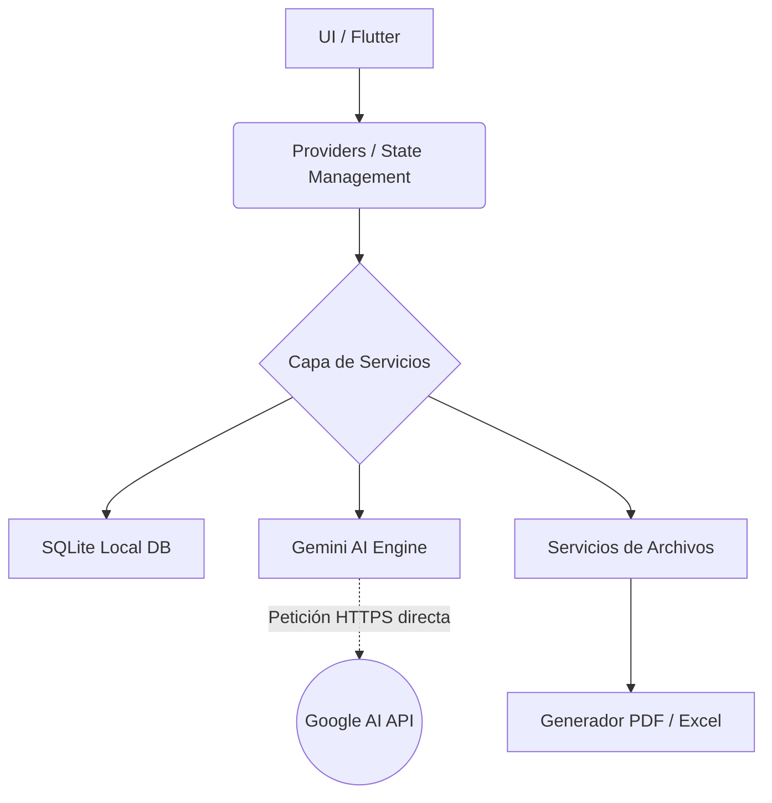

<p align="center">
  
</p>

<h1 align="center">Mochilalista App v2.0 (Offline-First)</h1>

<p align="center">
  <strong>Plataforma Inteligente para la Gestión de Ventas, CRM y Automatización de Inventarios.</strong>
</p>

<p align="center">
  
  
  
  
</p>

---

## 🚀 Resumen del Proyecto

**Mochilalista** es una solución empresarial integral diseñada para optimizar el flujo de trabajo de negocios minoristas y mayoristas. A partir de la versión 2.0, la aplicación ha evolucionado a una arquitectura **Offline-First**, centralizando la lógica, base de datos y procesamiento de Inteligencia Artificial directamente en el dispositivo móvil del usuario.

## ✨ Funcionalidades Estrella

* **🧠 Escaneo AI de Listas (On-Device):** Extracción automatizada de datos desde comprobantes físicos utilizando Google Gemini AI integrado directamente en la app.
* **🛒 Smart Inventory Matcher:** Algoritmo de similitud local (`string_similarity`) que vincula automáticamente los productos detectados por la IA con el catálogo SQLite.
* **📄 Generador de Cotizaciones PDF:** Creación instantánea de presupuestos profesionales en el dispositivo.
* **📲 Integración con WhatsApp CRM:** Flujo directo para enviar cotizaciones y realizar seguimiento.
* **💾 Respaldo y Restauración local:** Exportación de la base de datos a WhatsApp, Descargas Locales o Google Drive.

---

## 📸 Demostración Visual (UX/UI)

*(Próximamente se agregarán capturas reales de la aplicación)*

---

## 🧠 Arquitectura del Sistema (Offline-First)

Mochilalista ha evolucionado a una arquitectura **100% Offline-First**, eliminando dependencias de un backend externo para maximizar la velocidad y confiabilidad en dispositivos móviles.



<details>
<summary><b>Ver detalles de Arquitectura Offline-First</b></summary>

<br>

* **Base de Datos Local:** Implementación robusta con `sqflite` (SQLite) con 13 tablas relacionales para manejar usuarios, negocios, inventario, ventas y CRM localmente.
* **Gestión de Estado:** `Provider` para un flujo de datos predecible y performante en móviles.
* **Procesamiento AI:** El motor `AIExtractionService` se comunica directamente con Google Gemini usando una API key local (`.env`), eliminando la necesidad de un backend intermediario.
* **Gestión de Imágenes:** Almacenamiento local optimizado y preparado para futura integración con Cloudinary.

</details>

---

## 🛠️ Entorno de Desarrollo Local

### Pre-requisitos
* [Flutter SDK](https://docs.flutter.dev/get-started/install) (versión estable más reciente).
* Un dispositivo físico Android o Emulador.

### Pasos para levantar el proyecto

1. Clona este repositorio y navega a la carpeta de la app:
   ```bash
   git clone https://github.com/TU_USUARIO/mochilalista-app.git
   cd mochilalista-app/app_movil
   ```

2. Configura las variables de entorno:
   ```bash
   cp .env.example .env
   # Edita el archivo .env añadiendo tu GOOGLE_API_KEY
   ```

3. Instala las dependencias:
   ```bash
   flutter pub get
   ```

4. Ejecuta la aplicación:
   ```bash
   flutter run
   ```

---

*Nota histórica: En la v1.0, esta aplicación dependía de un backend en Python (FastAPI). Para maximizar el rendimiento y autonomía de los negocios, la v2.0 ha migrado completamente a una arquitectura standalone sin backend, donde todo el procesamiento, almacenamiento y lógica empresarial viven dentro del dispositivo.*
