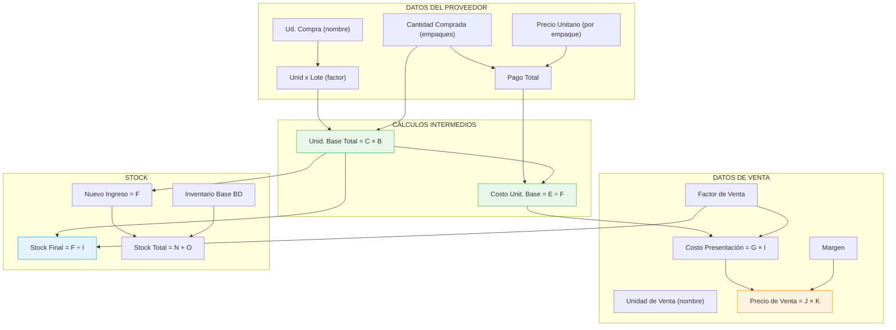

# 📋 Plan de Trabajo — Mejoras en el Modal Comparativo "Control de Variante"

> **Proyecto:** MochilaLista App  
> **Fecha:** 05 de Octubre, 2026 (Actualizado v2.0)  
> **Archivos principales afectados:** `comparative_update_modal.dart`, `scanner_matching_engine.dart`, `scanner_batch_saver.dart` y archivos `part` en `ui/`  
> **Objetivo:** Corregir errores críticos de lógica de cálculo, mejorar la fiabilidad del matching de productos, garantizar que los datos se guarden correctamente, rediseñar la interfaz del modal para ser eficiente y fácil de usar, y asegurar coherencia total entre todos los campos interrelacionados.

---

## 📑 Índice

1. [Resumen Ejecutivo](#1-resumen-ejecutivo)
2. [Análisis del Estado Actual](#2-análisis-del-estado-actual)
3. [Problemas Identificados](#3-problemas-identificados)
4. [Arquitectura de la Solución](#4-arquitectura-de-la-solución)
5. [Fases de Implementación](#5-fases-de-implementación)
   - [Fase 1: Corrección del bug crítico de duplicación del factor en Nuevo Ingreso](#fase-1-corrección-del-bug-crítico-de-duplicación-del-factor-en-nuevo-ingreso)
   - [Fase 2: Refactorización de la lógica central de cálculos](#fase-2-refactorización-de-la-lógica-central-de-cálculos)
   - [Fase 3: Recálculo en cascada al editar Nuevo Ingreso](#fase-3-recálculo-en-cascada-al-editar-nuevo-ingreso)
   - [Fase 4: Sistema de protección contra matching incorrecto](#fase-4-sistema-de-protección-contra-matching-incorrecto)
   - [Fase 5: Auditoría y corrección del flujo de guardado](#fase-5-auditoría-y-corrección-del-flujo-de-guardado)
   - [Fase 6: Reordenamiento de secciones del modal](#fase-6-reordenamiento-de-secciones-del-modal)
   - [Fase 7: Rediseño del componente _buildCompareRow](#fase-7-rediseño-del-componente-_buildcomparerow)
   - [Fase 8: Reestructuración de la sección Identidad](#fase-8-reestructuración-de-la-sección-identidad)
   - [Fase 9: Reestructuración de la sección Proveedor](#fase-9-reestructuración-de-la-sección-proveedor)
   - [Fase 10: Reestructuración de la sección Cálculo Financiero](#fase-10-reestructuración-de-la-sección-cálculo-financiero)
   - [Fase 11: Mejoras en la tarjeta de Nueva Variante](#fase-11-mejoras-en-la-tarjeta-de-nueva-variante)
   - [Fase 12: Pruebas de coherencia y validación final](#fase-12-pruebas-de-coherencia-y-validación-final)
6. [Mapa de Dependencias entre Campos](#6-mapa-de-dependencias-entre-campos)
7. [Archivos Afectados](#7-archivos-afectados)
8. [Riesgos y Consideraciones](#8-riesgos-y-consideraciones)

---

## 1. Resumen Ejecutivo

| # | Tipo | Mejora | Prioridad |
|---|------|--------|-----------|
| 1 | 🐛 Bug Crítico | **Duplicación del factor de venta en "Nuevo Ingreso"** — El campo toma el `stockFinal` (ya dividido por factor) y lo vuelve a dividir | 🔴 Crítica |
| 2 | 🐛 Bug | **Recálculo inconsistente en sección Proveedor** — Al cambiar `cantidad_ump` o `unidades_por_lote`, el precio unitario y total no se actualizan correctamente | 🔴 Alta |
| 3 | 🐛 Bug | **El costo de presentación no reacciona a cambios del factor de venta** — Cambiar de "Unidad" a "Par" no recalcula automáticamente el costo de presentación | 🔴 Alta |
| 4 | 🐛 Bug | **Falta recálculo en cascada al editar Nuevo Ingreso** — Editar el stock manualmente no actualiza costos, precios ni demás campos dependientes | 🔴 Alta |
| 5 | 🐛 Bug Grave | **Matching demasiado permisivo** — Productos como "Maxi Maní" y "Maxi Coffee Toffi" se vinculan por compartir una sola palabra "Maxi", causando guardado incorrecto | 🔴 Crítica |
| 6 | 🐛 Bug | **Inconsistencias en el guardado de datos** — El batch saver puede guardar datos incongruentes según los flags de update y la semántica de stockIngresanteOverride | 🔴 Alta |
| 7 | ✨ UI/UX | **Orden de secciones ineficiente** — El usuario busca primero el precio y stock, pero están al final del modal | 🟡 Media |
| 8 | ✨ UI/UX | **Sección Identidad demasiado estrecha** — El campo de nombre tiene un área de edición de solo ~120px | 🟡 Media |
| 9 | ✨ UI/UX | **Sistema de comparación en columnas consume demasiado espacio vertical** | 🟡 Media |
| 10 | ✨ UI/UX | **Secciones no retráctiles** — Excepto Identidad, las demás no son colapsables | 🟡 Media |
| 11 | ✨ Feature | **Falta opción de editar stock de unidad base total** en el modal | 🟡 Media |
| 12 | ✨ UI/UX | **Tarjeta de nueva variante desorganizada** — Datos de venta dispersos | 🟢 Baja |

---

## 2. Análisis del Estado Actual

### Archivos clave analizados

| Archivo | Rol |
|---------|-----|
| [`comparative_update_modal.dart`](file:///c:/Users/vjuli/Documents/mochilalista-app/app_movil/lib/features/scanner/widgets/staging/comparative_modal/comparative_update_modal.dart) | Widget principal del modal. Contiene el state, controladores, y toda la lógica de `_onPurchaseDataChanged`, `_recalcularModal`, `_applyChanges` |
| [`modal_variant_cards.dart`](file:///c:/Users/vjuli/Documents/mochilalista-app/app_movil/lib/features/scanner/widgets/staging/comparative_modal/ui/modal_variant_cards.dart) | Tarjetas horizontales de variantes existentes + el widget genérico `_buildCompareRow` |
| [`modal_purchase_section.dart`](file:///c:/Users/vjuli/Documents/mochilalista-app/app_movil/lib/features/scanner/widgets/staging/comparative_modal/ui/modal_purchase_section.dart) | Sección "Comparativa de Compra (Proveedor)" — ud. compra, unid x lote, cantidad, precio unit., pago total |
| [`modal_sale_section.dart`](file:///c:/Users/vjuli/Documents/mochilalista-app/app_movil/lib/features/scanner/widgets/staging/comparative_modal/ui/modal_sale_section.dart) | Sección "Cálculo Financiero" — unidad venta, factor, costo presentación, margen, precio venta |
| [`modal_stock_section.dart`](file:///c:/Users/vjuli/Documents/mochilalista-app/app_movil/lib/features/scanner/widgets/staging/comparative_modal/ui/modal_stock_section.dart) | Sección "Gestión de Stock" — inventario base, nuevo ingreso, sumar/reemplazar, stock total resultante |
| [`modal_discount_section.dart`](file:///c:/Users/vjuli/Documents/mochilalista-app/app_movil/lib/features/scanner/widgets/staging/comparative_modal/ui/modal_discount_section.dart) | Sección de promociones/descuentos |
| [`scanner_models.dart`](file:///c:/Users/vjuli/Documents/mochilalista-app/app_movil/lib/features/scanner/models/scanner_models.dart) | Modelo `StagingVariant` con campos, snapshots, y flags de update |
| [`scanner_cost_engine.dart`](file:///c:/Users/vjuli/Documents/mochilalista-app/app_movil/lib/features/scanner/services/scanner_cost_engine.dart) | Motor centralizado de cálculos financieros |
| [`scanner_matching_engine.dart`](file:///c:/Users/vjuli/Documents/mochilalista-app/app_movil/lib/features/scanner/services/scanner_matching_engine.dart) | Motor de matching — `_calculateSimilarity()`, scoring por tokens, lematización |
| [`scanner_batch_saver.dart`](file:///c:/Users/vjuli/Documents/mochilalista-app/app_movil/lib/features/scanner/services/scanner_batch_saver.dart) | Transacción atómica de guardado masivo en SQLite |
| [`scanner_provider.dart`](file:///c:/Users/vjuli/Documents/mochilalista-app/app_movil/lib/features/scanner/providers/scanner_provider.dart) | Coordinador del flujo: `switchVariantLink`, `switchVariantToNew`, `manualLinkProductGroup`, `createLeftoverVariant` |
| [`variant_editor_row.dart`](file:///c:/Users/vjuli/Documents/mochilalista-app/app_movil/lib/features/scanner/widgets/staging/variant_editor_row.dart) | Tarjeta/editor de variante en el staging (fuera del modal) |
| [`spanish_lemmatizer.dart`](file:///c:/Users/vjuli/Documents/mochilalista-app/app_movil/lib/features/scanner/services/spanish_lemmatizer.dart) | Lematización y distancia de Levenshtein para matching |

### Estructura actual del modal

El modal `ComparativeUpdateModal` se estructura verticalmente así:
1. **Header** — Título "Control de Variante/Creación" + botón restaurar/cerrar
2. **Info Box** — Categoría, marca, nombre padre, variante seleccionada
3. **Variant Cards** — Lista horizontal de variantes disponibles + "Crear Nueva"
4. **Banner de Discrepancia** — Si la unidad de venta difiere entre factura y BD
5. **Info Banner** — Texto informativo sobre cómo funciona la comparación
6. **Sección Identidad** — (Retráctil) Nombre, Marca, Código de Barras
7. **Sección Proveedor** — Ud. Compra, Unid x Lote, Cantidad, Precio Unit., Pago Total
8. **Sección Cálculo Financiero** — U. Venta, Factor V., SmartUnitSelector, Resumen, Costo Pres., Margen, P. Venta
9. **Sección Gestión de Stock** — Inventario Base, Nuevo Ingreso, Sumar/Reemplazar, Stock Total Resultante
10. **Sección Descuentos** — (Solo si tiene promo activa en BD)
11. **Botón "GUARDAR DECISIÓN"**

---

## 3. Problemas Identificados

### 🐛 BUG CRÍTICO #1: Duplicación del factor de venta en "Nuevo Ingreso"

**Ubicación:** [`modal_stock_section.dart` L49-57](file:///c:/Users/vjuli/Documents/mochilalista-app/app_movil/lib/features/scanner/widgets/staging/comparative_modal/ui/modal_stock_section.dart#L49-L57) y [`comparative_update_modal.dart` L209-221](file:///c:/Users/vjuli/Documents/mochilalista-app/app_movil/lib/features/scanner/widgets/staging/comparative_modal/comparative_update_modal.dart#L209-L221)

**Flujo del error (ejemplo con Par x2, compra 12 unidades):**

```
PASO 1 — _onPurchaseDataChanged() (línea 215):
  factor = 2 (Par)
  cantidadUMP = 1 (compró 1 empaque)
  unidLote = 12 (el empaque trae 12 unidades)
  newStock = (1 * 12) / 2 = 6  ← 6 Pares ✅ CORRECTO aquí
  _stockIngresanteCtrl.text = "6"  ← ⚠️ ESTE VALOR YA ESTÁ EN UNIDADES DE VENTA (Pares)

PASO 2 — _buildStockManagementRow() (línea 56):
  stockCalculado = (cantComprada * unidLote) / factor
              = (1 * 12) / 2 = 6  ← Recalcula, obtiene 6 ✅
  
  PERO también lee: stockIngresante = int.tryParse(_stockIngresanteCtrl.text) = 6
  
  ← Parece correcto, pero el problema real está en la SEMÁNTICA:
     _stockIngresanteCtrl contiene "6" (que son 6 PARES = 12 unidades base)
     pero la sección de stock MUESTRA "6" como Nuevo Ingreso
     y abajo muestra "3 Unidad(s)" (línea 122: stockIngresante ~/ factor = 6 ~/ 2 = 3)
     
     ¡Esto es INCORRECTO! Dice que entran 3 pares cuando realmente entran 6 pares.
```

**Causa raíz:** En `_onPurchaseDataChanged()` (línea 215 del modal), el `newStock` se calcula así:
```dart
int newStock = factor > 0 ? ((cantidadUMP * unidLote) / factor).toInt() : 0;
```

Esto produce el stock **en unidades de venta** (6 pares). Pero luego en `_buildStockManagementRow()`, ese valor "6" se trata como si fuera **en unidades base**, y se le vuelve a aplicar la conversión `stockIngresante ~/ factor` para mostrar la equivalencia, produciendo `6 / 2 = 3`.

**El texto bajo "Nuevo Ingreso" dice "3 Unidad(s)" cuando debería decir "6 Par(s)"** — como se ve claramente en la foto proporcionada donde "Inventario Base: 12, 6 Unidad(s)" y "Nuevo Ingreso: 6, 3 Unidad(s)".

**Impacto:** El stock que se guarda estará dividido de más. Si el usuario compró 12 unidades para vender en pares, el sistema guardará 6 como "nuevo ingreso" (que el usuario puede interpretar como 6 unidades base), pero al sumarlo al existente mostrará "Stock Total Resultante: 9 Unidad(s) (18 unidades base)" — lo cual es completamente incoherente porque solo compró 12 unidades, no 18.

---

### 🐛 BUG #2: Inconsistencia en recálculo de precios de proveedor

**Ubicación:** [`comparative_update_modal.dart` L186-224](file:///c:/Users/vjuli/Documents/mochilalista-app/app_movil/lib/features/scanner/widgets/staging/comparative_modal/comparative_update_modal.dart#L186-L224)

**Problema:** `_onPurchaseDataChanged()` solo tiene dos modos: `fromTotal` (recalcula precio unitario desde el total) o `!fromTotal` (recalcula total desde cantidad × precio). Pero no contempla el escenario donde el usuario cambia:
- **Solo `unidades_por_lote`** → Debería recalcular el costo unitario base (porque ahora hay más/menos unidades por el mismo pago total) y en cascada actualizar costo de presentación.
- **Solo `cantidad_ump`** → Misma lógica: cambia la cantidad de empaques, el total permanece, el costo unitario cambia.

**Actualmente:** Al cambiar `unidLote` o `cantidadUMP`, el sistema recalcula `pagoTotal = cantidadUMP * precioUMP` (línea 199), pero `precioUMP` es el precio **por empaque**, no por unidad base. Esto genera que si cambias las unidades por lote, el sistema recalcule el total como si el precio por empaque no cambiara, cuando en realidad debería mantenerse el total y recalcular el precio unitario.

---

### 🐛 BUG #3: Falta de recálculo del costo de presentación al cambiar factor de venta

**Ubicación:** `_onUnidadVentaChanged()` en la línea 162 llama a `_onPurchaseDataChanged(fromTotal: false)`, lo cual recalcula el `pagoTotal` innecesariamente (multiplicando cantidadUMP × precioUMP otra vez) en lugar de simplemente recalcular el costo de presentación y stock.

---

### 🐛 BUG #4: Semántica ambigua de `_stockIngresanteCtrl`

**Problema de diseño:** El controlador `_stockIngresanteCtrl` almacena un valor cuya unidad (base vs presentación) cambia según el contexto:
- En `_onPurchaseDataChanged()`: se guarda en **unidades de venta** (dividido por factor)
- En `_buildStockManagementRow()`: se lee como **unidades base** y se vuelve a dividir
- En `_buildNewVariantStockRow()`: se lee directamente sin conversión
- En `_applyChanges()`: se compara con `calculatedStock` que está en **unidades de venta**

**Esta ambigüedad es la raíz de la duplicación del cálculo del factor.**

---

### 🐛 BUG #5: Falta de recálculo en cascada al editar "Nuevo Ingreso"

**Ubicación:** [`modal_stock_section.dart` L117](file:///c:/Users/vjuli/Documents/mochilalista-app/app_movil/lib/features/scanner/widgets/staging/comparative_modal/ui/modal_stock_section.dart#L117)

**Problema:** Cuando el usuario edita manualmente el campo "Nuevo Ingreso" en la sección de Gestión de Stock, el único efecto es `updateState(() {})` (línea 117), que solo redibuja el widget. **No se actualiza ningún campo dependiente:**

- No se recalcula el `Costo Unitario Base` (debería ser `pagoTotal / nuevoStock`)
- No se recalcula el `Costo de Presentación` (debería ser `costoUnitBase × factor`)
- No se recalcula el `Precio de Venta` (debería ser `costoPres × margen`)
- No se recalcula la `Cantidad de Empaques` comprada (debería ser `nuevoStock / unidPorLote`)

**Impacto:** Si el usuario recibió menos unidades de las esperadas (por ejemplo, 10 en vez de 12), al editarlo manualmente el costo unitario sigue calculándose con 12 unidades, haciendo que el costo sea artificialmente bajo y el precio de venta quede mal calculado. El usuario queda con datos financieramente incorrectos sin saberlo.

---

### 🐛 BUG GRAVE #6: Matching demasiado permisivo — Falsos positivos peligrosos

**Ubicación:** [`scanner_matching_engine.dart` L64-101, L388-435](file:///c:/Users/vjuli/Documents/mochilalista-app/app_movil/lib/features/scanner/services/scanner_matching_engine.dart#L64-L101)

**Problema reportado por usuarios:** Productos como "Chocolate Maxi Maní" y "Maxi Coffee Toffi" se vinculan automáticamente porque comparten la palabra "Maxi". El sistema les asigna un score suficiente para hacer `MATCH_SUGERIDO` y el usuario, por apuro, guarda los datos sin revisar, provocando que se actualice un producto completamente diferente.

**Análisis detallado del problema en el matching:**

El matching busca tokens en la BD con `LIKE` (líneas 75-88):
```dart
for (var i = 0; i < originalTokens.length; i++) {
  String originalToken = originalTokens[i];
  String lemmatizedToken = SpanishLemmatizer.lemmatize(originalToken);
  whereClause += ' OR p.nombre LIKE ? OR p.nombre LIKE ?';
  whereArgs.add('%$originalToken%');
  whereArgs.add('%$lemmatizedToken%');
}
```

**Este `OR` es el problema:** Basta que **UNA SOLA** palabra del nombre coincida (aunque sea parcialmente via `LIKE '%..%'`) para que el producto aparezca como candidato. Luego en el scoring (líneas 108-230):

1. `_calculateSimilarity()` compara token por token con Levenshtein, pero con umbral de `0.75` por token individual (línea 428)
2. El score final se promedia: `(score / tokensA.length) * 100`
3. Un producto se vincula si el score total supera `40` (línea 232)

**Ejemplo del problema:**
```
Factura: "CHOCOLATE MAXI MANI" (3 tokens)
BD:      "MAXI COFFE TOFFI"   (3 tokens)

Token matching:
- "chocolate" vs "maxi"  → 0.0 (no coincide)
- "chocolate" vs "coffe" → 0.0 (no coincide)
- "chocolate" vs "toffi" → 0.0 (no coincide)
- "maxi" vs "maxi"       → 1.0 ✅ coincide!
- "maxi" vs "coffe"      → 0.0
- "maxi" vs "toffi"      → 0.0
- "mani" vs "maxi"       → 0.75 ← ¡Levenshtein lo considera similar! (1 edit)
- "mani" vs "coffe"      → 0.0
- "mani" vs "toffi"      → 0.0

Score = (0 + 1.0 + 0.75) / 3 * 100 = 58.3
El score de nombre aporta: 58.3 * 0.50 = 29.15
Basta con un boost de marca (15) o unidad (10-15) para superar el umbral de 40.
```

**El sistema vincula estos productos porque "maxi" == "maxi" y "mani" ≈ "maxi" por Levenshtein, a pesar de que son productos completamente diferentes.**

---

### 🐛 BUG #7: Inconsistencias en el flujo de guardado (Batch Saver)

**Ubicación:** [`scanner_batch_saver.dart`](file:///c:/Users/vjuli/Documents/mochilalista-app/app_movil/lib/features/scanner/services/scanner_batch_saver.dart)

**Problemas encontrados al auditar el guardado:**

**a) El stock se guarda usando `cantidadSumar` que puede ser ambiguo (L131-133):**
```dart
int cantidadSumar =
    v.stockIngresanteOverride ??
    (v.cantidadUmpComprada * v.unidadesPorLote).toInt();
```
Si `stockIngresanteOverride` fue guardado en "unidades de venta" (por el Bug #1), el stock en la BD será incorrecto. Debe asegurarse que siempre sea en unidades base.

**b) La unidad de venta se guarda solo si `updateCosto || updatePrecio` (L170-173):**
```dart
if (v.updateCosto || v.updatePrecio) {
  updateData['unidad_venta'] = v.unidadVenta;
  updateData['unidades_por_venta'] = v.unidadesPorVenta;
}
```
**Problema:** Si el usuario cambió la unidad de venta pero NO el costo ni el precio (porque quiere mantener los mismos precios), la unidad de venta **NO se guarda**. El producto queda con la unidad vieja en la BD pero con el stock calculado con la unidad nueva, causando incongruencia.

**c) Los datos de compra del proveedor se guardan con flags individuales (L155-167):**
```dart
if (v.updateUmpCompra) updateData['ump_compra'] = v.umpCompra;
if (v.updatePrecioUmp) updateData['precio_ump_proveedor'] = v.precioUmpProveedor;
if (v.updateCantidadUmp) updateData['cantidad_ump_comprada'] = v.cantidadUmpComprada;
if (v.updatePagoTotal) updateData['total_pago_lote'] = v.totalPagoLote;
if (v.updateUnidLote) updateData['unidades_por_lote'] = v.unidadesPorLote;
```
**Problema:** Los datos de compra son interdependientes (`pagoTotal = cantidad × precioUmp`). Si el usuario cambia `cantidad` pero no marca `precioUmp`, se guarda la nueva cantidad con el viejo precio unitario — pero el pago total puede haber cambiado también sin marcarse. Esto deja datos financieros inconsistentes en la BD.

**d) El `costo_unitario_calculado` que se guarda (L176-178):**
```dart
if (v.updateCosto) {
  updateData['costo_unitario_calculado'] = v.costoUnitarioSugerido;
}
```
El valor `costoUnitarioSugerido` en el modelo es el **costo de presentación** (costo base × factor de venta), NO el costo unitario individual. El nombre del campo en la BD sugiere un costo unitario base, pero el código guarda el costo de presentación. Hay que verificar que esto sea intencional y consistente con el resto de la app.

**e) Para variantes nuevas, se guarda el stock como `cantidadSumar` directamente (L266):**
```dart
'stock_actual': cantidadSumar,
```
Pero `cantidadSumar` se calcula como `cantidadUmpComprada * unidadesPorLote` (unidades base). El `stock_actual` en la BD de presentaciones — ¿debería ser en unidades base o en unidades de venta? Esto debe ser consistente con cómo se lee el stock en el catálogo y en el punto de venta.

**f) El `stock_ledger` registra la cantidad como `stockDiff` (L233-248):**
```dart
int stockDiff = (updateData['stock_actual'] as int) - stockActual;
await txn.insert('stock_ledger', {
  'cantidad': stockDiff,
  'costo_unitario': updateData['costo_unitario_calculado'] ?? oldP.first['costo_unitario_calculado'],
});
```
El `costo_unitario` en el ledger es el costo de presentación (por el punto d), no el costo unitario base. Esto puede causar problemas si el sistema intenta reconstruir el costo total desde el ledger.

---

### ✨ Problemas de UI/UX identificados

#### a) `_buildCompareRow` — Columnas estrechas

El widget [`_buildCompareRow` L125-183](file:///c:/Users/vjuli/Documents/mochilalista-app/app_movil/lib/features/scanner/widgets/staging/comparative_modal/ui/modal_variant_cards.dart#L125-L183) usa un layout `Row` con:
- `Checkbox` (izquierda)
- Columna "Actual (BD)" con `flex: 4`
- Flecha `→`
- Columna "Nuevo (A Guardar)" con `flex: 5` y un `TextField` de `height: 34`

**Problema:** En pantallas de celular, esto deja apenas ~100-120px para el texto del nombre, marca o código de barras. Los textos largos se truncan con `maxLines: 2, overflow: TextOverflow.ellipsis`.

#### b) Cada dato en su propia fila completa

Datos como "U. Venta" y "Factor V." podrían estar en la misma fila horizontal pero actualmente cada uno tiene su propio `_buildCompareRow` completo, consumiendo ~80px de altura cada uno.

#### c) Secciones no colapsables

Solo la sección "Identidad" es retráctil. Las secciones de Proveedor, Cálculo Financiero y Stock son siempre visibles completamente, obligando al usuario a hacer mucho scroll.

#### d) Falta edición de stock de unidad base total

En el modal, el campo "Unid. Base Total" es solo informativo (readonly). El usuario no puede editarlo directamente.

#### e) Orden de secciones ineficiente

El orden actual muestra primero la Identidad (nombre, marca), luego el Proveedor (compra), luego el Cálculo Financiero (precios) y finalmente el Stock. Pero según el feedback de usuarios, **lo primero que quieren verificar es el precio de venta y cuánto stock ingresará**, no los datos de identidad ni de compra que generalmente ya vienen correctos de la factura.

---

## 4. Arquitectura de la Solución

### 4.1 Principio central: **Unidades Base como fuente de verdad**

Para eliminar la ambigüedad del Bug #1, todo el sistema usará **unidades base** como la métrica canónica interna:

```
Unidades Base Total = cantidadUmpComprada × unidadesPorLote
Stock en Unidad de Venta = Unidades Base Total ÷ factor_venta
```

El controlador `_stockIngresanteCtrl` SIEMPRE contendrá **unidades base**, nunca unidades de venta. Las conversiones a unidades de venta solo se harán para **visualización**.

### 4.2 Cadena de recálculo unificada

Se creará un sistema de recálculo por "origen del cambio" más granular. Cuando un campo cambia, **toda la cadena** se propaga automáticamente:

```
                    ┌─ Ud. Compra (nombre) → resuelve factor lote
                    ├─ Unid x Lote (factor lote)
 DATOS PROVEEDOR ── ├─ Cantidad Comprada (empaques)    ──┐
                    ├─ Precio Unitario (por empaque)     │
                    └─ Pago Total (cantidad × precio)    │
                                                         ▼
                              ┌───── Unid. Base Total ─────┐
                              │ = cantComprada × unidLote  │
                              └──────────┬─────────────────┘
                                         │
                    ┌────────────────────▼────────────────────┐
                    │  Costo Unitario Base                      │
                    │  = pagoTotal / unidBasesTotal             │
                    │                                          │
                    │  Costo Presentación                      │
                    │  = costoUnitBase × factorVenta            │
                    └────────────────────┬─────────────────────┘
                                         │
              ┌──────────────────────────▼──────────────────────┐
              │  Precio Venta = costoPresentación × margen      │
              │  Margen = precioVenta / costoPresentación        │
              └──────────────────────────┬──────────────────────┘
                                         │
              ┌──────────────────────────▼──────────────────────┐
              │  Stock Final (venta) = unidBasesTotal ÷ factor   │
              │  Nuevo Ingreso (base) = unidBasesTotal           │
              │  Stock Total = stockBD + nuevoIngreso            │
              └─────────────────────────────────────────────────┘
```

**Cuando el usuario edita "Nuevo Ingreso" (unidades base), la cadena se invierte:**
```
Nuevo Ingreso editado → stockIngresanteOverride = nuevoValor
  → cantidadUmp = nuevoValor / unidPorLote (recalcular hacia atrás)
  → costoUnitBase = pagoTotal / nuevoValor (pago se mantiene fijo)
  → costoPresentación = costoUnitBase × factor
  → precioVenta = costoPres × margen (margen se mantiene fijo)
  → stockFinal = nuevoValor ÷ factorVenta
```

### 4.3 Nuevo diseño de `_buildCompareRow` → Diseño compacto

En lugar del layout actual de dos columnas lado a lado:

```
[✓] Nombre Específico
    Actual (BD)          →  Nuevo (A Guardar)
    Papel A4                [_Papel A4 Rojo__]
```

Se usará un diseño **apilado vertical compacto**:

```
┌──────────────────────────────────────────────┐
│ [✓] Nombre Específico                        │
│     BD: Papel A4                             │
│     [_________Papel A4 Rojo_________________]│
└──────────────────────────────────────────────┘
```

### 4.4 Secciones retráctiles con resumen fijo

Cada sección tendrá:
- Un **header siempre visible** con: icono + título + resumen de valores actuales/seleccionados + chevron de colapso
- Un **body colapsable** con los campos de edición y comparación

### 4.5 Sistema de protección contra matching incorrecto

Se implementará un sistema multicapa para proteger al usuario contra falsos positivos:

1. **Capa 1 — Motor de matching mejorado:** Subir el umbral de confianza y penalizar matches de una sola palabra.
2. **Capa 2 — Banner de advertencia visual:** Cuando el score está en zona intermedia (40-65), mostrar una advertencia clara.
3. **Capa 3 — Indicador de confianza por colores:** Rojo/Naranja/Verde en las tarjetas de variantes.

---

## 5. Fases de Implementación

---

### Fase 1: Corrección del bug crítico de duplicación del factor en Nuevo Ingreso

> **Prioridad:** 🔴 Crítica  
> **Archivos:** `comparative_update_modal.dart`, `modal_stock_section.dart`

#### Qué se hará:
1. **Estandarizar `_stockIngresanteCtrl` a unidades base** — El valor almacenado será SIEMPRE `cantidadUmp × unidadesPorLote` (o un override manual que también será en unidades base).

2. **Corregir `_onPurchaseDataChanged()` línea 215:**
   ```dart
   // ANTES (INCORRECTO - divide por factor):
   int newStock = factor > 0 ? ((cantidadUMP * unidLote) / factor).toInt() : 0;
   
   // DESPUÉS (CORRECTO - unidades base sin dividir):
   int newStock = (cantidadUMP * unidLote).toInt();
   ```

3. **Corregir `_buildStockManagementRow()`** para que muestre correctamente:
   - "Nuevo Ingreso" = valor en unidades base (editable)  
   - Debajo: `"X Par(s)"` = unidades base ÷ factor (solo visual)

4. **Corregir `_applyChanges()` línea 281** para que el `calculatedStock` sea en unidades base:
   ```dart
   // ANTES (en unidades de venta):
   int calculatedStock = factor > 0 ? ((cantUmp * unLote) / factor).toInt() : 0;
   
   // DESPUÉS (en unidades base):
   int calculatedStock = (cantUmp * unLote).toInt();
   ```

5. **Corregir `_leftoverSuelto`** para que lea `_stockIngresanteCtrl` como unidades base correctamente.

#### Prueba de validación:
- Comprar 12 unidades, vender por Par (x2)
- `Unid. Base Total` = 12
- `Stock Final (Par)` = 6
- En Gestión de Stock: `Nuevo Ingreso` = 12 (unidades base), debajo "6 Par(es)"
- `Stock Total Resultante` = 6 Par(es) (12 unidades base) — si inventario base era 0

---

### Fase 2: Refactorización de la lógica central de cálculos

> **Prioridad:** 🔴 Alta  
> **Archivos:** `comparative_update_modal.dart`

#### Qué se hará:

1. **Reescribir `_onPurchaseDataChanged()`** con sistema de "origen del cambio" más claro:

   ```dart
   enum ChangeOrigin {
     umpName,        // Cambió el nombre de la unidad de compra
     umpFactor,      // Cambió las unidades por lote
     cantidadUmp,    // Cambió la cantidad comprada de empaques
     precioUmp,      // Cambió el precio por empaque
     pagoTotal,      // Cambió el pago total
     factorVenta,    // Cambió unidad de venta o su factor
     costoPresent,   // Cambió el costo de presentación manualmente
     margen,         // Cambió el margen
     precioVenta,    // Cambió el precio de venta
     stockBase,      // Cambió el stock de unidad base manualmente
   }
   ```

2. **Implementar reglas de recálculo por origen:**

   | Origen del cambio | Qué se mantiene fijo | Qué se recalcula |
   |---|---|---|
   | `cantidadUmp` | Precio UMP, Pago Total | → Costo Unit. Base, Costo Pres., Precio Venta, Stock |
   | `precioUmp` | Cantidad UMP | → Pago Total, Costo Unit. Base, Costo Pres., Precio Venta |
   | `pagoTotal` | Cantidad UMP | → Precio UMP, Costo Unit. Base, Costo Pres., Precio Venta |
   | `umpFactor` | Pago Total, Cantidad UMP | → Costo Unit. Base, Costo Pres., Precio Venta, Stock |
   | `factorVenta` | Todo de compra, Costo Unit. Base | → Costo Pres., Stock Final, Precio Venta |
   | `margen` | Costo Pres. | → Precio Venta |
   | `precioVenta` | Costo Pres. | → Margen |
   | `stockBase` | Pago Total | → Cantidad UMP, Costo Unit. Base, Costo Pres., Precio Venta |
   | `costoPresent` | Factor Venta | → Precio Venta (vía margen), Pago Total ← backtrack |

3. **Separar `_onPurchaseDataChanged` del cálculo de precios de venta**:
   - `_recalculateFromPurchase(ChangeOrigin origin)` — Recalcula toda la cadena desde datos de compra
   - `_recalculateFromSale(ChangeOrigin origin)` — Solo recalcula margen/precio
   - `_recalculateStock()` — Recalcula stock y sus derivados

4. **Agregar recálculo cuando cambia el factor de venta:** Actualmente `_onUnidadVentaChanged()` llama a `_onPurchaseDataChanged(fromTotal: false)` lo cual recalcula el total de pago innecesariamente. En su lugar, debería llamar a una función que solo recalcule:
   - Costo de presentación = costoUnitBase × nuevoFactor
   - Precio de venta = costoPres × margen
   - Stock final = unidBasesTotal ÷ nuevoFactor

---

### Fase 3: Recálculo en cascada al editar Nuevo Ingreso

> **Prioridad:** 🔴 Alta  
> **Archivos:** `comparative_update_modal.dart`, `modal_stock_section.dart`

#### Qué se hará:

1. **En `_buildStockManagementRow()`**, cambiar el `onChanged` del campo "Nuevo Ingreso" de:
   ```dart
   // ANTES:
   onChanged: (_) => updateState(() {}),
   
   // DESPUÉS:
   onChanged: (_) => _onStockBaseManualEdit(),
   ```

2. **Crear nueva función `_onStockBaseManualEdit()`** que:
   ```dart
   void _onStockBaseManualEdit() {
     int nuevoStockBase = int.tryParse(_stockIngresanteCtrl.text) ?? 0;
     double pagoTotal = double.tryParse(_pagoTotalCtrl.text) ?? 0.0;
     int unidLote = int.tryParse(_unidLoteCtrl.text) ?? 1;
     int factor = int.tryParse(_uVentaFactorCtrl.text) ?? 1;
     
     // 1. Marcar override
     widget.variant.stockIngresanteOverride = nuevoStockBase;
     
     // 2. Recalcular cantidad de empaques hacia atrás
     if (unidLote > 0) {
       double nuevaCantidad = nuevoStockBase / unidLote;
       _cantidadUmpCtrl.text = nuevaCantidad.toStringAsFixed(2);
     }
     
     // 3. Recalcular costo unitario base (pago total se mantiene)
     double costoUnitBase = nuevoStockBase > 0 ? pagoTotal / nuevoStockBase : 0;
     
     // 4. Recalcular costo de presentación
     double costoPres = costoUnitBase * factor;
     _costoCtrl.text = costoPres.toStringAsFixed(2);
     
     // 5. Recalcular precio de venta (margen se mantiene)
     _recalcularModal(fromMargen: true);
     
     updateState(() {});
   }
   ```

3. **En el mismo campo, agregar el mismo recálculo para `_buildNewVariantStockRow()`** — La variante nueva también debe recalcular al editar el stock.

4. **Asegurar coherencia bidireccional:** Si después de editar el stock el usuario edita otro campo (por ejemplo, cantidad de empaques), el `stockIngresanteOverride` se debe resetear a `null` y volver al cálculo automático.

---

### Fase 4: Sistema de protección contra matching incorrecto

> **Prioridad:** 🔴 Crítica  
> **Archivos:** `scanner_matching_engine.dart`, `scanner_provider.dart`, `variant_editor_row.dart`, `modal_variant_cards.dart`

#### Análisis de propuestas:

| Propuesta | Descripción | Pros | Contras |
|-----------|-------------|------|---------|
| **A) Matching estricto** | Subir umbral de 40 → 60. Requerir que al menos 60% de los tokens del nombre coincidan (no solo 1) | Elimina casi todos los falsos positivos | Puede no vincular productos que sí existen pero tienen nombre abreviado ("Choc. Maxi" vs "Chocolate Maxi Maní") |
| **B) Advertencia visual** | Mantener el matching permisivo pero agregar un banner de advertencia cuando el score < 65, indicando "Similitud parcial - Revise antes de guardar" | No pierde productos legítimos; educa al usuario | El usuario puede ignorar la advertencia si tiene prisa |
| **C) Sistema híbrido (Recomendado)** | Combinar A y B: mejorar el scoring penalizando matches de 1 solo token, Y agregar advertencia visual con semáforo de confianza | Mejor de ambos mundos; protege sin perder flexibilidad | Más complejo de implementar |

#### Qué se hará (Propuesta C — Sistema Híbrido):

**1. Mejoras al motor de matching (`scanner_matching_engine.dart`):**

   a) **Penalización por coincidencia de 1 solo token:**
   ```dart
   // En _calculateSimilarity(), después de calcular el score por tokens:
   int matchingTokenCount = tokensA.where((ta) {
     return tokensB.any((tb) => 
       SpanishLemmatizer.calculateSimilarity(
         SpanishLemmatizer.lemmatize(ta), 
         SpanishLemmatizer.lemmatize(tb)
       ) >= 0.75
     );
   }).length;
   
   // Si solo 1 token coincide y hay 3+ tokens, penalizar fuertemente
   if (matchingTokenCount <= 1 && tokensA.length >= 3) {
     return (score * 0.4).toInt(); // Reducir a 40% del score
   }
   // Si solo 1 token coincide de 2, penalizar moderadamente
   if (matchingTokenCount <= 1 && tokensA.length == 2) {
     return (score * 0.6).toInt(); // Reducir a 60%
   }
   ```

   b) **Subir el umbral mínimo de 40 → 50** para `MATCH_SUGERIDO` (línea 232):
   ```dart
   if (bestCandidate != null && highestScore >= 50) { // era 40
   ```

   c) **Agregar "ratio de cobertura de tokens"** al scoring:
   ```dart
   // Bonus por cobertura: qué porcentaje de tokens del input coinciden
   double coverage = matchingTokenCount / tokensA.length;
   score += (coverage * 15).toInt(); // Hasta 15 puntos extra por cobertura completa
   ```

**2. Agregar campo `confianza` al modelo para la UI:**

   El `MatchResult` ya tiene `confianza`, pero necesitamos que sea más semántico:
   - `confianza >= 75` → 🟢 Verde: "Alta confianza" — match seguro
   - `confianza 50-74` → 🟡 Amarillo: "Confianza media" — revisar antes de guardar
   - `confianza < 50` → 🔴 Rojo: "Baja confianza" — probablemente NO es el mismo producto

**3. Banner de advertencia en la UI del staging (`variant_editor_row.dart`):**

   Cuando la confianza del `matchProducto` o `matchPresentacion` está en zona amarilla (50-74), mostrar:
   ```
   ┌─────────────────────────────────────────────────────────┐
   │ ⚠️ SIMILITUD PARCIAL — Confianza: 58%                  │
   │                                                         │
   │ El sistema detectó similitudes entre:                    │
   │ 📄 Factura: "CHOCOLATE MAXI MANI"                      │
   │ 📦 Inventario: "MAXI COFFE TOFFI"                      │
   │                                                         │
   │ Esto puede NO ser el mismo producto. Verifique antes    │
   │ de guardar.                                              │
   │                                                         │
   │ [Sí, es correcto ✓]  [No, desvincular ✗]              │
   └─────────────────────────────────────────────────────────┘
   ```

**4. Indicador visual de confianza en las tarjetas de variantes del modal:**

   En `_buildVariantCards()`, agregar un indicador de color en cada tarjeta:
   ```dart
   // Punto de color según confianza
   Container(
     width: 8, height: 8,
     decoration: BoxDecoration(
       shape: BoxShape.circle,
       color: confianza >= 75 ? Colors.green 
            : confianza >= 50 ? Colors.orange 
            : Colors.red,
     ),
   )
   ```

---

### Fase 5: Auditoría y corrección del flujo de guardado

> **Prioridad:** 🔴 Alta  
> **Archivos:** `scanner_batch_saver.dart`, `scanner_models.dart`

#### Qué se hará:

**1. Estandarizar la semántica de `stockIngresanteOverride`:**
   - Definir explícitamente en un comentario/doc que `stockIngresanteOverride` SIEMPRE es en unidades base
   - En `_applyChanges()` del modal, asegurar que se guarde en unidades base
   - En `executeBatchSave()`, `cantidadSumar` ya toma `stockIngresanteOverride ?? (cantUmp * unidLote)`, que será consistente si ambos son en unidades base

**2. Corregir el guardado de unidad de venta (L170-173):**
   ```dart
   // ANTES:
   if (v.updateCosto || v.updatePrecio) {
     updateData['unidad_venta'] = v.unidadVenta;
     updateData['unidades_por_venta'] = v.unidadesPorVenta;
   }
   
   // DESPUÉS — Agregar flag dedicado para unidad de venta:
   if (v.updateUnidadVenta) {
     updateData['unidad_venta'] = v.unidadVenta;
     updateData['unidades_por_venta'] = v.unidadesPorVenta;
   }
   // Y también si se actualizan costos/precios (porque dependen de la unidad)
   if (v.updateCosto || v.updatePrecio) {
     updateData['unidad_venta'] ??= v.unidadVenta;
     updateData['unidades_por_venta'] ??= v.unidadesPorVenta;
   }
   ```

**3. Agrupar los datos de compra como bloque atómico:**
   ```dart
   // DESPUÉS — Si cualquier dato de compra cambió, guardar TODOS para mantener coherencia:
   if (v.updateDatosCompra) {
     updateData['ump_compra'] = v.umpCompra;
     updateData['precio_ump_proveedor'] = v.precioUmpProveedor;
     updateData['cantidad_ump_comprada'] = v.cantidadUmpComprada;
     updateData['total_pago_lote'] = v.totalPagoLote;
     updateData['unidades_por_lote'] = v.unidadesPorLote;
   }
   ```
   Esto asegura que la relación `pagoTotal = cantidad × precio` siempre sea correcta en la BD.

**4. Verificar coherencia de `costo_unitario_calculado`:**
   - Auditar cómo se lee este campo en el catálogo y punto de venta
   - Si la BD espera costo de presentación (que es lo que se guarda ahora), documentarlo
   - Si espera costo unitario base, corregir el guardado

**5. Asegurar que el stock se guarde siempre en la unidad correcta:**
   - En la BD, `stock_actual` siempre será en **unidades de venta** (es la cantidad que el usuario puede vender)
   - El `cantidadSumar` se calculará como: `unidadesBase / factorVenta` para el stock
   - Actualizar el código:
   ```dart
   // El stock a sumar debe ser en unidades de venta para la BD
   int unidadesBase = v.stockIngresanteOverride ?? 
                      (v.cantidadUmpComprada * v.unidadesPorLote).toInt();
   int stockEnVenta = v.unidadesPorVenta > 0 
                      ? unidadesBase ~/ v.unidadesPorVenta 
                      : unidadesBase;
   ```
   **NOTA:** Esto requiere verificar primero cómo el catálogo y punto de venta interpretan `stock_actual`. Si ya lo interpretan como unidades base, no cambiar.

---

### Fase 6: Reordenamiento de secciones del modal

> **Prioridad:** 🟡 Media  
> **Archivos:** `comparative_update_modal.dart`

#### Qué se hará:

Reorganizar el orden de las secciones en el `build()` del modal según la prioridad del usuario:

**Orden actual:**
```
1. Header + Info Box
2. Variant Cards
3. Banner de Discrepancia
4. Info Banner
5. Sección Identidad (retráctil)
6. Sección Proveedor
7. Sección Cálculo Financiero (precios)
8. Sección Gestión de Stock
9. Sección Descuentos
10. Botón GUARDAR
```

**Nuevo orden propuesto:**
```
1. Header + Info Box
2. Variant Cards + Indicadores de confianza
3. Banner de Discrepancia / Advertencia de matching
4. Sección Cálculo Financiero (precios) ← SUBIÓ — Lo primero que revisa el usuario
5. Sección Gestión de Stock ← SUBIÓ — Lo segundo que revisa el usuario
6. Sección Proveedor (retráctil, colapsada por defecto) ← BAJÓ
7. Sección Identidad (retráctil, colapsada por defecto) ← BAJÓ
8. Sección Descuentos (si aplica)
9. Botón GUARDAR
```

**Justificación:** Los usuarios reportan que lo primero que verifican es:
1. **¿Es el producto correcto?** → Variant Cards + advertencia
2. **¿Está bien el precio de venta?** → Cálculo Financiero
3. **¿Cuánto stock entra?** → Gestión de Stock
4. Solo si algo no cuadra revisan → Proveedor e Identidad

Eliminar el "Info Banner" (texto explicativo que ocupa espacio y que los usuarios ya conocen después de usar la app varias veces).

---

### Fase 7: Rediseño del componente `_buildCompareRow`

> **Prioridad:** 🟡 Media  
> **Archivos:** `modal_variant_cards.dart`

#### Qué se hará:

1. **Crear nuevo widget `_buildCompactField`** — Layout vertical compacto:

   ```
   ┌────────────────────────────────────────┐
   │ [✓] Nombre Específico  |  BD: Papel A4 │
   │ ┌──────────────────────────────────────┐│
   │ │ Papel A4 Rojo                        ││
   │ └──────────────────────────────────────┘│
   └────────────────────────────────────────┘
   ```

   - El checkbox y la etiqueta están en la primera línea
   - El valor de BD se muestra como referencia al lado derecho (texto pequeño, tachado si el checkbox está activo)
   - El TextField ocupa todo el ancho disponible

2. **Crear variante `_buildCompactFieldRow`** — Para campos numéricos cortos que pueden ir en fila:

   ```
   ┌───────────────────┬───────────────────┐
   │ [✓] Precio UMP    │ [✓] Pago Total    │
   │ BD: 9.95          │ BD: 9.95          │
   │ [___S/ 9.95___]   │ [___S/ 9.95___]   │
   └───────────────────┴───────────────────┘
   ```

3. **Mantener `_buildCompareRow` existente como fallback** para compatibilidad, pero marcarlo como `@deprecated`.

---

### Fase 8: Reestructuración de la sección Identidad

> **Prioridad:** 🟡 Media  
> **Archivos:** `comparative_update_modal.dart` (sección inline)

#### Qué se hará:

1. **Mantener como sección retráctil con resumen mejorado:**
   ```
   📝 Identidad del Producto              ▼
   ─── Nombre: Papel A4 Rojo | Marca: Faber Castell
   ```
   Al expandir:
   ```
   [✓] Nombre                     BD: Papel A4
   [_____Papel A4 Rojo_____________________________]
   
   [✓] Marca                      BD: Faber Castell
   [_____Faber Castell______________________________]
   
   [✓] Código de Barras           BD: 7750123456789
   [_____7750123456789_______________] [📷 Escanear]
   ```

2. **Usar el nuevo `_buildCompactField`** para que cada campo tenga el TextField a ancho completo.

3. **Eliminar la flecha `→` y la columna "Actual (BD)"** como columna separada.

---

### Fase 9: Reestructuración de la sección Proveedor

> **Prioridad:** 🔴 Alta  
> **Archivos:** `modal_purchase_section.dart`

#### Qué se hará:

1. **Convertir a sección retráctil con resumen fijo (colapsada por defecto en nuevo orden):**
   ```
   🛒 Proveedor                                    ▼
   ─── DIS (x240) | Cant: 1.0 | Total: S/9.95
   ```

2. **Eliminar el header de columnas** "Concepto | Actual (BD) | Nuevo (Factura)" — ya no es necesario con el nuevo layout.

3. **Agrupar campos en filas horizontales:**
   ```
   Bloque Identidad del Lote:
   ┌─── Ud. Compra ──────┬─── Unid x Lote ──────┐
   │ BD: DIS              │ BD: 240               │
   │ [____DIS_______]     │ [____240________]      │
   └─────────────────────┴───────────────────────┘
   
   Bloque Financiero:
   ┌─── Cant. Comprada ──┬─── P. Unitario ────────┐
   │ BD: 1.0             │ BD: S/ 9.95             │
   │ [____1.0______]     │ [____S/ 9.95_____]      │
   └─────────────────────┴───────────────────────┘
   ┌─── Pago Total ──────────────────────────────┐
   │ BD: S/ 9.95                                  │
   │ [____S/ 9.95__________________________________]│
   └──────────────────────────────────────────────┘
   ```

4. **Corregir lógica de recálculo:**
   - Al cambiar `Unid x Lote`: mantener Pago Total fijo → recalcular Precio UMP y Costo Unit. Base
   - Al cambiar `Cant. Comprada`: mantener Pago Total fijo → recalcular Precio UMP y Costo Unit. Base
   - Al cambiar `Precio UMP`: mantener Cantidad fija → recalcular Pago Total y Costo Unit. Base
   - Al cambiar `Pago Total`: mantener Cantidad fija → recalcular Precio UMP y Costo Unit. Base

5. **Agregar campo editable "Unid. Base Total"** debajo del bloque financiero:
   ```
   ┌─── Unid. Base Total (calculado) ──────────────┐
   │ = 1.0 × 240 = 240 unidades                    │
   │ [____240_____] ← editable                     │
   └───────────────────────────────────────────────┘
   ```
   Al editarlo: ejecutar cadena completa de recálculo hacia atrás (ver Fase 3).

---

### Fase 10: Reestructuración de la sección Cálculo Financiero

> **Prioridad:** 🟡 Media  
> **Archivos:** `modal_sale_section.dart`

#### Qué se hará:

1. **Convertir a sección retráctil con resumen fijo (expandida por defecto por ser la primera que ve el usuario):**
   ```
   💰 Venta y Precios                              ▼
   ─── Unidad (x1) | Costo: S/0.04 | P.Venta: S/0.06
   ```

2. **Reorganizar sub-secciones internamente:**
   
   **Sub-bloque Unidad de Venta** (solo si es variante existente, checkbox para actualizar):
   ```
   ┌─── U. Venta ────────┬─── Factor ─────────────┐
   │ BD: Unidad           │ BD: 1                   │
   │ [____Par______]      │ [____2________]          │
   └─────────────────────┴───────────────────────┘
   [Unidad(x1)] [Par(x2)] [½Doc] ← SmartUnitSelector chips
   ```

   **Resumen de stock calculado** (siempre visible, de solo lectura):
   ```
   ┌─────────────┬──────────────────┐
   │ Unid. Base   │ Stock Final      │
   │ 240          │ 240 Unidad       │
   └─────────────┴──────────────────┘
   ```

   **Sub-bloque Precios** (con checkboxes individuales):
   ```
   ┌─── Costo Pres. ─────┬─── Margen ──────┬─── P. Venta ────┐
   │ BD: S/0.04           │ BD: x1.35       │ BD: S/0.05      │
   │ [____S/0.04___]      │ [___x1.35___]   │ [___S/0.06__]   │
   └─────────────────────┴────────────────┴─────────────────┘
   ```

3. **Agrupar "Costo Pres.", "Margen" y "P. Venta" en una sola fila** de 3 campos compactos.

---

### Fase 11: Mejoras en la tarjeta de Nueva Variante

> **Prioridad:** 🟢 Baja  
> **Archivos:** `variant_editor_row.dart` (sección de nueva variante, líneas 499-795)

#### Qué se hará:

1. **Reorganizar la estructura de secciones:**

   **Actual (desordenado):**
   ```
   📦 Identificación
     - Nombre
     - Código de Barras (plegable)
     - SmartUnitSelector (Unidad de Venta + Factor) ← DATOS DE VENTA aquí
   🛒 Datos de Compra
     - Empaque Prov. + Unid x Empaque
     - Compró + P. Total
     ▸ Detalles avanzados (Costo Unit. + Stock)
   💰 Precio de Venta
     - Margen + P. Venta Final ← DATOS DE VENTA aquí
   ```

   **Propuesto (organizado):**
   ```
   📦 Identificación
     - Nombre
     - Código de Barras (plegable)
   
   🛒 Datos de Compra (Factura)
     - Empaque Prov. + Unid x Empaque
     - Compró + P. Total
     ▸ Detalles avanzados (Costo Unit. + Stock Base)
   
   💰 Venta y Precio
     - SmartUnitSelector (Unidad de Venta + Factor) ← MOVIDO AQUÍ
     - Margen + P. Venta Final
   ```

2. **Mover el `SmartUnitSelector`** de la sección "Identificación" a la sección "Precio de Venta", justo antes del margen y precio de venta final, para que todos los datos de venta estén agrupados lógicamente.

---

### Fase 12: Pruebas de coherencia y validación final

> **Prioridad:** 🔴 Crítica  
> **Archivos:** Todos los modificados

#### Escenarios de prueba — Cálculos y Stock:

| # | Escenario | Unidad Compra | Unid/Lote | Cantidad | Unidad Venta | Factor | Resultado esperado |
|---|-----------|--------------|-----------|----------|-------------|--------|-------------------|
| 1 | Básico | UND | 1 | 12 | Unidad | 1 | Base: 12, Stock: 12 |
| 2 | Pares | DIS | 12 | 1 | Par | 2 | Base: 12, Stock: 6 Par |
| 3 | Docena | Caja | 144 | 1 | Docena | 12 | Base: 144, Stock: 12 Doc |
| 4 | Sobrante | UND | 1 | 5 | Par | 2 | Base: 5, Stock: 2 Par + 1 sobrante |
| 5 | Déficit | UND | 1 | 1 | Par | 2 | Base: 1, Déficit de 1 |
| 6 | Millar | MLL | 1000 | 0.25 | Unidad | 1 | Base: 250, Stock: 250 |
| 7 | Stock override | UND | 1 | 12 → edit 10 | Par | 2 | Base: 10, Stock: 5 Par, Costo recalculado |
| 8 | Cambiar factor | UND → Par | 1 → 2 | 12 | Par | 2 | Base: 24, Stock: 12 Par, Costo×2 |
| 9 | Override + cascade | 12 base → edit 8 | - | - | Par | 2 | Stock: 4 Par, CostoPres ×2, Precio recalculado |
| 10 | Nuevo ingreso editado | 240 → edit 200 | MLL/1000 | Recalc a 0.2 | Unidad | 1 | CostoUnit = pagoTotal/200, Precio recalculado |

#### Escenarios de prueba — Matching:

| # | Factura | Inventario | Debería vincular? | Score esperado |
|---|---------|------------|-------------------|---------------|
| 1 | "CHOCOLATE MAXI MANI" | "CHOCOLATE MAXI MANI" | ✅ Sí, 100% | >= 85 |
| 2 | "CHOC. MAXI MANI" | "CHOCOLATE MAXI MANI" | ✅ Sí, alta | >= 70 |
| 3 | "CHOCOLATE MAXI MANI" | "MAXI COFFE TOFFI" | ❌ No | < 50 |
| 4 | "LAPIZ HB FABER" | "LAPIZ 2B FABER" | ⚠️ Advertencia | 50-74 |
| 5 | "CUADERNO A4" | "CUADERNO A5" | ⚠️ Advertencia | 50-74 |
| 6 | "GOMA EVA" | "GOMA DE BORRAR" | ❌ No o ⚠️ | < 60 |

#### Escenarios de prueba — Guardado correcto:

| # | Escenario | Verificación en BD |
|---|-----------|-------------------|
| 1 | Nueva variante guardada | `stock_actual`, `costo_unitario_calculado`, `precio_venta_final` son coherentes |
| 2 | Variante existente actualizada con nuevos datos de compra | Todos los campos de compra se actualizaron juntos |
| 3 | Cambio de unidad de venta sin cambio de precio | `unidad_venta` y `unidades_por_venta` se actualizaron |
| 4 | Stock override con recálculo | Los costos guardados reflejan el stock real, no el calculado original |
| 5 | Producto vinculado por matching con confianza media | Los datos del producto correcto se actualizaron, no otro |

#### Validaciones automáticas a implementar:
- `assert(unidBasesTotal == cantidadUmp × unidPorLote)` (excepto con override)
- `assert(pagoTotal == cantidadUmp × precioUmp)` (relación bidireccional)
- `assert(costoUnitBase == pagoTotal / unidBasesTotal)`
- `assert(costoPresentacion == costoUnitBase × factorVenta)`
- `assert(precioVenta == costoPresentacion × margen)` (con tolerancia de redondeo)
- `assert(stockFinal == unidBasesTotal ~/ factorVenta)`

---

## 6. Mapa de Dependencias entre Campos



**Reglas de precedencia cuando hay conflicto:**
1. `Pago Total` es la fuente de verdad financiera (es lo que dice la factura)
2. `Unid. Base Total` es la fuente de verdad de stock (es lo que se recibió físicamente)
3. Los demás campos se calculan a partir de estas dos fuentes

**Regla de recálculo inverso (cuando se edita Nuevo Ingreso):**
1. `Nuevo Ingreso` editado → se convierte en la nueva `Unid. Base Total`
2. `Cantidad Comprada` = Nuevo Ingreso ÷ Unid x Lote
3. `Costo Unit. Base` = Pago Total ÷ Nuevo Ingreso
4. `Costo Presentación` = Costo Unit. Base × Factor Venta
5. `Precio Venta` = Costo Presentación × Margen (margen se mantiene fijo)
6. `Stock Final` = Nuevo Ingreso ÷ Factor Venta

---

## 7. Archivos Afectados

| Archivo | Tipo de Cambio | Fase |
|---------|---------------|------|
| `comparative_update_modal.dart` | 🔧 Refactorización mayor de lógica + reorden | 1, 2, 3, 6, 8 |
| `modal_variant_cards.dart` | ✨ Nuevo widget `_buildCompactField` + confianza | 4, 7 |
| `modal_purchase_section.dart` | 🔧 Rediseño + lógica corregida | 9 |
| `modal_sale_section.dart` | 🔧 Rediseño + lógica corregida | 10 |
| `modal_stock_section.dart` | 🐛 Bug fix + rediseño + stock editable + cascade | 1, 3 |
| `modal_discount_section.dart` | ✨ Hacer retráctil | 10 |
| `scanner_matching_engine.dart` | 🐛 Fix matching + penalización + umbral | 4 |
| `scanner_batch_saver.dart` | 🐛 Fix guardado atómico + unidades correctas | 5 |
| `scanner_provider.dart` | 🔧 Propagar confianza + ajustar linking | 4, 5 |
| `scanner_models.dart` | 🔧 Documentar semántica + nuevos flags de update | 1, 5 |
| `variant_editor_row.dart` | ✨ Reorganizar secciones nueva variante + banner advertencia | 4, 11 |
| `scanner_cost_engine.dart` | Sin cambios (ya está correcto) | — |
| `spanish_lemmatizer.dart` | Sin cambios (la lematización está correcta) | — |

---

## 8. Riesgos y Consideraciones

| Riesgo | Impacto | Mitigación |
|--------|---------|-----------|
| **Regresión en cálculos existentes** al refactorizar `_onPurchaseDataChanged` | 🔴 Alto | Fase 12 con 10+ escenarios de prueba exhaustivos para cálculos |
| **Incompatibilidad con snapshots existentes** — Si un usuario tiene variantes con snapshots guardados con la semántica vieja de `stockIngresanteOverride` | 🟡 Medio | `stockIngresanteOverride` se interpreta contextualmente; documentar migración |
| **`variant_editor_row.dart` tiene su propia `_onPurchaseDataChanged`** que puede tener lógica duplicada/divergente | 🟡 Medio | Auditar que la lógica del variant_editor_row sea coherente con la del modal. La lógica del variant_editor_row ya funciona correctamente con unidades base (usa `_stockBaseCtrl` que es unidades base) |
| **Matching más estricto puede no vincular productos legítimos** con nombres abreviados | 🟡 Medio | El sistema híbrido mantiene la vinculación pero con advertencia visual; además el usuario siempre puede vincular manualmente |
| **Cambio de layout puede confundir a usuarios acostumbrados al diseño actual** | 🟢 Bajo | El nuevo diseño es más intuitivo; mantener colores y semántica visual similar |
| **La sección de descuentos puede necesitar ajuste** si cambia cómo fluye el precio de venta | 🟢 Bajo | Revisar en Fase 12 que el descuento se calcule sobre el nuevo precio correctamente |
| **Datos existentes en la BD pueden tener inconsistencias** del Bug #1 ya guardadas | 🟡 Medio | No se migrarán datos existentes; el fix solo aplica a futuras operaciones |
| **Recálculo en cascada al editar Nuevo Ingreso puede sentirse "mágico"** para el usuario | 🟢 Bajo | Agregar animación sutil o flash de color en los campos que cambian automáticamente para que el usuario sepa qué se actualizó |

---

> **⚠️ NOTA:** Este plan v2.0 está completo con todos los puntos solicitados. Revísalo y déjame tus comentarios o aprobación para comenzar la implementación.
