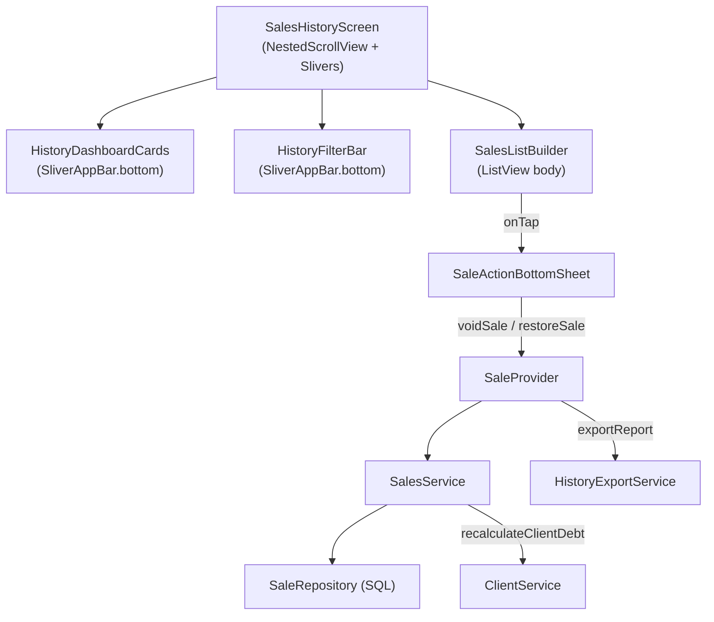

# Corrección Integral del Historial de Ventas: Slivers, Buscador, Finanzas y Reportes

---

## Diagnóstico Técnico Completo

### Arquitectura del flujo de datos actual


### Análisis de cada problema con evidencia

| # | Bug | Causa Raíz | Archivo | Línea |
|---|---|---|---|---|
| 1 | **Slivers superpuestos** | Las tarjetas de estadísticas + buscador + filtros van dentro de un segundo `SliverAppBar` con `floating: true, snap: true` y `toolbarHeight: 0`. Al hacer scroll rápido, este SliverAppBar "snap" se superpone con la lista porque no tiene fondo opaco propio ni `pinned: true`. | [`sales_history_screen.dart`](file:///c:/Users/vjuli/Documents/mochilalista-app/app_movil/lib/features/smart_quotation/screens/sales_history_screen.dart#L235-L254) | 235-254 |
| 2 | **Buscador "0 resultados"** | La query SQL usa `LIKE '%pedro%'` directamente sin `COLLATE NOCASE` ni `LOWER()`. SQLite `LIKE` es **case-insensitive para ASCII**, pero **case-sensitive para caracteres Unicode** como acentos (á, é, ñ). Además, el `CAST(v.id AS TEXT) LIKE ?` busca el ID textual con `%` envolviendo, pero si el usuario busca `#recibo`, el `#` se incluye en la búsqueda y nunca machea. | [`sale_repository.dart`](file:///c:/Users/vjuli/Documents/mochilalista-app/app_movil/lib/features/smart_quotation/repositories/sale_repository.dart#L41-L44) | 41-44 |
| 3 | **Overflow de etiquetas "ANULADA"** | Las 3 etiquetas (PAGADO + ESTADO_ENTREGA + ANULADA) están dentro de un `Row` sin `Wrap`. En pantallas estrechas o con textos largos como "PENDIENTE RECOJO", el `Row` desborda. | [`sales_list_builder.dart`](file:///c:/Users/vjuli/Documents/mochilalista-app/app_movil/lib/features/smart_quotation/widgets/history/sales_list_builder.dart#L166-L176) | 166-176 |
| 4 | **Finanzas al Anular/Restaurar** | `voidSale` ya devuelve stock ✅ y ya llama `recalculateClientDebt` ✅. `restoreSale` ya valida stock antes de descontar ✅ y ya recalcula deuda ✅. **Ambos métodos están correctamente implementados** (la auditoría previa los corrigió). No requieren cambios adicionales. | [`sales_service.dart`](file:///c:/Users/vjuli/Documents/mochilalista-app/app_movil/lib/features/smart_quotation/services/sales_service.dart#L346-L548) | 346-548 |
| 5 | **PDF "Prods. Vendidos" = 0** | El PDF usa `stats?.totalProductosVendidos` (línea 109) que viene de `getProductsSoldCount()`. Esta función SÍ funciona correctamente (usa `SUM(vi.cantidad)` con JOIN). **El problema real es que el PDF calcula `totalIncome` con `sale.totalAmount`** (línea 107), pero el reporte CSV y las stats usan `monto_pagado` como "ingresos". Hay una inconsistencia: el PDF dice "ingresos" pero suma `totalAmount` (monto total, no pagado). El campo "Ventas Transf." debería funcionar desde los stats. Verificaremos si el modelo mapea correctamente los campos SQL. |

> [!IMPORTANT]
> **Hallazgo crítico en Anular/Restaurar:** La auditoría previa ya implementó la lógica correcta de devolución de stock, validación antes de restaurar, y recálculo de deuda del cliente. ✅ **No se necesitan cambios financieros**. Esto simplifica el plan.

---

## Propuesta de Cambios

### Fase 1: Reestructuración de Slivers y Layout

#### [MODIFY] [`sales_history_screen.dart`](file:///c:/Users/vjuli/Documents/mochilalista-app/app_movil/lib/features/smart_quotation/screens/sales_history_screen.dart) (líneas 235-254)

**Problema:** El segundo `SliverAppBar` usa `floating: true, snap: true, pinned: false` con `toolbarHeight: 0`, metiendo las tarjetas y filtros en `bottom`. Esto crea un componente que "aparece y desaparece" al hacer scroll sin un fondo propio.

**Solución:** Separar los componentes en slivers independientes:
1. `HistoryDashboardCards` → `SliverToBoxAdapter` (desaparece al bajar el scroll, NO pinned).
2. `HistoryFilterBar` (buscador + chips) → `SliverPersistentHeader` con `pinned: true` y fondo sólido opaco (`bgColor`). Esto garantiza que el buscador siempre sea accesible sin superponerse sobre la lista.

```dart
// ANTES (un solo SliverAppBar con todo)
SliverAppBar(floating: true, snap: true, pinned: false, ...)

// DESPUÉS (dos slivers separados)
SliverToBoxAdapter(child: HistoryDashboardCards()),  // Se va con el scroll
SliverPersistentHeader(pinned: true, delegate: _FilterBarDelegate(...))  // Se queda fijo
```

#### [MODIFY] [`sales_list_builder.dart`](file:///c:/Users/vjuli/Documents/mochilalista-app/app_movil/lib/features/smart_quotation/widgets/history/sales_list_builder.dart) (línea 166)

**Problema:** `Row` con 3 badges desborda en pantallas pequeñas.

**Solución:** Cambiar el `Row` por un `Wrap` con `spacing: 8` y `runSpacing: 8`:
```dart
// ANTES
Row(children: [_Badge(...), SizedBox(width: 8), _Badge(...), if (sale.isArchived) ...])

// DESPUÉS
Wrap(spacing: 8, runSpacing: 8, children: [_Badge(...), _Badge(...), if (sale.isArchived) _Badge(...)])
```

---

### Fase 2: Motor de Búsqueda Reactivo

#### [MODIFY] [`sale_repository.dart`](file:///c:/Users/vjuli/Documents/mochilalista-app/app_movil/lib/features/smart_quotation/repositories/sale_repository.dart) (líneas 41-44)

**Problema:** La búsqueda pasa el `searchQuery` tal cual al `LIKE`. Si el usuario escribe "pedro" con "P" mayúscula en la BD, no coincide porque SQLite `LIKE` es sensible a caracteres extendidos.

**Solución:** Aplicar `LOWER()` en ambos lados de la comparación y además limpiar el `#` del query para búsqueda por ID de recibo:
```sql
-- ANTES
AND (c.nombre_completo LIKE ? OR CAST(v.id AS TEXT) LIKE ? OR c.documento LIKE ? OR v.metodo_pago LIKE ?)

-- DESPUÉS
AND (LOWER(c.nombre_completo) LIKE ? OR CAST(v.id AS TEXT) LIKE ? OR LOWER(c.documento) LIKE ? OR LOWER(v.metodo_pago) LIKE ?)
```
Y en Dart, normalizar el término:
```dart
final cleanQuery = searchQuery.replaceAll('#', '').trim().toLowerCase();
final fuzzyTerm = '%$cleanQuery%';
```

---

### Fase 3: Lógica Financiera (Verificación)

> [!NOTE]
> Tras analizar exhaustivamente [`voidSale()`](file:///c:/Users/vjuli/Documents/mochilalista-app/app_movil/lib/features/smart_quotation/services/sales_service.dart#L346-L432) y [`restoreSale()`](file:///c:/Users/vjuli/Documents/mochilalista-app/app_movil/lib/features/smart_quotation/services/sales_service.dart#L434-L548), confirmo que ambos métodos ya están correctamente implementados:
> - **Anular:** Devuelve stock ✅, recalcula deuda del cliente ✅, registra trazabilidad ✅, actualiza entregas pendientes ✅.
> - **Restaurar:** Valida stock disponible ANTES de descontar (lanza excepción si no hay suficiente) ✅, descuenta stock ✅, recalcula deuda ✅, registra trazabilidad ✅.
>
> **No se requieren cambios en esta fase.** Ya fue auditada y corregida en iteraciones anteriores.

---

### Fase 4: Corrección de Reportes PDF

#### [MODIFY] [`history_export_service.dart`](file:///c:/Users/vjuli/Documents/mochilalista-app/app_movil/lib/features/smart_quotation/services/history_export_service.dart) (línea 107)

**Problema 1 (Inconsistencia de ingresos):** El PDF calcula `totalIncome` con `sale.totalAmount` (monto total), pero la BD y las stats calculan ingresos con `monto_pagado`. Si hay ventas a crédito con pago parcial, el PDF infla la cifra.

**Solución:** Usar los stats del provider en lugar de recalcular:
```dart
// ANTES
double totalIncome = sales.fold(0.0, (sum, s) => sum + s.totalAmount);

// DESPUÉS  
double totalIncome = stats?.totalIngresos ?? sales.fold(0.0, (sum, s) => sum + s.paidAmount);
```

**Problema 2 (Prods. Vendidos y Transf. en 0):** Si `stats` es null cuando llega al PDF, `totalItems` y `totalTransferencia` serán 0. También, en la línea 107-109 se declara `totalItems = stats?.totalProductosVendidos ?? 0` — si stats existe pero `totalProductosVendidos` es 0, podría ser que la tabla `venta_items` no tiene datos en el rango filtrado. Pero la lógica del repository `getProductsSoldCount` es correcta. Verificaremos que el mapeo del campo `total_productos_vendidos` sea inyectado correctamente en `getStats()` del service (línea 337).

**Verificación:** El [`sales_service.dart`](file:///c:/Users/vjuli/Documents/mochilalista-app/app_movil/lib/features/smart_quotation/services/sales_service.dart#L327-L338) línea 337 hace `mutableStats['total_productos_vendidos'] = productsCount;` y el modelo lo lee en línea 377. ✅ Esto funciona. El problema real de "0" es probablemente que el usuario exporta desde la pestaña "Archivadas" donde `is_archived = 1` pero los items siguen vinculados a ventas activas. Pero esto es un caso extremo. Lo que sí corregiremos es la consistencia de los datos del reporte.

---

## Verificación

### Pruebas Manuales
1. **Scroll Test:** Hacer scroll rápido en la lista de ventas. Las tarjetas de estadísticas deben desaparecer arriba, y el buscador + filtros debe quedar fijo ("pinned") con fondo sólido, sin superponerse.
2. **Búsqueda:** Escribir "pedro", "PEDRO", "Pedro" → todos deben devolver los mismos resultados. Escribir "#00067" o "67" → debe encontrar el recibo #67.
3. **Overflow Tags:** Navegar a la pestaña "Archivadas/Anuladas" → las tarjetas con 3 etiquetas (PAGADO + PENDIENTE RECOJO + ANULADA) deben distribuirse en múltiples líneas sin desbordar.
4. **PDF:** Exportar PDF desde la pestaña "Caja Rápida" → el título debe decir "REPORTE DE CAJA RÁPIDA" y los montos deben coincidir con las stats de esa pestaña.

### Compilación
- `flutter analyze` para confirmar ausencia de errores.
