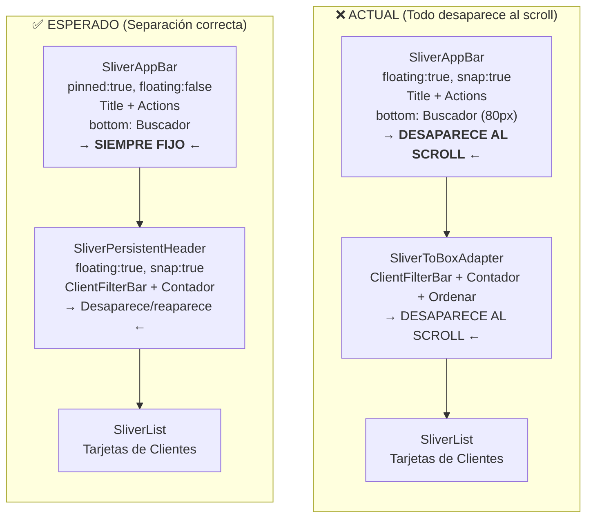

# Corrección del Directorio de Clientes: Slivers, State Leak y Limpieza UI

---

## Diagnóstico Técnico del Estado Actual

### Arquitectura de Slivers (Actual vs. Esperada)



### Tabla de Problemas Confirmados con Evidencia

| # | Bug | Causa Raíz | Archivo | Líneas |
|---|---|---|---|---|
| 1 | **AppBar y Buscador desaparecen al scroll** | El `SliverAppBar` tiene `floating: true, snap: true` sin `pinned: true`. Esto significa que el AppBar COMPLETO (título + buscador) desaparece al hacer scroll hacia abajo. Solo reaparece con snap al subir. **Debería ser `pinned: true, floating: false`** para que nunca desaparezca. | [`client_tracking_screen.dart`](file:///c:/Users/vjuli/Documents/mochilalista-app/app_movil/lib/features/smart_quotation/screens/crm/client_tracking_screen.dart#L291-L333) | 291-333 |
| 2 | **Filtros no son flotantes** | Los filtros (`ClientFilterBar`), el contador de clientes y el botón "Ordenar" están dentro de un `SliverToBoxAdapter` (línea 335-387). Un `SliverToBoxAdapter` es un bloque rígido: sube con el scroll y desaparece sin volver. **Debería ser un `SliverPersistentHeader` con `floating: true`** para que reaparezca al mínimo scroll hacia arriba. | [`client_tracking_screen.dart`](file:///c:/Users/vjuli/Documents/mochilalista-app/app_movil/lib/features/smart_quotation/screens/crm/client_tracking_screen.dart#L335-L387) | 335-387 |
| 3 | **Chip "Clientes App" obsoleto** | Existe un `FilterChip` con label `"Clientes App"` (línea 39-46) que filtra por `filterIsAppClient`. El provider también mantiene la variable `_filterIsAppClient` (línea 23). Todo el sistema (toggle, getter, variable) es código muerto. | [`client_filter_bar.dart`](file:///c:/Users/vjuli/Documents/mochilalista-app/app_movil/lib/features/smart_quotation/widgets/crm/client_filter_bar.dart#L39-L46) | 39-46 |
| 4 | **State Leak en buscador** | En `initState()` (línea 25-38) NO se limpia el `_searchQuery` del `TrackingProvider`. Solo se llama a `_onRefresh()` que ejecuta `loadClients()`, pero este método NO resetea `_searchQuery`. Si el usuario buscó "pedro", salió de la pantalla y volvió, el `_searchCtrl` del TextField se crea vacío (línea 20), pero `_searchQuery` en el Provider sigue siendo `"pedro"`, filtrando la lista invisiblemente. | [`client_tracking_screen.dart`](file:///c:/Users/vjuli/Documents/mochilalista-app/app_movil/lib/features/smart_quotation/screens/crm/client_tracking_screen.dart#L24-L38) | 24-38 |

> [!IMPORTANT]
> **Hallazgo adicional sobre el banner "Modo Exploración":** El banner de "Modo Exploración" (líneas 338-355) está dentro del `SliverToBoxAdapter` que contiene los filtros. Al separar los filtros en su propio `SliverPersistentHeader`, este banner también necesita su propio sliver. Lo moveremos a un `SliverToBoxAdapter` independiente para que suba con el scroll de forma natural, sin interferir con el header flotante de los filtros.

---

## Propuesta de Cambios

### Fase 1: Corrección de Fuga de Estado (State Leak)

#### [MODIFY] [`tracking_provider.dart`](file:///c:/Users/vjuli/Documents/mochilalista-app/app_movil/lib/features/smart_quotation/providers/tracking_provider.dart)

Crear un método explícito `resetFiltersAndSearch()` que limpie completamente el estado de búsqueda y filtros:

```dart
/// Limpia todos los filtros y la búsqueda. 
/// Se debe invocar cada vez que la pantalla del directorio se monta.
void resetFiltersAndSearch() {
  _searchQuery = "";
  _filterHasDebt = false;
  _filterPendingDelivery = false;
  _filterIsAppClient = false;
  _filterConfidenceLevel = "todos";
  _currentSort = "newest";
  notifyListeners();
}
```

#### [MODIFY] [`client_tracking_screen.dart`](file:///c:/Users/vjuli/Documents/mochilalista-app/app_movil/lib/features/smart_quotation/screens/crm/client_tracking_screen.dart) (initState)

Invocar `resetFiltersAndSearch()` al inicio, ANTES de cargar los clientes:

```dart
@override
void initState() {
  super.initState();
  WidgetsBinding.instance.addPostFrameCallback((_) {
    final provider = Provider.of<TrackingProvider>(context, listen: false);
    provider.resetFiltersAndSearch(); // ← Pizarra limpia
    _searchCtrl.clear(); // ← Sincronizar también el TextField visual
    provider.loadClients();
  });
  // ... scroll listener sin cambios
}
```

---

### Fase 2: Reingeniería de Slivers

#### [MODIFY] [`client_tracking_screen.dart`](file:///c:/Users/vjuli/Documents/mochilalista-app/app_movil/lib/features/smart_quotation/screens/crm/client_tracking_screen.dart) (líneas 288-417)

Se reemplaza el `CustomScrollView` por un `NestedScrollView` para aislar correctamente las capas:

```dart
// ═══════════════════════════════════════════
// SLIVER 1: AppBar + Buscador (SIEMPRE FIJO)
// ═══════════════════════════════════════════
SliverAppBar(
  title: "Directorio de Clientes",
  pinned: true,     // ← SIEMPRE VISIBLE
  floating: false,  // ← NO se esconde
  bottom: PreferredSize(
    preferredSize: Size.fromHeight(80),
    child: /* Buscador TextField */
  ),
),

// ═══════════════════════════════════════════
// SLIVER 2 (condicional): Banner "Modo Exploración"
// ═══════════════════════════════════════════
if (isGuest)
  SliverToBoxAdapter(child: /* Banner naranja */),

// ═══════════════════════════════════════════
// SLIVER 3: Filtros + Contador (FLOTANTE)
// SliverPersistentHeader con floating: true
// Se oculta al bajar, reaparece al subir
// ═══════════════════════════════════════════
SliverPersistentHeader(
  pinned: false,
  floating: true,
  delegate: _ClientFloatingFilterDelegate(
    maxHeight: 125.0,  // FilterBar (70) + CounterBar (~55)
    minHeight: 0.0,
    child: Column(
      children: [
        ClientFilterBar(),
        CounterAndSortBar(...),
      ],
    ),
  ),
),
```

Se reutilizará el mismo patrón de delegate `ClipRect` + `SizedBox` + `OverflowBox` ya probado en la Mesa de Trabajo.

---

### Fase 3: Limpieza de UI (Chip "Clientes App")

#### [MODIFY] [`client_filter_bar.dart`](file:///c:/Users/vjuli/Documents/mochilalista-app/app_movil/lib/features/smart_quotation/widgets/crm/client_filter_bar.dart) (líneas 38-47)

Eliminar completamente el `FilterChip` de "Clientes App" y su separador:

```diff
           onSelected: (_) => provider.toggleDeliveryFilter(),
         ),
-        const SizedBox(width: 10),
-        _buildFilterChip(
-          label: "Clientes App",
-          icon: Icons.phone_android,
-          isSelected: provider.filterIsAppClient,
-          activeColor: isDark ? Colors.teal[300]! : Colors.teal,
-          isDark: isDark,
-          onSelected: (_) => provider.toggleAppClientFilter(),
-        ),
         const SizedBox(width: 10),
         _buildConfidenceChip(provider, isDark),
```

> [!NOTE]
> **No eliminaremos** la variable `_filterIsAppClient`, el getter, ni el método `toggleAppClientFilter()` del `TrackingProvider`. Esto se debe a que podrían usarse desde otros contextos (detalle del cliente, reportes) y su eliminación requeriría una auditoría de impacto más amplia. Solo eliminaremos la entrada visual en la UI de filtros.

---

## Verificación

### Pruebas Manuales
1. **Scroll Behavior:** Hacer scroll rápido en el Directorio de Clientes:
   - El AppBar + Buscador deben quedar siempre fijos en la parte superior.
   - Los chips de filtro y el contador deben desaparecer al bajar, pero reaparecer al menor scroll hacia arriba.
2. **State Reset:** Buscar un cliente (ej. "pedro"), salir de la pantalla, volver a entrar:
   - El campo de texto del buscador debe estar vacío.
   - La lista debe mostrar TODOS los clientes, no solo los filtrados.
3. **Chip eliminado:** Verificar que "Clientes App" ya no aparece en la barra de filtros.

### Compilación
- `flutter analyze` para confirmar ausencia de errores.
