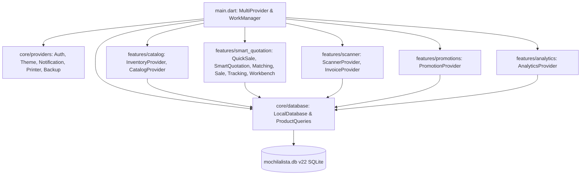

# INFORME DE AUDITORÍA INTEGRAL: ARQUITECTURA, UX/UI Y COHERENCIA DE BASE DE DATOS
**Proyecto:** Mochila Lista — Ecosistema Móvil Comercial POS / CRM Local-First  
**Rol del Análisis:** Senior Mobile UI/UX Architect & Systems Engineer (Material & Apple Design Awards Standard)  
**Versión de Auditoría:** v2.0 (Revisión Profunda Ampliada — Dispositivos Físicos y Mobile Awards)  
**Fecha:** 14 de Octubre de 2026  
**Entorno Técnico:** Flutter 3.x / Dart 3.x • SQLite Local (`sqflite` v22) • Provider Architecture • WorkManager Offline Engine  

---

## 1. RESUMEN EJECUTIVO Y MANIFIESTO ARQUITECTÓNICO

### 1.1. Identidad Innegociable: Local-First Puro + Conectividad Inteligente
La aplicación **Mochila Lista** está concebida bajo una filosofía de ingeniería de software de máxima resiliencia comercial para el pequeño y mediano comerciante:
1. **0% Dependencia de Servidor Central para Persistencia:** La app no cuenta ni necesita un backend central o base de datos en la nube para funcionar día a día. Todo el ciclo de vida comercial —inventario, variantes factor-aware, catálogo visual, caja rápida, cotizaciones de listas escolares, CRM de clientes, cronogramas de crédito, anulaciones, trazabilidad en `stock_ledger` y analítica predictiva— se ejecuta localmente mediante **SQLite en el propio dispositivo (`local_db.dart`)**. Esto asegura:
   * **Cero Latencia de Red:** Las consultas y transacciones responden en **1 a 4 milisegundos reales**, permitiendo una agilidad de cobro en mostrador imposible de igualar por aplicaciones web o clientes cliente-servidor tradicionales.
   * **Autonomía Operativa 100%:** Un comerciante en una galería comercial subterránea, sótano o feria escolar sin señal puede cobrar, emitir comprobantes, modificar stock y registrar abonos sin bloqueos ni caídas.
   * **Gratuidad y Privacidad Total:** Sin costos de hosting de base de datos recurrentes ni riesgo de filtración de datos en reposo centralizado.
2. **Conectividad Inteligente On-Demand:** La conexión a internet se utiliza de manera selectiva y asíncrona, exclusivamente para capacidades aumentadas:
   * Procesamiento OCR/IA con Gemini para escaneo de facturas de compra y listas escolares manuscritas o impresas.
   * Compartir cotizaciones y reportes vía WhatsApp o PDF.
   * Exportación y sincronización de respaldos en formatos `.mlb` (por perfil de negocio individual) y `.mlbg` (respaldo global de toda la base de datos e imágenes).

---

## 2. RADIOGRAFÍA INTEGRAL DE LA ARQUITECTURA Y MÓDULOS



### 2.1. Estructura de Capas del Proyecto
* **`core/database/`**:
  * `local_db.dart`: Configuración de base de datos (`mochilalista.db`, versión 22), creación de 15 tablas relacionales e índices optimizados, aislamiento multi-negocio con `negocio_id` y generador de números secuenciales (`numero_secuencial`).
  * `product_queries.dart`: Queries SQL consolidados para inventario unificado mediante `JOIN` entre `productos`, `presentaciones_producto` y `marcas`.
* **`core/providers/`**:
  * `auth_provider.dart`: Gestión de sesiones, roles (Dueño, Empleado, Cliente Comunitario, Invitado), bloqueo PIN con delay inteligente (`lock_screen.dart`) y aislamiento de negocio activo (`activeBusinessId`).
  * `backup_provider.dart`: Orquestador de copias de seguridad locales y automáticas vía `Workmanager`.
  * `theme_provider.dart`: Soporte para modo oscuro profundo (`#12121A` / `#1E1E28`) y modo claro limpio con tipografía personalizada.
* **`features/catalog/`**:
  * Gestión de productos, marcas, categorías, proveedores y variantes factor-aware. Pantallas: `inventory_screen.dart`, `catalog_screen.dart`, `product_detail_screen.dart`, `product_create_screen.dart`, `product_edit_screen.dart`.
* **`features/smart_quotation/`**:
  * Motor neurálgico de ventas y CRM: `quick_sale_screen.dart` (Caja Rápida), `manual_quotation_screen.dart`, `matching_screen.dart` (Conciliación de listas escolares), `workbench_screen.dart` (Mesa de trabajo y semáforos de stock), `sales_history_screen.dart`, `sales_checkout_screen.dart`, `client_tracking_screen.dart` y `client_detail_screen.dart`.
* **`features/scanner/`**:
  * Pipeline de escaneo de facturas con IA Gemini: `scan_screen.dart`, `invoice_review_screen.dart`, `invoice_staging_screen.dart`, `invoice_history_screen.dart` e `invoice_detail_screen.dart`.
* **`features/promotions/`**:
  * Bundles y combos escolares: `bundle_builder_screen.dart` y `offers_tab.dart`.
* **`features/analytics/`**:
  * Tablero ejecutivo de Inteligencia de Negocio (`analytics_dashboard_screen.dart`), reabastecimiento predictivo (`smart_restock_screen.dart`), proyecciones (`predictive_analytics_screen.dart`) y trazabilidad de movimientos (`audit_trail_screen.dart`).

---

## 3. AUDITORÍA UI/UX VENTANA POR VENTANA Y MODAL POR MODAL

### 3.1. Diagnóstico Global Frente a Patrones de "Mobile Awards"
Los estándares de diseño móvil más premiados a nivel global (*Apple Design Awards*, *Google Material Design Awards*, aplicaciones benchmark como *Things 3*, *Revolut*, *Linear*, *Square POS*) comparten principios indispensables que elevan un sistema utilitario a una experiencia memorable:
1. **Física y Gestualidad Natural:** Ninguna ventana modal debe requerir que el usuario estire el pulgar hacia un botón lejano para descartarse; todo contenedor temporal debe deslizarse suavemente siguiendo el dedo (*swipe-down to dismiss* con inercia y amortiguación de resorte).
2. **Fluidez Transicional sin Saltos Abruptos:** Los paneles desplegables y filtros no deben saltar de repente ni generar parpadeos visuales en la altura del scroll.
3. **Micro-interacciones y Háptica con Sentido Comercial:** Cada acción decisiva (agregar producto a caja rápida, aplicar una oferta, registrar un abono, cambiar stock) debe proveer retroalimentación háptica sutil (`HapticFeedback.lightImpact()`), que brinde certeza sensorial de que la operación se procesó al instante.
4. **Espacios de Trabajo No Bloqueantes:** El comerciante jamás debe sentirse "atrapado" o con miedo de perder lo que hacía si cambia de pantalla para consultar un dato.
5. **Ergonomía Edge-to-Edge Real:** Todo botón de acción primordial debe estar anclado en la zona natural del pulgar y estar 100% blindado contra colisiones con barras de navegación del sistema operativo (3 botones Android o barra gestual).

---

### 3.2. Evaluación Detallada Ventana por Ventana y Oportunidades "Mobile Awards"

#### A. `home_screen.dart` (Dashboard Principal)
* **Estado Actual:** Usa `IndexedStack` para alternar entre Inicio, Inventario, Catálogo y Clientes. Posee un gradiente animado en el fondo (`_bgAnimController`), `DashboardHeader`, `WeeklySalesChart`, `SmartActionGrid` y `RecentActivityList`.
* **Puntos Fuertes:** Carga limpia, refresco suave con `RefreshIndicator`, banners condicionales por rol. En esta pantalla, la barra inferior `NavigationBar` sí respeta la barra del sistema Android.
* **Oportunidades "Mobile Awards" de Alto Impacto:**
  1. *Barra de Búsqueda Inteligente Global (Omni-Search):* El comerciante debe poder buscar en 1 toque desde la cabecera del Home: productos, clientes, cotizaciones y pedidos anteriores mediante búsqueda difusa (*fuzzy search* local en SQLite a 0ms), sin obligarlo a entrar primero a Inventario o a Clientes.
  2. *Ambient Work Dock (Multi-Proceso Simultáneo):* Integración de una píldora flotante viva sobre la barra inferior que notifique de inmediato si hay una venta pausada, una factura en clasificación o una lista escolar a medio emparejar, con botón de reanudación en 1 toque.
  3. *Acceso Rápido por Gestos (Power Shortcuts):* Mantener presionado el botón "Venta Rápida" abre inmediatamente el escáner de código de barras para venta rápida en mostrador, reduciendo el flujo de 3 toques a 1 solo gesto.
  4. *Interactividad en Gráfico Semanal:* Tocar cualquier barra del gráfico de ventas abre una tarjeta emergente elegante con el desglose de ventas de ese día y sus productos estrella.

#### B. `inventory_screen.dart` y Pestañas (`products_tab.dart`, `categories_tab.dart`, etc.)
* **Estado Actual:** `TabBar` superior con scroll horizontal (Productos, Ofertas, Categorías, Marcas, Proveedores). Dispone de vistas Grid, Tile y Compact, `FilterDrawer` lateral y botón FAB expandible.
* **Puntos Fuertes:** Buen rendimiento en paginación con `loadMore()`.
* **Oportunidades "Mobile Awards" de Alto Impacto:**
  1. *Reemplazo de `FilterDrawer` por `LiveFilterBottomSheet`:* El drawer lateral cubre el 80% de la pantalla e interrumpe la visualización de la lista. Se sustituye por un panel inferior retráctil con chips interactivos y deslizadores de precio/stock, mostrando un botón en vivo: *"Mostrar 42 productos coincidentes"*.
  2. *Cabecera Sliver Elástica con Desenfoque Dinámico:* Transformar la AppBar en un `SliverAppBar` con `stretch: true` y desenfoque gradual (*glassmorphic blur*) al deslizar la lista.
  3. *Auditoría Rápida de Stock en Mostrador (Quick Stepper):* En la vista compacta, incorporar botones discretos `+` y `-` para actualizar el stock físico del anaquel al vuelo con feedback háptico, sin obligar a abrir la pantalla completa de edición.
  4. *Insignias de Alerta Inteligente:* Etiquetas con micro-pulsaciones de color para productos con stock bajo o sin ventas en 30 días (*Dead Stock Warning*).

#### C. `catalog_screen.dart` (Catálogo Comercial Virtual)
* **Estado Actual:** Cuadrícula de productos orientada a catálogo visual con botón flotante para acceder al carrito del catálogo. Permite transferir productos a Caja Rápida o a Cotización.
* **Oportunidades "Mobile Awards" de Alto Impacto:**
  1. *Barra Inferior Docked del Carrito:* Reemplazar el botón circular flotante por una barra inferior dinámica (*Docked Cart Bar*) que muestre en tiempo real: `[🛒 4 productos • S/ 38.50 | Ver Carrito / Pasar a Caja]`, visible sin tapar los productos.
  2. *Selector Instantáneo de Presentaciones:* Tocar el chip de variante directamente en la tarjeta del catálogo cambia la presentación y su precio sin necesidad de abrir el modal completo.
  3. *Transferencia Directa de 1 Toque a Caja Rápida / Cotización:* Simplificar el diálogo de confirmación eliminando pasos redundantes y asegurando que se valide el stock factor-aware (`displayStockForValidation`).
  4. *Modo Presentación para el Cliente:* Un botón de "Modo Tienda" que oculta costos, márgenes y proveedores, optimizando la tipografía y fotografías para mostrársela directamente al cliente en mostrador.

#### D. `product_detail_screen.dart` y Modales de Stock / Descuento
* **Estado Actual:** Visualizador detallado con carrusel de presentaciones, insignias de estado, botón de ajuste rápido de stock (`StockUpdateModal`) y modal de descuento inteligente (`DiscountIntelligentModal`).
* **Puntos Fuertes:** `StockUpdateModal` tiene una excelente transición de color (`AnimatedSwitcher`) entre stock saludable, bajo y agotado.
* **Oportunidades "Mobile Awards" de Alto Impacto:**
  1. *Física de Descarte en `StockUpdateModal` y `PriceUpdateModal`:* Convertirlos de diálogos tradicionales centrados a modales con arrastre vertical suave para cerrar (*swipe-down to dismiss*) y háptica táctil en cada incremento numérico.
  2. *Secciones Financieras Plegables con Ocultamiento de Privacidad:* Poder colapsar las métricas de ganancia con un toque o cubrirlas con desenfoque de privacidad cuando un cliente esté cerca del mostrador.
  3. *Transición Hero de Imagen:* Al tocar la foto del producto o presentación, expandirla a pantalla completa mediante una animación `Hero` continua y fluida.

#### E. `product_create_screen.dart` y `product_edit_screen.dart`
* **Estado Actual:** Formulario con múltiples controladores para variantes y el widget `ProductPresentationCard` (que supera las 1,500 líneas).
* **Oportunidades "Mobile Awards" de Alto Impacto:**
  1. *Tarjetas de Presentaciones en Acordeón Compacto:* Las presentaciones no seleccionadas se presentan colapsadas mostrando solo: `[Unidad: Caja x12 • Precio: S/ 18.00 • Stock: 10 cajas]`, reduciendo la altura de pantalla en un 60% y expandiéndose únicamente al editarlas.
  2. *Calculadora Reactiva de Margen y Precios:* Un slider interactivo de margen de ganancia (%) que recalcula en tiempo real el precio de venta sugerido y viceversa, con indicadores de color según la rentabilidad.
  3. *Sugerencia Automática de Unidad y Factor:* Al escribir "Caja", el sistema sugiere automáticamente factores típicos (x12, x24, x50) para evitar que el comerciante cometa errores de tipeo.

#### F. `quick_sale_screen.dart` (Caja Rápida)
* **Estado Actual:** Buscador con debounce (250ms), escaneo de código de barras, carrusel retráctil de ofertas activas, lista de items con edición de cantidad/precio, modal de checkout (`QuickCheckoutModal`) y `PopScope` no destructivo.
* **Puntos Fuertes:** Excelente persistencia en `QuickSaleProvider` al navegar hacia atrás.
* **Oportunidades "Mobile Awards" de Alto Impacto:**
  1. *Puente Directo de Ajuste de Stock y Precio In-Situ:* Si un producto figura agotado en el sistema pero el comerciante lo tiene en la mano en el mostrador, un botón o toque prolongado abre `StockUpdateModal` o `PriceUpdateModal` ahí mismo, actualizando SQLite y sumándolo al carrito sin abandonar la venta.
  2. *Cortina Fluida para el Modo Ocultar Ganancias (`toggleHideProfits`):* Sustituir el cambio instantáneo por una animación de desenfoque y revelado cruzado (*curtain blur reveal*).
  3. *Chip de Cliente Vinculado con Acceso a Saldo a Favor:* Visualizar en el header el cliente asignado con su saldo a favor disponible, permitiendo aplicarlo con 1 toque en el checkout.
  4. *Modales de Detalle y Checkout con Cierre Gestual:* `QuickSaleDetailModal` y `QuickCheckoutModal` adaptados con arrastre vertical hacia abajo y blindados contra la barra del sistema.

#### G. `features/scanner/` (`invoice_review_screen.dart` e `invoice_staging_screen.dart`)
* **Estado Actual:** Pipeline de carga de facturas mediante Gemini AI. En Staging (`invoice_staging_screen.dart`), se clasifican los productos extraídos contra el catálogo local (`ScannerMatchingEngine`) y se valida el factor de conversión (`UnitCatalogService`).
* **Puntos Fuertes:** Diálogo de confirmación que permite pausar la clasificación y guardarla en memoria (`saveProgress()`).
* **Oportunidades "Mobile Awards" de Alto Impacto:**
  1. *Notificación en el Ambient Work Dock:* Al pausar una factura, la app mantiene visible la píldora en todas las pantallas principales: `[📄 Factura Distribuidora: 12 items en revisión • Continuar]`.
  2. *Indicador Visual de Factor de Conversión:* Cuando una factura contiene unidades al por mayor (ej. Cajas o Docenas), mostrar un badge interactivo con semáforo que verifique si el factor coincide con el catálogo existente antes de guardar en lote.
  3. *Modales de Clasificación Gestuales:* Todos los modales de mapeo de variantes y selección de categoría cierran deslizando hacia abajo sin perder el progreso confirmado.

#### H. `matching_screen.dart` (Conciliación de Listas Escolares)
* **Estado Actual:** Pantalla de matching con semáforos de stock (verde, amarillo, rojo), selector de cliente, edición de precios y cálculo de ahorro global.
* **Puntos Fuertes:** Persistencia en `MatchingProvider`.
* **Oportunidades "Mobile Awards" de Alto Impacto:**
  1. *Micro-interacción de Emparejamiento Exitoso:* Al asignar un producto a un ítem de la lista, la tarjeta emite un destello verde sutil y una respuesta háptica ligera, confirmando el emparejamiento.
  2. *Panel Deslizable de Reemplazos Sugeridos:* Si un producto está agotado, un deslizamiento lateral sobre el ítem abre una hoja inferior con alternativas similares disponibles en stock.
  3. *Cálculo Dinámico de Ahorro para el Cliente:* Insignia visual destacada con el ahorro acumulado por combos y ofertas aplicadas en la lista, ideal para mostrársela a los padres de familia.

#### I. `manual_quotation_screen.dart` (Cotización Manual)
* **Estado Actual:** Utiliza `ExpansionTile` para dividir la información de la cotización y los datos del cliente/colegio (`manual_quote_headers_section.dart`).
* **Oportunidades "Mobile Awards" de Alto Impacto:**
  1. *Acordeones Dinámicos con Resumen (*Morphing Accordions*):* Al colapsar los paneles de identificación o cliente, el encabezado muestra insignias elegantes con los datos cargados (`"Cliente: Juan Pérez • Col. San Agustín • 12 items"`), evitando reabrir el panel para verificar.
  2. *Auto-Persistencia de Borrador en Salida:* Sincronización automática con `SmartQuotationProvider.saveManualDraft()` ante cualquier evento de navegación hacia atrás, integrándolo en el `PersistentWorkDock`.
  3. *Puente In-Situ de Stock y Precios:* Posibilidad de ajustar precios o stock de cualquier ítem cotizado directamente desde la lista sin saltar a inventario.

#### J. `client_tracking_screen.dart` y `client_detail_screen.dart` (CRM Clientes)
* **Estado Actual:** Directorio con slivers, buscador de clientes, indicadores de deuda total y entregas pendientes.
* **Oportunidades "Mobile Awards" de Alto Impacto:**
  1. *Puente Directo a Nueva Venta o Cotización:* En el perfil del cliente (`client_detail_screen.dart`), botones de acción destacados: `[⚡ Venta Rápida]` y `[📝 Cotizar]`, que abren Caja Rápida o Cotización Manual con el cliente ya vinculado y su saldo a favor listo para aplicar.
  2. *Timeline Financiero Segmentado:* Historial de transacciones organizado en pestañas limpias (Cargos, Abonos, Devoluciones) con un sparkline gráfico que ilustra la evolución de la deuda del cliente en el tiempo.
  3. *Acceso Rápido por WhatsApp:* Botón de contacto directo con plantilla pre-formateada de estado de cuenta en 1 toque.

#### K. `sales_history_screen.dart` y `sale_history_detail_screen.dart`
* **Estado Actual:** Historial con filtros por fecha, buscador, filtro por origen (Caja Rápida, Cotización, etc.), modal de anulación y visualización de ticket térmico.
* **Oportunidades "Mobile Awards" de Alto Impacto:**
  1. *Cabecera Sliver Elástica con Métricas del Período:* Totales de ventas, cobros y fiados que se compactan de forma elástica al deslizar el historial.
  2. *Sheet de Acciones Gestual:* `SaleActionBottomSheet` con soporte de arrastre vertical, micro-háptica y confirmación de anulación clara con advertencia de impacto en stock.

#### L. `bundle_builder_screen.dart` y `offers_tab.dart` (Promociones y Combos)
* **Estado Actual:** Constructor de paquetes escolares con cálculo automático de costo, precio sugerido y ahorro del cliente.
* **Oportunidades "Mobile Awards" de Alto Impacto:**
  1. *Dial Dinámico de Rentabilidad en Tiempo Real:* Un indicador semicircular o barra de progreso animada que cambia de color mientras el comerciante define el precio del paquete (Verde esmeralda si margen > 30%, Ámbar si está entre 15% y 30%, Rojo suave si < 15%).
  2. *Tarjeta de Ahorro Percibido:* Muestra visualmente cuánto dinero percibe el cliente que está ahorrando, ayudando al comerciante a crear ofertas más atractivas.

#### M. `analytics_dashboard_screen.dart` (Inteligencia de Negocio)
* **Estado Actual:** Gráficos de barras y circulares, KPIs financieros, carrusel de insights estratégicos y detección de stock muerto.
* **Oportunidades "Mobile Awards" de Alto Impacto:**
  1. *Puentes Directos de BI a Acción Comercial:*
     * En la tarjeta de Stock Muerto (`dead_stock_card.dart`): Botón directo en cada producto para abrir `DiscountIntelligentModal` o enviarlo a un nuevo combo en `BundleBuilderScreen` con 1 solo toque.
     * En la tarjeta de Alertas de Stock (`restock_alerts_card.dart`): Botón directo para abrir `StockUpdateModal` o registrar pedido a proveedor.
  2. *Interactividad Táctil en Gráficos:* Tocar cualquier barra o porción de torta despliega una burbuja animada con micro-vibración y valores exactos en Soles (S/).

---

### 3.3. Auditoría Específica de Modales e Info Tooltips (`info_tooltip_button.dart`)

#### El Problema Técnico Detectado en el Código Actual
El widget `InfoTooltipButton` está implementado en `app_movil/lib/core/widgets/info_tooltip_button.dart` y se consume en **más de 20 pantallas** a lo largo de toda la aplicación:
```dart
void _showInfoSheet(BuildContext context) {
  final isDark = Theme.of(context).brightness == Brightness.dark;

  showModalBottomSheet(
    context: context,
    isScrollControlled: true,
    backgroundColor: Colors.transparent,
    builder: (ctx) => _InfoBottomSheet(
      title: title,
      description: description,
      tips: tips,
      isDark: isDark,
    ),
  );
}
```
Dentro de `_InfoBottomSheet`, el diseño actual es:
```dart
Container(
  constraints: BoxConstraints(
    maxHeight: MediaQuery.of(context).size.height * 0.65,
  ),
  child: SingleChildScrollView(
    padding: const EdgeInsets.fromLTRB(24, 12, 24, 32),
    child: Column(
      // Handle, Header, Descripción, Tips, Botón "Entendido"
    )
  )
)
```
**Causa Raíz del Comportamiento Rígido:**
1. Aunque `showModalBottomSheet` en Flutter tiene `enableDrag: true` de forma predeterminada, cuando el hijo contiene un `SingleChildScrollView` sin física coordinada (`ClampingScrollPhysics` o `BouncingScrollPhysics`), el `Scrollable` captura todos los punteros verticales.
2. Si el usuario intenta deslizar hacia abajo en cualquier parte del cuerpo (sobre el texto explicativo o los tips), el gesto no cierra el modal; simplemente intenta desplazar el scroll interno.
3. El usuario se siente atrapado y forzado a presionar únicamente el botón "Entendido" al fondo o la barra superior diminuta.

#### La Solución Arquitectónica "Mobile Awards"
Reemplazar el contenedor rígido por un **`InteractiveSheetWrapper`** universal con:
1. **Detección Gestual Integrada con Coordinación de Scroll:** Uso de `NotificationListener<ScrollNotification>` y `GestureDetector` vertical que detecte la intención de arrastre en la posición cero (`pixels <= 0`), transfiriendo el movimiento hacia el cierre del modal con física de seguimiento 1:1.
2. **Resorte y Fling Velocity:** Si la velocidad del deslizamiento hacia abajo supera los `700 px/s` o si el desplazamiento vertical supera el `20%` de la altura, el modal se despide con una curva elástica suave (`Curves.easeOutCubic`) y dispara un `HapticFeedback.lightImpact()`.
3. **Indicador Táctil (Drag Handle) Activo:** Un indicador superior que reacciona visualmente al arrastre (se estira sutilmente de 40px a 56px al tirar de él), dando retroalimentación visual directa al usuario.
4. **Reutilización Universal en el 100% de Modales:** Al aplicar este wrapper a `info_tooltip_button.dart`, **las 20 pantallas que lo consumen recibirán la mejora instantáneamente**, y el mismo componente servirá como base para todos los bottom sheets de la app (`StockUpdateModal`, `DiscountIntelligentModal`, `PriceUpdateModal`, `CatalogCartModal`, `ProductActionSheet`, `ProductDetailModal`, `QuickSaleDetailModal`, `QuickCheckoutModal`, `ClientSearchModal`, `SaleActionBottomSheet`, modales de matching, scanner y autenticación).

---

## 4. AUDITORÍA DE DISPOSITIVOS FÍSICOS: BARRA INFERIOR DEL SISTEMA (BUG-07)

### 4.1. Diagnóstico del Problema en Teléfonos Físicos
En dispositivos Android con barra de navegación de 3 botones (Atrás, Inicio, Apps Recientes) o teléfonos con navegación gestual en modo *Edge-to-Edge* (como Samsung Galaxy con One UI, Xiaomi con MIUI/HyperOS, Motorola o Google Pixel), la barra del sistema ocupa entre **24dp y 48dp** de altura física en la base de la pantalla.
* **El Problema Crítico:** Cuando se despliega un modal inferior (`showModalBottomSheet`) con `useSafeArea: false` o con un padding inferior fijo quemado (como el `padding: const EdgeInsets.fromLTRB(24, 12, 24, 32)` de `info_tooltip_button.dart` o `padding: const EdgeInsets.all(20)` de `catalog_cart_modal.dart`), el sistema dibuja el contenido detrás de los botones de Android.
* **Consecuencia Comercial Grave:** El botón de acción principal ("ENVIAR A CAJA RÁPIDA", "APLICAR CAMBIOS", "ENTENDIDO", "CONFIRMAR NOTA") queda parcial o totalmente cubierto por los botones físicos/virtuales del teléfono. El comerciante intenta tocar el botón de la app y el teléfono responde saliendo a la pantalla de inicio o yendo hacia atrás.

### 4.2. Por Qué `home_screen.dart` SÍ Funciona Bien
En [home_screen.dart](file:///c:/Users/vjuli/Documents/mochilalista-app/app_movil/lib/core/screens/home_screen.dart#L158-L177), el widget `NavigationBar` (Material 3) está ubicado en la propiedad `bottomNavigationBar` del `Scaffold`. Flutter integra automáticamente los *window insets* del sistema operativo en el slot de navegación inferior, aplicando el relleno necesario sin código adicional. En contraste, las rutas modales (`ModalBottomSheetRoute`) crean un contexto visual independiente que no hereda automáticamente los insets si no se configuran explícitamente.

### 4.3. Inventario de Modales y Pantallas Auditadas Frente a este Problema

| Archivo / Modal | Estado Actual frente al Sistema | Riesgo de Oclusión |
|---|---|:---:|
| `info_tooltip_button.dart` | `SingleChildScrollView` con `padding: ... 32` fijo, sin `SafeArea` | **ALTO (Botón Entendido tapado)** |
| `catalog_cart_modal.dart` | `Container(height: 90%)` con botón inferior en `padding: 20` fijo | **CRÍTICO (Botón Enviar a Caja tapado)** |
| `stock_update_modal.dart` | Diálogo centrado (`Dialog`) con `padding: 24` | **BAJO (Centrado, pero sin arrastre)** |
| `price_update_modal.dart` | Diálogo centrado (`Dialog`) con `padding: 24` | **BAJO (Centrado, pero sin arrastre)** |
| `discount_intelligent_modal.dart` | Modal inferior con padding fijo inferior | **ALTO (Botón Aplicar Descuento tapado)** |
| `product_action_sheet.dart` | Usa `MediaQuery.padding.bottom + 20` + `SafeArea` | **PROTEGIDO (Doble padding ocasional)** |
| `product_detail_modal.dart` | Usa `SafeArea` interno | **MEDIO (Sensible a Edge-to-Edge)** |
| `quick_sale_detail_modal.dart` | Usa `SafeArea` interno | **MEDIO (Depende de teclado abierto)** |
| `quick_checkout_modal.dart` | Usa `Padding(viewInsets)` + `SafeArea` | **PROTEGIDO (Funciona bien con teclado)** |
| `client_search_modal.dart` | Modal inferior con lista de clientes | **MEDIO (Último cliente tapado)** |
| `sale_action_bottom_sheet.dart` | Modal de opciones de venta | **ALTO (Opciones inferiores tapadas)** |
| `matching_product_search_modal.dart` | Modal con `useSafeArea: false` | **ALTO (Lista inferior tapada)** |
| `export_options_modal.dart` | Usa `SafeArea` interno | **PROTEGIDO** |
| `duplicate_merge_modal.dart` | Modal inferior con acciones de fusión | **ALTO (Botón fusionar tapado)** |
| `profile_management_modals.dart` | Diálogos y sheets de perfil | **ALTO (Botón guardar tapado)** |
| `forgot_pin_recovery_modal.dart` | Recuperación de PIN | **ALTO (Botón validar tapado)** |

### 4.4. Solución Universal en `InteractiveSheetWrapper`
Para blindar al 100% de la aplicación contra este fallo en cualquier marca o modelo de smartphone, `InteractiveSheetWrapper` implementará la fórmula definitiva de protección combinando:
1. **Detección Dual de Insets:** `final bottomPadding = math.max(MediaQuery.paddingOf(context).bottom, MediaQuery.viewPaddingOf(context).bottom);`  
   *(En ROMs de Samsung y Xiaomi, `padding.bottom` puede reportar 0 en overlays mientras que `viewPadding.bottom` reporta la altura exacta de la barra de 3 botones).*
2. **Respuesta Dinámica al Teclado:** `final keyboardInset = MediaQuery.viewInsetsOf(context).bottom;`
3. **Inyección de Relleno Seguro Dinámico:**  
   `EdgeInsets.only(bottom: math.max(16.0, bottomPadding) + keyboardInset)`  
   Garantizando que cualquier botón al fondo quede suspendido exactamente a una distancia ergonómica segura por encima de la barra del sistema.

---

## 5. PERSISTENCIA DE ESTADO ENTRE VENTANAS Y "AMBIENT WORK DOCK"

### 5.1. Diagnóstico de la Persistencia Actual
* **Caja Rápida (`QuickSaleProvider`):** Almacena `_states[negocioId]`. Persiste carrito, cantidades, cliente seleccionado y notas. Si el usuario sale al Home o a otra pestaña, los datos no se pierden.
* **Escáner de Facturas (`ScannerProvider`):** Almacena `_states[negocioId]` con `stagingData` y `aiRawData`. Al salir de Staging, pide confirmación y guarda el progreso en memoria.
* **Conciliación de Listas (`MatchingProvider`):** Almacena `_states[negocioId]` con pares y cliente vinculado.
* **Cotización Manual (`ManualQuotationScreen`):** Guarda los items y cantidades en el `State` local del widget. Si el usuario presiona atrás, se corre el riesgo de perder el borrador si no se invocó previamente `saveManualDraft()`.

### 5.2. Evolución del "Ambient Work Dock" (Multi-Proceso y Navegación Profunda)
Inspirado en la *Dynamic Island* de iOS y los docks de trabajo flotantes de las mejores suites comerciales:
1. **Multi-Proceso Simultáneo:** Si el comerciante tiene al mismo tiempo 2 o más flujos en pausa (ej. una venta en Caja Rápida + una Factura en Staging + una Cotización Manual):
   * La píldora se transforma en un carrusel compacto horizontal donde el usuario puede deslizar entre las tareas activas.
   * Al pulsar la píldora, se despliega una mini-bandeja flotante translúcida (*Floating Task Sheet*) con el detalle de cada flujo para retomar o descartar con 1 toque.
2. **Píldora de Retorno en Navegación Profunda ("Return Pill"):** Si el comerciante sale de Caja Rápida para consultar detalles en `InventoryScreen`, `ProductDetailScreen` o `ClientDetailScreen`, aparece una pequeña píldora flotante no intrusiva en la esquina inferior:  
   `[↩ Volver a Venta en curso (3 items)]`  
   Permitiendo regresar inmediatamente a la venta sin tener que presionar el botón "Atrás" múltiples veces.
3. **Blindaje de Área Segura (`SafeArea`):** El Dock se posiciona dinámicamente respetando `math.max(MediaQuery.paddingOf(context).bottom, MediaQuery.viewPaddingOf(context).bottom)` y la altura de la `NavigationBar`, garantizando que nunca tape elementos interactivos ni sea tapado por la barra de 3 botones.

---

## 6. AUDITORÍA PROFUNDA DE COHERENCIA LÓGICA Y BASE DE DATOS (`local_db.dart`)

### 6.1. Cuadro de Hallazgos Críticos y Regresiones Potenciales

| ID | Módulo | Severidad | Descripción del Problema | Impacto en BD / Negocio |
|---|---|---|---|---|
| **BUG-01** | `SalesService.anularVenta` | **CRÍTICA** | Al anular una venta, solo se suma `quantity` básico al `stock_actual` sin multiplicar por `unidades_por_venta` (factor). | **Corrupción de Inventario:** Si se vendió una caja de 12 lápices (se descontaron 12 unidades base), al anular solo se devuelve 1 unidad al stock. Se pierden 11 unidades en la base de datos. |
| **BUG-02** | `SalesService.restoreSale` | **CRÍTICA** | Al restaurar una venta previamente anulada, valida `currentStock < quantity` y descuenta `quantity` sin considerar el factor de la presentación. | **Incoherencia de Stock:** Descuenta menos stock del real al restaurar la venta. |
| **BUG-03** | `CatalogScreen._executeTransferToQuickSale` | **ALTA** | Al transferir items del catálogo a la Caja Rápida, calcula `maxStock = presentation.stockActual` en lugar de stock en unidades de venta (`stockActual ~/ factor`). | **Falsos Positivos de Stock:** Permite agregar más paquetes o cajas a la caja rápida de las que realmente existen en el inventario. |
| **BUG-04** | `ManualQuotationScreen` | **MEDIA** | Manejo de estado de items en el `State` local sin sincronización automática en el evento `PopScope`. | **Pérdida de Datos:** Si el usuario pulsa el botón atrás del sistema por accidente, pierde la cotización manual en curso. |
| **BUG-05** | `SalesService.createSale` (Bundles Factor-Aware) | **ALTA** | Si un combo contiene una presentación cuya unidad de venta es un pack (factor > 1), la deducción del combo solo multiplica `qtyReq * quantity` sin el factor de la variante. | **Fuga de Stock en Paquetes:** Las presentaciones multi-unidad dentro de combos descuentan solo unidades individuales en lugar de paquetes. |
| **BUG-06** | `info_tooltip_button.dart` | **MEDIA** | El scroll interno de `_InfoBottomSheet` bloquea los gestos de arrastre vertical hacia abajo en más de 20 pantallas. | **Rigidez UX:** Los modales se sienten estáticos y obligan al toque del botón "Entendido". |
| **BUG-07** | *Transversal en Modales y Sheets* | **CRÍTICA UX/DISPOSITIVOS** | Modales y bottom sheets con padding inferior fijo o `useSafeArea: false` quedan tapados por la barra inferior de 3 botones de Android o la barra fantasma Edge-to-Edge en teléfonos reales. | **Bloqueo Operativo:** Los botones principales de acción ("Enviar a Caja", "Aplicar Cambios", "Confirmar") quedan inaccesibles en dispositivos físicos. |

---

### 6.2. Análisis Técnico Detallado de los Hallazgos

#### Detalle BUG-01: Anulación de Venta Desincronizada en Productos con Factor
* **Ubicación:** `app_movil/lib/features/smart_quotation/services/sales_service.dart`, líneas 413-432.
* **Código Defectuoso:**
  ```dart
  int presId = item['presentation_id'] as int;
  final presCheck = await txn.query('presentaciones_producto', columns: ['stock_actual', 'costo_unitario_calculado', 'precio_venta_final'], where: 'id = ?', whereArgs: [presId]);
  
  if (presCheck.isNotEmpty) {
    int currentStock = (presCheck.first['stock_actual'] as int?) ?? 0;
    // ❌ ERROR: Se suma quantity directamente sin consultar ni multiplicar por unidades_por_venta
    await txn.rawUpdate('UPDATE presentaciones_producto SET stock_actual = ? WHERE id = ?', [currentStock + quantity, presId]);
    
    await txn.insert('stock_ledger', {
      'presentation_id': presId,
      'negocio_id': negocioId,
      'tipo_transaccion': 'ANULACION',
      'cantidad': quantity, // ❌ Registra en el ledger una cantidad menor a la realmente devuelta
      // ...
    });
  }
  ```
* **Solución Mandatoria:**
  Consultar `unidades_por_venta`. Calcular `int factor = (presCheck.first['unidades_por_venta'] as int?) ?? 1; if (factor <= 0) factor = 1; int baseUnitsToRestore = quantity * factor;` y actualizar con `currentStock + baseUnitsToRestore`.

#### Detalle BUG-03: Stock Máximo Erróneo al Pasar del Catálogo a Caja Rápida
* **Ubicación:** `app_movil/lib/features/catalog/screens/catalog/catalog_screen.dart`, líneas 224-237.
* **Código Defectuoso:**
  ```dart
  final presId = cartItem.item.presentation.id!;
  // ❌ ERROR: stockActual viene en unidades base. Si son cajas de 12 y hay 24 unidades base, maxStock debería ser 2 (24 ~/ 12), no 24.
  final maxStock = cartItem.item.presentation.stockActual;

  if (!quickProv.cartItems.any((p) => p.presentationId == presId)) {
    quickProv.addToCart(cartItem.item);
    quickProv.updateQuantity(presId, cartItem.quantity, maxStock);
  }
  ```
* **Solución Mandatoria:**
  Utilizar `cartItem.item.displayStockForValidation` en lugar de `presentation.stockActual`.

---

## 7. CONCLUSIONES DE LA AUDITORÍA REVISADA
1. **La base de datos local SQLite v22 es un activo estratégico inestimable:** La persistencia local a 0ms de latencia otorga a Mochila Lista una ventaja competitiva radical frente a cualquier app con backend en la nube.
2. **Los 7 bugs detectados (`BUG-01` al `BUG-07`) tienen solución arquitectónica limpia y definitiva:** No se requieren migraciones destructivas ni refactorizaciones de tablas; se corrigen en la capa de servicios (`sales_service.dart`, `catalog_screen.dart`), en el provider de cotización y en el wrapper gestual universal `InteractiveSheetWrapper`.
3. **La experiencia Mobile Awards es completamente alcanzable:** Con la implementación de los gestos fluidos de arrastre en el 100% de modales, el blindaje universal contra la barra de navegación del sistema Android, la persistencia multi-tarea con el `PersistentWorkDock`, los acordeones morphing y los puentes directos de acción comercial, la aplicación se posicionará como un referente de diseño y rendimiento en el ecosistema móvil comercial.
