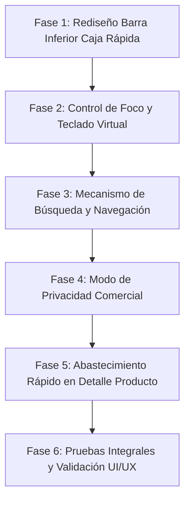

# PLAN DE TRABAJO MAESTRO: MEJORAS EN CAJA RÁPIDA Y DETALLE DE PRODUCTO

**Fecha de elaboración:** 14 de Octubre de 2026  
**Rama activa de trabajo:** `dev/mejoras-v9.0-comercializacion-seguridad`  
**Estado:** Propuesta de Planificación para Revisión y Aprobación del Usuario  

---

## 1. DIAGNÓSTICO PROFUNDO Y COMPRENSIÓN DE LOS PROBLEMAS

A partir del análisis exhaustivo del código fuente y de las capturas de pantalla enviadas (`media_1791952266668.jpg` y `media_1791952269430.jpg`), se han diagnosticado los siguientes problemas estructurales, de interacción y de experiencia de usuario:

```
┌────────────────────────────────────────────────────────────────────────┐
│                          MAPA DE DIAGNÓSTICO                           │
├────────────────────────────────────────────────────────────────────────┤
│ 1. Barra Inferior Caja Rápida   --> Desbordamiento y falta de          │
│                                     responsividad entre Total y Cobro  │
│ 2. Foco y Teclado Virtual       --> Reactivación invasiva al cerrar    │
│                                     modales sin intención del usuario  │
│ 3. Búsqueda por Categorías      --> Atrapamiento en sliver de búsqueda │
│                                     sin botón para volver al carrito   │
│ 4. Modo Privacidad Ganancias    --> Exposición de margen comercial al  │
│                                     girar pantalla al cliente          │
│ 5. Detalle de Producto (Stock)  --> Alerta de stock bajo estática sin  │
│                                     CTA de abastecimiento rápido       │
└────────────────────────────────────────────────────────────────────────┘
```

---

### Detalle de Hallazgos Técnicos

### 1.1. Barra inferior de Caja Rápida: Desbordamiento visual y falta de elasticidad
* **Evidencia visual (Captura 1):** En la parte inferior, la etiqueta verde de ganancia (`Ganancia ~0,73 S/`) compite por espacio horizontal directo con el texto `"TOTAL A COBRAR"` y el botón fucsia `"COBRAR"`. En teléfonos de ancho estándar (360 a 400 dp), la etiqueta verde queda truncada, cortada o se superpone con el botón.
* **Causa raíz en código (`quick_sale_screen.dart`, líneas 721-744):**
  Un `Row` rígido contiene el `Text("TOTAL A COBRAR")` y el badge de ganancia dentro de un `Expanded`, adyacente a un `SizedBox(width: 140)` del botón de cobro. En pantallas compactas, los textos no caben en una sola línea horizontal.
* **Impacto:** Aspecto poco profesional, números cortados y sensación de interfaz descuidada.

---

### 1.2. Foco y teclado virtual invasivo al abrir y cerrar modales
* **Problema reportado:** Cada vez que el usuario abre y cierra un modal (detalle del producto en el carrito, modal de cobro, etc.), el teclado del teléfono se despliega automáticamente sin haber tocado un campo de texto.
* **Causa raíz en código:**
  1. En `quick_sale_screen.dart`, el `FocusNode _searchFocus` está enlazado a la barra superior de búsqueda.
  2. Cuando una ruta modal de Flutter (`showModalBottomSheet` o `showDialog`) se cierra (`Navigator.pop`), el `FocusScope` de la ruta inferior intenta restaurar el foco previo o auto-enfocar el primer `FocusNode` del árbol de widgets, activando el teclado virtual.
  3. El `GestureDetector` de la pantalla solo envolvía al `CustomScrollView`, dejando sin captura de toques de desenfoque al AppBar, la cabecera del cliente y la barra inferior.
* **Impacto:** Fricción continua para el usuario, tapado de pantalla innecesario y experiencia de uso frustrante.

---

### 1.3. Búsqueda por categorías: Atrapamiento del usuario en la vista de búsqueda
* **Problema reportado:** Al pulsar chips de categorías como `"Todas"` o `"abarrotes"`, se despliegan los resultados de búsqueda, pero no existe ninguna forma intuitiva de cancelar o cerrar la búsqueda para regresar al carrito sin verse forzado a elegir un producto.
* **Causa raíz en código (`quick_sale_screen.dart` y `quick_search_provider.dart`):**
  1. Al seleccionar una categoría, `QuickSearchProvider.selectCategory` puebla `_searchResults`.
  2. En `quick_sale_screen.dart`, cuando `searchResults.isNotEmpty`, se sustituyen los slivers del carrito por `_buildSearchResultsSlivers`.
  3. La barra inferior de cobro se oculta condicionalmente con `if (quickProv.cartItems.isNotEmpty && searchProv.searchResults.isEmpty)`.
  4. La cabecera de resultados no incluye ningún botón de `"Cerrar Búsqueda"` o `"Volver al Carrito"`.
  5. Tocar `"Todas"` no limpia la búsqueda, sino que consulta todos los productos públicos, manteniendo `searchResults` lleno.
  6. Tocar la misma categoría activa no la deselecciona (`if (_selectedCategoryId == categoryId) return;`).
* **Impacto:** El usuario queda atrapado en un callejón sin salida visual y operativo.

---

### 1.4. Modo Privacidad Comercial: Ocultar ganancia estimada y márgenes al mostrar la pantalla al cliente
* **Problema planteado:** El comerciante suele girar el teléfono hacia su cliente final para que este valide los productos, cantidades y el precio total. Sin embargo, en Caja Rápida se visualiza:
  1. Header: `"Cliente anónimo · Ganancia est. 0,73 S/"`
  2. Items del carrito: `"· 23% mrg"`
  3. Barra inferior: `"Ganancia ~0,73 S/"`
  Si el cliente final ve estos datos confidenciales de utilidad y margen, puede generar desconfianza, regateos o incomodidad comercial.
* **Requerimiento específico:**
  - Debe existir un mecanismo para ocultar estos datos en toda la ventana.
  - El botón debe ser claro e intuitivo para el comerciante, pero discreto y natural para el cliente final (no debe parecer un botón sospechoso de "ocultar trampa", sino un modo de vista simplificada o icono discreto).
  - Debe extenderse a la ventana de **Detalle de Cotización** (`quotation_detail_screen.dart`) ya sea manual o por IA.
  - **Análisis de Cotización Manual (`manual_quotation_screen.dart`):**  
    *Diagnóstico:* En la cotización manual, el usuario está armando el presupuesto; generalmente esta pantalla no se pone frente al cliente hasta que se genera el detalle o el comprobante. Sin embargo, para mantener coherencia sistémica y tranquilidad total del comerciante si un cliente está observando por encima del hombro mientras cotiza, se propone que la preferencia de privacidad sea **persistente y global para el comerciante**, aplicándose tanto en Caja Rápida como en Detalles de Cotización y Cotización Manual.

---

### 1.5. Detalle de Producto: Alerta de stock bajo estática sin acción rápida de abastecimiento
* **Evidencia visual (Captura 2):**
  - La tarjeta de alerta dice: `"Stock bajo: 1 unidades. Considera reabastecer este producto pronto."`, pero es un contenedor puramente pasivo sin botones ni interacción.
  - En el bloque de `"INFORMACIÓN FINANCIERA"`, el `"PRECIO DE VENTA"` cuenta con un botón táctil de edición, mientras que `"STOCK DISPONIBLE: 1"` es solo texto estático.
* **Requerimiento específico:**
  - Agregar una acción directa de **Abastecer / Editar Stock** en la tarjeta de alerta de stock bajo.
  - Permitir que el comerciante ajuste o agregue unidades de stock recibido de compras reales de forma inmediata y directa.
  - Dotar también a la tarjeta de `"STOCK DISPONIBLE"` de interacción táctil con acceso al mismo flujo rápido.

---

## 2. PLAN DE TRABAJO ESTRUCTURADO EN FASES



---

### FASE 1: Rediseño Visual y Responsivo de la Barra Inferior en Caja Rápida
**Objetivo:** Lograr una barra inferior elástica, limpia, moderna y con jerarquía visual impecable en cualquier resolución.

* **1.1. Reestructuración de la distribución espacial (Flex/Layout):**
  - Reemplazar la fila rígida horizontal por una estructura responsiva donde el bloque de montos se adapte dinámicamente al ancho disponible sin colisionar con el botón `"COBRAR"`.
  - Diseñar una disposición de dos filas compactas a la izquierda:
    - *Fila Superior:* Etiqueta `"TOTAL A COBRAR"` en tipografía secundaria limpia + badge de ganancia estilizado en formato micro-cápsula con padding refinado.
    - *Fila Principal:* Monto total `"4,00 S/"` con `FittedBox` para evitar desbordes aún con cifras altas.
* **1.2. Pulido de los estilos visuales:**
  - Bordes redondeados consistentes (`BorderRadius.circular(16)`).
  - Colores refinados para modo claro y modo oscuro (tonos verdes esmeralda suaves y opacidades acordes al sistema de diseño).
  - Botón `"COBRAR"` con tamaño táctil optimizado (ancho proporcional o auto-ajustable respetando un mínimo de 130 dp).
* **1.3. Archivos a intervenir:**
  - [quick_sale_screen.dart](file:///c:/Users/vjuli/Documents/mochilalista-app/app_movil/lib/features/smart_quotation/screens/quick_sale_screen.dart)

---

### FASE 2: Control Estricto del Foco y Erradicación del Teclado Invasivo
**Objetivo:** Garantizar que el teclado virtual ÚNICAMENTE se despliegue cuando el usuario toque de forma deliberada un campo de texto, y se oculte de inmediato al tocar cualquier área externa o cerrar modales.

* **2.1. Gestión de desenfoque al abrir y cerrar modales:**
  - En `_openDetailModal`, `_processToCheckout`, `_scanBarcode` y selectores de clientes:
    - Aplicar `FocusManager.instance.primaryFocus?.unfocus()` antes de lanzar el modal.
    - Capturar la finalización del modal (`await ...` o `.then(...)`) y ejecutar explícitamente `FocusScope.of(context).unfocus()` y `_searchFocus.unfocus()`.
* **2.2. Prevención de auto-focus por restauración de ruta:**
  - Configurar `_searchFocus.skipTraversal = true` y verificar que ningún widget hijo tenga `autofocus: true`.
* **2.3. Detección global de toques externos (Tap-to-Dismiss):**
  - Envolver el `Scaffold.body` completo con `GestureDetector` configurado con `HitTestBehavior.opaque` para interceptar cualquier toque en espacios libres, cabeceras, divisores o barras y replegar el teclado.
* **2.4. Archivos a intervenir:**
  - [quick_sale_screen.dart](file:///c:/Users/vjuli/Documents/mochilalista-app/app_movil/lib/features/smart_quotation/screens/quick_sale_screen.dart)
  - [quick_sale_detail_modal.dart](file:///c:/Users/vjuli/Documents/mochilalista-app/app_movil/lib/features/smart_quotation/widgets/quick_sale/quick_sale_detail_modal.dart)
  - [quick_checkout_modal.dart](file:///c:/Users/vjuli/Documents/mochilalista-app/app_movil/lib/features/smart_quotation/widgets/quick_sale/quick_checkout_modal.dart)

---

### FASE 3: Mecanismo Flexible de Búsqueda por Categorías y Retorno al Carrito
**Objetivo:** Permitir al usuario explorar categorías sin quedar atrapado, ofreciendo opciones claras para cancelar filtros y volver al carrito cuando lo desee.

* **3.1. Enriquecimiento del `QuickSearchProvider`:**
  - Implementar método explícito `clearSearch()` que limpie `_searchResults`, resetee `_selectedCategoryId = null`, borre `_currentQuery = ''` y notifique a la UI.
  - Modificar `selectCategory(int? id)`:
    - Si se pulsa la categoría que ya está activa, deseleccionarla (`_selectedCategoryId = null`) y, si no hay texto en el buscador, limpiar resultados y volver al carrito.
    - Si se selecciona `"Todas"` y no hay texto escrito en el buscador, limpiar la búsqueda para mostrar el carrito de compras en lugar de consultar todo el catálogo.
* **3.2. Cabecera interactiva en resultados de búsqueda:**
  - En `_buildSearchResultsSlivers`:
    - Agregar un botón prominente y accesible: `[ ✕ Volver al Carrito (N) ]` junto al contador de resultados y botón de ordenamiento.
    - Permitir que el comerciante cierre la vista de resultados con un solo toque sin estar obligado a añadir productos.
* **3.3. Botón de limpieza en la barra de búsqueda:**
  - Incorporar icono de borrado (`Icons.clear` o `Icons.close`) en el sufijo del `TextField` cuando haya texto o filtros activos para reiniciar el estado de forma inmediata.
* **3.4. Archivos a intervenir:**
  - [quick_search_provider.dart](file:///c:/Users/vjuli/Documents/mochilalista-app/app_movil/lib/features/smart_quotation/providers/quick_search_provider.dart)
  - [quick_sale_screen.dart](file:///c:/Users/vjuli/Documents/mochilalista-app/app_movil/lib/features/smart_quotation/screens/quick_sale_screen.dart)

---

### FASE 4: Modo de Privacidad Comercial (Ocultar/Mostrar Ganancia y Margen)
**Objetivo:** Proteger los datos confidenciales de rentabilidad mediante un conmutador discreto y natural, permitiendo girar la pantalla al cliente con total seguridad.

* **4.1. Diseño del Conmutador de Privacidad:**
  - Ubicación: En el `AppBar` de Caja Rápida y de Detalles de Cotización, junto a los iconos de información/notas.
  - Iconografía e interactividad: Icono sutil de visualización (`Icons.visibility_outlined` / `Icons.visibility_off_outlined`) o alternador de "Vista Cliente".
  - Apariencia neutra: Para el cliente parecerá un simple botón de formato de vista o lectura, sin levantar sospechas ni denotar desconfianza.
  - Persistencia: Guardar la preferencia en `SharedPreferences` para que el comerciante pueda mantener su modo favorito activo de manera predeterminada.
* **4.2. Elementos sensibles a ocultar en Caja Rápida:**
  - *Header superior:* Ocultar `"· Ganancia est. X S/"`, mostrando únicamente `"Cliente anónimo"` o el nombre del cliente.
  - *Tarjetas de productos en carrito:* Ocultar la cápsula `"· XX% mrg"`.
  - *Barra inferior:* Ocultar por completo la etiqueta `"Ganancia ~X S/"`.
* **4.3. Implementación en Detalles de Cotización (`quotation_detail_screen.dart`):**
  - Aplicar el mismo botón de visibilidad discreto en el AppBar.
  - Ocultar indicadores de rentabilidad, márgenes o costos unitarios que pudieran exponerse al cliente cuando este revisa la lista cotizada.
* **4.4. Decisión y alcance en Cotización Manual (`manual_quotation_screen.dart`):**
  - *Recomendación técnica:* Integrar la lectura de la misma preferencia de privacidad compartida. Si el usuario activa el modo privacidad, en la cotización manual se ocultarán los márgenes unitarios y costos de adquisición. Esto garantiza una protección integral en caso de que el cliente esté presente mientras se elabora la cotización en vivo.
* **4.5. Archivos a intervenir:**
  - [quick_sale_provider.dart](file:///c:/Users/vjuli/Documents/mochilalista-app/app_movil/lib/features/smart_quotation/providers/quick_sale_provider.dart) (o provider de preferencias comerciales)
  - [quick_sale_screen.dart](file:///c:/Users/vjuli/Documents/mochilalista-app/app_movil/lib/features/smart_quotation/screens/quick_sale_screen.dart)
  - [quick_sale_header.dart](file:///c:/Users/vjuli/Documents/mochilalista-app/app_movil/lib/features/smart_quotation/widgets/quick_sale/quick_sale_header.dart)
  - [quick_sale_cart_item.dart](file:///c:/Users/vjuli/Documents/mochilalista-app/app_movil/lib/features/smart_quotation/widgets/quick_sale/quick_sale_cart_item.dart)
  - [quotation_detail_screen.dart](file:///c:/Users/vjuli/Documents/mochilalista-app/app_movil/lib/features/smart_quotation/screens/quotation_detail_screen.dart)
  - [manual_quotation_screen.dart](file:///c:/Users/vjuli/Documents/mochilalista-app/app_movil/lib/features/smart_quotation/screens/manual_quotation_screen.dart)

---

### FASE 5: Abastecimiento Rápido y Edición de Stock en Detalle de Producto
**Objetivo:** Convertir la tarjeta pasiva de stock bajo y el bloque de stock disponible en un flujo activo, rápido y seguro para actualizar inventario cuando llega mercancía real.

* **5.1. Transformación de la tarjeta de alerta de stock bajo:**
  - Agregar un botón de llamada a la acción (CTA) directo: `[ Abastecer ]` o `[ Ajustar Stock ]` con icono de `Icons.add_business` o `Icons.inventory_2`.
  - Diseñar el botón con estilo secundario armónico (borde suave, color contrastante con la alerta pero visualmente atractivo).
* **5.2. Interacción táctil en la sección de "STOCK DISPONIBLE":**
  - Dotar al bloque de `"STOCK DISPONIBLE"` de un botón táctil con icono de edición (idéntico al de `"PRECIO DE VENTA"` adyacente), permitiendo acceder al mismo modal de abastecimiento rápido.
* **5.3. Creación del Modal de Abastecimiento Rápido (`QuickRestockModal`):**
  - Presentar la información de la variante activa (ej. `Fórmula Láctea 390g - Unidad x1`).
  - Mostrar stock actual registrado.
  - Ofrecer dos modalidades claras e intuitivas:
    1. *Sumar stock recibido:* Entrada numérica para añadir unidades que acaban de llegar (ej. `+12`, calculando automáticamente nuevo stock: `13`).
    2. *Reasignar stock exacto:* Para inventario físico directo.
  - Botón de guardado inmediato que invoque `inventoryProvider.updatePresentation(presentationId, stock: nuevoStock)` y refresque los datos en pantalla al instante (`_refreshData()`).
  - Enlace rápido a `"Edición completa del producto"` (`ProductEditScreen`) por si el comerciante también necesita cambiar costos, precios o proveedores.
* **5.4. Archivos a intervenir:**
  - [product_detail_screen.dart](file:///c:/Users/vjuli/Documents/mochilalista-app/app_movil/lib/features/catalog/screens/product_detail_screen.dart)
  - Nuevo widget modal: `quick_restock_modal.dart` (en `features/catalog/widgets/`).

---

### FASE 6: Pruebas de Regresión, Validación UI/UX y Reporte Final
**Objetivo:** Asegurar calidad técnica de código, 0 advertencias en análisis y perfecta coherencia visual.

* **6.1. Verificación de análisis estático:**
  - Ejecución de `flutter analyze` verificando 0 errores y 0 warnings.
* **6.2. Pruebas funcionales específicas:**
  - Prueba de responsividad de la barra inferior en distintos anchos de pantalla.
  - Prueba de apertura y cierre de modales verificando que el teclado permanezca cerrado.
  - Prueba de navegación de categorías y retorno al carrito sin seleccionar productos.
  - Prueba de activación/desactivación del Modo Privacidad y persistencia.
  - Prueba de ajuste y suma de stock en la variante seleccionada del producto.
* **6.3. Reporte final detallado:**
  - Elaboración de un informe final con evidencias de código y guía de verificación para el usuario.

---

## 3. RESUMEN DE COMPONENTES Y ARCHIVOS AFECTADOS

| Fase | Funcionalidad | Archivos Clave |
|---|---|---|
| **Fase 1** | Responsividad Barra Inferior | `quick_sale_screen.dart` |
| **Fase 2** | Control de Foco y Teclado | `quick_sale_screen.dart`, `quick_sale_detail_modal.dart`, `quick_checkout_modal.dart` |
| **Fase 3** | Cierre de Búsqueda y Categorías | `quick_search_provider.dart`, `quick_sale_screen.dart` |
| **Fase 4** | Modo Privacidad Comercial | `quick_sale_provider.dart`, `quick_sale_screen.dart`, `quick_sale_header.dart`, `quick_sale_cart_item.dart`, `quotation_detail_screen.dart`, `manual_quotation_screen.dart` |
| **Fase 5** | Abastecimiento Rápido de Stock | `product_detail_screen.dart`, nuevo `quick_restock_modal.dart` |
| **Fase 6** | Pruebas e Integración | Tests unitarios y análisis de código Flutter |
