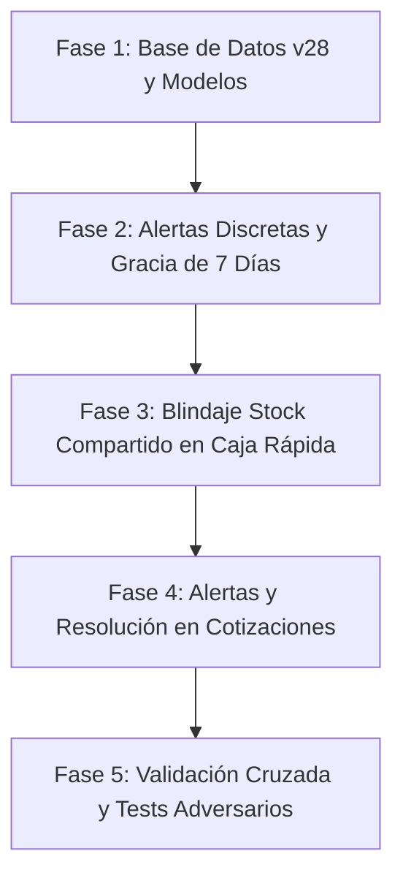

# PLAN MAESTRO: ALERTAS DE STOCK DISCRETAS, BLINDAJE DE STOCK COMPARTIDO EN CAJA RÁPIDA Y GESTIÓN EN LISTAS COTIZADAS

**Documento de Especificación y Plan de Ejecución**  
**Fecha:** Noviembre 2026  
**Metodología:** Loop Autónomo + Árbitro Interno Adversarial  
**Estado:** PENDIENTE DE REVISIÓN Y APROBACIÓN POR EL USUARIO (FASE DE PLANIFICACIÓN - CERO MODIFICACIONES DE CÓDIGO)

---

## 1. RESUMEN EJECUTIVO Y DIAGNÓSTICO FORENSE CON EVIDENCIAS

A partir de la inspección exhaustiva del código fuente del repositorio y el análisis forense de las 5 capturas proporcionadas (`Imágenes 1, 2, 3, 4 y 5`), se han identificado las causas raíces exactas y los cuellos de botella en la lógica de inventario, venta rápida y cotizaciones.

### 1.1 Diagnóstico de la Imagen 1: Detalle de Producto y Alertas en Inventario
* **Problema 1.1 (Alerta prematura en productos nuevos):** En `product_detail_stock_alert.dart` y en los badges de `inventory_item_tile.dart`, la condición de stock bajo se dispara inmediatamente si `stockVisual <= stockAlerta` (por defecto `<= 5`). Cuando un comerciante crea un producto nuevo con 1 o 2 unidades para testear mercado, el sistema lo satura al instante con alertas rojas/naranjas de *"Stock bajo: X unidades — Considera reabastecer este producto pronto"*. La tabla SQLite `productos` cuenta actualmente con `fecha_actualizacion`, pero carece de la columna canónica `fecha_creacion`.
* **Problema 1.2 (Tarjeta de alerta rígida):** La tarjeta naranja de `ProductDetailStockAlert` ocupa un espacio prominente permanente sin opción de colapsar o cerrar temporalmente, saturando la pantalla si el comerciante ya está consciente de la situación.
* **Problema 1.3 (Saturación cromática en pestaña Productos de Inventario):** En `products_tab.dart`, los listados (`inventory_item_tile.dart`, `inventory_compact_tile.dart`, `inventory_grid_card.dart`) muestran badges de stock palpitantes y con colores estridentes (rojo/naranja/verde) sin que el comerciante pueda alternar a un modo visual neutro y discreto.

### 1.2 Diagnóstico de las Imágenes 2, 3, 4 y 5: Fallas Críticas de Stock Compartido en Caja Rápida
* **Fallo A — Banner azul del modal reporta `0 und.` (`Imágenes 3 y 5`):**
  * **Causa Raíz:** En `quick_sale_detail_modal.dart` (líneas 1021-1028), el banner calcula el pool libre llamando a `quickProv.getRemainingPoolStock(_fullProduct!.id, pool)`. Dicha función suma la demanda de **todos** los ítems en el carrito sin excluir la línea que se está editando. Si en el carrito la línea que se abre ya tenía 3 cajas (`3 × 3 = 9` unidades base de las 10 del pool), el cálculo resta esas 9 unidades a las 10 base, dejando 1 base suelta (la cual no alcanza para formar 1 caja de 3), reportando `Inventario base compartido: 0 und. (= máx. 0 Caja)`.
  * **Truncamiento de texto:** En el carrusel horizontal de variantes (`quick_sale_detail_modal.dart`, líneas 1120-1175), el chip `Pack rojo` se recorta como `Pa...` debido a restricciones de ancho y al `ShaderMask` con stops agresivos sin padding compensatorio.
* **Fallo B — Retención de datos fantasmas y bloqueo de stock compartido (`Imágenes 4 y 5`):**
  * **Causa Raíz Principal:** Al cambiar de variante dentro del modal (de `Pack rojo` con 3 cajas a `rojo` con 1 unidad):
    1. En `quick_sale_detail_modal.dart` (`_updateVariant`, líneas 333-360), `availableStock` se precalcula estáticamente y se almacena en el campo inmutable `stock` del `MatchedProduct`.
    2. En `quick_sale_provider.dart` (`updateItemFromModal`, líneas 394-460), al reemplazar la variante anterior (`oldPresentationId != product.presentationId`), se removía la cantidad del mapa pero no se aseguraba la depuración atómica antes de evaluar `_validateSharedStockDemand`.
    3. Cuando el usuario regresa a la pantalla principal de `Caja Rápida` (`Imagen 4`) e intenta presionar `+` sobre `piso - rojo`, `quickProv.updateQuantity` ejecuta `_validateSharedStockDemand`, el cual utilizaba el `item.sharedStockPool` o arrastraba la demanda residual del ítem reemplazado (9 unidades de `Pack rojo`), concluyendo erróneamente que `10 - 9 = 1` y bloqueando el incremento con el mensaje: *"Stock compartido insuficiente. Quedan 1 und. base disponibles (= 1 Unidad)"*, a pesar de que el carrito en ese momento solo tenía `rojo` x 1.
    4. En la `Imagen 5`, al reabrir el modal, arriba se lee `Stock vendible: 10 Unidad`, en el centro `0 und.` y en el chip `rojo • 1 disp.`, demostrando una desincronización total entre los distintos componentes que leen estados divergentes.

### 1.3 Diagnóstico en Listas Cotizadas: Inconsistencia en Stock Compartido
* **Problema:** En `quotation_service.dart` (`validateIntegrity`), cuando una cotización incluye múltiples variantes con `usa_stock_compartido == true` del mismo producto (ejemplo: `rojo` x 6 y `Pack rojo` x 2 cajas = 6 base, total = 12 unidades base para un pool de 10):
  * La validación detecta que la demanda acumulada (12) supera el pool (10) y marca `canSell = false`.
  * **Sin embargo**, al emitir el `StockWarning` individual de cada variante, evalúa cada una contra el total del pool como si la otra no existiera (`rojo` reporta disponible 10, y `Pack rojo` reporta disponible 2 cajas).
  * Al presionar "Corregir Stock" (`_fixAllStock`), el sistema asigna 10 a `rojo` y 2 a `Pack rojo`, manteniendo el conflicto vivo de forma infinita (16 base requeridas).
  * No existe una alerta especializada que indique el conflicto del pozo compartido ni opciones en 1 toque para recortar la variante adecuada o eliminar una de ellas.

---

## 2. PROTOCOLO DEL ÁRBITRO INTERNO ADVERSARIAL (STRESS TESTING Y CASOS LÍMITE)

El Árbitro Interno Adversarial someterá cada cambio propuesto a las siguientes pruebas de estrés:

1. **Escenario de Variantes Múltiples Cruzadas (Modo MIXTO):**
   * Un producto con:
     * Variante A (compartida, factor 1).
     * Variante B (compartida, factor 6).
     * Variante C (independiente, factor 1, stock propio 20).
   * Si el usuario agrega C al carrito, la demanda de C **bajo ninguna circunstancia** debe descontarse del pool de A y B.
2. **Escenario de Reemplazo en Modal sin Persistencia Fantasma:**
   * Agregar 3 cajas de B (18 base de un pool de 20).
   * Abrir modal, cambiar a variante A con 15 unidades.
   * Guardar cambios: el carrito debe reflejar 15 unidades de A (ocupando 15 base) y dejar 5 base libres para reabrir o agregar más. Al tocar `+` en A, debe permitir subir hasta 20 unidades sin trabas.
3. **Escenario de División por Cero y Factores Nulos:**
   * Variantes con `unidades_por_venta <= 0` deben normalizarse automáticamente a 1 para evitar `IntegerDivisionByZeroException`.
4. **Escenario de Productos Antiguos sin `fecha_creacion`:**
   * La base de datos SQLite debe migrar de v27 a v28 agregando la columna `fecha_creacion TEXT`.
   * Si un registro existente tiene `fecha_creacion IS NULL`, debe retroalimentarse con `fecha_actualizacion` o `datetime('now', '-30 days')` para no silenciar alertas de productos viejos.
5. **Persistencia y Rendimiento a 0ms:**
   * Las preferencias de color discreto deben persistir en `SharedPreferences` y reaccionar instantáneamente vía `Provider` sin reconstrucciones masivas innecesarias.

---

## 3. MODELADO MATEMÁTICO E INVARIANTES DE STOCK COMPARTIDO

### 3.1 Invariante de Inmutabilidad de Referencia
* El `stock_compartido` del producto base y el `cupo_maximo_variante` de cada variante son **valores de catálogo de sólo lectura** en el contexto de ventas.
* **Prohibido:** Mutar o reasignar `presentation.stockActual` o `product.stockCompartido` en los modelos del carrito para representar stocks provisionales.

### 3.2 Fórmulas de Disponibilidad en Caja Rápida (Carrito y Modal)
Sea un producto $P$ con pool base total $S_{\text{pool}}$ ($S_{\text{pool}} = P.\text{stockCompartido} > 0 \ ? \ P.\text{stockCompartido} : P.\text{presentaciones}.\text{first}.\text{stockActual}$).

Para cualquier variante evaluada $V$ perteneciente a $P$ ($V.\text{usaStockCompartido} == \text{true}$):

$$\text{DemandaOtrasVariantes}(V, \text{excludeLineId}) = \sum_{\substack{i \in \text{CartItems} \\ i.\text{productId} == P.\text{id} \\ i.\text{usaStockCompartido} \\ i.\text{presentationId} \neq \text{excludeLineId}}} (i.\text{cantidad} \times i.\text{factor})$$

$$\text{BaseDisponibleParaLinea}(V, \text{excludeLineId}) = \max\left(0, \ S_{\text{pool}} - \text{DemandaOtrasVariantes}(V, \text{excludeLineId})\right)$$

$$\text{MáximoFísicoFormable}(V) = \left\lfloor \frac{\text{BaseDisponibleParaLinea}(V, \text{excludeLineId})}{V.\text{factor}} \right\rfloor$$

$$\text{MáximoVendible}(V) = \begin{cases} 
\min\left(V.\text{cupoMaximo}, \ \text{MáximoFísicoFormable}(V)\right) & \text{si } V.\text{cupoMaximo} \neq \text{null} \\
\text{MáximoFísicoFormable}(V) & \text{si } V.\text{cupoMaximo} == \text{null}
\end{cases}$$

### 3.3 Regla de Sincronización en el Modal de Edición de Línea
Cuando se abre el modal para la línea $L$ (con variante inicial $V_0$):
* `excludeLineId` se fija como $L.\text{presentationId}$ para todo el ciclo de vida del modal.
* Al seleccionar cualquier variante $V_x$ dentro del modal, la base disponible para $V_x$ se calcula contra las **demás líneas del carrito**, permitiendo que el usuario asigne libremente hasta $\text{MáximoVendible}(V_x)$ sin que la variante saliente bloquee a la entrante.
* En el banner azul del modal:
  * Mostrar siempre el inventario base compartido total del almacén ($S_{\text{pool}}$).
  * Mostrar las unidades base libres actuales:
    $$\text{BaseLibreModal} = \max\left(0, \ \text{BaseDisponibleParaLinea} - (Q_{\text{modal}} \times V_x.\text{factor})\right)$$

---

## 4. DISEÑO UI / UX DE LAS ALERTAS DISCRETAS

### 4.1 Detalle de Producto (`product_detail_stock_alert.dart`)
1. **Regla de 7 Días de Gracia:**
   * Si `DateTime.now().difference(product.fechaCreacion).inDays < 7`, el widget retorna `SizedBox.shrink()`. Cero hostigamiento en productos recién testeados.
2. **Tarjeta Colapsable con Píldora de Reapertura:**
   * Botón discreto de cierre `IconButton(icon: Icon(Icons.close, size: 18), ...)` en la esquina superior de la alerta naranja.
   * Al pulsar, se activa un estado local `_isDismissed = true` mediante `AnimatedCrossFade`.
   * En estado colapsado, muestra una píldora compacta y elegante:
     * Contenedor con borde ámbar suave, icono `Icons.warning_amber_rounded` (16px), texto *"Alerta de stock bajo (oculta)"* y un icono `Icons.keyboard_arrow_down` para reabrir con un toque.

### 4.2 Inventario: Pestaña Productos (`products_tab.dart` e `inventory_filter_header.dart`)
1. **Interruptor Discreto de Modo de Alerta:**
   * Se añade en la barra de herramientas / filtros un botón discreto (icono `Icons.palette_outlined` / `Icons.notifications_active_outlined` con indicador de estado).
   * Al tocarlo por primera vez o mediante un botón de información, despliega un modal inferior / tooltip limpio:
     > **Colores de Alerta de Stock**  
     > * **Activo (predeterminado):** Resalta en rojo los productos agotados y en naranja aquellos con stock bajo.  
     > * **Desactivado:** Muestra todos los indicadores de stock en un tono neutro y uniforme para una navegación limpia sin alertas visuales invasivas.
2. **Efecto Visual en los Badges de las Variantes:**
   * Cuando `showStockAlertColors == false`:
     * En `inventory_item_tile.dart`, `inventory_compact_tile.dart` y `inventory_grid_card.dart`:
     * Se desactiva la pulsación (`isPulsing = false`).
     * El fondo y texto del badge de stock adoptan tonos neutros (gris azulado/pizarra en modo oscuro, gris suave en modo claro) en lugar de rojo/naranja.
     * La transición entre modos se ejecuta mediante `AnimatedContainer` con duración de 250ms.

---

## 5. BLINDAJE Y GESTIÓN EN LISTAS COTIZADAS

### 5.1 Detección Forense en `quotation_service.dart` (`validateIntegrity`)
1. Agrupar los ítems de la cotización que pertenezcan al mismo producto y tengan `usa_stock_compartido == true`.
2. Calcular la demanda agregada en unidades base: $\sum (\text{qty}_k \times \text{factor}_k)$.
3. Si la demanda acumulada supera el pool compartido:
   * Marcar `canSell = false`.
   * Crear un `SharedStockConflict` especializado que asocie los `itemId` involucrados, el nombre del producto, la base demandada total y la base disponible en almacén.

### 5.2 Alerta Interactiva y Soluciones en 1 Toque (`SmartUpdateModal` y `QuotationDetailScreen`)
1. En `SmartUpdateModal`:
   * Presentar una sección destacada **"Conflicto de Stock Compartido"** con estilo ámbar/rojo distintivo.
   * Detallar: *"El producto [Nombre] cuenta con 10 und. base en almacén, pero las variantes en la cotización suman 12 und. base."*
   * Botones de acción directa por cada variante en conflicto:
     * **"Ajustar a máximo compatible (X unid.)"**: Calcula cuántas unidades de esa variante pueden mantenerse descontando lo que ya ocupa la otra variante.
     * **"Remover de la cotización"**: Elimina la variante para que la otra conserve el stock completo.
2. En `QuoteItemListRow`:
   * Mostrar en las tarjetas de esas variantes un banner explicativo claro: *"Stock compartido en conflicto con otra variante de la lista"*.

### 5.3 Bloqueo de Venta en Checkout y Transacción Atómica
1. En `sales_checkout_screen.dart`: Se bloquea la pantalla si existe conflicto de stock compartido activo (`!validation.canSell`).
2. En `sales_service.dart`: Dentro de la transacción atómica SQLite `txn`, se realiza un pre-chequeo consolidado de todos los ítems compartidos antes de ejecutar cualquier `UPDATE`. Si el balance final proyectado fuera menor a cero, la transacción aborta con un mensaje descriptivo evitando saldos negativos o inconsistencias en el kardex.

---

## 6. FASES DE EJECUCIÓN PASO A PASO (ROADMAP TÉCNICO)

### Fase 1: Migración Canónica de Base de Datos y Capa de Modelos
* **Archivos:**
  * `app_movil/lib/core/database/local_db.dart` (Upgrade a versión 28, añadir columna `fecha_creacion TEXT` en tabla `productos`).
  * `app_movil/lib/features/catalog/models/product_model.dart` (Añadir `fechaCreacion` en `Product`, mapeo `fromJson`, `toJson`, `copyWith`).
  * `app_movil/lib/features/catalog/repositories/product_repository.dart` (Incorporar `fecha_creacion` en `_kProductoColumns` y registrar en inserts).
  * `app_movil/lib/features/smart_quotation/models/matching_model.dart` (Garantizar inmutabilidad de `sharedStockPool` y `cupoMaximoVariante`).

### Fase 2: Alertas Discretas y Plazo de Gracia de 7 Días
* **Archivos:**
  * `app_movil/lib/features/catalog/widgets/detail/product_detail_stock_alert.dart` (Validación `difference.inDays >= 7`, botón cerrar y píldora compacta colapsable con animación).
  * `app_movil/lib/features/catalog/providers/inventory_provider.dart` (Preferencia `showStockAlertColors` con `SharedPreferences` y método de alternancia reactivo).
  * `app_movil/lib/features/catalog/screens/tabs/widgets/inventory_filter_header.dart` (Botón discreto de alternancia de colores de alerta con popover informativo).
  * `app_movil/lib/core/widgets/inventory_item_tile.dart`, `inventory_compact_tile.dart`, `inventory_grid_card.dart` (Aplicación de paleta neutra cuando las alertas de color están desactivadas).

### Fase 3: Blindaje de Stock Compartido en Caja Rápida y Modal de Variantes
* **Archivos:**
  * `app_movil/lib/features/smart_quotation/providers/quick_sale_provider.dart` (Implementar `getBaseOccupiedByOtherVariants`, `getAvailableBaseForLine`, `getMaxVendibleForPresentation`, atomicidad estricta en `updateItemFromModal`).
  * `app_movil/lib/features/smart_quotation/widgets/quick_sale/quick_sale_detail_modal.dart` (Corregir banner azul para excluir la línea en edición, cálculo en tiempo real a 0ms, corregir recorte `Pa...` en chips de variantes con padding y layout elástico).
  * `app_movil/lib/features/smart_quotation/widgets/quick_sale/quick_sale_cart_item.dart` y `quick_sale_screen.dart` (Sincronización en vivo de botones `+` / `-`).

### Fase 4: Alertas y Resolución Interactiva en Listas Cotizadas
* **Archivos:**
  * `app_movil/lib/features/smart_quotation/models/crm_models.dart` (Añadir modelo `SharedStockConflict` en `ValidationResult`).
  * `app_movil/lib/features/smart_quotation/services/quotation_service.dart` (Validación acumulativa agrupada por `producto_id` de variantes compartidas).
  * `app_movil/lib/features/smart_quotation/widgets/smart_update_modal.dart` (UI para conflicto de stock compartido con acciones de ajuste inteligente y eliminación en 1 toque).
  * `app_movil/lib/features/smart_quotation/screens/quotation_detail_screen.dart` (Actualización de `_fixAllStock` para resolver prorrateo sin caer en bucles de sobreasignación).
  * `app_movil/lib/features/smart_quotation/services/sales_service.dart` (Validación transaccional SQLite consolidada previo a la deducción de inventario).

### Fase 5: Batería de Pruebas Automatizadas y Verificación Adversarial
* Pruebas de integración unitarias de cálculo dinámico de stock compartido.
* Pruebas de migración de base de datos de v27 a v28.
* Verificación manual guiada replicando exactamente los pasos de las 5 imágenes adjuntas.

