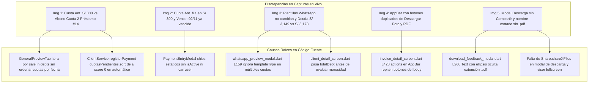
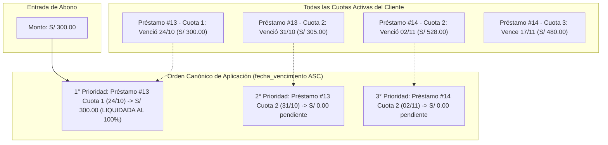
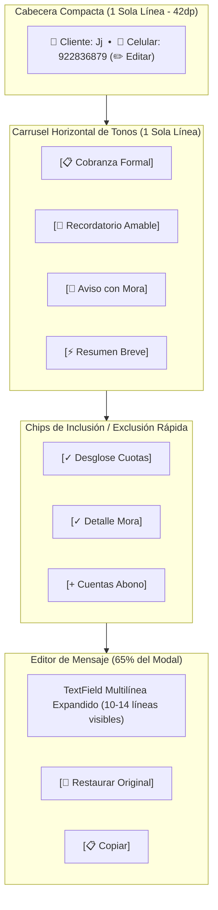
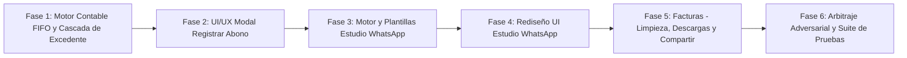
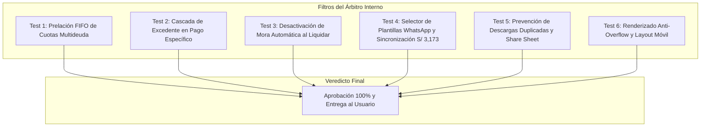

# 🚀 PLAN MAESTRO DE AUDITORÍA Y REINGENIERÍA: REGISTRAR ABONO, ESTUDIO DE WHATSAPP Y EXPORTACIÓN DE FACTURAS

**Documento de Especificación Técnica, Diagnóstico Forense de Código, Reingeniería Contable/UX y Protocolo Adversarial**  
**Proyecto:** MochilaLista App (Local-First SQLite, 0ms Latency, Flutter Mobile - Estándar Mobile Awards)  
**Fecha:** Noviembre 2026  
**Metodología:** Loop Autónomo + Árbitro Interno Adversarial Estricto  
**Estado:** 📋 EN REVISIÓN (Fase de Auditoría y Planificación Forense - **Cero Modificaciones de Código Ejecutadas**)

---

## 📑 ÍNDICE GENERAL

1. [Ficha Técnica y Alcance de la Auditoría](#-1-ficha-técnica-y-alcance-de-la-auditoría)
2. [Diagnóstico Forense de las 5 Capturas y Causa Raíz en Código Fuente](#-2-diagnóstico-forense-de-las-5-capturas-y-causa-raíz-en-código-fuente)
3. [Módulo 1: Auditoría de Lógica Contable y Refinamiento UX en Registrar Abono](#-3-módulo-1-auditoría-de-lógica-contable-y-refinamiento-ux-en-registrar-abono)
4. [Módulo 2: Reparación de Plantillas, Layout Expandido y Personalización en Estudio de WhatsApp](#-4-módulo-2-reparación-de-plantillas-layout-expandido-y-personalización-en-estudio-de-whatsapp)
5. [Módulo 3: Limpieza de Cabecera, Detección de Descargas y Compartir en Facturas Escaneadas](#-5-módulo-3-limpieza-de-cabecera-detección-de-descargas-y-compartir-en-facturas-escaneadas)
6. [Plan de Trabajo Detallado por Fases de Implementación](#-6-plan-de-trabajo-detallado-por-fases-de-implementación)
7. [Protocolo del Árbitro Interno Adversarial y Matriz de Pruebas Automatizadas](#-7-protocolo-del-árbitro-interno-adversarial-y-matriz-de-pruebas-automatizadas)

---

## 📌 1. FICHA TÉCNICA Y ALCANCE DE LA AUDITORÍA

El presente plan aborda tres módulos de alta sensibilidad comercial y financiera en la aplicación MochilaLista. Cada módulo presenta un punto de fricción crítico detectado durante pruebas en vivo con datos reales:

1. **`Registrar Abono` (`PaymentEntryModal`, `GeneralPreviewTab`, `ClientService`):**
   * Descoordinación entre el botón de sugerencia rápida (`Cuota Ant.`) y el motor de previsualización/aplicación automática de pagos.
   * Carencia de prelación cronológica estricta por fecha de vencimiento (`fecha_vencimiento ASC`) a través de múltiples deudas y préstamos del cliente.
   * Comportamiento en `Pago Específico`: falta de amortización inteligente de excedentes hacia cuotas posteriores del mismo préstamo y badges de vencimiento estáticos.
   * Necesidad de carrusel dinámico de montos con estados animados de selección y cierre suave de teclado al tocar fuera.
2. **`Estudio de WhatsApp` (`WhatsAppPreviewModal`, `ClientDetailScreen`, `NotificationsScreen`):**
   * Bug crítico que congela el texto editable e ignora el selector de plantillas cuando existen múltiples cuotas vencidas.
   * Desincronización de deuda exigible entre el perfil del cliente/abonos (`S/ 3,173.00`) y el texto de WhatsApp (`S/ 3,149.00`).
   * Colapso del espacio vertical para el editor de texto debido a campos y chips sobredimensionados en la cabecera.
   * Necesidad de chips modulares de contenido rápido (`[✓ Desglose]`, `[✓ Detalle Mora]`, `[+ Cuentas]`) y botones de utilidad (`[🔄 Restaurar]`, `[📋 Copiar]`).
3. **`Detalle de Factura Escaneada` (`InvoiceDetailScreen`, `DownloadFeedbackModal`, `InvoiceFileService`):**
   * Iconos duplicados de descarga en el `AppBar` que saturan la barra de navegación.
   * Ausencia de memoria de descarga en los botones principales, provocando descargas redundantes del mismo archivo.
   * Modal de confirmación sin opción de compartir por WhatsApp/apps nativas y truncamiento de la extensión `.pdf`.
   * Falta de visor a pantalla completa con zoom interactivo para la foto del comprobante.

### Módulos y Archivos Involucrados en la Auditoría:
* **Módulo de Abonos y Contabilidad CRM:**
  * `app_movil/lib/features/smart_quotation/widgets/crm/payment_entry_modal.dart`
  * `app_movil/lib/features/smart_quotation/widgets/crm/general_preview_tab.dart`
  * `app_movil/lib/features/smart_quotation/services/client_service.dart`
  * `app_movil/lib/features/smart_quotation/providers/tracking_provider.dart`
  * `app_movil/lib/features/smart_quotation/models/crm_models.dart`
* **Módulo de Estudio de WhatsApp:**
  * `app_movil/lib/features/smart_quotation/widgets/history/detail_widgets/whatsapp_preview_modal.dart`
  * `app_movil/lib/features/smart_quotation/screens/crm/client_detail_screen.dart`
  * `app_movil/lib/features/profile/screens/notifications_screen.dart`
  * `app_movil/lib/core/utils/cuota_date_helper.dart`
* **Módulo de Facturas Escaneadas y Exportación:**
  * `app_movil/lib/features/scanner/screens/invoice_detail_screen.dart`
  * `app_movil/lib/features/scanner/widgets/shared/download_feedback_modal.dart`
  * `app_movil/lib/features/scanner/services/invoice_file_service.dart`
  * `app_movil/lib/features/scanner/services/invoice_pdf_report_service.dart`

---

## 📸 2. DIAGNÓSTICO FORENSE DE LAS 5 CAPTURAS Y CAUSA RAÍZ EN CÓDIGO FUENTE

A continuación se detalla la correspondencia exacta entre cada captura enviada por el usuario y su causa raíz en el código fuente:



### Tabla Forense Comparativa:

| Captura | Módulo / Pantalla | Síntoma Visible en la Imagen | Causa Raíz Exacta en Código Fuente |
| :--- | :--- | :--- | :--- |
| **Imagen 1** | `Registrar Abono` (`Distribución Automática`) | • Sugerencia rápida dice `Cuota Ant. S/ 300.00` (perteneciente al Préstamo #13 con vencimiento 24/10).<br>• Sin embargo, abajo en la lista de aplicación dice: `Abono parcial a Cuota 2 (Préstamo #14) S/ 300.00`. | • **`general_preview_tab.dart` (L40-L73):** El bucle recorre `for (var sale in debts) { for (var cuota in sale.installments) }`. Procesa venta por venta en el orden en que vinieron de la BD sin aplanar ni ordenar las cuotas por `fecha_vencimiento ASC`.<br>• **`client_service.dart` (L938-L950):** En `registerPayment`, cuando `cuotaId == null` y `ventaId == null`, `scoreA` y `scoreB` quedan en 0, conservando el orden de consulta de ventas (`ventas` de #14 antes de #13) en vez de ordenar por vencimiento. |
| **Imagen 2** | `Registrar Abono` (`Pago Específico`) | • La etiqueta `Cuota Ant.` permanece coloreada en ámbar como si estuviera fija, a pesar de que el monto en el campo es `S/ 528.00`.<br>• En la lista, la Cuota 2 dice `Vence: 02/11` cuando en la fecha actual (`07/11`) ya está vencida.<br>• No se especifica si los `S/ 528.00` incluyen morosidad acumulada. | • **`payment_entry_modal.dart` (L654-L696):** Los chips de monto rápido son un `Row` estático con 3 tarjetas fijas; no evalúan `enteredAmount == amount` para resaltar el chip activo.<br>• **`payment_entry_modal.dart` (L1076):** Hardcodea `Text("Vence: ${DateFormat('dd/MM').format(cuota.dueDate)}")` sin validar si `dueDate.isBefore(DateTime.now())`.<br>• **`payment_entry_modal.dart` (L1086-L1093):** Muestra sólo `Pendiente: AppCurrency.format(faltaCuota)` sin discriminar `moraMonto`. |
| **Imagen 3** | `Estudio de WhatsApp` | • Al tocar los botones en `PLANTILLAS SUGERIDAS` (`Cobranza / Desglose`, `Recordatorio Amable`, `Cuentas de Abono`), el texto del mensaje no cambia en absoluto.<br>• El mensaje cita una deuda de `*S/ 3,149.00*`, mientras que en `Registrar Abono` (Img 1 y 2) la deuda total es `S/ 3,173.00` (diferencia de `S/ 24.00` de mora).<br>• El área de texto está muy comprimida por los campos superiores. | • **`whatsapp_preview_modal.dart` (L159-L211):** En el bloque de `multipleCuotas`, la función `_generateInitialMessage` ignora por completo el parámetro `templateType`. Genera siempre el mismo texto hardcodeado.<br>• **`client_detail_screen.dart` (L83-L94 y L198-L205):** `_launchWhatsApp` envía `_currentClient.totalDebt`, el cual fue cargado antes de que `loadClientDebts` ejecutara `evaluarMorosidadPeriodica` (que sumó los `S/ 24.00` de mora).<br>• **`whatsapp_preview_modal.dart` (L278-L351):** Los campos de cliente y teléfono ocupan una fila entera y los ChoiceChips un Wrap de dos filas, restando altura al editor. |
| **Imagen 4** | `Detalle Factura #19` | • En el `AppBar` superior aparecen los iconos `[⬇️]` y `[📄 PDF]`, mientras que en el cuerpo de la pantalla aparecen dos botones prominentes `[⬇️ Descargar Foto]` y `[📄 Reporte PDF]`. | • **`invoice_detail_screen.dart` (L428-L437):** El `AppBar.actions` contiene dos `IconButton` redundantes que ejecutan exactamente `_downloadScannedImage` y `_downloadPdfReport`. |
| **Imagen 5** | Modal `¡Descarga Exitosa!` | • El nombre del archivo se trunca con puntos suspensivos sin mostrar la extensión `.pdf`.<br>• Solo existen botones `Cerrar` y `Abrir Archivo`; falta opción para compartir directamente (WhatsApp, correo, etc.).<br>• Si se vuelve a tocar el botón en la pantalla principal, vuelve a descargar el archivo generando duplicados `_HHmmss.pdf`. | • **`download_feedback_modal.dart` (L267-L277):** `Text(fileName, maxLines: 2, overflow: TextOverflow.ellipsis)` trunca el final del string donde reside `.pdf`.<br>• **`download_feedback_modal.dart` (L302-L349):** La fila inferior solo tiene `OutlinedButton(Cerrar)` y `ElevatedButton(Abrir Archivo)`.<br>• **`invoice_detail_screen.dart` (L737-L770):** Los botones no guardan estado de si el archivo ya fue descargado en esta sesión o existe en Descargas. |

---

## 💰 3. MÓDULO 1: AUDITORÍA DE LÓGICA CONTABLE Y REFINAMIENTO UX EN REGISTRAR ABONO

### 3.1. Modelo Matemático y Regla de Prelación Cronológica Estricta (FIFO de Cuotas)

#### Problema Detectado:
En un sistema financiero multiventas/créditos, la prelación contable canónica exige que el dinero recibido cubra primero la obligación más exigible en el tiempo, sin importar si proviene de la Venta A o del Préstamo B.
En la `Imagen 1`, el cliente tiene:
* **Préstamo #13:** Cuota 1 vencida el `24/10` por `S/ 300.00`; Cuota 2 vencida el `31/10` por `S/ 305.00`.
* **Préstamo #14:** Cuota 2 vencida el `02/11` por `S/ 528.00`; Cuota 3 vence el `17/11` por `S/ 480.00`.

Al ingresar `S/ 300.00`, el sistema **debe liquidar la Cuota 1 del Préstamo #13 (vencida el 24/10)**, dejando intactas las cuotas posteriores.



#### Blindaje en `GeneralPreviewTab` y `ClientService.registerPayment`:
1. **Aplanamiento Cronológico Unificado:**
   Tanto en la previsualización (`GeneralPreviewTab`) como en el procesamiento real (`ClientService.registerPayment`), se compilarán todas las cuotas de todas las ventas/préstamos pendientes en una sola lista unificada de cuotas candidatas.
2. **Criterio de Ordenamiento Canónico:**
   ```dart
   todasLasCuotas.sort((a, b) {
     final dateA = DateTime.tryParse(a['fecha_vencimiento'] ?? '') ?? DateTime(2099);
     final dateB = DateTime.tryParse(b['fecha_vencimiento'] ?? '') ?? DateTime(2099);
     final compDate = dateA.compareTo(dateB);
     if (compDate != 0) return compDate; // Vencimiento más antiguo primero
     return (a['numero_cuota'] as int).compareTo(b['numero_cuota'] as int);
   });
   ```
3. **Liquidación y Desactivación de Morosidad:**
   * El saldo real exigible de cada cuota se calcula como:  
     $$\text{Saldo Exigible} = \text{monto} - \text{monto\_pagado}$$
     *(donde `monto` ya integra `monto_original + mora_monto`).*
   * Cuando $(\text{Saldo Exigible} - \text{Abono}) \le 0.01$:
     * Estado de cuota pasa a `'pagado'`.
     * Campo `'mora_automatica'` se actualiza a `0` (blindaje anti-reaplicación).
     * Se resuelve la alerta en el Centro de Notificaciones (`is_resolved = 1`).

---

### 3.2. Lógica de Pago Específico con Cascada de Excedente en la Misma Operación

#### Regla de Negocio:
Cuando el comerciante selecciona una cuota específica (ej. Cuota 2 de `S/ 528.00` del Préstamo #14) e ingresa un monto mayor (ej. `S/ 600.00`):
1. **Paso 1:** Se amortizan los primeros `S/ 528.00` cancelando al 100% la Cuota 2.
2. **Paso 2:** El excedente de `S/ 72.00` **no debe saltar a otra venta al azar ni tratarse como vuelto sin previo aviso**, sino aplicarse inteligentemente a la **siguiente cuota del mismo préstamo/venta** (Cuota 3, reduciendo su saldo de `S/ 480.00` a `S/ 408.00`).
3. **Paso 3:** Si todas las cuotas de ese préstamo/venta quedan completamente saldadas y aún resta dinero, recién allí se activa el banner de excedente para decidir si se da como vuelto o se guarda como saldo a favor.
4. **Previsualización en Vivo en Pago Específico:**
   Debajo de la lista de cuotas, cuando el monto ingresado supera la cuota seleccionada, se renderizará un card dinámico de impacto:
   > 💡 *Se liquidará la Cuota 2 (S/ 528.00) y el excedente de S/ 72.00 se abonará a la Cuota 3 de este mismo préstamo.*

#### Badges y Fechas de Vencimiento en Lista de Cuotas:
En `_buildSpecificSelectionTab`:
* Si `DateTime.parse(cuota.dueDate).isBefore(DateTime.now())`:
  * Renderizar badge: `Venció: dd/MM` con fondo `Colors.red.withOpacity(0.15)` y texto rojo/ámbar.
* Si `cuota.tieneMora` (`cuota.moraMonto > 0.01`):
  * Subtitle: `Pendiente: S/ 528.00 (incl. +S/ 48.00 mora)` con tipografía clara y sin sobrecargar la tarjeta.

---

### 3.3. Refinamiento UX: Carrusel Horizontal de Montos Rápidos y Teclado Suave

1. **Estructura del Método de Pago:**  
   * **REGLA ESTRICTA:** Mantener 100% intacta la fila deslizable horizontal de `Método de Pago` (`Efectivo`, `Yape`, `Plin`, `Transferencia`, `Tarjeta`, `Saldo a Favor`).
2. **Carrusel Horizontal de Montos Rápidos (1 sola línea):**
   * Reemplazar el `Row` de 3 cards fijas por un `SingleChildScrollView(scrollDirection: Axis.horizontal, physics: BouncingScrollPhysics())`.
   * Incluir 5 etiquetas dinámicas de alta utilidad para el comerciante:
     1. `Cuota más antigua` (monto exacto de la cuota con mayor atraso).
     2. `Total Vencido` (suma de todas las cuotas vencidas a la fecha).
     3. `Próxima Cuota` (monto de la cuota vigente más próxima a vencer).
     4. `50% Deuda` (`totalDebt / 2`).
     5. `Deuda Total` (`totalDebt`).
   * **Indicador de Selección Activa:**  
     Detectar cuando `(enteredAmount - tagAmount).abs() < 0.01`. Si coincide, aplicar `AnimatedContainer`:
     * Borde verde esmeralda `2px`.
     * Fondo resaltado tenue.
     * Pequeño icono `✓` a la izquierda del texto.
3. **Cierre de Teclado y Desactivación de Foco:**
   * Envolver el modal en `GestureDetector(behavior: HitTestBehavior.translucent, onTap: () => FocusScope.of(context).unfocus())`.
   * En el `TextField` de monto: agregar `onTapOutside: (_) => FocusScope.of(context).unfocus()`.

---

## 💬 4. MÓDULO 2: REPARACIÓN DE PLANTILLAS, LAYOUT EXPANDIDO Y PERSONALIZACIÓN EN ESTUDIO DE WHATSAPP

### 4.1. Reparación del Bug Crítico de Plantillas en Múltiples Cuotas

#### Causa Raíz:
En `whatsapp_preview_modal.dart` (L159-L211), cuando `widget.multipleCuotas != null`, la función `_generateInitialMessage(String templateType)` ignora por completo la variable `templateType`.

#### Nueva Matriz de Plantillas de Tono para Múltiples Cuotas:

| ID Plantilla | Nombre Visible | Enfoque y Tono del Mensaje | Estructura Generada |
| :--- | :--- | :--- | :--- |
| `'formal'` | `📋 Cobranza Formal` | Ejecutivo, claro y detallado. | Saludo con nombre, aviso de cuotas en observación, desglose de cada cuota con días de mora, total exigible y canales de pago. |
| `'cordial'` | `🤝 Recordatorio Amable` | Cercano, conciliador y empático. | Saludo afectuoso, recordatorio de cuotas pendientes sin tono de intimación, invitación cordial a regularizar. |
| `'mora'` | `🚨 Aviso con Mora` | Firme, con énfasis en recargos por mora. | Notificación de recargos acumulados, advertencia de incremento diario de mora e invitación a frenar los intereses pagando hoy. |
| `'resumen'` | `⚡ Resumen Breve` | Ultra-compacto (3 líneas). | *Hola [Nombre] 👋. Mantienes [N] cuotas pendientes por un total de S/ [Total]. Canales de abono: Yape/Plin.* |

---

### 4.2. Sincronización de Deuda Exigible y Morosidad (`S/ 3,173.00` vs `S/ 3,149.00`)

1. **Causa de la Discrepancia:**
   En `client_detail_screen.dart`, la secuencia de refresco cargaba `freshClient` **antes** de llamar a `loadClientDebts`. Al correr `loadClientDebts`, `SalesService.evaluarMorosidadPeriodica` detectó y aplicó `S/ 24.00` de mora en SQLite. Sin embargo, `_currentClient` no se actualizó, manteniendo la deuda desfasada en `S/ 3,149.00`.
2. **Corrección Arquitectónica:**
   * En `client_detail_screen.dart`, invertir el orden: ejecutar primero `evaluarMorosidadPeriodica` y `loadClientDebts`, y recién obtener el `freshClient` actualizado.
   * En `whatsapp_preview_modal.dart`, calcular en tiempo real el saldo exigible a partir de la lista de cuotas:  
     $$\text{Total Exigible} = \sum (\text{monto} - \text{monto\_pagado})$$
     Garantizando paridad total a 0ms con el modal de `Registrar Abono`.

---

### 4.3. Rediseño UX: Espacio Vertical Máximo y Chips Modulares de Contenido



* **Barra Superior Compacta de 1 Línea:**  
  Reemplaza los dos TextFields gigantes por una tira horizontal elegante: avatar del cliente, nombre completo en negrita y chip editable con el número de WhatsApp.
* **Chips Modulares de Contenido Rápido:**
  * `[✓ Desglose de Cuotas]`: Al apagarlo, oculta la lista detallada y deja solo el saldo total.
  * `[✓ Detalle de Mora]`: Al apagarlo, muestra los montos consolidados sin desglosar base + mora.
  * `[+ Cuentas de Abono]`: Agrega al pie del mensaje los datos oficiales de Yape, Plin y cuentas bancarias del negocio.
* **Herramientas Rápidas en la Cabecera del Cuadro de Texto:**
  * `[🔄 Restaurar]`: Regenera el mensaje según los chips activos.
  * `[📋 Copiar]`: Copia el contenido del editor al portapapeles.

---

## 📄 5. MÓDULO 3: LIMPIEZA DE CABECERA, DETECCIÓN DE DESCARGAS Y COMPARTIR EN FACTURAS ESCANEADAS

### 5.1. Limpieza del `AppBar` y Eliminación de Acciones Redundantes
En `invoice_detail_screen.dart` (L428-L437):
* **Eliminar** los dos `IconButton` del `AppBar` (`Icons.download_rounded` y `Icons.picture_as_pdf_outlined`).
* **Conservar únicamente** el `InfoTooltipButton` informativo.
* Toda la interacción de descarga y exportación se concentrará en los botones grandes del cuerpo de la pantalla: `[⬇️ Descargar Foto]` y `[📄 Reporte PDF]`, que proporcionan texto explicativo y estados visuales claros.

---

### 5.2. Persistencia de Descarga y Prevención de Duplicados

1. **Detección de Archivos Existentes:**  
   Al abrir la pantalla y al completar una descarga, verificar si los archivos correspondientes ya existen físicamente en la carpeta pública de descargas (`getPublicDownloadsDirectory()`):
   * Foto: `Factura_[ID]_[PROVEEDOR].[ext]`
   * Reporte: `Factura_[ID]_Reporte_[PROVEEDOR]_[FECHA].pdf`
2. **Feedback Visual en Botones Principales:**
   * **Estado Inicial:** Estilo actual (`Descargar Foto` / `Reporte PDF`).
   * **Estado Generando/Descargando:** Pequeño spinner `SizedBox(width: 16, height: 16, child: CircularProgressIndicator(strokeWidth: 2))` reemplazando el icono.
   * **Estado Descargado:** Botón adquiere borde y texto verde suave con icono `Icons.check_circle_rounded` y etiqueta `✓ Foto Guardada` / `✓ PDF Guardado`.
3. **Diálogo de Archivo Ya Descargado:**  
   Si el usuario presiona un botón cuyo archivo ya fue descargado previamente, no se genera un nuevo duplicado `_HHmmss.pdf`. En su lugar, se abre un BottomSheet elegante:
   * **Título:** `Archivo ya disponible en Descargas`
   * **Nombre:** Nombre exacto del archivo con badge de extensión.
   * **3 Acciones Inmediatas:**
     * `[📂 Abrir Archivo]`: Abre con el visor nativo mediante `OpenFilex.open()`.
     * `[📤 Compartir Archivo]`: Abre el share sheet nativo mediante `Share.shareXFiles()`.
     * `[🔄 Volver a Descargar]`: Fuerza una re-descarga sobrescribiendo o actualizando el archivo.

---

### 5.3. Nueva Función Compartir, Protección de Extensión y Visor Fullscreen

1. **Mejoras en `DownloadFeedbackModal`:**
   * **Corrección de Truncamiento:** Mostrar el nombre base con elipsis central y la extensión `.pdf` o `.jpg` en un badge destacado que **nunca se oculte**, garantizando que el usuario siempre vea el formato del archivo descargado.
   * **Botón `[📤 Compartir]` Integrado:** Añadir un botón en la fila inferior junto a `Cerrar` y `Abrir Archivo` que invoque `Share.shareXFiles([XFile(file.path)])`.
2. **Visor de Foto a Pantalla Completa (`InteractiveViewer`):**
   * Permitir tocar la miniatura de la factura o presionar un botón de zoom para abrir un diálogo a pantalla completa (`Dialog.fullscreen`).
   * Fondo negro inmersivo con `InteractiveViewer(minScale: 1.0, maxScale: 6.0)`.
   * Doble tap para zoom rápido al 2.5x y botón de compartir flotante en la esquina superior.

---

## 🛠️ 6. PLAN DE TRABAJO DETALLADO POR FASES DE IMPLEMENTACIÓN



### FASE 1: Motor Contable de Distribución Automática y Cascada de Excedente Específico
* **Archivos:** `client_service.dart`, `general_preview_tab.dart`, `crm_models.dart`.
* **Tareas Técnicas:**
  1. Refactorizar `ClientService.registerPayment` para que, en modo automático (`isAutomatic == true` o `cuotaId == null && ventaId == null`), compile todas las cuotas de todas las ventas/préstamos pendientes y las ordene estrictamente por `fecha_vencimiento ASC` (FIFO canónico).
  2. Actualizar `GeneralPreviewTab` para replicar con exactitud matemática el mismo ordenamiento de cuotas por vencimiento cronológico, garantizando paridad 1:1 entre lo previsualizado y lo ejecutado.
  3. En modo específico (`cuotaId != null`), implementar la cascada de excedente: amortizar al 100% la cuota seleccionada y asignar cualquier monto sobrante a las siguientes cuotas de esa misma venta/préstamo en orden de cuota.
  4. Asegurar que al liquidar una cuota (`saldo <= 0.01`), se actualice `mora_automatica = 0` y se resuelva la notificación asociada.

### FASE 2: Refinamiento UI/UX en Modal Registrar Abono
* **Archivos:** `payment_entry_modal.dart`.
* **Tareas Técnicas:**
  1. Conservar intacto el diseño actual de la fila de `Método de Pago`.
  2. Reemplazar la fila rígida de 3 etiquetas de monto por un carrusel horizontal fluido (`SingleChildScrollView` con `Axis.horizontal`), añadiendo las 5 etiquetas: `Cuota más antigua`, `Total Vencido`, `Próxima Cuota`, `50% Deuda`, `Deuda Total`.
  3. Implementar micro-animación y estado activo destacado (`AnimatedContainer`, borde verde esmeralda e icono `✓`) cuando el monto ingresado coincida con una etiqueta.
  4. En la pestaña de `Pago Específico`, corregir los badges de fecha para mostrar `Venció: dd/MM` en rojo/ámbar cuando la fecha sea anterior a hoy, y mostrar el desglose de morosidad (`incl. +S/ XX.XX mora`).
  5. En `Pago Específico`, renderizar un preview en vivo del impacto contable si el monto supera el saldo de la cuota seleccionada.
  6. Implementar `onTapOutside: (_) => FocusScope.of(context).unfocus()` en el `TextField` de monto y en el cuerpo del modal.

### FASE 3: Motor Contable y Generador de Mensajes en Estudio de WhatsApp
* **Archivos:** `whatsapp_preview_modal.dart`, `client_detail_screen.dart`, `notifications_screen.dart`.
* **Tareas Técnicas:**
  1. Refactorizar `_generateInitialMessage` en `whatsapp_preview_modal.dart` para soportar las 4 plantillas de tono (`formal`, `cordial`, `mora`, `resumen`) tanto en cuotas individuales como en múltiples cuotas vencidas.
  2. Implementar los chips modulares de contenido: `[✓ Desglose de Cuotas]`, `[✓ Detalle de Mora]` y `[+ Cuentas de Abono]`, regenerando dinámicamente el mensaje sin perder el tono seleccionado.
  3. Corregir la secuencia de refresco en `client_detail_screen.dart` para asegurar que `evaluarMorosidadPeriodica` y `loadClientDebts` se ejecuten antes de consultar `_currentClient`, sincronizando el total exigible a `S/ 3,173.00`.
  4. Calcular la deuda total exigible en el modal sumando directamente las cuotas activas, garantizando paridad a 0ms.

### FASE 4: Rediseño de Layout y Optimización Vertical en Estudio de WhatsApp
* **Archivos:** `whatsapp_preview_modal.dart`.
* **Tareas Técnicas:**
  1. Compactar la cabecera del cliente y celular en una sola línea horizontal estilizada con avatar, nombre y chip de teléfono con opción de edición.
  2. Colocar los selectores de plantilla en un carrusel horizontal de 1 sola línea (`SingleChildScrollView`).
  3. Expandir el área del `TextField` de mensaje editable para que ocupe el ~65% de la altura del modal, ofreciendo una visualización amplia y cómoda.
  4. Añadir botones de utilidad en la cabecera del editor: `[🔄 Restaurar original]` y `[📋 Copiar]`.
  5. Añadir `onTapOutside` en el editor para cerrar el teclado táctil al tocar fuera.

### FASE 5: Limpieza, Persistencia de Descarga y Compartir en Facturas
* **Archivos:** `invoice_detail_screen.dart`, `download_feedback_modal.dart`, `invoice_file_service.dart`.
* **Tareas Técnicas:**
  1. Eliminar los dos iconos duplicados de descarga en el `AppBar` de `invoice_detail_screen.dart`, conservando únicamente el `InfoTooltipButton`.
  2. Agregar variables de estado en `InvoiceDetailScreen` para rastrear si la foto o el PDF ya fueron descargados, con verificación en el sistema de archivos.
  3. Añadir estados visuales y animaciones a los botones principales `[Descargar Foto]` y `[Reporte PDF]`: estado de carga y estado descargado `[✓ Foto Guardada]` / `[✓ PDF Guardado]`.
  4. Implementar diálogo/sheet de "Archivo ya descargado" cuando se presione un botón cuyo archivo ya existe, con las opciones `[📂 Abrir]`, `[📤 Compartir]` y `[🔄 Re-descargar]`.
  5. En `download_feedback_modal.dart`, integrar la función `[📤 Compartir]` con `Share.shareXFiles([XFile(_savedFile!.path)])` y blindar la visualización del nombre de archivo para que la extensión `.pdf` nunca se oculte.
  6. Añadir visor de foto a pantalla completa con zoom interactivo (`InteractiveViewer`).

### FASE 6: Arbitraje Interno Adversarial y Suite de Pruebas Automatizadas
* **Archivos:** `test/abonos_whatsapp_facturas_adversarial_test.dart`.
* **Tareas Técnicas:**
  1. Crear una batería de pruebas unitarias y de widgets que cubran exhaustivamente los casos límite contables y de interfaz.
  2. Ejecutar `flutter test` garantizando 100% de tests aprobados sin advertencias de deprecación ni fallos de renderizado.

---

## ⚖️ 7. PROTOCOLO DEL ÁRBITRO INTERNO ADVERSARIAL Y MATRIZ DE PRUEBAS

Para asegurar que ninguna de las correcciones introduzca regresiones en la contabilidad, el almacenamiento local o la experiencia de usuario, se ejecutará el siguiente protocolo adversarial:



### Matriz de Casos de Prueba Adversariales:

| ID | Área / Módulo | Escenario de Prueba Adversarial | Criterio de Aceptación Estricto |
| :--- | :--- | :--- | :--- |
| **TC-01** | **Contabilidad Abonos** | Cliente con Préstamo #13 (vence 24/10) y Préstamo #14 (vence 02/11). Abono automático de S/ 300.00. | `GeneralPreviewTab` y `ClientService.registerPayment` aplican el abono al 100% sobre la Cuota 1 del Préstamo #13. Préstamo #14 permanece sin modificaciones. |
| **TC-02** | **Pago Específico** | Usuario selecciona Cuota 2 de Préstamo #14 (deuda S/ 528.00) y abona S/ 600.00. | Cuota 2 se liquida al 100% (S/ 528.00) y el excedente de S/ 72.00 se amortiza automáticamente a la Cuota 3 de ese mismo préstamo. |
| **TC-03** | **Morosidad** | Cuota con morosidad acumulada se liquida al 100%. | El campo `mora_automatica` en SQLite pasa a `0`, impidiendo que el motor nocturno vuelva a cargar moras sobre una cuota ya saldada. |
| **TC-04** | **WhatsApp Preview** | Cliente con 4 cuotas vencidas. Usuario cambia entre las 4 plantillas de tono. | El texto en el `TextEditingController` cambia instantáneamente reflejando el tono y la estructura de cada plantilla. |
| **TC-05** | **WhatsApp Preview** | Cliente con mora acumulada abre el modal de WhatsApp. | La deuda total exigible en el mensaje muestra exactamente `S/ 3,173.00`, coincidiendo 1:1 con la deuda del modal de Abonos. |
| **TC-06** | **Factura Detalle** | Apertura de pantalla `Factura #19`. | El `AppBar` no contiene botones de descarga. Los únicos botones de descarga están en el cuerpo. |
| **TC-07** | **Factura Descargas** | Usuario descarga el PDF y luego vuelve a presionar el botón de PDF. | No se descarga un segundo archivo duplicado en el sistema de archivos. Se abre el sheet de archivo existente con opciones de Abrir, Compartir y Re-descargar. |
| **TC-08** | **Modal Descarga** | Finaliza la descarga de un PDF con nombre largo. | El texto muestra la extensión `.pdf` sin cortes y el botón `Compartir` está presente y operativo. |

---

## 📌 CONCLUSIÓN Y PRÓXIMOS PASOS

Este documento representa la auditoría completa, el diagnóstico forense en código y la planificación arquitectónica detallada para solucionar los tres módulos sin alterar la armonía visual de la aplicación.

**En espera de su revisión y aprobación del plan para iniciar inmediatamente la ejecución en código (Fases 1 a 6).**

