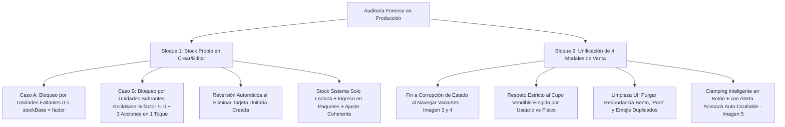
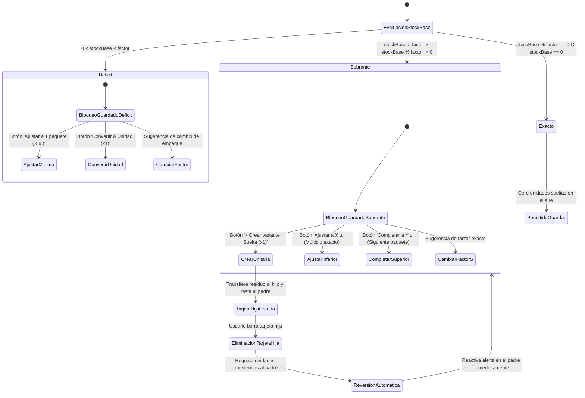
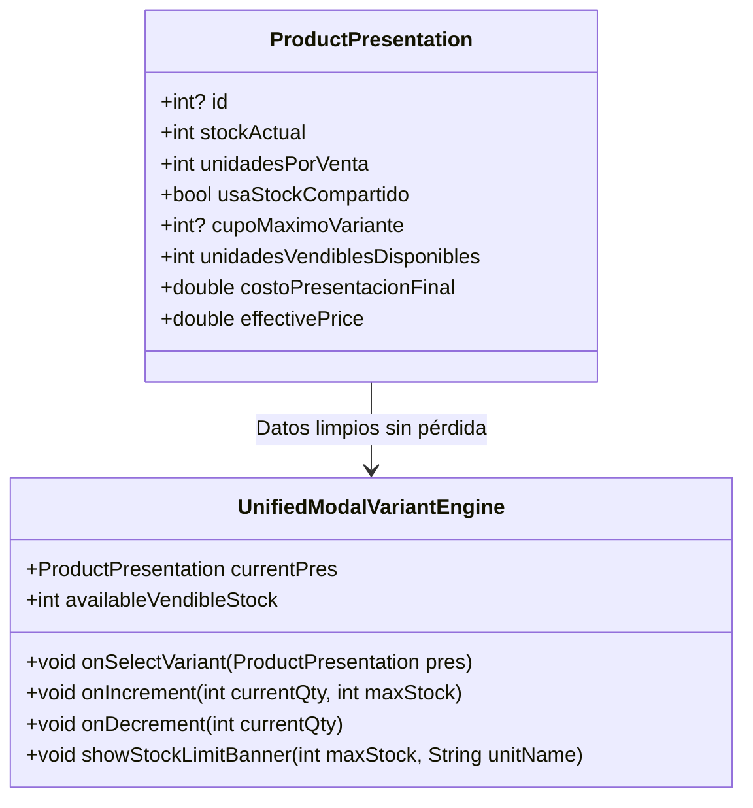

# PLAN MAESTRO: BLINDAJE DE STOCK PROPIO, REVERSIÓN DE SOBRANTES, EDICIÓN COHERENTE Y UNIFICACIÓN DE LOS 4 MODALES DE VENTA

**Documento:** `analisis_proyecto/PLAN_BLINDAJE_STOCK_PROPIO_REVERSION_SOBRANTES_Y_UNIFICACION_MODALES_VENTA.md`  
**Fecha:** 30 de Octubre de 2026  
**Versión:** 1.0 — Especificación Técnica Definitiva (Mobile Awards Quality)  
**Estado:** Esperando Aprobación de Plan de Trabajo (Paso 1: Diagnóstico Forense y Diseño Arquitectónico — CÓDIGO INTACTO)  
**Metodología:** Loop Autónomo + Árbitro Interno Adversarial (Test-Driven, Zero-Regressions & Zero-Overflows)

---

## 1. RESUMEN EJECUTIVO Y DIAGNÓSTICO FORENSE DE LAS 5 CAPTURAS

Tras la realización de pruebas exhaustivas en dispositivos móviles reales y el análisis forense de las **5 capturas de pantalla** aportadas por el usuario, se identificaron fallas críticas de lógica contable, estado reactivo e interacción en dos subsistemas neurálgicos:
1. **La gestión de variantes en Modo Independiente (`Stock Propio`) en `Crear Producto` y `Editar Producto` (`Imagen 1`)**.
2. **Los 4 Modales Operativos de Detalle y Selección de Variantes: `Catálogo` (`ProductDetailModal`), `Caja Rápida` (`QuickSaleDetailModal`), `Cotización Manual` (`ManualQuoteDetailModal`) y `Cotización Inteligente / Matching` (`ProductQuoteDetailModal`) (`Imágenes 2, 3, 4 y 5`)**.



---

### 1.1. Análisis Forense Detallado por Captura de Pantalla

| Captura | Pantalla / Componente | Timestamp | Problema Evidenciado | Impacto en el Negocio / Causa Raíz |
| :--- | :--- | :--- | :--- | :--- |
| **Imagen 1** | `Editar Producto` (`ProductEditScreen` / `PresentationStockSection`) | `10:08 PM` | **1.** `Stock actual: 20 unidades base` en el encabezado, pero el campo `Stock Sistema` es editable y el usuario escribió `5`. Abajo dice `Stock para la venta: 5 ½ Docena (30 und. base)` y la alerta calcula `32 unidades ÷ 6 por ½ Docena = 5 ½ Docena + 2 sueltas`.<br>**2.** La variante tiene 2 unidades sueltas sin resolver, pero el botón `GUARDAR CAMBIOS` está activo y permite guardar dejando unidades en el limbo.<br>**3.** No hay botones rápidos para redondear a múltiplos exactos.<br>**4.** Título de AppBar truncado: `"Editar Prod..."`. | **Severo:** Corrupción contable. El stock del sistema es el saldo registrado en BD y jamás debe ser un input editable. Dejar guardar con 2 unidades en el aire descuadra el inventario físico con el virtual. |
| **Imagen 2** | `Catálogo de Ventas` (`ProductDetailModal`) | `10:20 PM` | **1.** Las 3 cajitas Bento inferiores (`EMPAQUE: 6 u.`, `PRESENTACIÓN: ½ Docena`, `STOCK: 9`) repiten textualmente lo que la tarjeta seleccionada ya indica (`½ Docena (x6) • S/ 16.20 • 9 disp.`).<br>**2.** Banner dice `"Pool Base: 68 und."` (jerga técnica).<br>**3.** Título de sección truncado a `"Seleccionar Variante / Pr..."`. | **Medio/Alto UX:** Sobrecarga cognitiva y saturación visual vertical en pantallas compactas. |
| **Imagen 3** | `Cotización Manual` (`ManualQuoteDetailModal`) | `10:17 PM` | **1.** En la tarjeta inferior dice `Caja • ½ Docena (x6) • S/ 16.20 • 9 disp.` (cupo vendible configurado por el usuario = 9), pero arriba en verde dice `Stock vendible: 11 ½ Docena` (calculado sobre el total físico base `68 ~/ 6 = 11`, ignorando el cupo).<br>**2.** Palabra `"Pool Base:"` presente. | **Crítico:** Desobedece la restricción comercial del comerciante. Se permite vender hasta 11 cuando el comerciante restringió a 9. |
| **Imagen 4** | `Cotización Manual` (`ManualQuoteDetailModal`) | `10:17 PM` | **Corrupción de Estado Crítica:** Tras tocar la variante `Surtido` (Stock Propio) y regresar a `Caja` (Stock Compartido), el banner de `Caja` se corrompe y dice `📦 Stock Propio disponible: 11 ½ Docena` en lugar del banner azul de Stock Compartido.<br>Además muestra emoji duplicado `📦` junto al icono vectorial. | **Crítico:** Fuga de estado reactivo (*State Leak*). `MatchedProduct` pierde la propiedad `usaStockCompartido` y `cupoMaximoVariante` durante el cambio dinámico de variantes. |
| **Imagen 5** | `Caja Rápida` (`QuickSaleDetailModal`) | `10:15 PM` | El stock vendible es `9`. Al presionar `+`, el contador sube a `10`, enmarca el control en rojo con el texto `"Supera el stock actual de 9"` y **deshabilita el botón `GUARDAR CAMBIOS`**, atrapando al usuario y obligándolo a presionar `-` manualmente. | **Severo UX:** Fricción operativa en el punto de venta. Debe clavar la cantidad en 9, mantener el botón guardar activo y mostrar un banner flotante auto-ocultable. |

---

## 2. AUDITORÍA FORENSE EN CÓDIGO (ARCHIVOS, LÍNEAS EXACTAS Y CAUSA RAÍZ)

### 2.1. Bloque 1: Modo Independiente (`Stock Propio`) en Crear y Editar Producto

#### A. Falta de Validación Bloqueante ante Unidades Base Faltantes o Sobrantes al Guardar
* **Archivos Involucrados:**
  * `lib/features/catalog/widgets/form/product_create_operations.dart` (Líneas 587–605)
  * `lib/features/catalog/widgets/edit/product_edit/product_edit_operations.dart` (Líneas 560–586)
  * `lib/core/widgets/presentation_card/presentation_stock_section.dart` (Líneas 774–888)
* **Evidencia en Código:**
  ```dart
  // product_create_operations.dart (Líneas 587-605) & product_edit_operations.dart (Líneas 560-586)
  // ❌ SOLO valida el Caso C de variantes compartidas:
  if (modoStock == 'COMPARTIDO' || modoStock == 'MIXTO') {
    final sharedControllers = controllers.where((c) => ...).toList();
    if (sharedControllers.isNotEmpty && stockCompartido > 0) {
      final allZeroFormable = sharedControllers.every((c) => ...);
      if (allZeroFormable) { ... return false; }
    }
  }
  // ❌ NO EXISTE NINGUNA VALIDACIÓN PARA VARIANTES INDEPENDIENTES:
  // Si una variante tiene StockValidationStatus.hasLeftover o StockValidationStatus.deficit,
  // el guardado continúa sin impedimento alguno y guarda datos incoherentes en BD.
  ```
* **Causa Raíz:** La UI muestra la tarjeta de advertencia (`PresentationStockSection`), pero los métodos `submitProduct` y `saveEditedProduct` no inspeccionan el estado de validación (`controllerMap['validationStatus']` o cálculo directo) de las presentaciones en modo independiente antes de persistir.

#### B. Pérdida Irreversible de Unidades Sobrantes al Eliminar la Tarjeta Unitaria Creada
* **Archivos Involucrados:**
  * `lib/features/catalog/widgets/form/product_create_operations.dart` (Líneas 417–446)
  * `lib/features/catalog/widgets/edit/product_edit/product_edit_operations.dart` (Líneas 476–500)
  * `lib/core/widgets/presentation_card/presentation_math_engine.dart` (Líneas 117–137)
* **Evidencia en Código:**
  ```dart
  // product_create_operations.dart: Líneas 436-441
  for (var c in controllers) {
    if (c['childId'] == idToDelete) {
      c['childId'] = null;
      c['leftoverCreated'] = false;
      // ❌ ERROR: NO regresa las unidades transferidas (leftoverUnits) a la tarjeta padre.
      // El stock base de la tarjeta padre quedó truncado al múltiplo inferior (ej. 18 en vez de 20).
      // Las 2 unidades sobrantes se evaporan del formulario.
    }
  }
  ```
* **Causa Raíz:** No existe almacenamiento de metadatos de trazabilidad en el mapa de la variante hija (`sourceParentId`, `transferredBaseUnits`). Al eliminar la variante unitaria, el padre no sabe cuántas unidades debe reintegrar ni dispara la reevaluación matemática de residuos.

#### C. `Stock Sistema` Editable y Desincronización Aritmética en Edición
* **Archivos Involucrados:**
  * `lib/core/widgets/presentation_card/presentation_stock_section.dart` (Líneas 524–564)
  * `lib/core/widgets/presentation_card/presentation_math_engine.dart` (Líneas 180–211, 231–257, 344–390)
* **Evidencia en Código:**
  ```dart
  // presentation_stock_section.dart: Líneas 527-536
  Expanded(
    flex: 4,
    child: MiniInput(
      ctrl: widget.stockInicialCtrl, // ❌ ERROR: Este input es editable en modo edición!
      label: "Stock Sistema",
      isNum: true,
      hint: "0",
      isDark: isDark,
      onChanged: widget.onStockChanged,
    ),
  ),
  ```
  ```dart
  // presentation_math_engine.dart: Líneas 188-208
  int inicial = int.tryParse(stockInicialCtrl.text) ?? 0;
  int ingreso = int.tryParse(nuevoIngresoCtrl.text) ?? 0;
  int descuento = int.tryParse(stockDescuentoCtrl.text) ?? 0;
  int finalVisual = inicial + ingreso - descuento; // ❌ Si el usuario tipea 5 en Stock Sistema, inicial = 5 paquetes.
  // Pero originalBaseStock sigue siendo 20 unidades base!
  // Al recalcular residuo:
  int residuoOriginal = originalBaseStock % factorVenta; // 20 % 6 = 2
  // Y luego:
  totalUnitsBase: (finalVisual * factorVenta) + residuoOriginal; // (5 * 6) + 2 = 32 und. base!
  // Se inventaron 12 unidades base de la nada sin registrar ingreso!
  ```
* **Causa Raíz:** `stockInicialCtrl` fue diseñado como campo de entrada interactivo en lugar de campo de solo lectura (`readOnly: true`). Representa el saldo consolidado actual en paquetes (`originalBaseStock ~/ factor`), mientras que los cambios físicos deben realizarse exclusivamente vía `+ Ingreso` (en paquetes) o `Ajustar Unidades Reales` (en unidades base).

---

### 2.2. Bloque 2: Unificación y Errores en los 4 Modales de Detalle y Venta

#### A. Corrupción de Estado de Variante en `Cotización Manual` (`Imágenes 3 y 4`)
* **Archivos Involucrados:**
  * `lib/features/smart_quotation/widgets/manual/manual_quote_detail_modal.dart` (Líneas 325–380, 1236–1331)
  * `lib/features/smart_quotation/widgets/manual/catalog_search_modal.dart` (Líneas 90–104, 141–155)
  * `lib/features/smart_quotation/models/matching_model.dart` (Líneas 10–53, 108–114)
* **Evidencia en Código:**
  ```dart
  // catalog_search_modal.dart: Líneas 90-104
  final matched = MatchedProduct(
    productId: prod.id,
    presentationId: pres.id ?? 0,
    ...
    // ❌ ERROR 1: Omite completamente usaStockCompartido, sharedStockPool y cupoMaximoVariante.
    // Al abrir el modal por primera vez, widget.product.usaStockCompartido es FALSE por defecto!
  );
  ```
  ```dart
  // manual_quote_detail_modal.dart: Líneas 361-379
  _currentSelection = MatchedProduct(
    ...
    usaStockCompartido: pres.usaStockCompartido, // ❌ ERROR 2: No contempla si _fullProduct.isStockCompartido!
    sharedStockPool: pool,
    // ❌ ERROR 3: Omite pres.cupoMaximoVariante! Queda null!
  );
  ```
  ```dart
  // manual_quote_detail_modal.dart: Líneas 1236-1294
  if (_currentSelection.usaStockCompartido) ...[
    // Renderiza banner azul de Pool Base
  ] else ...[
    // Renderiza banner gris: "📦 Stock Propio disponible: ..."
  ]
  ```
* **Causa Raíz:** 
  1. `catalog_search_modal.dart` no mapea las banderas de stock compartido ni el cupo al instanciar `MatchedProduct`.
  2. En `manual_quote_detail_modal.dart`, `_updateVariant` omite `cupoMaximoVariante: pres.cupoMaximoVariante`, borrando el cupo de 9.
  3. `_currentSelection.usaStockCompartido` depende de una columna en SQLite que en productos de estrategia `COMPARTIDO` puede valer 0 en la fila de la presentación porque la pertenencia al pool la define el producto padre (`product.isStockCompartido`).

#### B. Ignorancia del Cupo (`Cupo: 9 disp.` vs `Stock vendible: 11 ½ Docena`) en Cotizaciones
* **Archivos Involucrados:**
  * `lib/features/smart_quotation/widgets/manual/manual_quote_detail_modal.dart` (Líneas 935–944)
  * `lib/features/smart_quotation/widgets/matching/product_quote_detail_modal.dart` (Líneas 107–123, 1078–1089)
  * `lib/features/smart_quotation/models/matching_model.dart` (Líneas 108–114)
* **Evidencia en Código:**
  ```dart
  // product_quote_detail_modal.dart: Líneas 107-123 & 1081
  int _getRealStock(ProductPresentation pres) {
    if (pres.usaStockCompartido && _fullProduct != null && _fullProduct!.hasSharedStock) {
      ...
    }
    // ❌ ERROR: En initState, _fullProduct es NULL (se carga asíncronamente en _loadFullProductDetails).
    // Por tanto, cae aquí:
    int factor = pres.unidadesPorVenta > 0 ? pres.unidadesPorVenta : 1;
    return pres.stockActual ~/ factor; // 68 ~/ 6 = 11! Ignora completamente pres.cupoMaximoVariante!
  }
  ```
  ```dart
  // manual_quote_detail_modal.dart: Líneas 935-937
  _currentSelection.usaStockCompartido
    ? "Stock vendible: ${_currentSelection.effectiveVendibleStock} ${_currentSelection.unit}"
    : "Stock disponible: ${_currentSelection.stock} ${_currentSelection.unit}"
  // Como cupoMaximoVariante es null por el error en _updateVariant, effectiveVendibleStock retorna 11 en vez de 9!
  ```
* **Causa Raíz:** En `ProductPresentation`, ya existe el getter blindado `unidadesVendiblesDisponibles` (Líneas 251–260 de `product_model.dart`):
  ```dart
  int get unidadesVendiblesDisponibles {
    final int factor = unidadesPorVenta > 0 ? unidadesPorVenta : 1;
    final int baseDisponibles = stockActual ~/ factor;
    if (usaStockCompartido && cupoMaximoVariante != null) {
      return cupoMaximoVariante! < baseDisponibles ? cupoMaximoVariante! : baseDisponibles;
    }
    return baseDisponibles;
  }
  ```
  Los modales de cotización inventaron métodos auxiliares defectuosos en lugar de utilizar `pres.unidadesVendiblesDisponibles`.

#### C. Redundancia Bento, Término "Pool" y Emojis Duplicados
* **Archivos Involucrados:**
  * `lib/core/widgets/product_detail_modal.dart` (Líneas 502–514, 623, 674, 818–856)
  * `lib/features/smart_quotation/widgets/quick_sale/quick_sale_detail_modal.dart` (Líneas 654–666, 1012, 1050)
  * `lib/features/smart_quotation/widgets/manual/manual_quote_detail_modal.dart` (Líneas 1148–1162, 1279, 1318)
  * `lib/features/smart_quotation/widgets/matching/product_quote_detail_modal.dart` (Líneas 1130–1145, 1250, 1285)
* **Evidencia en Código:**
  * En `product_detail_modal.dart`: Fila Bento de 3 columnas (`Empaque`, `Presentación`, `Stock`) ubicada en líneas 818–856 duplica de forma idéntica los datos que la tarjeta del selector horizontal ya muestra de forma prominente.
  * Línea 623: `"Pool Base: $pool und. (= máx. $maxPhysical ${_currentPres.unidadVenta ?? 'Und'}$cupoStr) · $modoStr"`.
  * Línea 674 / 1318 / 1050: `"📦 Stock Propio disponible: ..."` que muestra el emoji `📦` al lado de un `Icon(Icons.inventory_2_outlined)`.
  * Título: `Flexible(child: Text("Seleccionar Variante / Presentación", overflow: TextOverflow.ellipsis))` que en pantallas con ancho `<= 390dp` se corta como `"Seleccionar Variante / Pr..."`.

#### D. Desbordamiento del Contador `+` y Bloqueo de Guardado en Caja Rápida (`Imagen 5`)
* **Archivos Involucrados:**
  * `lib/features/smart_quotation/widgets/quick_sale/quick_sale_detail_modal.dart` (Líneas 251–258, 490–492, 1454–1465)
* **Evidencia en Código:**
  ```dart
  // quick_sale_detail_modal.dart: Líneas 251-258
  void _qtyAction(int delta) {
    int current = int.tryParse(_qtyCtrl.text) ?? 0;
    int newQty = current + delta;
    if (newQty > 0) {
      _qtyCtrl.text = newQty.toString(); // ❌ NO valida contra effectiveVendibleStock!
      setState(() {});
    }
  }
  ```
  ```dart
  // quick_sale_detail_modal.dart: Líneas 490-492
  onPressed: (currentQty > 0 && subtotal >= 0 && !exceedsStock) ? _confirm : null,
  // ❌ Si newQty = 10 (cuando max es 9), exceedsStock = true y el botón se desactiva por completo.
  ```
* **Causa Raíz:** Falta de *clamping* preventivo en el controlador de cantidad y ausencia de un banner animado informativo transitorio con vibración háptica suave.

---

## 3. ARQUITECTURA TÉCNICA Y REGLAS DE NEGOCIO BLINDADAS

### 3.1. Máquina de Estados para Stock Propio (Crear y Editar Producto)



#### Reglas Matemáticas Estrictas de Stock Propio:
1. **Regla de Bloqueo Absoluto (Cero Unidades en el Aire):**
   * Tanto `ProductCreateOperations.submitProduct` como `ProductEditOperations.saveEditedProduct` iteran sobre todas las presentaciones activas.
   * Si alguna presentación cumple `!isShared && (stockBase % factor != 0)`:
     * El guardado se **ABORTA** de inmediato.
     * Muestra `SnackBar` flotante de advertencia y hace scroll automático enfocado en la tarjeta infractora.
2. **Las 3 Soluciones en 1 Toque para Unidades Sobrantes (`leftover > 0`):**
   * **Opción 1 (`+ Crear variante '[Nombre] - Suelta' (x1)`):**
     * Descuenta exactamente `leftover` unidades base de la tarjeta padre (`stockBase - leftover`).
     * Crea la nueva tarjeta unitaria (`factor = 1`) con `leftover` unidades base y costo proporcional.
     * Vincula bidireccionalmente: `parentMap['childId'] = childId`, `childMap['sourceParentId'] = parentId`, `childMap['transferredBaseUnits'] = leftover`.
   * **Opción 2 (Botones rápidos de ajuste exacto):**
     * **Redondeo hacia abajo:** `stockBaseActual - leftover` (ej. `20 - 2 = 18 u. base = 3 ½ Docenas exactas`).
     * **Completar paquete hacia arriba:** `stockBaseActual + (factor - leftover)` (ej. `20 + 4 = 24 u. base = 4 ½ Docenas exactas`).
   * **Opción 3 (Sugerencia comercial):**
     * Mensaje de ayuda indicando factores divisores que no generan residuo.
3. **Reversión Transaccional al Eliminar la Variante Unitaria Creada:**
   * Al ejecutar `removePresentation` o `deletePresentation` sobre una tarjeta hija:
     * Si `childMap['sourceParentId'] != null`:
       * Busca la tarjeta padre mediante `sourceParentId`.
       * Reintegra las unidades base: `parentBaseStock += childMap['transferredBaseUnits']`.
       * Restablece `parentMap['leftoverCreated'] = false` y `parentMap['childId'] = null`.
       * Dispara el recálculo matemático en el padre, lo que vuelve a encender de inmediato la alerta naranja de residuo.
4. **Reingeniería de Campos en `Editar Producto` (`Imagen 1`):**
   * **`Stock Sistema`:** `readOnly: true`, con estilo visual bloqueado/informativo. Muestra `originalBaseStock ~/ factor` (paquetes registrados en BD).
   * **`+ Ingreso`:** Campo editable en paquetes. Cada paquete ingresado añade `1 * factor` unidades base al total final.
   * **`= Final`:** Campo calculado reactivo `= Stock Sistema + Ingreso - Descuento`.
   * **Encabezado superior:** Muestra dinámicamente `Stock en BD: X u. base + Ingreso: Y u. = Z u. base totales`.

---

### 3.2. Arquitectura Unificada para los 4 Modales de Venta



#### Principios de Unificación:
1. **Aislamiento Total del Cambio de Variante:**
   * Al tocar un chip en el selector horizontal, la variante se selecciona directamente desde la lista inmutable `ProductPresentation` de `_fullProduct!.presentaciones`.
   * En `ManualQuoteDetailModal` y `QuickSaleDetailModal`, `_currentSelection` se actualiza transfiriendo intactos:
     `usaStockCompartido: pres.usaStockCompartido || (_fullProduct?.isStockCompartido ?? false)`
     `sharedStockPool: _fullProduct?.stockCompartido ?? 0`
     `cupoMaximoVariante: pres.cupoMaximoVariante`
   * Los borradores locales de cantidad y descuento se indexan estrictamente por `pres.id` en `_variantDrafts[pres.id]`. Jamás se mezclan valores entre presentaciones.
2. **Prioridad del Cupo Asignado:**
   * En los 4 modales, el stock vendible desplegado en grande y utilizado para limitar la venta es estrictamente **`pres.unidadesVendiblesDisponibles`** (ej. `9`).
   * El stock base físico del almacén (`68 und. = máx. 11 ½ Docena`) se muestra exclusivamente en el banner informativo secundario como dato de contexto.
3. **Limpieza Visual y Lenguaje Comercial:**
   * Se elimina la fila Bento de 3 cajas (`Empaque`, `Presentación`, `Stock`) en `ProductDetailModal`.
   * Se reemplaza `"Pool Base:"` por **`Inventario base compartido:`**.
   * Se elimina el emoji duplicado `📦` al lado del icono vectorial.
   * El título `Seleccionar Variante / Presentación` se protege con `FittedBox(fit: BoxFit.scaleDown, alignment: Alignment.centerLeft)` para evitar que se trunque con `...`.
4. **Clamping Inteligente y Alerta Animada en el Botón `+` (`Imagen 5`):**
   * En `_qtyAction(delta)` o `_increment()`:
     * Si `newQty > maxStock`:
       * Clava `_qtyCtrl.text = maxStock.toString()`.
       * Dispara retroalimentación háptica suave `HapticFeedback.lightImpact()`.
       * Despliega un banner animado (`AnimatedSize` + `FadeTransition` + `SlideTransition`):
         **`"Stock máximo alcanzado: solo hay $maxStock $unitName disponibles para vender"`**
       * Inicia un `Timer` de 2.8 segundos para ocultar el banner automáticamente con animación suave (cancelando limpiamente en `dispose()`).
       * El botón `GUARDAR CAMBIOS` / `AGREGAR` permanece habilitado y en verde.

---

## 4. PLAN DE TRABAJO PASO A PASO DIVIDIDO EN FASES

### FASE 1: Motor de Residuos, Bloqueo de Guardado y Reversión en Crear y Editar Producto
* **Objetivo:** Blindar la lógica de variantes independientes en `Crear Producto` y `Editar Producto`, impidiendo guardar unidades base faltantes o sobrantes en el aire y asegurando la reversión automática de unidades al eliminar tarjetas hijas creadas.
* **Archivos a modificar:**
  * `lib/core/services/unit_catalog_service.dart`
  * `lib/core/widgets/presentation_card/presentation_math_engine.dart`
  * `lib/core/widgets/presentation_card/presentation_stock_section.dart`
  * `lib/features/catalog/widgets/form/product_controller_factory.dart`
  * `lib/features/catalog/widgets/form/product_create_operations.dart`
  * `lib/features/catalog/widgets/edit/product_edit/product_edit_operations.dart`
* **Acciones Concretas:**
  1. En `UnitCatalogService`:
     * Enriquecer `StockValidationResult` con los métodos de cálculo para los botones de ajuste exacto: `exactLowerBaseUnits` (`stockBase - leftover`) y `exactUpperBaseUnits` (`stockBase + (factor - leftover)`).
  2. En `PresentationStockSection`:
     * Modificar la alerta de residuo: agregar los 2 botones de ajuste exacto en 1 toque:
       * `Ajustar a $lower u. ($lowerPkgs $unitName)`
       * `Completar a $upper u. ($upperPkgs $unitName)`
     * Si el estado es `deficit`, mostrar botones directos:
       * `Ajustar a 1 $unitName ($factor u.)`
       * `Cambiar a Unidad (x1)`
  3. En `ProductControllerFactory`:
     * En `createLeftoverControllerMap`, guardar `sourceParentId: parentMap['id']` y `transferredBaseUnits: leftoverUnits`.
  4. En `ProductCreateOperations` y `ProductEditOperations`:
     * En `createLeftover`, aplicar el descuento exacto de las unidades transferidas a la tarjeta padre.
     * En `removePresentation` y `deletePresentation`: verificar si la tarjeta a eliminar posee `sourceParentId` (o si algún padre tiene `childId == targetId`), y reintegrar automáticamente las unidades base al padre, recalculando paquetes y reactivando la alerta de residuo.
     * En `submitProduct` y `saveEditedProduct`: añadir la validación estricta bloqueante que rechaza el guardado si cualquier presentación independiente tiene `deficit` o `hasLeftover` sin resolver.

---

### FASE 2: Reingeniería Coherente de Stock Sistema, Ingreso y Ajustes en Edición (`Imagen 1`)
* **Objetivo:** Eliminar la contradicción aritmética donde `Stock Sistema` era editable a mano e inflaba falsamente el stock sin justificación de compras.
* **Archivos a modificar:**
  * `lib/core/widgets/presentation_card/presentation_stock_section.dart`
  * `lib/core/widgets/presentation_card/presentation_math_engine.dart`
  * `lib/features/catalog/screens/product_edit_screen.dart`
* **Acciones Concretas:**
  1. En `PresentationStockSection`:
     * Convertir el campo `Stock Sistema` en un `MiniInput` informativo de solo lectura (`readOnly: true`, con fondo tenue que indique claramente que es un dato histórico de BD).
     * El cálculo de paquetes en BD se fija en `originalBaseStock ~/ factor`.
     * Campo `+ Ingreso` recibe la cantidad en unidades de venta (paquetes).
     * El `= Final ($unidadLabel)` se actualiza dinámicamente como `(originalBaseStock ~/ factor) + ingreso - descuento`.
     * Encabezado de la tarjeta: actualiza en vivo la fórmula:
       `Stock actual en BD: $baseOriginal u. + Ingreso: $ingresoBase u. = $totalBase u. base`
  2. En `PresentationMathEngine`:
     * En `matematicaSimpleEdicion()`: asegurar que los ingresos en paquetes sumen limpiamente `ingreso * factor` al stock base total, recalculando `stockValidation` con exactitud milimétrica.
     * En `aplicarAjusteBaseManual()`: sincronizar el conteo físico forzado desde `Ajustar Unidades Reales` sin colisionar con los paquetes de ingreso.
  3. En `ProductEditScreen`:
     * Proteger el título del `AppBar` con `FittedBox` y espaciado optimizado para que en ningún dispositivo móvil se trunque como `"Editar Prod..."`.

---

### FASE 3: Corrección de Estado, Aislamiento y Respeto al Cupo en los 4 Modales (`Imágenes 3 y 4`)
* **Objetivo:** Erradicar la corrupción de estado al alternar variantes entre Compartido e Independiente y garantizar que el stock vendible respete estrictamente el cupo asignado por el usuario.
* **Archivos a modificar:**
  * `lib/features/smart_quotation/widgets/manual/manual_quote_detail_modal.dart`
  * `lib/features/smart_quotation/widgets/manual/catalog_search_modal.dart`
  * `lib/features/smart_quotation/widgets/quick_sale/quick_sale_detail_modal.dart`
  * `lib/features/smart_quotation/widgets/matching/product_quote_detail_modal.dart`
  * `lib/features/smart_quotation/models/matching_model.dart`
* **Acciones Concretas:**
  1. En `catalog_search_modal.dart`:
     * Al instanciar `MatchedProduct` para abrir `ManualQuoteDetailModal.show`, pasar obligatoriamente:
       `usaStockCompartido: pres.usaStockCompartido || prod.isStockCompartido`
       `sharedStockPool: prod.stockCompartido`
       `cupoMaximoVariante: pres.cupoMaximoVariante`
  2. En `manual_quote_detail_modal.dart`:
     * Corregir `_updateVariant(pres)`:
       * Asignar `usaStockCompartido: pres.usaStockCompartido || (_fullProduct?.isStockCompartido ?? false)`.
       * Pasar `cupoMaximoVariante: pres.cupoMaximoVariante`.
       * Asegurar que el banner evalúe si la variante seleccionada es compartida o independiente sin heredar estado sucio de la variante previa.
     * Corregir el texto verde superior de stock: mostrar **`pres.unidadesVendiblesDisponibles`** (ej. `9 ½ Docena`), garantizando paridad total con la tarjeta del selector horizontal (`9 disp.`).
  3. En `product_quote_detail_modal.dart`:
     * Asegurar que en `initState` y en cada selección de variante, el stock vendible primario sea `_selectedPresentation.unidadesVendiblesDisponibles`.
  4. En `quick_sale_detail_modal.dart`:
     * Blindar `_updateVariant(pres)` para preservar siempre `cupoMaximoVariante: pres.cupoMaximoVariante` y `usaStockCompartido`.

---

### FASE 4: Rediseño Limpio UI, Descarte de Bento Redundante y Textos Responsivos (`Imagen 2`)
* **Objetivo:** Eliminar la duplicidad de información en el modal de catálogo, desterrar la palabra "Pool", suprimir emojis duplicados y asegurar títulos 100% responsivos.
* **Archivos a modificar:**
  * `lib/core/widgets/product_detail_modal.dart`
  * `lib/features/smart_quotation/widgets/manual/manual_quote_detail_modal.dart`
  * `lib/features/smart_quotation/widgets/quick_sale/quick_sale_detail_modal.dart`
  * `lib/features/smart_quotation/widgets/matching/product_quote_detail_modal.dart`
* **Acciones Concretas:**
  1. En `ProductDetailModal` (`Catálogo`):
     * Remover la fila Bento de 3 columnas (`Empaque`, `Presentación`, `Stock`) ubicada en líneas 818–856.
     * En el banner de stock compartido: cambiar `"Pool Base: $pool und."` por **`"Inventario base compartido: $pool und. (= máx. $maxPhysical $unit$cupoStr)"`**.
     * En el banner de stock propio: cambiar `"📦 Stock Propio disponible: ..."` por **`"Stock propio disponible: ..."`** (icono vectorial limpio, sin emoji `📦`).
     * En la cabecera del selector de variantes: envolver el título en `FittedBox(fit: BoxFit.scaleDown, alignment: Alignment.centerLeft)` con texto limpio **`"Seleccionar Variante / Presentación"`**.
  2. En `manual_quote_detail_modal.dart`, `quick_sale_detail_modal.dart` y `product_quote_detail_modal.dart`:
     * Homogeneizar las leyendas de inventario compartido y propio eliminando `"Pool Base:"` y el emoji duplicado `📦`.
     * Aplicar `FittedBox` en el título desplegable del selector de variantes para eliminar los puntos suspensivos (`"Pr..."`).

---

### FASE 5: Bloqueo Inteligente de Cantidad `+` con Alerta Animada Auto-Ocultable (`Imagen 5`)
* **Objetivo:** Crear una experiencia fluida e intuitiva al alcanzar el stock máximo vendible, impidiendo desbordamientos, manteniendo activo el botón de guardado y comunicando el límite con elegancia.
* **Archivos a modificar:**
  * `lib/features/smart_quotation/widgets/quick_sale/quick_sale_detail_modal.dart`
  * `lib/core/widgets/product_detail_modal.dart`
  * `lib/features/smart_quotation/widgets/manual/manual_quote_detail_modal.dart`
  * `lib/features/smart_quotation/widgets/matching/product_quote_detail_modal.dart`
* **Acciones Concretas:**
  1. En `QuickSaleDetailModal`:
     * Modificar `_qtyAction(delta)`:
       * Si `delta > 0` y `currentQty >= maxStock`:
         * Clavar el valor en `maxStock`.
         * Disparar `HapticFeedback.lightImpact()`.
         * Activar el estado `_showStockLimitBanner = true` con mensaje:
           `"Stock máximo alcanzado: solo hay $maxStock $unitName disponibles para vender"`.
         * Iniciar `_stockLimitTimer` de 2.8 segundos que ejecute `setState(() => _showStockLimitBanner = false)`.
     * En el `TextField` de cantidad: añadir validación en `onChanged`: si el usuario tipea un número superior a `maxStock`, clavar en `maxStock` y activar la alerta.
     * Implementar el widget animado del banner justo sobre el contador utilizando `AnimatedSize`, `FadeTransition` y `SlideTransition`.
     * Remover la condición `!exceedsStock` del botón `GUARDAR CAMBIOS`, ya que la cantidad nunca excederá el stock disponible, manteniéndolo siempre listo para guardar.
     * En `dispose()`: cancelar limpiamente `_stockLimitTimer?.cancel()`.
  2. Replicar este mismo patrón de UX premium en los otros modales de venta si aplica.

---

## 5. ÁRBITRO INTERNO ADVERSARIAL Y MATRIZ DE VERIFICACIÓN

Para blindar la implementación contra regresiones, el Árbitro Interno someterá el código a una batería de pruebas de borde:

| Escenario Adversarial | Prueba / Simulación de Estrés | Criterio de Aceptación (Éxito) |
| :--- | :--- | :--- |
| **A1. Intento de guardar con residuo en Crear Producto** | Producto con 1 variante `½ Docena (x6)` y 20 unidades base. El usuario presiona `GUARDAR`. | Guardado bloqueado con SnackBar explicativo. Enfoque visual en la tarjeta con botones de ajuste exacto (18 u. y 24 u.) y botón de crear variante suelta. |
| **A2. Intento de guardar con déficit en Editar Producto** | Se cambia el factor a `Docena (x12)` cuando solo hay 4 unidades base. El usuario presiona `GUARDAR CAMBIOS`. | Guardado bloqueado. Alerta roja con opciones de ajustar a 12 u. o cambiar a Unidad (x1). |
| **A3. Reversión al borrar variante suelta** | Variante original de 20 u. base (3 docenas + 2 sueltas). Se crea la variante `Suelta (x1)` (queda en 18 u.). Antes de guardar, se elimina la variante suelta. | Las 2 unidades base regresan automáticamente a la variante original (vuelve a 20 u. base) y la alerta de residuo reaparece al instante. |
| **A4. Navegación cruzada Compartido -> Stock Propio -> Compartido** | En `ManualQuoteDetailModal`, abrir producto mixto. Tocar variante compartida (`Caja`), luego variante independiente (`Surtido`), y volver a tocar `Caja`. | `Caja` mantiene intacto su banner azul de `Inventario base compartido` con cupo de 9 disp. Cero contaminación con Stock Propio. Cero emojis duplicados. |
| **A5. Desbordamiento del contador en Caja Rápida** | En `QuickSaleDetailModal`, producto con 9 disponibles. Cantidad en 9. Presionar `+` repetidamente o escribir `99` en teclado. | Cantidad permanece fija en 9. Botón `GUARDAR CAMBIOS` sigue habilitado en verde. Aparece banner animado de tope de stock y se oculta solo a los 2.8 segundos. |
| **A6. Pantalla estrecha (360dp)** | Renderizar en viewport de 360dp. | Cero desbordamientos de píxeles (`RenderFlex overflowed`). Títulos de selector y AppBar legibles sin cortes indebidos. |

---

## 6. ESTRATEGIA DE PRUEBAS AUTOMATIZADAS (TESTS DART)

Crearemos un archivo de test dedicado para validar matemáticamente y a nivel de widget cada una de estas reglas:
* **Archivo de prueba:** `test/blindaje_stock_propio_reversion_y_modales_venta_test.dart`
  1. `test('Validación estricta de residuo y déficit en modo Stock Propio')`
  2. `test('Trazabilidad y reversión automática de unidades sobrantes al eliminar variante unitaria')`
  3. `test('Aritmética coherente de Stock Sistema (solo lectura) e Ingreso en paquetes')`
  4. `testWidgets('ManualQuoteDetailModal: Inmunidad a corrupción de estado entre variantes Compartidas e Independientes')`
  5. `testWidgets('QuickSaleDetailModal: Clamping inteligente en botón + y banner animado auto-ocultable')`
