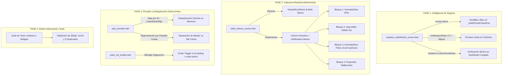

# Plan de Corrección Crítica: Renderizado, Layout y Duplicación de Datos en Estadísticas e Historial

> **Fecha:** 23 de Octubre de 2026  
> **Estado:** Propuesta de Arquitectura y Diagnóstico Exhaustivo (Pendiente de Aprobación)  
> **Metodología:** Loop Autónomo + Árbitro Adversarial  
> **Archivos Involucrados:**  
> - `app_movil/lib/features/analytics/screens/analytics_dashboard_screen.dart`  
> - `app_movil/lib/features/smart_quotation/screens/sales_history_screen.dart`  
> - `app_movil/lib/features/smart_quotation/providers/sale_provider.dart`  
> - `app_movil/lib/features/smart_quotation/widgets/history/sales_list_builder.dart`  
> - `app_movil/lib/features/smart_quotation/widgets/history/history_filter_bar.dart`  
> - `app_movil/lib/features/smart_quotation/widgets/history/history_dashboard_cards.dart`  
> - `app_movil/lib/features/smart_quotation/repositories/sale_repository.dart`  

---

## 1. DIAGNÓSTICO EXHAUSTIVO DE LAS 5 CAPTURAS DE PRUEBA REAL

Tras la inspección minuciosa del código fuente en comparación directa con las 5 capturas en dispositivo físico, se han identificado con precisión milimétrica las causas de cada anomalía:

### 1.1. Captura 1 (`4.50.51 AM.jpeg`) — Colapso Geométrico en `Inteligencia de Negocio`
* **Síntomas visibles:**
  1. Justo debajo del AppBar, aparecen 4 óvalos vacíos (uno azul y tres grises sin texto) superpuestos encima de las tarjetas superiores.
  2. Las tarjetas superiores aparecen cortadas con textos deformados: `"...cia ...l"` y `"...or P..."`.
  3. El 70% inferior de la pantalla queda totalmente en negro: desapareció el icono central con halo pulsante (`query_stats`), el título `"Inteligencia de Negocio & Radar"`, el subtítulo descriptivo y el botón primario `"Generar Reporte Integral"`.
* **Causa Raíz Exacta en Código (`analytics_dashboard_screen.dart`):**
  * En las líneas **425-449**, dentro de `_buildIdleScreen`:
    ```dart
    // Pre-selección de Periodo
    Column(
      crossAxisAlignment: CrossAxisAlignment.start,
      children: [
        ...
        const SizedBox(height: 10),
        _buildPeriodChipsRow(prov, isDark, isPreSelect: true), // 💣 ERROR CRÍTICO
      ],
    )
    ```
  * `_buildPeriodChipsRow` (línea 714) retorna un `ListView.separated` con `scrollDirection: Axis.horizontal`.
  * **Violación de Contrato en Flutter:** Un `ListView` horizontal dentro de una `Column` que a su vez está dentro de un `SingleChildScrollView` (línea 362) sufre de **altura ilimitada en el eje transversal (`Vertical viewport was given unbounded height`)**.
  * Al compilar en modo release/profile en el dispositivo, Flutter aborta el cálculo de layout de ese `RenderFlex`:
    - Los `ChoiceChip` se instancian a coordenadas inválidas `(0, 0)` en la capa superior (encima de las tarjetas de características).
    - El texto de los chips no llega a pintarse (óvalos vacíos).
    - El resto de los hijos del `Column` (incluyendo el botón CTA `"Generar Reporte"`, el icono pulsante y los textos) no se renderizan, dejando el 70% inferior de la pantalla completamente negro.
  * Adicionalmente, el `GridView.count` con `childAspectRatio: 2.2` (líneas 409-421) y `maxLines: 1` sin `TextOverflow.ellipsis` en `_buildIdleFeatureBadge` hace que los títulos de 12pt ("Ganancia Neta Real", "Motor Predictivo") se corten abruptamente.

---

### 1.2. Capturas 2 y 3 (`4.50.51 AM (5).jpeg` y `(4).jpeg`) — Deformación de Layout y Huecos en `Historial de Ventas`
* **Síntomas visibles:**
  1. En reposo (Captura 2), no se ven las tarjetas de KPIs; la fila de selector de periodo y orden (`6 Meses | Más recientes`) está tragada detrás del buscador; los chips `"Todos"`, `"Pagados"`, `"Con Deuda"` aparecen cortados horizontalmente por la mitad.
  2. Existe un **hueco negro vacío gigante (~180px)** entre los chips cortados y la primera tarjeta (`Recibo #3`).
  3. Al scrollear hacia abajo (Captura 3), la tarjeta superior (`PAGADO | ENTREGADO`) se mete por debajo del buscador y queda cortada por la mitad.
* **Causa Raíz Arquitectónica en Código (`sales_history_screen.dart`):**
  * La pantalla utiliza un `NestedScrollView` combinando **dos `SliverAppBar` dispares** con un `SliverToBoxAdapter` en el medio:
    ```dart
    // Sliver 1: Pinned + Absorber
    SliverOverlapAbsorber(
      handle: NestedScrollView.sliverOverlapAbsorberHandleFor(context),
      sliver: SliverAppBar(pinned: true, bottom: Column(TabBar, HistorySearchBar)),
    ),
    // Sliver 2: Box Adapter
    SliverToBoxAdapter(child: HistoryDashboardCards()),
    // Sliver 3: Floating + Snap (SIN ABSORBER)
    SliverAppBar(
      floating: true, snap: true, toolbarHeight: 0,
      bottom: PreferredSize(preferredSize: Size.fromHeight(88), child: HistoryFilterChips()),
    )
    ```
  * En el body, `SalesListBuilder` inserta:
    ```dart
    if (handle != null) SliverOverlapInjector(handle: handle)
    ```
  * **Por qué falla matemáticamente en Flutter:**
    1. `SliverOverlapAbsorber` solo absorbe la altura del **primer** `SliverAppBar` (~140px).
    2. El segundo `SliverAppBar` (`floating: true, snap: true`) no está absorbido, por lo que Flutter traslada su posición de forma independiente: al reaccionar al scroll, sube y baja pisando la base del primer `SliverAppBar`, **cortando los chips por la mitad**.
    3. `SliverOverlapInjector` en el body empuja la lista hacia abajo asumiendo un espacio fijo, pero al interactuar con el scroll colapsable de las tarjetas de KPI (`HistoryDashboardCards`) y el floating de la segunda barra, **genera un desfasaje artificial de ~180px de hueco negro**.
    4. Cuando el usuario hace scroll hacia abajo, las coordenadas relativas del inner scroll view y del outer header colisionan, haciendo que la primera tarjeta del listado sea dibujada por detrás del buscador sin respetar márgenes.

---

### 1.3. Captura 4 (`4.50.51 AM (3).jpeg`) — Pestaña Vacía `"Sin Ventas"` al Cambiar de Pestaña
* **Síntomas visibles:**
  * En la pestaña `"Todas"` aparece `"Recibo #3"` con etiqueta `"⚡ Caja Rápida"`.
  * Al pasar a la pestaña `"Caja Rápida"`, la pantalla muestra el estado vacío `"Sin Ventas - No hay ventas registradas en este filtro"`.
* **Causa Raíz Lógica en Código (`sale_provider.dart`):**
  * En `sale_provider.dart`:
    ```dart
    // En loadFilteredHistory:
    bool isArchivedTab = _currentTab == "archivadas";
    String? origen = (_currentTab == "todas" || _currentTab == "archivadas") ? null : _currentTab;

    final newSales = await _salesService.getHistory(
      _negocioId!,
      ...
      origenVenta: origen, // 💣 FILTRA EN SQL SEGÚN LA PESTAÑA ACTIVA
    );

    if (reset) {
      _masterSales = List.from(newSales); // 💣 CONTAMINA _masterSales CON EL SUBCONJUNTO
    }
    ```
  * Cuando `loadFilteredHistory` se ejecuta para una pestaña filtrada (o cuando `setTab` fue precedido por una recarga con filtro de origen), `_masterSales` deja de ser la lista maestra y pasa a contener **únicamente** las ventas de esa pestaña anterior.
  * Luego, al conmutar a otra pestaña, `setTab` evalúa:
    ```dart
    if (_masterSales.isNotEmpty) {
      _applyTabFilterInMemory();
      notifyListeners();
      return; // 💣 NUNCA LLAMA A SQLITE
    }
    ```
  * `_applyTabFilterInMemory()` intenta filtrar en memoria sobre un `_masterSales` que solo contiene los registros de la pestaña previa:
    `_masterSales.where((s) => s.origenVenta == 'pos_rapido')` devuelve `[]`.
  * La pantalla no solicita datos a la base de datos y se queda congelada mostrando `"Sin Ventas"`.

---

### 1.4. Captura 5 (`4.50.51 AM (1).jpeg`) — Duplicación Masiva en Pull-to-Refresh
* **Síntomas visibles:**
  * En `"Caja Rápida"`, tras arrastrar hacia abajo para recargar, `"Recibo #3"` aparece duplicado (dos tarjetas idénticas de S/ 4.40). Si se vuelve a recargar, se triplica o cuadruplica.
* **Causa Raíz Lógica en Código (`sales_list_builder.dart` y `sale_provider.dart`):**
  * En `sales_list_builder.dart`:
    ```dart
    // Línea 58-60:
    if (index == provider.salesHistory.length) {
      WidgetsBinding.instance.addPostFrameCallback((_) => provider.loadFilteredHistory());
      return const Center(child: Padding(padding: EdgeInsets.all(20.0), child: CircularProgressIndicator()));
    }
    ...
    // Línea 342:
    childCount: provider.salesHistory.length + (provider.hasMoreData ? 1 : 0),
    ```
  * En `sale_provider.dart`:
    ```dart
    Future<void> loadFilteredHistory({bool reset = false}) async {
      if (reset) {
        _isLoading = true;
        _currentSkip = 0;
        _hasMoreData = true; // 💣 ACTIVA hasMoreData INMEDIATAMENTE
        notifyListeners();   // 💣 RECONSTRUYE LA UI ANTES DE CONSULTAR SQLITE
      }
    ```
  * **La Condición de Carrera Mortal:**
    1. El usuario realiza *pull-to-refresh*. `loadFilteredHistory(reset: true)` se ejecuta.
    2. Se ejecuta `_hasMoreData = true; notifyListeners();`. La lista `_salesHistory` **aún no se ha limpiado** y tiene 1 venta (`Recibo #3`).
    3. `SalesListBuilder` se reconstruye con `childCount = 1 + 1 = 2`.
    4. El índice 1 (el loader de paginación) es inmediatamente visible en pantalla porque la lista es muy corta.
    5. El `itemBuilder` del índice 1 ejecuta su callback de post-frame: `provider.loadFilteredHistory()` (con `reset: false` y `skip: _currentSkip`, que vale 0).
    6. Se disparan **dos consultas asíncronas concurrentes** a SQLite:
       - Consulta 1 (refresh con reset): obtiene `[Recibo #3]`.
       - Consulta 2 (paginación): obtiene `[Recibo #3]`.
    7. Al finalizar la Consulta 2, ejecuta:
       ```dart
       _masterSales.addAll(newSales); // 💣 SIN DEDUPLICACIÓN POR ID
       ```
    8. `_masterSales` pasa a tener `[Recibo #3, Recibo #3]`.
    9. Cada nuevo pull-to-refresh repite el ciclo, añadiendo copias infinitas del mismo registro.

---

## 2. ARQUITECTURA DE SOLUCIÓN: FASES Y METODOLOGÍA



---

## 3. ESPECIFICACIÓN DETALLADA DE IMPLEMENTACIÓN POR FASES

### FASE 1: Reparación del Layout y Pre-Carga en `Inteligencia de Negocio`
**Objetivo:** Eliminar el error `Horizontal viewport was given unbounded height`, garantizar que el estado pre-carga (`AnalyticsStep.idle`) muestre el 100% de sus componentes y certificar que el dashboard cargado opere sin colapsos.

1. **Acotamiento Geométrico de Chips de Periodo:**
   * En `_buildIdleScreen` de `analytics_dashboard_screen.dart`:
     Envolver la llamada `_buildPeriodChipsRow(prov, isDark, isPreSelect: true)` dentro de un contenedor con altura acotada:
     ```dart
     SizedBox(
       height: 38,
       child: _buildPeriodChipsRow(prov, isDark, isPreSelect: true),
     )
     ```
   * En `_buildPeriodChipsRow`: Mantener el `ListView.separated` con `scrollDirection: Axis.horizontal` y padding horizontal limpio.

2. **Ajuste de las 4 Tarjetas de Vista Previa:**
   * En `GridView.count`:
     * Modificar `childAspectRatio: 2.0` para dar suficiente holgura vertical a los textos.
     * En `_buildIdleFeatureBadge`:
       * Asegurar `TextOverflow.ellipsis` en título y subtítulo.
       * Usar `Flexible` / `Expanded` o `FittedBox(fit: BoxFit.scaleDown, alignment: Alignment.centerLeft)` para que ningún título ("Ganancia Neta Real", "Motor Predictivo", etc.) se desborde ni se corte en pantallas de 360dp.

3. **Garantía Visual del Estado Idle:**
   * Verificar que se visualicen secuencialmente en un `SingleChildScrollView`:
     - Icono pulsante central con halo (`query_stats`)
     - Título principal `"Inteligencia de Negocio & Radar"`
     - Subtítulo explicativo
     - 4 Tarjetas de características (`Ganancia Neta Real`, `Motor Predictivo`, `Inventario Muerto`, `Radar Mercado IA`)
     - Selector de Periodos con chips visibles y funcionales
     - Botón primario full-width `"Generar Reporte Integral"`
     - Espaciado inferior de 24px para evitar cortes con la barra de navegación del sistema.

4. **Auditoría del Dashboard Cargado (`_buildCustomScrollView`) y Modales:**
   * Revisar `SliverPersistentHeader` (altura fija de 96px con `SliverStickyHeaderDelegate`): confirmar que los saltos rápidos (`_jumpToGroup`) y el slider de periodos funcionen sin desbordes.
   * Auditar `CommercialRadarCard`, `DashboardCustomizerModal` y modales de filtros: asegurar que no haya listas sin altura acotada ni conflictos de renderizado.

---

### FASE 2: Nueva Arquitectura Determinista de Cabecera y Scroll para `Historial de Ventas`
**Objetivo:** Reemplazar `NestedScrollView` y los múltiples `SliverAppBar` por una arquitectura basada en cajas fijas y reactivas (`Column` + `AnimatedSize` + `ClipRect` + `NotificationListener<ScrollNotification>`).

1. **Estructura Jerárquica del Scaffold:**
   * **`AppBar` estándar de Flutter (Fijo en el tope):**
     * Título `"Historial de Ventas"`.
     * Acciones: `InfoTooltipButton` y botón de exportar reportes.
     * `bottom: TabBar(controller: _tabController, ...)` con 4 pestañas: `"Todas"`, `"Cotizaciones Vendidas"`, `"Caja Rápida"`, `"Archivadas / Anuladas"`.
   * **Cuerpo Principal (`body`):**
     * Envuelto en un `NotificationListener<ScrollNotification>` para detectar el desplazamiento de la pestaña activa.
     * Organizado como una `Column` con cuatro bloques deterministas:

2. **Bloque 1 — Tarjetas de Estadísticas KPI (`AnimatedSize` + `ClipRect`):**
   * En reposo o cuando `scrollOffset <= 15px`: Totalmente visible (`_showKpis = true`).
   * Al hacer scroll hacia abajo (`scrollOffset > 15px`): Se colapsa suavemente a `height: 0` con animación de 250ms (`Curves.easeInOutCubic`).
   * Solo vuelve a mostrarse cuando el usuario regresa al tope superior de la lista (`scrollOffset <= 15px`).

3. **Bloque 2 — Barra del Buscador (Siempre Fija y Visible):**
   * Ubicada como una caja sólida directamente en la `Column`.
   * Fondo uniforme (`isDark ? Color(0xFF1A1A24) : Colors.blue[900]`), padding vertical de 8px.
   * **Inmunidad total:** Al ser un widget estándar no-scrollable situado por encima del `Expanded(TabBarView)`, es físicamente imposible que un scroll lo pise o lo tape.

4. **Bloque 3 — Barra de Filtros (`AnimatedSize` + `ClipRect`):**
   * Contiene `HistoryFilterChips` (Fila 1: `Periodo | Orden` + Fila 2: `Todos | Pagados | Con Deuda`).
   * **Lógica de Visibilidad Dinámica:**
     * Al estar en el tope (`scrollOffset <= 15px`): `_showFilters = true`.
     * Al scrollear hacia abajo (`delta > 0`): `_showFilters = false`, colapsando a `height: 0` para maximizar el área de lectura de ventas.
     * Al scrollear hacia arriba (`delta < -6px`): `_showFilters = true` **se despliega de inmediato de forma suave** debajo del buscador fijo, permitiendo cambiar de filtro sin tener que viajar hasta el inicio de la lista.

5. **Bloque 4 — `Expanded(child: TabBarView(...))`:**
   * Cada pestaña contiene su propio `RefreshIndicator` y `ListView.builder` independiente.
   * `padding: const EdgeInsets.fromLTRB(16, 12, 16, 100)`.
   * Se eliminan completamente `SliverOverlapAbsorber`, `SliverOverlapInjector` y `CustomScrollView` innecesarios.
   * **Resultado garantizado:** **0px de huecos negros, 0 chips cortados y 0 tarjetas devoradas por el buscador**.

---

### FASE 3: Corrección del Bug de Pestañas Vacías y Duplicación en `SaleProvider` y `SalesListBuilder`
**Objetivo:** Garantizar que cada pestaña muestre sus datos de forma instantánea (0ms) al navegar de ida y vuelta, y blindar la recarga y paginación para que sea matemáticamente imposible duplicar tarjetas.

1. **Arquitectura de Datos Desacoplada en `SaleProvider`:**
   * **Regla de Oro:** La lista maestra `_masterSales` **NUNCA** debe ser filtrada por `origen_venta` en la consulta SQL cuando se solicitan las ventas activas del periodo. Debe contener **todas** las transacciones activas (`smart_quotation`, `pos_rapido`, `prestamo_personal`).
   * Las pestañas en memoria se resuelven de forma pura y determinista:
     * `"todas"`: `_masterSales.where((s) => !s.isArchived).toList()`
     * `"smart_quotation"`: `_masterSales.where((s) => !s.isArchived && s.origenVenta == 'smart_quotation').toList()`
     * `"pos_rapido"`: `_masterSales.where((s) => !s.isArchived && s.origenVenta == 'pos_rapido').toList()`
     * `"archivadas"`: Para ventas anuladas, mantener una lista dedicada `_archivedSales` (o consultar a SQLite solo cuando se activa esta pestaña si no están en memoria).
   * Al cambiar de pestaña en el `TabBar`, la UI consulta la lista filtrada correspondiente sin limpiar ni esperar a SQLite, obteniendo una transición instantánea a 0ms.

2. **Deduplicación Estricta por `sale.id`:**
   * En `sale_provider.dart`, reemplazar cualquier `.addAll(newSales)` ciego por un mecanismo de deduplicación estricta basado en mapa ordenado:
     ```dart
     void _mergeSales(List<SaleModel> incoming, {bool replace = false}) {
       if (replace) {
         final map = <int, SaleModel>{};
         for (final s in incoming) {
           map[s.id] = s;
         }
         _masterSales = map.values.toList();
       } else {
         final map = {for (var s in _masterSales) s.id: s};
         for (final s in incoming) {
           map[s.id] = s; // Inserta o actualiza
         }
         _masterSales = map.values.toList();
       }
     }
     ```
   * Esto garantiza que aunque SQLite devuelva un registro ya existente, **jamás podrá duplicarse en la lista**.

3. **Blindaje de Paginación y Pull-to-Refresh en `SalesListBuilder`:**
   * En `loadFilteredHistory({bool reset = false})`:
     * Si `reset == true`, activar bandera `_isRefreshing = true`.
     * Limpiar o bloquear cualquier llamada subsecuente a paginación mientras `_isRefreshing` o `_isLoading` esté activa.
   * En `SalesListBuilder`:
     * No renderizar el loader de paginación ni disparar `loadFilteredHistory()` si `provider.isLoading` es verdadero.
     * Solo invocar la paginación cuando el usuario realmente se aproxime al final de la lista física (`index >= provider.salesHistory.length - 2` y `!provider.isLoadingMore` y `provider.hasMoreData`).

---

### FASE 4: Verificación con Árbitro Adversarial y Pruebas Automatizadas
**Objetivo:** Validar en suite de tests rigurosos que todas las anomalías visuales y de datos quedaron 100% resueltas.

1. **Test 1: Renderizado Completo de `AnalyticsDashboardScreen` en Estado Idle:**
   * Verificar que `_buildIdleScreen` renderiza a 360dp sin lanzar excepciones de `RenderFlex` ni `unbounded height`.
   * Verificar presencia de: icono pulsante, título, las 4 tarjetas con títulos completos, fila de chips de periodo con altura acotada y botón CTA `"Generar Reporte Integral"`.
2. **Test 2: Layout Determinista de `SalesHistoryScreen`:**
   * Verificar que el `AppBar`, `TabBar` y `HistorySearchBar` están en la jerarquía fija superior.
   * Simular scroll down (`delta > 0`): verificar que `HistoryDashboardCards` y `HistoryFilterChips` se colapsan a `height: 0`.
   * Simular scroll up (`delta < -6`): verificar que `HistoryFilterChips` reaparece de inmediato.
   * Verificar que el padding de la lista es directo y no hay `SliverOverlapInjector` ni huecos vacíos.
3. **Test 3: Conmutación de Pestañas a 0ms sin `"Sin Ventas"` Falsos:**
   * Insertar en BD: 1 venta rápida (`pos_rapido`), 1 cotización (`smart_quotation`), 1 préstamo (`prestamo_personal`).
   * Cargar pantalla en pestaña `"Todas"` (3 ventas visibles).
   * Cambiar a pestaña `"Caja Rápida"`: verificar que inmediatamente aparece `Recibo #3` y NO `"Sin Ventas"`.
   * Volver a `"Todas"` y luego a `"Cotizaciones Vendidas"`: verificar consistencia de datos a 0ms.
4. **Test 4: Idempotencia en Pull-to-Refresh (0 Duplicados tras 5 recargas seguidas):**
   * Estando en `"Caja Rápida"` con 1 venta, disparar `onRefresh` 5 veces consecutivas simulando tirones rápidos.
   * Verificar que la longitud de `provider.salesHistory` sigue siendo exactamente 1 y no 5.

---

## 4. MATRIZ DE RIESGOS Y MEDIDAS DE MITIGACIÓN

| Riesgo Potencial | Severidad | Mitigación Arquitectónica |
| :--- | :--- | :--- |
| Pérdida de animación fluida al contraer KPIs y filtros | Media | Uso de `AnimatedSize` con `ClipRect` de 250ms y curva `easeInOutCubic`, evitando saltos bruscos en el viewport. |
| Incompatibilidad con `DeepNavReturnPill` | Baja | La píldora flotante se mantiene como overlay en el `Stack` del Scaffold en `sales_history_screen.dart`, sin interferir con la `Column` reactiva. |
| Rendimiento de filtrado en memoria con miles de ventas | Baja | `_masterSales` está acotado por periodo (por defecto 6 meses o rango seleccionado). Para reportes masivos de todo el histórico, se mantiene `loadAllForExport()` que consulta directamente SQLite sin saturar la memoria UI. |
| Conflicto de Scroll entre TabBarView y la cabecera | Media | El `NotificationListener<ScrollNotification>` filtra por `notification.depth == 0` o métricas de scroll vertical de la lista interna, garantizando respuesta determinista. |

---

## 5. REPORTE DE CONCLUSIÓN PRE-IMPLEMENTACIÓN

Este plan aborda exhaustivamente y de raíz cada uno de los fallos detectados en las 5 capturas reales. No se ha modificado ningún archivo de código del proyecto todavía, cumpliendo estrictamente con la directiva del usuario. 

Una vez revisado y aprobado este documento, se procederá inmediatamente a ejecutar las Fases 1, 2, 3 y 4 con verificación continua mediante nuestro Árbitro Adversarial.
