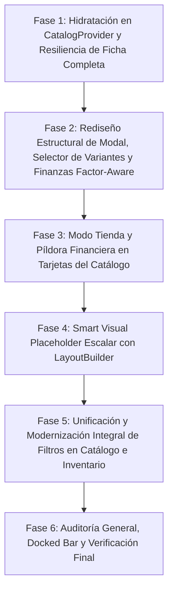

# PLAN DE TRABAJO: CORRECCIÓN INTEGRAL DE CATÁLOGO, TARJETAS, MODAL DE DETALLES Y SISTEMA DE FILTROS

**Documento:** `analisis_proyecto/PLAN_CORRECCION_INTEGRAL_CATALOGO_Y_FILTROS.md`  
**Estado:** Propuesta de Planificación Técnica Actualizada y Perfeccionada  
**Objetivo:** Elevar la experiencia del Catálogo de Ventas (`catalog_screen.dart`), sus tarjetas (`catalog_item_card.dart`), su modal de producto (`product_detail_modal.dart`) y su ecosistema de filtros (`live_filter_bottom_sheet.dart`, `catalog_filter_drawer.dart`, `filter_drawer.dart`, `inventory_screen.dart`) a un estándar de diseño y rendimiento de clase mundial (*Mobile Awards Quality*), erradicando bugs críticos, colisiones visuales, incoherencias matemáticas y redundancias arquitectónicas.

---

## 1. RESUMEN EJECUTIVO Y ANÁLISIS DE IMPACTO

El Catálogo de Ventas es la vitrina comercial operativa de la aplicación: el comerciante lo utiliza frente al cliente en mostrador o para armar pedidos y ventas rápidas con un solo toque.

A través de las auditorías en código y las capturas de pantalla provistas, se identificaron **5 vectores de deficiencia**:
1. **Modo Tienda Decorativo y Ausencia de Cálculos Financieros:** El interruptor "Tienda" oculta/muestra un banner informativo, pero no altera el contenido sensible (costos y márgenes) porque ni la tarjeta ni el modal de detalles calculan o muestran estos datos en modo comerciante.
2. **Degradación Estética por Productos sin Foto:** El placeholder actual (`"Sin imagen"` con icono tachado sobre fondo gris plano) crea una experiencia repetitiva, monótona y poco profesional en inventarios con fotografía parcial.
3. **Redundancia y Desborde en el Sistema de Filtros (Catálogo e Inventario):** 
   * Doble botón de filtros en `catalog_screen.dart` (en el `AppBar` y en el buscador), provocando el truncamiento del título principal (`"Catálogo ..."`) y desconexión entre el nuevo `LiveFilterBottomSheet` y los Drawers existentes.
   * En `inventory_screen.dart`, el `AppBar` tiene un botón de filtros que erróneamente abre `LiveFilterBottomSheet` (vinculado a `CatalogProvider`), mientras que la barra de búsqueda en `products_tab.dart` abre `FilterDrawer` (vinculado a `InventoryProvider`).
4. **Bugs Críticos en el Modal de Detalles (`product_detail_modal.dart`):**
   * *Colisión Visual:* Títulos largos se montan por debajo del botón de cierre `X`.
   * *Desequilibrio de Layout:* Píldoras de `EMPAQUE`, `PRESENTACIÓN` y `STOCK` distribuidas en un `Wrap` asimétrico (2 arriba, 1 sola abajo).
   * *Presentaciones Incompletas y Crash de Pantalla Blanca:* `ProductQueries.parseInventoryRow` entrega `product.presentaciones = []`, lo que impide mostrar variantes hermanas y dispara un `LateInitializationError` fatal en `ProductDetailScreen`.
5. **Falta de Pulido en el Docked Bar y Navegación entre Modales.**

---

## 2. DIAGNÓSTICO TÉCNICO EN PROFUNDIDAD (EVIDENCIA EN CÓDIGO)

### Diagnóstico 1: Modo Tienda Inoperante (`_isStoreMode`)
* **Archivo:** `lib/features/catalog/screens/catalog/catalog_screen.dart` (Líneas 573-649, 1097)
  * El estado `_isStoreMode` (booleano) se conmuta desde el `AppBar` y se pasa a `CatalogItemCard(isStoreMode: _isStoreMode)`.
* **Archivo:** `lib/core/widgets/catalog_item_card.dart` (Líneas 14, 20)
  * La tarjeta declara `final bool isStoreMode;`, **pero en su método `build` no se utiliza en ninguna parte**. No existe ninguna vista condicional de costo o margen para el comerciante.
* **Archivo:** `lib/core/widgets/product_detail_modal.dart` (Líneas 17, 24, 33, 41)
  * Recibe `isStoreMode`, pero tampoco muestra costos de compra ni márgenes de rentabilidad cuando está desactivado.
* **Datos disponibles en SQLite:** En `ProductPresentation`, los campos `costoUnitarioCalculado`, `factorGananciaVenta`, `unidadesPorVenta` y `precioVentaFinal` están presentes en la base de datos local y disponibles para su procesamiento financiero.

---

### Diagnóstico 2: Placeholder "Sin Imagen" Monótono
* **Archivo:** `lib/core/widgets/universal_image.dart` (Líneas 66-83)
  ```dart
  Widget _buildPlaceholder(BuildContext context, bool isDark) {
    return Container(
      color: isDark ? Colors.white10 : Colors.grey[100],
      child: Column(
        children: [
          Icon(Icons.image_not_supported_outlined, ...),
          Text("Sin imagen", ...),
        ],
      ),
    );
  }
  ```
* **Consecuencia:** Cuando un negocio tiene 50 productos sin fotografía, la pantalla se satura de decenas de recuadros idénticos con texto negativo (*"Sin imagen"*), comunicando descuido o fallo en lugar de una interfaz de nivel comercial.

---

### Diagnóstico 3: Duplicación de Botones y Truncamiento del Título

#### Catálogo (`catalog_screen.dart`):
* El `SliverAppBar` contiene:
  1. Botón de navegación atrás (`canPop`)
  2. Título `"Catálogo de Ventas"`
  3. `InfoTooltipButton`
  4. Botón píldora interactivo `"Tienda"` (con icono y texto)
  5. Botón de Filtros (`IconButton` con icono `Icons.tune_rounded` y badge de filtros activos)
  6. Botón de Refrescar (`IconButton` con `Icons.refresh`)
* **Problema:** Debido a la acumulación de acciones horizontales en el `AppBar`, el espacio para el `title` colapsa en pantallas estándar (360-390dp), forzando el truncamiento a `"Catálogo ..."`.
* En `catalog_header.dart` (Líneas 99-111), dentro del buscador se ubica un segundo botón azul de filtros (`Icons.tune`), el cual llama exactamente a la misma función: `LiveFilterBottomSheet.show(context)`.

#### Inventario (`inventory_screen.dart` y `products_tab.dart`):
* En `inventory_screen.dart` (Línea 259), el `AppBar` tiene un `IconButton` con `Icons.filter_list_rounded` que llama a `LiveFilterBottomSheet.show(context)`, el cual modifica `CatalogProvider` y **no tiene ningún efecto sobre el inventario**.
* Mientras tanto, en `products_tab.dart` (Línea 570), la barra de búsqueda llama a `Scaffold.of(context).openEndDrawer()`, abriendo `FilterDrawer` que sí opera sobre `InventoryProvider`.

---

### Diagnóstico 4: Bugs Estructurales y Crash en `product_detail_modal.dart`

#### 4.1. Colisión del Título con el Botón `X`
* En la raíz del modal se utiliza un `Stack`. El contenido principal se encuentra dentro de un `SingleChildScrollView` con padding horizontal de 24dp.
* La cabecera es un `Row` con la miniatura (90dp) y un `Expanded` que contiene la marca y el nombre completo del producto.
* El botón de cierre `X` está colocado como:
  ```dart
  Positioned(top: 8, right: 12, child: IconButton(Icons.close, ...))
  ```
* Al expandirse el `Column` del texto en todo el ancho restante, los nombres largos de 2 a 4 líneas invaden la esquina superior derecha y **se renderizan directamente debajo del botón `X`**, solapando caracteres e iconos.

#### 4.2. Desequilibrio de las Tarjetas `EMPAQUE`, `PRESENTACIÓN` y `STOCK`
* Implementadas como un `Wrap` con 3 elementos `_DetailPill` con tamaño intrínseco.
* En teléfonos estándar, 2 píldoras llenan la primera fila y la 3ª (`STOCK`) cae sola en la segunda fila alineada a la izquierda, dejando un 60% de espacio vacío a su derecha.

#### 4.3. BUG CRÍTICO: `product.presentaciones` Vacío y Pantalla Blanca en `ProductDetailScreen`
1. En `lib/core/database/product_queries.dart`:
   ```dart
   static InventoryWrapper parseInventoryRow(Map<String, dynamic> row) {
     return InventoryWrapper(
       product: Product.fromJson(productJson), // ⚠️ row NO contiene la clave 'presentaciones'
       presentation: ProductPresentation.fromJson(presJson)
     );
   }
   ```
   En `Product.fromJson`, al no existir la clave `presentaciones`, se asigna una lista vacía: `presentaciones = []`.
2. En `product_detail_modal.dart`, se pasa este objeto `prod` con `presentaciones: []` directamente al constructor de `ProductDetailScreen`.
3. En `ProductDetailScreen`:
   * Se declara `late ProductPresentation _selectedPresentation;`.
   * En `initState()`, `_updateSelectedPresentation(widget.initialPresentationId)` ejecuta `_currentProduct.presentaciones.firstWhere(...)`. Como la lista está vacía, lanza excepción que es capturada por el `catch`, pero al estar vacía la lista, **`_selectedPresentation` nunca se inicializa**.
   * Al ejecutarse `build()`, cualquier acceso a `_selectedPresentation` dispara un fatal **`LateInitializationError`**, congelando la pantalla en blanco.
4. Adicionalmente, el patrón `Navigator.pop(context)` seguido de `Navigator.push(context, ...)` reutiliza un contexto que se está destruyendo.

---

## 3. RECOMENDACIONES DE DISEÑO Y ARQUITECTURA (DECISIONES ESTRATÉGICAS)

### A. Evaluación del Placeholder "Sin Imagen" (Smart Visual Placeholder Responsivo)
* **Alternativa Evaluada 1: Solo Iniciales Simples.**
  * *Veredicto:* Insuficiente. Dos letras sobre un fondo plano siguen luciendo vacías.
* **Alternativa Evaluada 2: Mantener el icono gris con texto tachado.**
  * *Veredicto:* Rechazado. Comunica error y rompe la inmersión de venta.
* **Alternativa Recomendada: "Smart Visual Placeholder" Proporcional con `LayoutBuilder` (Mobile Awards Standard).**
  * **Diseño Propuesto:**
    1. **Fondo con Gradiente Sutil y Sofisticado:** Paleta armónica calculada determinísticamente por hash del nombre o `categoriaId`.
    2. **Monograma / Avatar Tipográfico Escalar:** Iniciales en mayúscula del producto (1 a 2 letras). El tamaño de fuente se calcula proporcionalmente al tamaño real del contenedor con `LayoutBuilder` (`fontSize = minDim * 0.35`).
    3. **Micro-Icono Flotante de Categoría:** Micro-icono proporcional (`iconSize = minDim * 0.22`) que identifica el rubro (abarrotes, bebidas, limpieza, útiles, etc.).
    4. **Eliminación Absoluta del Texto "Sin imagen"**: Garantiza elegancia tanto en una miniatura de 48px como en una tarjeta grande de 180px o en un modal full-width.

---

### B. Eliminación de Botones Duplicados y Arquitectura de Filtros

#### 1. Decisión sobre el Botón Duplicado en Catálogo (`catalog_screen.dart`):
* **Recomendación:** **Eliminar el botón de filtros del `SliverAppBar`** y **conservar el botón de filtros en la barra de búsqueda (`CatalogHeader`)**.
* **Justificación:** Libera el ancho del `AppBar`, erradicando el corte `"Catálogo ..."` para mostrar `"Catálogo de Ventas"` limpio. Alinea la acción de búsqueda con la de filtrado en un único centro de exploración.

#### 2. Decisión sobre el Botón Duplicado en Inventario (`inventory_screen.dart` y `products_tab.dart`):
* **Recomendación:** **Eliminar el botón de filtro del `AppBar` de `inventory_screen.dart`** (que además apuntaba erróneamente a `CatalogProvider`) y **mantener el botón de filtro en la barra de búsqueda de `products_tab.dart`** vinculado a `InventoryProvider`.

#### 3. Arquitectura Unificada de Filtros:
* Se conserva e integra la totalidad de los criterios existentes en `catalog_filter_drawer.dart` y `filter_drawer.dart`:
  1. Categorías (chips multi-selección)
  2. Marcas (chips multi-selección)
  3. Proveedores (multi-selección para inventario)
  4. Estado de Stock (*Todos / Con Stock / Stock Bajo / Agotados*)
  5. Rango de Precios (Slider interactivo + campos numéricos manuales de entrada)
  6. Rango de Stock (Slider interactivo + inputs manuales)
  7. Solo Ofertas / Descuentos
  8. Opciones de Visualización (*Solo Principales / Ocultar Variantes*)
  9. Estado (*Público / Privado / Todos*)
* Todo organizado mediante acordeones fluidos `MorphingAccordion`, conteo reactivo a 0ms en SQLite y blindaje inferior `SafeArea` / BUG-07. Se elimina el archivo redundante e inerte `catalog_filter_drawer.dart`.

---

## 4. PLAN DETALLADO DE IMPLEMENTACIÓN POR FASES



---

### FASE 1: Hidratación de Presentaciones en `CatalogProvider` y Blindaje de Navegación

* **Archivos a intervenir:**
  * `lib/features/catalog/providers/catalog_provider.dart`
  * `lib/core/widgets/product_detail_modal.dart`
  * `lib/features/catalog/screens/product_detail_screen.dart`
* **Acciones en Código:**
  1. **Hidratación en Memoria de `product.presentaciones`:**
     * En `CatalogProvider.loadMoreItems()`, agrupar todas las presentaciones pertenecientes al mismo `product.id`.
     * Asignar a cada `InventoryWrapper.product` la lista completa de todas sus presentaciones hermanas (`uniquePresentations.values.toList()`).
     * Exponer en `CatalogProvider` el método `Product getFullProduct(int productId)` y `List<ProductPresentation> getPresentationsForProduct(int productId)` para consultas instantáneas a 0ms.
     * **Resultado directo:** A partir de este paso, `CatalogItemCard`, `ProductDetailModal` y `ProductDetailScreen` dispondrán siempre de todas las presentaciones del producto sin consultas asíncronas extras.
  2. **Blindaje en `ProductDetailScreen`:**
     * En `_updateSelectedPresentation`, si `_currentProduct.presentaciones` estuviera vacía, asignar fallback seguro con `widget.initialPresentationId` o valores por defecto para que `late ProductPresentation _selectedPresentation;` jamás quede sin inicializar.
  3. **Navegación Limpia y Segura:**
     * En `ProductDetailModal`, capturar `final navigator = Navigator.of(context);` antes de cerrar el modal:
       ```dart
       final navigator = Navigator.of(context);
       navigator.pop();
       navigator.push(MaterialPageRoute(
         builder: (_) => ProductDetailScreen(
           product: fullProductWithPresentations,
           initialPresentationId: pres.id ?? -1,
           heroTag: 'cat_${pres.id}',
         ),
       ));
       ```
  4. **Protección en Modo Tienda:**
     * Ocultar el botón *"Ver Ficha Completa de Producto"* cuando `isStoreMode == true`.

---

### FASE 2: Rediseño Estructural del Modal de Detalles (`product_detail_modal.dart`)

* **Archivos a intervenir:**
  * `lib/core/widgets/product_detail_modal.dart`
* **Acciones en Código:**
  1. **Aislamiento Total del Botón de Cierre `X` (Sin Colisiones):**
     * Reestructurar la fila de cabecera reservando un margen derecho estricto de 48dp o integrando el botón `X` dentro del layout natural para que ningún título largo colisione ni pase por debajo del botón.
  2. **Layout Bento Simétrico de 3 Columnas (`EMPAQUE`, `PRESENTACIÓN`, `STOCK`):**
     * Sustituir el `Wrap` asimétrico por una fila Bento equilibrada (`Row` con 3 `Expanded` iguales), con bordes suaves, iconos vectoriales y tipografía uniforme.
  3. **Selector Reactivo de Presentaciones Dentro del Modal:**
     * Mostrar una fila horizontal de chips con todas las presentaciones hermanas del producto hidratadas desde la Fase 1.
     * Al cambiar de variante:
       * Recalcular instantáneamente empaque, unidad, stock, precios, costo y margen.
       * **Validación y Clamping de Cantidad:** Si `_quantity` supera el nuevo stock vendible (`displayStock` de la nueva presentación), ajustarlo automáticamente:
         ```dart
         final int newMaxStock = selectedPres.stockActual ~/ (selectedPres.unidadesPorVenta <= 0 ? 1 : selectedPres.unidadesPorVenta);
         if (_quantity > newMaxStock) {
           _quantity = newMaxStock > 0 ? newMaxStock : 1;
         }
         ```
  4. **Cálculo Matemático Factor-Aware de Costo y Margen (Banda Financiera):**
     * **Cálculo de Costo de la Presentación:**
       $$\text{factorVenta} = \max(1, \text{pres.unidadesPorVenta})$$
       $$\text{costoUnitarioBase} = \text{pres.costoUnitarioCalculado} ?? 0.0$$
       $$\text{costoPresentacion} = \text{costoUnitarioBase} \times \text{factorVenta}$$
     * **Cálculo de Ganancia Neta y Margen:**
       $$\text{precioEfectivo} = (\text{pres.precioOferta} != \text{null} \ \&\& \ \text{pres.precioOferta}! > 0) \ ? \ \text{pres.precioOferta}! \ : \ \text{pres.precioVentaFinal}$$
       $$\text{gananciaPresentacion} = \text{precioEfectivo} - \text{costoPresentacion}$$
       $$\text{gananciaTotal} = \text{gananciaPresentacion} \times \text{_quantity}$$
       $$\text{margenPorcentual} = \text{precioEfectivo} > 0 \ ? \ ((\text{precioEfectivo} - \text{costoPresentacion}) / \text{precioEfectivo} \times 100) \ : \ 0.0$$
     * **Presentación Visual:**
       * Si `factorVenta > 1`, mostrar: `"Costo Pack: S/ ${costoPresentacion.toStringAsFixed(2)} (S/ ${costoUnitarioBase.toStringAsFixed(2)}/u)"`.
       * Si `factorVenta == 1`, mostrar: `"Costo Unit.: S/ ${costoPresentacion.toStringAsFixed(2)}"`.
       * Ganancia Neta recalculada según `_quantity`.
       * **Semáforo Visual de Rentabilidad:**
         * Verde Esmeralda: Margen $\ge 30\%$
         * Ámbar Cálido: Margen entre $15\%$ y $29\%$
         * Rojo / Coral: Margen $< 15\%$ o negativo.
  5. **Modo Tienda Activado:**
     * Ocultar completamente la banda financiera con `AnimatedSize` y `AnimatedSwitcher` de 250ms.

---

### FASE 3: Modo Tienda y Píldora Financiera Factor-Aware en Tarjetas (`catalog_item_card.dart`)

* **Archivos a intervenir:**
  * `lib/core/widgets/catalog_item_card.dart`
* **Acciones en Código:**
  1. **Integración de `isStoreMode`:**
     * Cuando `widget.isStoreMode == false` (Modo Vendedor), desplegar una micro-píldora compacta:
       * Formato: `Costo S/ ${costoPresentacion.toStringAsFixed(2)} · ${margenPorcentual.toStringAsFixed(0)}%` con punto cromático del semáforo.
  2. **Selector de Presentación en Tarjeta:**
     * Gracias a la hidratación de la Fase 1, `prod.presentaciones` reflejará de inmediato todas las variantes, recalculando el costo y margen factor-aware al tocar cada variante.
  3. **Blindaje de Layout:**
     * Ocultar con `AnimatedSwitcher` en Modo Tienda, preservando estrictamente el `childAspectRatio: 0.63` de la grilla sin desbordamientos de renderizado.

---

### FASE 4: Smart Visual Placeholder Escalar con `LayoutBuilder`

* **Archivos a intervenir:**
  * `lib/core/widgets/universal_image.dart`
* **Acciones en Código:**
  1. **Diseño Adaptativo con `LayoutBuilder`:**
     ```dart
     LayoutBuilder(
       builder: (context, constraints) {
         final double minDim = math.min(constraints.maxWidth, constraints.maxHeight);
         final double fontSize = (minDim * 0.35).clamp(11.0, 48.0);
         final double iconSize = (minDim * 0.22).clamp(10.0, 32.0);
         ...
       }
     )
     ```
  2. **Gradiente Determinístico:** Paleta suave calculada por hash del nombre o ID de categoría.
  3. **Monograma Tipográfico:** 1 a 2 iniciales con peso tipográfico `FontWeight.w900` y tracking estilizado.
  4. **Micro-Icono de Categoría:** En marca de agua translúcida o badge inferior derecho (bebidas, snacks, limpieza, librería, etc.).
  5. **Eliminación Absoluta del Texto `"Sin imagen"`:** Aplicado universalmente en catálogo, modales, carrito e inventario.

---

### FASE 5: Unificación y Modernización Integral de Filtros en Catálogo e Inventario

* **Archivos a intervenir:**
  * `lib/features/catalog/screens/catalog/catalog_screen.dart`
  * `lib/core/widgets/catalog_header.dart`
  * `lib/features/catalog/screens/inventory_screen.dart`
  * `lib/features/catalog/screens/tabs/products_tab.dart`
  * `lib/core/widgets/live_filter_bottom_sheet.dart`
  * `lib/core/widgets/filter_drawer.dart`
  * Eliminación de `lib/core/widgets/catalog_filter_drawer.dart`
* **Acciones en Código:**
  1. **Depuración de Botones Duplicados:**
     * En `catalog_screen.dart`: Retirar el botón de filtro del `SliverAppBar`. El título `"Catálogo de Ventas"` se muestra completo. El botón protagónico queda en `catalog_header.dart` con badge dinámico.
     * En `inventory_screen.dart`: Retirar el botón de filtro del `AppBar` (que abría erróneamente `LiveFilterBottomSheet`). En `products_tab.dart`, el botón del buscador abre el filtro de inventario con coherencia total.
  2. **Consolidación de Criterios Completos en el Sistema Modernizado:**
     * Categorías y Marcas con chips animados y selección múltiple.
     * Proveedores (en inventario).
     * **Estado de Stock:** Chips de *Todos / Con Stock / Stock Bajo / Agotados*.
     * **Rango de Precios y Rango de Stock:** RangeSlider interactivo + campos de texto numéricos manuales (`TextField`) para ingreso directo.
     * **Solo Ofertas / Descuentos:** Switch reactivo con micro-háptica.
     * **Visualización y Estado:** *Solo Principales / Ocultar Variantes* y *Público / Privado* (en inventario).
  3. **Conteo en Vivo a 0ms y Acordeones `MorphingAccordion`:**
     * El botón inferior flotante calcula en tiempo real *"Ver X Productos"* antes de aplicar.
     * Secciones colapsables limpias para no saturar la pantalla.
     * Blindaje inferior con `InteractiveSheetWrapper.getEffectiveBottomPadding`.
  4. **Limpieza de Código:**
     * Eliminación de `catalog_filter_drawer.dart`.

---

### FASE 6: Auditoría General, Docked Bar y Verificación Final

* **Archivos a intervenir:**
  * `lib/features/catalog/screens/catalog/catalog_screen.dart`
  * `lib/core/widgets/catalog_cart_modal.dart`
* **Acciones en Código:**
  1. **Docked Bar Inferior:**
     * Animación suave al colapsar/expandir `"Mi Lista"` y `"Caja Rápida"` con blindaje de navegación gestual.
  2. **Traspaso a Caja Rápida y Cotización:**
     * Confirmar que los productos transferidos conserven su presentación seleccionada, factor y precios de oferta.
  3. **Verificación Estética Dark / Light Mode:**
     * Asegurar contrastes óptimos de los semáforos de rentabilidad y del nuevo Smart Placeholder.

---

## 5. PROTOCOLO DE VALIDACIÓN ADVERSARIAL Y PRUEBAS AUTOMATIZADAS

1. **Test de Hidratación y Navegación:**
   * Cargar catálogo y verificar que cada `item.product.presentaciones` contenga todas las variantes hermanas.
   * Abrir `ProductDetailScreen` y validar que no ocurra `LateInitializationError` (0 pantallas blancas).
2. **Test Matemático Factor-Aware:**
   * Producto con `unidadesPorVenta = 12`, `costoUnitario = 1.00`, `precioVenta = 15.00`.
   * Verificar que `costoPresentacion == 12.00`, `ganancia == 3.00` y `margen == 20%` (y no `14.00` de ganancia errónea).
3. **Test de Clamping de Stock al Cambiar Variante:**
   * Variante A con stock 10 (seleccionada cantidad 8) $\rightarrow$ cambiar a Variante B con stock 3 $\rightarrow$ cantidad se ajusta automáticamente a 3.
4. **Test de Aislamiento del Botón `X`:**
   * Nombre de 85 caracteres no colisiona ni se solapa con el botón de cierre.
5. **Test de Responsividad del Placeholder:**
   * Renderizado en 48x48 y 200x200 sin overflow y con tipografía proporcional.
6. **Test de Filtros Unificados:**
   * Verificación de que ningún botón abra un provider equivocado y que el conteo en vivo refleje exactamente los productos coincidentes.
7. **Análisis Estático:** `flutter analyze` con 0 errores y 0 warnings.

---

> [!IMPORTANT]
> **COMPROMISO DE NO MODIFICACIÓN PREVIA:**  
> Ningún archivo de código fuente ha sido alterado aún. La ejecución comenzará únicamente tras recibir tu aprobación de este plan actualizado.
