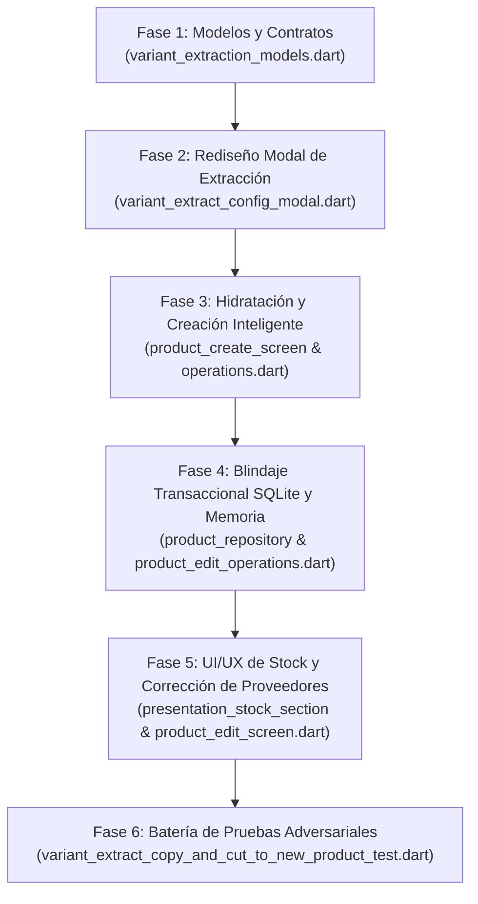

# PLAN DE TRABAJO: CORRECCIÓN PROFUNDA DE STOCK COMPARTIDO, UNIDADES CON FACTOR > 1, COSTOS Y FLUJO DE EXTRACCIÓN DE VARIANTES (COPIAR / CORTAR)

**Documento:** `analisis_proyecto/PLAN_CORRECCION_PROFUNDA_STOCK_COMPARTIDO_UNIDADES_Y_COSTOS_EN_EXTRACCION_VARIANTES.md`  
**Fecha:** 13 de Noviembre de 2026  
**Estado:** Propuesta de Planificación Técnica Exhaustiva para Aprobación  
**Metodología:** Loop Autónomo + Árbitro Interno Adversarial  
**Archivos Auditados:**
* `app_movil/lib/features/catalog/models/variant_extraction_models.dart`
* `app_movil/lib/features/catalog/widgets/variants/variant_extract_config_modal.dart`
* `app_movil/lib/features/catalog/screens/product_edit_screen.dart`
* `app_movil/lib/features/catalog/widgets/edit/product_edit/product_edit_operations.dart`
* `app_movil/lib/features/catalog/screens/product_create_screen.dart`
* `app_movil/lib/features/catalog/widgets/form/product_create_operations.dart`
* `app_movil/lib/core/widgets/product_presentation_card.dart`
* `app_movil/lib/core/widgets/presentation_card/presentation_stock_section.dart`
* `app_movil/lib/core/widgets/presentation_card/presentation_pricing_section.dart`
* `app_movil/lib/core/widgets/presentation_card/presentation_math_engine.dart`
* `app_movil/lib/features/catalog/widgets/form/product_controller_factory.dart`
* `app_movil/lib/features/catalog/widgets/form/product_form_mapper.dart`
* `app_movil/lib/features/catalog/repositories/product_repository.dart`
* `app_movil/test/variant_extract_copy_and_cut_to_new_product_test.dart`

---

## 1. RESUMEN EJECUTIVO Y ANÁLISIS FORENSE DE LAS 5 CAPTURAS

Durante las pruebas reales con el producto `'piso'` y su variante `#2 Secundaria` (`Caja (x3) Pack rojo`), se descubrió una fractura multidimensional en la arquitectura de extracción y migración de variantes a productos independientes:

```
[Producto Origen 'piso']
  - Inventario Base Compartido: 10 und.
  - Variante #2 Secundaria: Caja (Factor 3)
  - Stock Visual Vendible: 3 Cajas (= 9 und. base)
  - Costos y Precios: Costo S/ 30.00 | Margen 1.36 (36.3%) | Venta S/ 40.90
  - Proveedor General: ATUQ DEX S.A.C.
              │
              ▼ [Modal "Convertir Variante en Producto"]
  ❌ BUG 1: Lee "3" y asume "3 uds sueltas" (no 3 Cajas = 9 und. base)
  ❌ BUG 2: Muestra "Proveedor: Ninguno" (getter _generalProviderName ignora proveedores persistidos)
  ❌ BUG 3: Botón footer "→ Continuar a Crear →" repite flechas y recorta texto
  ❌ BUG 4: No ofrece conversión inteligente entre Empaque (Caja x3) y Unidad (x1)
              │
              ▼ [Crear / Mover Producto]
  ❌ BUG 5: Inyecta "3" en "Stock Inicial (Sueltas físicas)" -> Divide 3 / 3 = 1 Caja (3 und. base)
  ❌ BUG 6: Muestra "⚙️ Ajuste por ventas previas" en pantalla de producto NUEVO
  ❌ BUG 7: En SQLite y en memoria, el pool compartido de 'piso' (10 und.) NO descuenta las 9 und. trasladadas
```

### Tabla Resumen de Diagnósticos Forenses

| # | Problema Detectado | Capturas | Archivo y Línea Afectada | Causa Raíz en Código |
|---|-------------------|----------|--------------------------|----------------------|
| **1** | **Colapso de Stock ($3 \text{ Cajas} \to 1 \text{ Caja}$)** | Img 2, 3, 5 | `variant_extract_config_modal.dart:159-164`<br>`product_create_operations.dart:926-946`<br>`presentation_math_engine.dart:281-285` | `variantControllerMap['stockFinal']` almacena la cantidad visual de empaques ($3$). El modal lo llamó `"3 uds"` y lo transfirió a `stockInicial` de `ProductCreateScreen` que espera "unidades sueltas base". El motor dividió $3 \div 3 = 1$ Caja. |
| **2** | **Desconexión Transaccional en Stock Compartido** | Img 2, 3, 5 | `product_repository.dart:1334-1348`<br>`product_edit_operations.dart:613-656`<br>`variant_extract_config_modal.dart:88` | `cutVariantFromProductTransaction` solo hace `UPDATE presentaciones_producto SET activo=0, stock_actual=0`. Jamás descuenta `productos.stock_compartido` ni la presentación default vinculada. En memoria, `_sharedStockCtrl` de `'piso'` quedó intacto en 10. |
| **3** | **Ceguera de Factores ($F > 1$) y Rigidez de Presentación** | Img 1, 3, 4 | `variant_extract_config_modal.dart:73-126`<br>`variant_extraction_models.dart:74-126` | No existía desglose económico a nivel unitario ($C_{\text{base}} = 10.00$, $P_{\text{base}} = 13.63$) ni selector para elegir si el nuevo producto nace como Empaque ($x3$), Unidad ($x1$) o Ambas presentaciones vinculadas en stock compartido ($x1 + x3$). |
| **4** | **Input de Stock Confuso y Botón de Ventas Previas en Creación** | Img 5 | `presentation_stock_section.dart:586-601`<br>`presentation_stock_section.dart:700-757` | En modo creación con $F > 1$, la UI solo ofrecía "Stock Inicial (Sueltas físicas)", induciendo a error al comerciante. El botón `"⚙️ Ajuste por ventas previas"` se renderizaba fuera del bloque `if (widget.isEditMode)`. |
| **5** | **Bug `Proveedor: Ninguno` en Modal** | Img 3, 6 | `product_edit_screen.dart:509-513`<br>`variant_extract_config_modal.dart:646` | El getter `_generalProviderName` solo leía `deferredProviderName`. Para proveedores persistidos en BD (`ATUQ DEX S.A.C.`), devolvía `null`, renderizando `"Proveedor: Ninguno"`. |
| **6** | **Pérdida de Datos Secundarios y Botón de Pie Deforme** | Img 3, 4, 5 | `product_controller_factory.dart:940-954`<br>`variant_extract_config_modal.dart:915-921` | Se omitían `umpCompra`, `cantCompra`, `totalPago`, `precioOfertaExacto`. El botón tenía doble flecha `→ Continuar a Crear →` y recortaba el texto. |

---

## 2. DIAGNÓSTICO MATEMÁTICO FORENSE Y FÓRMULAS DE CONVERSIÓN

### 2.1. El Ecosistema de Datos en `Editar Producto` (`'piso'`)
* Inventario Base Compartido del Padre: $S_{\text{pool}} = 10 \text{ und. base}$.
* Variante Origen (`Pack rojo`):
  * Unidad: `Caja`, Factor de empaque: $F = 3$.
  * Costo por Caja: $C_{\text{pkg}} = \text{S/ } 30.00$.
  * Margen comercial: $M = 1.36$ ($36.3\%$).
  * Precio Venta por Caja: $P_{\text{pkg}} = \text{S/ } 40.90$.
  * Stock Vendible Máximo: $V_{\text{disp}} = \lfloor S_{\text{pool}} / F \rfloor = \lfloor 10 / 3 \rfloor = 3 \text{ Cajas}$.
  * Unidades Físicas Base Comprometidas: $S_{\text{base}} = V_{\text{disp}} \times F = 3 \times 3 = 9 \text{ und. base}$.
  * Sobrante no empaquetable en `'piso'`: $R = S_{\text{pool}} \pmod F = 10 \pmod 3 = 1 \text{ und. base}$.

### 2.2. Desglose Matemático a Nivel Unitario (Base)
Cuando el comerciante extrae una presentación con $F > 1$, existen dos realidades económicas proporcionales:

$$\text{Costo Unitario Real } (C_{\text{base}}) = \frac{C_{\text{pkg}}}{F} = \frac{30.00}{3} = \text{S/ } 10.00$$

$$\text{Margen Comercial } (M) = \frac{P_{\text{pkg}}}{C_{\text{pkg}}} = \frac{40.90}{30.00} = 1.3633\dots \implies 36.3\%$$

$$\text{Precio Unitario Proporcional } (P_{\text{base}}) = \frac{P_{\text{pkg}}}{F} = \frac{40.90}{3} = \text{S/ } 13.633\dots \implies \text{S/ } 13.63$$

$$\text{Verificación de Coherencia: } C_{\text{base}} \times M = 10.00 \times 1.3633 = \text{S/ } 13.63 \quad \checkmark$$

### 2.3. Las 3 Opciones de Estructuración en el Nuevo Producto

```
                        Variante Extraída: Caja (x3)
                                     │
           ┌─────────────────────────┼─────────────────────────┐
           ▼                         ▼                         ▼
      [OPCIÓN 1]                [OPCIÓN 2]                [OPCIÓN 3]
  Mantener en Empaque       Convertir a Unidad         Crear con Ambas
       (Caja x3)                (Unidad x1)          (Unidad x1 + Caja x3)
  ───────────────────       ───────────────────      ─────────────────────
  Modo: INDEPENDIENTE       Modo: INDEPENDIENTE      Modo: COMPARTIDO
  Pres 1: Caja (x3)         Pres 1: Unidad (x1)      Pool Nuevo: 9 und. base
  Costo: S/ 30.00           Costo: S/ 10.00          Costo Base: S/ 10.00
  Venta: S/ 40.90           Venta: S/ 13.63          ⭐ Pres 1: Unidad (x1)
  Stock: 3 Cajas            Stock: 9 Unidades           C: 10.00 | V: 13.63
  (9 und. base físicas)     (9 und. base físicas)    #2 Pres 2: Caja (x3)
                                                        C: 30.00 | V: 40.90
                                                        Cupo: 3 Cajas
```

* **Opción 1 (`Mantener en Empaque` - Por Defecto):**
  * Presentación única `Caja` ($F=3$).
  * Stock físico inyectado en `ProductCreateScreen`: $S_{\text{base}} = 9 \text{ und. base}$.
  * El motor calcula: $9 \div 3 = 3 \text{ Cajas}$. La UI muestra: `3 Cajas (9 und. base)`.
* **Opción 2 (`Convertir a Unidad Individual`):**
  * Presentación única `Unidad` ($F=1$).
  * Costo: `S/ 10.00`, Margen: `1.36` ($36.3\%$), Venta: `S/ 13.63`.
  * Stock físico: $9 \text{ Unidades}$.
* **Opción 3 (`Crear con Ambas Presentaciones`):**
  * El nuevo producto se inicializa en modo `COMPARTIDO`.
  * `_sharedStockCtrl.text = "9"`.
  * `_baseCostCtrl.text = "10.00"`.
  * Se instancian **2 tarjetas de presentación**:
    * `⭐ Principal`: `Unidad` ($F=1$), $C=10.00$, $V=13.63$, `usaStockCompartido: true`.
    * `#2 Secundaria`: `Caja` ($F=3$), $C=30.00$, $V=40.90$, `usaStockCompartido: true`, `cupoMaximoVariante: 3`.

---

## 3. LÓGICA COMPARATIVA: STOCK COMPARTIDO VS. STOCK PROPIO AL EXTRAER

### 3.1. Caso A: Variante Origen en `🔗 Stock Compartido`
1. **Detección:**
   * La variante tiene `usaStockCompartido == true` o el producto padre tiene `modoStock == 'COMPARTIDO'`.
   * El stock disponible vendible es $V = \text{stockFinal}$ ($3$ Cajas).
   * El stock base comprometido es $S_{\text{trasladar}} = V \times F = 3 \times 3 = 9 \text{ und. base}$.
   * El pool base total del padre es $S_{\text{pool}} = 10 \text{ und. base}$.
2. **Visualización en Modal:**
   * Etiqueta de Stock: `Stock disponible: 3 Cajas (9 und. base de 10 und. compartidas)`.
3. **Comportamiento en `✂️ Cortar / Mover`:**
   * El modal ofrece el toggle: **`¿Descontar 9 und. base del stock compartido de 'piso'?`** (Activado por defecto).
   * **Si está Activado:**
     * Al guardar el nuevo producto, se ejecuta `finalizeVariantExtractionCut`:
       * En SQLite (`cutVariantFromProductTransaction`):
         * `UPDATE productos SET stock_compartido = stock_compartido - 9 WHERE id = originProductId`.
         * `UPDATE presentaciones_producto SET stock_actual = stock_actual - 9 WHERE producto_id = originProductId AND usa_stock_compartido = 1`.
         * `INSERT INTO stock_ledger (presentation_id, cantidad: -9, tipo: 'TRANSFERENCIA_EXTRACCIÓN')`.
         * `UPDATE presentaciones_producto SET activo = 0, stock_actual = 0 WHERE id = presentationId`.
       * En memoria en `ProductEditScreen`:
         * `_sharedStockCtrl.text = (10 - 9).toString() = "1"`.
         * Se actualiza `c['stockFinal']` en todas las presentaciones restantes vinculadas para que sincronicen su nuevo cupo.
   * **Si está Desactivado:**
     * No se descuenta el stock de `'piso'`. El producto original mantiene sus $10$ und. y solo se retira la variante.
4. **Comportamiento en `📋 Copiar`:**
   * El producto origen `'piso'` nunca se modifica ni descuenta.
   * El usuario elige entre copiar las $3$ Cajas ($9$ und. base) al nuevo producto o iniciarlo en `Stock: 0`.

### 3.2. Caso B: Variante Origen en `📦 Stock Propio (Individual)`
1. **Detección:**
   * La variante tiene `usaStockCompartido == false`.
   * Su stock es independiente: $S_{\text{base}} = V \times F$.
2. **Visualización en Modal:**
   * `Stock disponible: 3 Cajas (9 und. base individuales)`.
3. **Comportamiento en `✂️ Cortar / Mover`:**
   * Descuenta única y exclusivamente las unidades de esa variante individual en SQLite y en memoria, sin alterar ninguna otra variante ni el pool compartido del padre.

---

## 4. PLAN DE TRABAJO DETALLADO POR FASES DE IMPLEMENTACIÓN



---

### FASE 1: AMPLIACIÓN DE MODELOS DE DATOS Y CONTRATOS DE TRANSFERENCIA
**Objetivo:** Garantizar que el paquete de datos (`VariantExtractionBundle`, `VariantExtractionDetailData`, `ProductExtractionResult`) transporte toda la información dimensional, empaque, costos desglosados y trazabilidad transaccional sin pérdida ni ambigüedad.

* **Archivo:** `app_movil/lib/features/catalog/models/variant_extraction_models.dart`
* **Acciones Concretas:**
  1. Agregar `enum VariantExtractionStructure`:
     * `keepPackaging` (mantener empaque original, ej. Caja x3).
     * `unitOnly` (convertir a unidad suelta individual x1).
     * `bothUnitAndPackage` (crear con ambas presentaciones x1 y x3 en stock compartido).
  2. Enriquecer `VariantExtractionDetailData`:
     * `final VariantExtractionStructure targetStructure;`
     * `final int packageUnits;` (ej. 3 Cajas)
     * `final int baseUnits;` (ej. 9 und. base)
     * `final bool isSharedOrigin;` (indica si venía de stock compartido)
     * `final int parentSharedStock;` (ej. 10 und. en el padre)
     * `final bool deductStockFromOrigin;` (toggle para cortar con descuento real)
     * `final double unitCostPrice;` (ej. S/ 10.00)
     * `final double unitSalePrice;` (ej. S/ 13.63)
     * `final String? umpCompra;`
     * `final int unidadesLote;`
     * `final double? cantCompra;`
     * `final double? totalPago;`
     * `final String? variantDescription;`
  3. Enriquecer `ProductExtractionResult`:
     * `final int transferredBaseUnits;` (cantidad exacta en unidades base a descontar de la BD)
     * `final bool isSharedOrigin;`
     * `final bool shouldDeductSharedPool;`

---

### FASE 2: REDISEÑO DEL MODAL DE CONFIGURACIÓN PREVIA
**Objetivo:** Ofrecer una interfaz transparente, comprensible y quirúrgica que informe con precisión matemática el stock, los costos y dé el control al comerciante.

* **Archivo:** `app_movil/lib/features/catalog/widgets/variants/variant_extract_config_modal.dart`
* **Acciones Concretas:**
  1. **Detección Forense en `initState`:**
     * Detectar si `isShared`: `map['usaStockCompartido'] == true || widget.modoStock == 'COMPARTIDO'`.
     * Leer `_factorVenta = int.tryParse(map['unidadesVenta']) ?? 1`.
     * Leer `_visualPackages = int.tryParse(map['stockFinal']) ?? 0`.
     * Calcular `_baseUnits = _visualPackages * _factorVenta`.
     * Calcular `_unitCost = _costoUnitario / _factorVenta`.
     * Calcular `_unitPrice = _precioVenta / _factorVenta`.
  2. **Tarjeta de Cabecera y Resumen Financiero Dual:**
     * Si `_factorVenta > 1`, mostrar badge dual:
       `Caja (x3): Costo S/ 30.00 • Venta S/ 40.90`  
       `Por unidad: Costo S/ 10.00 • Venta S/ 13.63 • Margen 36.3%`
  3. **Selector Interactivo de Estructuración (Sólo visible si `_factorVenta > 1`):**
     * 3 tarjetas seleccionables con radio button:
       * **`Mantener en Caja (x3)`** *(Recomendado si solo vendes empaques)*.
       * **`Convertir a Unidad (x1)`** *(Ideal para empezar a vender por menor)*.
       * **`Crear con Ambas (Unidad x1 + Caja x3)`** *(Vender al por menor y al por mayor con stock compartido)*.
  4. **Tarjeta de Stock Inteligente:**
     * Si `isShared`: Mostrar claramente:
       `📦 Stock disponible: 3 Cajas (9 und. base de 10 und. compartidas)`.
       * En modo `Cortar / Mover`: Switch interactivo:
         `¿Descontar 9 und. base del inventario compartido de 'piso'?` (On por defecto).
         Subtítulo: `El producto 'piso' quedará con 1 und. base restante`.
     * Si es `Stock Propio`: Mostrar:
       `📦 Stock actual: 3 Cajas (9 und. base individuales)`.
  5. **Corrección de Proveedor General en el Modal:**
     * En el chip de `Proveedor`, resolver el nombre correctamente (si `widget.generalProviderName` es nulo o vacío, consultar el provider o mostrar el proveedor específico de la variante).
  6. **Limpieza del Botón Footer:**
     * Eliminar la duplicación de flechas. Usar un `ElevatedButton` estilizado con texto limpio:
       **`Continuar a Crear →`** en una sola línea sin desbordamientos.

---

### FASE 3: HIDRATACIÓN Y CREACIÓN INTELIGENTE EN `ProductCreateScreen`
**Objetivo:** Inicializar el nuevo producto con la estructura seleccionada por el usuario (Opción 1, 2 o 3) con sus costos, márgenes, descuentos, datos de compra y stock perfectamente calibrados.

* **Archivos:**
  * `app_movil/lib/features/catalog/screens/product_create_screen.dart`
  * `app_movil/lib/features/catalog/widgets/form/product_create_operations.dart`
* **Acciones Concretas:**
  1. **Soporte para Opción 1 (`keepPackaging`):**
     * Modo: `INDEPENDIENTE`.
     * Variante Principal: `Unidad: Caja`, `Factor: 3`, `Costo: S/ 30.00`, `Margen: 1.36`, `Precio: S/ 40.90`.
     * Stock Inicial: Inyectar `detail.baseUnits` ($9$ und. base) en `stockInicial`, para que el motor calcule `stockFinal = 9 / 3 = 3 Cajas`.
  2. **Soporte para Opción 2 (`unitOnly`):**
     * Modo: `INDEPENDIENTE`.
     * Variante Principal: `Unidad: Unidad`, `Factor: 1`, `Costo: S/ 10.00`, `Margen: 1.36`, `Precio: S/ 13.63`.
     * Stock Inicial: Inyectar `detail.baseUnits` ($9$ und. base).
  3. **Soporte para Opción 3 (`bothUnitAndPackage`):**
     * Modo: `COMPARTIDO`.
     * Inicializar `_sharedStockCtrl.text = detail.baseUnits.toString()` (`"9"`).
     * Inicializar `_baseCostCtrl.text = detail.unitCostPrice.toStringAsFixed(2)` (`"10.00"`).
     * Variante 1 (`⭐ Principal`): `Unidad (x1)`, $C=10.00$, $M=1.36$, $P=13.63$, `usaStockCompartido: true`.
     * Variante 2 (`#2 Secundaria`): `Caja (x3)`, $C=30.00$, $M=1.36$, $P=40.90$, `usaStockCompartido: true`, `cupoMaximoVariante: detail.packageUnits` ($3$).
  4. **Traslado Íntegro de Datos Secundarios:**
     * Pasar `umpCompra`, `unidadesLote`, `cantCompra`, `totalPago`.
     * Pasar `precioOfertaExacto`, `descuentoActivo`, `tipoDescuento`, `valorDescuento`.
     * Pasar `variantDescription`, `variantImage`, `barcode`, `providerId`, `alertStock`.

---

### FASE 4: BLINDAJE TRANSACCIONAL EN SQLITE Y EN MEMORIA AL CORTAR/MOVER
**Objetivo:** Garantizar que la variante se retire limpiamente y que el stock descontado se debite de manera atómica del pool compartido en SQLite y en la interfaz de edición origen.

* **Archivos:**
  * `app_movil/lib/features/catalog/repositories/product_repository.dart`
  * `app_movil/lib/features/catalog/widgets/edit/product_edit/product_edit_operations.dart`
* **Acciones Concretas:**
  1. **En `product_repository.dart` (`cutVariantFromProductTransaction`):**
     * Recibir `int transferredBaseUnits`, `bool isSharedVariant`, `bool shouldDeductSharedPool`.
     * Si `shouldDeductSharedPool && transferredBaseUnits > 0`:
       * Consultar `stock_compartido` actual de `productos` con `id = originProductId`.
       * Calcular `nuevoStock = max(0, stockActual - transferredBaseUnits)`.
       * `UPDATE productos SET stock_compartido = ? WHERE id = ?`.
       * `UPDATE presentaciones_producto SET stock_actual = ? WHERE producto_id = ? AND usa_stock_compartido = 1 AND id != presentationId`.
       * Insertar en `stock_ledger`: `cantidad: -transferredBaseUnits`, `tipo_transaccion: 'TRANSFERENCIA_EXTRACCIÓN'`.
     * Desactivar la variante cortada: `UPDATE presentaciones_producto SET activo = 0, stock_actual = 0, codigo_barras = NULL WHERE id = presentationId`.
  2. **En `product_edit_operations.dart` (`finalizeVariantExtractionCut`):**
     * Actualizar en memoria el controlador de stock compartido:
       `sharedStockCtrl.text = (int.parse(sharedStockCtrl.text) - transferredBaseUnits).toString();`
     * Recalcular y refrescar los cupos visuales de las presentaciones restantes que usan stock compartido.
     * Capturar snapshot en `_undoStack` para que el usuario pueda deshacer la acción si lo desea.

---

### FASE 5: UI/UX DE STOCK INTUITIVO Y RESOLUCIÓN DE PROVEEDORES
**Objetivo:** Erradicar la ambigüedad en el input de stock cuando $F > 1$, ocultar botones fuera de contexto y resolver fielmente los nombres de proveedores.

* **Archivos:**
  * `app_movil/lib/core/widgets/presentation_card/presentation_stock_section.dart`
  * `app_movil/lib/features/catalog/screens/product_edit_screen.dart`
* **Acciones Concretas:**
  1. **En `presentation_stock_section.dart` (Input de Stock cuando $F > 1$ en Creación):**
     * Si `!widget.isEditMode && safeFactor > 1`:
       * Mostrar input intuitivo con indicación clara:
         Permitir ingresar la cantidad en **Empaques (Cajas)** o en **Sueltas físicas**, sincronizados automáticamente en vivo.
       * Ejemplo: Si el usuario escribe `3` en Cajas $\to$ se calculan `9` sueltas físicas. Si escribe `9` en sueltas $\to$ se calculan `3` Cajas.
       * El chip explicativo muestra: `Equivale a: 3 Cajas (9 und. base)`.
  2. **Ocultar `"⚙️ Ajuste por ventas previas"` en Creación:**
     * Envolver el bloque de `TextButton.icon("Ajuste por ventas previas")` bajo `if (widget.isEditMode)`.
     * En `ProductCreateScreen` nunca debe mostrarse ese botón.
  3. **En `product_edit_screen.dart` (Resolución de Proveedor General):**
     * Corregir el getter `_generalProviderName`:
       ```dart
       String? get _generalProviderName {
         final provId = _generalProviderId;
         if (provId == null || provId == -2) return null;
         if (provId < 0) {
           return _deferredProviderNames[provId] ??
               _presentationControllers.first['deferredProviderName'] as String?;
         }
         final invProv = Provider.of<InventoryProvider>(context, listen: false);
         return invProv.providers.where((p) => p.id == provId).firstOrNull?.nombre;
       }
       ```
     * Si la variante tiene un proveedor específico en `Detalles Avanzados` (`map['providerId']`), pasarlo prioritariamente al modal para que no se pierda.

---

### FASE 6: BATERÍA DE PRUEBAS ADVERSARIALES (ÁRBITRO INTERNO)
**Objetivo:** Verificar cada vector de prueba con tests automatizados rigurosos que garanticen regresión cero y blindaje matemático absoluto.

* **Archivo de Tests:** `app_movil/test/variant_extract_copy_and_cut_to_new_product_test.dart`
* **Vectores de Prueba a Implementar:**
  * **Vector T1:** Conversión de Stock con Factor $> 1$ ($3 \text{ Cajas de Factor 3} = 9 \text{ und. base}$).
  * **Vector T2:** Opción 1 (Mantener Empaque): Se preserva `Caja (x3)`, $C=30$, $V=40.90$, $Stock = 3$ Cajas ($9$ und. base).
  * **Vector T3:** Opción 2 (Convertir a Unidad): Se genera `Unidad (x1)`, $C=10.00$, $M=1.36$, $V=13.63$, $Stock = 9$ unidades.
  * **Vector T4:** Opción 3 (Crear con Ambas): Se inicializa producto en modo `COMPARTIDO` con $9$ und. base en pool y $2$ presentaciones vinculadas.
  * **Vector T5:** Corte con descuento de stock en pool compartido: `piso` pasa de $10$ a $1$ und. base en SQLite y en memoria.
  * **Vector T6:** Corte sin descuento de stock: `piso` conserva sus $10$ und. base.
  * **Vector T7:** Modo Copiar: Nunca descuenta stock del padre y permite clonar stock o iniciar en $0$.
  * **Vector T8:** Resolución exacta de Proveedor persistido (`ATUQ DEX S.A.C.`).
  * **Vector T9:** Traslado íntegro de Descuentos (`precioOfertaExacto`) y Datos de Compra (`cantCompra`, `totalPago`, `umpCompra`).
  * **Vector T10:** Ausencia de `"⚙️ Ajuste por ventas previas"` en modo creación.
  * **Vector T11:** UI responsiva sin overflow en 320dp y botón footer limpio en una línea.

---

## 5. CRITERIOS DE ACEPTACIÓN (CHECKLIST DE CONTROL FINAL)

* [ ] Al extraer la variante `Caja (x3)` con $3$ Cajas disponibles, el modal muestra `3 Cajas (9 und. base de 10 und. compartidas)`.
* [ ] Al pasar a `ProductCreateScreen`, el stock del nuevo producto equivale a `3 Cajas (9 und. base)` y NO a `1 Caja`.
* [ ] El modal ofrece las 3 opciones de estructura económica (Empaque, Unidad o Ambas) calculando costos unitarios reales y precios proporcionales.
* [ ] Al cortar la variante con descuento, el producto `'piso'` queda con $1$ unidad base en su inventario compartido tanto en SQLite como en memoria.
* [ ] Al crear el nuevo producto, el botón `"⚙️ Ajuste por ventas previas"` no aparece.
* [ ] El chip de Proveedor en el modal muestra `"ATUQ DEX S.A.C."` en lugar de `"Ninguno"`.
* [ ] El botón inferior del modal dice limpiamente `"Continuar a Crear →"` sin flechas duplicadas ni texto recortado.
* [ ] Todos los tests de la suite adversarial pasan al 100% sin excepciones ni advertencias de RenderFlex overflow.

