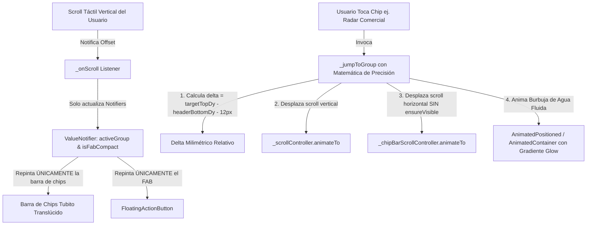
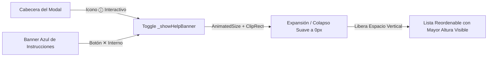
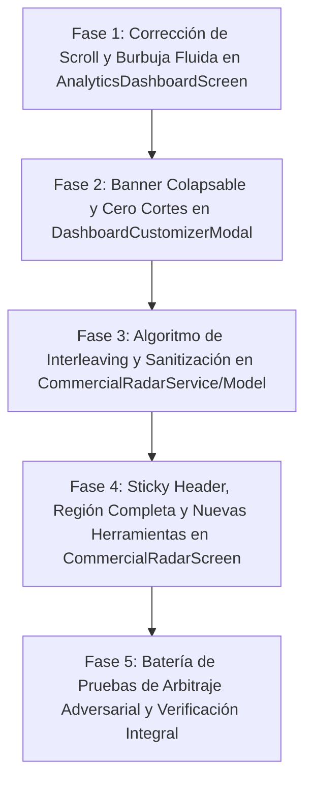

# PLAN MAESTRO: CORRECCIÓN DEFINITIVA DE SCROLL EN BI Y EVOLUCIÓN "MOBILE AWARDS" DE RADAR COMERCIAL IA

> **Fecha:** 25 de Octubre de 2026  
> **Estado:** Listo para Aprobación y Ejecución  
> **Área:** Business Intelligence (`analytics_dashboard_screen.dart`), Personalización (`dashboard_customizer_modal.dart`) y Radar Comercial IA (`commercial_radar_screen.dart`, `commercial_radar_service.dart`, `commercial_radar_model.dart`)  
> **Metodología:** Loop Autónomo TDD + Árbitro Adversarial Estricto  

---

## 1. RESUMEN EJECUTIVO Y AUDITORÍA DE DIAGNÓSTICO (ANÁLISIS DE LAS 5 CAPTURAS)

A partir de la auditoría técnica exhaustiva del código fuente y el cotejo visual contra las 5 capturas reales provistas por el usuario en su dispositivo físico, se han diagnosticado las fallas de navegación, deficiencias geométricas y oportunidades de evolución "Mobile Awards":

### 1.1 Diagnóstico de Fallas Críticas en `analytics_dashboard_screen.dart` (Capturas 1 y 2)

| # | Síntoma Reportado | Causa Raíz Exacta en Código | Impacto Técnico |
|---|-------------------|-----------------------------|-----------------|
| **1.1.1** | **Salto con chips solo funciona 1 vez y reinicia a la cabecera (offset `0.0`):** Al presionar `"📰 Radar Comercial"` baja, pero al tocar otro chip regresa bruscamente al inicio. | En `_ensureActiveChipVisible` (líneas 155-167), se llama a `Scrollable.ensureVisible(ctx)`. En el árbol de Flutter, `Scrollable.ensureVisible` busca **todos** los ancestros de tipo `Scrollable`. Como el chip reside dentro de un `SliverPersistentHeader` superior que está anclado en `0.0`, `ensureVisible` fuerza al `CustomScrollView` vertical principal a regresar a `0.0` para centrar el chip en el viewport global. | Cancelación de navegación vertical e imposibilidad de saltar entre secciones. |
| **1.1.2** | **Scroll manual "amarrado" a la primera sección:** El usuario intenta deslizar hacia abajo pero el sistema lo jala hacia arriba. | En `_onScroll` (líneas 118-121), cada vez que el scroll pasa el umbral de una nueva sección, se invoca `_ensureActiveChipVisible(sec.categoryGroup)`. En el post-frame, `Scrollable.ensureVisible` comanda al scroll vertical a volver a `0.0`, creando un bucle infinito de retroceso hacia el inicio. | Bloqueo total de la navegación libre por deslizamiento táctil. |
| **1.1.3** | **Corte visual de tarjeta al aterrizar (Captura 2):** `"comerciantes en Perú"` queda cortado a la mitad detrás de la barra de chips. | En `_jumpToGroup` (línea 292): `final targetOffset = currentOffset + targetDy - 106.0;`. `targetDy` proviene de `renderBox.localToGlobal(Offset.zero).dy` (coordenada física de pantalla con status bar + app bar ~91px). El header pinned mide 98px. El borde inferior real está en ~189px. Restar un valor mágico `106.0` deja el encabezado de la tarjeta sepultado detrás del header fijo. | Infracción de diseño y legibilidad amputada. |
| **1.1.4** | **Rebuilds masivos durante el scroll vertical:** Deslizar el dedo gatilla `setState` por dirección del FAB y por cambio de grupo activo. | `_isFabCompact` y `_activeGroup` son variables de estado en `_AnalyticsDashboardScreenState`. Cada frame de scroll ejecuta `setState()`, reconstruyendo todo el Scaffold, CustomScrollView y 14 tarjetas con gráficos complejos. | Caídas de frames (micro-janks) y re-renderizados innecesarios. |

---

### 1.2 Diagnóstico de Espacio y Recorte en `dashboard_customizer_modal.dart` (Captura 3)

| # | Síntoma Reportado | Causa Raíz Exacta en Código | Impacto Técnico |
|---|-------------------|-----------------------------|-----------------|
| **1.2.1** | **Banner azul ocupa espacio vertical fijo sin poder ocultarse:** | El contenedor azul de instrucciones (líneas 188-210) es un widget estático que ocupa ~60px continuos en la vista vertical. | Reduce la cantidad de tarjetas visibles simultáneamente en el modal, obligando a hacer scroll excesivo. |
| **1.2.2** | **Texto cortado en tarjeta "Radar Comercial & Mercado IA":** En la Captura 3 se lee `"Noticias locales, clima, carreteras y consejos de"` (falta `"abastecimiento"`). | El widget `ListTile` estándar tiene una restricción de altura fija de 72px cuando `isThreeLine` es falso (por defecto). Con el `trailing: Switch.adaptive` y el `leading`, el ancho disponible para el texto colisiona con el límite de altura del `ListTile`, amputando la última palabra. | Incumplimiento de la Regla de Cero Textos Cortados. |

---

### 1.3 Diagnóstico y Nuevas Funciones en `commercial_radar_screen.dart` y `commercial_radar_service.dart` (Capturas 4 y 5)

| # | Síntoma / Requerimiento | Causa Raíz / Oportunidad de Evolución | Solución Propuesta |
|---|-------------------------|--------------------------------------|--------------------|
| **1.3.1** | **Píldora de Región Truncada (Captura 4):** Se muestra `"📍 Talara / Pi..."`. | Línea 459 de `commercial_radar_screen.dart`: `_selectedRegion.length > 12 ? "${_selectedRegion.substring(0, 11)}..." : _selectedRegion`. Había un recorte arbitrario en código. | Eliminar el truncamiento manual forzado y reestructurar el layout para soportar `"📍 Talara / Piura"` completo. |
| **1.3.2** | **Filtros desaparecen con el scroll (Captura 5):** Al bajar por las noticias, la barra de categorías se va y las tarjetas chocan en seco contra el AppBar. | La pantalla está construida con un `ListView` plano donde los chips son hijos directos con scroll vertical. | Transformar la estructura a `CustomScrollView` con `SliverPersistentHeader(pinned: true)` para que los filtros queden fijos con degradado sutil de fondo. |
| **1.3.3** | **Emojis residuales en titulares:** Se observa `🌧️` incrustado en `"¿qué provincias serán afectadas?"` (Captura 4). | El getter `cleanTitle` en `commercial_radar_model.dart` solo eliminaba 8 caracteres específicos (`[🔴🔵👇🚨⚠️💥📢🔥📌⚡️]`). Faltaban los emojis de clima y símbolos gráficos universales. | Implementar un regex completo de sanitización de rangos unicode de emojis. |
| **1.3.4** | **Saturación monotemática de noticias (casi todo lluvias):** | La búsqueda en Google News con palabras clave de lluvia en Piura genera 10 noticias donde la gran mayoría son de lluvias, y se muestran en bloque. | Implementar un algoritmo de **Balanceo e Intercalado Temático (`Interleaving`)** en `CommercialRadarService` para alternar categorías en la pestaña `"Todas"`. |
| **1.3.5** | **Semáforo de Pulso Operativo:** | No existe un resumen visual inmediato de las condiciones de operación en la cabecera del Radar. | Añadir 3 indicadores inteligentes en la cabecera: `🛣️ Rutas y Fletes`, `📦 Abastecimiento` y `📅 Próxima Campaña` (con conteo de días). |
| **1.3.6** | **Botones de Acción en 1 Toque + Compartir por WhatsApp:** | Las noticias solo tienen un enlace web pasivo. | Agregar botón directo a `SmartRestockScreen` para alertas logísticas/abastecimiento, botón para planificar ofertas, y botón `"📲 Compartir Alerta"` que formatea un mensaje oficial para WhatsApp. |
| **1.3.7** | **Buscador en Tiempo Real + Pestaña `"📌 Guardadas"`:** | El comerciante no puede marcar noticias importantes (ej. normativas de SUNAT) ni buscar por palabra clave. | Integrar buscador en tiempo real y persistencia local de favoritos con pestaña `"📌 Guardadas (N)"`. |

---

## 2. ARQUITECTURA DE SOLUCIÓN TÉCNICA DETALLADA

### 2.1 Bloque 1: Arquitectura de Scroll y "Ola de Burbuja Fluida en Tubito" (`analytics_dashboard_screen.dart`)



#### Reglas de Implementación en Bloque 1:
1. **Erradicación Total de `Scrollable.ensureVisible`:**
   * Queda estrictamente prohibido invocar `Scrollable.ensureVisible` sobre los chips de categorías.
   * La barra de chips tendrá su propio `_chipBarScrollController = ScrollController()`.
   * Para centrar un chip: se calcula su coordenada horizontal relativa dentro de la fila y se ejecuta `_chipBarScrollController.animateTo(targetX, duration: 300ms, curve: Curves.easeOutCubic)`.
2. **Desacoplamiento Reactivo a 60 FPS con `ValueNotifier`:**
   * Se declaran `final ValueNotifier<String> _activeGroupNotifier = ValueNotifier<String>('resumen');` y `final ValueNotifier<bool> _isFabCompactNotifier = ValueNotifier<bool>(false);`.
   * En `_onScroll`, las mutaciones son directas: `_activeGroupNotifier.value = nuevoGrupo;` e `_isFabCompactNotifier.value = isDown;`.
   * **Cero llamadas a `setState()` en `_onScroll`**: el `CustomScrollView` no sufre ninguna reconstrucción mientras el usuario hace scroll.
3. **Fórmula de Precisión Milimétrica para `_jumpToGroup`:**
   * Se asocia un `GlobalKey _stickyHeaderKey = GlobalKey();` al contenedor de la cabecera fija.
   * Al ejecutar el salto a una sección:
     ```dart
     final headerBox = _stickyHeaderKey.currentContext?.findRenderObject() as RenderBox?;
     final targetBox = targetKey.currentContext?.findRenderObject() as RenderBox?;
     if (headerBox != null && targetBox != null && headerBox.hasSize && targetBox.hasSize) {
       final headerBottomDy = headerBox.localToGlobal(Offset(0, headerBox.size.height)).dy;
       final targetTopDy = targetBox.localToGlobal(Offset.zero).dy;
       final delta = (targetTopDy - headerBottomDy) - 12.0; // 12px de respiro visual
       final targetOffset = (_scrollController.offset + delta).clamp(0.0, _scrollController.position.maxScrollExtent);
       _scrollController.animateTo(
         targetOffset,
         duration: const Duration(milliseconds: 400),
         curve: Curves.easeInOutCubic,
       );
     }
     ```
   * Esta fórmula es 100% inmune a la altura del AppBar, status bar, notch o densidad de pantalla, porque opera con la diferencia física real entre el borde inferior del header y el borde superior de la tarjeta.
4. **Diseño "Burbuja de Agua Fluida en Tubito" (Mobile Awards):**
   * El contenedor de la fila de chips se modela como un **conducto translúcido continuo** (`BoxDecoration` con radio circular de 24px, color de fondo `Colors.white.withValues(alpha: 0.06)`, sutil borde).
   * La selección activa se representa mediante una **burbuja luminosa con gradiente azul-cian** (`[Color(0xFF0284C7), Color(0xFF2563EB)]`), con resplandor sutil (`BoxShadow(color: Color(0xFF0284C7).withValues(alpha: 0.4), blurRadius: 10)`), animada fluidamente con curva suave (`Curves.easeInOutCubic`).

---

### 2.2 Bloque 2: Optimización de Espacio y Banner Colapsable en `dashboard_customizer_modal.dart`



#### Reglas de Implementación en Bloque 2:
1. **Banner Colapsable con Transición Fluida:**
   * Variable de estado: `bool _showHelpBanner = true;`.
   * Envoltorio del banner: `AnimatedSize(duration: Duration(milliseconds: 250), curve: Curves.easeInOut, child: _showHelpBanner ? Container(...) : const SizedBox.shrink())`.
   * Botón `✕` dentro del banner para cerrarlo con un toque.
   * Icono `ⓘ` interactivo en la cabecera del modal (al lado del botón de restablecer `↺` y cerrar `✕`). Cuando el banner está cerrado, el icono `ⓘ` permite reabrirlo instantáneamente.
2. **Cero Textos Cortados en Tarjetas:**
   * Sustituir la estructura rígida de `ListTile` por un layout responsivo basado en `Row` y `Column` con padding ajustado, o configurar `isThreeLine: true` con `subtitle` configurado para soportar múltiples líneas sin límite artificial.
   * Garantizar que la tarjeta `"Radar Comercial & Mercado IA"` muestre su texto completo: `"Noticias locales, clima, carreteras y consejos de abastecimiento"` sin omitir ninguna palabra.

---

### 2.3 Bloque 3: Auditoría Visual y Nuevas Herramientas "Mobile Awards" en `Radar Comercial IA`

#### 2.3.1 Píldora de Región y Sticky Header (`CommercialRadarScreen`)
* **Layout Responsivo de Región:** Se elimina el corte `_selectedRegion.substring(0, 11)...`. La píldora de región se ubica con espacio flexible y soporte completo para nombres largos como `"📍 Talara / Piura"` o `"📍 Piura / Región Norte"`.
* **Sticky Header con `SliverPersistentHeader`:**
  * Estructura del cuerpo migrada a `CustomScrollView`.
  * La barra de categorías y el buscador se convierten en un `SliverPersistentHeader(pinned: true)` con `minExtent: 52`, `maxExtent: 52` (o con buscador integrado), fondo sólido con color de tema y elevación/sombra sutil al hacer scroll.
  * Al deslizar hacia abajo, las noticias pasan por debajo de la barra de filtros fija, permitiendo cambiar de categoría en cualquier instante.

#### 2.3.2 Limpieza Total de Emojis en Titulares (`commercial_radar_model.dart`)
* Ampliación del getter `cleanTitle`:
  ```dart
  String get cleanTitle {
    // Sanitizar emojis invasivos y caracteres gráficos residuales de RSS
    final emojiRegex = RegExp(
      r'[\u{1F300}-\u{1F9FF}\u{2600}-\u{26FF}\u{2700}-\u{27BF}\u{1F1E0}-\u{1F1FF}\u{1F900}-\u{1F9FF}\u{1F600}-\u{1F64F}\u{1F680}-\u{1F6FF}]',
      unicode: true,
    );
    String t = title.replaceAll(emojiRegex, '').replaceAll(RegExp(r'\s+'), ' ').trim();
    if (t.startsWith(':') || t.startsWith('-')) {
      t = t.substring(1).trim();
    }
    return t.isEmpty ? title : t;
  }
  ```

#### 2.3.3 Algoritmo de Balanceo e Intercalado Temático (`Interleaving`) en `CommercialRadarService`
* En `CommercialRadarService`, cuando se solicitan noticias para la pestaña `"Todas"`, las noticias obtenidas se organizan en 5 colas según su categoría:
  1. `Clima y Rutas`
  2. `Proveedores y Abastecimiento`
  3. `Leyes y SUNAT`
  4. `Mi Región`
  5. `Campañas`
* El algoritmo extrae un elemento de cada cola en orden cíclico: `[Clima, Proveedores, Leyes, Mi Región, Campañas, Clima, Proveedores, ...]`.
* Esto erradica por completo la acumulación de múltiples noticias idénticas de lluvia seguidas, brindando una experiencia editorial rica y variada.

#### 2.3.4 Herramienta A: Semáforo de Pulso Operativo en Cabecera
* Panel superior compacto con 3 indicadores calculados:
  1. `🛣️ Rutas y Fletes`: `Normal 🟢` (sin alertas críticas), `Precaución 🟡` (lluvias moderadas/trabajos de vía), `Alerta 🔴` (quebradas activadas/cierres).
  2. `📦 Abastecimiento`: `Estable 🟢`, `Demoras 🟡` (retrasos de fletes), `Crítico 🔴` (desabastecimiento/paro).
  3. `📅 Próxima Campaña`: Tarjeta con nombre y cuenta regresiva (ej. `"Día de la Madre: en 18 días"` o `"Campaña Navideña: en 60 días"`).

#### 2.3.5 Herramienta B: Botones de Acción Directa en 1 Toque + Compartir por WhatsApp
* En cada tarjeta de noticia:
  * Si la categoría es `Clima y Rutas` o `Proveedores y Abastecimiento`:
    * Botón de acción: `"📦 Revisar Stock Crítico"` $\rightarrow$ Navega inmediatamente a `SmartRestockScreen`.
  * Si la categoría es `Campañas` o `Mi Región`:
    * Botón de acción: `"📋 Ir a Mesa de Trabajo"`.
  * Botón `"📲 Compartir Alerta"`:
    * Genera un mensaje formateado con negritas y emojis profesionales para enviar por WhatsApp a transportistas o socios:
      ```
      🚨 *ALERTA RADAR COMERCIAL - MOCHILALISTA*
      📍 *Zona:* Talara / Piura
      📰 *Noticia:* Senamhi advierte lluvias en Piura y Tumbes durante el fin de semana
      🚛 *Impacto Logístico:* Riesgo de activación de quebradas en la Panamericana Norte...
      💡 *Medidas Sugeridas:* Adelantar despachos de mercadería crítica antes del viernes...
      🔗 *Fuente Oficial:* SENAMHI Alertas
      ```

#### 2.3.6 Herramienta C: Buscador en Tiempo Real + Pestaña `"📌 Guardadas"` (Favoritos)
* Buscador integrado en la cabecera de filtros que filtra dinámicamente por título, resumen y análisis de impacto.
* Icono de marcador (`Bookmark`) en cada tarjeta para guardar o desmarcar la noticia.
* Los IDs guardados se persisten en `SharedPreferences` (`commercial_radar_bookmarked_ids`).
* Nuevo chip en la barra de categorías: `"📌 Guardadas (N)"`. Al seleccionarlo, se filtran exclusivamente las noticias guardadas por el usuario.

---

## 3. FASES DE EJECUCIÓN (LOOP AUTÓNOMO TDD)



### Fase 1: Corrección de Scroll y Burbuja Fluida en `AnalyticsDashboardScreen`
1. Reemplazar `setState` de `_isFabCompact` y `_activeGroup` por `ValueNotifier`.
2. Erradicar por completo `Scrollable.ensureVisible` de los chips de categorías.
3. Incorporar `ScrollController _chipBarScrollController` horizontal exclusivo.
4. Implementar la fórmula de salto milimétrico usando coordenadas relativas al `_stickyHeaderKey` (+ 12px de respiro).
5. Diseñar la fila de chips con estilo de conducto/tubito translúcido y la animación fluida de la burbuja activa luminosa.

### Fase 2: Banner Colapsable y Cero Cortes en `DashboardCustomizerModal`
1. Implementar `AnimatedSize` + `ClipRect` para colapso/expansión del banner azul de instrucciones.
2. Agregar botón `✕` de cierre en el banner y botón interactivo `ⓘ` en el AppBar del modal.
3. Ajustar el layout de las tarjetas reordenables para eliminar restricciones de altura de `ListTile`, garantizando que `"Radar Comercial & Mercado IA"` muestre todo su texto sin recortes.

### Fase 3: Algoritmo de Interleaving y Sanitización en `CommercialRadarService` y `CommercialNewsItem`
1. Actualizar el regex de `CommercialNewsItem.cleanTitle` para purgar cualquier emoji residual.
2. Implementar `_interleaveCategories` en `CommercialRadarService` para balancear el feed de `"Todas"`.
3. Enriquecer los datos de respaldo offline para asegurar variedad inmediata en las 5 categorías.

### Fase 4: Sticky Header, Región Completa y Nuevas Herramientas en `CommercialRadarScreen`
1. Eliminar el truncamiento manual de `_selectedRegion` y ajustar el layout del banner para mostrar `"📍 Talara / Piura"` completo.
2. Migrar la pantalla a `CustomScrollView` con `SliverPersistentHeader(pinned: true)` para la barra de categorías y búsqueda.
3. Diseñar e implementar el "Semáforo de Pulso Operativo" con sus 3 indicadores (`Rutas`, `Abastecimiento`, `Próxima Campaña`).
4. Implementar botones de acción directa en 1 toque (`"📦 Revisar Stock Crítico"`, `"📋 Ir a Mesa de Trabajo"`).
5. Implementar el botón `"📲 Compartir Alerta"` vía `Share.share` con plantilla estructurada para WhatsApp.
6. Implementar el buscador en tiempo real y la persistencia local de favoritos con la pestaña `"📌 Guardadas (N)"`.

### Fase 5: Batería de Pruebas de Arbitraje Adversarial y Verificación Integral
1. Crear el archivo de pruebas `test/scroll_bi_and_commercial_radar_evolution_test.dart` cubriendo los 10 escenarios críticos:
   * Verificación de scroll sin rebote ni reajuste a `0.0`.
   * Verificación de precisión del cálculo de salto vertical.
   * Verificación de colapso y reapertura del banner de ayuda con icono `ⓘ`.
   * Verificación de visualización completa de subtítulos sin recorte.
   * Verificación de `SliverPersistentHeader` pinned en `CommercialRadarScreen`.
   * Verificación de nombre de región completo sin `...`.
   * Verificación de interleaving temático en `CommercialRadarService`.
   * Verificación de limpieza estricta de emojis en titulares.
   * Verificación de persistencia de favoritos (`📌 Guardadas`).
   * Verificación de lógica del Semáforo de Pulso Operativo.
2. Ejecutar `flutter test` garantizando 100% de tests en verde sin excepciones ni regresiones.

---

## 4. MATRIZ DE RIESGOS Y MEDIDAS DE MITIGACIÓN

| Riesgo Potencial | Nivel | Mitigación Técnica |
|------------------|-------|--------------------|
| Conflicto de scroll en `CustomScrollView` con `SliverPersistentHeader` | Medio | La barra de chips utiliza un `ScrollController` horizontal independiente. Jamás se comparte ni se enlaza al controlador vertical. |
| Inconsistencia de favoritos si se desinstala la app o se borra caché | Bajo | Se utiliza `SharedPreferences` con clave aislada `commercial_radar_bookmarked_ids` con fallback a lista vacía segura. |
| Formato de mensaje WhatsApp incompatible con caracteres especiales | Bajo | El texto generado se sanitiza y codifica limpiamente para `Share.share`, funcionando nativamente en Android e iOS. |
| Pérdida de rendimiento por cálculos en tiempo real en `CommercialRadarScreen` | Bajo | El filtrado y búsqueda se ejecutan en memoria sobre la lista en caché, garantizando respuestas instantáneas a 60 FPS. |
