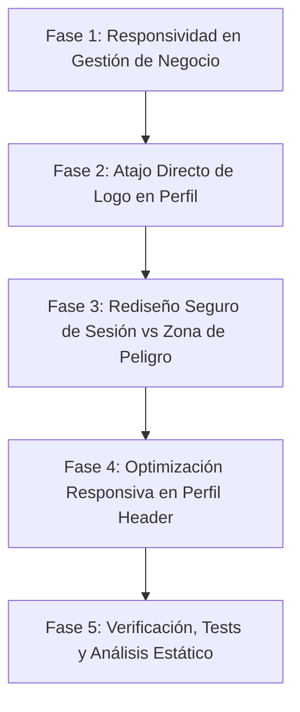

# 📋 Plan de Trabajo: Mejoras de Responsividad en Gestión de Negocio y Rediseño de Perfil de Usuario

---

## 🎯 Resumen Ejecutivo

A partir de la profunda inspección visual de las capturas proporcionadas y el análisis exhaustivo del código fuente (`inventory_screen.dart`, `categories_tab.dart`, `brands_tab.dart`, `providers_tab.dart`, `sortable_toolbar.dart`, `profile_screen.dart`, `profile_completion_indicator.dart`, `master_detail_modal.dart`, `auto_categorization_modal.dart`), hemos identificado tres áreas críticas que requieren optimización:

1. **Desbordamiento Visual y Falta de Responsividad en Gestión de Negocio:**
   - La barra de herramientas de ordenamiento (`SortableToolbar`) contiene un `Row` horizontal rígido (Título + Trailing Icons de IA y Duplicados + Etiqueta "Ordenar:" + Botones de orden `#` y `AZ ↑`). En pantallas angostas (≤ 380dp) o con escalado de texto de accesibilidad de Android, la suma de anchos supera los 420dp provocando desbordamiento horizontal (`RenderFlex overflowed`).
   - El banner de sugerencias predefinidas (`_buildSuggestedCategoriesBanner`) y los chips dinámicos carecen de contención elástica en pantallas pequeñas.
   - Los modales (`AutoCategorizationModal`, `DuplicateMergeModal`, `MasterDetailModal`) tienen textos en filas sin `Flexible` o contenedores con `Column` sin `SingleChildScrollView`, susceptibles a desbordamiento vertical y horizontal.
2. **Atajo Erróneo del Pendiente de Logo en el Perfil:**
   - En `ProfileCompletionIndicator`, el chip `[🖼️ Logo]` invoca el callback `onEditBusiness` (que abre el modal de datos generales del negocio: nombre, dirección, ruc), en lugar de invocar `_showPhotoOptions` (el modal que se abre al presionar el ícono de cámara del avatar para elegir de galería, ver pantalla completa o capturar foto).
3. **Peligro y Confusión de UX en "Eliminar Perfil" vs "Cerrar Sesión":**
   - Ambos elementos conviven actualmente en el mismo contenedor bajo "Seguridad de la Cuenta" con idéntico estilo destructivo rojo brillante (`isDestructive: true`). Esto viola las heurísticas de Nielsen sobre prevención de errores y genera estrés cognitivo al usuario al intentar realizar una tarea rutinaria (cambiar de negocio o salir).

---

## 🔍 Diagnóstico Técnico y Causas Raíz

| # | Componente / Archivo | Causa Raíz Técnica | Impacto Visual / UX |
|---|----------------------|-------------------|----------------------|
| **1** | [sortable_toolbar.dart](file:///c:/Users/vjuli/Documents/mochilalista-app/app_movil/lib/core/widgets/sortable_toolbar.dart) | `Row` rígido con `mainAxisAlignment: MainAxisAlignment.spaceBetween`, padding horizontal fijo de 40dp, dos `IconButton` de 48x48dp, label "Ordenar:" y dos `_SortButton`. Requiere mínimo ~428dp. | Se desborda en dispositivos de 360-390dp o cuando el texto del sistema está agrandado. |
| **2** | [auto_categorization_modal.dart](file:///c:/Users/vjuli/Documents/mochilalista-app/app_movil/lib/features/catalog/widgets/auto_categorization_modal.dart#L273-L305) | En el sub-row de cada sugerencia: `s.currentCategoryName -> s.suggestedCategoryName` se renderiza dentro de un `Row` sin `Flexible` ni `TextOverflow.ellipsis`. | Nombres de categoría medianos o largos provocan que la fila supere el ancho de pantalla. |
| **3** | [master_detail_modal.dart](file:///c:/Users/vjuli/Documents/mochilalista-app/app_movil/lib/core/widgets/master_detail_modal.dart#L58-L150) | Estructurado como un `Column` sin scroll dentro de un BottomSheet de altura automática con `dataRows` variables. | En pantallas de baja altura (ej. 640dp o teclados desplegados) se produce un desbordamiento vertical en la parte inferior. |
| **4** | [categories_tab.dart](file:///c:/Users/vjuli/Documents/mochilalista-app/app_movil/lib/features/catalog/screens/tabs/categories_tab.dart#L570-L600) | La cabecera del banner de categorías sugeridas tiene un `Row` con título y subtítulo fijos sin protección elástica. | Posible recorte o desbordamiento en anchos reducidos. |
| **5** | [profile_screen.dart](file:///c:/Users/vjuli/Documents/mochilalista-app/app_movil/lib/features/profile/screens/profile_screen.dart#L250-L280) | `_buildSectionHeader` tiene un `Row` donde "Administración del Negocio" comparte espacio con el botón "Editar Datos" sin ajuste tipográfico adaptativo. | En la captura 2 se observa cómo el título se trunca feamente a "Administración del Ne...". |
| **6** | [profile_completion_indicator.dart](file:///c:/Users/vjuli/Documents/mochilalista-app/app_movil/lib/features/profile/widgets/profile_completion_indicator.dart#L68-L72) | El campo `'Logo'` asigna `onTap: onEditBusiness` en vez de recibir un callback específico `onChangeLogo`. | Al presionar el pendiente de Logo, abre el formulario de texto del negocio y no el selector de foto de cámara/galería. |
| **7** | [profile_screen.dart](file:///c:/Users/vjuli/Documents/mochilalista-app/app_movil/lib/features/profile/screens/profile_screen.dart#L225-L236) | "Cambiar de Negocio / Cerrar Sesión" y "Eliminar Perfil Definitivamente" están juntos en la misma tarjeta y ambos en rojo vivo. | Confusión, riesgo de presionar accidentalmente el borrado permanente al querer solo cerrar sesión. |

---

## 💡 Propuestas de Solución y Recomendaciones de Diseño

### 1. Pestañas de Gestión de Negocio y Modales Responsivos
- **Toolbar Adaptativa (`SortableToolbar`):**
  - Implementar un diseño que evalúe el ancho disponible (`LayoutBuilder` o constraints elásticos).
  - Envolver el título en `Flexible` con `TextOverflow.ellipsis`.
  - Configurar los botones de acción (`AutoCategorizar` y `Detectar Duplicados`) con `VisualDensity.compact` y constraints ajustados (36x36dp en lugar del target por defecto de 48dp).
  - Hacer que la etiqueta `"Ordenar:"` sea compacta o se oculte en anchos menores a 360dp, conservando los chips `#` y `A-Z` que ya son autoexplicativos mediante sus íconos y tooltips.
- **Modales 100% Responsivos:**
  - En `MasterDetailModal`: Envolver el cuerpo de detalles en un `Flexible(child: SingleChildScrollView(...))` asegurando que funcione en cualquier altura o con rotación de pantalla.
  - En `AutoCategorizationModal`: Aplicar `Flexible` con `TextOverflow.ellipsis` al flujo `anterior -> sugerida`.
  - En `DuplicateMergeModal`: Garantizar que la fila de entidad y el botón "Conservar" usen el ancho disponible sin apretar los textos.

### 2. Atajo Directo de Logo en Pendientes de Perfil
- Extender `ProfileCompletionIndicator` para aceptar el parámetro `final VoidCallback? onChangeLogo`.
- En `_ProfileField(label: 'Logo')`, asignar `onTap: onChangeLogo ?? onEditBusiness`.
- En `ProfileScreen`, conectar `onChangeLogo: () => _showPhotoOptions(context, auth, validLogoPath)`.
- **Resultado:** Al tocar `[🖼️ Logo]` en los pendientes, se despliega de inmediato el modal de opciones de imagen (Cámara, Galería, Ver foto, Eliminar), exactamente igual a tocar el botón de cámara sobre el logo.

### 3. Rediseño Profesional de "Eliminar Perfil" vs "Cerrar Sesión"

Proponemos una arquitectura de pantalla basada en las mejores prácticas de la industria (estándares de GitHub, Stripe, Shopify y directrices de Material Design 3):

```
┌────────────────────────────────────────────────────────┐
│ 👤 PERFIL & ADMINISTRACIÓN DEL NEGOCIO                 │
├────────────────────────────────────────────────────────┤
│ [Tarjeta de Negocio] (RUC, Ubicación, Mapa)            │
│ [Indicador de Completitud del Perfil] (% y pendientes) │
├────────────────────────────────────────────────────────┤
│ ⚙️ CONFIGURACIÓN GENERAL                               │
│  - Editar Datos Personales                             │
│  - Respaldos y Seguridad                               │
│  - Modo Noche / Claro                                  │
│  - Notificaciones & Impresora Térmica                  │
├────────────────────────────────────────────────────────┤
│ 🔒 SEGURIDAD DE LA CUENTA                              │
│  - [Banner Activar PIN si no existe]                   │
│  - Crear / Cambiar PIN de Seguridad                    │
├────────────────────────────────────────────────────────┤
│ 🚪 GESTIÓN DE SESIÓN (Neutral / Separado)              │
│  - Cambiar de Negocio / Cerrar Sesión                  │
│    (Ícono: Icons.swap_horiz_rounded / logout)          │
│    (Color: Neutral / Ámbar sutil, NO rojo crítico)     │
├────────────────────────────────────────────────────────┤
│                                                        │
│ ⚠️ ZONA DE PELIGRO (Danger Zone al pie de pantalla)   │
│  ┌──────────────────────────────────────────────────┐  │
│  │  🛡️ Zona Crítica                                  │  │
│  │  Esta acción eliminará de forma irreversible el  │  │
│  │  negocio actual y sus datos locales.             │  │
│  │                                                  │  │
│  │  [🗑️ Eliminar este perfil de negocio...]          │  │
│  └──────────────────────────────────────────────────┘  │
└────────────────────────────────────────────────────────┘
```

#### Ventajas del nuevo diseño:
1. **Desacoplamiento Absoluto:** "Cerrar Sesión / Cambiar de Negocio" tiene su propio espacio como acción de sesión rutinaria. Utiliza tonos neutros o ámbar amigable, eliminando el pánico visual.
2. **Máxima Seguridad Preventiva:** "Eliminar Perfil" se traslada al fondo de la pantalla dentro de una caja discreta ("Zona de Peligro" / "Danger Zone") con borde rojo tenue y texto explicativo. Es imposible tocarlo por error al querer cerrar sesión.
3. **Discreción y Elegancia:** Mantiene la opción perfectamente accesible para cuando un usuario realmente decida dar de baja su negocio, pero sin estorbar ni alarmar en el uso cotidiano.

---

## 🗓️ Fases del Procedimiento de Trabajo



---

### 🔹 Fase 1: Responsividad en Gestión de Negocio (Categorías, Marcas, Proveedores y Modales)
- **1.1 Refactor de `SortableToolbar`:**
  - Implementar contención flexible con `LayoutBuilder` o `Flexible`.
  - Reducir padding horizontal a `16dp` y compactar botones de acción a `36x36dp`.
  - Permitir que el contador/título se trunque limpiamente si el ancho es muy reducido.
  - Optimizar el grupo de ordenamiento (`#` y `AZ`) para que no exceda el viewport.
- **1.2 Optimización de `_buildSuggestedCategoriesBanner` (`categories_tab.dart`):**
  - Aplicar `Expanded` en el título del banner y permitir que los chips del `Wrap` tengan ancho máximo delimitado.
- **1.3 Modales Responsivos:**
  - **`AutoCategorizationModal`:** Aplicar `Flexible` y `TextOverflow.ellipsis` en los nombres de categoría actual y sugerida.
  - **`MasterDetailModal`:** Envolver el contenido en `Flexible(child: SingleChildScrollView(...))` para prevenir desbordamientos verticales con teclados o pantallas cortas.
  - **`DuplicateMergeModal`:** Ajustar la fila de elementos y botón "Conservar" para pantallas angostas.
  - **`DuplicateWarningDialog`:** Asegurar que los botones de acción se adapten sin cortar texto.

---

### 🔹 Fase 2: Corrección del Atajo de Logo en Indicador de Perfil
- **2.1 Modificación de `ProfileCompletionIndicator`:**
  - Agregar parámetro opcional `final VoidCallback? onChangeLogo`.
  - Vincular el chip pendiente `'Logo'` a `onTap: onChangeLogo ?? onEditBusiness`.
- **2.2 Integración en `ProfileScreen`:**
  - Pasar `onChangeLogo: () => _showPhotoOptions(context, auth, validLogoPath)` en la invocación del widget.
  - Probar que al pulsar el chip se abra la hoja de opciones de fotografía (cámara, galería, ver foto, eliminar).

---

### 🔹 Fase 3: Rediseño y Desacoplamiento de "Eliminar Perfil" vs "Cerrar Sesión"
- **3.1 Reestructuración de "Seguridad de la Cuenta":**
  - Mantener exclusivamente los ítems de seguridad: Tarjeta/recordatorio de PIN y botón de "Crear / Cambiar PIN de Seguridad".
- **3.2 Creación de Sección "Gestión de Sesión":**
  - Ubicar "Cambiar de Negocio / Cerrar Sesión" en un contenedor limpio e independiente.
  - Cambiar su estilo: ícono de cambio de negocio (`Icons.swap_horiz_rounded` o `Icons.logout_rounded`) en color Slate/Ámbar, texto principal en color estándar y trailing arrow sutil.
- **3.3 Implementación de la "Zona de Peligro" (Danger Zone):**
  - Ubicar al final de la pantalla, separada por un espaciado generoso (`SizedBox(height: 35)`).
  - Diseñar contenedor con fondo suave (`isDark ? Color(0xFF1F161A) : Color(0xFFFFF5F5)`) y borde sutil rojo (`Colors.red.withValues(alpha: 0.25)`).
  - Cabecera con ícono de escudo de advertencia: "Zona de Peligro" / "Zona Crítica".
  - Texto descriptivo claro sobre la irreversibilidad del borrado local.
  - Botón discreto tipo Outlined o Tile de baja saturación: *"Eliminar este negocio permanentemente..."*, que abre el `DeleteBusinessModal` con sus confirmaciones y validaciones de PIN/'ELIMINAR'.

---

### 🔹 Fase 4: Optimización Responsiva en Perfil
- **4.1 Corrección del Encabezado de Sección en Perfil (`_buildSectionHeader`):**
  - Evitar que "Administración del Negocio" se trunque a "Administración del Ne..." optimizando el espaciado del botón "Editar Datos" o reduciendo ligeramente el tamaño de fuente si el ancho de pantalla es menor a 380dp.
- **4.2 Verificación de `BusinessInfoCard` y `ProfileCompletionIndicator`:**
  - Comprobar que en pantallas angostas ningún chip de pendientes ni fila de dirección/RUC desborde.

---

### 🔹 Fase 5: Verificación Integral, Tests y Cierre
- **5.1 Pruebas Automatizadas:**
  - Ejecutar la suite completa de pruebas (`flutter test test/fase_improvements_test.dart`) para verificar que no haya regresiones.
  - Agregar nuevas pruebas unitarias para el indicador de completitud con el callback de logo y las funciones auxiliares.
- **5.2 Análisis Estático:**
  - Ejecutar `flutter analyze` y asegurar **0 errores** y **0 advertencias**.
- **5.3 Informe Final y Guía de Pruebas:**
  - Entregar un resumen detallado con los cambios realizados y los pasos exactos para que el usuario valide en su dispositivo móvil.

---

## 🛑 Estado Actual y Espera de Aprobación

> [!IMPORTANT]
> **COMPROMISO DE NO MODIFICACIÓN:**
> No se ha realizado ninguna modificación en los archivos de código fuente. Este plan se presenta formalmente para tu evaluación.
> Por favor revisa las fases, propuestas visuales y detalles técnicos. Puedes aprobar el plan para iniciar o dejar los comentarios y ajustes que consideres necesarios.
