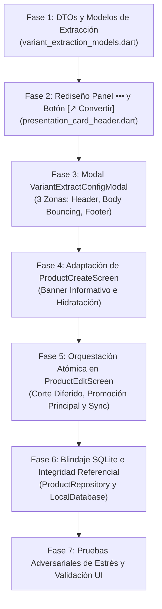

# PLAN DE TRABAJO: EXTRACCIÓN, COPIADO Y CORTE DE VARIANTES A NUEVO PRODUCTO

**Documento:** `analisis_proyecto/PLAN_EXTRACCION_COPIADO_Y_CORTE_DE_VARIANTES_A_NUEVO_PRODUCTO.md`  
**Estado:** Propuesta de Planificación Técnica y Arquitectura Integral — En Revisión  
**Metodología:** Loop Autónomo + Árbitro Interno Adversarial  
**Módulos Involucrados:**  
* `lib/core/widgets/presentation_card/presentation_card_header.dart` (Panel desplegable `•••` responsivo)
* `lib/core/widgets/product_presentation_card.dart` (Cableado de delegados y estados)
* `lib/features/catalog/widgets/edit/product_edit/product_presentation_list.dart` (Conexión de lista de variantes)
* `lib/features/catalog/screens/product_edit_screen.dart` (Orquestación en edición, snapshots y coordinación)
* `lib/features/catalog/widgets/edit/product_edit/product_edit_operations.dart` (Operaciones atómicas y corte seguro)
* `lib/features/catalog/widgets/variants/variant_extract_config_modal.dart` (Nuevo modal de configuración en 3 zonas)
* `lib/features/catalog/models/variant_extraction_models.dart` (DTOs y contratos de extracción)
* `lib/features/catalog/screens/product_create_screen.dart` (Recepción de variante, banner informativo y guardado)
* `lib/features/catalog/widgets/form/product_create_operations.dart` (Hidratación desde bundle de extracción)
* `lib/features/catalog/providers/inventory_provider.dart` (Sincronización a 0ms en catálogo)
* `lib/features/catalog/repositories/product_repository.dart` & `lib/core/database/local_db.dart` (Integridad referencial SQLite)

---

## 1. RESUMEN EJECUTIVO Y ANÁLISIS DE LAS CAPTURAS REALES (IMÁGENES 1 Y 2)

Durante las pruebas de usuario en la pantalla de **`Editar Producto`**, se detectó una limitación crítica de usabilidad al gestionar variantes y presentaciones de producto:

```
[Producto Actual en Edición]
  ├── ⭐ Principal: "Unidad (x1) rojo - S/ 13.90"
  ├── #2 Secundaria: "Caja (x3) Pack rojo - S/ 40.90"
  └── #3 Secundaria: "Unidad (x1) verde - S/ 16.90"
```

### El Problema de Negocio
Cuando el comerciante crea por error una presentación que debía ser un producto totalmente autónomo (por ejemplo, `#3 verde` debió ser un producto independiente con su propia gama de presentaciones, o decide independizar la presentación `#2 Pack rojo` como un producto empaquetado único), hoy en día se encuentra atrapado:
1. No existe mecanismo para mover o extraer una variante a un producto nuevo.
2. Si elimina la variante, pierde todos los datos digitados (código de barras, costos calculados, precios, márgenes, fotos, factores y stock).
3. Tiene que salir a la pantalla de catálogo, abrir `Crear Producto` y volver a teclear todo desde cero manualmente, con alto riesgo de equivocarse en costos o códigos.

### Radiografía de las Capturas Reales (Imágenes 1 y 2)

#### Análisis de la Imagen 1 (Vista de Lista de Variantes)
* Se observan las 3 variantes con sus respectivas tarjetas:
  * `⭐ Principal` (`Unidad (x1) rojo`, Stock: 10 uds, Costo: S/ 10.00, Margen: 39.0%, Precio: S/ 13.90).
  * `#2 Secundaria` (`Caja (x3) Pack rojo`, Stock: 3 uds, Costo: S/ 30.00, Margen: 36.3%, Precio: S/ 40.90).
  * `#3 Secundaria` (`Unidad (x1) verde`, Stock: 15 uds, Costo: S/ 12.00, Margen: 40.8%, Precio: S/ 16.90).
* En el encabezado de cada tarjeta existe el botón de herramientas **`•••`** junto a la flecha de colapso/expansión.

#### Análisis de la Imagen 2 (Panel Desplegable `•••` Abierto y Colisión Visual)
* En la tarjeta **`⭐ Principal`**:
  * Como es la principal, el botón `Hacer Principal` está oculto.
  * Se muestran: `Visible: [Switch]`, flecha `↓`, y chip `[Clonar]`.
  * **DEFECTO CRÍTICO DE LAYOUT:** El botón `[Eliminar]` no cupo en la primera fila debido al uso de un `Wrap` sin cálculo proporcional y se desbordó a una segunda fila completamente solo y huérfano a la izquierda, dando un aspecto roto, asimétrico y poco profesional.
* En la tarjeta **`#2 Secundaria`**:
  * Fila 1: `[⭐ Hacer Principal]` + `Visible: [Switch]`
  * Fila 2: `[↑ ↓]` + `[Clonar]` + `[Eliminar]`
  * Aunque se distribuye en dos filas, la composición es frágil: en pantallas de `320dp` (ej. Galaxy A01/A03 Core o dispositivos compactos con escalado de fuente del sistema aumentado), `[Eliminar]` también se fragmenta o genera colisiones visuales.
* **FALTA DE ACCIÓN:** No existe ninguna opción para **`[↗️ Convertir en Producto]`** ni para independizar la presentación.

---

## 2. DIAGNÓSTICO TÉCNICO EN PROFUNDIDAD (EVIDENCIA EN CÓDIGO)

### Diagnóstico 2.1: Deficiencias en `PresentationCardHeader` (`presentation_card_header.dart`)
* **Ubicación:** `lib/core/widgets/presentation_card/presentation_card_header.dart` (Líneas 210-427).
* **Causa Raíz del Botón Huérfano:**
  ```dart
  // Líneas 229-234
  child: Wrap(
    spacing: 8,
    runSpacing: 8,
    crossAxisAlignment: WrapCrossAlignment.center,
    alignment: WrapAlignment.start,
    children: [
      if (!isDefault && widget.onSetDefault != null) ActionChip(...), // ~130dp
      Container(child: Row(children: [Text("Visible:"), Switch(...)])), // ~110dp
      if (widget.onMoveUp != null || widget.onMoveDown != null) ... // ~45-75dp
      if (widget.onClone != null) ActionChip(label: Text("Clonar")), // ~90dp
      if (widget.totalPresentations > 1) ActionChip(label: Text("Eliminar")), // ~95dp
    ],
  )
  ```
  * En una pantalla estándar con ancho de viewport de `360dp`, restando márgenes exteriores (`16 * 2 = 32dp`) y paddings internos (`14 * 2 = 28dp`), el ancho disponible para el `Wrap` es de solo **`300dp`**.
  * En la variante principal: `Visible` (~110dp) + `Flecha ↓` (~45dp) + `Clonar` (~90dp) + espaciados (16dp) = **261dp**. El botón `Eliminar` (~95dp) requiere `261 + 8 + 95 = 364dp > 300dp`, forzando el salto de línea obligatorio para un solo chip huérfano.
  * No hay arquitectura de filas balanceadas o grid responsivo.

### Diagnóstico 2.2: Ausencia de Delegados de Extracción en Tarjetas y Listas
* **Ubicación:** `lib/core/widgets/product_presentation_card.dart` y `lib/features/catalog/widgets/edit/product_edit/product_presentation_list.dart`.
* Ni `ProductPresentationCard` ni `ProductPresentationList` definen un callback `onExtractToProduct` o `onConvertToProduct`.
* Los controladores y datos en memoria (`controllerMap`) contienen toda la información enriquecida (costos base, márgenes calculados, stock visual, códigos de barras, proveedor específico diferido, etc.), pero están confinados exclusivamente a la mutación interna del producto padre.

### Diagnóstico 2.3: Limitación en la Entrada de `ProductCreateScreen`
* **Ubicación:** `lib/features/catalog/screens/product_create_screen.dart` (Líneas 20-25, 67-101).
  ```dart
  class ProductCreateScreen extends StatefulWidget {
    final String? initialBarcode;
    const ProductCreateScreen({super.key, this.initialBarcode});
    ...
  ```
* Actualmente `ProductCreateScreen` solo acepta `initialBarcode`. Su inicialización depende de `ProductCreateOperations.hydrateFromDraft(...)`, el cual lee un borrador global en memoria (`ProductCreateDraft`) guardado en `InventoryProvider`.
* Si un usuario estaba creando un borrador propio de otro producto, abrir una extracción podría colisionar si no se aísla adecuadamente el contexto de creación por extracción.

### Diagnóstico 2.4: Integridad Referencial y Trazabilidad en SQLite (`local_db.dart`)
* **Ubicación:** `lib/core/database/local_db.dart` (Líneas 1091, 1102, 1110, 1140).
  * `presentaciones_producto`: `id`, `producto_id`, `stock_actual`, `activo`, etc.
  * `venta_items`: `FOREIGN KEY (presentation_id) REFERENCES presentaciones_producto (id)`.
  * `smart_quotation_items`: `FOREIGN KEY (presentation_id) REFERENCES presentaciones_producto (id)`.
  * `stock_ledger`: `FOREIGN KEY (presentation_id) REFERENCES presentaciones_producto (id) ON DELETE CASCADE`.
* **Riesgo Crítico Adversarial en Modo `Cortar`:**
  * Si una variante ya existía en la base de datos y tuvo ventas pasadas o cotizaciones, ejecutar un simple `DELETE FROM presentaciones_producto WHERE id = ?` generaría:
    1. Un fallo catastrófico de SQLite (`SQLiteConstraintException: FOREIGN KEY constraint failed`) si las claves foráneas están habilitadas.
    2. O si estuviesen deshabilitadas, una pérdida irreversible de trazabilidad histórica en recibos y reportes financieros.
  * **Solución Obligatoria:** En modo `Cortar`, si la presentación original ya existe en BD (`db_id != null`), debe ejecutarse un retiro por soft-delete (`activo = 0`) registrando en el `stock_ledger` la salida por traslado/independización (`TRANSFERENCIA_SALIDA`), mientras que en el nuevo producto se registra el ingreso atómico correspondiente. Si la variante fue creada en memoria en la sesión de edición actual y aún no existe en BD (`db_id == null`), puede descartarse de memoria de forma limpia sin tocar SQLite.

---

## 3. ARQUITECTURA DEL PANEL DESPLEGABLE `•••` REDISEÑADO (100% RESPONSIVO)

Para erradicar para siempre los botones huérfanos y ofrecer una integración limpia y profesional para `[↗️ Convertir en Producto]`:

```
┌───────────────────────────────────────────────────────────────┐
│ ⭐ Principal   👁️ Visible                             •••  ⌃  │
├───────────────────────────────────────────────────────────────┤
│ [PANEL DESPLEGABLE DE ACCIONES RÁPIDAS]                       │
│                                                               │
│ Fila 1: [⭐ Hacer Principal] (si sec.)  [ Visible: (🟢) ]    │
│ Fila 2: [ ↗️ Convertir en Producto ]       [  ↑  |  ↓  ]      │
│ Fila 3: [  ⎘ Clonar Variante  ]      [  🗑️ Eliminar  ]        │
└───────────────────────────────────────────────────────────────┘
```

### Estructura y Distribución por Filas con `LayoutBuilder`
En lugar de un `Wrap` arbitrario que fragmenta botones según anchos aleatorios, el panel se estructura en **bloques funcionales balanceados**:

1. **Fila 1 (Estado y Jerarquía):**
   * Si es variante secundaria: Chip destacado `[⭐ Hacer Principal]` con color ámbar suave.
   * Switch interactivo `[ Visible: (🟢) ]` con borde redondeado y micro-interacción háptica.
   * Si es variante principal: El switch de visibilidad ocupa una posición balanceada en la fila superior con badge explicativo *"Variante Principal"*.
2. **Fila 2 (Acción de Independización y Reordenamiento):**
   * **Nuevo Botón `[↗️ Convertir en Producto]` (o `[↗️ Extraer a Producto]`):**
     * Chip / Botón estilizado con icono de flecha emergente `Icons.drive_file_move_outlined` o `Icons.open_in_new_rounded`.
     * Fondo teal / índigo con micro-borde sutil y feedback háptico `mediumImpact`.
     * Texto claro y legible: *"Convertir en Producto"*.
   * **Módulo de Flechas de Posición `[ ↑ | ↓ ]`:**
     * Contenedor unificado compacto con botones visuales que se deshabilitan cuando la variante está en los extremos (arriba o abajo).
3. **Fila 3 (Gestión y Depuración):**
   * Se distribuye simétricamente en 2 botones de igual proporción (`Expanded` dentro de un `Row` con espaciado de 8dp):
     * Botón `[ ⎘ Clonar ]` (borde teal suave).
     * Botón `[ 🗑️ Eliminar ]` (borde rojo suave, bloqueado con aviso si es la única variante del producto).
   * **Cero botones huérfanos:** Ambos ocupan el 50% del ancho disponible en la fila inferior, brindando estabilidad visual total en `320dp`, `360dp`, `390dp` y `412dp`.

---

## 4. DISEÑO Y ESPECIFICACIÓN DEL MODAL FLOTANTE DE CONFIGURACIÓN PREVIA (`VariantExtractConfigModal`)

Al presionar `[↗️ Convertir en Producto]`, se despliega un `showModalBottomSheet` interactivo diseñado bajo el estándar de **3 Zonas Ergonómicas**.

```
┌───────────────────────────────────────────────────────────────┐
│ [ZONA 1: CABECERA FIJA Y SELECTOR DE MODO]                    │
│ ✕ Configurar Extracción a Nuevo Producto                      │
│ ┌───────────────────────────────────────────────────────────┐ │
│ │ 📦 Unidad (x1) verde • S/ 16.90 • Costo: S/ 12.00 • 15 uds│ │
│ └───────────────────────────────────────────────────────────┘ │
│ [ 📋 Copiar Variante ]            [ ✂️ Cortar Variante ]      │
├───────────────────────────────────────────────────────────────┤
│ [ZONA 2: CUERPO ESCROLLEABLE CON BOUNCING PHYSICS]           │
│                                                               │
│ Nombre del Nuevo Producto:                                    │
│ [ Cuaderno Standford - verde___________________________ ]     │
│ Chips rápidos: [Solo Nombre Padre] [Padre + Var] [Solo Var]   │
│                                                               │
│ ▼ A. Datos generales del producto actual                      │
│ [✓ Copiar datos generales del producto actual]  (Switch)     │
│  [✓ Categoría: Papelería]  [✓ Marca: Standford]              │
│  [✓ Proveedor: Distribuidora Lima]  [✓ Descripción]          │
│  [Fotos generales del producto]                              │
│                                                               │
│ ▼ B. Datos detallados de la variante a trasladar              │
│  [✓ Precios, Costo y Margen (S/ 16.90 / Costo S/ 12.00)]     │
│  [✓ Unidad / Empaque (Unidad x1)]                            │
│  [✓ Foto específica de la variante]                          │
│  [✓ Stock Actual (15 uds)] -> (o Iniciar en 0 uds)           │
│  [✓ Código de Barras (7751234567890)]                        │
│  [✓ Alerta de Stock Mínimo (5 uds)]                          │
├───────────────────────────────────────────────────────────────┤
│ [ZONA 3: PIE DE PÁGINA FIJO PINNED FOOTER]                    │
│ ℹ️ Modo Cortar: La variante se retirará al guardar el nuevo.  │
│ [ Cancelar ]            [ Continuar a Crear Producto → ]     │
└───────────────────────────────────────────────────────────────┘
```

### Zona 1: Cabecera Fija y Selector de Modo Interactivo
* **Fila Superior:** Título destacado `"Convertir Variante en Producto"`, botón de cierre `✕` y subtítulo contextual con el nombre del producto origen.
* **Tarjeta Resumen de la Variante:**
  * Chip con la unidad y detalle (`Unidad (x1) verde`).
  * Indicadores de precio de venta (`S/ 16.90`), costo unitario (`S/ 12.00`), margen (`40.8%`) y stock actual (`15 uds`).
* **Selector de Modo en 2 Tarjetas Interactivas:**
  1. **Tarjeta `[📋 Copiar a Nuevo Producto]`:**
     * Icono: `Icons.copy_all_rounded` (color teal).
     * Título: *"Copiar Variante"*.
     * Descripción: *"Mantiene la variante en este producto y crea uno nuevo idéntico con sus datos."*
     * Selección por tap con borde iluminado y radio button activo.
  2. **Tarjeta `[✂️ Cortar a Nuevo Producto]`:**
     * Icono: `Icons.content_cut_rounded` (color ámbar/naranja).
     * Título: *"Cortar / Mover Variante"*.
     * Descripción: *"Traslada la variante al nuevo producto y la retira de este producto al guardar."*
     * **Blindaje Caso 1 Variante:** Si el producto origen solo tiene 1 sola variante, esta tarjeta aparece deshabilitada (`opacity: 0.4`), no seleccionable, con un badge de advertencia: *"Este producto solo tiene 1 variante; agrega otra o usa 'Copiar'"*.

### Zona 2: Cuerpo Escrolleable con `SingleChildScrollView` y Cierre de Teclado
* Configurado con `physics: const BouncingScrollPhysics()`.
* Envuelto en un detector táctil para que al tocar cualquier zona fuera de los inputs, el teclado virtual se oculte automáticamente (`FocusManager.instance.primaryFocus?.unfocus()`).
* **Input Inteligente `Nombre del Nuevo Producto`:**
  * Pre-llenado automático inicial combinando: `"${producto.nombre} - ${variante.especifico}"` (o si la variante no tiene nombre específico, usa `"${producto.nombre} (${variante.unidadVenta})"`, limpiando duplicaciones redundantes).
  * Fila de **Chips de Selección Rápida en 1 toque**:
    * `[Padre + Variante]` (ej. *"Cuaderno Standford - verde"*)
    * `[Solo Variante]` (ej. *"Pack rojo x3"*)
    * `[Solo Nombre Padre]` (ej. *"Cuaderno Standford"*)
* **Sección A: `Datos Generales del Producto Padre`:**
  * Interruptor maestro: `[✓ Copiar datos generales]` (al desactivar, desmarca todos los chips hijos en cascada).
  * Chips modulares seleccionables con toque único:
    * `[✓ Categoría: Papelería]`
    * `[✓ Marca: Standford]`
    * `[✓ Proveedor: Distribuidora Lima]`
    * `[✓ Descripción / Notas]`
    * `[Fotos generales del producto]`
* **Sección B: `Datos Detallados de la Variante Seleccionada`:**
  * Chips modulares configurables:
    * `[✓ Precios, Costo y Margen]` (conserva precios, costo de compra y márgenes configurados).
    * `[✓ Unidad / Empaque]` (conserva unidad de venta y factor de conversión).
    * `[✓ Foto específica de la variante]` (si la variante tenía foto propia, la convierte en foto principal).
    * `[✓ Trasladar Stock Actual (15 uds)]`:
      * Selector con toggle entre: *"Trasladar 15 uds"* o *"Iniciar nuevo producto con Stock 0"*.
    * `[Código de Barras]`:
      * **Regla Inteligente Anti-Duplicidad:**
        * En modo `Cortar`: Activado por defecto con chip verde (ya que se retirará del producto original y no habrá colisión).
        * En modo `Copiar`: Desactivado por defecto con chip gris y mensaje explicativo: *"Desactivado para evitar códigos de barras duplicados en catálogo; puedes activarlo si usarás el mismo código"*.
    * `[✓ Alerta de Stock Mínimo]`.

### Zona 3: Pie de Página Fijo (`Pinned Footer`)
* Resumen visual dinámico reactivo:
  * En modo `Copiar`: *"Se abrirá Crear Producto con 'verde' como variante principal. El producto actual conservará sus 3 variantes."*
  * En modo `Cortar`: *"Se abrirá Crear Producto. La variante 'verde' se retirará de este producto de forma segura ÚNICAMENTE al presionar GUARDAR."*
* Botones de acción:
  * `[ Cancelar ]`: Cierra el modal sin realizar ningún cambio ni navegación.
  * `[ Continuar a Crear Producto → ]`: Valida que el nombre del nuevo producto no esté vacío, construye el objeto de transferencia `VariantExtractionBundle` y navega a `ProductCreateScreen`.

---

## 5. REGLAS DE NEGOCIO, INTEGRIDAD Y TRASLADO ATÓMICO DIFERIDO

### Regla de Oro Innegociable: Cero Pérdida de Datos ante Cancelación
```
[Editar Producto] (Variante #3 verde)
       │
       ▼ Tap [↗️ Convertir en Producto]
[Modal de Configuración] -> Elige "✂️ Cortar" -> Tap [Continuar →]
       │
       ▼ Navegación con Bundle
[Crear Producto]
   ├── Caso A: Usuario presiona "←" (Atrás) o cancela el formulario
   │     └── 🛑 RETORNO LIMPIO: La variante original sigue 100% INTACTA en Editar Producto.
   │
   └── Caso B: Usuario presiona "GUARDAR PRODUCTO" con éxito
         └── ✅ ATOMIZACIÓN: Se crea el nuevo producto en SQLite y SE RETIRA la variante
             del producto origen de forma definitiva y sincronizada.
```

### Manejo de Casos Especiales en Modo `✂️ Cortar`

#### Caso Especial 1: El Usuario Corta la Variante `⭐ Principal`
* En la `Imagen 2`, la variante principal es `Unidad (x1) rojo`.
* Si el comerciante corta esta variante:
  1. Al guardarse exitosamente el nuevo producto, el sistema inspecciona la lista restante de variantes del producto origen.
  2. Automáticamente **promueve la variante inmediata siguiente (`#2 Secundaria`, `Caja (x3) Pack rojo`) para ser la nueva `⭐ Principal`** (`isDefault = true`).
  3. Reenumera y recalcula los índices de orden de las variantes restantes.
  4. La tarjeta del producto origen nunca queda sin variante principal.

#### Caso Especial 2: El Producto Solo Tiene 1 Variante en Total
* Una regla fundamental del catálogo es que todo producto debe tener al menos 1 presentación activa (`controllers.length >= 1`).
* En el modal flotante, si `totalPresentations <= 1`:
  * La opción `✂️ Cortar a Nuevo Producto` se inhabilita visualmente.
  * Se muestra un tooltip y texto explicativo claro: *"Este producto solo tiene 1 variante; usa 'Copiar' o agrega otra variante antes de moverla"*.
  * La opción `📋 Copiar a Nuevo Producto` permanece 100% habilitada.

#### Caso Especial 3: Variante Recién Creada en Memoria vs. Variante Existente en SQLite con Ventas
* **Variante en Memoria (`db_id == null`):**
  * Fue agregada durante la sesión de edición y aún no se guardó en BD.
  * Al cortar y confirmarse la creación del nuevo producto, simplemente se libera su controlador con `ProductControllerFactory.disposeControllerMap` y se remueve de `_presentationControllers`.
* **Variante Persistida en SQLite (`db_id != null`):**
  * Puede tener recibos históricos (`venta_items`), cotizaciones (`smart_quotation_items`) o movimientos de inventario (`stock_ledger`).
  * **Acción Transaccional Atómica:**
    1. Si tiene stock a trasladar, se descuenta del producto origen mediante un movimiento en `stock_ledger` (`tipo_transaccion: 'TRANSFERENCIA_EXTRACCIÓN'`).
    2. La presentación en el producto origen se desactiva mediante soft-delete (`UPDATE presentaciones_producto SET activo = 0, es_default = 0 WHERE id = ?`).
    3. De esta manera, **ningún recibo histórico pierde su integridad referencial** ni se disparan errores de SQLiteConstraintException.
    4. El nuevo producto nace con su propio registro de producto, su propia presentación principal (`activo = 1`, `es_default = 1`) y su registro en `stock_ledger` (`tipo_transaccion: 'INVENTARIO_INICIAL'` o `'TRANSFERENCIA_INGRESO'`).

#### Caso Especial 4: Manejo de Variantes Fraccionadas / Sobrantes (`childId` / `leftoverCreated`)
* Si el usuario corta una variante que tenía una variante sobrante vinculada (por ejemplo, abrió una caja y creó una variante unitaria sobrante):
  * El sistema desvincula limpiamente la relación padre-hijo antes de trasladar, consolidando el stock o notificando al usuario que la variante unitaria vinculada permanecerá como variante independiente en el producto origen.

---

## 6. FLUJO EN LA VENTANA `Crear Producto` Y SINCRONIZACIÓN AL GUARDAR

### Navegación con Contrato de Extracción (`VariantExtractionBundle`)
En `product_edit_screen.dart`:
```dart
final result = await Navigator.push<ProductExtractionResult>(
  context,
  MaterialPageRoute(
    builder: (_) => ProductCreateScreen(
      extractionBundle: bundle,
    ),
  ),
);
```

### Banner Superior Informativo en `ProductCreateScreen`
Cuando `widget.extractionBundle != null`, en la parte superior del cuerpo de `ProductCreateScreen` (justo debajo del AppBar) se renderiza un banner informativo prominente con diseño temático:

* **Si es Modo `📋 Variante Copiada`:**
  * Fondo: Color teal muy suave (`Colors.teal.shade50` en tema claro, `Color(0xFF0F2624)` en tema oscuro).
  * Icono: `Icons.copy_rounded` (color teal).
  * Mensaje: *"Nuevo producto generado a partir de una variante copiada. El producto original no se modificará."*
* **Si es Modo `✂️ Variante Cortada / Trasladada`:**
  * Fondo: Color ámbar muy suave (`Colors.amber.shade50` en tema claro, `Color(0xFF26200F)` en tema oscuro).
  * Icono: `Icons.content_cut_rounded` (color ámbar).
  * Mensaje: *"Nuevo producto trasladado. Al presionar 'GUARDAR PRODUCTO', la variante original se retirará del producto anterior de forma automática."*

### Hidratación Automática de los Controladores
* El campo `_nameCtrl` recibe el nombre configurado en el modal.
* Si el usuario eligió copiar categoría, marca o proveedor, los selectores se pre-seleccionan automáticamente.
* La variante extraída se inserta en la posición 0 como variante **`⭐ Principal`** (`isDefault: true`), hidratando:
  * Precio de venta, costo de compra, márgenes.
  * Unidad y factor de venta.
  * Stock inicial y final (según lo configurado en el modal).
  * Código de barras (si fue seleccionado).
  * Imagen específica de la variante (si tenía, se coloca tanto como imagen de la variante como imagen general del nuevo producto si se marcó).

### Sincronización y Retorno al Guardar
1. Cuando el usuario presiona **`GUARDAR PRODUCTO`** en `ProductCreateScreen` y la transacción en SQLite finaliza con éxito:
   ```dart
   Navigator.pop(context, ProductExtractionResult(
     success: true,
     mode: widget.extractionBundle!.mode,
     extractedVariantDbId: widget.extractionBundle!.variantDbId,
     extractedVariantLocalId: widget.extractionBundle!.variantLocalId,
     newProductName: _nameCtrl.text.trim(),
   ));
   ```
2. Al regresar a `ProductEditScreen`:
   * Si `result == null` o `result.success == false`: **No hace nada.** El usuario canceló o retrocedió; los datos de la variante origen se conservan intactos.
   * Si `result.success == true` y `result.mode == ExtractionMode.cut`:
     * Se busca la variante en `_presentationControllers` por `id` local o `db_id`.
     * Se invoca la operación de retiro seguro:
       * Si era `⭐ Principal`, la variante inmediata pasa a ser `⭐ Principal`.
       * Se agrega el `db_id` a la lista de desactivación o soft-delete.
       * Se guarda automáticamente el producto origen mediante `ProductEditOperations.saveEditedProduct(...)` o actualización rápida de base de datos.
       * Se recarga `InventoryProvider` en segundo plano para que el catálogo refleje ambos productos sincronizados a `0ms`.
     * Se muestra un `SnackBar` de confirmación:
       `"✅ Nuevo producto '${result.newProductName}' creado y variante trasladada exitosamente."`

---

## 7. ÁRBITRO INTERNO ADVERSARIAL (MATRIZ DE RIESGOS, ATAQUES Y BLINDAJES)

| # | Vector de Ataque / Caso Límite | Comportamiento No Deseado Potencial | Blindaje Técnico Implementado |
|---|---|---|---|
| **A1** | El usuario elige `✂️ Cortar`, se abre `Crear Producto`, pero sale con la flecha `←` o presiona el botón físico Atrás de Android. | Que la variante ya se haya borrado en el producto origen y el usuario pierda su información. | **Traslado 100% Diferido:** El producto origen NO sufre ninguna modificación hasta que `ProductCreateScreen` retorne `success == true`. Si se cancela, la variante permanece intacta. |
| **A2** | El producto origen solo tiene 1 variante y el comerciante intenta cortarla. | El producto origen se quedaría con 0 variantes, violando la restricción de que todo producto debe tener al menos 1 presentación. | **Inhabilitación Preventiva en Modal:** Si `totalPresentations <= 1`, la tarjeta `✂️ Cortar` se muestra bloqueada con opacidad reducida y aviso explicativo; solo se permite `📋 Copiar`. |
| **A3** | El comerciante corta la variante `⭐ Principal` (`Unidad (x1) rojo` en Imagen 2). | El producto origen se queda sin variante principal, provocando inconsistencias en el catálogo de ventas y precios huérfanos. | **Promoción Automática de Sucesora:** Al confirmar el corte, la variante `#2 Secundaria` se promueve automáticamente a `isDefault = true` y se reordenan las demás. |
| **A4** | La variante que se corta ya tenía ventas pasadas registradas en `venta_items` o `smart_quotation_items`. | `SQLiteConstraintException: FOREIGN KEY constraint failed` o pérdida de historial al hacer un `DELETE` físico. | **Soft-Delete con Auditoría:** Si la variante ya existía en BD (`db_id != null`), se actualiza `activo = 0` y se registra `TRANSFERENCIA_EXTRACCIÓN` en `stock_ledger`. Los recibos históricos siguen apuntando al ID de la presentación sin quiebres. |
| **A5** | El usuario elige `📋 Copiar` y deja el mismo código de barras en el nuevo producto. | Dos productos distintos tendrían el mismo código de barras, colisionando en el lector del escáner en caja rápida. | **Blindaje Anti-Duplicidad en Modal:** En modo `Copiar`, el chip de `Código de Barras` se desmarca por defecto con aviso preventivo; en modo `Cortar` se marca por defecto porque dejará de estar en el origen. |
| **A6** | El producto origen está configurado con stock compartido (`COMPARTIDO` o `MIXTO`). | Modificar el stock al extraer una variante descalibra el pool común de unidades base de las demás presentaciones. | **Aislamiento de Stock:** El nuevo producto nace con su propio modo de stock independiente; el pool compartido del producto origen solo se ajusta si el comerciante decidió explícitamente transferir unidades físicas reales. |
| **A7** | El usuario tiene cambios sin guardar en otros campos del producto en `ProductEditScreen` al pulsar `[↗️ Convertir en Producto]`. | Conflicto entre el estado no guardado del producto origen y la navegación hacia crear producto. | **Lectura en Caliente de Controladores:** El modal lee los valores actuales presentes en los controladores en memoria (incluyendo ediciones recientes) para formar el bundle de extracción. |
| **A8** | Pantallas ultra-angostas (`320dp` a `360dp`) o tamaños de fuente del sistema aumentados al 130%. | Textos truncados o desbordes (`RenderFlex overflowed by xx pixels`) en el panel `•••` o en el modal. | **Distribución Grid / Row Balanceada:** Eliminación del `Wrap` frágil en el panel `•••`; modal con `SingleChildScrollView`, `FittedBox` y paddings adaptativos con diseño verificado en `320dp`. |

---

## 8. PLAN DE IMPLEMENTACIÓN POR FASES



---

### FASE 1: DTOs y Contratos de Datos para la Extracción
* **Archivo Nuevo:** `lib/features/catalog/models/variant_extraction_models.dart`
* **Entregables:**
  1. `enum ProductExtractionMode { copy, cut }`
  2. Clase `VariantExtractionGeneralData`:
     * Flags booleanos: `copyCategory`, `copyBrand`, `copyProvider`, `copyDescription`, `copyImages`.
     * Valores resueltos: `categoryId`, `categoryName`, `brandId`, `brandName`, `providerId`, `providerName`, `description`, `images`.
  3. Clase `VariantExtractionDetailData`:
     * Flags booleanos: `includePricing`, `includeUnit`, `includeVariantImage`, `includeStock`, `includeBarcode`, `includeStockAlert`.
     * Valores resueltos: `newProductName`, `unitName`, `unitFactor`, `cost`, `margin`, `salePrice`, `stockUnits`, `barcode`, `alertStock`, `imagePath`.
  4. Clase `VariantExtractionBundle`:
     * `ProductExtractionMode mode`
     * `String originProductId`
     * `String originProductName`
     * `String variantLocalId`
     * `int? variantDbId`
     * `bool isOriginDefault`
     * `VariantExtractionGeneralData generalData`
     * `VariantExtractionDetailData detailData`
  5. Clase `ProductExtractionResult`:
     * `bool success`
     * `ProductExtractionMode mode`
     * `String variantLocalId`
     * `int? variantDbId`
     * `String newProductName`
     * `int? newProductId`

---

### FASE 2: Rediseño Responsivo del Panel `•••` en `PresentationCardHeader`
* **Archivo a Modificar:** `lib/core/widgets/presentation_card/presentation_card_header.dart` (Líneas 210-427).
* **Entregables:**
  1. Añadir nuevo callback a `PresentationCardHeader`:
     ```dart
     final VoidCallback? onConvertToProduct;
     ```
  2. Reemplazar el `Wrap` desequilibrado por una estructura de **3 Filas Adaptativas**:
     * **Fila 1:** `[⭐ Hacer Principal]` (si aplica) + `[ Visible: (🟢) ]`.
     * **Fila 2:** Botón destacado `[ ↗️ Convertir en Producto ]` con icono `Icons.open_in_new_rounded` y micro-borde + `[ ↑ | ↓ ]` agrupado.
     * **Fila 3:** `Row` con dos `Expanded`: `[ ⎘ Clonar ]` (50%) y `[ 🗑️ Eliminar ]` (50%).
  3. Comprobación de dimensiones en `320dp` y `360dp`: cero desbordes y cero botones huérfanos.

---

### FASE 3: Construcción del Modal Flotante `VariantExtractConfigModal`
* **Archivo Nuevo:** `lib/features/catalog/widgets/variants/variant_extract_config_modal.dart`
* **Entregables:**
  1. Modal inferior flotante (`showModalBottomSheet`) con `isScrollControlled: true` y bordes superiores redondeados de 20dp.
  2. **Zona 1 (Fija):**
     * Cabecera con título, subtítulo del producto padre y botón de cierre `✕`.
     * Resumen de la variante (unidad, precios, costo, margen, stock).
     * Selector interactivo animado de 2 tarjetas: `[📋 Copiar a Nuevo Producto]` vs. `[✂️ Cortar a Nuevo Producto]`.
     * Lógica de bloqueo de `✂️ Cortar` si `totalPresentations <= 1` con badge explicativo.
  3. **Zona 2 (Escrolleable):**
     * `SingleChildScrollView` con `BouncingScrollPhysics`.
     * Cierre de teclado al tocar fuera con `FocusManager.instance.primaryFocus?.unfocus()`.
     * Input editable `Nombre del Nuevo Producto` con chips rápidos: `[Padre + Variante]`, `[Solo Variante]`, `[Solo Padre]`.
     * **Sección A:** Switch maestro de datos generales y chips para Categoría, Marca, Proveedor, Descripción y Fotos.
     * **Sección B:** Chips modulares para Precios/Costo/Margen, Unidad/Factor, Foto de variante, Stock (llevar vs. iniciar en 0), Código de Barras (blindaje automático en Copiar vs. Cortar) y Alerta de stock mínimo.
  4. **Zona 3 (Fija inferior):**
     * Resumen dinámico de confirmación.
     * Botones `[ Cancelar ]` y `[ Continuar a Crear Producto → ]`.

---

### FASE 4: Cableado en `ProductPresentationCard`, `ProductPresentationList` y `ProductEditScreen`
* **Archivos a Modificar:**
  * `lib/core/widgets/product_presentation_card.dart`
  * `lib/features/catalog/widgets/edit/product_edit/product_presentation_list.dart`
  * `lib/features/catalog/screens/product_edit_screen.dart`
* **Entregables:**
  1. Propagación del callback `onConvertToProduct` desde `PresentationCardHeader` a través de `ProductPresentationCard` y `ProductPresentationList` hasta `ProductEditScreen`.
  2. En `ProductEditScreen`, implementación del método `_handleExtractVariant(int index)`:
     * Lee los controladores de la variante en `_presentationControllers[index]`.
     * Obtiene los metadatos generales del producto (marca, categoría, proveedor general, descripciones).
     * Despliega `VariantExtractConfigModal.show(...)`.
     * Si el usuario confirma, recibe el `VariantExtractionBundle` y navega a `ProductCreateScreen`.

---

### FASE 5: Adaptación de `ProductCreateScreen` (Banner e Hidratación)
* **Archivos a Modificar:**
  * `lib/features/catalog/screens/product_create_screen.dart`
  * `lib/features/catalog/widgets/form/product_create_operations.dart`
* **Entregables:**
  1. Agregar parámetro opcional:
     ```dart
     final VariantExtractionBundle? extractionBundle;
     ```
  2. Si `extractionBundle != null`:
     * Renderizar el **Banner Superior Informativo** temático (Teal para Copiar, Ámbar para Cortar).
     * Hidratar `_nameCtrl`, selectores de marca, categoría, proveedor y opcionales según lo marcado en `generalData`.
     * Crear el mapa de controladores de la variante principal (`_controllers`) con los datos de `detailData`, asignándola como `isDefault: true`.
     * Evitar que el borrador residual en memoria sobreescriba los datos trasladados.
  3. Al presionar **`GUARDAR PRODUCTO`** exitosamente:
     * Retornar `ProductExtractionResult(success: true, mode: bundle.mode, ...)` mediante `Navigator.pop(context, result)`.

---

### FASE 6: Orquestación Transaccional de Corte Diferido y SQLite
* **Archivos a Modificar:**
  * `lib/features/catalog/widgets/edit/product_edit/product_edit_operations.dart`
  * `lib/features/catalog/repositories/product_repository.dart`
  * `lib/features/catalog/providers/inventory_provider.dart`
* **Entregables:**
  1. En `ProductEditScreen`, procesar el resultado de navegación:
     * Si `result == null` o `result.success == false`: Ningún cambio (cero riesgo de pérdida de datos).
     * Si `result.success == true` y `result.mode == ProductExtractionMode.cut`:
       * Ejecutar `ProductEditOperations.finalizeVariantExtractionCut(...)`:
         * Si la variante era `⭐ Principal`: Promover la siguiente variante disponible a `⭐ Principal`.
         * Si la variante tenía `db_id`: Marcar para soft-delete (`activo = 0`) y registrar la salida en `stock_ledger` si hubo traslado de stock.
         * Si era variante en memoria: Remover de `_presentationControllers` y liberar controladores.
         * Guardar el producto origen de forma atómica.
         * Notificar a `InventoryProvider` para actualizar el catálogo en tiempo real.
         * Mostrar notificación flotante de éxito.

---

### FASE 7: Pruebas Adversariales de Estrés y Validación Visual
* **Entregables:**
  1. **Prueba de Cancelación:** Entrar a `Crear Producto` en modo `Cortar`, presionar `←` o cancelar -> Verificar que la variante original permanece 100% intacta.
  2. **Prueba de Corte de Variante Principal:** Cortar `⭐ Principal` -> Verificar que `#2 Secundaria` es promovida a `⭐ Principal` y reordenada limpiamente.
  3. **Prueba de 1 Sola Variante:** Producto con 1 variante -> Verificar que la opción `Cortar` aparece inhabilitada y solo permite `Copiar`.
  4. **Prueba de Variantes en Memoria vs. SQLite:** Cortar una variante recién agregada sin guardar vs. una con ventas previas -> Verificar cero fallos de Foreign Key y trazabilidad intacta.
  5. **Prueba Responsiva:** Probar en resoluciones `320dp`, `360dp` y con fuentes grandes -> Verificar que no existan botones huérfanos ni desbordes amarillos/negros.

---

## 9. CRITERIOS DE ACEPTACIÓN Y DEFINICIÓN DE TERMINADO (DoD)

1. [ ] **Panel `•••` Reorganizado y Libre de Huérfanos:**
   * En la variante principal y en las secundarias, los botones se distribuyen en 3 filas armónicas sin que `Eliminar` quede descolgado en solitario.
   * El botón `[↗️ Convertir en Producto]` está perfectamente visible, alineado y con estilo profesional.
2. [ ] **Modal `VariantExtractConfigModal` Completo:**
   * Cabecera fija con resumen de la variante y selector de modo interactivo (`📋 Copiar` vs. `✂️ Cortar`).
   * Deshabilitación estricta de `✂️ Cortar` cuando el producto tiene 1 sola presentación.
   * Input de nombre con pre-llenado inteligente y chips rápidos.
   * Switch maestro y chips individuales para datos generales y datos de variante.
   * Blindaje automático de código de barras para no duplicar en modo Copiar.
   * Bouncing scroll y cierre automático de teclado al tocar fuera.
3. [ ] **Cero Pérdida de Datos ante Cancelación:**
   * Si el usuario se arrepiente o sale de `Crear Producto`, la variante original no se pierde ni se borra.
4. [ ] **Traslado Atómico y Promoción Automática:**
   * En modo `Cortar`, al guardar el nuevo producto, la variante se retira del origen.
   * Si era la principal, la siguiente pasa a ser principal automáticamente.
   * Variantes con historial en SQLite se manejan sin violar restricciones de clave foránea.
5. [ ] **Banner Superior Informativo en `Crear Producto`:**
   * Muestra claramente si el producto nace de una variante copiada o cortada.
6. [ ] **Cero Regresiones en Pruebas Automatizadas:**
   * `flutter test` y `flutter analyze` finalizan con 0 errores y 0 advertencias.

