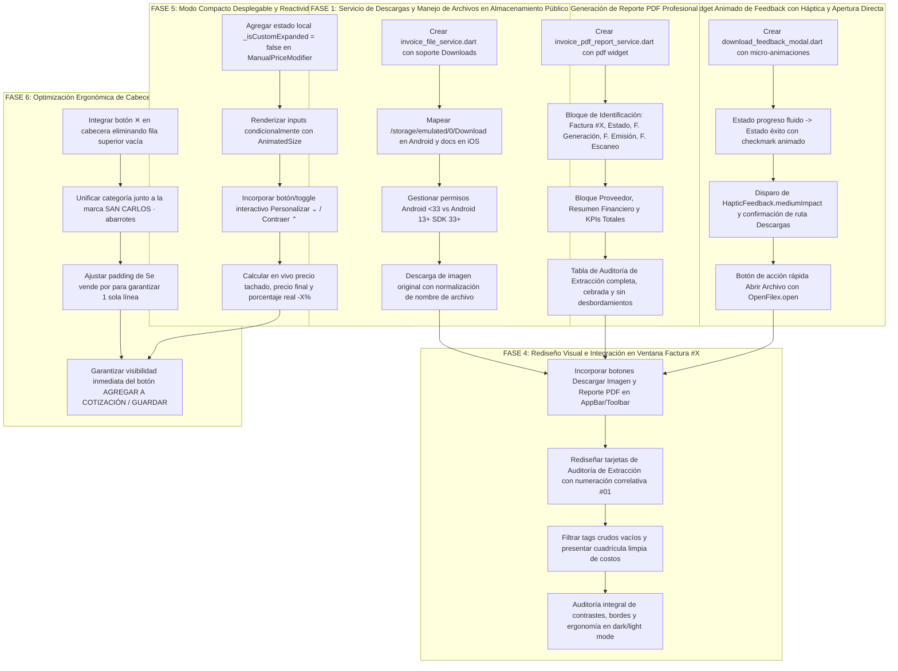

# 🚀 PLAN MAESTRO DE TRABAJO: DESCARGA PROFESIONAL DE FACTURAS ESCANEADAS (IMAGEN & REPORTE PDF EJECUTIVO EN DOWNLOADS) Y OPTIMIZACIÓN VERTICAL REACTIVA DEL MODAL DE DETALLES (COTIZACIÓN MANUAL & CAJA RÁPIDA)

**Documento de Especificación Técnica, Diagnóstico Forense, Arquitectura de Solución y Protocolo Adversarial**  
**Proyecto:** MochilaLista Mobile Application (Flutter, Local-First SQLite, 0ms Latency)  
**Fecha:** Octubre 2026  
**Metodología:** Loop Autónomo + Árbitro Interno Adversarial Estricto  
**Módulos Involucrados:**
- **Módulo Escáner de Facturas:** `lib/features/scanner/screens/invoice_detail_screen.dart`, `lib/features/scanner/models/invoice_model.dart`, `lib/features/scanner/providers/invoice_provider.dart`, nuevo servicio `invoice_pdf_report_service.dart`, nuevo widget `download_feedback_modal.dart`.
- **Módulo Cotización Manual:** `lib/features/smart_quotation/widgets/manual/manual_quote_detail_modal.dart`, `lib/features/smart_quotation/widgets/manual/manual_price_modifier.dart`.
- **Módulo Caja Rápida:** `lib/features/smart_quotation/widgets/quick_sale/quick_sale_detail_modal.dart`.
- **Servicios Transversales & Almacenamiento:** `lib/core/utils/backup_manager.dart`, `gal`, `open_filex`, `pdf`, `path_provider`, `permission_handler`.

---

## 📸 1. AUDITORÍA FORENSE DE LAS 5 CAPTURAS Y DIAGNÓSTICO EN CÓDIGO FUENTE

A partir de la inspección de las 5 capturas remitidas por el usuario y la auditoría exhaustiva línea por línea del código fuente, se determina la causa raíz técnica de cada comportamiento y limitación:

| Captura | Pantalla / Componente | Diagnóstico Forense del Problema | Causa Raíz Técnica en Código Fuente |
| :--- | :--- | :--- | :--- |
| **Imagen 1** | **Ventana de Detalle de Factura Escaneada** (`Factura #19`) | **1. Carencia de Descarga de Imagen y Reporte PDF:** No existe ningún botón o mecanismo en la pantalla para descargar la imagen original ni para emitir un reporte PDF con la auditoría.<br>**2. Oportunidad de Claridad Visual en la Auditoría:** Los ítems extraídos en `Auditoría de Extracción` se muestran en tarjetas monótonas sin numeración correlativa (`#01`, `#02`), con acumulación de tags crudos ("Padre", "Variante", "Marca", "Código") incluso vacíos, saturando la visualización. | • `invoice_detail_screen.dart` L350-382 (`AppBar`): Solo cuenta con el título `Factura #19` y un botón pasivo `InfoTooltipButton`. No hay acciones de descarga (`IconButton` o Toolbar).<br>• L427-485: El visor de imagen solo ofrece `InteractiveViewer` y un chip pasivo `"🔍 Zoom interactivo"`.<br>• L1112-1235: `extractedItems` se itera generando tarjetas con un `Wrap` fijo de 5 tags y un contenedor interno rígido sin numeración ni jerarquía ejecutiva. |
| **Imagen 2** | **Modal de Detalles en Cotización Manual** (`SAN CARLOS - jekeke Color`) | **1. El Botón Principal queda Oculto Fuera de Pantalla:** Al tener descuento activo (`Aplicar Descuento` en ON), los 2 campos gigantes de texto (`S/ a Descontar` y `Precio Final Unit.`) consumen más de 115dp verticales.<br>**2. Espacio Desperdiciado en Cabecera:** El botón `✕` ocupa una fila entera vacía arriba, el chip de categoría `abarrotes` salta a una fila solitaria abajo de `Se vende por: Par (Factor: 2)`. `Cantidad` y `Subtotal` quedan cortados y el botón `AGREGAR A COTIZACIÓN` queda completamente inaccesible sin scroll. | • `manual_quote_detail_modal.dart` L510-521: Un `Align(alignment: Alignment.topRight, child: IconButton(...))` independiente genera una fila horizontal entera con 36-40dp de espacio muerto antes del avatar.<br>• L644-660: `Wrap` con `Container` de ancho amplio para `"Se vende por..."` fuerza a `widget.categoryName` a saltar a una línea secundaria.<br>• `manual_price_modifier.dart` L229-335: Si `isManualPrice == true`, renderiza de inmediato el bloque con los 2 `TextField` sin opción de colapso/despliegue.<br>• `manual_quote_detail_modal.dart` L1087: Un `SizedBox(height: 35)` agrava la expulsión del botón fuera del viewport. |
| **Imagen 3** | **Modal de Detalles tras Scroll hacia Abajo** (`SAN CARLOS - jekeke Color`) | **Pérdida de Contexto Visual:** Para poder tocar el botón `AGREGAR A COTIZACIÓN`, el usuario se ve obligado a desplazar el modal hacia abajo, ocultando el avatar, la marca `SAN CARLOS`, el nombre `jekeke` y las variantes. | • Consecuencia directa del exceso de altura acumulada en L510-1087 de `manual_quote_detail_modal.dart`. El modal excede el 92% del alto de la pantalla física (`maxHeightFactor: 0.92`), forzando el scroll interno de `SingleChildScrollView`. |
| **Imagen 4** | **Modal de Detalles tras Modificar Descuento Manual** (`SAN CARLOS - jekeke Color` - 1:48) | **Bug de Desincronización y Datos Congelados:** El usuario ingresó `- S/ 2.00` de descuento especial, calculando correctamente `Precio Final Unit.: S/ 11.90`, `Ahorro: 2,00 S/` y `Subtotal: 11,90 S/`. Sin embargo, justo arriba de los inputs, **a la izquierda de `✏️ Editar Catálogo`, los precios y el porcentaje siguen congelados mostrando `13,90 S/   12,50 S/   -10%`** (la antigua oferta de catálogo), contradiciendo el `11.90 S/` activo. | • `manual_price_modifier.dart` L154-187: El bloque de precios a la izquierda de `Editar Catálogo` está rígidamente condicionado a `if (catalogHasOffer && catalogOfferPrice != null)`.<br>• En L165 y L180 pinta directamente `catalogOfferPrice` (12.50) y `catalogDiscountPercent` (10%), **ignorando por completo `priceCtrl.text`, `discountCtrl.text` y `isCustomPrice`**.<br>• Además, si el producto no tiene oferta en BD (`catalogHasOffer == false`) pero el usuario activa descuento manual, L188-197 pinta `"Precio Base: S/ X"`, sin reflejar el precio tachado ni el porcentaje nuevo. |
| **Imagen 5** | **Modal de Detalles con Descuento Desactivado** (`Ula Ula`) | **1. Verificación del Modo Compacto:** Cuando el switch está en OFF (`isManualPrice == false`), la tarjeta de descuento es compacta y el botón `AGREGAR A COTIZACIÓN` **sí es visible de inmediato** sin scroll.<br>**2. Texto Partido Anti-estético:** El texto `"Se vende por: Unidad (Factor:\n1)"` se corta en 2 líneas únicamente por el `"1)"`.<br>**3. Fila Vacía del Botón `✕`:** Se repite la fila superior vacía innecesaria. | • `manual_quote_detail_modal.dart` L651: `Text("Se vende por: ${_currentSelection.unit}  (Factor: ${_currentSelection.conversionFactor})")` con padding horizontal de 10dp y fuente de 13dp excede por pocos píxeles el ancho de columna disponible al lado de una imagen de 90dp.<br>• `manual_price_modifier.dart` L189-196: En estado OFF, no se renderizan los inputs, demostrando que al ocultar los inputs el modal encaja perfectamente en pantalla. |

---

## 🎯 2. PRINCIPIOS RECTORES Y ARQUITECTURA DE SOLUCIÓN

### Principio 1: Guardado Directo y Accesible en Carpeta Pública `Downloads`
- Tanto la **Imagen Escaneada** como el **Reporte PDF Ejecutivo** deben guardarse en la **carpeta pública de Descargas (`Downloads`) del dispositivo** (`/storage/emulated/0/Download` en Android; y `getDownloadsDirectory()` / documentos compartibles en iOS).
- Manejo inteligente de permisos según la versión de Android:
  * En Android 13+ (API 33+), no se solicita el permiso deprecado `Permission.storage`, escribiendo directamente en la carpeta pública de descargas o mediante SAF.
  * En Android <13 (API <33), se verifica y solicita `Permission.storage`.
  * En iOS se utiliza el directorio de documentos accesibles / descargas.
- Los nombres de archivo serán normalizados, sin caracteres inválidos ni espacios problemáticos:
  * **Imagen:** `Factura_${displayId}_${proveedorSanitizado}_${YYYYMMDD_HHMMSS}.jpg`  
    *(Ej: `Factura_19_BAZAR_LIBRERIA_DEL_PACIFICO_20261022_113000.jpg`)*
  * **Reporte PDF:** `Factura_${displayId}_Reporte_${proveedorSanitizado}_${YYYYMMDD_HHMMSS}.pdf`  
    *(Ej: `Factura_19_Reporte_BAZAR_LIBRERIA_DEL_PACIFICO_20261022_113000.pdf`)*

### Principio 2: Reporte PDF Ejecutivo y Profesional de Alto Nivel
- Se utilizará la librería nativa `pdf` (^3.10.4) para generar un documento A4 corporativo, limpio, estructurado y sin saturación.
- **Jerarquía y Secciones Obligatorias del PDF:**
  1. **Encabezado Institucional:** Nombre del negocio emisor/usuario (si está configurado), título prominente `"REPORTE DE FACTURA ESCANEADA"`, identificador `"Factura #19"` con badge de estado estilizado (`COMPLETADO`).
  2. **Bloque de Metadatos y Trazabilidad Temporal:**
     - Fecha y hora exacta de emisión del PDF: `Fecha de Generación: 22/10/2026, 11:30 AM`.
     - Fecha de Emisión original del comprobante físico: `F. Emisión Comprobante: 12/03/2026`.
     - Fecha y hora de procesamiento con IA: `Escaneada con IA: 13 Oct 2026, 09:27 PM`.
     - Tipo de Registro: `Escaneada con Inteligencia Artificial` o `Factura Manual`.
     - Proveedor Vinculado: Nombre de la empresa (`BAZAR LIBRERIA DEL PACIFICO`) y RUC si existe en inventario.
  3. **Resumen Financiero Ejecutivo (KPI Cards):**
     - Tarjeta destacada con el Monto Total Facturado (`S/ 435.40`).
     - Cantidad total de productos/ítems procesados (`13 ítems`).
     - Subtotales calculados a partir de los ítems de auditoría.
  4. **Tabla de Auditoría de Extracción (Listado Completo de Productos):**
     - Columnas: `N°`, `Descripción en Factura`, `Producto / Variante Vinculada`, `Cantidad Comprada`, `UMP / Presentación`, `Costo Unitario (S/)`, `Subtotal (S/)`.
     - Formato sin cortes de texto, alternancia de filas (cebrado suave gris claro / blanco), tipografía monospace para cifras y alineación decimal estricta.

### Principio 3: Experiencia de Descarga Animada con Feedback Háptico y Apertura Directa
- Al iniciar la descarga (imagen o PDF), se muestra un widget interactivo con micro-animaciones fluidas:
  1. **Estado de Procesamiento:** Indicador circular / barra de progreso indeterminada con copy contextual: `"Generando reporte ejecutivo..."` o `"Descargando imagen original..."`.
  2. **Estado de Éxito:**
     - Micro-animación de checkmark verde (`Icons.check_circle_rounded`) con escala y fade-in.
     - Disparo de vibración háptica del dispositivo (`HapticFeedback.mediumImpact()`).
     - Nombre exacto del archivo guardado y confirmación explícita: `"Guardado con éxito en Descargas"`.
     - Botón principal de acción directa: **`Abrir Archivo`** (ejecuta `OpenFilex.open(filePath)` para visualizarlo de inmediato en el visor de imágenes o lector de PDF favorito del usuario).
     - Botón secundario: **`Cerrar`**.
  3. **Estado de Error Resiliente:** Si el archivo local no existe o se deniega el permiso, feedback claro con opción de reintentar.

### Principio 4: Estado Compacto Activo Desplegable en `ManualPriceModifier`
- Se introduce una arquitectura de dos estados cuando `isManualPrice == true`:
  1. **Estado 1: Compacto Activo (Por Defecto):**
     - Muestra el título `"Aplicar Descuento"`, el switch encendido, el badge contextual (`📦 Oferta de Catálogo` o `✨ Descuento Especial`), el precio base tachado, el precio final activo, el porcentaje de descuento y el botón `✏️ Editar Catálogo`.
     - **Los 2 campos de texto (`S/ a Descontar` y `Precio Final Unit.`) permanecen ocultos/plegados**.
     - Se incorpora un control interactivo discreto pero evidente: **`Personalizar ⌄`** (o toque en la fila).
     - **Ahorro de espacio vertical:** Se recuperan más de **115dp de altura**, haciendo que el botón `AGREGAR A COTIZACIÓN` o `GUARDAR CAMBIOS` quede inmediatamente a la vista.
  2. **Estado 2: Desplegado para Edición Manual:**
     - Al pulsar `Personalizar ⌄` (o si el usuario desea ajustar un descuento específico), el contenedor se expande mediante `AnimatedSize` (curva `easeInOutCubic`, 280ms) revelando los 2 inputs de texto.
     - El indicador cambia a `Contraer ⌃` para permitir replegarlo en cualquier momento.

### Principio 5: Recuperación Integral de Espacio Vertical en el Modal
Para garantizar que incluso en pantallas con ratios 16:9 o teclados/paneles flotantes el botón inferior no sufra cortes:
1. **Integración del Botón `✕`:** Se elimina el `Align(alignment: Alignment.topRight)` independiente de la cabecera. Se posiciona el botón de cerrar en la esquina superior derecha alineado en el mismo eje horizontal con el nombre y marca del producto o mediante un Stack superior elegante.
2. **Compactación de Categoría:** En lugar de ocupar una fila entera debajo de `"Se vende por..."`, la categoría se muestra junto a la marca: `SAN CARLOS · ABARROTES` o como micro-badge contiguo a la presentación.
3. **Ajuste de Presentación en 1 Línea:** El contenedor `"Se vende por: Unidad (Factor: 1)"` se ajusta en padding (`EdgeInsets.symmetric(horizontal: 8, vertical: 4)`) y formato (`"Venta: Unidad (x1)"` o texto de 12dp), evitando el corte de `"1)"` a una segunda línea.
4. **Reducción de Gaps Excesivos:** Se optimiza el espaciado antes de los botones finales (`SizedBox(height: 35)` reducido a `16-18dp`).

### Principio 6: Reactividad Total a 0ms en Bloque de Precios y Porcentaje
- En `ManualPriceModifier`, el bloque situado a la izquierda de `✏️ Editar Catálogo` se rediseña para depender dinámicamente de los valores en tiempo real:
  * Si `isManualPrice == true`:
    - El precio final unitario activo se calcula dinámicamente:  
      `double activePrice = double.tryParse(priceCtrl.text) ?? (catalogHasOffer ? (catalogOfferPrice ?? systemPrice) : systemPrice);`
    - El porcentaje de descuento real se calcula en vivo sobre el precio base regular:  
      `int activePercent = systemPrice > 0 ? (((systemPrice - activePrice) / systemPrice) * 100).round() : 0;`
    - Si `activePrice < systemPrice`: Se renderiza el precio base tachado (`13,90 S/`), el precio final activo (`11,90 S/`) y el badge con el porcentaje recalculado en vivo (`-14%`).
    - Si es `isCustomPrice`, se estiliza en tonos naranja/ámbar para coherencia con `✨ Descuento Especial`.
    - Si el producto originalmente no tenía oferta (como `Ula Ula` en Imagen 5) y el usuario activa el switch y escribe un descuento, la línea deja de decir `"Precio Base: 5,06 S/"` y pasa a mostrar instantáneamente el precio base tachado `5,06 S/`, el nuevo precio final y el badge `-%`.
  * Si el usuario edita desde `✏️ Editar Catálogo` (`PriceUpdateModal`):
    - Al guardar y regresar, los nuevos datos de BD se propagan a 0ms a `systemPrice`, `catalogOfferPrice` y `catalogDiscountPercent`, refrescando el bloque inmediatamente.

---

## 🏗️ 3. DIAGRAMA DE FLUJO ARQUITECTURAL DE LAS 6 FASES



---

## 📋 4. ESPECIFICACIÓN DETALLADA DE LAS 6 FASES DE IMPLEMENTACIÓN

### FASE 1: Servicio de Archivos y Descargas en Almacenamiento Público (`invoice_file_service.dart`)
1. **Objetivo:** Implementar una utilidad limpia y robusta para guardar archivos físicos en la carpeta pública de Descargas de Android e iOS, controlando permisos según versión del SO.
2. **Ubicación del Archivo:** `lib/features/scanner/services/invoice_file_service.dart`.
3. **Tareas Específicas:**
   - Implementar método `Future<Directory> getPublicDownloadsDirectory()`.
     * En Android: resolver `/storage/emulated/0/Download`. Si no existe, crearlo o recurrir a `getExternalStorageDirectory()`.
     * En iOS: recurrir a `getApplicationDocumentsDirectory()`.
   - Implementar método `Future<bool> requestStoragePermission()`:
     * Si `Platform.isAndroid`: consultar `DeviceInfoPlugin().androidInfo`. Si `sdkInt < 33`, solicitar `Permission.storage`. Si es 33+, retornar `true` directamente (Scoped Storage).
   - Implementar método `Future<File> saveScannedImageToDownloads({required String sourcePath, required String fileName})`:
     * Si `sourcePath` comienza con `http`: descargar bytes mediante `http.get()`.
     * Si `sourcePath` es archivo local existente (`File(sourcePath).existsSync()`): leer los bytes con `readAsBytes()`.
     * Si la imagen no está disponible (`'local_ia_scan'` o no existe): lanzar excepción descriptiva.
     * Sanitizar el nombre del archivo y guardarlo en la carpeta pública de descargas.
     * Opcional: registrar en galería mediante `Gal.putImageBytes()` como respaldo multimedia.

---

### FASE 2: Motor de Generación de Reporte PDF Profesional (`invoice_pdf_report_service.dart`)
1. **Objetivo:** Generar un documento PDF ejecutivo, limpio, de alta resolución y con diseño corporativo que contenga todos los metadatos y la auditoría completa de la factura escaneada.
2. **Ubicación del Archivo:** `lib/features/scanner/services/invoice_pdf_report_service.dart`.
3. **Tareas Específicas:**
   - Implementar método `Future<Uint8List> generateInvoicePdfReport({required InvoiceModel invoice, String? providerName, UserModel? currentUser})`.
   - **Estructura Visual del PDF (A4 Vertical, márgenes 28pt):**
     * **Paleta de Colores Corporativa:** Teal oscuro (`#004D40`), Azul pizarra (`#1E293B`), Gris de fondo suave (`#F8FAFC`), Acentos de éxito (`#15803D`).
     * **Bloque 1 - Cabecera:**
       - Título: `REPORTE DE AUDITORÍA DE FACTURA`.
       - Identificador destacado: `FACTURA #${invoice.displayId}`.
       - Badge de Estado: `COMPLETADO` / `REVISIÓN` / `PROCESANDO` con fondo tintado.
     * **Bloque 2 - Trazabilidad y Metadatos:**
       - 2 Columnas ordenadas:
         * *Columna Izquierda:* Proveedor Vinculado (Nombre y RUC), Tipo de Factura (`Escaneada con IA` o `Factura Manual`).
         * *Columna Derecha:* Fecha de Emisión Comprobante (`dd/MM/yyyy`), Fecha de Escaneo con IA (`dd/MM/yyyy HH:mm`), Fecha y hora de Creación del Reporte (`dd/MM/yyyy HH:mm:ss`).
     * **Bloque 3 - Resumen Financiero Ejecutivo (KPIs):**
       - Recuadro elegante con Monto Total Facturado (`S/ 435.40`), Cantidad de Ítems Extraídos (`13`), y Suma de Subtotales calculados.
     * **Bloque 4 - Tabla de Auditoría de Extracción:**
       - Cabecera estilizada con fondo Teal oscuro y texto blanco en negrita.
       - Columnas calibradas:
         1. `N°` (ancho 25pt, centrado).
         2. `Descripción Detectada / Producto` (ancho flexible, negrita, con variante o padre debajo si aplica).
         3. `Cantidad` (ancho 50pt, centrado).
         4. `Unidad (UMP)` (ancho 55pt, centrado).
         5. `Costo Unit. (S/)` (ancho 65pt, alineado a la derecha).
         6. `Subtotal (S/)` (ancho 65pt, alineado a la derecha, negrita).
       - Filas alternadas (filas pares blanco, filas impares `#F1F5F9`).
       - Fila final de Totales con doble borde inferior y subtotal general.
     * **Pie de Página:**
       - Numeración de páginas `Página X de Y` y nota de confidencialidad institucional MochilaLista.

---

### FASE 3: Widget Animado de Descarga con Háptica y Apertura Directa (`download_feedback_modal.dart`)
1. **Objetivo:** Brindar al usuario una experiencia de feedback visual y táctil de nivel "Mobile Awards" al descargar la imagen o el PDF.
2. **Ubicación del Archivo:** `lib/features/scanner/widgets/shared/download_feedback_modal.dart`.
3. **Tareas Específicas:**
   - Crear diálogo/modal animado que admita un `Future<File>`:
     * **Paso 1 (Cargando):** `CircularProgressIndicator` o `LinearProgressIndicator` moderno con mensaje dinámico (`"Generando documento PDF..."` o `"Descargando imagen del comprobante..."`).
     * **Paso 2 (Éxito):**
       - Transición suave con `AnimatedSwitcher` / `ScaleTransition`.
       - Ícono animado de check verde (`Icons.check_circle_rounded`).
       - Disparo de háptica: `HapticFeedback.mediumImpact()`.
       - Nombre del archivo en negrita tipográfica limpia con icono según tipo (PDF o Imagen).
       - Mensaje claro: `"Guardado con éxito en la carpeta Descargas"`.
       - Botón destacado en azul: **`ABRIR ARCHIVO`** -> Llama a `OpenFilex.open(file.path)`.
       - Botón secundario de cierre: **`LISTO`** -> Cierra el modal.
     * **Paso 3 (Error):**
       - Ícono de advertencia, descripción del fallo y botón para reintentar o descartar.

---

### FASE 4: Integración en Pantalla de Detalle de Factura y Rediseño de Auditoría (`invoice_detail_screen.dart`)
1. **Objetivo:** Dotar a `invoice_detail_screen.dart` de las acciones de descarga y enriquecer la sección `Auditoría de Extracción`.
2. **Ubicación del Archivo:** `lib/features/scanner/screens/invoice_detail_screen.dart`.
3. **Tareas Específicas:**
   - **Acciones en AppBar / Toolbar:**
     * Agregar botones de acción rápida en el `AppBar` o en una barra de herramientas elegante:
       - Botón `[ 🖼️ Guardar Foto ]` con icono `Icons.download_rounded` / `Icons.image_outlined`.
       - Botón `[ 📄 Reporte PDF ]` con icono `Icons.picture_as_pdf_outlined`.
   - **Conexión de Descarga:**
     * Al pulsar Guardar Foto: disparar `InvoiceFileService.downloadInvoiceImage` envuelto en `DownloadFeedbackModal`.
     * Al pulsar Reporte PDF: disparar `InvoicePdfReportService.generateAndDownloadReport` envuelto en `DownloadFeedbackModal`.
   - **Rediseño Integral de la Tarjeta `Auditoría de Extracción`:**
     * Incorporar badge de número de orden `#01`, `#02`, `#03`... en cada ítem extraído.
     * Jerarquizar el título del ítem (`descripcion_detectada`) con peso tipográfico destacado.
     * Limpiar el `Wrap` de tags: mostrar únicamente valores válidos y significativos (ej. si Marca o Variante no es "N/A" ni null, mostrarlo como chip compacto; si está vacío, omitirlo para no saturar).
     * Rediseñar la cuadrícula interna de valores financieros:
       - Línea 1: `Cantidad Comprada` y `UMP` con icono de lote.
       - Línea 2: `Costo Unitario Real` resaltado en tono ámbar/naranja.
       - Línea 3: `Total Pagado` con tipografía bold grande en verde esmeralda.

---

### FASE 5: Modo Compacto Desplegable y Reactividad a 0ms en `ManualPriceModifier`
1. **Objetivo:** Optimizar el espacio vertical de la tarjeta de descuento mediante un modo compacto plegable y corregir la reactividad de la línea de precios a la izquierda de `✏️ Editar Catálogo`.
2. **Ubicación del Archivo:** `lib/features/smart_quotation/widgets/manual/manual_price_modifier.dart`.
3. **Tareas Específicas:**
   - **A. Modo Compacto Activo Plegable:**
     * Convertir o dotar a `ManualPriceModifier` de un estado local `_isCustomExpanded` (o recibirlo como parámetro con callback).
     * Por defecto, cuando `isManualPrice == true`, `_isCustomExpanded` inicia en `false`.
     * En estado compacto (`_isCustomExpanded == false`), los dos campos de texto (`S/ a Descontar` y `Precio Final Unit.`) no se muestran, recuperando más de 115dp verticales.
     * Incorporar un botón / enlace interactivo:
       - Si está plegado: **`Personalizar Descuento ⌄`**.
       - Si está desplegado: **`Contraer ⌃`**.
     * Animación suave con `AnimatedCrossFade` o `AnimatedSize` (curva `Curves.easeInOutCubic`, 280ms).
   - **B. Reactividad Total a 0ms en Precios y Porcentaje:**
     * Reemplazar la lógica rígida de L154-187 que solo leía `catalogOfferPrice`.
     * Evaluar el precio final unitario activo en tiempo real:
       ```dart
       final double? parsedCustomPrice = double.tryParse(priceCtrl.text);
       final double activeUnitPrice = (isManualPrice && parsedCustomPrice != null)
           ? parsedCustomPrice
           : (catalogHasOffer && catalogOfferPrice != null ? catalogOfferPrice! : systemPrice);
       final bool hasEffectiveDiscount = isManualPrice && (activeUnitPrice < systemPrice);
       final int activePercent = (systemPrice > 0 && hasEffectiveDiscount)
           ? (((systemPrice - activeUnitPrice) / systemPrice) * 100).round()
           : (catalogHasOffer ? catalogDiscountPercent : 0);
       ```
     * Si `hasEffectiveDiscount`:
       - Renderizar el precio base tachado `currency.format(systemPrice)`.
       - Renderizar el precio final unitario activo `currency.format(activeUnitPrice)` (en verde si es de catálogo, o naranja si es descuento especial).
       - Renderizar el badge con el porcentaje dinámico recalculado: `-$activePercent%`.
     * Si el switch está apagado (`isManualPrice == false`) y el producto no tiene oferta de catálogo, mantener `"Precio Base: ${currency.format(systemPrice)}"`.
     * Esta corrección garantiza que al ingresar `- S/ 2.00` en la Imagen 4, la línea muestre inmediatamente **`13,90 S/   11,90 S/   -14%`** sin desfases.

---

### FASE 6: Optimización Ergonómica de Cabecera y Paridad Cotización/Caja
1. **Objetivo:** Eliminar filas vacías y textos desbordados en `manual_quote_detail_modal.dart` y `quick_sale_detail_modal.dart`, garantizando visibilidad inmediata del botón de acción sin scroll.
2. **Ubicaciones:**
   - `lib/features/smart_quotation/widgets/manual/manual_quote_detail_modal.dart`
   - `lib/features/smart_quotation/widgets/quick_sale/quick_sale_detail_modal.dart`
3. **Tareas Específicas:**
   - **1. Integración de Botón `✕`:**
     * Eliminar el bloque aislado `Align(alignment: Alignment.topRight, child: IconButton(...))` de L510-520.
     * Posicionar el botón de cierre en la esquina superior derecha alineado con la cabecera del producto mediante `Row` superior o `Positioned` en Stack, eliminando 36dp de fila vacía.
   - **2. Unificación de Categoría:**
     * Reubicar el chip de categoría (`abarrotes`) junto al nombre de la marca:  
       `SAN CARLOS · ABARROTES` con estilo tipográfico discreto y elegante, o contiguo a los datos de presentación.
     * Eliminar la fila huérfana de categoría, ahorrando 30dp adicionales.
   - **3. Presentación en 1 Línea:**
     * Ajustar el contenedor `"Se vende por..."`:
       - Texto reformulado a: `"Se vende por: ${_currentSelection.unit} (x${_currentSelection.conversionFactor})"` con fuente de 12dp.
       - Padding horizontal optimizado de 10dp a 8dp.
       - Garantizar que en ningún dispositivo móvil `"1)"` salte a una segunda línea.
   - **4. Ajuste de Padding y Márgenes Finales:**
     * Reducir `SizedBox(height: 35)` antes del botón de confirmación a `18dp`.
   - **Resultado Global:**
     * Con el ahorro acumulado de ~115dp (descuento compacto) + ~36dp (botón ✕ integrado) + ~30dp (categoría en línea) + ~17dp (gap final), se liberan casi **200dp verticales**.
     * El botón inferior `AGREGAR A COTIZACIÓN` / `GUARDAR CAMBIOS` **queda 100% visible inmediatamente al abrir el modal** en todos los teléfonos físicos.

---

## 🛡️ 5. PROTOCOLO DEL ÁRBITRO INTERNO ADVERSARIAL (STRESS & REGRESSION TESTING)

Antes de considerar concluida la implementación, el sistema se someterá a las siguientes 8 pruebas adversariales obligatorias:

1. **Test Adversarial 1 (Facturas Legacy sin Imagen Local):**
   * *Escenario:* Facturas con `imagenUrl == 'local_ia_scan'` o rutas temporales eliminadas.
   * *Criterio de Aprobación:* El botón de descargar imagen detecta la ausencia del archivo físico y muestra un SnackBar o diálogo preventivo amigable sin arrojar excepción no controlada (`FileSystemException`).
2. **Test Adversarial 2 (Permisos de Almacenamiento en Android 10 vs Android 14):**
   * *Escenario:* Ejecución en Android con API < 33 (requiere permiso de almacenamiento tradicional) vs Android 14 (API 34, Scoped Storage sin permiso de storage).
   * *Criterio de Aprobación:* La lógica de `InvoiceFileService` detecta la versión SDK del dispositivo; en Android 14 escribe directamente en `/storage/emulated/0/Download` sin pedir permisos innecesarios ni fallar, y en Android 10 solicita el permiso adecuadamente.
3. **Test Adversarial 3 (Apertura de PDF sin Lector Instalado):**
   * *Escenario:* El usuario pulsa `Abrir Archivo` tras descargar el PDF en un dispositivo sin visor de PDF configurado por defecto.
   * *Criterio de Aprobación:* `OpenFilex.open()` captura el resultado; si el sistema no puede abrir el archivo, muestra un mensaje informativo indicando que el archivo está seguro en `Descargas`.
4. **Test Adversarial 4 (Desbordamiento de Texto en Tabla PDF):**
   * *Escenario:* Un producto extraído por IA posee una descripción de más de 120 caracteres (`descripcion_detectada`).
   * *Criterio de Aprobación:* La celda en la tabla PDF realiza salto de línea automático (`pw.Text(..., softWrap: true)`) sin truncar ni empujar las columnas de Cantidad, Costo Unitario y Subtotal fuera de los márgenes de página.
5. **Test Adversarial 5 (Pantallas Extremadamente Angostas - 360dp de Ancho):**
   * *Escenario:* Prueba visual del modal de detalles y de la ventana de factura en dispositivos compactos.
   * *Criterio de Aprobación:* Ningún `Row` o `Wrap` genera `RenderFlex overflowed by X pixels`. `"Se vende por..."` se mantiene en 1 sola línea limpia.
6. **Test Adversarial 6 (Consistencia Matemática de Descuentos a 0ms):**
   * *Escenario:* Modificar `S/ a Descontar` a `- S/ 2.00` en un producto con precio base `13,90 S/`.
   * *Criterio de Aprobación:* La línea a la izquierda de `Editar Catálogo` muestra de inmediato `13,90 S/   11,90 S/   -14%`. El `Ahorro` muestra `2,00 S/` y el `Subtotal` `11,90 S/`. La sincronización es absoluta a 0ms.
7. **Test Adversarial 7 (Alternancia de Estado Plegado/Desplegado):**
   * *Escenario:* Pulsar repetidamente `Personalizar ⌄` y `Contraer ⌃` mientras se escribe en los campos de descuento.
   * *Criterio de Aprobación:* La animación se ejecuta sin saltos bruscos (`jank`), los textos ingresados en los controladores no se borran y el foco del teclado se gestiona limpiamente.
8. **Test Adversarial 8 (Integridad y Paridad entre Cotización Manual y Caja Rápida):**
   * *Escenario:* Probar el modal tanto agregando un producto desde el buscador de Cotización Manual como editando un ítem en Caja Rápida.
   * *Criterio de Aprobación:* Ambos modales comparten la misma experiencia de espacio compacto, la misma visibilidad directa del botón y la misma reactividad inmediata de precios.

---

## ⏱️ 6. MATRIZ DE ARCHIVOS A CREAR Y MODIFICAR

| Archivo | Tipo de Operación | Propósito Principal |
| :--- | :--- | :--- |
| `lib/features/scanner/services/invoice_file_service.dart` | **Nuevo Archivo** | Gestión de descargas públicas a `Downloads`, permisos Android/iOS y guardado de imágenes. |
| `lib/features/scanner/services/invoice_pdf_report_service.dart` | **Nuevo Archivo** | Generador de reportes PDF ejecutivos de factura con metadatos y auditoría completa. |
| `lib/features/scanner/widgets/shared/download_feedback_modal.dart` | **Nuevo Archivo** | Modal animado con micro-animaciones, háptica, confirmación de ruta y botón de apertura. |
| `lib/features/scanner/screens/invoice_detail_screen.dart` | **Modificación** | Botones de descarga en AppBar/Toolbar, conexión de servicios y rediseño de Auditoría. |
| `lib/features/smart_quotation/widgets/manual/manual_price_modifier.dart` | **Modificación** | Estado compacto desplegable (`Personalizar ⌄`) y reactividad total 0ms en precios/porcentaje. |
| `lib/features/smart_quotation/widgets/manual/manual_quote_detail_modal.dart` | **Modificación** | Integración del botón `✕`, categoría en línea, optimización de presentación y visibilidad de botón. |
| `lib/features/smart_quotation/widgets/quick_sale/quick_sale_detail_modal.dart` | **Modificación** | Paridad completa con las mejoras verticales y reactivas de Cotización Manual. |

---

## 🏁 7. CONCLUSIÓN DEL PLAN
Este plan ataca con precisión quirúrgica las causas raíz demostradas en las 5 capturas: añade dos funciones de alto valor profesional en Facturas Escaneadas (descarga de imagen y reporte ejecutivo PDF directamente en `Downloads`), soluciona definitivamente el problema de altura del modal de detalles mediante el nuevo Estado Compacto Plegable, y erradica el bug de desincronización de precios a la izquierda de `Editar Catálogo`.
