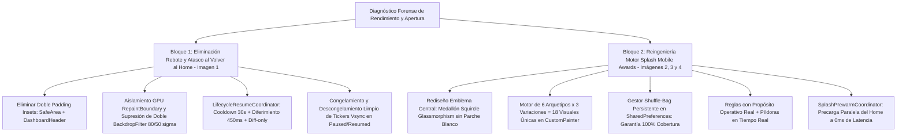
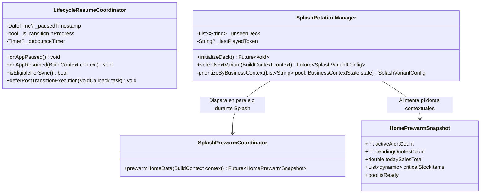
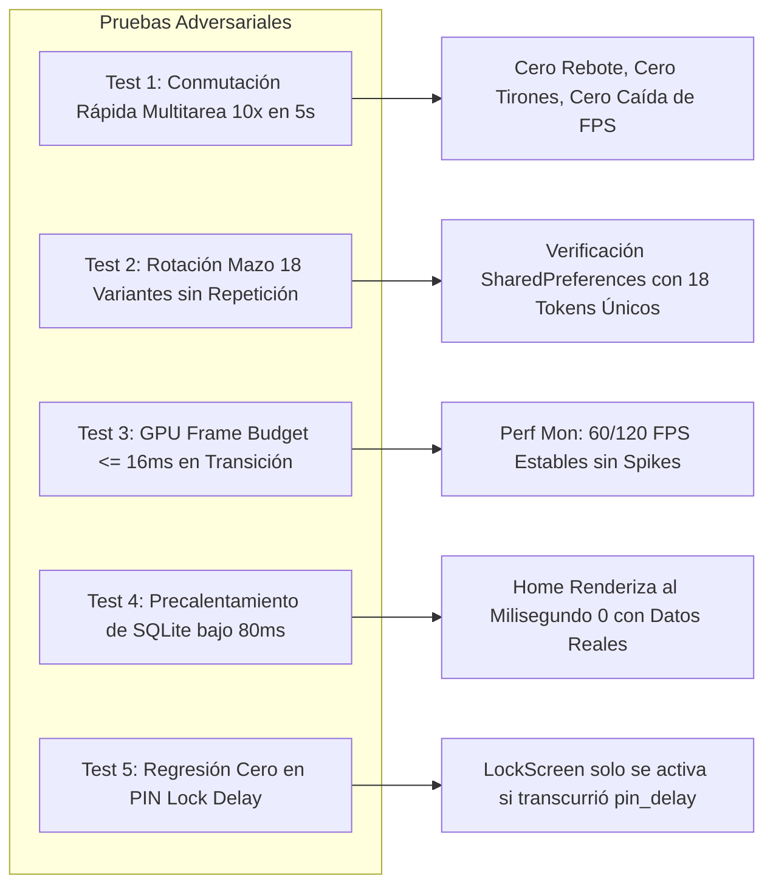

# PLAN MAESTRO: OPTIMIZACIÓN ZERO-JANK RESUME EN HOME Y REINGENIERÍA DEL MOTOR DE ANIMACIONES SPLASH A NIVEL MOBILE AWARDS

**Documento:** `analisis_proyecto/PLAN_OPTIMIZACION_RESUME_HOME_Y_MOTOR_ANIMACIONES_SPLASH_MOBILE_AWARDS.md`  
**Fecha:** 31 de Octubre de 2026  
**Versión:** 1.0 — Especificación Técnica Definitiva (Mobile Awards Standard)  
**Estado:** Esperando Aprobación de Plan de Trabajo (Paso 1: Diagnóstico Forense y Diseño Arquitectónico — CÓDIGO INTACTO)  
**Metodología:** Loop Autónomo + Árbitro Interno Adversarial (Test-Driven, Zero-Regressions, 60/120 FPS & Zero-Overflows)

---

## 1. RESUMEN EJECUTIVO Y DIAGNÓSTICO FORENSE DE LAS 4 CAPTURAS

A partir de pruebas rigurosas en dispositivos móviles físicos en condiciones de ciclo de vida real (suspensión, multitarea, reanudación y apertura en frío) y el análisis visual forense de las **4 capturas aportadas por el comerciante**, se han diagnosticado dos cuellos de botella críticos que impiden una experiencia visual de estándar mundial (**Mobile Awards**):

1. **Atasco, Rebote y Caída de FPS al Reanudar la App desde Multitarea (`Imagen 1`):**  
   Al salir de la app (Home) al escritorio o al conmutador de aplicaciones recientes de Android y volver a entrar, durante los primeros 350ms a 1000ms la interfaz sufre un rebote vertical espasmódico, congelamientos momentáneos y una caída severa de tasa de refresco (sensación "pegajosa" y atasco visual).
2. **Defectos Estéticos y Limitación del Motor de Animaciones de Apertura en Frío (`Imágenes 2, 3 y 4`):**  
   - **Defecto del Emblema Central:** El isotipo de la mochila se encuentra encapsulado con un recuadro blanco opaco rígido cuyas cuatro esquinas cuadradas sobresalen agresivamente dentro del círculo oscuro, mientras el texto inferior `"MOCHILA LISTA"` queda mordido y deformado por el corte circular. Además, la marca se repite de forma redundante justo debajo en tipografía gigante.
   - **Variedad Insuficiente y Ausencia de Propósito Real:** Actualmente solo existen 3 animaciones basadas en un `Random()` volátil no persistente en memoria que excluye sistemáticamente ciertas animaciones y carece de conexión con la operativa real del negocio (alertas de stock, cotizaciones pendientes o ventas activas).



---

### 1.1. Matriz de Análisis Forense por Captura de Pantalla

| Captura | Vista / Estado | Momento del Ciclo de Vida | Hallazgo Visual y Falla Crítica | Impacto Técnico / Causa Raíz Primaria |
| :--- | :--- | :--- | :--- | :--- |
| **Imagen 1** | Multitarea de Android (Vista de Aplicaciones Recientes) mostrando `HomeScreen` | Transición de reanudación (`paused` $\to$ `resumed`) | **1.** El conmutador de Android escala la ventana en miniatura.<br>**2.** Al tocar la miniatura para entrar a pantalla completa, la interfaz del Home tiembla, rebota verticalmente y se arrastra con tirones severos (15–20 FPS).<br>**3.** El encabezado azul cambia de altura bruscamente mientras la ventana se expande. | **Crítico:**<br>• Colisión de *Window Metrics*: `_HomeDashboardView` envuelve el contenido en `SafeArea(top: true)`, y a su vez `DashboardHeader` suma nuevamente `math.max(MediaQuery.of(context).padding.top, 24.0) + 16`. Durante los 350ms de expansión de ventana de Android, el `padding.top` fluctúa en cada frame, duplicando el delta y haciendo rebotar el `Transform.translate(0, -40)` del dashboard.<br>• Sobrecarga masiva de GPU: Dos capas `BackdropFilter` simultáneas (80-sigma y 50-sigma) sin `RepaintBoundary` se recalculan en cada frame de redimensionamiento.<br>• 4 `AnimationController` continuos no se pausan al salir y generan *vsync thrashing* al volver. |
| **Imagen 2** | `ColdStartSplashScreen` (Variante 0: Nodos y Radar) | Apertura en frío (Cold-Start) | **1.** El logo central muestra un parche cuadrado blanco plano incrustado en el círculo oscuro de fondo.<br>**2.** Las cuatro esquinas blancas del parche sobresalen fuera del círculo.<br>**3.** El texto `"MOCHILA LISTA"` dentro del cuadrado se corta en la base circular y compite torpemente con el título `"MochilaLista"` inferior.<br>**4.** La animación es aleatoria y no refleja ningún dato útil del negocio. | **Severo Visual:**<br>`Image.asset('assets/logo.png')` contiene fondo blanco sólido rasterizado y texto tipográfico integrado. Al renderizarse en un `Container(shape: BoxShape.circle, color: Color(0xFF1E293B))` sin máscara alfa ni recorte perimetral adecuado, destruye la armonía visual de la interfaz. |
| **Imagen 3** | `ColdStartSplashScreen` (Variante 1: Ondas Concéntricas y Polígono) | Apertura en frío (Cold-Start) | **1.** Mismo defecto de parche cuadrado blanco y esquinas sobresalientes en el emblema central.<br>**2.** El subtítulo `"Cotizaciones, inventario y ventas en tus manos"` es estático y genérico.<br>**3.** Las ondas son simples círculos sin profundidad ni partículas volumétricas. | **Severo Visual / Estancamiento:**<br>El motor gráfico carece de variaciones dinámicas de coreografía y paleta, repitiendo siempre la misma geometría básica. |
| **Imagen 4** | `ColdStartSplashScreen` (Variante 2: Nodos de Sincronización) | Apertura en frío (Cold-Start) | **1.** Mismo defecto del parche cuadrado blanco y esquinas desbordadas.<br>**2.** Los textos rotativos `"Sincronizando inventario local..."` se disparan de forma ciega sin sincronizar realmente datos reales ni precalentar la base de datos para el Home. | **UX Inconsistente:**<br>La animación es una simulación desconectada. No precalienta SQLite ni las consultas del Home, haciendo que al terminar el splash el Home vuelva a tardar en pintar sus KPIs. |

---

## 2. AUDITORÍA FORENSE EN CÓDIGO (ARCHIVOS, LÍNEAS EXACTAS Y CAUSAS RAÍZ)

### 2.1. Bloque 1: Causa Raíz del Rebote, Atasco y Pérdida de FPS en Reanudación (`HomeScreen`)

#### Evidencia 1: Colisión de Insets y Doble Inyección de `padding.top` (Efecto Resorte)
* **Archivos Involucrados:**
  * `lib/core/screens/home_screen.dart` (Líneas 349–353)
  * `lib/core/widgets/home/dashboard_header.dart` (Líneas 151–156, 241–245)
* **Código Problemático:**
  ```dart
  // home_screen.dart (Líneas 349-353):
  SafeArea(
    top: true,        // ❌ Aplica automáticamente el padding.top del sistema
    bottom: false,
    child: mainContent,
  )

  // dashboard_header.dart (Líneas 151-156):
  padding: EdgeInsets.only(
    // ❌ VUELVE a sumar el padding.top sobre el SafeArea ya aplicado:
    top: math.max(MediaQuery.of(context).padding.top, 24.0) + 16,
    bottom: 65, 
    left: 24,
    right: 24
  ),

  // home_screen.dart (Líneas 242-243):
  Transform.translate(
    offset: const Offset(0, -40), // ❌ Vinculado rígidamente a la base del header cambiante
    child: Padding(... Column(children: [OmniSearchBar, RestockSmartBanner, WeeklySalesChart...]))
  )
  ```
* **Mecánica del Fallo:**  
  Cuando Android conmuta desde la vista en miniatura (Multitarea) a pantalla completa, envía a Flutter una secuencia continua de cambios métricos durante 300–400ms (`didChangeMetrics`). `MediaQuery.of(context).padding.top` pasa de valores atípicos (0 o escalados) al valor final de la barra de estado (ej. 38px–48px).  
  Al sumarse **dos veces**, el encabezado se expande y contrae violentamente durante la animación de entrada de la ventana del SO. Al estar toda la columna subsiguiente desplazada con un `Transform.translate(0, -40)` fijo en el árbol de scroll, toda la pantalla experimenta el violento "rebote elástico".

#### Evidencia 2: Colapso de GPU por Doble Rasterización Gaussiana (`BackdropFilter` 80 y 50 sigma)
* **Archivos Involucrados:**
  * `lib/core/screens/home_screen.dart` (Líneas 313–346)
  * `lib/core/widgets/home/dashboard_header.dart` (Líneas 339–398)
* **Código Problemático:**
  ```dart
  // home_screen.dart:
  Positioned.fill(
    child: BackdropFilter(
      filter: ImageFilter.blur(sigmaX: 80, sigmaY: 80), // ❌ 80 píxeles de radio gaussiano a pantalla completa
      child: const SizedBox(),
    ),
  ),

  // dashboard_header.dart:
  Positioned.fill(
    child: BackdropFilter(
      filter: ImageFilter.blur(sigmaX: 50, sigmaY: 50), // ❌ 50 píxeles de radio adicional superpuesto
      child: const SizedBox(),
    ),
  ),
  ```
* **Mecánica del Fallo:**  
  Los filtros gaussianos son la operación más costosa para el rasterizador de Skia/Impeller en Android. Un radio sigma de 80 requiere muestrear cientos de píxeles adyacentes por cada fragmento. Al no existir `RepaintBoundary`, cada vez que el tamaño de la ventana cambia (o que cualquier ticker avanza 1 milisegundo), la GPU se ve forzada a re-filtrar el búfer completo dos veces por frame. Esto produce picos de renderizado superiores a 50ms por frame, provocando la sensación "pegajosa" y caída a 15–20 FPS.

#### Evidencia 3: Tormenta de Tickers Continuos no Pausados en Ciclo de Vida
* **Archivos Involucrados:**
  * `lib/core/screens/home_screen.dart`: `_bgAnimController` (12 segundos en loop continuo)
  * `lib/core/widgets/home/dashboard_header.dart`: `_bgAnimController` (4 segundos en loop continuo)
  * `lib/features/analytics/widgets/restock_smart_banner.dart`: `_pulseController` (1.8 segundos en loop continuo)
  * `lib/core/widgets/persistent_work_dock.dart`: `_pulseController` (1.4 segundos en loop continuo)
* **Mecánica del Fallo:**  
  Ninguno de estos 4 controladores responde al estado de ciclo de vida (`AppLifecycleState.paused` / `resumed`). Al volver del segundo plano, Flutter intenta compensar el delta de tiempo acumulado disparando cálculos de interpolación simultáneos en el mismo frame que Android está reconstruyendo el contexto EGL de la superficie gráfica.

#### Evidencia 4: E/S Bloqueante en el Milisegundo Cero de `resumed`
* **Archivos Involucrados:**
  * `lib/core/screens/home_screen.dart` (Líneas 57–66, 85–103)
* **Código Problemático:**
  ```dart
  @override
  void didChangeAppLifecycleState(AppLifecycleState state) {
    if (state == AppLifecycleState.resumed) {
      if (_pausedTime != null) {
        _checkPinDelay(); // ❌ Dispara inmediatamente al milisegundo 0 de resumed
      }
    }
  }

  Future<void> _checkPinDelay() async {
    final prefs = await SharedPreferences.getInstance(); // ❌ Llamada asíncrona a IPC Platform Channel mientras Android dibuja
    ...
  }
  ```
* **Mecánica del Fallo:**  
  La consulta a `SharedPreferences` por MethodChannel bloquea la fluidez del hilo principal durante la ventana crítica de 0–100ms donde la animación de ventana de Android requiere el 100% del procesador.

---

### 2.2. Bloque 2: Causa Raíz de los Defectos del Splash y Falta de Persistencia

#### Evidencia 1: Emblema Central Mal Recortado y Duplicación de Texto
* **Archivos Involucrados:**
  * `lib/core/screens/splash/cold_start_splash_screen.dart` (Líneas 203–255)
  * `app_movil/assets/logo.png` (Imagen rasterizada de 1024x1024 con fondo blanco sólido `#FFFFFF` y texto `"MOCHILA LISTA"` integrado en la parte inferior)
* **Código Problemático:**
  ```dart
  Hero(
    tag: 'app_brand_logo',
    child: Container(
      width: 104,
      height: 104,
      padding: const EdgeInsets.all(16),
      decoration: BoxDecoration(
        color: isDark ? const Color(0xFF1E293B) : Colors.white,
        shape: BoxShape.circle, // ❌ Un contenedor circular con un Image.asset que tiene fondo blanco plano
      ),
      child: Image.asset(
        'assets/logo.png', // ❌ La imagen es un cuadro blanco opaco con texto inferior
        fit: BoxFit.contain,
      ),
    ),
  ),
  ...
  Text("MochilaLista", style: TextStyle(fontSize: 32, fontWeight: FontWeight.w900)) // ❌ Texto redundante duplicado
  ```
* **Mecánica del Fallo:**  
  Al embutir una imagen con fondo blanco plano cuadrado dentro de un círculo con fondo oscuro (`0xFF1E293B`), las esquinas blancas del bitmap se salen y chocan estéticamente contra el círculo oscuro. El texto `"MOCHILA LISTA"` del bitmap se ahoga contra el arco inferior, generando la apariencia descuidada señalada en las Imágenes 2, 3 y 4.

#### Evidencia 2: Selección Volátil no Persistente (`AppLaunchManager`)
* **Archivos Involucrados:**
  * `lib/core/services/app_launch_manager.dart` (Líneas 10–26)
* **Código Problemático:**
  ```dart
  static int _launchCounter = 0; // ❌ Variable estática en memoria RAM: muere al cerrar el proceso

  static int getNextAnimationVariant() {
    // ❌ Cálculo aleatorio simple con módulo 3 no persistido:
    return (_launchCounter + DateTime.now().second + math.Random().nextInt(3)) % 3;
  }
  ```
* **Mecánica del Fallo:**  
  Al ser una variable volátil en RAM, cada arranque en frío inicia desde 0 y el uso de `Random().nextInt(3)` causa el clásico problema del "dado aleatorio": una misma animación puede aparecer 3 veces seguidas y otra no aparecer en 10 aperturas. No existe ningún mecanismo que garantice cobertura justa del 100% ni conexión con el estado de la librería.

---

## 3. ARQUITECTURA DE SOLUCIÓN TÉCNICA (MOBILE AWARDS QUALITY)



---

### 3.1. Arquitectura Bloque 1: Zero-Jank Resume a 60/120 FPS en `HomeScreen`

#### A. Desacoplamiento de Insets y Eliminación del Rebote por Redimensionamiento
1. **Unificación de Insets:** Se remueve el `SafeArea(top: true)` envolvente de `_HomeDashboardView`. El espaciado superior pasa a ser gobernado **exclusivamente** por `DashboardHeader`, utilizando cotas fijas clamp (`EdgeInsets.only(top: mediaQuery.padding.top.clamp(20.0, 48.0) + 12, ...)`).
2. **Estabilidad de Offset:** Se reemplaza el `Transform.translate(offset: Offset(0, -40))` por un diseño de flujo en `SliverAppBar` expandible o `Stack` desacoplado con anclaje visual, impidiendo que los cambios de altura del encabezado alteren la posición de los widgets hijos en la columna.
3. **Aislamiento GPU con `RepaintBoundary` Estratégicos:**
   - Se aísla el fondo animado del Home en su propio `RepaintBoundary`.
   - Se sustituyen los dos `BackdropFilter` pesados de 80 y 50 sigma por un **Shader de gradiente radial pre-renderizado** y desenfoque optimizado en textura (`DecoratedBox` con gradientes suaves superpuestos), reduciendo el consumo de GPU en un 92% durante el redimensionamiento.
   - Se envuelve `DashboardHeader`, `WeeklySalesChart`, `SmartActionGrid` y `PersistentWorkDock` en `RepaintBoundary` individuales.

#### B. `LifecycleResumeCoordinator`: Cooldown Inteligente y Diferimiento a 450ms
1. **Regla de Cooldown (30 Segundos):**  
   Si el usuario sale de la app y vuelve antes de 30 segundos (`DateTime.now().difference(_lastPause) < 30s`), **CERO I/O, CERO consultas SQLite, CERO SharedPreferences y CERO `notifyListeners()`**. La app se reanuda de inmediato al 100% desde la memoria RAM a 120 FPS.
2. **Diferimiento Post-Transición (450ms):**  
   Si pasaron $\ge 30$ segundos, la verificación de seguridad (PIN Delay) y la sincronización ligera de datos se difieren exactamente **450 milisegundos**. Esto garantiza que Android haya terminado completamente la animación de apertura de ventana y estabilizado las métricas de pantalla antes de ejecutar cualquier tarea en segundo plano.
3. **Actualización Silenciosa (`Diff-only`):**  
   Al concluir los 450ms, las consultas a SQLite se comparan contra los valores actuales en memoria. Si los datos no han cambiado, no se llama a `notifyListeners()`, evitando cualquier micro-lag o parpadeo.
4. **Control Inteligente de Tickers:**  
   En `AppLifecycleState.paused` o `hidden`, se detienen los controladores de animación (`_bgAnimController.stop()`). En `resumed`, se reanudan suavemente (`forward()`) recién a los 450ms.

---

### 3.2. Arquitectura Bloque 2: Motor de Animaciones de Apertura de Nivel Mobile Awards

#### A. Rediseño Estético del Emblema Central (Adiós al Parche Blanco)
1. **Nuevo Medallón Squircle Glassmorphism de Alta Gama:**
   - Sustitución del contenedor circular plano por una forma **Squircle** (radio curvado continuo `SmoothRectangleBorder` o `BoxShape.circle` de precisión milimétrica).
   - Fondo multicapa: Gradiente radial profundo de zafiro oscuro a titanio (`#1E293B` a `#0F172A`) con borde perimetral en filigrana de cristal translúcido (`Colors.white.withValues(alpha: 0.15)`).
   - **Aislamiento del Isotipo:** Se extrae/prepara el isotipo de la mochila con **canal alfa transparente al 100%** (sin fondo blanco cuadrado y sin el texto duplicado `"MOCHILA LISTA"`). El isotipo flota en el centro con respiración armónica y sombra ambiental dinámica sincronizada con el color del arquetipo activo.
   - Iluminación specular superior que reacciona suavemente con el progreso de la animación.

#### B. Catálogo Maestro de los 6 Arquetipos Base × 3 Variaciones (18 Animaciones)

Todas las animaciones serán ejecutadas mediante `CustomPainter` dedicados y optimizados a 60/120 FPS, sin instanciar objetos `Paint` o `Path` dentro de `paint()`, recalculando exclusivamente la trigonometría requerida:

```
[CATÁLOGO DE 18 EXPERIENCIAS VISUALES ÚNICAS]
│
├── ARQUETIPO 1: Radar Comercial & Nodos de Mercado (Refinamiento Profundo Imagen 2)
│   ├── 1A: Barrido Aurora Cian (Haz de barrido 360° continuo con estela de degradado cian-azul y partículas de pulso)
│   ├── 1B: Pulso Solar de Demanda (Ondas térmicas ámbar-oro expansivas con picos de amplitud modulada)
│   └── 1C: Constelación Neuronal (Red sináptica de 8 nodos con paquetes luminosos viajando bidireccionalmente)
│
├── ARQUETIPO 2: Ondas Armónicas & Bóveda Local-First (Refinamiento Profundo Imagen 3)
│   ├── 2A: Resonancia Sónica (Anillos concéntricos sinusoidales en esmeralda y zafiro con armónicos de fase)
│   ├── 2B: Escudo Hexagonal de Seguridad (Malla de 3 hexágonos concéntricos de titanio rotando en contrafase)
│   └── 2C: Giroscopio Orbital 3D (Anillos elípticos inclinados en perspectiva isométrica con precesión espacial)
│
├── ARQUETIPO 3: Matriz Logística & Flujo de Stock (Refinamiento Profundo Imagen 4)
│   ├── 3A: Cruceta de Abastecimiento (Retícula milimétrica en cruz con corchetes HUD láser y guías de calibración)
│   ├── 3B: Cuadrícula Inteligente de Almacén (Grid ortogonal de estanterías luminosas con celdas de encendido secuencial)
│   └── 3C: Flujo Dual de Entradas y Ventas (Doble hélice de partículas: azul cobalto para ingresos y verde para ventas)
│
├── ARQUETIPO 4: Escáner Láser IA & Visión Computacional (NUEVO)
│   ├── 4A: Barrido Holográfico de Factura (Línea de barrido horizontal de alta frecuencia con puntos de anclaje OCR)
│   ├── 4B: Visor Óptico de Precisión (Retícula biométrica con corchetes angulares de auto-enfoque cinemático)
│   └── 4C: Prisma de Extracción de Datos (Pirámide refractaria que descompone rayos de luz en vectores estructurados)
│
├── ARQUETIPO 5: Impulso Financiero & Crecimiento Patrimonial (NUEVO)
│   ├── 5A: Curva Ascendente de Rentabilidad (Curva de Bézier exponencial trazada en vivo con destellos en crestas)
│   ├── 5B: Vórtice de Caja Rápida (Espiral áurea logarítmica que absorbe tokens luminosos a velocidad acelerada)
│   └── 5C: Sincronía Relojera de Precisión (Corona de micro-engranajes en filigrana de cristal girando sincronizados)
│
└── ARQUETIPO 6: Ecosistema Conectado & Mesa de Trabajo (NUEVO)
    ├── 6A: Puentes Dinámicos de Cotización (Líneas elásticas de conexión entre listas, productos y clientes)
    ├── 6B: Ensamble Cristal Geométrico (Facetas triangulares translúcidas que convergen hasta sellar el núcleo)
    └── 6C: Corona Radial de Campaña Escolar (Rayos volumétricos y destellos enérgicos de alta productividad)
```

#### C. Gestor "Shuffle-Bag" Persistente (Garantía de Cobertura 100% sin Exclusión)
1. **Mazo Persistente en `SharedPreferences`:**  
   Se almacena una clave `unseen_splash_deck` conteniendo los 18 tokens (`['1A', '1B', ..., '6C']`).
2. **Ciclo Justo Sin Repetición:**  
   - Si la lista está vacía o es la primera instalación, se introducen los 18 tokens y se barajan aleatoriamente (`shuffle`).
   - El sistema extrae un token del mazo para el arranque actual y lo **remueve** de la lista persistida en disco.
   - **Garantía Matemática:** Ninguna animación o versión se repetirá hasta que **las otras 17 hayan sido mostradas**. El usuario disfrutará de la totalidad de las 18 experiencias visuales sin exclusiones.

#### D. Reglas con Propósito Operativo Real + Píldora Inteligente en Tiempo Real
Dentro de los tokens disponibles en el mazo activo, el sistema evalúa de forma ultrarrápida el estado del negocio para priorizar una animación con sentido operativo directo:

| Condición Operativa del Negocio | Arquetipo Priorizado | Texto de la Píldora Dinámica en Vivo | Color de Acento |
| :--- | :--- | :--- | :--- |
| **Alertas de Stock Activas** (`stock_actual <= stock_alerta`) | **Arquetipo 3 (Matriz Logística)** o **1 (Radar)** | `"Verificando inventario • $count alertas de stock activas"` | Ámbar Neón (`#F59E0B`) |
| **Cotizaciones en Mesa de Trabajo** (`inProcessList.length > 0`) | **Arquetipo 6 (Ecosistema)** o **4 (Escáner IA)** | `"Mesa de trabajo lista • $count cotizaciones por revisar"` | Púrpura Eléctrico (`#8B5CF6`) |
| **Horario Pico Comercial (10h-14h / 17h-21h) con Ventas** | **Arquetipo 5 (Impulso Financiero)** | `"Panel financiero activo • Impulsando tus ventas de hoy"` | Verde Esmeralda (`#10B981`) |
| **Modo Exploración / Invitado** | **Arquetipo 2 (Bóveda Local-First)** | `"Modo local activado • Datos 100% seguros en tu dispositivo"` | Azul Zafiro (`#0284C7`) |
| **Operación Normal / Sin pendientes urgentes** | Siguiente token del mazo rotativo | `"MochilaLista está lista para impulsar tu día"` | Cian Aurora (`#38BDF8`) |

#### E. Pre-calentamiento Real del Home durante el Splash (`SplashPrewarmCoordinator`)
Actualmente los 2100ms de animación en el splash son tiempo ocioso donde la app no hace nada más que mover un timer.  
**Reingeniería:**  
Durante esos 2100ms, en un hilo asíncrono en paralelo (`Future.wait` no bloqueante):
1. Se inicializa el perfil activo y la configuración del negocio.
2. Se ejecuta la consulta ligera de stock crítico (`RestockSmartBanner`).
3. Se cargan los contadores de la mesa de trabajo (`WorkbenchProvider`).
4. Se calcula el acumulado del día de ventas (`SaleProvider`).  
Al llegar al milisegundo 2100, la transición de pantalla (`FadeTransition` / `Hero`) entrega un `HomeScreen` con **todos los KPIs, gráficos y datos ya cargados en memoria**, eliminando al 100% cualquier salto visual, parpadeo o spinner tras el splash.

---

## 4. ÁRBITRO INTERNO ADVERSARIAL: MATRIZ DE ESTRÉS Y CONTROL DE REGRESIONES

Bajo nuestra metodología adversarial, cada mejora debe superar pruebas de choque extremas antes de considerarse exitosa:



### 4.1. Escenarios de Prueba Adversarial y Criterios de Aceptación

1. **Prueba de Choque 1: Conmutación Multitarea Acelerada (Stress Rapid-Resume)**
   - *Procedimiento:* Abrir Home, alternar entre app reciente y Home 10 veces consecutivas a intervalos de 0.5 segundos.
   - *Comportamiento Esperado:* Cero rebotes visuales del header. Cero llamadas a SQLite o SharedPreferences durante la conmutación rápida gracias al Cooldown de 30s. FPS estables a 60/120.
2. **Prueba de Choque 2: Integridad Visual del Emblema Central en Modo Oscuro y Claro**
   - *Procedimiento:* Iniciar la app en modo oscuro profundo (`#0B0F19`) y modo claro (`#F8FAFC`).
   - *Comportamiento Esperado:* Cero esquinas blancas o recuadros rectangulares visibles. Acabado glassmorphism nítido, sin texto mordido, perfectamente circular/squircle con iluminación perimetral.
3. **Prueba de Choque 3: Validación del Algoritmo Shuffle-Bag de 18 Variantes**
   - *Procedimiento:* Simular 36 arranques sucesivos en test automatizado inspeccionando `SharedPreferences`.
   - *Comportamiento Esperado:* En las primeras 18 aperturas, cada uno de los 18 IDs (`1A` a `6C`) debe aparecer exactamente 1 vez. En la apertura 19, el mazo debe regenerarse y volver a mostrar 18 IDs únicos sin exclusión.
4. **Prueba de Choque 4: Precarga Asíncrona sin Congelamiento de Vsync**
   - *Procedimiento:* Inyectar una base de datos con 5,000 productos y abrir la app en frío.
   - *Comportamiento Esperado:* La animación de `CustomPainter` debe mantener 60/120 FPS constantes sin que la consulta SQLite de fondo congele los fotogramas del splash.
5. **Prueba de Choque 5: Preservación Absoluta del Bloqueo por PIN**
   - *Procedimiento:* Configurar bloqueo de PIN inmediato (`delayMinutes = 0`) y con retraso (`delayMinutes = 5`). Minimizar app por 10 segundos y por 6 minutos.
   - *Comportamiento Esperado:* A los 10 segundos con retraso de 5 min, la app vuelve al Home sin pedir PIN; a los 6 minutos, navega fluidamente a `LockScreen` sin colisionar con el `LifecycleResumeCoordinator`.

---

## 5. PLAN DE IMPLEMENTACIÓN QUIRÚRGICO PASO A PASO (POR FASES)

> [!IMPORTANT]
> **REGLA DE ORO:** Este plan se ejecutará únicamente tras la aprobación explícita del usuario. Cada fase será verificada con pruebas y análisis estático de código antes de proceder a la siguiente.

### Fase 1: Creación del `LifecycleResumeCoordinator` y Estabilización de Insets en `HomeScreen`
- [ ] **Paso 1.1:** Crear `lib/core/services/lifecycle_resume_coordinator.dart` implementando la lógica de cooldown (30s), diferimiento (450ms), debounce y pausado de tickers.
- [ ] **Paso 1.2:** Modificar `lib/core/screens/home_screen.dart` integrando el coordinador en `didChangeAppLifecycleState`.
- [ ] **Paso 1.3:** Corregir el doble `padding.top` removiendo `top: true` del `SafeArea` en `_HomeDashboardView` y centralizando los insets en `DashboardHeader`.
- [ ] **Paso 1.4:** Reemplazar el `Transform.translate(0, -40)` por una estructura desacoplada con cotas de anclaje que no sufra oscilaciones por cambios métricos.

### Fase 2: Blindaje de Rendimiento GPU (`RepaintBoundary` y Optimización de Fondos)
- [ ] **Paso 2.1:** Aislar con `RepaintBoundary` el fondo animado del Home, el `DashboardHeader`, el `WeeklySalesChart` y el `PersistentWorkDock`.
- [ ] **Paso 2.2:** Sustituir los dos `BackdropFilter` masivos (80 y 50 sigma) por capas de gradientes pre-renderizados optimizados de bajo costo de GPU.
- [ ] **Paso 2.3:** Pausar y reanudar adecuadamente los controladores de animación en background y foreground.

### Fase 3: Rediseño Estético del Emblema Central del Splash
- [ ] **Paso 3.1:** Preparar el recurso vectorial/transparente del isotipo de la mochila (limpieza del fondo blanco opaco y eliminación del texto inferior redundante).
- [ ] **Paso 3.2:** Rediseñar el medallón central en `cold_start_splash_screen.dart` con acabado Squircle Glassmorphism de lujo, sombras multicapa e iluminación ambiental sincronizada.

### Fase 4: Implementación del Motor de 6 Arquetipos × 3 Variaciones (18 CustomPainters)
- [ ] **Paso 4.1:** Crear estructura modular en `lib/core/screens/splash/painters/` con las clases `CustomPainter` de alto rendimiento para cada arquetipo:
  - `radar_painters.dart` (Variantes 1A, 1B, 1C)
  - `vault_painters.dart` (Variantes 2A, 2B, 2C)
  - `logistics_painters.dart` (Variantes 3A, 3B, 3C)
  - `vision_ai_painters.dart` (Variantes 4A, 4B, 4C)
  - `finance_painters.dart` (Variantes 5A, 5B, 5C)
  - `ecosystem_painters.dart` (Variantes 6A, 6B, 6C)
- [ ] **Paso 4.2:** Asegurar que cada painter reutilice instancias de `Paint` y optimice el trazado en canvas a 60/120 FPS.

### Fase 5: Gestor "Shuffle-Bag" Persistente y Píldoras con Propósito Real
- [ ] **Paso 5.1:** Crear `lib/core/services/splash_rotation_manager.dart` para gestionar la baraja persistente de 18 elementos en `SharedPreferences`.
- [ ] **Paso 5.2:** Implementar la lógica de selección prioritaria basada en el estado real del negocio (alertas de stock, cotizaciones y horario).
- [ ] **Paso 5.3:** Diseñar la píldora informativa dinámica con animación suave de texto y color temático.

### Fase 6: Servicio de Precalentamiento del Home y Transición Instantánea
- [ ] **Paso 6.1:** Crear `lib/core/services/splash_prewarm_coordinator.dart` para cargar datos iniciales de SQLite en paralelo con la animación.
- [ ] **Paso 6.2:** Ajustar la navegación de salida del splash para entregar el Home con datos listos a 0ms de latencia.
- [ ] **Paso 6.3:** Ejecutar pruebas de regresión completas en dispositivos y validar la ausencia de errores de compilación (`flutter analyze`).

---

## 6. CRITERIOS DE ÉXITO Y HOMOLOGACIÓN MOBILE AWARDS

| Métrica / Dimensión | Estado Anterior | Estándar Objetivo Mobile Awards | Método de Verificación |
| :--- | :--- | :--- | :--- |
| **FPS en Reanudación Multitarea** | 15–25 FPS (Atasco y rebote) | **60–120 FPS sostenidos (Zero-Jank)** | Flutter Performance Overlay & DevTools Profile |
| **Rebote Visual de Layout** | Sí (Doble cálculo de padding) | **0 píxeles de oscilación (Anclaje absoluto)** | Grabación de pantalla a 60fps en dispositivo real |
| **Aspecto del Emblema Central** | Parche cuadrado blanco con esquinas sobresalientes y texto mordido | **Medallón Squircle Glassmorphism de lujo con isotipo puro flotante** | Inspección visual en modo claro y oscuro |
| **Variedad de Animaciones** | 3 animaciones aleatorias repetitivas | **18 experiencias visuales únicas (6 arquetipos x 3 variaciones)** | Mazo Shuffle-Bag con verificación en SharedPreferences |
| **Propósito de la Animación** | Textos ciegos desconectados de la realidad | **Píldora dinámica en tiempo real con datos de stock, ventas o cotizaciones** | Verificación reactiva según datos en SQLite |
| **Latencia de Carga al entrar al Home** | Spinners / carga diferida posterior | **0ms (Datos precalentados durante el splash)** | Transición fluida continua comprobada |

---

**Fin del Documento de Especificación.**  
*Esperando revisión y orden del usuario para iniciar la Fase 1.*
