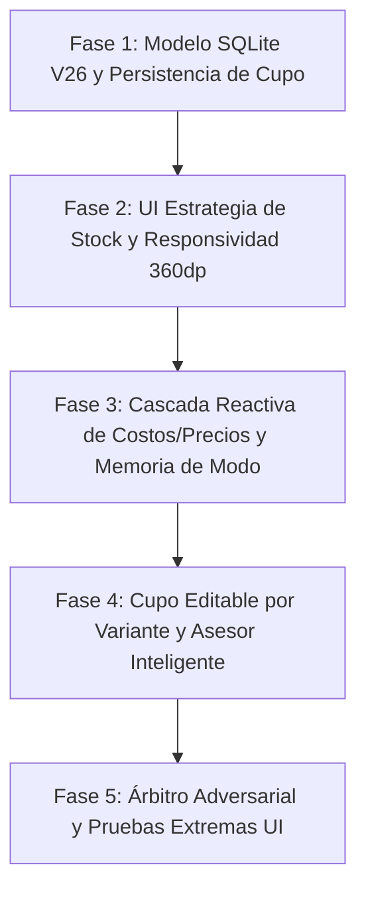

# PLAN MAESTRO: ESTRATEGIA DE STOCK, COSTOS REACTIVOS, MEMORIA DE MODO, ASESOR INTELIGENTE Y CUPOS POR VARIANTE (PARTE 1)

**Documento:** `analisis_proyecto/PLAN_PARTE1_ESTRATEGIA_STOCK_COSTOS_REACTIVOS_Y_ASESOR_VARIANTES.md`  
**Fecha:** 28 de Octubre de 2026  
**Versión:** 1.0 — Especificación Técnica Definitiva (Mobile Awards Quality)  
**Estado:** Esperando Aprobación de Plan de Trabajo (Paso 1: Diagnóstico Forense y Diseño Arquitectónico)  
**Metodología:** Loop Autónomo + Árbitro Adversarial (Test-Driven, Zero-Regressions & Zero-Overflows)

---

## 1. RESUMEN EJECUTIVO Y OBJETIVOS ESTRATÉGICOS

### 1.1. Contexto Global
A partir de las pruebas exhaustivas en dispositivos reales y del análisis detallado de las **4 capturas de pantalla** aportadas por el usuario, se ha diagnosticado la arquitectura de gestión de inventario físico (**Compartido, Independiente y Mixto**).

Aunque la base estructural del modelo existe, se detectaron fallos críticos de UX/UI en pantallas estándar (`360dp`), desincronizaciones reactivas donde el costo base unitario no se propaga a las variantes compartidas, saturación de alertas innecesarias sobre unidades sueltas dentro de tarjetas de pool común, duplicación de iconos/emojis, falta de un cupo de venta editable por variante compartida y carencia de un asesor matemático que evite que queden unidades base atrapadas e invendibles.

### 1.2. Objetivos de la Primera Etapa (Parte 1)
1. **Refinamiento Visual y Responsividad (360dp):**
   * Rediseñar el selector segmentado de `Estrategia de Stock` (`Compartido`, `Independiente`, `Mixto`) eliminando de raíz los cortes de texto (`"Compart..."`, `"Indepen..."`) mediante una distribución vertical icono-texto optimizada y paddings calibrados.
   * Disponer los chips rápidos (`+10 und`, `+50 und`, `+100 und`, `+500 und`) en una sola fila horizontal deslizable con un `ShaderMask` suave en los extremos.
2. **Diferenciación Estricta entre `Crear Producto` vs. `Editar Producto`:**
   * En `Crear Producto`: Mostrar únicamente `Stock Base Inicial *` y `Costo Base Unitario` en la estrategia global; en variantes con `Stock Propio`, ocultar las cajas `+ Ingreso` y `= Final`, dejando solo `Stock Inicial`.
   * En `Editar Producto`: En la estrategia global, desplegar el flujo de reposición `Stock Base Actual` + `+ Ingreso (Nuevas Unidades)` + `= Stock Base Final` (donde los chips rápidos alimentan el ingreso de nuevas unidades base); en variantes con `Stock Propio`, mantener `Stock Actual` + `+ Ingreso` = `Stock Final`.
3. **Resumen Vivo del Pool y Asesor Inteligente de Unidades Sobrantes:**
   * En `Estrategia de Stock`, mostrar un resumen vivo del stock final disponible por cada variante compartida (`Principal (Par x2): 25 disp. • Caja (½ Docena x6): 8 disp.`).
   * Limpiar las tarjetas individuales de variantes compartidas para que no muestren alertas alarmistas de "unidades sobrantes" (ya que pertenecen al pool común).
   * Incorporar un **Asesor Matemático Inteligente** que detecte si ninguna variante vende por `Unidad (Factor = 1)` y pueden quedar unidades huérfanas al vender, ofreciendo un banner con el botón directo `✨ Crear variante por Unidad automáticamente`, minimizable a un icono `💡 Sugerencia de variante unitaria` en la cabecera.
4. **Cálculo Reactivo en Cascada de Costos/Precios y Memoria de Modo:**
   * Resolver el bug por el cual `Costo Base Unitario` no calculaba el `Costo (S/)` ni el `Precio Venta (S/)` en variantes compartidas.
   * Implementar la cascada matemática bidireccional inmediata: $\text{Costo Variante} = \text{Costo Base Unitario} \times \text{Factor}$, recalculando automáticamente margen, precio con redondeo (.50, .90, .00) y módulo de descuentos.
   * Implementar **Memoria de Modo**: Restaurar valores personalizados anteriores al alternar entre `Compartido` y `Stock Propio`.
   * Eliminar los emojis duplicados (`🔗`, `📦`) en los conmutadores y badges de las tarjetas de variantes.
5. **Cupo / Tope Máximo Editable por Variante Compartida:**
   * Permitir que el usuario edite el `Stock Final` de una variante compartida para asignarle un cupo de venta menor al físico sin reducir las unidades del pool central.
   * Blindar la regla: El cupo no puede superar $\lfloor \text{Unidades Base} \div \text{Factor} \rfloor$, resultando en $\text{Stock Final Efectivo} = \min(\text{Cupo}, \lfloor \text{Unidades Base Restantes} \div \text{Factor} \rfloor)$.
   * Crear la columna `cupo_maximo_variante INTEGER DEFAULT NULL` en SQLite (`presentaciones_producto`) para dejar la base lista para la Parte 2 (Caja Rápida y modales operativos).

---

## 2. DIAGNÓSTICO FORENSE Y EVIDENCIA VISUAL EN CÓDIGO (ARCHIVOS Y LÍNEAS EXACTAS)

### 2.1. Desbordamiento de Texto en Pestañas de Estrategia de Stock
* **Archivo:** `app_movil/lib/features/catalog/widgets/form/product_stock_strategy_selector.dart`
* **Líneas exactas:** 308–335
* **Código actual defectuoso:**
  ```dart
  child: Row(
    mainAxisAlignment: MainAxisAlignment.center,
    children: [
      Icon(icon, size: 15, ...),
      const SizedBox(width: 4),
      Flexible(
        child: Text(
          title,
          maxLines: 1,
          overflow: TextOverflow.ellipsis, // ❌ En 360dp el ancho disponible por pestaña es de aprox 105px.
          // El Row horizontal con icono de 15px + separación de 4px + padding hace que
          // "Compartido" e "Independiente" se trunquen a "Compart..." e "Indepen...".
  ```
* **Causa Raíz:** Distribución en fila horizontal con ancho insuficiente para palabras largas de 11 a 13 caracteres junto a un icono.

### 2.2. Falta de Reactividad en Cascada del Costo Base a Variantes Compartidas
* **Archivos:**
  * `app_movil/lib/features/catalog/screens/product_create_screen.dart` (Líneas 59, 407–418)
  * `app_movil/lib/features/catalog/screens/product_edit_screen.dart` (Líneas 76, 811–817)
  * `app_movil/lib/core/widgets/presentation_card/presentation_math_engine.dart` (Líneas 85–155, 315–400)
* **Causa Raíz:**
  1. `_baseCostCtrl` solo tiene un listener pasivo `_syncDraft` o `_onFormChangedWithDebounce`. No existe un despachador que notifique a los `controllerMap` de las variantes compartidas cuando el usuario escribe o cambia el `Costo Base Unitario`.
  2. Al inicializarse o al cambiar el factor de una variante compartida (`onUnidadVentaChanged`), el motor toma `costoBaseParaSobrante = 0.0` o solo busca datos de compras pasadas, dejando `costoPres = 0.00` y `precioVenta = 0.00`.

### 2.3. Cajas Inadecuadas en Crear Producto vs. Editar Producto
* **Archivo:** `app_movil/lib/core/widgets/presentation_card/presentation_stock_section.dart`
* **Líneas exactas:** 298–338
* **Código actual:**
  ```dart
  Row(
    children: [
      Expanded(flex: 4, child: MiniInput(ctrl: widget.stockInicialCtrl, label: widget.isEditMode ? "Stock Sistema" : "Inicial (Sueltas)", ...)),
      const SizedBox(width: 8),
      Expanded(flex: 3, child: MiniInput(ctrl: widget.nuevoIngresoCtrl, label: "+ Ingreso", ...)),
      const SizedBox(width: 8),
      Expanded(flex: 4, child: MiniInput(ctrl: widget.stockFinalCtrl, label: "= Final ($unidadLabel)", ...)),
    ],
  )
  ```
* **Causa Raíz:** En `Crear Producto`, un producto nuevo en `Stock Propio` no tiene sentido que muestre `+ Ingreso` ni `= Final`. Solo debe mostrar el campo directo de `Stock Inicial`. Por el contrario, en `Editar Producto`, la sección `Estrategia de Stock` compartida no ofrece un campo `+ Ingreso` para el pool central.

### 2.4. Duplicación de Emojis e Iconos Vectoriales
* **Archivo:** `app_movil/lib/core/widgets/presentation_card/presentation_stock_section.dart`
* **Líneas exactas:** 125, 164, 210
* **Código actual:**
  * Línea 117: `Icon(Icons.hub_rounded)` + Línea 125: `Text("🔗 Compartido")`
  * Línea 156: `Icon(Icons.inventory_2_outlined)` + Línea 164: `Text("📦 Stock Propio")`
  * Línea 205: `Icon(Icons.hub_rounded)` + Línea 210: `Text("🔗 Stock del Pool Central")`
* **Causa Raíz:** Redundancia visual discordante de emojis de color al lado de iconos vectoriales temáticos.

### 2.5. Omisión de `usaStockCompartido` y `cupoMaximoVariante` en Edición y Modelo
* **Archivos:**
  * `app_movil/lib/features/catalog/widgets/edit/product_edit/product_edit_operations.dart` (Líneas 89–153)
  * `app_movil/lib/core/database/local_db.dart` (Líneas 145–158, 327)
  * `app_movil/lib/features/catalog/models/product_model.dart` (Líneas 1–64, 174–206)
* **Causa Raíz:**
  1. En `loadInitialData` de `ProductEditOperations`, al mapear las variantes existentes a los controladores, se omitió el parámetro `usaStockCompartido: pres.usaStockCompartido`, ocasionando que variantes compartidas previamente se cargaran en falso o desvinculadas.
  2. No existe la columna `cupo_maximo_variante` en `presentaciones_producto` para registrar el cupo asignado a una variante de stock compartido.

---

## 3. ARQUITECTURA TÉCNICA Y ESPECIFICACIÓN DETALLADA (LOS 5 BLOQUES)

### BLOQUE 1: Refinamiento Visual de "Estrategia de Stock" y Campos Exclusivos (Crear vs. Editar)

#### 1.1. Selector Segmentado Responsive Anti-Cortes
* En `ProductStockStrategySelector`:
  * Rediseñar cada segmento (`_buildSegmentOption`) utilizando una disposición en columna vertical compacta:
    ```dart
    Column(
      mainAxisSize: MainAxisSize.min,
      mainAxisAlignment: MainAxisAlignment.center,
      children: [
        Icon(icon, size: 16, color: iconColor),
        const SizedBox(height: 3),
        Text(
          title,
          maxLines: 1,
          style: TextStyle(
            fontSize: 11,
            fontWeight: isSelected ? FontWeight.bold : FontWeight.w500,
            letterSpacing: -0.2,
          ),
        ),
      ],
    )
    ```
  * En pantallas de `360dp`, el ancho de cada opción (~106px) permite albergar `Compartido`, `Independiente` y `Mixto` con holgura sin cortes de elipsis (`"Compart..."`).
  * En los chips de adición rápida (`+10 und`, `+50 und`, `+100 und`, `+500 und`):
    * Envolver el `SingleChildScrollView` horizontal en un `ShaderMask` con un gradiente horizontal sutil (`Colors.transparent` a `Colors.black` en los primeros 12px y últimos 12px) para lograr un desvanecimiento elegante sin cortes secos.

#### 1.2. Formularios Diferenciados: Crear Producto vs. Editar Producto
* **En `Crear Producto` (`isEditMode == false`):**
  * `Estrategia de Stock` (`COMPARTIDO` y `MIXTO`): Muestra únicamente:
    * `Stock Base Inicial *` (`sharedStockCtrl`)
    * `Costo Base Unitario` (`baseCostCtrl`)
    * Chips rápidos `+10`, `+50`, `+100`, `+500` que suman al `Stock Base Inicial`.
  * Tarjetas de Variantes con `Stock Propio`: Ocultar los inputs `+ Ingreso` y `= Final`. Mostrar únicamente `Stock Inicial (Sueltas)` con su calculadora de empaque de unidades base.
* **En `Editar Producto` (`isEditMode == true`):**
  * `Estrategia de Stock` (`COMPARTIDO` y `MIXTO`): Desplegar el flujo formal de abastecimiento del pool:
    * `Stock Base Actual` (solo lectura, extraído del stock compartido original).
    * `+ Ingreso (Nuevas Unidades)` (campo editable para registrar nuevas compras).
    * `= Stock Base Final` (calculado automáticamente: $\text{Stock Base Actual} + \text{Ingreso}$).
    * Los chips rápidos en `Editar Producto` suman directamente al campo `+ Ingreso`.
  * Tarjetas de Variantes con `Stock Propio`: Mantener el flujo completo `Stock Actual` + `+ Ingreso` = `Stock Final`.

---

### BLOQUE 2: Resumen Vivo en "Estrategia de Stock" y Asesor Inteligente de Unidades Sobrantes

#### 2.1. Resumen Vivo del Stock por Variante Compartida
* Dentro del panel azul de `Estrategia de Stock` (cuando la estrategia es `COMPARTIDO` o `MIXTO`):
  * Agregar un contenedor compacto con fondo translúcido que liste en vivo el stock vendible calculado para cada variante compartida:
    $$\text{Stock Vendible} = \min\left(\text{Cupo Asignado}, \lfloor \text{Stock Base Total} \div \text{Factor Variante} \rfloor\right)$$
  * Formato visual:
    ```
    📦 Stock Calculado por Variante:
    • Principal (Par x2): 25 disp.
    • Caja (½ Docena x6): 8 disp.
    ```
* **Limpieza en las tarjetas individuales de variantes compartidas:**
  * Sustituir el texto alarmista:
    `"Factor x6 · Toma de las 50 unidades base del pool (8 ½ Docena + 2 u. sueltas restantes)"`
  * Por el texto limpio y profesional:
    `"Factor x6 · Toma de las 50 unidades base del pool central."`
  * Las unidades no múltiplos pertenecen al pool general y no constituyen un error de la variante.

#### 2.2. Asesor Matemático Inteligente de Unidades Sobrantes
* **Regla Matemática:**
  1. El sistema inspecciona todas las variantes activas configuradas en modo compartido.
  2. Evalúa si **al menos una variante tiene `Factor = 1` (`Unidad`)** o si las variantes cubren la totalidad del stock base sin dejar residuos imposibles de vender.
  3. Si **ninguna variante compartida vende por `Unidad (Factor = 1)`**, existe el riesgo inminente de que queden unidades base atrapadas e invendibles cuando el pool baje por debajo del factor mínimo (por ejemplo, tener 1 unidad suelta cuando solo se vende por Par x2 o Docena x12).
* **Banner Inteligente de Recomendación:**
  * Si se cumple la condición anterior, se despliega en `Estrategia de Stock` una tarjeta elegante con borde violeta/ámbar:
    * Título: `"💡 Asesor de Stock: Evita unidades base sobrantes"`
    * Mensaje: `"Actualmente ninguna variante compartida vende por Unidad (Factor 1). Al vender por paquetes o pares, podrían quedar unidades base que no podrás liquidar sueltas."`
    * Botón de acción: `[ ✨ Crear variante por Unidad automáticamente ]`
    * Botón de minimizar `[ ✕ ]`: Oculta el banner y activa un botón compacto `💡 Sugerencia unitaria` en la cabecera de la sección para reabrirlo cuando el usuario lo desee.
* **Acción del Botón `Crear variante por Unidad automáticamente`:**
  * Inserta automáticamente una nueva presentación en la lista con:
    * `nombreEspecifico`: `"Unidad"` (o nombre adecuado).
    * `unidadVenta`: `"Unidad"`.
    * `unidadesVenta` (Factor): `1`.
    * `usaStockCompartido`: `true`.
    * `costoPres`: Igual al `Costo Base Unitario`.
    * `margen`: Margen predeterminado del formulario (`1.35`).
    * `precioVenta`: $\text{Costo Base Unitario} \times \text{Margen}$ con redondeo.
    * `descuentoActivo`: `false`.
  * La recomendación **no es obligatoria ni bloquea el guardado**, garantizando libertad total al comerciante.

---

### BLOQUE 3: Relleno Automático Reactivo de Costos, Precios y Descuentos + Memoria de Modo

#### 3.1. Cascada Reactiva del Costo Base Unitario
* **Flujo Reactivo Bidireccional:**
  1. En `ProductCreateScreen` y `ProductEditScreen`, agregar un despachador `_onBaseCostChanged()` al listener de `_baseCostCtrl`.
  2. Cuando el usuario modifica el `Costo Base Unitario` (ej. `S/ 2.00`):
     * Itera sobre todas las variantes que estén en modo `Compartido` (`usaStockCompartido == true`).
     * Calcula:
       $$\text{costoPres} = \text{Costo Base Unitario} \times \text{Factor Variante}$$
     * Actualiza el `TextEditingController` de `costoPres` de esa variante.
     * Invoca inmediatamente el recálculo de precio de venta en el motor:
       $$\text{precioVenta} = \text{costoPres} \times \text{margen}$$
     * Aplica el redondeo activo (.50, .90, .00) si existía previamente.
     * Sincroniza el `Módulo de Descuentos`: si hay descuento porcentual, recalcula el `precioOferta`; si hay descuento fijo, valida que el precio de oferta no supere el nuevo precio de venta.
  3. Cuando el usuario cambia la `Unidad de Venta` o `Factor` en una variante compartida (`SmartUnitSelector`):
     * Multiplica de inmediato el `Costo Base Unitario` por el nuevo factor y actualiza en cascada costo, precio y descuento.

#### 3.2. Memoria Inteligente al Cambiar de Modo (`Compartido` $\leftrightarrow$ `Stock Propio`)
* **En `controllerMap` de cada variante:**
  * Crear la estructura interna `'savedPropioSnapshot'`:
    ```dart
    {
      'costoPres': String,
      'margen': String,
      'precioVenta': String,
      'descuentoActivo': bool,
      'tipoDescuento': String,
      'valorDescuento': String,
      'stockInicial': String,
      'nuevoIngreso': String,
      'stockFinal': String,
    }
    ```
  * **Al conmutar a `Compartido`:**
    * Guarda en `savedPropioSnapshot` los valores personalizados que tenía la variante.
    * Aplica el costo derivado del pool ($\text{Costo Base} \times \text{Factor}$) y calcula el stock disponible según el pool base.
  * **Al regresar a `Stock Propio`:**
    * Restaura los valores de `savedPropioSnapshot` (o el snapshot inicial en `ProductEditScreen`), recuperando exactamente el costo propio, margen, precio y stock digitados antes por el usuario.
* **Eliminación de Emojis Duplicados:**
  * En `presentation_stock_section.dart`, reemplazar `Text("🔗 Compartido")` por `Text("Compartido")`, `Text("📦 Stock Propio")` por `Text("Stock Propio")` y `Text("🔗 Stock del Pool Central")` por `Text("Stock del Pool Central")`, manteniendo la iconografía vectorial limpia.

---

### BLOQUE 4: Edición del Stock Final Calculado (Cupo / Tope por Variante Compartida)

#### 4.1. Lógica del Cupo de Venta Asignado
* En las tarjetas de variantes que están en modo `Compartido`, el indicador de stock final (`= 25 Par disp.`) pasa de ser una etiqueta pasiva a un **Campo Interactivo de Cupo Asignado**:
  * Por defecto, muestra el máximo vendible físico:
    $$\text{Máximo Físico} = \lfloor \text{Unidades Base Pool} \div \text{Factor} \rfloor$$
  * Si el comerciante desea reservar unidades para otras presentaciones, puede tocar y ajustar el cupo a un valor inferior (ej. establecer `6 ½ Docenas` en lugar de `8`).
  * **Regla de Oro Inquebrantable:**
    1. Ajustar el cupo de una variante **NO reduce las unidades base del pool central** (las 50 unidades base siguen intactas en el inventario global).
    2. El sistema **JAMÁS permite fijar un cupo mayor al máximo físico**:
       $$\text{Cupo Válido} \le \lfloor \text{Unidades Base Pool} \div \text{Factor} \rfloor$$
       Si el usuario intenta tipear un número mayor, el sistema lo ajusta automáticamente al máximo físico y muestra un tooltip explicativo.
    3. Fórmula de stock final efectivo:
       $$\text{Stock Final Efectivo} = \min\left(\text{Cupo Asignado}, \lfloor \text{Unidades Base Pool} \div \text{Factor} \rfloor\right)$$
       Si en el futuro las unidades base del pool disminuyen por ventas de otras variantes y ya no alcanzan para cubrir el cupo, el stock disponible baja automáticamente de acuerdo a la disponibilidad física real.

#### 4.2. Persistencia en Base de Datos (SQLite) y Modelos
* **Migración V26 en `LocalDatabase` (`local_db.dart`):**
  ```sql
  ALTER TABLE presentaciones_producto ADD COLUMN cupo_maximo_variante INTEGER DEFAULT NULL;
  ```
* **Modelo `ProductPresentation` (`product_model.dart`):**
  * Campo: `final int? cupoMaximoVariante;`
  * Propiedad getter `unidadesVendiblesDisponibles`:
    ```dart
    int get unidadesVendiblesDisponibles {
      final int factor = unidadesPorVenta > 0 ? unidadesPorVenta : 1;
      final int maxDisponibles = stockActual ~/ factor;
      if (usaStockCompartido && cupoMaximoVariante != null && cupoMaximoVariante! > 0) {
        return cupoMaximoVariante! < maxDisponibles ? cupoMaximoVariante! : maxDisponibles;
      }
      return maxDisponibles;
    }
    ```
  * Actualización de constructores, `copyWith`, `fromJson`, `toSqlite` y `toJson`.
* **Mapeo en `ProductFormMapper` y Operaciones:**
  * Persistir `cupo_maximo_variante` en `toSqlite` y cargarlo correctamente en `ProductEditOperations.loadInitialData`.

---

## 4. PLAN DE TRABAJO DETALLADO POR FASES (LOOP AUTÓNOMO + ÁRBITRO ADVERSARIAL)



### FASE 1: Ampliación del Modelo de Datos SQLite (V26) y Persistencia del Cupo
* **Archivos involucrados:**
  * `app_movil/lib/core/database/local_db.dart`
  * `app_movil/lib/features/catalog/models/product_model.dart`
  * `app_movil/lib/features/catalog/widgets/form/product_form_mapper.dart`
  * `app_movil/lib/features/catalog/widgets/form/product_controller_factory.dart`
  * `app_movil/lib/features/catalog/widgets/edit/product_edit/product_edit_operations.dart`
* **Acciones:**
  1. Incrementar versión de base de datos a `26` en `LocalDatabase`.
  2. Implementar migración `oldVersion < 26`: añadir `cupo_maximo_variante INTEGER DEFAULT NULL` a `presentaciones_producto`.
  3. Actualizar `_createDB` con la nueva columna en la sentencia inicial.
  4. Agregar `cupoMaximoVariante` a `ProductPresentation`, integrándolo en `toSqlite()`, `fromJson()`, `toJson()` y `copyWith()`.
  5. Actualizar el getter `unidadesVendiblesDisponibles` considerando `cupoMaximoVariante`.
  6. Corregir el bug de `loadInitialData` en `ProductEditOperations` asegurando que `usaStockCompartido` y `cupoMaximoVariante` se trasladen a los mapas de controladores.
* **Árbitro Adversarial (Criterios de Aceptación):**
  * Test unitario SQLite valida que la migración V25 -> V26 ejecuta sin errores y crea la columna `cupo_maximo_variante`.
  * La inserción y lectura de variantes compartidas con y sin cupo devuelve los valores exactos.

---

### FASE 2: Refinamiento Visual de "Estrategia de Stock" y Adaptabilidad 360dp
* **Archivos involucrados:**
  * `app_movil/lib/features/catalog/widgets/form/product_stock_strategy_selector.dart`
  * `app_movil/lib/core/widgets/presentation_card/presentation_stock_section.dart`
* **Acciones:**
  1. Rediseñar `_buildSegmentOption` en `ProductStockStrategySelector` apilando icono y texto verticalmente (`Column(mainAxisSize: MainAxisSize.min)`), reduciendo paddings y ajustando la escala tipográfica a 11dp sin elipsis.
  2. Agregar `ShaderMask` horizontal suave en los bordes izquierdo y derecho del contenedor deslizable de chips rápidos (`+10`, `+50`, `+100`, `+500`).
  3. Parametrizar `ProductStockStrategySelector` con `isEditMode`:
     * Si `isEditMode == false` (`Crear Producto`): Mostrar `Stock Base Inicial *` y `Costo Base Unitario`.
     * Si `isEditMode == true` (`Editar Producto`): Mostrar `Stock Base Actual` + `+ Ingreso (Nuevas Unidades)` + `= Stock Base Final`, donde los chips rápidos suman al ingreso.
  4. En `PresentationStockSection`:
     * Si `!isShared && !isEditMode` (`Crear Producto` en `Stock Propio`): Ocultar los inputs `+ Ingreso` y `= Final`, mostrando únicamente `Stock Inicial`.
     * Si `!isShared && isEditMode` (`Editar Producto` en `Stock Propio`): Mostrar `Stock Actual` + `+ Ingreso` = `Stock Final`.
  5. Eliminar emojis duplicados (`🔗`, `📦`) en conmutadores y badges.
* **Árbitro Adversarial (Criterios de Aceptación):**
  * Widget test en viewport de 360x640 valida que no existen desbordamientos de renderizado (`RenderFlex overflowed`) ni cortes de texto en `Compartido`, `Independiente` y `Mixto`.
  * Verifica que en `Crear Producto` no se rendericen los campos `+ Ingreso` ni `= Final` en variantes de `Stock Propio`.

---

### FASE 3: Motor Reactivo en Cascada de Costos/Precios y Memoria de Modo
* **Archivos involucrados:**
  * `app_movil/lib/features/catalog/screens/product_create_screen.dart`
  * `app_movil/lib/features/catalog/screens/product_edit_screen.dart`
  * `app_movil/lib/core/widgets/presentation_card/presentation_math_engine.dart`
  * `app_movil/lib/core/widgets/product_presentation_card.dart`
* **Acciones:**
  1. Conectar `_baseCostCtrl` con un despachador reactivo que notifique en cascada a todas las variantes con `usaStockCompartido == true`.
  2. En cada variante compartida:
     $$\text{costoPres} = \text{baseCost} \times \text{factor}$$
     Recalcular `precioVenta = costoPres * margen`, aplicar redondeo activo y recalcular descuentos en vivo.
  3. En `PresentationMathEngine`: Actualizar `onUnidadVentaChanged` para que al conmutar de unidad o factor en modo compartido, derive inmediatamente el nuevo costo desde el costo base unitario y actualice precios y descuentos.
  4. Implementar `savedPropioSnapshot`:
     * Al conmutar de `Stock Propio` a `Compartido`, almacenar los valores digitados por el usuario.
     * Al conmutar de vuelta a `Stock Propio`, restaurar los valores previos para no perder la información ingresada.
* **Árbitro Adversarial (Criterios de Aceptación):**
  * Test reactivo: Al escribir `2.00` en `Costo Base Unitario`, una variante con factor 2 pasa automáticamente a costo `4.00` y precio `5.40` (con margen 1.35), y una variante con factor 6 pasa a costo `12.00` y precio `16.20`.
  * Test de memoria: Alternar de `Stock Propio` a `Compartido` y de vuelta a `Stock Propio` preserva los costos y márgenes originales sin sobreescritura destructiva.

---

### FASE 4: Cupo Editable por Variante y Asesor Inteligente de Unidades Sobrantes
* **Archivos involucrados:**
  * `app_movil/lib/features/catalog/widgets/form/product_stock_strategy_selector.dart`
  * `app_movil/lib/core/widgets/presentation_card/presentation_stock_section.dart`
  * `app_movil/lib/features/catalog/widgets/form/product_create_operations.dart`
  * `app_movil/lib/features/catalog/widgets/edit/product_edit/product_edit_operations.dart`
* **Acciones:**
  1. **Resumen Vivo en `Estrategia de Stock`:**
     * Integrar el widget que resume el stock final vendible de todas las variantes compartidas activas en tiempo real.
  2. **Limpieza en Variantes:**
     * Eliminar el texto confuso de unidades sobrantes en la tarjeta de variante compartida.
  3. **Asesor Inteligente y Banner de Recomendación:**
     * Implementar evaluador matemático que verifique si existe al menos una variante con `factor == 1`.
     * Si no existe, renderizar el banner explicativo con botón `✨ Crear variante por Unidad automáticamente` y botón de minimizar `✕`.
     * Agregar icono `💡 Sugerencia unitaria` en la cabecera cuando el banner esté minimizado.
     * Conectar la acción para autogenerar e insertar la variante por unidad lista para guardar.
  4. **Cupo / Tope Máximo Editable por Variante:**
     * Transformar el badge de stock disponible en un campo editable con tope clamped:
       $$\text{Cupo Máximo} = \lfloor \text{Stock Base Pool} \div \text{Factor} \rfloor$$
     * Si el usuario escribe un valor menor, se asigna como cupo. Si escribe un valor mayor, se ajusta al tope físico.
     * Modificar el cupo no altera el stock base general del pool.
* **Árbitro Adversarial (Criterios de Aceptación):**
  * Test del Asesor: Con pool de 50 und y variantes Par (x2) y ½ Docena (x6), el asesor recomienda crear variante por Unidad. Al tocar el botón, se añade la variante de factor 1 y el banner se oculta.
  * Test de Cupo: Con 50 und y factor 6 (máx 8), intentar asignar cupo 10 se ajusta a 8; asignar cupo 5 establece stock vendible en 5 sin disminuir las 50 unidades base del pool central.

---

### FASE 5: Suite Integral de Pruebas y Validación Anti-Regresiones
* **Archivo de prueba:** `app_movil/test/stock_compartido_parte1_reactividad_asesor_y_cupos_test.dart`
* **Casos de prueba a ejecutar:**
  1. `ProductStockStrategySelector`: Rediseño visual sin elipsis ni overflow en pantalla de 360dp.
  2. Campos condicionales: `Crear Producto` oculta `+ Ingreso` y `= Final` en stock propio; `Editar Producto` muestra flujo de reposición en pool central.
  3. Reactividad 360°: Modificación de `Costo Base Unitario` propaga instantáneamente costo, precio de venta, margen y oferta a variantes compartidas.
  4. Memoria de Modo: Retención y restauración de datos al alternar entre `Compartido` y `Stock Propio`.
  5. Asesor Inteligente: Detección matemática de unidades atrapadas, colapsabilidad en icono y autogeneración de variante unitaria.
  6. Cupo Máximo: Clamping contra máximo físico, independencia del pool central y persistencia en SQLite V26.

---

## 5. MATRIZ DE RIESGOS Y BLINDAJE TÉCNICO

| Riesgo Técnico Identificado | Impacto | Estrategia de Mitigación / Blindaje |
| :--- | :---: | :--- |
| **Bucle infinito de listeners al propagar costo base a variantes** | Alto | Flag de guard `_isPropagatingBaseCost` en el despachador para evitar que la actualización de las variantes vuelva a disparar listeners hacia el padre. |
| **Pérdida de datos ingresados por el usuario al alternar modos** | Medio | Almacenamiento desacoplado en `savedPropioSnapshot` dentro de cada mapa de controlador, garantizando recuperación al 100%. |
| **Inconsistencia de stock al fijar un cupo menor en variante** | Alto | Regla de Oro: El cupo solo limita la vista y venta de esa presentación específica (`min(cupo, pool ~/ factor)`), mientras el pool central conserva todas las unidades físicas intactas. |
| **Desbordamiento tipográfico en pantallas ultra estrechas (< 340dp)** | Medio | Uso de `FittedBox` con `BoxFit.scaleDown` en los títulos de las pestañas del selector para garantizar adaptabilidad extrema. |
| **Fallo en migración SQLite V25 -> V26 en bases existentes** | Crítico | Manejo defensivo con `PRAGMA table_info` comprobando existencia previa de la columna antes de ejecutar `ALTER TABLE`. |

---

## 6. PRÓXIMO PASO TRAS LA APROBACIÓN
Una vez aprobado este plan, se procederá a la ejecución estricta fase por fase sin desvíos, ejecutando `flutter test` en cada hito y verificando la ausencia total de regresiones en la suite de pruebas existente del catálogo e inventario.
