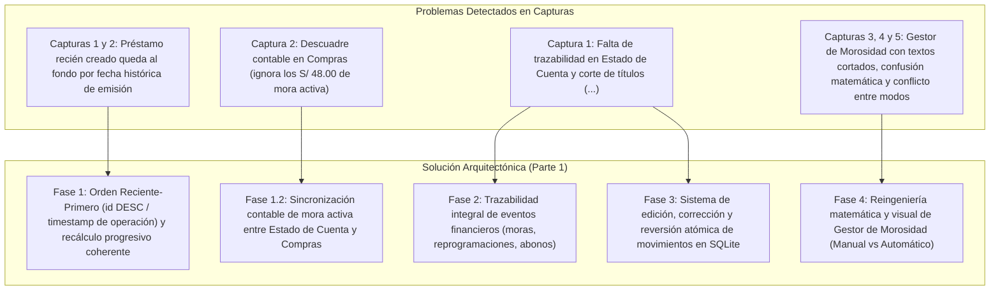
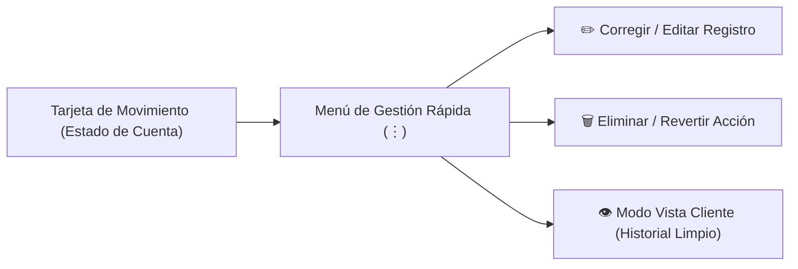

# Plan Maestro de Trabajo (Parte 1): Historial Contable Reciente-Primero, Trazabilidad, Corrección de Errores y Gestor de Morosidad

**Proyecto:** MochilaLista App (Módulo CRM & Smart Quotation - Gestión Financiera del Cliente)  
**Documento:** `analisis_proyecto/PLAN_PARTE1_HISTORIAL_CONTABLE_CORRECCION_ERRORES_Y_GESTOR_MOROSIDAD.md`  
**Estado:** Planificación y Diseño Arquitectónico (Pendiente de Aprobación de Usuario)  
**Versión:** 1.0.0  
**Fecha:** Noviembre 2026  

---

## 1. Diagnóstico Forense y Objetivos del Proyecto

A partir de las pruebas operativas realizadas sobre el flujo de préstamos (`Préstamo #14`) y la inspección de las 5 capturas reales adjuntadas por el usuario, se han identificado 4 áreas críticas de inconsistencia contable, falta de trazabilidad y fricción de usabilidad:

---

## 2. Especificación Técnica por Fases de Implementación

### FASE 1: Ordenamiento Reciente-Primero en Todas las Pestañas y Sincronización Contable Exacta entre `Estado de Cuenta` y `Compras` (Capturas 1 y 2)

#### 1.1 Inversión y Estandarización del Ordenamiento en `Perfil del Cliente`
* **Causa Raíz:** En `client_service.dart` (`getClientLedger`), los movimientos se ordenaban exclusivamente por `fecha_venta` / `fecha_pago` ascendente (`dateA.compareTo(dateB)`) y luego se invertían. Al registrar un préstamo histórico (`02/10/2026`), su fecha de emisión lo enviaba al fondo de la lista, quedando sepultado bajo el `Préstamo #13` (`04/11/2026`). En `client_repository.dart` (`getClientSales`), la consulta utilizaba `ORDER BY v.fecha_venta DESC`, sufriendo el mismo defecto.
* **Diseño Arquitectónico del Orden:**
  1. **Criterio de Ordenamiento Primario:** Recencia operativa real (`timestamp de creación` o `id DESC`), permitiendo que el préstamo, compra o abono recién registrado aparezca de inmediato en la **CIMA** de la lista para comodidad del comerciante.
  2. **Estandarización en las 3 Pestañas:**
     * **`Estado de Cuenta` (`LedgerTimelineTab`):** Se ordenan los movimientos de más reciente a más antiguo según el momento en que se registraron.
     * **`Compras` (`ClientSalesHistoryTab`):** La consulta en `ClientRepository.getClientSales` y `ClientService` ordenará por `v.id DESC` (con fallback a `v.fecha_venta DESC`), garantizando que la última operación registrada lidere la lista.
     * **`Listas / Cotiz.` (`ClientQuotationsTab`):** Se mantiene y asegura `ORDER BY sq.id DESC` / `created_at DESC`.
  3. **Cálculo Progresivo de `Saldo Deuda` Coherente:**
     * Para que el ítem superior muestre con exactitud el **Saldo Deuda Actual** (`S/ 3,173.00` en la cima):
       * Se calcula la matemática acumulativa desde la base histórica más antigua hacia la cima (de abajo hacia arriba), sumando cargos y restando abonos.
       * Cada tarjeta refleja fielmente el saldo resultante en ese punto del tiempo, culminando en la tarjeta superior con el saldo total vigente a la fecha.

#### 1.2 Sincronización Contable de Morosidad entre `Estado de Cuenta` y `Compras` (Captura 2)
* **Causa Raíz:** En `client_detail_screen.dart` (`_refreshData`), `prov.getClientById` se llamaba antes de `prov.loadClientLedger`. Además, `SaleSummary` en `crm_models.dart` no almacenaba `mora_total` ni calculaba la deuda incluyendo la morosidad activa de las cuotas, ocasionando que la tarjeta en `Compras` mostrara `Debe S/ 1,920.00` y `Total: S/ 2,400.00` a pesar de que el cliente tenía `S/ 48.00` de mora devengada (`Total real: S/ 2,448.00`, `Debe real: S/ 1,968.00`).
* **Solución Técnica:**
  1. **Ampliación de `SaleSummary`:**
     * Agregar campos `moraTotal` y `montoOriginalTotal` al modelo `SaleSummary`.
     * `trueTotal` devolverá el total consolidado (`monto_total` que ya contiene la mora actualizada).
  2. **Actualización de la Consulta SQL en `ClientRepository.getClientSales`:**
     * Incluir `v.mora_total` y evaluar si existen recargos por cuota para sincronizar el estado contable antes de renderizar.
  3. **Interfaz en `ClientSalesHistoryTab`:**
     * Si `sale.moraTotal > 0.01`:
       * El badge de deuda mostrará el monto exacto: `Debe ${AppCurrency.format(deudaVenta)}` (ej. `Debe S/ 1,968.00`).
       * Se añadirá un chip explícito de morosidad: `+ Mora: ${AppCurrency.format(sale.moraTotal)}` con estilo ámbar/naranja.
       * El total indicará: `Total: ${AppCurrency.format(sale.trueTotal)}`.

---

### FASE 2: Trazabilidad Detallada de Todas las Acciones Financieras en `Estado de Cuenta` (Captura 1)

#### 2.1 Desglose Completo en Tarjetas de Préstamo y Compra
* **Problema:** En `Estado de Cuenta`, `Préstamo #14` mutaba silenciosamente su valor inicial a `- S/ 2,448.00` el `02 Oct 2026`, borrando la distinción entre capital prestado (`S/ 2,000.00`), interés pactado (`S/ 400.00`) y mora acumulada (`S/ 48.00`).
* **Solución Técnica:**
  * Enriquecer `LedgerItem` con metadatos descriptivos:
    * `montoBase`: Monto inicial de emisión (`S/ 2,400.00`).
    * `moraAcumulada`: Monto de mora activa asociada (`S/ 48.00`).
    * `cuotasCount`: Cantidad de cuotas del cronograma.
  * En la tarjeta de `Estado de Cuenta`, si el préstamo o compra tiene mora activa, mostrar un desglose visual ordenado:
    * `Monto Base: S/ 2,400.00` • `+ Mora: S/ 48.00` ➔ `Total: S/ 2,448.00`.

#### 2.2 Registro de Eventos Financieros (Audit Log Financiero)
* **Diseño de la Tabla SQLite `eventos_financieros_cliente`:**
  * Crear la tabla si no existe para registrar hitos financieros que no deben quedar ocultos:
    * `id`: INTEGER PRIMARY KEY AUTOINCREMENT
    * `negocio_id`: INTEGER
    * `cliente_id`: INTEGER
    * `venta_id`: INTEGER (nullable)
    * `cuota_id`: INTEGER (nullable)
    * `tipo_evento`: TEXT (`mora_aplicada`, `mora_condonada`, `reprogramacion_fecha`, `ajuste_monto_cuota`, `abono_anulado`, etc.)
    * `titulo`: TEXT
    * `descripcion`: TEXT
    * `monto_impacto`: REAL (ej. `+48.00` en mora, `0.00` en reprogramación)
    * `fecha_evento`: TEXT (ISO 8601 del momento exacto del cambio)
* **Integración en `getClientLedger`:**
  * Permitir que el comerciante visualice los eventos relevantes en el timeline con icono contextual (ej. `Icons.schedule_rounded` para reprogramación de fecha, `Icons.trending_up_rounded` para recargo de mora, `Icons.verified_rounded` para condonación).

#### 2.3 Rediseño de Títulos sin Cortes en `360dp`
* **Problema:** Textos cortados con elipsis agresiva: `"Abono histórico (Cuota #1 Préstamo #14) (..."`.
* **Solución:**
  * Separar la información en dos componentes semánticos:
    1. **Título Principal:** `"Abono • Cuota #1 (Préstamo #14)"` (limpio y directo).
    2. **Badges de Metadatos:** Un `Wrap` con chips compactos:
       * Chip de Método: `Efectivo`, `Yape`, `Plin`, `Transferencia` con su respectivo icono vectorial.
       * Chip de Tipo: `Histórico` o `En línea`.
  * Ajustar el espaciado para que nunca se trunque el texto en anchos de `360dp`.

---

### FASE 3: Sistema de Corrección, Edición y Eliminación/Reversión de Errores en el Historial (`Estado de Cuenta` Impecable)

#### 3.1 Menú de Gestión Rápida por Registro en `Estado de Cuenta`
* Cada tarjeta de `Estado de Cuenta` dispondrá de un botón discreto de opciones (`⋮` o icono de edición rápida) que abrirá el modal **`Gestión de Movimiento`** con 3 acciones fundamentales:

#### 3.2 Lógica de Edición de Registros (`editarMovimiento`)
1. **Edición de Abono (`pagos`):**
   * Permite corregir: monto pagado, método de pago, fecha del abono y nota explicativa.
   * **Actualización en Cascada en SQLite:**
     * Actualiza la fila en `pagos`.
     * Recalcula `cuotas.monto_pagado` y el estado de la cuota (`pagado`, `parcial`, `pendiente` o `vencida`).
     * Recalcula `ventas.monto_pagado` y `ventas.estado_pago`.
     * Ejecuta `recalculateClientDebt(clienteId)` y `recalculateClientSaldoAFavor(clienteId)`.
     * Actualiza la reputación del cliente a 0ms.
2. **Edición de Préstamo o Cargo (`ventas`):**
   * Permite editar la nota/motivo del préstamo o la fecha de emisión.

#### 3.3 Lógica de Eliminación y Reversión Atómica (`revertirMovimiento`)
1. **Reversión de Abono Erróneo:**
   * Diálogo de confirmación claro: *"Se anulará el abono de S/ 480.00. La deuda del cliente aumentará en S/ 480.00 y la Cuota #1 volverá a estar pendiente."*
   * Elimina limpiamente el registro en `pagos` (o lo marca como revertido en SQLite sin dejar residuos visuales confusos).
   * Restaura el saldo y cuotas inmediatamente.
2. **Reversión de Préstamo / Venta Creada por Error:**
   * Si el préstamo fue creado por duplicación o prueba, valida si tiene abonos asociados.
   * Si tiene abonos, solicita confirmación para anular las operaciones vinculadas.
   * Elimina de forma atómica en SQLite: `cuotas`, `pagos`, `venta_items` y `ventas`.
   * Recalcula la deuda total del cliente dejándola en su estado anterior exacto.

#### 3.4 Modo Vista Cliente (Historial Limpio y Confiable)
* Los registros corregidos o eliminados desaparecen por completo de la vista activa de `Estado de Cuenta`.
* El cliente solo ve una línea temporal pulida, exacta, profesional y coherente con sus recibos físicos o transferencias.

---

### FASE 4: Reingeniería Matemática, Visual y de Usabilidad del Modal `Gestor de Morosidad` (Capturas 3, 4 y 5)

#### 4.1 Aislamiento de Variables y Notificador de Modo Automático en `Manual / Directo` (Captura 3)
* **Problema:** Al estar en `Manual / Directo`, no se advertía si el modo `Automático Periódico` seguía encendido. Al guardar, se corrompía la frecuencia a `cada 1 ...`.
* **Solución Técnica:**
  1. **Separación Estricta de Estados en `_CuotaMorosidadModalState`:**
     * `_manualValorCtrl` vs `_autoValorCtrl`.
     * `_autoFrecuencia` y `_autoIntervaloDias` permanecen inmutables al manipular campos en `Manual / Directo`.
  2. **Banner Informativo e Interactivo en `Manual / Directo`:**
     * Cuando `_autoActiva == true`, se muestra una barra superior destacada dentro de la pestaña `Manual / Directo`:
       * Icono: `Icons.info_outline_rounded`.
       * Texto: *"La acumulación periódica (+S/ 24.00 cada 2 días) sigue activa en segundo plano."*
       * Botón de 1 toque: **`[Desactivar]`** (apaga `_autoActiva` al instante sin obligar a cambiar de pestaña).

#### 4.2 Rediseño del Banner Superior de Estado (`MORA PERIÓDICA ACTIVA`)
* **Problema:** Textos truncados (`"+S/ 48.00 cada 2 ..."`), icono duplicado y confusión entre recargo por ciclo y recargo acumulado.
* **Solución:**
  * Uso de un solo icono vectorial limpio (`Icons.update_rounded`).
  * Estructura clara y responsive con `FittedBox` y texto multilínea controlado:
    * **Título:** `MORA PERIÓDICA ACTIVA`
    * **Detalle:** `+S/ 24.00 cada 2 días • Acumulado: +S/ 48.00`
  * Cero desbordes en pantallas de `360dp`.

#### 4.3 Compactación de la Pestaña `Automático Periódico` y Rediseño de `"Simulación en Vivo"` (Capturas 4 y 5)
* **Problema:** Formulario verticalmente excesivo que obligaba a hacer scroll largo para ver la simulación. Cuadro de simulación largo, redundante y con emojis duplicados (`⚡`).
* **Solución:**
  1. **Layout Compacto:**
     * Secciones de `Tipo de Recargo`, `Porcentaje / Monto` y `Frecuencia` con padding optimizado y chips horizontales estilizados.
  2. **Estructura Visual de la "Simulación en Vivo" (3 Filas Claras):**
     * En lugar de un párrafo denso, se diseña una tarjeta minimalista de 3 filas:
       * **Fila 1 (Atraso y Ciclos):** `Icons.event_busy_rounded` ➔ `5 días de atraso • 2 ciclos cumplidos (cada 2 días)`
       * **Fila 2 (Cálculo Hoy):** `Icons.calculate_rounded` ➔ `2 ciclos × S/ 24.00 (5%) = +S/ 48.00 de mora acumulada`
       * **Fila 3 (Próximo Recargo):** `Icons.schedule_rounded` ➔ `Siguiente recargo (+S/ 24.00): en 1 día`
  3. **Cierre Automático del Teclado:**
     * `GestureDetector` con `unfocus()` y `onTapOutside` en los campos `TextField` del modal.
  4. **Cero Emojis Unicode:** Sustituir todos los emojis por iconos vectoriales oficiales de Material Design.

---

## 3. Protocolo de Verificación y Árbitro Adversarial (Fase 5)

Siguiendo la metodología estricta de trabajo en loop y validación contra falsos positivos:

1. **Análisis Estático Completo:**
   * Ejecución mediante `dart-mcp-server` de `analyze_files` sobre `app_movil`.
   * Criterio de éxito: **0 errores, 0 warnings, 0 infos**.
2. **Batería de Pruebas Automatizadas Unitarias y de Widgets:**
   * Crear el archivo de pruebas `test/client_ledger_ordering_and_late_fee_manager_test.dart` cubriendo:
     * **Test 1:** Ordenamiento Reciente-Primero: registrar préstamo con fecha de emisión anterior y comprobar que aparece en la cima de `Estado de Cuenta` y `Compras`.
     * **Test 2:** Coherencia de saldo acumulativo progresivo (el ítem superior debe coincidir con la deuda total viva del cliente).
     * **Test 3:** Cuadre contable exacto entre `Compras` y `Estado de Cuenta` ante mora activa (`+S/ 48.00` reflejado en ambas pestañas).
     * **Test 4:** Menú de corrección: edición de abono y recálculo en cascada de cuota, venta y deuda del cliente.
     * **Test 5:** Reversión limpia de un movimiento erróneo en SQLite sin dejar residuos en la vista del cliente.
     * **Test 6:** Gestor de morosidad: banner interactivo en `Manual / Directo` y persistencia no destructiva de la frecuencia periódica.
     * **Test 7:** Simulación en vivo estructurada sin desbordes en `360dp` y con cero emojis Unicode.
3. **Ejecución de Suites Existentes:**
   * Revalidar que las suites de pruebas previas continúen pasando al 100%.

---

## 4. Matriz de Archivos a Modificar

| Módulo / Archivo | Responsabilidad Principal |
| :--- | :--- |
| `client_service.dart` | Ordenamiento Reciente-Primero, cálculo progresivo de saldos, métodos de edición y reversión atómica de movimientos |
| `client_repository.dart` | Sincronización de consultas SQL (`getClientSales`) con `id DESC` e inclusión de `mora_total` |
| `crm_models.dart` | Campos de morosidad y montos base en `SaleSummary` y metadatos en `LedgerItem` |
| `ledger_timeline_tab.dart` | Rediseño de títulos sin cortes en 360dp, chips de método de pago, menú `⋮` de edición/reversión |
| `client_sales_history_tab.dart` | Badge exacto de deuda con mora activa y chip de morosidad sincronizado |
| `cuota_morosidad_modal.dart` | Aislamiento de variables, banner en `Manual / Directo`, simulación de 3 filas, cierre de teclado y cero emojis |
| `local_db.dart` | Tabla de auditoría/eventos financieros `eventos_financieros_cliente` |
| `test/client_ledger_ordering_and_late_fee_manager_test.dart` | Suite de pruebas automatizadas del árbitro adversarial |

