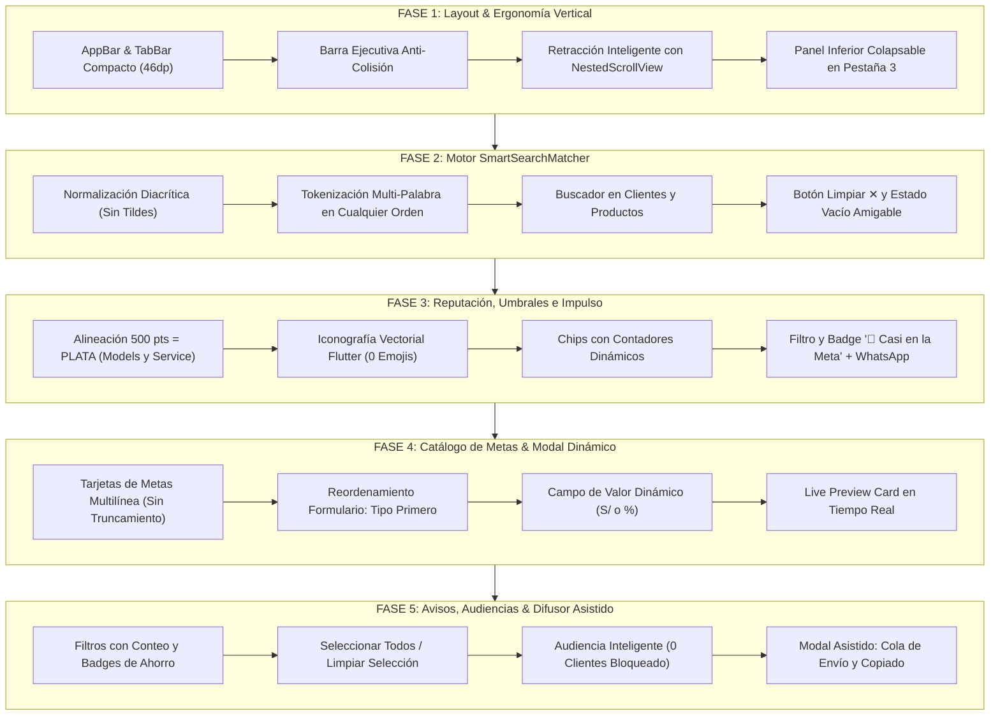

# PLAN MAESTRO PARTE 1: REDISEÑO INTEGRAL DEL CENTRO DE FIDELIZACIÓN, BUSCADORES MULTI-PALABRA Y DIFUSOR COMERCIAL WHATSAPP

> **Documento:** Plan de Trabajo Maestro - Parte 1  
> **Módulos Afectados:** `LoyaltyCenterScreen`, `MetaRewardEditorModal`, `RewardReviewModal`, `LoyaltyWhatsAppService`, `CrmModels`, `ClientService`  
> **Versión Objetivo:** v9.20  
> **Metodología:** Loop Autónomo de Desarrollo + Árbitro Adversarial Estricto  
> **Estado:** 🟡 Pendiente de Aprobación por el Usuario  

---

## 1. OBJETIVO ESTRATÉGICO Y DIAGNÓSTICO FORENSE DE LA UI/UX

El sistema de **Fidelización y Premios** de MochilaLista es una herramienta central para la retención comercial, gamificación de compras y cobranza puntual de clientes. Tras exhaustivas pruebas en dispositivos móviles reales (resolución estándar de `360x800dp`), se han identificado **5 grupos de inconsistencias críticas de diseño, layout vertical, truncamiento de texto, rangos de score y flujo operativo** evidenciados en las 5 capturas recibidas:

### 1.1. Hallazgos Forenses por Captura de Pantalla

```
┌────────────────────────────────────────────────────────────────────────────────────────┐
│                                DIAGNÓSTICO FORENSE VISUAL                              │
├──────────────────┬─────────────────────────────────────┬───────────────────────────────┤
│ Captura          │ Pantalla / Pestaña                  │ Problema Detectado            │
├──────────────────┼─────────────────────────────────────┼───────────────────────────────┤
│ 1 & 2            │ Pestaña 3: Avisos y Ofertas         │ • AppBar cortado:             │
│ (1.07.xx AM)     │                                     │   "Fidelización y Pre..."     │
│                  │                                     │ • Pestaña 3 cortada:          │
│                  │                                     │   "Avisos y Oferta" (sin "s") │
│                  │                                     │ • Métrica 3 cortada:          │
│                  │                                     │   "Clientes VIP /"            │
│                  │                                     │ • Métrica 1 choca con icono   │
│                  │                                     │ • Espacio vertical aplastado: │
│                  │                                     │   Solo 2.5 productos visibles │
│                  │                                     │ • Chip cortado: "Tod..."      │
│                  │                                     │ • Bloque de audiencia ocupa   │
│                  │                                     │   el 45% inferior fijo        │
├──────────────────┼─────────────────────────────────────┼───────────────────────────────┤
│ 3                │ Pestaña 2: Recompensas y Metas      │ • Los 4 títulos de metas se   │
│ (1.09.03 AM (3)) │                                     │   cortan con puntos (...)     │
│                  │                                     │ • "Descuento de Bienve..."    │
│                  │                                     │ • "10% de Ahorro Espec..."    │
│                  │                                     │ • "Bono Especial Fidelid..."  │
│                  │                                     │ • "Línea de Crédito Pre..."   │
├──────────────────┼─────────────────────────────────────┼───────────────────────────────┤
│ 4                │ Modal: Nueva Meta de Fidelización   │ • Campo fijo "Descuento (S/)" │
│ (1.09.03 AM (4)) │                                     │   incluso en Porcentaje/Regalo│
│                  │                                     │ • Tipo de beneficio ubicado   │
│                  │                                     │   debajo del campo de valor   │
│                  │                                     │ • Cero vista previa en vivo   │
├──────────────────┼─────────────────────────────────────┼───────────────────────────────┤
│ 5                │ Pestaña 1: Reputación y Niveles     │ • Incoherencia crítica:       │
│ (1.09.04 AM (1)) │                                     │   Score 500 y 580 tienen      │
│                  │                                     │   badge "Bronce" (debe ser    │
│                  │                                     │   Plata para clientes nuevos) │
│                  │                                     │ • Uso de emojis inconsistentes│
│                  │                                     │ • Chips sin contadores reales │
│                  │                                     │ • Sin búsqueda multi-palabra  │
└──────────────────┴─────────────────────────────────────┴───────────────────────────────┘
```

---

## 2. ARQUITECTURA DE LAS 5 FASES DE IMPLEMENTACIÓN



---

## 3. ESPECIFICACIÓN DETALLADA POR FASES

### FASE 1: Corrección de Cortes Visuales, Iconografía Vectorial y Cabeceras Retráctiles Inteligentes

#### 1.1. AppBar y TabBar en 360dp sin Cortes
* **AppBar:**
  * Envolver el título en `FittedBox(fit: BoxFit.scaleDown, alignment: Alignment.centerLeft)` con tamaño tipográfico calibrado a `17.5sp` y peso `FontWeight.w700`.
  * Optimizar los paddings de las acciones (`refresh` e `infoTooltip`) a `horizontal: 4` para garantizar que `"Fidelización y Premios"` disponga de al menos `220dp` útiles, eliminando el corte `"Fidelización y Pre..."`.
* **TabBar Compacto Horizontal (Ahorro de ~26dp de altura):**
  * Rediseñar las 3 pestañas cambiando el esquema vertical (icono arriba, texto abajo de 72dp) por un layout en fila horizontal compacto (`Row(mainAxisSize: MainAxisSize.min, children: [Icon, SizedBox(width: 6), Text])`) de altura `46dp`.
  * Etiquetas completas garantizadas en 360dp:
    * Pestaña 1: `Reputación` (`Icons.military_tech_outlined`)
    * Pestaña 2: `Recompensas` (`Icons.emoji_events_outlined`) + `Badge` rojo con conteo de pendientes
    * Pestaña 3: `Avisos y Ofertas` (`Icons.campaign_outlined`) con tipografía `12sp` y padding proporcional para que jamás se coma la `"s"` (`"Avisos y Oferta"` ❌ $\rightarrow$ `"Avisos y Ofertas"` ✅).

#### 1.2. Barra de Métricas Ejecutiva Superior Anti-Colisión
* **Diseño en 3 Columnas Proporcionales con `FittedBox`:**
  * Reemplazar la fila rígida actual por una estructura de 3 bloques con `Expanded`:
    1. **Columna 1:** Icono `Icons.stars_rounded` (dorado) + Texto `"Puntos Activos"` (en lugar del texto largo `"Puntos en Circulación"`) y valor `"$_totalActivePoints pts"`.
    2. **Columna 2:** Icono `Icons.notifications_active_rounded` (rojo/verde) + Texto `"Por Revisar"` y valor `"${_pendingRewards.length} pendientes"`.
    3. **Columna 3:** Icono `Icons.diamond_outlined` (celeste/morado) + Texto `"Clientes VIP"` (en lugar de `"Clientes VIP /"`) y valor `"$_vipAndGoldCount clientes"`.
  * Ambos niveles (etiqueta y número) protegidos con `FittedBox(fit: BoxFit.scaleDown)` para tolerar pantallas desde `320dp` hasta tablets.

#### 1.3. Retracción Automática al Hacer Scroll (`NestedScrollView`)
* **Arquitectura de Scroll Fluido:**
  * Implementar `NestedScrollView` en el cuerpo de `LoyaltyCenterScreen`:
    * `headerSliverBuilder`: Aloja la barra ejecutiva de métricas en un `SliverToBoxAdapter` que se contrae y desaparece suavemente al hacer scroll hacia abajo en la lista activa, dejando fijada únicamente la barra de pestañas (`pinned: true`).
    * Al hacer scroll hacia arriba, la barra ejecutiva vuelve a aparecer con animación nativa a 60/120 FPS.
* **Contexto Adaptativo por Pestaña:**
  * En la Pestaña 3 (`Avisos y Ofertas`), el banner azul explicativo se convierte en un aviso colapsable/descartable en sesión mediante un icono `close` o se oculta suavemente al scrollear, liberando espacio para el catálogo de productos.

#### 1.4. Rediseño de la Pestaña 3: Panel Inferior Colapsable de Audiencia
* **Problema actual:** El bloque `"2. Selecciona la Audiencia"` está fijo en la columna inferior ocupando ~260dp, estrangulando la lista de productos a una caja de `height: 190` donde solo entran 2.5 productos.
* **Solución ergonómica:**
  * La lista de productos `"1. Selecciona los Productos"` pasa a ser `Expanded` dentro del cuerpo visible, mostrando entre 6 y 10 productos simultáneamente.
  * La sección `"2. Selecciona la Audiencia"` se convierte en un **Panel Inferior Retráctil Integrado (Dock de Audiencia)**:
    * **Estado Compacto (Barra inferior):** Muestra el resumen de la audiencia seleccionada (ej. `🎯 Audiencia: Todos (4 clientes)`), la cantidad de productos marcados (`3 productos`), y el botón principal `"Difundir Ofertas"`.
    * **Estado Expandido (Tocar barra o botón chevron 🔼):** Despliega suavemente los chips de nivel de cliente, la lista seleccionable de clientes y las opciones de difusión sin tapar permanentemente la selección de inventario.

---

## FASE 2: MOTOR DE BÚSQUEDA INTELIGENTE MULTI-PALABRA (`SmartSearchMatcher`)

### 2.1. Arquitectura de Búsqueda Inteligente
Actualmente, los campos de búsqueda en `Reputación` y `Avisos y Ofertas` hacen un simple `.contains(q)`, lo que falla si el usuario escribe varias palabras en diferente orden, usa tildes, o escribe términos compuestos.

Se diseñará la utilidad estática:
```dart
class SmartSearchMatcher {
  static String normalize(String input);
  static bool matches({required String query, required List<String> targets});
}
```

#### 2.2. Reglas del Algoritmo
1. **Normalización Diacrítica:**
   * Remueve tildes y diacríticos: `á` $\rightarrow$ `a`, `é` $\rightarrow$ `e`, `í` $\rightarrow$ `i`, `ó` $\rightarrow$ `o`, `ú` $\rightarrow$ `u`, `Á` $\rightarrow$ `a`, etc.
   * Convierte a minúsculas y elimina espacios duplicados o en los extremos.
2. **Tokenización Multi-Palabra en Cualquier Orden:**
   * La cadena de búsqueda se divide en tokens: `query.trim().split(RegExp(r'\s+'))`.
   * **Criterio AND estricto:** Para que un ítem sea considerado coincidencia, **todos los tokens** deben encontrarse en el corpus de texto consolidado del ítem.
3. **Corpus de Búsqueda por Entidad:**
   * **En Clientes (`Pestaña Reputación`):**
     `Corpus = "${client.fullName} ${client.phone} ${client.dniRuc ?? ''} ${client.tier.displayName} ${client.tier.key}"`
     * *Ejemplo:* `"jj 922"` encuentra a `"Jj"` con teléfono `"922836879"`.
     * *Ejemplo:* `"freddy obs"` encuentra a `"Freddy"` en nivel `"Observación"`.
   * **En Productos (`Pestaña Avisos y Ofertas`):**
     `Corpus = "${product.nombre} ${product.nombreEspecifico ?? ''} ${product.marca ?? ''} ${product.categoria ?? ''}"`
     * *Ejemplo:* `"agua 500"` encuentra `"Agua Sin Gas PET 500ML - Sin Gas"`.
     * *Ejemplo:* `"cartulina neon"` encuentra `"Cartulina - Alto Color Basic y Neón"`.
4. **Ergonomía de Entrada:**
   * Incorporación de botón `IconButton(icon: Icon(Icons.clear_rounded), onPressed: clear)` cuando `query.isNotEmpty`.
   * Estados vacíos informativos y amigables con botón `"Limpiar búsqueda"` cuando no hay coincidencias.

---

## FASE 3: PERFECCIONAMIENTO DE LA PESTAÑA 1 (`REPUTACIÓN`), UMBRAL 500 = PLATA E IMPULSO COMERCIAL

### 3.1. Corrección y Alineación de Umbrales de Nivel (`Score 500 = Plata`)
En la Captura 5 (`1.09.04 AM (1).jpeg`), los clientes `Huk` (500 pts) y `Bmk` (580 pts) se muestran erróneamente como `🥉 Bronce`. Esto ocurre porque tanto en `ReputationTier.fromScore` como en `ClientService` se definió `score < 600` como Bronce.

#### Matriz Unificada de Niveles de Reputación
| Nivel | Rango de Score | Línea Base Comercial | Límite Crédito Sugerido | Color Semántico | Icono Vectorial |
| :--- | :---: | :--- | :---: | :---: | :--- |
| **Diamante VIP** | `900 - 1000` | Cliente estrella, pagos récord | S/ 1,500.00 | `#00E5FF` (Cyan) | `Icons.diamond_rounded` |
| **Oro** | `750 - 899` | Cliente fidelizado frecuente | S/ 700.00 | `#FFB800` (Ámbar) | `Icons.military_tech_rounded` |
| **Plata** | **`500 - 749`** | **Nivel de bienvenida y nuevo cliente** | S/ 350.00 | `#A8B2C1` (Plata) | `Icons.verified_rounded` |
| **Bronce** | `350 - 499` | Cliente con retrasos leves | S/ 150.00 | `#CD7F32` (Bronce) | `Icons.shield_outlined` |
| **Observación** | `0 - 349` | Moroso crítico / en riesgo | S/ 0.00 | `#EF4444` (Rojo) | `Icons.warning_amber_rounded` |

* **Archivos a Sincronizar:**
  * `crm_models.dart`: Modificar `ReputationTier.fromScore`:
    ```dart
    static ReputationTier fromScore(int score) {
      if (score >= 900) return diamanteVip;
      if (score >= 750) return oro;
      if (score >= 500) return plata; // 🔥 Corrige score 500 y 580 a Plata
      if (score >= 350) return bronce;
      return observacion;
    }
    ```
  * `crm_models.dart`: Actualizar `minScore` y `maxScore` en las constantes `observacion` (0-349), `bronce` (350-499) y `plata` (500-749).
  * `client_service.dart`: Alinear los umbrales de recálculo dinámico en transacciones de pagos (`finalScore < 350` para `OBSERVACION`, `< 500` para `BRONCE`, `< 750` para `PLATA`).

### 3.2. Iconografía Vectorial Profesional y Chips con Conteo Real
* **Erradicación de Emojis Unicode Dispares:**
  * Reemplazar `💎`, `🏆`, `🥈`, `🥉`, `⚠️` por iconos vectoriales `Icon(tier.icon)` con su color temático correspondiente tanto en badges de clientes como en los chips de filtro.
* **Chips de Filtro Horizontales con Conteo Real:**
  * `Todos (4)`, `Diamante VIP (0)`, `Oro (0)`, `Plata (2)`, `Bronce (0)`, `Observación (2)`.
  * Scroll horizontal fluido con `ShaderMask` en bordes para indicar visualmente que hay más elementos a la derecha.

### 3.3. Funcionalidad Comercial: Filtro e Indicador `"🎯 Casi en la Meta"`
* **Detección Automática de Proximidad:**
  * Un cliente está "Casi en la Meta" cuando sus `puntosActuales` representan $\ge 70\%$ de los puntos requeridos para su próxima meta disponible (o le faltan $\le 50$ puntos).
* **Acción en Tarjeta:**
  * Badge visual elegante: `🎯 A 30 pts de Descuento S/ 10.00`.
  * Botón de 1 toque: `WhatsApp Impulso` que ejecuta `LoyaltyWhatsAppService.sendAlmostAtGoalNotification`, generando el mensaje comercial optimizado para invitar al cliente a comprar esta semana y alcanzar su premio.

---

## FASE 4: REDISEÑO DEL `CATÁLOGO DE METAS` Y MODAL `NUEVA META DE FIDELIZACIÓN` (PESTAÑA 2)

### 4.1. Tarjetas del `Catálogo de Metas` sin Cortes (Captura 3)
* **Causa del problema:** En `_buildGoalCard`, el título está en un `Row` horizontal con `maxLines: 1` compitiendo contra el badge de puntos (`100 pts`) y el icono de editar, recortando `"Descuento de Bienve..."`, `"10% de Ahorro Espec..."`, etc.
* **Solución de Layout:**
  * Reorganizar la cabecera de la tarjeta:
    ```
    ┌────────────────────────────────────────────────────────┐
    │ [Icono]  Título de la Meta Completo           [100 pts]│
    │          Hasta en 2 líneas sin corte               [✏] │
    │          Descuento de S/ 5.00                          │
    │          Términos: Válido en compras mayores a S/ 30   │
    └────────────────────────────────────────────────────────┘
    ```
  * Permitir `maxLines: 2` en el título del premio con `TextOverflow.ellipsis` únicamente si supera las 2 líneas.
  * Disponer el badge de puntos y el botón de edición en una columna o fila flexible que nunca invada el texto del título.

### 4.2. Modal `Nueva Meta de Fidelización` Dinámico y Live Preview (Captura 4)
* **Reordenamiento Lógico del Formulario:**
  1. **Título del Premio:** `TextFormField` descriptivo.
  2. **Tipo de Beneficio Comercial (Primero):** Selector visual con tarjetas o dropdown enriquecido:
     * `Descuento en Monto (S/)`
     * `Descuento Porcentual (%)`
     * `Producto de Regalo`
     * `Crédito Preferencial (Límite Extra)`
  3. **Fila Adaptativa:**
     * `Puntos Requeridos` (`Icon(Icons.stars_rounded)` + sufijo `pts`).
     * `Valor del Beneficio` adaptativo según el tipo seleccionado:
       * Si es Monto: Etiqueta `"Descuento (S/)"`, prefijo `"S/ "`.
       * Si es Porcentaje: Etiqueta `"Porcentaje (%)"`, sufijo `"% "`.
       * Si es Regalo: Etiqueta `"Valor Ref. Regalo (S/)"`, prefijo `"S/ "`.
       * Si es Crédito: Etiqueta `"Monto Crédito (S/)"`, prefijo `"S/ "`.
  4. **Términos / Condiciones (Opcional).**
  5. **Switch Meta Activa.**
* **Tarjeta de Vista Previa en Vivo (Live Preview Card):**
  * Debajo del formulario, renderizar en tiempo real una tarjeta idéntica a cómo se verá la meta en el catálogo para que el comerciante valide visualmente el resultado antes de pulsar `"Crear Meta de Premio"`.

---

## FASE 5: REINGENIERÍA DE LA PESTAÑA 3 (`AVISOS Y OFERTAS`), AUDIENCIA Y DIFUSOR POR WHATSAPP

### 5.1. Filtros y Tarjetas de Productos en Oferta / Liquidación (Capturas 1 y 2)
* **Chips con Conteo Dinámico y ShaderMask:**
  * `🔥 Ofertas Activas (6)`, `📦 Baja Rotación (4)`, `Todos (10)`.
  * La fila de chips incluye scroll horizontal con `ShaderMask` para evitar cortes de texto (`"Tod..."` ❌ $\rightarrow$ `"Todos (10)"` ✅).
* **Acción Rápida de Selección:**
  * Botón `"Seleccionar todos"` / `"Limpiar"` junto a `"X seleccionados"` para agilizar campañas masivas sin tener que tocar checkbox por checkbox.
* **Tarjeta de Producto con Badge de Ahorro:**
  * Calcular y mostrar en verde: `-10%` o `Ahorra S/ 2.00` junto al precio tachado y el precio de oferta.

### 5.2. Selector Inteligente de Audiencia y Validación de 0 Clientes
* **Chips de Audiencia con Conteo Real:**
  * `Todos (4)`, `Diamante VIP (0)`, `Oro (0)`, `Plata (2)`, `Bronce (0)`, `Observación (2)`.
* **Bloqueo Preventivo ante 0 Destinatarios:**
  * Si el usuario selecciona un segmento con `0 clientes`, el botón de envío se desactiva mostrando: `"Sin clientes en este segmento"`, evitando acciones fallidas.
* **Despliegue de Lista Filtrada:**
  * Al expandir la audiencia, el comerciante puede ver los clientes que la componen con nombre, teléfono y checkbox individual para desmarcar clientes específicos si así lo desea.

### 5.3. Modal de Vista Previa y Difusión Asistida (`PromotionBroadcastModal`)
Al pulsar `"Enviar Difusión WhatsApp (X prod.)"`:
1. Abre un modal con diseño Mobile Awards donde se visualiza el mensaje completo formateado para WhatsApp (emojis comerciales, lista de productos con precios regulares, precios de oferta y ahorros calculados).
2. Permite editar el texto del mensaje si el comerciante desea agregar una nota personalizada.
3. Presenta la lista de destinatarios seleccionados con un botón `"Enviar WhatsApp"` al lado de cada cliente.
4. Al enviar a un cliente, se actualiza en tiempo real con un badge verde `✅ Enviado`.
5. Incluye un botón flotante `"Copiar Mensaje"` para copiar el texto comercial al portapapeles en 1 toque.

---

## 4. MATRIZ DE AUDITORÍA ADVERSARIAL Y SUITE DE PRUEBAS

Para certificar que no existen regresiones, se creará el archivo de pruebas automatizadas:
`test/loyalty_center_redesign_and_smart_search_test.dart`

```
┌────────────────────────────────────────────────────────────────────────────────────────┐
│                          MATRIZ DE PRUEBAS DEL ÁRBITRO                                 │
├────┬─────────────────────────────┬─────────────────────────────────────────────────────┤
│ #  │ Módulo / Prueba             │ Criterio de Aceptación Adversarial                  │
├────┼─────────────────────────────┼─────────────────────────────────────────────────────┤
│ 1  │ SmartSearchMatcher          │ • Busca "agua 500" y encuentra "Agua Sin Gas 500ML" │
│    │ Multi-Palabra & Diacríticos │ • Busca "cancion" y encuentra "Canción" (sin tilde) │
│    │                             │ • Busca "500 agua" (orden invertido) y coincide     │
│    │                             │ • Busca "jj 922" en clientes y coincide por teléfono│
├────┼─────────────────────────────┼─────────────────────────────────────────────────────┤
│ 2  │ ReputationTier & Rangos     │ • Score 500 -> PLATA (No Bronce)                    │
│    │ Coherencia Inicial          │ • Score 580 -> PLATA (No Bronce)                    │
│    │                             │ • Score 400 -> BRONCE                               │
│    │                             │ • Score 340 -> OBSERVACION                          │
│    │                             │ • Score 750 -> ORO | Score 900 -> DIAMANTE VIP      │
├────┼─────────────────────────────┼─────────────────────────────────────────────────────┤
│ 3  │ Renderizado en 360dp        │ • AppBar renderiza sin overflow ni puntos (...)     │
│    │ Cero Cortes de Texto        │ • TabBar muestra "Avisos y Ofertas" completa        │
│    │                             │ • Métricas ejecutivas muestran 3 columnas completas │
│    │                             │ • Tarjetas de metas muestran títulos hasta 2 líneas │
├────┼─────────────────────────────┼─────────────────────────────────────────────────────┤
│ 4  │ Formulario Dinámico         │ • Cambiar beneficio a Porcentaje muestra sufijo "%" │
│    │ MetaRewardEditorModal       │ • Cambiar beneficio a Monto muestra prefijo "S/ "   │
│    │                             │ • Live Preview Card reacciona a cambios en 0ms      │
├────┼─────────────────────────────┼─────────────────────────────────────────────────────┤
│ 5  │ Difusor WhatsApp            │ • Audiencia con 0 clientes deshabilita botón envío  │
│    │ Audiencia & Validación      │ • Selección masiva "Seleccionar todos" marca todos  │
│    │                             │ • Mensaje WhatsApp calcula ahorros correctamente    │
└────┴─────────────────────────────┴─────────────────────────────────────────────────────┘
```

---

## 5. PLAN DE EJECUCIÓN SECUENCIAL (LOOP AUTÓNOMO)

Una vez aprobado este plan, el trabajo se ejecutará en 5 ciclos estrictos:

1. **Ciclo 1:** Creación de `SmartSearchMatcher` y actualización de umbrales `500 = PLATA` en `crm_models.dart` y `client_service.dart`.
2. **Ciclo 2:** Rediseño del `AppBar`, `TabBar` horizontal compacto y cabecera de métricas con `NestedScrollView`.
3. **Ciclo 3:** Perfeccionamiento de la Pestaña 1 (`Reputación`): Iconografía vectorial, chips con contadores y filtro `"🎯 Casi en la Meta"`.
4. **Ciclo 4:** Rediseño de la Pestaña 2 (`Recompensas`): Tarjetas de metas sin corte y modal `MetaRewardEditorModal` dinámico con Live Preview.
5. **Ciclo 5:** Reingeniería de la Pestaña 3 (`Avisos y Ofertas`): Panel inferior retráctil de audiencia, badges de ahorro y modal de difusión asistida.
6. **Certificación:** Ejecución de `dart analyze lib test` (0 warnings) y corrida de toda la suite de pruebas.

---

> **Fin del Plan Maestro Parte 1.** Listo para revisión y aprobación.

