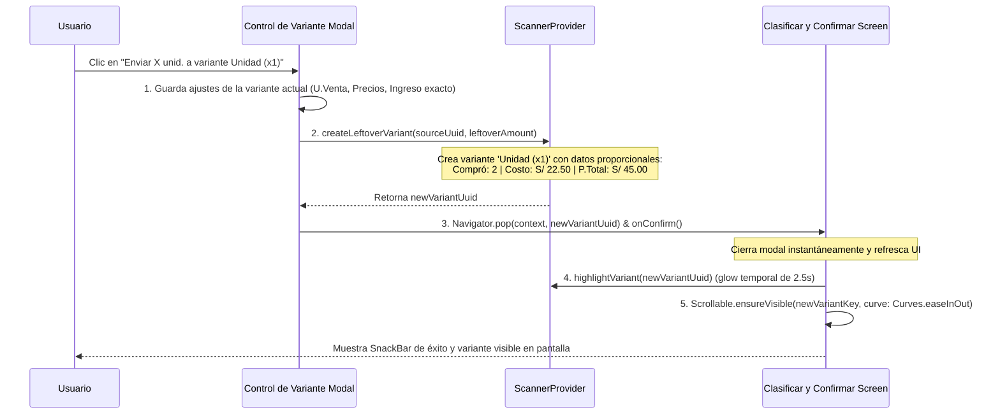

# PLAN DE TRABAJO (PARTE 1): REDISEÑO DE TARJETA VINCULADA, REPARTO EQUILIBRADO 100%, CORRECCIÓN Y VALIDACIÓN DEL MODAL 'CONTROL DE VARIANTE'

**Documento:** `analisis_proyecto/PLAN_PARTE1_REDISENO_TARJETA_VINCULADA_Y_MODAL_CONTROL_VARIANTE.md`  
**Fecha:** 28 de Octubre de 2026  
**Versión:** 1.0 — Especificación Técnica Definitiva (Mobile Awards Quality)  
**Estado:** Esperando Aprobación de Plan de Trabajo (Paso 1: Diagnóstico Forense y Arquitectura de Solución)  
**Metodología:** Loop Autónomo + Árbitro Interno Adversarial (Zero-Regressions, Zero-Overflows & 100% Mathematical Accuracy)

---

## 1. RESUMEN EJECUTIVO Y OBJETIVOS ESTRATÉGICOS

### 1.1. Contexto Global
Tras la realización de pruebas exhaustivas en condiciones reales en el módulo **`Clasificar y Confirmar` (Conciliación del Escáner de Facturas IA)** y en su modal **`Control de Variante`**, se han identificado varios problemas de comprensión visual, ergonomía interactiva y consistencia matemática documentados en las 5 capturas forenses adjuntas.

Esta **Primera Etapa (Parte 1)** se enfoca en resolver integralmente:
1. **Claridad de Vinculación y Reparto Horizontal al 100% en la Tarjeta Vinculada (Capturas 1 y 5):**
   * Reestructurar la tarjeta para que el comerciante entienda de un vistazo el flujo comercial: **`Texto en Factura` $\rightarrow$ `Producto en Base de Datos` $\rightarrow$ `Variante Vinculada`**.
   * Eliminar la duplicación de nombres del producto (ej. `"Biblia Latinoamericana - Latinoamericana"`).
   * Rediseñar la sección inferior de ingreso de stock que actualmente se encuentra comprimida en una columna a la izquierda bajo la variante, dejando un espacio vacío inútil a la derecha debajo del botón azul `"Control de Variante"`. Reorganizarla en un **panel equilibrado al 100% del ancho** con 3 columnas conectadas (`Stock Actual` + `Ingreso Factura` = `Nuevo Total`).
2. **Rediseño de la Alerta en el Modal `Control de Variante` y Depuración Tipográfica (Capturas 2, 3 y 4):**
   * Eliminar la saturación visual de **iconos y emojis duplicados** en cabeceras, botones y secciones (`🧮 💰`, `📦 📦`, `⚠️ ⚠️`, `➕ ➕`, `🔄 🔄`, `🛒 🛒`).
   * Corregir los **textos mal concatenados**:
     * Error de duplicación numérica: `"se completa 1 1 ½ Docena"` y `"(1 1 ½ Docena + 2 en reserva)"`.
     * Error de etiquetas y plurales rotos en divisores: `"Pack (x4) (x4) → 2 Pack (x4)es"` y `"Pack (x8) (x8)"`.
   * Sustituir los botones verticales gigantes de sugerencia por **chips horizontales compactos y elegantes (`Wrap`)**, animados con `AnimatedSize`, que permitan resolver el excedente en 1 solo toque sin desplazar excesivamente el modal.
3. **Flujo Automático al Crear Variante desde el Modal y Bloqueo de Stock Faltante (Capturas 4 y 5):**
   * Al presionar `"Enviar las X unid. a variante 'Unidad (x1)'"` dentro del modal:
     1. Guardar automáticamente las configuraciones de la variante actual (dejándola con el ingreso exacto para armar presentaciones completas).
     2. Crear automáticamente la nueva variante con las unidades sobrantes, asignándole sus **datos proporcionales de compra reales** (`Compró`, `Costo Unit.`, `P. Total`) y su precio de venta sugerido.
     3. Cerrar automáticamente el modal (`Navigator.pop`), limpiando la alerta en modal y tarjeta.
     4. Realizar **scroll suave animado (`Scrollable.ensureVisible`) hacia la nueva variante recién creada** en la pantalla `Clasificar y Confirmar`, aplicando un **resaltado visual temporal (glow)** para confirmación inmediata del usuario.
   * **Bloqueo Estricto de Stock Faltante (Déficit):** Si el stock total no alcanza para formar al menos 1 presentación vendible (`totalBase < factor` con `factor > 1`), mostrar alerta crítica y **deshabilitar (`disabled`) el botón `"GUARDAR DECISIÓN"`**, obligando a resolver el déficit dentro del modal (adaptando la unidad o completando el lote).
4. **Acabado Profesional en Modo Claro / Oscuro y Formato Monetario Global:**
   * Garantizar contraste cromático impecable tanto en Modo Claro (`Light`) como en Modo Oscuro (`Dark`), sin colores fijos ni fondos que dificulten la lectura.
   * Formatear rigurosamente todos los precios con `AppCurrency.format(...)` (`S/ #,##0.00`).

---

## 2. DIAGNÓSTICO FORENSE Y EVIDENCIA VISUAL EN CÓDIGO (ARCHIVOS Y LÍNEAS EXACTAS)

### 2.1. Tarjeta Vinculada y Reparto de Stock (Capturas 1 y 5)

#### A. Duplicación de Nombres y Falta de Jerarquía en la Cabecera
* **Archivo:** `app_movil/lib/features/scanner/widgets/staging/staging_product_group_card.dart`
* **Líneas exactas:** 286–315
* **Código defectuoso:**
  ```dart
  if (isParentMatch)
    Builder(
      builder: (context) {
        String variantName = "";
        if (group.variantes.isNotEmpty &&
            group.variantes.first.matchPresentacion.estado.contains("MATCH")) {
          variantName = group.variantes.first.matchPresentacion.datos?.nombre ?? "";
        }
        return Text(
          "${group.matchProducto.datos?.nombre ?? group.nombrePadre}${variantName.isNotEmpty ? ' - $variantName' : ''}",
          style: TextStyle(fontWeight: FontWeight.w900, fontSize: 16, color: textColor),
        );
      },
    )
  ```
* **Causa Raíz:** 
  1. Si el producto padre en BD se llama `"Biblia Latinoamericana"` y la primera variante en BD se llama `"Latinoamericana"`, el código concatena ciegamente `"${padre} - ${variante}"`, imprimiendo el redundante `"Biblia Latinoamericana - Latinoamericana"`.
  2. Más grave aún: el producto padre tiene inmediatamente debajo un selector de variantes existentes. Incrustar el nombre de la variante en el título del producto padre genera confusión ontológica (el usuario no sabe si está viendo el producto o la variante).
  3. La información de la factura escaneada (`"En Factura: 'BIBLIA LATINOAM UNIMUNDO'"`) se muestra en un texto suelto en cursiva sin un contenedor visual que diferencie el dato extraído por IA del registro en base de datos.

#### B. Amontonamiento en Esquina Izquierda y Espacio Vacío a la Derecha (Captura 1 y 5)
* **Archivo:** `app_movil/lib/features/scanner/widgets/staging/variant_editor_row.dart`
* **Líneas exactas:** 623–680
* **Código defectuoso:**
  ```dart
  Row(
    crossAxisAlignment: CrossAxisAlignment.start,
    children: [
      Expanded(
        child: Column(
          crossAxisAlignment: CrossAxisAlignment.start,
          children: [
            Text(widget.variant.matchPresentacion.datos?.nombre ?? widget.variant.nombreEspecifico, ...),
            Text("Se venderá por: ${widget.variant.effectiveUnidadVenta} (x${widget.variant.effectiveFactorVenta})", ...),
            Builder(builder: (ctx) {
              return Column(
                crossAxisAlignment: CrossAxisAlignment.start,
                children: [
                  Text("Ingresarán al Stock: +${widget.variant.stockIngresanteBase} unid. base (+$packIngreso ...)", ...),
                  Text("Inventario: $stockBD actual + ${widget.variant.stockIngresanteBase} ingreso = $totalBase ...", ...),
                ],
              );
            }),
          ],
        ),
      ),
      const SizedBox(width: 8),
      ElevatedButton.icon(
        icon: const Icon(Icons.tune, size: 16),
        label: const Text("Control de Variante", ...),
        ...
      ),
    ],
  )
  ```
* **Causa Raíz:**
  Todo el desglose de inventario (`Ingresarán al Stock` e `Inventario: 4 actual + 4 ingreso = 8`) está empaquetado dentro de la columna izquierda junto con el nombre de la variante, compartiendo la fila con el botón azul `"Control de Variante"`. Como el botón solo ocupa una pequeña porción vertical arriba a la derecha, debajo de él queda un enorme hueco rectangular vacío, mientras que la información crítica de stock queda asfixiada en textos de 11pt amontonados en la izquierda.

---

### 2.2. Modal `Control de Variante`: Emojis Duplicados y Textos Rotos (Capturas 2, 3 y 4)

#### A. Saturación de Iconos Vectoriales + Emojis Duplicados
* **Archivos y Líneas:**
  * `modal_sale_section.dart` (Línea 46): `Icon(Icons.point_of_sale / calculate)` + `Text("💰 Venta y Precios")`.
  * `modal_stock_section.dart` (Línea 85): `leading: Icon(Icons.inventory_2_outlined)` + `title: Text("📦 Gestión de Stock")`.
  * `modal_stock_section.dart` (Línea 482–489): `Icon(Icons.warning_amber_rounded)` + `Text("⚠️ Atención: Sobran...")`.
  * `modal_stock_section.dart` (Línea 506–508): `Icon(Icons.add_circle_outline)` + `label: Text("➕ Enviar las...")`.
  * `modal_stock_section.dart` (Línea 532–534): `Icon(Icons.inventory_2_outlined)` + `label: Text("📥 Conservar las...")`.
  * `modal_stock_section.dart` (Línea 562–565): `Icon(Icons.sync_alt)` + `Text("🔄 Divisores Exactos...")`.
  * `modal_purchase_section.dart` (Línea 50): `Icon(Icons.shopping_cart_outlined)` + `Text("🛒 Proveedor")`.
  * Alert deficit (Líneas 368–422): `Icon(Icons.error_outline)` + `Text("🚨...")`, `Icon(Icons.flash_on)` + `Text("⚡...")`, `Icon(Icons.edit)` + `Text("✏️...")`, `Icon(Icons.lock_open)` + `Text("🔓...")`.
* **Causa Raíz:** Falta de unificación estilística: los desarrolladores colocaron un icono de Flutter (`Icon`) y simultáneamente un emoji en el texto del `Text()`, generando duplicación visual redundante e infantil que demerita el acabado profesional del producto.

#### B. Bug de Texto 1: `"1 1 ½ Docena"` y `"(1 1 ½ Docena + 2 en reserva)"`
* **Archivo:** `modal_stock_section.dart` (Líneas 495 y 534) y `comparative_update_modal.dart` (Líneas 238–300)
* **Código defectuoso:**
  ```dart
  // comparative_update_modal.dart:
  static String _formatUnitLabel(int count, String rawUnit) {
    ...
    if (count == 1) return '1 $unit';
    ...
    return '$count ${unit}s';
  }

  // modal_stock_section.dart:
  Text("Con las $totalBase unidades base totales ... se completa $completas ${_ComparativeUpdateModalState._formatUnitLabel(completas, unidadActiva)}...")
  Text("📥 Conservar las $totalBase unid. en esta variante ($completas ${_ComparativeUpdateModalState._formatUnitLabel(completas, unidadActiva)} + $sobrante en reserva)")
  ```
* **Causa Raíz:** `_formatUnitLabel` **ya incorpora el número de unidades en su string de retorno** (`1 Par`, `1 Unidad`, `1 ½ Docena`). Al escribir en el template string `$completas ${_formatUnitLabel(completas, ...)}`, se antepone el número dos veces: `1` + `"1 ½ Docena"` = `"1 1 ½ Docena"`.

#### C. Bug de Texto 2: `"Pack (x4) (x4) → 2 Pack (x4)es"` y `"Pack (x8) (x8)"`
* **Archivo:** `modal_stock_section.dart`
* **Líneas exactas:** 578–583
* **Código defectuoso:**
  ```dart
  String unitName = UnitCatalogService.resolveFromFactor(d) ?? "Pack (x$d)";
  int pkgs = totalBase ~/ d;
  String pkgsLabel = _ComparativeUpdateModalState._formatUnitLabel(pkgs, unitName);
  String chipLabel = "$unitName (x$d) → $pkgsLabel";
  ```
* **Causa Raíz:**
  1. Si `d = 4`, `UnitCatalogService.resolveFromFactor(4)` es `null`. El fallback asigna `unitName = "Pack (x4)"`.
  2. Luego se construye: `chipLabel = "$unitName (x$d) → ..."` $\rightarrow$ `"$unitName"` ya contenía `"(x4)"`, por lo que añadir `"(x$d)"` genera la repetición `"Pack (x4) (x4)"`.
  3. Al llamar a `_formatUnitLabel(2, "Pack (x4)")`, la función analiza el último carácter del string, que es el paréntesis `')'`. Como no termina en vocal, ni en 's', ni en 'x', cae en la regla residual genérica `'$count ${unit}es'`, resultando en la aberración tipográfica `"2 Pack (x4)es"`.

---

### 2.3. Modal `Control de Variante`: Flujo de Creación de Variante y Bloqueo de Déficit (Capturas 4 y 5)

#### A. Acción Incompleta al Presionar `"Enviar las 2 unid. a variante..."`
* **Archivo:** `comparative_update_modal.dart`
* **Líneas exactas:** 601–617
* **Código defectuoso:**
  ```dart
  void _crearVarianteSobrante() {
    int sobrante = _leftoverSuelto;
    if (sobrante > 0) {
      widget.provider.createLeftoverVariant(widget.variant.uuidTemporal, sobrante);
      int adjustedStock = widget.variant.stockIngresanteOverride ?? (widget.variant.stockIngresanteBase - sobrante);
      _applyStockAdjustmentInLive(adjustedStock);
      if (mounted) {
        ScaffoldMessenger.of(context).showSnackBar(...);
      }
    }
  }
  ```
* **Causas Raíz:**
  1. **No guarda los cambios del modal:** No ejecuta `_applyChanges()`, por lo que cualquier modificación que el comerciante haya hecho en la variante principal (nueva unidad de venta, factor, precio o margen) no se persiste en el modelo.
  2. **No cierra el modal:** No llama a `Navigator.pop(context)`, dejando el modal abierto con la alerta aún visible en pantalla, desconcertando por completo al usuario.
  3. **No traslada datos proporcionales de compra a la nueva variante:** En `scanner_provider.dart` (líneas 758–780), la nueva variante creada tiene:
     `cantidadUmpComprada: 0, precioUmpProveedor: 0, totalPagoLote: 0`. En consecuencia, en la tarjeta de la nueva variante se muestran compras vacías o en cero, en lugar de trasladar proporcionalmente: `Compró: 2`, `Costo Unit.: S/ 22.50`, `P. Total: S/ 45.00`.
  4. **Falta de scroll y feedback visual:** Al no reportar el UUID de la nueva variante creada, la pantalla `Clasificar y Confirmar` no sabe hacia dónde desplazarse ni puede guiar la atención del comerciante mediante una animación de realce (*highlight*).

#### B. Ausencia de Bloqueo en `"GUARDAR DECISIÓN"` ante Stock Faltante
* **Archivo:** `comparative_update_modal.dart`
* **Líneas exactas:** 686–698
* **Código defectuoso:**
  ```dart
  bottomAction: SizedBox(
    width: double.infinity,
    height: 52,
    child: ElevatedButton(
      onPressed: _applyChanges, // Incondicional
      ...
      child: const Text("GUARDAR DECISIÓN", ...),
    ),
  ),
  ```
* **Causa Raíz:** El botón `"GUARDAR DECISIÓN"` siempre está activo (`onPressed: _applyChanges`), permitiendo al usuario guardar configuraciones donde `totalBase < factor` (por ejemplo, teniendo 4 unidades base totales y eligiendo `Docena x12`), dejando el producto con 0 docenas vendibles e introduciendo inconsistencias lógicas en el inventario.

---

## 3. ARQUITECTURA DE SOLUCIÓN TÉCNICA DETALLADA (LOS 4 BLOQUES)

### BLOQUE 1: Reestructuración de la Tarjeta Vinculada y Reparto Horizontal al 100%

#### 1.1. Arquitectura Visual de la Tarjeta Vinculada
Diseño comercial claro, jerarquizado y autodescriptivo:

```
┌────────────────────────────────────────────────────────────────────────┐
│  (1)  🟢 EN TU INVENTARIO (ID: 92)                  [ 🔗 Desvincular ] │
│  📄 Factura: 'BIBLIA LATINOAM UNIMUNDO'                                │
│                                                                        │
│  Biblia Latinoamericana                                                │
│  [ Stock: 4 unid. ]   [ Marca: Unimundo ]   [ Categoría: General ]    │
├────────────────────────────────────────────────────────────────────────┤
│  VARIANTE VINCULADA PARA ESTA COMPRA                                   │
│  ┌─────────────────────────┐  ┌─────────────────────────┐              │
│  │ Unidad Latinoamericana  │  │                         │              │
│  │ Unidad (x1)             │  │   + Nueva Variante      │              │
│  │ Stock: 4       S/ 30.38 │  │                         │              │
│  └─────────────────────────┘  └─────────────────────────┘              │
├────────────────────────────────────────────────────────────────────────┤
│  SUB-TARJETA DE DETALLE Y GESTIÓN DE STOCK (100% ANCHO)                │
│                                                                        │
│  Latinoamericana                               [ ⚙️ Control de         │
│  Se venderá por: ½ Docena (x6)                 [    Variante           │
│                                                                        │
│  ┌───────────────────┐     ┌───────────────────┐     ┌───────────────┐ │
│  │   Stock Actual    │  +  │  Ingreso Factura  │  =  │  Nuevo Total  │ │
│  │      4 unid.      │     │   +4 unid. base   │     │  8 unid. base │ │
│  │    (en almacén)   │     │   (+0 ½ Docena)   │     │  (1 ½ Docena) │ │
│  └───────────────────┘     └───────────────────┘     └───────────────┘ │
│                                                                        │
│  [ ⚠️ Sobrante detectado: Forman 1 ½ Docena, sobran 2 unid. sueltas ] │
│    [ ➕ Enviar 2 unid. a 'Unidad (x1)' ]  [ 📥 Conservar en reserva ]  │
└────────────────────────────────────────────────────────────────────────┘
```

1. **Corrección de Nombre Limpio:**
   * En `staging_product_group_card.dart`, el título principal del producto mostrará estrictamente:
     `group.matchProducto.datos?.nombre ?? group.nombrePadre` (ej. `"Biblia Latinoamericana"`), sin concatenar el nombre de variantes hijas.
2. **Badge de Origen (Factura):**
   * Mostrar el texto de la factura en un contenedor estilizado de lectura con icono `description_outlined` o `receipt_long_outlined`.
3. **Distribución al 100% de la Sección de Ingreso e Inventario:**
   * Separar la fila de título y botón (`Variant Title + Se venderá por:` a la izquierda, botón `"Control de Variante"` a la derecha).
   * Justo debajo, ubicar un **Panel de Balance Horizontal a Ancho Completo (100% width)** compuesto por 3 sub-tarjetas simétricas conectadas mediante operadores matemáticos (`+` e `=`):
     * **Tarjeta 1: Stock Actual:** `stockBD` unid. base (o su desglose en paquetes si `factor > 1`).
     * **Tarjeta 2: Ingreso Factura:** `+stockIngresante` unid. base (`+$packIngreso $unidad`).
     * **Tarjeta 3: Nuevo Total:** `$totalBase` unid. base (`$completas $unidad` ${sobrante > 0 ? '+ $sobrante sueltas' : ''}).
   * Este panel elimina el vacío derecho y transmite instantáneamente la ecuación de balance.

---

### BLOQUE 2: Rediseño de la Alerta en Modal `Control de Variante`, Corrección de Textos e Iconos

#### 2.1. Regla de Oro: Cero Duplicación de Icono + Emoji
* Cada título de sección, botón o alerta utilizará **un único icono vectorial de Flutter** (`Icon(Icons....)`) con color contextual según el tema. Se suprimirán todos los caracteres emojis introducidos en los strings (`💰`, `📦`, `⚠️`, `➕`, `🔄`, `📥`, `🛒`, `🚨`, `⚡`, `✏️`, `🔓`).

#### 2.2. Corrección Algorítmica de Textos y Plurales
1. **Unificación de Formateo de Presentaciones:**
   * En `comparative_update_modal.dart`, refactorizar `_formatUnitLabel` y crear el helper robusto `formatPresentation(int count, String unitName, int factor)`:
     * Si `count == 1`: `"1 $unitName"` (ej. `"1 ½ Docena"`).
     * Si `count > 1`: `"$count ${_pluralizeUnit(unitName)}"` (ej. `"2 Docenas"`).
     * Evitar la concatenación redundante `"$completas ${_formatUnitLabel(...)}"`. En la alerta se leerá nítidamente:
       `"Con las $totalBase unidades base totales ($stockBD actuales + $nuevoIngreso ingreso) se completa ${formatPresentation(completas, unidadActiva, factor)}, pero quedan $sobrante unidades sueltas que no alcanzan para otra presentación."`
2. **Corrección de Divisores Exactos y Plurales:**
   * En `modal_stock_section.dart`:
     ```dart
     // Obtener nombre base de la unidad
     String baseUnitName = UnitCatalogService.resolveFromFactor(d) ?? "Pack";
     int pkgs = totalBase ~/ d;
     String pkgsFormatted = formatPresentation(pkgs, baseUnitName, d);
     // Chip label limpio: "Pack (x4) → 2 Packs" o "Par (x2) → 4 Pares"
     String chipLabel = "$baseUnitName (x$d) → $pkgsFormatted";
     ```
   * Eliminar la duplicación de `(x$d)` y resolver el plural correctamente (`Pack` $\rightarrow$ `Packs`, no `Pack (x4)es`).

#### 2.3. Alerta Compacta con Chips Horizontales y `AnimatedSize`
* Reemplazar la pila vertical de botones por:
  1. **Acción Principal Destacada:** Botón naranja prominente:
     `[ Enviar las $sobrante unid. a variante 'Unidad (x1)' ]` (con `Icon(Icons.add_circle_outline)`).
  2. **Divisores Sugeridos en Fila de Chips (`Wrap` o deslizable horizontal):**
     * Chips interactivos compactos (`ActionChip` estilizado) con toque único que aplica el divisor inmediatamente:
       `[ 1 Unidad (x1) → 8 Unidades ]` `[ 2 Par (x2) → 4 Pares ]` `[ 4 Pack (x4) → 2 Packs ]` `[ 8 Pack (x8) → 1 Pack ]`
  3. **Acción Secundaria Discreta:** Botón delineado (`OutlinedButton`):
     `[ Conservar en reserva base ($completas × $unidadActiva + $sobrante en almacén) ]`

---

### BLOQUE 3: Flujo Automático Completo al Crear Variante + Bloqueo de Stock Faltante

#### 3.1. Flujo Automático en Cascada al Crear Variante desde Modal
Al presionar `"Enviar las X unid. a variante 'Unidad (x1)'"`:


* **Traslado Proporcional Exacto de Datos de Compra en `ScannerProvider.createLeftoverVariant`:**
  * `cantidadUmpComprada`: `leftoverAmount.toDouble()` (ej. `2.0`).
  * `unidadesPorLote`: `1`.
  * `umpCompra`: `"Unidad"`.
  * `precioUmpProveedor`: `costoBase` (ej. `S/ 22.50`).
  * `totalPagoLote`: `leftoverAmount * costoBase` (ej. `S/ 45.00`).
  * `costoUnitarioSugerido`: `costoBase` (`S/ 22.50`).
  * `factorGananciaVentaSugerido`: `margen` (ej. `1.35`).
  * `precioVentaSugerido`: `costoBase * margen` (ej. `S/ 30.38`).
  * `stockIngresanteOverride`: `leftoverAmount` (`2`).
  * `sourceVariantUuid`: `sourceVariantUuid`.

#### 3.2. Bloqueo Estricto de Stock Faltante (Déficit)
* En `comparative_update_modal.dart`:
  * Se evalúa en tiempo real:
    ```dart
    final int factor = int.tryParse(_uVentaFactorCtrl.text) ?? widget.variant.effectiveFactorVenta;
    final int totalBase = _calculateCurrentTotalBaseUnits();
    final bool hasDeficit = factor > 1 && totalBase < factor && !widget.variant.allowDeficitApproved;
    ```
  * Si `hasDeficit == true`:
    * Se muestra la alerta roja de déficit explicando cuántas unidades faltan y ofreciendo los divisores que sí alcanzan.
    * El botón inferior `"GUARDAR DECISIÓN"` pasa a estado **DESHABILITADO (`onPressed: null`)**, con estilo visual opaco (`Colors.grey` / `Colors.white12`) y tooltip explicativo.
  * Cuando el usuario corrige la presentación (ej. adaptando a `Unidad x1` o a un factor $\le totalBase$), `hasDeficit` pasa a `false` y el botón se reactiva inmediatamente en azul vibrante.

---

### BLOQUE 4: Soporte Perfecto en Modo Claro y Oscuro + `AppCurrency.format`

#### 4.1. Contrastes y Tokens Semánticos
* **Modo Oscuro (`Dark`):**
  * Fondo de tarjeta padre: `Color(0xFF14141C)`.
  * Fondo de sub-tarjetas de stock: `Color(0xFF1A1A24)`.
  * Bordes: `Colors.white10` (suaves, sin brillos excesivos).
  * Textos principales: `Colors.white` (`FontWeight.bold`).
  * Textos secundarios / metadatos: `Colors.grey[400]`.
  * Alertas de stock exacto: Verde con alpha 0.15 y borde 0.3.
  * Alertas de sobrante: Naranja con alpha 0.12 y texto `Colors.orange[300]`.
* **Modo Claro (`Light`):**
  * Fondo de tarjeta padre: `Colors.white` con sombra sutil (`BoxShadow(color: Colors.black.withOpacity(0.04), blurRadius: 6)`).
  * Fondo de sub-tarjetas de stock: `Color(0xFFF8FAFC)`.
  * Bordes: `Colors.grey.shade200` y `Colors.grey.shade300`.
  * Textos principales: `Color(0xFF0F172A)` (Slate 900).
  * Textos secundarios: `Color(0xFF64748B)` (Slate 500).
  * Alertas de stock exacto: `Color(0xFFDCFCE7)` (Verde 100) con texto `Color(0xFF166534)`.
  * Alertas de sobrante: `Color(0xFFFEF3C7)` (Ámbar 100) con texto `Color(0xFF92400E)`.

#### 4.2. Formato Monetario Global con `AppCurrency.format`
* Reemplazo total de interpolaciones rústicas tipo `"S/${precio.toStringAsFixed(2)}"` o `"S/$precio"` por `AppCurrency.format(precio)` en:
  * Chips de variantes existentes y selector superior.
  * Cabecera y datos del último registro en base de datos.
  * Inputs financieros del modal (`Costo Pres.`, `P. Venta`).
  * Desglose de compra en factura (`Compró`, `P. Total`).
  * Alertas y etiquetas de sugerencias de divisores.

---

## 4. FASES DE EJECUCIÓN PASO A PASO (METODOLOGÍA LOOP AUTÓNOMO)

```
┌────────────────────────────────────────────────────────────────────────┐
│ FASE 1: Limpieza de Cabecera, Nombre Limpio y Reparto 100% de Stock    │
│ (staging_product_group_card.dart & variant_editor_row.dart)            │
├────────────────────────────────────────────────────────────────────────┤
│ FASE 2: Depuración Tipográfica, Eliminación de Emojis y Chips en Modal │
│ (comparative_update_modal.dart & modal_stock_section.dart)             │
├────────────────────────────────────────────────────────────────────────┤
│ FASE 3: Flujo Automático Crear Variante + Bloqueo de Stock Faltante    │
│ (comparative_update_modal.dart, scanner_provider.dart & staging_screen)│
├────────────────────────────────────────────────────────────────────────┤
│ FASE 4: Pulido de Contrastes Light/Dark y Formato Global AppCurrency   │
│ (comparative_modal ui & staging widgets)                               │
├────────────────────────────────────────────────────────────────────────┤
│ FASE 5: Protocolo de Arbitraje Adversarial & Batería de Pruebas        │
│ (Test unitarios, tests de widgets, viewport 320dp/360dp, 0 regresiones)│
└────────────────────────────────────────────────────────────────────────┘
```

### FASE 1: Limpieza de Cabecera, Nombre Limpio y Reparto 100% de Stock
1. **`staging_product_group_card.dart`:**
   * Mostrar únicamente el nombre limpio del producto en base de datos (`group.matchProducto.datos?.nombre ?? group.nombrePadre`), corrigiendo la concatenación de nombres de variantes.
   * Estilizar el bloque de origen (Factura) como un contenedor visualmente distinguible.
   * Pulir badges informativos (`Stock Actual`, `Marca`, `Categoría`) y botón de desvincular con tooltip.
2. **`variant_editor_row.dart`:**
   * Rediseñar la sub-tarjeta de variante vinculada:
     * Fila superior: Nombre de variante + `Se venderá por: ...` a la izquierda; botón `"Control de Variante"` a la derecha.
     * Fila inferior (100% de ancho): Panel horizontal de 3 columnas conectadas (`Stock Actual` + `Ingreso Factura` = `Nuevo Total`).
     * Alerta inferior de stock (Stock exacto / Sobrante / Déficit) ocupando el ancho completo.

### FASE 2: Depuración Tipográfica, Eliminación de Emojis y Chips en Modal
1. **Eliminación de Iconos Duplicados:**
   * Auditar y sustituir la duplicación de icono vectorial + emoji en `modal_sale_section.dart`, `modal_stock_section.dart` y `modal_purchase_section.dart`. Dejar exclusivamente iconos vectoriales limpios.
2. **Corrección de Textos y Plurales:**
   * Refactorizar `_formatUnitLabel` y helpers de texto para erradicar el bug `"1 1 ½ Docena"` y el bug de divisores `"Pack (x4) (x4) → 2 Pack (x4)es"`.
3. **Alerta Compacta con Chips y `AnimatedSize`:**
   * Convertir la lista de divisores sugeridos en un `Wrap` de chips interactivos de 1 toque.
   * Encapsular la alerta en `AnimatedSize` para transiciones suaves al alternar opciones.

### FASE 3: Flujo Automático Crear Variante + Bloqueo de Stock Faltante
1. **`ScannerProvider.createLeftoverVariant`:**
   * Actualizar la función para que retorne el UUID de la nueva variante.
   * Asignar valores proporcionales reales de compra a la nueva variante (`cantidadUmpComprada`, `unidadesPorLote`, `precioUmpProveedor`, `totalPagoLote`, etc.).
   * Añadir método `highlightVariant(String? variantUuid)` con timer de 2.5s.
2. **`ComparativeUpdateModal._crearVarianteSobrante`:**
   * Guardar automáticamente los cambios de la variante principal.
   * Invocar `createLeftoverVariant` y obtener el nuevo UUID.
   * Cerrar automáticamente el modal (`Navigator.pop(context, newUuid)`).
3. **`InvoiceStagingScreen` & `VariantEditorRow`:**
   * Recibir el evento de creación de variante sobrante.
   * Ejecutar scroll animado suave (`Scrollable.ensureVisible`) hacia la nueva variante.
   * Activar el efecto visual de resalte (*glow*) temporal en la nueva variante.
4. **Bloqueo Estricto de Déficit:**
   * En `ComparativeUpdateModal`, verificar si existe stock faltante no resuelto.
   * Deshabilitar incondicionalmente el botón `"GUARDAR DECISIÓN"` mientras persista el déficit.

### FASE 4: Pulido de Contrastes Light/Dark y Formato Global AppCurrency
1. Auditar todas las superficies, textos y bordes en Modo Claro (`Light`) y Modo Oscuro (`Dark`).
2. Reemplazar todas las cadenas monetarias por `AppCurrency.format(...)`.

### FASE 5: Protocolo de Arbitraje Adversarial & Batería de Pruebas
1. Ejecutar análisis estático completo (`flutter analyze`) certificando 0 advertencias y 0 errores.
2. Crear archivo de pruebas unitarias y de widgets (`test/scanner_variant_card_redesign_and_modal_refinement_test.dart`) con cobertura exhaustiva de:
   * Pluralización y formateo de unidades (pares, packs, docenas, fracciones).
   * Creación proporcional de variantes sobrantes y cálculo exacto de compra y venta.
   * Bloqueo de botón `"GUARDAR DECISIÓN"` ante déficit de stock.
   * Renderizado de la tarjeta en viewports estrechos de `320dp` y `360dp` sin overflows.
   * Verificación de contrastes y `AppCurrency.format`.

---

## 5. PROTOCOLO DE ARBITRAJE INTERNO ADVERSARIAL

Para garantizar que esta entrega cumpla con el estándar más alto de calidad de software móvil (Mobile Awards Quality), el **Árbitro Interno Adversarial** someterá los cambios a las siguientes pruebas de estrés:

1. **Test Adversarial 1: Simulación de Concatenación de Nombres Extremos:**
   * *Escenario:* Producto en BD: `"Biblia Latinoamericana"`, Variante en BD: `"Latinoamericana"`. Factura: `"BIBLIA LATINOAM UNIMUNDO"`.
   * *Aserción:* El título principal debe ser exactamente `"Biblia Latinoamericana"`. No debe existir ninguna ocurrencia de `"Biblia Latinoamericana - Latinoamericana"`.
2. **Test Adversarial 2: Invarianza del Balance de Stock al 100% de Ancho:**
   * *Escenario:* Producto con 4 unidades en BD + 4 ingresadas en factura = 8 unidades totales vendidas por `½ Docena (x6)`.
   * *Aserción:* El panel horizontal debe mostrar exactamente 3 columnas: `Stock Actual: 4`, `Ingreso Factura: +4`, `Nuevo Total: 8 (1 ½ Docena)`. Sin overflow a 320dp.
3. **Test Adversarial 3: Auditoría de Emojis e Iconos Duplicados:**
   * *Escenario:* Búsqueda por regex de combinaciones `Icon + Emoji` en todo el modal `Control de Variante`.
   * *Aserción:* Cero ocurrencias de emojis incrustados en etiquetas que ya posean un icono vectorial.
4. **Test Adversarial 4: Matemáticas y Pluralización de Divisores Sugeridos:**
   * *Escenario:* Total 8 unidades base, factor actual 6. Divisores sugeridos: 1, 2, 4, 8.
   * *Aserción:*
     * Para 1: `"Unidad (x1) → 8 Unidades"`.
     * Para 2: `"Par (x2) → 4 Pares"`.
     * Para 4: `"Pack (x4) → 2 Packs"`.
     * Para 8: `"Pack (x8) → 1 Pack"`.
     * Cero repeticiones tipo `(x4) (x4)` y cero plurales mutilados tipo `Pack (x4)es`.
5. **Test Adversarial 5: Ciclo de Creación Proporcional de Variante Sobrante:**
   * *Escenario:* Factura compró 4 unidades a S/ 22.50 = S/ 90.00. Variante principal toma 2 unidades (para completar 1 ½ Docena con 4 en BD). Se envían 2 unidades sobrantes a `Unidad (x1)`.
   * *Aserción:*
     * Variante creada tiene: `cantidadUmpComprada == 2.0`, `precioUmpProveedor == 22.50`, `totalPagoLote == 45.00`.
     * El modal se cierra automáticamente.
     * Ambas variantes quedan con `sobrante == 0` y `déficit == 0`.
6. **Test Adversarial 6: Bloqueo Infranqueable de Stock Faltante (Déficit):**
   * *Escenario:* Usuario tiene 4 unidades base y cambia la unidad a `Docena (x12)` (faltan 8 unidades para 1 docena).
   * *Aserción:* El botón `"GUARDAR DECISIÓN"` tiene `onPressed == null` (deshabilitado). Al cambiar a `Par (x2)` o `Unidad (x1)`, el botón se habilita inmediatamente.
7. **Test Adversarial 7: Coherencia Monetaria con `AppCurrency`:**
   * *Escenario:* Inspección de todos los widgets de precios en tarjeta y modal.
   * *Aserción:* Todas las cifras monetarias cumplen la máscara `AppCurrency.format(...)` (`S/ #,##0.00`).

---

## 6. MATRIZ DE TRAZABILIDAD Y ARCHIVOS A MODIFICAR

| Archivo | Responsabilidad / Cambio Principal |
| :--- | :--- |
| `app_movil/lib/features/scanner/widgets/staging/staging_product_group_card.dart` | Nombre limpio del producto (sin repetir variante), bloque estilizado de origen factura, badges pulidos. |
| `app_movil/lib/features/scanner/widgets/staging/variant_editor_row.dart` | Rediseño de sub-tarjeta: panel horizontal al 100% de balance de stock (3 columnas simétricas), separación de botón Control de Variante. |
| `app_movil/lib/features/scanner/widgets/staging/comparative_modal/comparative_update_modal.dart` | Corrección de `_formatUnitLabel`, lógica de guardado automático al crear sobrante, bloqueo de déficit en botón GUARDAR DECISIÓN. |
| `app_movil/lib/features/scanner/widgets/staging/comparative_modal/ui/modal_stock_section.dart` | Eliminación de emojis duplicados, chips compactos de divisores exactos, corrección de textos rotos `"1 1 ½ Docena"` y plurales. |
| `app_movil/lib/features/scanner/widgets/staging/comparative_modal/ui/modal_sale_section.dart` | Eliminación de icono duplicado en Venta y Precios, uso de `AppCurrency.format`. |
| `app_movil/lib/features/scanner/widgets/staging/comparative_modal/ui/modal_purchase_section.dart` | Eliminación de icono duplicado en Proveedor, formato monetario con `AppCurrency`. |
| `app_movil/lib/features/scanner/providers/scanner_provider.dart` | Asignación de datos proporcionales de compra en `createLeftoverVariant`, retorno de UUID de nueva variante, `highlightVariant`. |
| `app_movil/lib/features/scanner/screens/invoice_staging_screen.dart` | Manejo del retorno del modal para auto-scroll suave (`Scrollable.ensureVisible`) hacia la nueva variante creada. |
| `app_movil/test/scanner_variant_card_redesign_and_modal_refinement_test.dart` | Nueva suite de pruebas unitarias y de widgets que certifique todos los invariantes del plan. |
