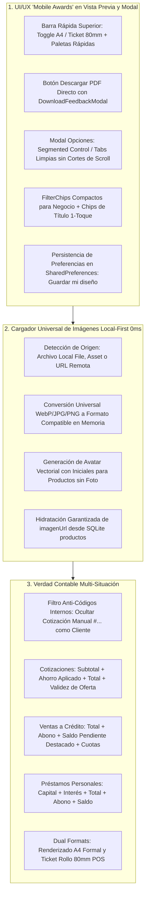
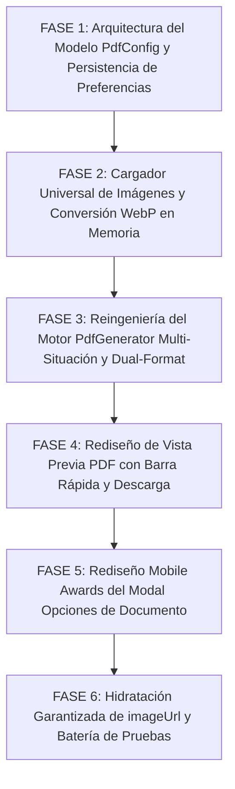

# 📄 PLAN MAESTRO PARTE 1: REDISEÑO INTEGRAL DE VISTA PREVIA PDF, MOTOR MULTI-SITUACIÓN Y MODAL DE OPCIONES

**Documento de Especificación Técnica, Auditoría Forense y Protocolo de Implementación Adversarial**  
**Proyecto:** MochilaLista App (Local-First SQLite, 0ms Latency, Flutter Mobile — Estándar Mobile Awards)  
**Módulos Involucrados:**
- **Visor y Pantalla de Vista Previa:** `lib/features/smart_quotation/screens/pdf_preview_screen.dart`
- **Motor Generador de Documentos PDF:** `lib/features/smart_quotation/utils/pdf_generator.dart`
- **Modelo de Configuración y Preferencias:** `lib/features/smart_quotation/models/pdf_config_model.dart`
- **Servicio de Descargas y Modal Animado:** `lib/features/scanner/services/invoice_file_service.dart`, `lib/features/scanner/widgets/shared/download_feedback_modal.dart`
- **Hidratación y Fuentes de Datos:** `lib/features/smart_quotation/services/sales_service.dart`, `lib/features/smart_quotation/services/quotation_service.dart`, `lib/core/models/user_model.dart`
**Fecha:** Octubre 2026  
**Metodología:** Loop Autónomo + Árbitro Interno Adversarial Estricto  

---

## 📸 1. AUDITORÍA FORENSE DE LAS 5 CAPTURAS Y DIAGNÓSTICO EN CÓDIGO FUENTE

A partir de la inspección exhaustiva de las 5 capturas remitidas por el usuario y la auditoría línea por línea del código fuente, se identifican las fallas técnicas exactas:

| Captura | Pantalla / Componente | Diagnóstico Forense del Problema | Causa Raíz Exacta en Código Fuente |
| :--- | :--- | :--- | :--- |
| **Captura 1** | **`Vista Previa PDF` (Hoja A4)** | **1. Logo del Negocio Ausente:** A pesar de tener `Logo` activo en opciones (`Imagen 4`), el logo no aparece en el PDF (solo el texto plano `LIBRERÍA BAZAR LUZAM`). **2. Bug del Código Interno mostrado como Cliente:** Debajo de la fecha `21/10/2026 18:34` aparece una píldora gris con `"Cotización Manual #21-1749"` como si fuera el cliente. **3. Visor Plano y Rígido:** No permite alternar entre Hoja A4 y Ticket 80mm ni cambiar colores rápidamente sin entrar al modal. **4. Barra Inferior Incompleta:** Solo tiene `PERSONALIZAR`, `Compartir` e `Imprimir`; carece de botón directo para descargar a la carpeta `Descargas` del teléfono. | • `pdf_generator.dart` L26-65 & L78-82: `_processLogo` invoca `http.get(Uri.parse(finalUrl))` asumiendo que `finalUrl` es una URL web remota. En nuestra app Local-First, `logoUrl` es una ruta local en almacenamiento (`File(path)`). `http.get` arroja excepción inmediata (`Unsupported scheme`), el `catch` lo silencia y devuelve `null`. Además, si el logo está en WebP, `pw.MemoryImage` falla por falta de codec. • `pdf_generator.dart` L135-136 & `manual_quote_save_ext.dart` L189-196: Cuando no hay cliente asignado, se autogenera el nombre `"Cotización Manual #21-1749"` y se guarda en `clientName`. En `_buildHeader`, se renderiza directamente sin validar si es un cliente real o un código autogenerado del sistema. • `pdf_preview_screen.dart` L103-124: Visor estático con `useActions: false`, sin barra de controles rápidos para tamaño de hoja o paleta de color. • `pdf_preview_screen.dart` L127-178: `_buildBottomToolbar` carece del botón `Descargar PDF` conectado a `DownloadFeedbackModal`. |
| **Captura 2** | **Modal `Opciones de Documento` (Inicio)** | **1. Input de Título Rígido:** Requiere teclear manualmente sin sugerencias de 1 toque. **2. Dropdown Tosco para Estilo:** Selector desplegable tosco en vez de una cuadrícula visual de paletas táctiles. **3. Colores y Estilos Desarticulados:** Verde en productos, teal en totales, azul en negocio, naranja en cliente, morado en imágenes. | • `pdf_preview_screen.dart` L245-276: `TextField` genérico sin chips rápidos contextuales (`COTIZACIÓN`, `PROFORMA`, `NOTA DE VENTA`, `COMPROBANTE`, `ESTADO DE CUENTA`). • `pdf_preview_screen.dart` L258-275: `DropdownButton<PdfTheme>` rígido que no muestra una vista previa visual de la paleta. |
| **Captura 3** | **Modal `Opciones de Documento` (Totales y Pago)** | **1. Corte Brusco de Scroll:** Al desplazarse, el texto `"Suma de todo lo ahorrado"` se corta bruscamente a la mitad contra el divisor de la cabecera fija. **2. Estructura Vertical Masiva:** Secciones colapsables largas que al abrirse empujan y desordenan la interfaz sin separación por temas. | • `pdf_preview_screen.dart` L216-241: `constraints: BoxConstraints(maxHeight: height * 0.7)` junto con un `ListView` sin gradiente de fade o padding superior adecuado bajo el `Divider(height: 1)`, provocando clipping visual severo al hacer scroll. |
| **Captura 4** | **Modal `Opciones de Documento` (Mi Negocio)** | **1. Checkboxes Verticales Gigantes:** 4 filas enteras de checkboxes sueltos (`Logo`, `Dirección`, `Teléfono`, `RUC`) que saturan la pantalla innecesariamente. **2. Carencia de Preview del Logo:** El usuario no sabe qué logo tiene registrado ni se le avisa si aún no lo ha configurado en su perfil. | • `pdf_preview_screen.dart` L378-385: 4 widgets `CheckboxListTile` apilados verticalmente ocupando más de 220dp de alto cuando deberían ser `FilterChips` horizontales compactos y elegantes dentro de una sola tarjeta. |
| **Captura 5** | **Modal `Opciones de Documento` (Cliente e Imágenes)** | **1. Subtítulo Erróneo en Imágenes:** Dice `"Estilo catálogo (Requiere internet)"` cuando la app es Local-First y guarda las fotos en memoria local. **2. Las Fotos no Aparecen:** Al activar el switch, la tabla del PDF no muestra las imágenes locales. **3. Datos del Cliente Rígidos:** No permite escribir o cambiar el nombre del cliente ni agregar una nota al pie (validez de cotización o cuentas Yape/Plin). **4. Sin Persistencia de Preferencias:** Cada vez que el usuario entra, debe volver a activar o cambiar sus opciones desde cero. | • `pdf_preview_screen.dart` L424: Subtítulo hardcodeado con `"Requiere internet"`. • `pdf_generator.dart` L84-92: Utiliza `http.get(Uri.parse(item.imageUrl!))` para descargar las fotos; al ser rutas locales (`/data/...`), arroja excepción de red y las imágenes se pierden en silencio. • `pdf_config_model.dart`: No tiene campos para nota al pie, cuentas de pago, ni métodos `saveToPrefs` / `loadFromPrefs`. |

---

## 🎯 2. PRINCIPIOS RECTORES Y ARQUITECTURA TÉCNICA DE LA SOLUCIÓN

### Principio 1: Cargador Universal de Imágenes Resiliente (Local-First 0ms)
- **Cero Dependencia de Internet:** Todo archivo local presente en el dispositivo (`File(path).existsSync()`) se lee directamente a bytes en memoria en 0ms (`File(path).readAsBytes()`).
- **Conversión Universal de Formatos Comprimidos (WebP/JPG/PNG -> PNG/JPG):**  
  La librería `pdf` (`pw.MemoryImage`) requiere bytes compatibles (PNG/JPEG). Utilizando el paquete `package:image` (`img.decodeImage(bytes)`), cualquier archivo local en formato WebP, JPG, PNG o BMP se decodifica y se recodifica en memoria como PNG/JPG nítido y ultraliviano, garantizando renderizado al 100% sin excepciones.
- **Simetría Visual con Avatar Vectorial:** Si `Incluir Imágenes` está activo y un producto no posee foto registrada, se dibuja un contenedor estilizado de 32x32 con esquinas redondeadas y un avatar vectorial elegante con las iniciales del producto (ej. `"SR"` para *"Shampoo Romero"*), conservando la simetría perfecta de la tabla tipo catálogo.

### Principio 2: Blindaje Multi-Situación y Verdad Contable
- **Validador de Cliente Real vs Códigos Internos:**  
  Se implementa un método estricto `isAutoGeneratedClientName(String? name)` que detecta patrones autogenerados (`Cotización Manual #...`, `Cotización #...`, `Venta #...`, `Venta Rápida #...`, `Borrador #...`, `Cliente General`, `Sin cliente`). Si no hay cliente real asignado, no se muestra esa píldora errónea.
- **Semántica Contable según el Tipo de Documento:**
  - **Cotización / Proforma:** Subtotal, Descuento/Ahorro Global (con felicitación de ahorro), Total General y Nota de Validez (ej. *"Válido por 7 días"*).
  - **Venta Pagada (Boleta / Nota de Venta):** Subtotal, Descuento, Total, Método de Pago, Estado `"PAGADO"` (Sello visual opcional).
  - **Venta al Crédito / Pago Parcial:** Total General, Monto Abonado, **`SALDO PENDIENTE POR COBRAR`** destacado en color ámbar/rojo contable, y desglose de cuotas pendientes con fechas de vencimiento.
  - **Préstamo Personal:** Capital Prestado, Tasa/Monto de Interés acordado, Total a Pagar, Abonos realizados, Saldo Deudor y cronograma de cuotas.
  - **Estado de Cuenta:** Resumen general de deuda y consolidado de pagos.

### Principio 3: Soporte Dual de Formatos de Hoja (A4 vs Ticket 80mm)
- **Hoja A4 (`PdfPageFormat.a4`):** Formato ejecutivo formal para enviar por correo o imprimir en hojas completas.
- **Ticket 80mm (`PdfPageFormat.roll80` o ancho de 80mm continuo):** Formato rollo térmico ideal para impresoras POS o para compartir directamente por WhatsApp como comprobante compacto de pantalla completa de celular. El motor adapta automáticamente el tamaño de fuentes, paddings y columnas para que no ocurran desbordes horizontales.

### Principio 4: UI/UX "Mobile Awards" y Persistencia
- **Barra Superior Rápida:** Selector de 1 toque de Formato (`📄 A4` / `🧾 Ticket 80mm`) y Selector de Paleta de Color con círculos cromáticos interactivos.
- **Descarga Directa con Feedback Háptico:** Botón `Descargar PDF` en la barra inferior que utiliza `InvoiceFileService.saveBytesToDownloads` y despliega el modal animado de éxito `DownloadFeedbackModal` con vibración táctil y botón `"Abrir Archivo"`.
- **Modal Reorganizado por Pestañas:**
  - `🎨 Identidad y Formato`
  - `🏪 Negocio y Cliente`
  - `📋 Tabla y Totales`
- **Cero Cortes de Scroll:** Padding superior e inferior generoso, bordes redondeados y `ClipRRect` suave para garantizar que ningún texto se corte contra la cabecera.
- **Persistencia en SharedPreferences:** Botón `"Guardar como diseño por defecto"` para recordar las preferencias del comerciante.

---

## 🏗️ 3. PLAN DE TRABAJO DETALLADO POR FASES

---

### FASE 1: ARQUITECTURA DEL MODELO `PdfConfig`, ENUMS Y SERVICIO DE PREFERENCIAS
**Objetivo:** Extender `PdfConfig` con soporte para formatos de hoja (A4 / Ticket 80mm), 4 paletas de color ejecutivas, datos editables de cliente/notas al pie y persistencia en `SharedPreferences`.

- [ ] **1.1. Enums y Extensiones de Formato y Tema (`pdf_config_model.dart`):**
  - Incorporar `enum PdfPageSize { a4, ticket80 }`.
  - Ampliar `enum PdfTheme` para soportar:
    - `modern` (Moderno Azul `#1565C0`)
    - `emerald` (Esmeralda Comercial `#00796B`)
    - `dark` (Ejecutivo Oscuro `#263238`)
    - `classic` (Minimalista Blanco y Negro para ahorro de tinta `#212121`).
  - Asegurar retrocompatibilidad con `fromJson` y `toJson`.
- [ ] **1.2. Nuevos Campos en `PdfConfig`:**
  - `PdfPageSize pageSize`: Por defecto `PdfPageSize.a4`.
  - `String? customClientName`: Para permitir corregir o ingresar el nombre del cliente en caliente desde el modal.
  - `String? footerNote`: Nota al pie editable (ej. *"Cotización válida por 7 días"*).
  - `bool showPaymentAccounts`: Mostrar cuentas de pago registradas del negocio (Yape, Plin, cuentas bancarias).
  - `bool showStatusStamp`: Sello visual opcional (`PAGADO` / `PENDIENTE`).
- [ ] **1.3. Servicio de Preferencias de Documento (`pdf_preferences_service.dart`):**
  - Implementar métodos para guardar (`saveDefaultConfig`) y recuperar (`loadDefaultConfig`) las preferencias predeterminadas del usuario desde `SharedPreferences`.

---

### FASE 2: CARGADOR UNIVERSAL DE IMÁGENES Y CONVERSIÓN WEBP EN MEMORIA
**Objetivo:** Crear el componente `PdfImageHelper` que resuelva de raíz el fallo del logo y las fotos de productos tanto para archivos locales como WebP/PNG/JPG.

- [ ] **2.1. Implementación de `PdfImageHelper` (`lib/features/smart_quotation/utils/pdf_image_helper.dart`):**
  - Método `Future<pw.ImageProvider?> resolveImage(String? pathOrUrl, {bool isGrayscale = false})`:
    - **Paso A (Limpieza):** Valida nulos, cadenas vacías o `'null'`. Retorna `null` si no es válido.
    - **Paso B (Archivos Locales - 0ms):** Si es una ruta local (`File(cleanPath).existsSync()`), lee los bytes directamente con `await File(cleanPath).readAsBytes()`.
    - **Paso C (Assets Locales):** Si inicia con `assets/`, lee con `rootBundle.load(cleanPath)`.
    - **Paso D (URLs Remotas):** Si inicia con `http://` o `https://`, descarga con `http.get` y timeout seguro de 4 segundos.
    - **Paso E (Decodificación Universal y Conversión WebP a PNG/JPG):**
      - Utilizar `img.decodeImage(bytes)` del paquete `image: ^4.2.0`.
      - Si `isGrayscale == true`, aplicar `img.grayscale(decoded)`.
      - Redimensionar proporcionalmente a un máximo de 800px para no inflar el tamaño del archivo PDF.
      - Codificar a PNG/JPEG en memoria (`img.encodePng(decoded)` o `img.encodeJpg(decoded, quality: 85)`).
      - Retornar `pw.MemoryImage(convertedBytes)`.
- [ ] **2.2. Avatar Vectorial de Respaldo para Productos sin Foto:**
  - Crear el widget `pw.Widget buildProductAvatar(String productName, {Map<String, PdfColor>? colors})`:
    - Genera las 2 letras iniciales del producto (ej. `"Shampoo Romero"` -> `"SR"`).
    - Dibuja un contenedor simétrico de 32x32 con esquinas redondeadas de 4pt, fondo suave derivado de la paleta y texto centrado en negrita.

---

### FASE 3: REINGENIERÍA DEL MOTOR `PdfGenerator` (MULTI-SITUACIÓN, DUAL-FORMAT Y VERDAD CONTABLE)
**Objetivo:** Reformar `pdf_generator.dart` para que renderice el logo, aplique la verdad contable según el documento, soporte A4 y Ticket 80mm, y elimine el bug del código interno como cliente.

- [ ] **3.1. Corrección del Renderizado del Logo del Negocio:**
  - En `_buildHeader`:
    - Si `config.showBusinessInfo && config.includeLogo && logo != null`:
      - Renderizar el logo junto al nombre del negocio (o en posición armónica) con altura proporcional (50-60pt), sin ocultar el nombre de la empresa ni sus datos legales (RUC, Dirección, Teléfono).
- [ ] **3.2. Filtro Anti-Códigos Internos en Datos del Cliente:**
  - Implementar `bool _isInternalDraftCode(String? text)`:
    - Evalúa expresiones regulares y patrones como `Cotización Manual #`, `Cotización #`, `Venta #`, `Borrador #`, `Cliente General`, `Sin cliente`.
  - Si el valor de cliente coincide con estos patrones:
    - No mostrar la píldora de cliente autogenerado falso.
    - Si el usuario especificó un `customClientName` en el modal, usar ese nombre.
    - Si hay un cliente real (`cliente_nombre` o `clientName` legítimo), renderizar la etiqueta clara:  
      `Cliente: {Nombre} | Tel: {Teléfono}`.
- [ ] **3.3. Verdad Contable y Bloque de Totales por Situación:**
  - **Cotización:** Mostrar `Subtotal`, `Descuento Aplicado`, `IMPORTE TOTAL` y nota de validez de la oferta.
  - **Venta Pagada:** Mostrar `IMPORTE TOTAL`, `Método de Pago`, Sello `PAGADO`.
  - **Venta al Crédito o con Pago Parcial:** Mostrar `IMPORTE TOTAL`, `Monto Abonado`, y destacar el **`SALDO PENDIENTE POR COBRAR`** con color rojo/ámbar contable, junto con el desglose de cuotas pendientes.
  - **Préstamo Personal:** Mostrar `Capital Prestado`, `Interés Acordado`, `Total a Pagar`, `Monto Abonado`, `Saldo Pendiente` y cuotas de devolución.
  - **Cuentas Bancarias / Yape:** Si `config.showPaymentAccounts` está activo, renderizar en el pie un bloque limpio con las cuentas registradas (`auth.currentBusiness?.paymentInfo`).
- [ ] **3.4. Motor Dual de Formato de Hoja (A4 vs Ticket 80mm):**
  - Si `config.pageSize == PdfPageSize.ticket80`:
    - Usar formato térmico `PdfPageFormat(80 * PdfPageFormat.mm, double.infinity, marginAll: 5 * PdfPageFormat.mm)`.
    - Ajustar la tabla para omitir márgenes sobrantes y priorizar columnas críticas (`Cant.`, `Descripción`, `Total`).
  - Si `config.pageSize == PdfPageSize.a4`:
    - Mantener la hoja formal ejecutiva A4 con márgenes de 30pt.

---

### FASE 4: REDISEÑO "MOBILE AWARDS" DE LA PANTALLA `PdfPreviewScreen`
**Objetivo:** Incorporar la barra de controles rápidos superior y el botón directo de descarga a la carpeta Downloads con feedback háptico.

- [ ] **4.1. Barra Flotante de Controles Rápidos sobre el Visor:**
  - Sobre la hoja del PDF, renderizar una barra flotante compacta con efecto glassmorphism o fondo oscuro suave:
    - **Selector de Formato de Hoja (1 toque):** SegmentedButton compacto con opciones `📄 A4` y `🧾 Ticket 80mm`.
    - **Selector Rápido de Color:** Círculos cromáticos de 26dp para alternar entre Azul Moderno, Esmeralda Comercial, Ejecutivo Oscuro y Minimalista B&N sin tener que abrir el modal.
- [ ] **4.2. Botón Directo `Descargar PDF` en la Barra Inferior:**
  - Actualizar `_buildBottomToolbar` para incluir un botón destacado de descarga (ícono `file_download` o botón `DESCARGAR`).
  - Al pulsar:
    - Invocar `DownloadFeedbackModal.show(...)`.
    - Tarea de descarga:
      - Genera los bytes del PDF con la configuración actual.
      - Guarda el archivo en la carpeta pública de descargas mediante `InvoiceFileService.saveBytesToDownloads(bytes: bytes, fileName: fileName)`.
      - Dispara vibración háptica `HapticFeedback.mediumImpact()`.
      - El modal muestra animación de checkmark y botón directo `"Abrir Archivo"` con `open_filex`.

---

### FASE 5: REDISEÑO INTEGRAL DEL MODAL `Opciones de Documento` (`PERSONALIZAR`)
**Objetivo:** Transformar el modal largo y desordenado en un panel ejecutivo con cero cortes de scroll, chips de 1 toque, filter chips y persistencia de diseño.

- [ ] **5.1. Eliminación de Cortes de Scroll y Jerarquía Limpia:**
  - Reemplazar el contenedor rígido con clipping por un layout con `SafeArea`, cabecera fija nítida y pestañas temáticas o `SegmentedControl`:
    - **Pestaña 1: `🎨 Formato y Estilo`**
      - Input de Título con **chips rápidos de 1 toque**: `COTIZACIÓN`, `PROFORMA`, `NOTA DE VENTA`, `COMPROBANTE`, `ESTADO DE CUENTA`.
      - Selector de Tamaño de Hoja: `Hoja A4` / `Ticket Térmico 80mm`.
      - Selector de Paleta Visual con tarjetas táctiles que muestran los colores reales.
    - **Pestaña 2: `🏪 Negocio y Cliente`**
      - Tarjeta de `Mi Negocio`: Muestra miniatura del logo actual (o indicador de subida en perfil) y reemplaza los 4 checkboxes gigantes por **FilterChips compactos y elegantes**: `[Logo]`, `[Dirección]`, `[Teléfono]`, `[RUC]`.
      - Switch para `Mostrar Cuentas de Pago (Yape/Plin)` en el pie del documento.
      - Tarjeta de `Datos del Cliente`: Switch `Mostrar Datos de Cliente`, campo de texto para **editar/escribir el nombre del cliente** en caliente, y campo para **Nota al pie del documento** (ej. validez).
    - **Pestaña 3: `📋 Columnas y Totales`**
      - Opciones de tabla: Switch de `Incluir Imágenes` con subtítulo actualizado a `"Muestra fotos en miniatura de tus productos (Local / Catálogo)"`.
      - Switches de columnas: `Unidad`, `Precio Unitario`, `Descuento Tachado`, `Subtotal`.
      - Switches de totales: `Total General`, `Descuento Global`, `Detalle de Pago/Cuotas`, `Sello de Estado`.
- [ ] **5.2. Persistencia: Botón `"Guardar mi diseño por defecto"`:**
  - Agregar botón en la base del modal para guardar la configuración seleccionada en `SharedPreferences`.
  - Notificar con un SnackBar sutil de confirmación.

---

### FASE 6: HIDRATACIÓN GARANTIZADA DE `imageUrl` Y PROTOCOLO DE PRUEBAS ADVERSARIAL
**Objetivo:** Garantizar que todos los orígenes de datos inyecten la ruta de imagen real de SQLite y verificar la estabilidad con pruebas automatizadas.

- [ ] **6.1. Hidratación Garantizada de `imageUrl` en Orígenes de Cotización y Venta:**
  - En `PdfPreviewScreen._loadData`:
    - Si algún ítem de `_quotation.items` tiene `imageUrl == null || imageUrl.isEmpty`, si tiene `productId` o `presentationId`, consultar en SQLite (`productos.imagen_url`) para hidratar la ruta real local antes de renderizar.
  - Verificar que en `Cotización Manual`, `Cotización Inteligente`, `Caja Rápida`, `Historial de Ventas` y `Detalle de Venta` las rutas se pasen íntegras.
- [ ] **6.2. Creación de Batería de Pruebas Automatizadas:**
  - Crear archivo de test: `app_movil/test/pdf_preview_and_generator_parte1_test.dart`:
    - Test 1: Verificar que `PdfImageHelper` cargue imágenes locales WebP y JPG convirtiéndolas a `pw.MemoryImage` sin excepciones.
    - Test 2: Verificar que si un producto no tiene foto, se dibuje el avatar vectorial simétrico con sus iniciales.
    - Test 3: Verificar que los códigos autogenerados (`Cotización Manual #...`) sean filtrados y no se muestren como nombre de cliente.
    - Test 4: Verificar la verdad contable en los 5 tipos de documentos (Cotización, Venta Pagada, Venta a Crédito, Préstamo, Estado de Cuenta).
    - Test 5: Verificar la generación tanto en `PdfPageFormat.a4` como en `PdfPageFormat.roll80`.
    - Test 6: Verificar serialización y persistencia de `PdfConfig`.
  - Ejecutar `flutter test` y verificar 0 fallos y 0 warnings.

---

## ⚖️ 4. PROTOCOLO DEL ÁRBITRO INTERNO ADVERSARIAL

Para que el Árbitro apruebe la Parte 1, se auditarán de manera estricta los siguientes puntos:

1. **Prueba del Logo del Negocio:** ¿Se renderiza el logo real en la cabecera cuando `includeLogo` está activo, sin depender de internet ni fallar ante formatos WebP locales? **(Obligatorio: SÍ)**
2. **Prueba de Fotos de Productos:** ¿Se dibujan las fotos locales de productos en la tabla, y en caso de no tener foto, se dibuja el avatar vectorial simétrico con iniciales? **(Obligatorio: SÍ)**
3. **Prueba de Subtítulo de Imágenes:** ¿El subtítulo dice `"Muestra fotos en miniatura de tus productos (Local / Catálogo)"` y no `"Requiere internet"`? **(Obligatorio: SÍ)**
4. **Prueba del Bug de Cliente:** ¿Ha desaparecido por completo el código `"Cotización Manual #21-1749"` como cliente falso en la cabecera? **(Obligatorio: SÍ)**
5. **Prueba Multi-Situación:** ¿El bloque de totales refleja exactamente la verdad contable en ventas con saldo deudor o préstamos personales? **(Obligatorio: SÍ)**
6. **Prueba de Formato Dual:** ¿El usuario puede alternar entre Hoja A4 y Ticket 80mm tanto desde la barra rápida como desde el modal? **(Obligatorio: SÍ)**
7. **Prueba de Descarga:** ¿El botón directo de descarga guarda el PDF en `Downloads` y abre el modal animado `DownloadFeedbackModal` con botón "Abrir Archivo"? **(Obligatorio: SÍ)**
8. **Prueba del Modal sin Cortes:** ¿Se eliminó cualquier corte de scroll contra la cabecera y se organizó el modal limpiamente por secciones con FilterChips compactos? **(Obligatorio: SÍ)**
9. **Prueba de Persistencia:** ¿Se guardan y restauran las opciones predeterminadas de diseño del usuario? **(Obligatorio: SÍ)**
10. **Prueba de Cero Regresiones:** ¿Pasan todas las pruebas de Flutter (`flutter test`) con 0 errores de compilación y 0 advertencias críticas? **(Obligatorio: SÍ)**
