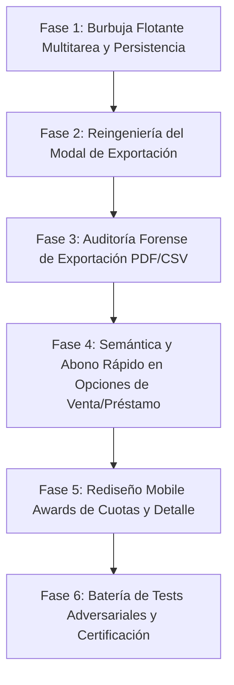

# PLAN MAESTRO PARTE 2: BURBUJA FLOTANTE GLOBAL, EXPORTACIÓN MODULAR COMBINABLE, ACCIONES DE VENTA/PRÉSTAMO Y DETALLES "MOBILE AWARDS"

> **MochilaLista App — Ciclo de Auditoría Forense y Perfeccionamiento UX/UI (Parte 2)**  
> **Fecha:** 20 de Octubre de 2026  
> **Estado:** Propuesta Técnica Exhaustiva para Revisión y Aprobación del Usuario  
> **Árbitro Interno Adversarial:** Activo (Cero regresiones, 100% pruebas aprobadas, cero desbordamientos `RenderFlex` a 360px).

---

## 📋 1. RESUMEN EJECUTIVO Y OBJETIVOS DE LA PARTE 2

Tras certificar con éxito la **Parte 1** (Paridad de datos entre Home e Historial, Verdad Contable, KPIs Responsivos en 3 columnas y Barra Unificada de Filtros), la **Parte 2** se enfoca en resolver integralmente la interactividad global de la navegación profunda, la experiencia de generación y descarga de reportes, las acciones contextuales de venta/préstamo y el rediseño sin colisiones de las ventanas de detalle.

### 4 Bloques Fundamentales:
1. **Restauración, Persistencia Global y Conmutación Inteligente en `DeepNavReturnPill`:**
   * Reintegración en `sales_history_screen.dart` con anclaje seguro y capacidad de auto-ocultamiento/repliegue en el borde (`isEdgeTucked`).
   * Persistencia global entre pantallas (`FloatingDockSessionState`) del lado (`isLeftEdge`), altura vertical (`panBottom`) y modo replegado (`isEdgeTucked`), evitando saltos o reseteos al cambiar de ruta.
   * Detección gestual táctil tripartita:
     * **Toque normal instantáneo:** Navega de inmediato a la tarea activa.
     * **Arrastre con desplazamiento (> 8px):** Mueve y acomoda la píldora libremente por la pantalla, acoplándola al borde izquierdo/derecho o replegándola.
     * **Pulsación estacionaria (450ms–500ms sin mover y soltar):** NO navega; activa feedback háptico y conmuta/rota la píldora entre los distintos trabajos pendientes disponibles (Caja Rápida, Cotización Manual, Conciliación Lista, etc.) con animación fluida `AnimatedSwitcher`.
2. **Reingeniería del Modal `Opciones de Exportación` (Imágenes 1 y 2):**
   * Eliminación de la lista vertical plana de 7 opciones ambiguas que se cortaba al scrollear.
   * Nueva interfaz modular con encabezado fijo, pie de acción fijo y **3 Selectores Claros y Combinables**:
     * **Selector 1 (Alcance Temporal):** Vista Actual, Todo el Periodo Activo, Histórico Completo.
     * **Selector 2 (Tipo y Estado Financiero):** Todas las Activas, Solo Cotizaciones Vendidas, Solo Caja Rápida, Solo Préstamos, Solo Anuladas + Filtro financiero (Todos, Pagados, Con Deuda).
     * **Selector 3 (Organización y Pago):** Lista Continua, Agrupado por Método de Pago, o Filtrar por un Método Específico.
     * **Resumen Previo en Vivo:** Tarjeta interactiva con contador exacto de registros y selector de formato (PDF / CSV Excel).
3. **Auditoría Forense de Exportación (SQLite -> PDF / CSV):**
   * Paridad 100% entre la combinación elegida, las consultas SQLite y el archivo final (fechas, pestaña, método, ordenamiento `sortBy`).
   * Columnas contables verídicas: `Importe Total`, `Monto Cobrado / Abonado`, `Deuda Pendiente`, erradicando confusiones de ingreso en caja y suprimiendo campos irrelevantes para préstamos (como estado de entrega de mercadería).
4. **Auditoría del Modal `Opciones de Venta / Préstamo` (Imagen 3):**
   * Adaptación semántica para préstamos (`sale.isLoan == true`): `Opciones de Préstamo`, `Ver Detalle del Préstamo`, `Descargar Constancia PDF`, `Compartir Constancia`, `Anular Préstamo`.
   * Banner de saldo deudor y acción destacada rápida **`"💸 Registrar Abono / Cobrar Deuda"`** cuando `sale.pendingDebt > 0.01`.
   * Verificación de anulación con devolución exacta de stock por factor `unidadesPorVenta` y sincronización reactiva 0ms.
5. **Rediseño "Mobile Awards" de Ventanas de Detalle (Imágenes 4 y 5):**
   * **Erradicación del colapso en `Plan de Cuotas` (`SalePaymentTimeline` — Imagen 4):** Sustitución del `ListTile` estrecho por tarjetas modulares donde la fecha (`Vence: 29/08/2026`) y badges (`PENDIENTE`, `PAGADO`) jamás se quiebran ni desbordan en pantallas de 360px.
   * **Semántica de Préstamos en `DetailStatusCard` (Imagen 5):** Cambio de `"ESTADO DE LA VENTA"` a `"ESTADO DEL PRÉSTAMO"`, eliminación de `"📦 ENTREGADO AL INSTANTE"` y desglose explícito de **Capital Prestado**, **Interés / Financiamiento**, **Total a Devolver**, **Abonado** y **Deuda Pendiente**.
   * Barra de acciones inferior para préstamos (PDF constancia, WhatsApp y Registrar Abono).

---

## 🔍 2. DIAGNÓSTICO FORENSE DE CÓDIGO Y EVIDENCIA VISUAL

### A. Diagnóstico de la Burbuja Flotante (`DeepNavReturnPill`)
* **Archivo:** `app_movil/lib/core/widgets/deep_nav_return_pill.dart`
* **Líneas 53-73 (`initState` y `_syncSessionState`):**
  * `_isLeftEdge`, `_isEdgeTucked`, `_panBottom`, `_panX` leen de `FloatingDockSessionState`.
  * Sin embargo, en `onPanEnd` (línea 349), `_panX` se asigna a `null`, pero `_panBottom` no se guarda en modo relativo normalizado frente a cambios de orientación o pantallas con distinto padding superior/inferior.
  * No existe una variable `selectedPendingTaskIndex` persistida globalmente.
* **Líneas 90-214 (`build` y cascada de prioridades):**
  * El código actual evalúa en orden excluyente:
    ```dart
    if (quickProv.cartItems.isNotEmpty) { ... return _buildPill(...); }
    if (scannerProv.stagingData != null) { ... return _buildPill(...); }
    if (matchingProv.pairs.isNotEmpty) { ... return _buildPill(...); }
    if (smartProv.hasManualDraft) { ... return _buildPill(...); }
    if (invProv.hasCreationDraft) { ... return _buildPill(...); }
    ```
    Si el usuario tiene productos en Caja Rápida Y una cotización manual en borrador, **la cotización queda permanentemente inaccesible** desde la píldora.
* **Líneas 325-352 (`GestureDetector`):**
  * Solo gestiona `onPanUpdate` y `onPanEnd`, mientras que el `InkWell(onTap: onTap)` está adentro en la línea 359.
  * No hay temporizador para detectar una pulsación larga estacionaria (sin movimiento > 8px) que conmute de tarea sin disparar la navegación al soltar el dedo.

### B. Diagnóstico de la Modal de Exportación (Imágenes 1 y 2)
* **Archivo:** `app_movil/lib/core/widgets/export_options_modal.dart`
* **Líneas 103-130:**
  * Se renderiza un `ListView.separated` vertical plano de 7 opciones fijas sin agrupar.
  * En la **Imagen 2**, al scrollear hacia abajo, la lista se corta visualmente contra el título y el separador sin un contenedor con encabezado y pie de página anclados (`InteractiveSheetWrapper`).
  * En `sales_history_screen.dart` (líneas 131-170), el método `_handleExport` evalúa mediante cadenas rígidas `optionId == 'current'`, `full_period`, `full_history`, etc., imposibilitando combinar un periodo específico con solo préstamos y agrupado por método de pago.
* **Archivo:** `app_movil/lib/features/smart_quotation/providers/sale_provider.dart`
* **Líneas 480-507 (`loadAllForExport`):**
  * Tiene `origenVenta: null` cableado fijo (línea 498).
  * No recibe parámetros para filtrar por método de pago ni para filtrar por tipo de origen (`prestamo_personal`, `pos_rapido`, `smart_quotation`), forzando filtrados en memoria posteriores que rompen la coherencia con SQLite.
* **Archivo:** `app_movil/lib/features/smart_quotation/services/history_export_service.dart`
* **Líneas 193-212 (`_buildSalesTable`):**
  * Columnas fijas: `['N°', 'Fecha', 'Cliente', 'Origen', 'Método', 'Total']`.
  * **Omisión contable crítica:** No desglosa el `Abonado` ni la `Deuda Pendiente`. Una venta de S/ 23.57 con abono de S/ 5.00 aparece como si hubiese ingresado completa por S/ 23.57.
  * En CSV (líneas 246 y 271), para préstamos incluye `Estado Entrega`, un concepto que no aplica a un desembolso monetario.

### C. Diagnóstico del Modal `Opciones de Venta / Préstamo` (Imagen 3)
* **Archivo:** `app_movil/lib/features/smart_quotation/widgets/history/sale_action_bottom_sheet.dart`
* **Líneas 283-355:**
  * Si `sale.isLoan == true`, el título cambia a `Opciones de Préstamo #ID`, pero las acciones inferiores mantienen:
    * `Descarga Rápida (Boleta)` en lugar de `Descargar Constancia PDF`.
    * `Compartir Comprobante` en lugar de `Compartir Constancia`.
  * Si la venta o préstamo tiene saldo pendiente (`sale.pendingDebt > 0.01`), **no existe ningún resumen ni acceso rápido para abonar**. El usuario debe navegar obligatoriamente hasta el perfil del cliente en el CRM para registrar un pago.

### D. Diagnóstico del Detalle de Venta y Préstamo (Imágenes 4 y 5)
* **Archivo:** `app_movil/lib/features/smart_quotation/widgets/history/detail_widgets/sale_payment_timeline.dart`
* **Líneas 51-113 (`ListTile` en `Plan de Cuotas` — Imagen 4):**
  * `ListTile` distribuye el ancho disponible en una sola fila entre `leading` (avatar circular), `title` / `subtitle` (en columna central) y `trailing` (`monto` + botón WhatsApp).
  * En pantallas de 360px a 400px, el espacio central se reduce a apenas ~120px. Esto provoca que el texto de la fecha se parta (`"Vence: 29/08/20\n26"`) y el texto del badge se corte a la mitad (`"PENDIENT\nE"`).
* **Archivo:** `app_movil/lib/features/smart_quotation/widgets/history/detail_widgets/detail_status_card.dart`
* **Líneas 68-87 (`ESTADO DE LA VENTA` — Imagen 5):**
  * Encabezado fijo: `Text("ESTADO DE LA VENTA", ...)`.
  * Renderiza invariablemente `deliveryIcon = Icons.inventory` y `deliveryStr = "ENTREGADO AL INSTANTE"`.
  * En un préstamo personal (`saleData['origen_venta'] == 'prestamo_personal'`), esto genera una grave inconsistencia visual y contable, confiriendo estatus de mercadería física a una operación de crédito.
* **Archivo:** `app_movil/lib/features/smart_quotation/widgets/history/detail_widgets/sale_action_footer.dart`
* **Línea 644 de `sale_history_detail_screen.dart`:**
  * `bottomNavigationBar: isLoan ? null : SaleActionFooter(...)`.
  * En préstamos no hay barra de acciones inferior, dejando la pantalla desprovista de acceso rápido para generar constancia, compartir por WhatsApp o registrar abono.

---

## 🏛️ 3. ARQUITECTURA DE LA SOLUCIÓN TÉCNICA

### Bloque 1: Modelo y Gestor de Píldora Flotante Multitarea (`DeepNavReturnPill`)
1. **Definición de `PendingTaskItem`:**
   ```dart
   class PendingTaskItem {
     final String id; // 'quick_sale', 'scanner_staging', 'matching', 'manual_quote', 'product_create'
     final String label;
     final String sublabel;
     final IconData icon;
     final Color color;
     final VoidCallback onTap;
     
     const PendingTaskItem({ ... });
   }
   ```
2. **Controlador Global en Memoria (`FloatingDockSessionState`):**
   * Almacena:
     * `isLeftEdge`: booleano (anclado a izquierda o derecha).
     * `panBottom`: double normalizado en píxeles desde el borde inferior.
     * `isEdgeTucked`: booleano (si la píldora está colapsada como pestaña lateral).
     * `selectedTaskIndex`: índice entero de la tarea activa seleccionada.
3. **Máquina de Estados de Gestos en `DeepNavReturnPill`:**
   * Al hacer `onPointerDown`:
     * Guarda posición inicial `(startX, startY)` y marca `_isDragging = false`.
     * Inicia un `Timer` de 450ms (`_stationaryTimer`).
   * Al hacer `onPointerMove`:
     * Si la distancia euclidiana `sqrt(dx^2 + dy^2) > 8.0px`, se cancela `_stationaryTimer` y se activa el modo arrastre (`_isDragging = true`).
     * Se actualizan `_panX` y `_panBottom`.
   * Al hacer `onPointerUp`:
     * Si `_stationaryTimer` expiró exitosamente mientras el dedo permanecía quieto (pulsación estacionaria completada):
       * Se ejecuta feedback háptico `HapticFeedback.selectionClick()`.
       * Se conmuta la tarea: `selectedTaskIndex = (selectedTaskIndex + 1) % activeTasks.length`.
       * Se anima la transición mediante `AnimatedSwitcher`.
     * Si se levantó el dedo ANTES de 450ms y sin arrastre (`_isDragging == false`):
       * Toque normal instantáneo: ejecuta el `onTap` de la tarea actualmente visible.
     * Si hubo arrastre (`_isDragging == true`):
       * Ajusta el snap al borde más cercano o retrae si la velocidad/posición cruza el umbral de borde (`_isEdgeTucked`).

---

### Bloque 2: Reingeniería del Modal de Exportación Combinable
```
+---------------------------------------------------------------+
|  📥 Opciones de Exportación                        [ X ]      |
+---------------------------------------------------------------+
|  1. ALCANCE TEMPORAL                                          |
|  [ Vista Actual ]   [ Todo el Periodo ]   [ Histórico Total ] |
|                                                               |
|  2. TIPO DE OPERACIÓN Y ESTADO CONTABLE                       |
|  Tipo:                                                        |
|  [ Todas ] [ Cotizaciones ] [ Caja Rápida ] [ Préstamos ] [ Anuladas ] |
|  Financiero:                                                  |
|  [ Todos ] [ Solo Pagados ] [ Con Deuda Pendiente ]           |
|                                                               |
|  3. ORGANIZACIÓN Y MÉTODO DE PAGO                             |
|  [ Lista Continua ]  [ Agrupado por Método ]  [ Por Método ]  |
|  (Chips si aplica: [Efectivo] [Yape] [Plin] [Transferencia])  |
+---------------------------------------------------------------+
|  📊 RESUMEN PREVIO EN VIVO                                     |
|  "Se exportarán 24 registros (Periodo: 6 Meses • Deuda: S/ 18.57)" |
|  Formato: [ (o) PDF Profesional ]   [ ( ) Excel / CSV ]       |
+---------------------------------------------------------------+
|  [            ⬇️ GENERAR Y DESCARGAR REPORTE                 ] |
+---------------------------------------------------------------+
```
* **Estado reactivo local:** Al pulsar cualquier selector, se recalculan inmediatamente los criterios y el conteo previo (`provider.countForExport(...)`).
* **Botón principal inferior anclado:** Permanece siempre visible y accesible con el pulgar sin sufrir recortes por scroll.

---

### Bloque 3: Sincronización Forense de Datos en `HistoryExportService`
1. **Ampliación de `loadAllForExport` en `SaleProvider`:**
   ```dart
   Future<List<SaleModel>> loadAllForExport({
     bool ignoreDateFilter = false,
     bool onlyArchived = false,
     String? origenVenta,
     String? financialStatus,
     String? paymentMethod,
     String? sortBy,
     String? order,
   });
   ```
2. **Columnas de Verdad Contable en PDF y CSV:**
   * En PDF: `['#ID', 'Fecha', 'Cliente', 'Origen', 'Método', 'Total', 'Abonado', 'Deuda']`.
   * En CSV: Columnas explícitas `Total Exigible`, `Monto Abonado`, `Deuda Pendiente`, `Estado Financiero`.
   * Para Préstamos: Se oculta `Estado de Entrega` y se muestran `Capital Prestado` e `Interés (%)`.
   * Totales al pie de página:
     * **Total Facturado / Préstamos Emitidos:** Sumatoria de `totalAmount`.
     * **Total Efectivamente Cobrado / Ingreso en Caja:** Sumatoria de `totalPaid`.
     * **Total Saldo Deudor por Cobrar:** Sumatoria de `pendingDebt`.

---

### Bloque 4: Enriquecimiento Semántico de `SaleActionBottomSheet`
1. **Encabezado con Verdad Contable:**
   * Muestra el badge de origen y, si `sale.pendingDebt > 0.01`, una tarjeta de advertencia suave:  
     `⚠️ Deuda Pendiente: S/ 18.57 (Abonado: S/ 5.00 de S/ 23.57)`.
2. **Acción Rápida de Abono:**
   * Botón de acento: `"💸 Registrar Abono / Cobrar Deuda"`. Al tocarlo, si existe `cliente_id`, abre `PaymentEntryModal(client: client)` o un diálogo ágil de abono con actualización a 0ms.
3. **Textos Adaptativos:**
   * `isLoan == true`:
     * `"Descargar Constancia PDF"` (ícono `description`).
     * `"Compartir Constancia"` (ícono `share`).
     * `"Anular Préstamo"` / `"Restaurar Préstamo"`.

---

### Bloque 5: Rediseño "Mobile Awards" de Ventanas de Detalle
1. **Rediseño de Cuotas en `SalePaymentTimeline` (Erradicación de rotura de fecha):**
   * En lugar de `ListTile`, cada cuota es un contenedor con disposición vertical en 2 niveles:
     * **Nivel 1 (Fila Principal):**  
       `[ #1 ]` Avatar circular compacto + `Vence: 29/08/2026` (`fontSize: 14, fontWeight: bold`, `maxLines: 1`) + `Flexible/Spacer` + `S/ 15.00` en negrita contrastada.
     * **Nivel 2 (Fila de Estado y Acciones):**  
       Chip de estado (`PENDIENTE` en ámbar suave / `PAGADO` en verde esmeralda) + Botón WhatsApp recordatorio + Botón de registrar abono a cuota.
   * Cero desbordamiento (`RenderFlex overflow`) en cualquier pantalla de 360px a 412px.
2. **Coherencia Semántica en `DetailStatusCard` para Préstamos:**
   * Si `sale.isLoan == true`:
     * Título de sección: `"ESTADO DEL PRÉSTAMO"`.
     * Banner temático:
       * Si está pagado: `✅ PRÉSTAMO LIQUIDADO`.
       * Si tiene abonos: `🟠 PAGO PARCIAL (Saldo por Cobrar)`.
       * Si no tiene abonos: `💸 PRÉSTAMO DESEMBOLSADO · EN CURSO`.
     * Desglose financiero ordenado:
       * `Capital Inicial Prestado:` `S/ 200.00`
       * `Interés / Financiamiento (20.0%):` `+ S/ 40.00`
       * `Total a Devolver:` `S/ 240.00`
       * `Total Abonado:` `S/ 0.00`
       * `Saldo Deudor Exigible:` `S/ 240.00`
3. **Pie de Acciones en Detalle de Préstamo (`SaleActionFooter`):**
   * Integración de barra inferior para préstamos con:
     * Botón `PDF` (Constancia de Préstamo).
     * Botón `WhatsApp` (Recordatorio / Comprobante de Préstamo).
     * Si tiene deuda: Botón destacado `"💸 Cobrar Deuda / Registrar Abono"`.

---

## 📅 4. PLAN DE TRABAJO PASO A PASO (FASES DE IMPLEMENTACIÓN)



### Fase 1: Restauración, Persistencia Global y Gesto Estacionario en `DeepNavReturnPill`
* Reincorporar `DeepNavReturnPill(isBottom: true)` en `sales_history_screen.dart`.
* Crear `PendingTaskItem` y compilar dinámicamente la lista de todas las tareas activas en segundo plano (`QuickSale`, `ScannerStaging`, `Matching`, `ManualQuotation`, `ProductCreate`).
* Añadir `selectedTaskIndex` a `FloatingDockSessionState` y sincronizar coordenadas globales.
* Implementar el listener con detección de umbral de movimiento (> 8px) y temporizador de 450ms para conmutación estacionaria con `AnimatedSwitcher` y `HapticFeedback`.

### Fase 2: Reingeniería del Modal `Opciones de Exportación`
* Reestructurar `ExportOptionsModal` con `InteractiveSheetWrapper` (encabezado fijo, cuerpo scrolleable y pie fijo).
* Implementar los 3 Selectores Combinables:
  1. Alcance Temporal (`Vista Actual`, `Periodo Activo`, `Histórico Total`).
  2. Tipo y Estado (`Todas`, `Cotizaciones`, `Caja Rápida`, `Préstamos`, `Anuladas` + `Todos`, `Pagados`, `Con Deuda`).
  3. Organización y Pago (`Continua`, `Agrupada por Método`, `Método Específico`).
* Diseñar la tarjeta de resumen previo en vivo con conteo dinámico de operaciones y selector de formato (PDF / CSV).

### Fase 3: Auditoría Forense de Exportación en SQLite, Servicio y Formatos
* Actualizar `loadAllForExport` en `SaleProvider` y `SaleRepository` para soportar parámetros combinados (`origenVenta`, `financialStatus`, `paymentMethod`, `sortBy`, `order`).
* Modificar `HistoryExportService` para incluir columnas contables (`Abonado`, `Deuda Pendiente`, `Estado Financiero`).
* Suprimir campos de mercadería en préstamos y garantizar que los totales de cabecera distingan entre ingresos cobrados y cuentas por cobrar.

### Fase 4: Auditoría y Adaptación Semántica de `SaleActionBottomSheet`
* Detectar `sale.isLoan == true` y transformar textos/íconos a constancias de préstamo y anulación de préstamo.
* Si `sale.pendingDebt > 0.01`, incorporar banner de saldo deudor en la cabecera del modal y el botón rápido `"💸 Registrar Abono / Cobrar Deuda"`.
* Verificar que la anulación de ventas/préstamos revierta el stock por factor y actualice inmediatamente el Historial, los KPIs y la Actividad Reciente del Home.

### Fase 5: Rediseño "Mobile Awards" de Ventanas de Detalle (Recibo, Cuotas y Préstamos)
* Rediseñar `SalePaymentTimeline` con tarjetas modulares de 2 niveles, erradicando saltos de línea en fechas (`Vence: 29/08/2026`) y estados en pantallas de 360px.
* Adaptar `DetailStatusCard` para préstamos: sección `"ESTADO DEL PRÉSTAMO"`, reemplazo de entrega de mercadería por estado financiero y desglose de capital, interés y saldo.
* Adaptar `SaleActionFooter` para préstamos (constancia PDF, WhatsApp y registrar abono).
* Ajustar `DetailNotesCard` para reflejar `"MOTIVO DEL PRÉSTAMO"`.

### Fase 6: Pruebas Automatizadas y Certificación Adversarial
* Crear la suite de pruebas unitarias y de widgets: `test/sales_history_part2_dock_export_detail_test.dart`.
* Validaciones críticas:
  1. Conmutación estacionaria en `DeepNavReturnPill` y persistencia de posición entre rutas.
  2. Renderizado del modal de exportación combinable y exactitud en el conteo previo.
  3. Desglose contable en reportes exportados (Abonado vs Deuda).
  4. Rediseño de cuotas sin desbordamiento horizontal en 360px.
  5. Semántica de préstamo en el detalle (sin entrega física y con desglose de interés).
* Ejecución global: `flutter analyze lib test` con 0 errores y `flutter test` con 100% aprobado.

---

## 🛡️ 5. MATRIZ DE COBERTURA Y CRITERIOS DE ACEPTACIÓN ADVERSARIAL

| Requerimiento del Usuario | Criterio de Certificación Adversarial | Validación en Pruebas |
| :--- | :--- | :--- |
| **Persistencia de `DeepNavReturnPill`** | La posición (lado, altura y repliegue) se mantiene idéntica al navegar entre Catálogo, Inventario, Historial y Detalle. | Test de integración verifica que `FloatingDockSessionState` preserva las coordenadas tras desmontar y volver a montar. |
| **Conmutación Estacionaria sin Navegar** | Mantener pulsado 450ms sin mover (> 8px) y soltar rota a la siguiente tarea pendiente sin disparar `Navigator.push`. Toque rápido navega. | Widget test simula pulsación estacionaria y verifica que no hubo navegación y cambió el `selectedTaskIndex`. |
| **Modal de Exportación Combinable** | El modal permite combinar periodo + tipo de venta + estado financiero + agrupación sin cortarse visualmente. | Widget test verifica presencia de los 3 selectores y que el pie de descarga permanece en el árbol visible. |
| **Verdad Contable en Reportes** | El PDF y CSV muestran columnas explícitas de `Abonado` y `Deuda Pendiente`, y préstamos no muestran `Estado Entrega`. | Test unitario de exportación valida las celdas generadas en el reporte. |
| **Cuotas sin Quiebre de Texto (360px)** | `Plan de Cuotas` muestra `Vence: 29/08/2026` y `PENDIENTE` en una sola línea nítida sin saltos ni desbordamientos. | Golden / Layout test con viewport 360x640 confirma `tester.takeException() == null` y texto sin `\n`. |
| **Semántica de Préstamo en Detalle** | `Préstamo #2` dice `"ESTADO DEL PRÉSTAMO"`, desglosa capital e interés y nunca dice `"ENTREGADO AL INSTANTE"`. | Widget test verifica ausencia de `"ENTREGADO AL INSTANTE"` y presencia de desglose de capital/interés. |
