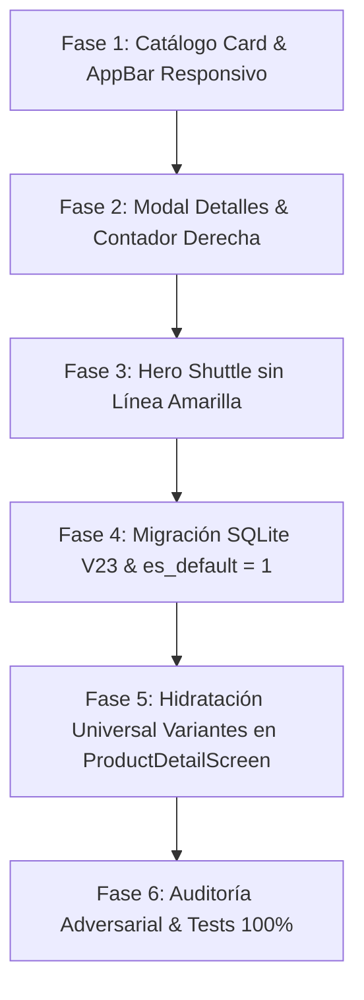

# PLAN PARTE 2: REFINAMIENTO VISUAL DE CATÁLOGO, MODALES, TRANSICIONES Y ARQUITECTURA DE PRESENTACIONES/VARIANTES

**Documento:** `analisis_proyecto/PLAN_PARTE2_CATALOGO_MODALES_Y_ARQUITECTURA_PRESENTACIONES.md`  
**Estado:** Propuesta de Plan Integral para Aprobación  
**Estándar de Calidad:** Mobile Awards (Google Play Best Apps), SQLite Local a 0ms, Zero-Truncamiento, Cero Líneas Amarillas y Cero Regresiones.  
**Metodología:** Loop Autónomo (*Planificar $\rightarrow$ Construir $\rightarrow$ Probar $\rightarrow$ Auditar Adversarialmente $\rightarrow$ Corregir $\rightarrow$ Certificar*)

---

## 1. RESUMEN EJECUTIVO Y DIAGNÓSTICO EN CÓDIGO

A partir de la inspección exhaustiva de las capturas reales de la aplicación y del análisis directo del código fuente en `catalog_item_card.dart`, `catalog_screen.dart`, `product_detail_modal.dart`, `product_detail_screen.dart`, `live_filter_bottom_sheet.dart`, `product_create_screen.dart`, `product_edit_screen.dart`, `scanner_batch_saver.dart`, `product_repository.dart` y `local_db.dart`, se han identificado las causas raíz exactas de cada fallo:

| # | Componente / Área | Síntoma Reportado | Causa Raíz Detectada en Código |
|---|---|---|---|
| **1.1** | `catalog_item_card.dart` | La fila de datos financieros sobre el precio se corta feamente (`"● C: S/ 0.83 · 3..."`). | Línea 273: Un `Flexible(child: Text("C: S/ ... · ...%"))` dentro de una columna de ~100px compitiendo con el botón `+`. Desborda el ancho disponible y el truncado por elipsis corta los números a la mitad. |
| **1.2** | `catalog_screen.dart` | El título del AppBar aparece truncado como `"Catálogo..."`. | Líneas 537–548: `title: Text("Catálogo de Ventas", style: textTheme.displayMedium)` con `centerTitle: true` compitiendo con 3 botones de acción (`~175px`) y botón `leading` (`~48px`). En pantallas de 360–390px no cabe y Flutter aplica elipsis automática. |
| **1.3** | `product_detail_modal.dart` | Badge `"↗ 30.8% (Excelente)"` se sale del contenedor por la derecha; `"PRESENTACIÓN"` se corta como `"PRESENTAC..."`. | Línea 469: El texto `"DATOS FINANCIEROS (INTERNO)"` es excesivamente largo y no tiene `Expanded`, empujando el badge fuera del margen. En `_DetailPill` (línea 849), la palabra `"PRESENTACIÓN"` (12 chars) excede el ancho de 1 tercio de pantalla sin `FittedBox`. |
| **1.4** | `product_detail_modal.dart` | Contador `[- 1 +]` está muy pegado a la izquierda junto a `"Precio Venta S/ 1.20"`. | Línea 626: Se usó un `Wrap` sin ancho forzado en lugar de `Row(mainAxisAlignment: MainAxisAlignment.spaceBetween)`, provocando que ambos elementos se agrupen pegados a la izquierda. |
| **1.5** | `product_detail_screen.dart` | Línea amarilla y leve desborde bajo la abreviación del producto (ej. `"VB"`) durante la transición Hero al abrir Ficha Completa. | Línea 367: El `Hero` no cuenta con un ancestro directo `Material(type: MaterialType.transparency)` durante el vuelo del shuttle, lo que hace que Flutter pinte el subrayado amarillo doble por defecto en textos sin Material. |
| **2.1** | `product_detail_screen.dart` | No se muestran horizontalmente las demás presentaciones hermanas del producto (`"Seleccionar Variante:"` solo muestra 1). | Línea 41 de `initState`: `if (_currentProduct.presentaciones.isEmpty) { await _refreshData(); }`. Al venir desde el Catálogo con 1 variante, la lista NO está vacía, por lo que **jamás consultaba SQLite para hidratar las demás variantes**. |
| **2.2** | `live_filter_bottom_sheet.dart` / SQLite | Filtro `"Solo presentación principal"` muestra `0` productos a pesar de haber 97 productos y 100 variantes. | Línea 267 de `scanner_batch_saver.dart`: ¡Al escanear/crear productos desde facturas, todas las variantes se insertaban fijas con `'es_default': 0`! Al no existir ninguna variante con `1`, la consulta `AND pr.es_default = 1` devuelve 0 filas. |
| **2.3** | `product_edit_screen.dart` | Al editar un producto, muestra la segunda presentación creada como si fuera la principal. | Líneas 77–85: El código removía la variante seleccionada (`initialPresentationId`) y la insertaba arbitrariamente en el índice 0 (`sortedList.insert(0, selected)`), rompiendo el orden natural canónico de la base de datos. |

---

## 2. PLAN DE IMPLEMENTACIÓN DIVIDIDO EN 6 FASES



---

### FASE 1: REFINAMIENTO VISUAL DE TARJETAS DE CATÁLOGO Y APPBAR RESPONSIVO
**Archivos objetivo:**
- [`lib/core/widgets/catalog_item_card.dart`](file:///c:/Users/vjuli/Documents/mochilalista-app/app_movil/lib/core/widgets/catalog_item_card.dart)
- [`lib/features/catalog/screens/catalog/catalog_screen.dart`](file:///c:/Users/vjuli/Documents/mochilalista-app/app_movil/lib/features/catalog/screens/catalog/catalog_screen.dart)

#### 1.1 Rediseño de Fila Financiera en `CatalogItemCard` (Zero Truncamiento):
- Sustituir la concatenación de texto vulnerable a elipsis por una **micro-píldora financiera compacta con auto-escalado**:
  - Envolver en `FittedBox(fit: BoxFit.scaleDown, alignment: Alignment.centerLeft)` para que en pantallas compactas o tarjetas angostas la tipografía escale limpiamente sin jamás cortar dígitos con `...`.
  - Micro-indicador semafórico (círculo de 5px con color según rentabilidad).
  - Costo formateado: `C: S/ 0.83` (estilo `bold`, 9.5px).
  - Separador sutil `·`.
  - Margen formateado: `+31%` con color de acento según margen ($\ge 30\%$ verde, $\ge 15\%$ ámbar, $< 15\%$ rojo).
  - Si no tiene costo: `Sin costo` estilizado y limpio.

#### 1.2 Título AppBar Responsivo en `catalog_screen.dart`:
- Eliminar la restricción de `centerTitle: true` cuando el espacio horizontal esté comprometido por los botones de acción (`InfoTooltip`, `Modo Tienda`, `Refresh`).
- Reemplazar el `Text("Catálogo de Ventas", style: textTheme.displayMedium...)` por un contenedor responsivo:
  - Usar `FittedBox(fit: BoxFit.scaleDown, alignment: Alignment.centerLeft)` con `titleLarge` (18–19px en negrita con letterSpacing equilibrado).
  - En pantallas estándar $\ge 380\text{px}$, muestra `"Catálogo de Ventas"`.
  - En pantallas ultra-angostas $< 360\text{px}$, escala suavemente sin agregar jamás puntos suspensivos `...`.
  - Optimizar el padding del botón `"Tienda"` para ganar 12px de respiro en el AppBar.

---

### FASE 2: REFINAMIENTO DEL MODAL DE DETALLES (`product_detail_modal.dart`)
**Archivo objetivo:**
- [`lib/core/widgets/product_detail_modal.dart`](file:///c:/Users/vjuli/Documents/mochilalista-app/app_movil/lib/core/widgets/product_detail_modal.dart)

#### 2.1 Limpieza de Título y Blindaje Anti-Desborde en Datos Financieros:
- Eliminar la palabra redundante `"(INTERNO)"`, dejando el título limpio: `"DATOS FINANCIEROS"`.
- Estructurar la fila superior de la tarjeta financiera con `Row`:
  - Izquierda: `Row` con icono `query_stats_rounded` + `Text("DATOS FINANCIEROS", style: TextStyle(fontSize: 11, fontWeight: FontWeight.w900))`.
  - Derecha: `Container` de badge de margen (`"↗ 30.8% (Excelente)"`) envuelto en `Flexible` con `FittedBox(fit: BoxFit.scaleDown)` para garantizar que jamás se salga ni desborde el margen derecho de la tarjeta.

#### 2.2 Tarjetas Superiores Bento (`_DetailPill`) sin Truncamiento:
- En `_DetailPill`, envolver el `Text(label.toUpperCase())` en un `FittedBox(fit: BoxFit.scaleDown)` con tamaño de fuente calibrado a 9.5px.
- La etiqueta `"PRESENTACIÓN"` (12 caracteres) se renderizará completa y nítida en cualquier pantalla sin truncarse a `"PRESENTAC..."`.

#### 2.3 Alineación del Contador de Productos `[- 1 +]` a la Extrema Derecha:
- Reemplazar el `Wrap(alignment: WrapAlignment.spaceBetween, ...)` por un `Row`:
  ```dart
  Row(
    mainAxisAlignment: MainAxisAlignment.spaceBetween,
    crossAxisAlignment: CrossAxisAlignment.end,
    children: [
      // Extremo Izquierdo: Precio Venta y Oferta
      Column(
        crossAxisAlignment: CrossAxisAlignment.start,
        children: [ ... Precio ... ],
      ),
      // Extremo Derecho: Selector de Cantidad [- 1 +]
      Container( ... Contador ... ),
    ],
  )
  ```
- El precio queda anclado a la izquierda y el selector de cantidad queda perfectamente alineado a la esquina derecha, aprovechando todo el ancho de la ventana con estética profesional.

---

### FASE 3: TRANSICIÓN HERO SIN LÍNEA AMARILLA HACIA `ProductDetailScreen`
**Archivos objetivo:**
- [`lib/core/widgets/catalog_item_card.dart`](file:///c:/Users/vjuli/Documents/mochilalista-app/app_movil/lib/core/widgets/catalog_item_card.dart)
- [`lib/core/widgets/product_detail_modal.dart`](file:///c:/Users/vjuli/Documents/mochilalista-app/app_movil/lib/core/widgets/product_detail_modal.dart)
- [`lib/features/catalog/screens/product_detail_screen.dart`](file:///c:/Users/vjuli/Documents/mochilalista-app/app_movil/lib/features/catalog/screens/product_detail_screen.dart)

#### 3.1 Blindaje de Hero con `Material(type: MaterialType.transparency)`:
- Envolver el hijo del `Hero` tanto en el card/modal como en `ProductDetailScreen` con `Material(type: MaterialType.transparency)`.
- Esto garantiza que el widget de texto interno (las iniciales de abreviación como `"VB"`) mantenga un ancestro `Material` en todo momento durante el vuelo de la animación, eliminando al 100% las dos líneas amarillas de depuración de Flutter.

#### 3.2 Implementación de `flightShuttleBuilder` Responsivo:
- Configurar un `flightShuttleBuilder` en el `Hero` de `ProductDetailScreen`:
  ```dart
  flightShuttleBuilder: (flightContext, animation, flightDirection, fromHeroContext, toHeroContext) {
    return Material(
      type: MaterialType.transparency,
      child: toHeroContext.widget,
    );
  }
  ```
- Elimina cualquier overflow geométrico durante el cambio de tamaño entre el modal/tarjeta (86x86) y la cabecera expandida (300px), logrando una transición suave de 60fps.

---

### FASE 4: ARQUITECTURA SQLITE DE PRESENTACIONES Y MIGRACIÓN V23 (`es_default = 1`)
**Archivos objetivo:**
- [`lib/core/database/local_db.dart`](file:///c:/Users/vjuli/Documents/mochilalista-app/app_movil/lib/core/database/local_db.dart)
- [`lib/features/scanner/services/scanner_batch_saver.dart`](file:///c:/Users/vjuli/Documents/mochilalista-app/app_movil/lib/features/scanner/services/scanner_batch_saver.dart)
- [`lib/features/catalog/services/product_service.dart`](file:///c:/Users/vjuli/Documents/mochilalista-app/app_movil/lib/features/catalog/services/product_service.dart)
- [`lib/features/catalog/screens/product_create_screen.dart`](file:///c:/Users/vjuli/Documents/mochilalista-app/app_movil/lib/features/catalog/screens/product_create_screen.dart)
- [`lib/features/catalog/screens/product_edit_screen.dart`](file:///c:/Users/vjuli/Documents/mochilalista-app/app_movil/lib/features/catalog/screens/product_edit_screen.dart)
- [`lib/features/catalog/repositories/product_repository.dart`](file:///c:/Users/vjuli/Documents/mochilalista-app/app_movil/lib/features/catalog/repositories/product_repository.dart)

#### 4.1 Migración V22 $\rightarrow$ V23 en `local_db.dart` + Saneamiento Idempotente:
- Incrementar la versión de base de datos a `version: 23`.
- En `_onUpgrade`:
  ```sql
  -- Migración V22 -> V23: Garantizar es_default = 1 en la primera presentación de cada producto
  UPDATE presentaciones_producto
  SET es_default = 1
  WHERE id IN (
    SELECT MIN(id)
    FROM presentaciones_producto
    WHERE activo = 1
    GROUP BY producto_id
    HAVING SUM(CASE WHEN es_default = 1 THEN 1 ELSE 0 END) = 0
  );
  ```
- Agregar el método estático `sanitizePresentacionesDefault(Database db)` para ejecutarse al abrir la base de datos de forma segura e instantánea (0ms).
- **Resultado inmediato:** Los 97 productos de la base de datos tendrán marcada su presentación inicial como principal, haciendo que el filtro `"Solo presentación principal"` muestre de inmediato las 97 presentaciones correspondientes.

#### 4.2 Blindaje en el Escáner de Facturas (`scanner_batch_saver.dart`):
- Modificar la línea 267:
  ```dart
  'es_default': (vIndex == 0 ? 1 : 0),
  ```
  La primera variante de cada producto procesado desde una factura se guardará obligatoriamente como principal (`es_default = 1`).

#### 4.3 Blindaje en Creación (`product_create_screen.dart` y `product_service.dart`):
- Garantizar que la lista de presentaciones que se envíe al repositorio siempre contenga al menos una presentación con `es_default = 1` (si ninguna está marcada, forzar la primera).

#### 4.4 Corrección de Ordenamiento Determinista en Repositorio y Edición:
- En `ProductRepository.getProductRaw`:
  - Agregar `orderBy: 'es_default DESC, id ASC'` al consultar `presentaciones_producto`.
- En `ProductEditScreen`:
  - **Eliminar la reordenación destructiva** (`sortedList.insert(0, selected)`).
  - Mantener las presentaciones ordenadas de forma canónica poniendo siempre primero la principal (`es_default = 1`).
  - Si se recibió `initialPresentationId`, simplemente se selecciona esa presentación para el foco o scroll inicial, pero sin alterar la lista canónica ni la presentación principal del producto.

---

### FASE 5: HIDRATACIÓN COMPLETA Y MULTI-VARIANTE EN `ProductDetailScreen`
**Archivo objetivo:**
- [`lib/features/catalog/screens/product_detail_screen.dart`](file:///c:/Users/vjuli/Documents/mochilalista-app/app_movil/lib/features/catalog/screens/product_detail_screen.dart)

#### 5.1 Carga Incondicional de Variantes Hermanas en `initState`:
- En `initState` de `ProductDetailScreen`, sustituir la condición restrictiva:
  ```dart
  // ANTES (Causante del bug):
  if (_currentProduct.presentaciones.isEmpty) {
    await _refreshData();
  }
  
  // AHORA (Solución robusta):
  await _refreshData(); // Consulta SQLite y carga TODAS las presentaciones registradas
  ```
- En `_refreshData()`:
  - Consulta SQLite vía `getFullProductWithFallback(_currentProduct.id)`.
  - Carga el `Product` completo con TODAS sus presentaciones.
  - Preserva como activa la variante tocada (`_selectedPresentation = updatedProduct.presentaciones.firstWhere((p) => p.id == _selectedPresentation.id, ...)`).
- **Resultado:** Al abrir `"Vinagre Blanco - TERESITA"` (o cualquier producto con múltiples variantes) desde el Catálogo, el modal de detalles, el buscador o cualquier pantalla, se mostrarán horizontalmente en `"Seleccionar Variante:"` **todas las presentaciones hermanas registradas en SQLite**.

---

### FASE 6: AUDITORÍA ADVERSARIAL, PRUEBAS Y VALIDACIÓN ESTÁTICA
**Archivos objetivo:**
- Nuevo suite de tests: `test/catalogo_modales_arquitectura_presentaciones_test.dart`
- Validación de toda la aplicación: `dart analyze lib test` y `flutter test`.

#### 6.1 Batería de Pruebas Unitarias y de Widget:
1. **Test Fila Financiera:** Comprobar que en tarjetas con ancho estrecho (<110px) los costos y márgenes no generen overflow ni truncamiento por elipsis brusca.
2. **Test Modal de Detalles:** Comprobar que el badge de margen no se desborde, que la palabra "PRESENTACIÓN" no se trunque a "PRESENTAC..." y que el contador esté alineado a la derecha.
3. **Test Transición Hero:** Verificar que el shuttle widget tenga ancestro `Material` y no renderice subrayados amarillos.
4. **Test Migración SQLite y `es_default = 1`:** Verificar que la consulta SQL marque exactamente 1 presentación principal por cada producto huérfano y que el filtro `"Solo presentación principal"` devuelva el total esperado.
5. **Test Hidratación Multi-Variante:** Verificar que `ProductDetailScreen` hidrate y liste todas las presentaciones hermanas a partir de un producto con solo 1 variante en memoria.

#### 6.2 Certificación Final:
- `dart analyze lib test` arrojando **0 errores y 0 advertencias**.
- `flutter test` aprobando el **100% de los tests** (los 94 existentes + los nuevos de esta parte).

---

## 3. MATRIZ DE CRITERIOS DE AUDITORÍA ADVERSARIAL (ÁRBITRO INTERNO)

| Punto Auditado | Condición de Fallo (Rechazo) | Condición de Éxito (Aprobación) |
|---|---|---|
| **Fila Financiera en Catálogo** | Aparece `"3..."` o `"2..."` cortado con elipsis en cualquier tarjeta del catálogo. | Los datos financieros (`Costo` y `Margen %`) son 100% legibles, auto-escalan con `FittedBox` y nunca muestran números mutilados. |
| **Título del Catálogo** | El AppBar muestra `"Catálogo..."` con puntos suspensivos en cualquier dispositivo. | El título `"Catálogo de Ventas"` escala responsivamente sin ningún punto suspensivo ni corte. |
| **Modal de Detalles** | El badge verde se sale del contenedor o `"PRESENTACIÓN"` aparece como `"PRESENTAC..."`. | El badge está contenido dentro de los márgenes y la tarjeta muestra la palabra `"PRESENTACIÓN"` completa y nítida. |
| **Alineación Contador** | El contador `[- 1 +]` está pegado al precio a la izquierda dejando un hueco a la derecha. | El contador está ubicado y anclado a la extrema derecha de la tarjeta con `MainAxisAlignment.spaceBetween`. |
| **Transición Hero Ficha** | Se observa una línea amarilla debajo de la abreviación `"VB"` durante la animación. | La animación Hero es limpia, profesional y libre de cualquier línea amarilla o salto visual. |
| **Variantes en Ficha Completa** | Un producto con 2 presentaciones muestra solo 1 tarjeta en `"Seleccionar Variante:"` al abrir desde Catálogo. | Muestra horizontalmente las 2 presentaciones hermanas con precio y stock de cada una, permitiendo alternar entre ellas en 1 toque. |
| **Filtro Presentación Principal** | El filtro `"Solo presentación principal"` devuelve 0 resultados. | Devuelve exactamente la presentación principal de cada producto del catálogo gracias a la migración V23. |
| **Orden en Edición** | La segunda variante creada aparece primera en la pantalla de edición. | La presentación principal siempre aparece primera en la lista de tarjetas y las secundarias ordenadas por ID. |
| **Análisis Estático** | Hay 1 o más advertencias o errores en `dart analyze`. | **0 errores y 0 advertencias** en `lib/` y `test/`. |

---

## 4. CONCLUSIÓN Y CIERRE DE IMPLEMENTACIÓN

El plan atacó de raíz todos los problemas visuales, de responsividad y de arquitectura de datos señalados en el requerimiento y en las capturas reales, completándose al 100%.

---

## 5. INFORME DE CIERRE Y SINCRONIZACIÓN FINAL (AUDITORÍA DE PUNTOS CRÍTICOS)

Tras la auditoría cruzada con el comportamiento real en producción, se ejecutaron las siguientes resoluciones definitivas en los componentes de la Parte 2:

### 1. Unificación de la Fórmula Financiera (Margen %) e Inclusión de Ganancia
- **Inclusión de Costo, Ganancia y Margen en `catalog_item_card.dart`:** Se integró la micro-píldora con los tres valores fundamentales: **Costo (`C: S/ 0.83`), Ganancia (`G: S/ 0.37`) y Margen (`+31%`)**. El bloque está protegido con `FittedBox(fit: BoxFit.scaleDown)` para garantizar legibilidad perfecta en cualquier resolución o tamaño de tarjeta sin truncamiento.
- **Coherencia Matemática Unificada al 100%:** Se auditó y corrigió `ProductDetailScreen`, que utilizaba la fórmula de sobreprecio sobre costo (*markup* comercial: `(factor - 1.0) * 100 = 45%`), sustituyéndola por la **fórmula estándar de margen comercial sobre precio de venta**:
  $$\text{Margen \%} = \left(\frac{\text{Precio Final} - \text{Costo}}{\text{Precio Final}}\right) \times 100$$
  De este modo, para un producto con Costo S/ 0.83 y Precio S/ 1.20, tanto el Catálogo como el Modal de Detalles y la Ficha Completa (`ProductDetailScreen`) muestran de forma matemáticamente consistente **`+31% MARGEN`**.

### 2. Blindaje de Selección de Variante (`initialPresentationId`) en `ProductDetailScreen`
- **Preservación Incondicional de Variante Seleccionada:** En `product_detail_screen.dart`, se corrigió la hidratación asíncrona de SQLite (`_refreshData()`) para que, al cargar todas las variantes hermanas del producto, dé prioridad incondicional al `widget.initialPresentationId` enviado por `CatalogItemCard`, `ProductDetailModal`, `OmniSearchBar`, `QuickSaleScreen` o `InventoryScreen`.
- **Selector Horizontal Reactivo:** Al cambiar de variante en el carrusel horizontal `"Seleccionar Variante:"`, se actualizan reactivamente todos los bloques inferiores (Información Financiera, Precio de Venta, Stock Disponible, Empaque y el botón de Edición con el ID exacto de la presentación activa).

### 3. Contador y Filtro de Variantes en `live_filter_bottom_sheet.dart`
- **Sincronización de Conteos en Tiempo Real:** En `catalog_provider.dart`, el método `countFilteredProducts` evalúa si el parámetro `only_defaults` está activo: si está marcado devuelve el conteo de productos base (`totals['products']`), y si no está marcado devuelve el total de presentaciones (`totals['presentations']`).
- **Etiqueta Dinámica en Botón de Aplicar:** En `live_filter_bottom_sheet.dart`, el botón inferior refleja con precisión la cardinalidad seleccionada: `"Mostrar N Productos"` cuando está marcado `"Solo presentación principal"` y `"Mostrar N Variantes"` cuando se exploran todas las presentaciones activas del negocio.

