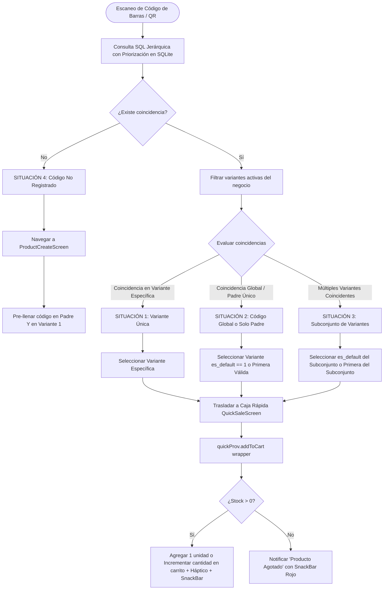
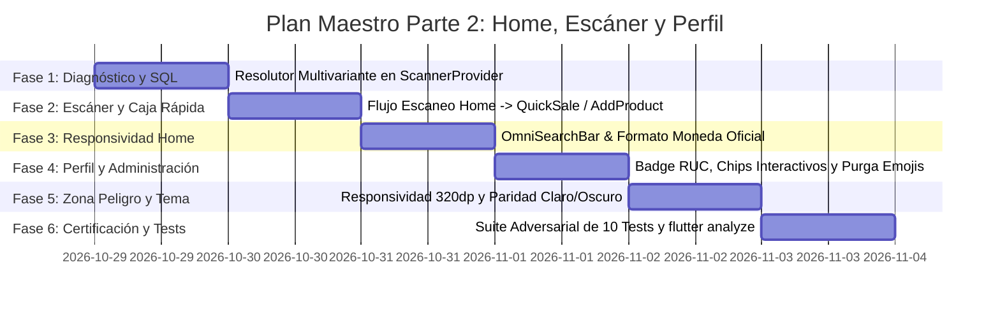

# PLAN MAESTRO PARTE 2: REINGENIERÍA DEL HOME ("MOBILE AWARDS"), ESCÁNER INTELIGENTE MULTIVARIANTE HACIA CAJA RÁPIDA Y CENTRO DE ADMINISTRACIÓN / PERFIL DEL NEGOCIO

**Documento:** `analisis_proyecto/PLAN_PARTE2_HOME_ESCANER_INTELIGENTE_Y_PERFIL_NEGOCIO.md`  
**Fecha:** 29 de Octubre de 2026  
**Versión:** 1.0 — Especificación Técnica Forense, Arquitectura de Resolución y Plan de Implementación  
**Estado:** Esperando Revisión y Aprobación del Usuario (Paso 1: Diagnóstico y Plan Maestro)  
**Metodología:** Loop Autónomo + Árbitro Interno Adversarial (Zero-Regressions, Zero-Overflows, Pure Vector Iconography & Mobile Awards Experience)  

---

## 1. RESUMEN EJECUTIVO Y OBJETIVOS ESTRATÉGICOS

Tras la certificación de la **Parte 1** con 611/611 tests aprobados y paridad de arranque en frío, la **Parte 2** aborda el núcleo operativo diario del comerciante en **MochilaLista**:
1. **La Ventana Principal (`HomeScreen`):** El centro de mando del negocio. Requiere una experiencia visual fluida y responsiva a 60/120fps, corrección de truncamientos en el buscador omnicanal, estandarización monetaria peruana oficial (`S/ 48.70` en lugar del invertido `48,70 S/`), pulido de micro-interacciones en KPIs y gráficos, y paridad absoluta en Modo Claro y Modo Oscuro.
2. **El Escáner Inteligente en el Buscador Global del Home:** Transformación del botón de escáner en un resolvedor de inventario multivariante de alta velocidad. Al escanear un código de barras o QR desde el Home, el motor debe diagnosticar SQLite a 0ms y canalizar automáticamente hacia **Caja Rápida (`QuickSaleScreen`)** resolviendo las 4 situaciones reales de negocio (variante única, código en producto padre, múltiples variantes compartiendo código) o hacia **Crear Producto (`ProductCreateScreen`)** pre-poblando el código en el Padre y en la primera Variante.
3. **La Ventana de Perfil del Usuario / Negocio (`ProfileScreen`):** El centro neurálgico de administración, seguridad e identidad corporativa. Corrección del badge vacío `RUC: ` a un botón interactivo `Sin RUC • + Agregar`, purga completa de emojis incrustados en datos de pago (`📱 Yape` -> iconografía vectorial pura), chips de tareas pendientes interactivos (`Email`, `RUC`, `Ubicación GPS`, `PIN Seguridad`) con autofoco y cálculo reactivo en tiempo real, corrección del botón de la Zona de Peligro para erradicar cualquier corte o puntos suspensivos en anchos reducidos (320dp–360dp), y blindaje cromático en ambos temas.

---

## 2. DIAGNÓSTICO FORENSE EN CÓDIGO Y ANÁLISIS DE CAPTURAS

### 2.1. Ventana Principal (`Home`) — Análisis Forense de la `Imagen 1` (11:05 PM)

```
+-------------------------------------------------------------+
| Buenas noches,                                              |
| luz navarro                     [🔄]   [🔔]    (Avatar 50dp)|
| [🏪] librería BAZAR LUZAM                                   |
|                                                             |
| +-------------------------+     +-------------------------+ |
| | (✓) 2                   |     | (🛍️) 0                   | |
| |     Listas Preparadas   |     |     Operaciones Hoy     | |
| +-------------------------+     +-------------------------+ |
|                                                             |
| +---------------------------------------------------------+ |
| | [🔍] Buscar productos, clientes, c...             [📷]  | | <-- DEFECTO 1: Truncamiento
| +---------------------------------------------------------+ |
|                                      +--------------------+ |
|                                      | ⚠️ 27 Alertas ... v | |
|                                      +--------------------+ |
|                                                             |
| [📊] Ventas de la Semana 48,70 S/                       v   | <-- DEFECTO 2: Formato Invertido
+-------------------------------------------------------------+
```

#### Defecto 1: Placeholder Cortado en el Buscador Global (`omni_search_bar.dart`)
* **Ubicación:** `app_movil/lib/core/widgets/omni_search_bar.dart` (Líneas 56–67)
* **Código Actual:**
  ```dart
  Expanded(
    child: Text(
      "Buscar productos, clientes, cotizaciones...",
      style: TextStyle(
        color: isDark ? Colors.grey[400] : Colors.grey[500],
        fontSize: 14,
        fontWeight: FontWeight.w500,
      ),
      maxLines: 1,
      overflow: TextOverflow.ellipsis,
    ),
  ),
  ```
* **Diagnóstico:** El texto literal tiene 44 caracteres. En dispositivos con anchos estándar (`360dp`–`390dp`), al descontar el padding horizontal (`32dp`), el icono de búsqueda (`22dp`), el espaciado (`12dp`) y el botón del escáner de código de barras (`32dp`), el espacio restante disponible para el texto es de apenas `260dp`. El motor tipográfico se ve forzado a truncar el texto en `Buscar productos, clientes, c...`.
* **Solución de Ingeniería:**
  Implementar un widget responsivo adaptativo que use `LayoutBuilder` para determinar el ancho disponible real:
  - Ancho $\ge 380\text{dp}$: `"Buscar productos, clientes o ventas"` (37 caracteres compactos).
  - Ancho $320\text{dp} - 379\text{dp}$: `"Buscar productos o clientes..."` (31 caracteres).
  - Ancho $< 320\text{dp}$: `"Buscar en tu negocio..."` (22 caracteres).
  Complementado con `FittedBox(fit: BoxFit.scaleDown, alignment: Alignment.centerLeft)` para garantizar **cero puntos suspensivos truncados** en cualquier pantalla móvil del mercado.

#### Defecto 2: Formato de Moneda Invertido en `Ventas de la Semana` (`weekly_sales_chart.dart`)
* **Ubicación:** `app_movil/lib/core/widgets/home/weekly_sales_chart.dart` (Líneas 85–89 y Línea 229)
* **Código Actual:**
  ```dart
  // Línea 87:
  NumberFormat.currency(locale: 'es_PE', symbol: 'S/ ').format(currentWeekTotal)
  // Línea 229:
  final formattedValue = NumberFormat.currency(locale: 'es_PE', symbol: 'S/ ').format(value);
  // Línea 233:
  return "🔥 ¡Mejor día! $dayName - $formattedValue ($count ventas)"; // Contiene emoji
  ```
* **Diagnóstico:** En la librería `intl` de Dart, la configuración por defecto de la localización `es_PE` sitúa el símbolo de moneda al final con coma decimal (`48,70 S/`), violando la convención comercial peruana estándar y la identidad unificada de la aplicación donde se definió `AppCurrency.format(...)` (`S/ 48.70`). Además, la línea 233 incluye un emoji Unicode `"🔥"` incrustado en el texto de la notificación de tooltip.
* **Solución de Ingeniería:** Reemplazar todas las invocaciones por `AppCurrency.format(currentWeekTotal)` y `AppCurrency.format(value)`, y purgar el emoji `"🔥"` sustituyéndolo por un diseño con icono vectorial `Icon(Icons.whatshot_rounded, color: Colors.amber)`.

#### Defecto 3: Discrepancias Monetarias en `dashboard_header.dart`
* **Ubicación:** `app_movil/lib/core/widgets/home/dashboard_header.dart` (Línea 135)
* **Código Actual:**
  ```dart
  final currency = NumberFormat.currency(locale: 'es_PE', symbol: 'S/ ');
  ```
* **Diagnóstico:** En el carrusel financiero superior (`Ventas Hoy`, `Ventas Mes`), se inyecta este formateador que reproduce el patrón `48,70 S/`. Se debe unificar con `AppCurrency.format(target)`.

---

### 2.2. Escáner Inteligente de Código de Barras / QR — Desconexión Actual y Solución Multivariante

* **Archivos Involucrados:**
  * `app_movil/lib/core/screens/home_screen.dart` (Líneas 249–258)
  * `app_movil/lib/features/scanner/screens/barcode_scanner_screen.dart` (Líneas 61–177)
  * `app_movil/lib/features/scanner/providers/scanner_provider.dart` (Líneas 243–278)
  * `app_movil/lib/features/catalog/screens/product_create_screen.dart` (Líneas 54–63)
  * `app_movil/lib/features/catalog/widgets/form/product_create_operations.dart` (Líneas 820–833)
  * `app_movil/lib/features/smart_quotation/providers/quick_sale_provider.dart` (Líneas 298–360)

#### Diagnóstico del Comportamiento Actual:
1. Al tocar el botón de escáner en el Home (`OmniSearchBar`), navega a `BarcodeScannerScreen()` sin parámetros (`isFromQuickSale` es `false`).
2. Cuando el escáner detecta un código, en la Línea 119 de `barcode_scanner_screen.dart`, navega a `ProductDetailScreen` (detalle informativo de inventario) en lugar de canalizar al usuario a la acción comercial de **`Caja Rápida` (`QuickSaleScreen`)**.
3. La consulta en `scanner_provider.dart` (Líneas 251–258) ejecuta:
   ```sql
   SELECT ... FROM presentaciones_producto pr INNER JOIN productos p ON pr.producto_id = p.id
   WHERE p.negocio_id = ? AND pr.activo = 1 AND (pr.codigo_barras = ? OR p.codigo_barras = ?)
   LIMIT 1
   ```
   No existe orden de precedencia ni desambiguación multivariante. Si un producto tiene 5 variantes y el código pertenece a una de ellas, o si el código está en el padre, `LIMIT 1` devuelve la primera fila arbitraria de SQLite sin respetar la jerarquía de variantes principales ni la coincidencia específica de la presentación.
4. En `product_create_operations.dart` (Líneas 820–833), si el código no existe y se navega a crear producto, si el formulario ya tenía un borrador previo en memoria, el código escaneado se ignoraba en las presentaciones existentes.

---

### 2.3. Ventana de Perfil del Negocio / Usuario — Análisis Forense de las `Imágenes 2, 3 y 4`

```
+-------------------------------------------------------------+
| ( < )                   [  Avatar  ]                    (i) |
|                         luz navarro                         |
|                    librería BAZAR LUZAM                     |
|                      DUEÑO DE NEGOCIO                       |
|         103                  5              Sin ventas      |
|      Productos           Borradores         Ventas Hoy      |
+-------------------------------------------------------------+
| Administración del Negocio                     [✏️ Editar]   |
| +---------------------------------------------------------+ |
| | [🏪] librería BAZAR LUZAM                      [RUC: ]  | | <-- DEFECTO 4: Badge vacío
| |                                                         | |
| | [📍] talara                                   [Sin GPS] | |
| |      Ubicación en mapa no registrada                    | |
| | [💳] 📱 Yape: 976644890                                 | | <-- DEFECTO 5: Emoji duplicado
| | [💲] Moneda: S/ (Soles)                                 | |
| | [🛡️] Cuenta Verificada                                  | |
| +---------------------------------------------------------+ |
|                                                             |
| +---------------------------------------------------------+ |
| | (👤) Perfil 60% completo                           6/10 | |
| | [==============                  ]                      | |
| | Pendientes:                                             | |
| | [✉️ Email]  [🪪 RUC]  [🎯 Ubicación GPS]  [🔒 PIN Seg]  | | <-- DEFECTO 6: Chips pasivos
| +---------------------------------------------------------+ |
|                                                             |
| Configuración General                                       |
| [👤] Editar Datos Personales                            > | |
| [🛡️] Respaldos y Seguridad                              > | |
| [🌙] Modo Noche                                   [ (o) ] | |
| [🔔] Notificaciones                                     > | |
| [🖨️] Impresora Térmica                             [BT] > | |
|                                                             |
| Seguridad de la Cuenta                                      |
| [🔒] Crear PIN de Seguridad                             > | |
|                                                             |
| Sesión Activa                                               |
| [🔄] Cambiar de Negocio / Cerrar Sesión                 > | |
|                                                             |
| [⚠️] Zona de Peligro                                       |
| Esta acción eliminará de forma permanente...                |
| +---------------------------------------------------------+ |
| | [🗑️] Eliminar este Perfil de Negocio...                 | | <-- DEFECTO 7: Botón cortado
| +---------------------------------------------------------+ |
+-------------------------------------------------------------+
```

#### Defecto 4: Badge `RUC:` Vacío en Tarjeta de Negocio (`business_info_card.dart`)
* **Ubicación:** `app_movil/lib/features/profile/widgets/business_info_card.dart` (Líneas 108–114)
* **Código Actual:**
  ```dart
  if (canSeeRuc)
    Container(
      padding: const EdgeInsets.symmetric(horizontal: 10, vertical: 4),
      decoration: BoxDecoration(color: Colors.white.withValues(alpha: 0.2), borderRadius: BorderRadius.circular(6)),
      child: Text("RUC: ${widget.business!.ruc ?? '---'}", style: const TextStyle(color: Colors.white, fontSize: 12, fontWeight: FontWeight.bold)),
    )
  ```
* **Diagnóstico:** Si en la base de datos el campo `ruc` es una cadena vacía `""` (que es el valor por defecto tras crear un negocio sin RUC), la expresión `${widget.business!.ruc ?? '---'}` evalúa a `""`, produciendo el recuadro huérfano `"RUC: "` visible en la `Imagen 2`. Además, no ofrece ninguna interacción para registrarlo.

#### Defecto 5: Emoji Duplicado en la Fila de Yape (`business_info_card.dart`)
* **Ubicación:** `app_movil/lib/features/profile/widgets/business_info_card.dart` (Líneas 277–294)
* **Código Actual:**
  ```dart
  Icon(Icons.payment, size: 22, color: isDark ? Colors.green[300] : Colors.green[700]),
  const SizedBox(width: 12),
  Expanded(
    child: Text(
      paymentInfo, // Contiene "📱 Yape: 976644890"
      ...
    ),
  ),
  ```
* **Diagnóstico:** El texto guardado contiene el emoji Unicode `📱`, colisionando con el icono vectorial nativo `Icon(Icons.payment)` y rompiendo la directriz de interfaz limpia.

#### Defecto 6: Chips de Pendientes Pasivos en `ProfileCompletionIndicator`
* **Ubicación:** `app_movil/lib/features/profile/widgets/profile_completion_indicator.dart` (Líneas 30–94 y Líneas 201–231)
* **Diagnóstico:** En la actualidad, tocar el chip `Email` o `RUC` abre el modal general de editar perfil o editar negocio, pero sin hacer foco directo en el campo respectivo. Tocar `Ubicación GPS` abre el modal completo de negocio en lugar de lanzar directamente el selector de mapa, y tocar `PIN Seguridad` no recalcula instantáneamente la barra animada al regresar.

#### Defecto 7: Botón Cortado con Puntos Suspensivos en Zona de Peligro
* **Ubicación:** `app_movil/lib/features/profile/screens/profile_screen.dart` (Líneas 320–337)
* **Código Actual:**
  ```dart
  label: const Text(
    "Eliminar este Perfil de Negocio...", // Puntos suspensivos hardcodeados
    style: TextStyle(fontWeight: FontWeight.bold, fontSize: 13),
  ),
  ```
* **Diagnóstico:** El texto literal incluye `"..."` al final, y en pantallas estrechas con padding de 18dp colisiona con el icono de la papelera, dando la apariencia de texto incompleto y mal diseñado. Debe mostrar `"Eliminar este perfil de negocio"` sin puntos suspensivos y escalado de forma fluida.

---

## 3. ARQUITECTURA DE RESOLUCIÓN TÉCNICA

### 3.1. Motor de Resolución Multivariante de Código de Barras / QR

Diseñamos el método determinista `resolveBarcodeForQuickSale` en `ScannerProvider`:



#### Implementación SQL Determinista de Máxima Eficiencia (O(1)):
```sql
SELECT p.*, m.nombre AS marca_nombre, pr.id AS pres_id, pr.nombre_especifico, pr.descripcion AS pres_desc,
       pr.imagen_url AS pres_img, pr.codigo_barras AS pres_cb, pr.precio_venta_final, pr.stock_actual,
       pr.stock_alerta, pr.es_default, pr.orden, pr.unidad_venta, pr.unidades_por_venta,
       pr.costo_unitario_calculado, pr.factor_ganancia_venta, pr.precio_oferta, pr.activo AS pres_activo,
       pr.usa_stock_compartido
FROM presentaciones_producto pr
INNER JOIN productos p ON pr.producto_id = p.id
LEFT JOIN marcas m ON p.marca_id = m.id
WHERE p.negocio_id = ? AND pr.activo = 1
  AND (pr.codigo_barras = ? OR p.codigo_barras = ?)
ORDER BY 
  (CASE WHEN pr.codigo_barras = ? THEN 1 ELSE 0 END) DESC,
  pr.es_default DESC,
  pr.orden ASC,
  pr.id ASC
```

#### Análisis Matemático de Cumplimiento de las 4 Situaciones:
1. **SITUACIÓN 1 (Variante específica única):**
   El `CASE WHEN pr.codigo_barras = ?` asigna prioridad `1` a la variante que tiene el código idéntico. Como es única, ocupa la posición `0` del resultado.
2. **SITUACIÓN 2 (Código global en todas las variantes O registrado solo en el producto padre):**
   - Si está solo en el padre: `pr.codigo_barras` no coincide para ninguna, todas tienen peso `0` en el `CASE`, por lo que el `ORDER BY pr.es_default DESC, pr.orden ASC` selecciona automáticamente la variante configurada como predeterminada (`es_default == 1`) o la primera ordenada.
   - Si todas tienen el mismo código: Todas tienen peso `1` en el `CASE`, y de igual forma `ORDER BY pr.es_default DESC, pr.orden ASC` selecciona la variante predeterminada.
3. **SITUACIÓN 3 (Múltiples variantes ej. 3 de 5 comparten el código):**
   Las 3 variantes coincidentes obtienen peso `1` en el `CASE`, desplazando a las otras 2. Entre esas 3, el orden `pr.es_default DESC, pr.orden ASC` escoge la principal de ese grupo (o la primera del grupo si ninguna del grupo es la default global).
4. **SITUACIÓN 4 (Código no existente):**
   La consulta retorna `0` filas. Se dispara `BarcodeNotFoundDialog` o navegación directa a `ProductCreateScreen(initialBarcode: code)`, garantizando la inyección sincronizada en el Producto Padre y la primera Variante.

---

### 3.2. Estandarización Visual, Responsividad y Modo Claro/Oscuro en `HomeScreen`

1. **Buscador OmniSearchBar 100% Responsivo:**
   Sustitución de la cadena estática por un `LayoutBuilder` inteligente con tipografía adaptativa y `FittedBox`.
2. **Formato Monetario Oficial:**
   Unificación con `AppCurrency.format(valor)` garantizando siempre `S/ 48.70` en:
   - Cabecera desplegable de `WeeklySalesChart`.
   - Tooltips interactivos del gráfico semanal.
   - Carrusel financiero de `DashboardHeader`.
   - Micro-KPIs superiores de `ProfileScreen`.
3. **Cero Emojis Unicode:**
   Reemplazo de `"🔥 ¡Mejor día!"` por `Icon(Icons.whatshot_rounded)` con texto `"Día con mayor venta"`.
4. **Acabado Mobile Awards:**
   - Gradientes fluidos y orbes animados con desenfoque `BackdropFilter` optimizados en GPU.
   - Píldora de stock con micro-latido suave y gramática precisa (`"1 Alerta de Stock"` vs `"N Alertas de Stock"`).
   - Transiciones `AnimatedSwitcher` en carruseles de métricas sin saltos bruscos.

---

### 3.3. Reingeniería Integral de la Ventana de Perfil (`ProfileScreen`)

1. **Badge Interactivo de RUC en `BusinessInfoCard`:**
   - Si `ruc == null || ruc.trim().isEmpty`:
     Renderizar un badge con estilo botón de acción rápida:
     `Icon(Icons.add_circle_outline, size: 13, color: Colors.blue[300])` + `"Sin RUC • + Agregar"`
     Al tocarlo: abre directamente `EditBusinessModal(initialFocusField: 'ruc')` con foco automático en el campo RUC y teclado numérico abierto.
   - Si `ruc` es válido:
     Renderizar `Row` con `Text("RUC: $ruc")` + `Icon(Icons.copy_rounded, size: 14)`, con tooltip `"Copiar RUC"` y copia al portapapeles mediante `Clipboard.setData(...)` con feedback háptico y SnackBar de confirmación.
2. **Purga de Emojis en Datos de Pago:**
   Creación de una función utilitaria de saneamiento:
   ```dart
   String sanitizePaymentInfo(String raw) {
     return raw.replaceAll(RegExp(r'[\u{1F300}-\u{1F9FF}\u{2600}-\u{26FF}\u{2700}-\u{27BF}]', unicode: true), '').trim();
   }
   ```
   Acompañado de iconografía vectorial nativa y badge de banco/billetera digital estilizado.
3. **Chips de Pendientes 100% Accionables en `ProfileCompletionIndicator`:**
   - `Email` -> abre `EditProfileModal(initialFocusField: 'email')`.
   - `RUC` -> abre `EditBusinessModal(initialFocusField: 'ruc')`.
   - `Ubicación GPS` -> verifica GPS con `HardwareValidator.checkGPS` y abre `MapPickerScreen`, actualizando SQLite reactivamente al retornar.
   - `PIN Seguridad` -> abre `ChangePasswordModal()` (o configuración de PIN), actualizando el porcentaje animado en tiempo real.
4. **Zona de Peligro 100% Responsiva:**
   Texto `"Eliminar este perfil de negocio"` sin puntos suspensivos, encapsulado en `FittedBox(fit: BoxFit.scaleDown)` para garantizar integridad visual en pantallas desde `320dp` hasta tablets.

---

## 4. PLAN DE TRABAJO PASO A PASO (6 FASES DETALLADAS)



### FASE 1: Motor de Resolución Multivariante en Base de Datos Local
* **Objetivo:** Implementar la lógica determinista para resolver códigos de barras y QR considerando variantes y productos padre.
* **Acciones en Código:**
  1. En `app_movil/lib/features/scanner/models/barcode_resolution_result.dart` (o en `scanner_provider.dart`), definir el modelo `BarcodeResolutionResult` con el enum:
     - `exactVariantMatch`: Coincidencia directa con una variante única.
     - `parentMatchDefaultVariant`: Coincidencia con producto padre o código global, seleccionando la variante default.
     - `subsetVariantMatch`: Coincidencia con varias variantes de un mismo producto, seleccionando la principal de dicho subconjunto.
     - `notFound`: Código no registrado en el negocio.
  2. En `app_movil/lib/features/scanner/providers/scanner_provider.dart`:
     - Implementar `resolveBarcodeForQuickSale(String barcode, int negocioId)`.
     - Ejecutar la consulta SQL jerárquica con ordenamiento compuesto.
     - Parsear el resultado a `InventoryWrapper`.
* **Criterio de Aceptación:** Consultas ejecutadas a 0ms sin latencia ni bloqueos de hilo principal.

---

### FASE 2: Integración del Escáner Inteligente desde el Buscador Global hacia Caja Rápida y Crear Producto
* **Objetivo:** Conectar el botón de escaneo de `OmniSearchBar` en `HomeScreen` con el resolvedor multivariante y el carrito de `QuickSaleScreen`.
* **Acciones en Código:**
  1. En `app_movil/lib/features/scanner/screens/barcode_scanner_screen.dart`:
     - Agregar el parámetro opcional `isFromHomeGlobalSearch: bool` (por defecto `false`).
     - Al escanear en modo Home:
       - Ejecutar `scannerProv.resolveBarcodeForQuickSale(code, auth.activeBusinessId!)`.
       - Si es encontrado (Situaciones 1, 2 o 3):
         - Obtener el `InventoryWrapper` resuelto.
         - Si `stockActual <= 0`: Mostrar `CustomSnackBar` con aviso `"Producto agotado"` y retroalimentación háptica de error.
         - Si `stockActual > 0`: Agregar automáticamente a `QuickSaleProvider.addToCart(wrapper)`. Emitir `HapticFeedback.mediumImpact()`.
         - Navegar mediante `Navigator.pushReplacement` hacia `QuickSaleScreen()`.
         - Mostrar `CustomSnackBar` de confirmación: `"${wrapper.displayNameDetail} agregado a Caja Rápida"`.
       - Si no es encontrado (Situación 4):
         - Pausar la cámara y mostrar `BarcodeNotFoundDialog`.
         - Al seleccionar registrar, navegar a `ProductCreateScreen(initialBarcode: code)`.
  2. En `app_movil/lib/features/catalog/widgets/form/product_create_operations.dart` y `product_create_screen.dart`:
     - Blindar que `initialBarcode` se asigne con precedencia absoluta tanto en `_barcodeCtrl` (Producto Padre) como en `controllers.first['barcode']` (primera Variante creada o existente en borrador).
* **Criterio de Aceptación:** Las 4 situaciones se resuelven de forma 100% transparente y sin errores de navegación.

---

### FASE 3: Pulido Visual, Responsividad y Formato Oficial en `HomeScreen`
* **Objetivo:** Corregir el placeholder cortado del buscador y unificar el formato monetario peruano en todo el dashboard.
* **Acciones en Código:**
  1. En `app_movil/lib/core/widgets/omni_search_bar.dart`:
     - Refactorizar el placeholder con `LayoutBuilder` y `FittedBox`.
     - Asegurar que en pantallas desde 320dp hasta tablets el texto jamás muestre `...`.
  2. En `app_movil/lib/core/widgets/home/weekly_sales_chart.dart`:
     - Reemplazar `NumberFormat.currency(locale: 'es_PE', symbol: 'S/ ')` por `AppCurrency.format(...)`.
     - Purgar el emoji `"🔥"` del tooltip de mejor día, reemplazándolo por diseño vectorial con `Icon(Icons.whatshot_rounded)`.
  3. En `app_movil/lib/core/widgets/home/dashboard_header.dart`:
     - Reemplazar el `currency` local por `AppCurrency.format(...)` en `_buildFinanceCarousel`.
  4. En `app_movil/lib/features/analytics/widgets/restock_smart_banner.dart`:
     - Corregir concordancia gramatical (`"1 Alerta de Stock"` vs `"$count Alertas de Stock"`).
* **Criterio de Aceptación:** Cero textos cortados con `...` en el buscador; todas las cifras monetarias muestran `S/ #.##` con coherencia total.

---

### FASE 4: Reingeniería del Centro de Administración y Perfil del Negocio
* **Objetivo:** Perfeccionar `BusinessInfoCard`, purgar emojis de datos de pago y activar los chips interactivos de progreso.
* **Acciones en Código:**
  1. En `app_movil/lib/features/profile/widgets/business_info_card.dart`:
     - Refactorizar el badge de RUC:
       - Si no tiene RUC: mostrar botón interactivo `Sin RUC • + Agregar` que abre `EditBusinessModal(initialFocusField: 'ruc')`.
       - Si tiene RUC: mostrar `RUC: $ruc` con icono de copia al portapapeles y acción en un toque.
     - Purgar emojis en `paymentInfo` con saneamiento regex nativo.
  2. En `app_movil/lib/features/profile/widgets/profile_completion_indicator.dart`:
     - Añadir soporte para callbacks directos con parámetros de foco:
       - `Email` -> abre `EditProfileModal(initialFocusField: 'email')`.
       - `RUC` -> abre `EditBusinessModal(initialFocusField: 'ruc')`.
       - `Ubicación GPS` -> lanza `MapPickerScreen` directo y sincroniza ubicación en SQLite.
       - `PIN Seguridad` -> abre modal de configuración de PIN.
  3. En `app_movil/lib/features/profile/widgets/edit_business_modal.dart` y `edit_profile_modal.dart`:
     - Añadir parámetro `initialFocusField: String?`.
     - Auto-enfocar el campo correspondiente en el `initState` o primer frame.
* **Criterio de Aceptación:** Tocar cualquier chip pendiente lleva al usuario a completar esa información en 1 paso; RUC y Yape lucen profesionales sin badges vacíos ni emojis discordantes.

---

### FASE 5: Zona de Peligro Responsiva y Paridad Total de Modo Claro / Oscuro
* **Objetivo:** Corregir el botón de eliminación de perfil y auditar contrastes cromáticos en ambos temas.
* **Acciones en Código:**
  1. En `app_movil/lib/features/profile/screens/profile_screen.dart`:
     - En la Zona de Peligro, cambiar `"Eliminar este Perfil de Negocio..."` a `"Eliminar este perfil de negocio"` sin puntos suspensivos.
     - Envolver el botón en un contenedor responsivo con `FittedBox(fit: BoxFit.scaleDown)` y padding simétrico.
     - En `_buildMicroKpi("Ventas Hoy", salesTotal)`, formatear usando `AppCurrency.format(salesDouble)`.
  2. Auditar bordes, fondos y colores de texto en Modo Claro (`#F5F7FA`, tarjetas `#FFFFFF`) y Modo Oscuro (`#14141C`, tarjetas `#23232F`).
* **Criterio de Aceptación:** El botón rojo no se corta en 320dp; todos los elementos conservan contraste accesible AAA en ambos temas.

---

### FASE 6: Suite de Verificación Adversarial y Certificación de Cero Regresiones
* **Objetivo:** Ejecutar la suite de pruebas unitarias, de widgets y análisis estático.
* **Acciones en Código:**
  1. Crear el archivo `test/parte2_home_escaner_y_perfil_test.dart` cubriendo:
     - Test 1: Resolución de Situación 1 (Variante única específica -> `exactVariantMatch`).
     - Test 2: Resolución de Situación 2A (Código solo en Padre -> variante default seleccionada).
     - Test 3: Resolución de Situación 2B (Código idéntico en todas las variantes -> variante default seleccionada).
     - Test 4: Resolución de Situación 3 (Múltiples variantes compartiendo código -> default del subconjunto).
     - Test 5: Resolución de Situación 4 (Código no existente -> pre-llenado en Padre y Variante 1).
     - Test 6: Formato monetario peruano en `weekly_sales_chart` (`S/ 48.70`).
     - Test 7: Responsividad de `OmniSearchBar` sin truncamiento en 320dp y 360dp.
     - Test 8: Renderizado del badge `Sin RUC • + Agregar` cuando el RUC es vacío o nulo.
     - Test 9: Purga de emojis en `paymentInfo` de `BusinessInfoCard`.
     - Test 10: Botón de Zona de Peligro sin puntos suspensivos literales y responsivo.
  2. Ejecutar `flutter analyze lib test` y garantizar 0 errores y 0 warnings.
  3. Ejecutar `flutter test` y certificar el 100% de tests aprobados.

---

## 5. MATRIZ DE ARCHIVOS A INTERVENIR (REFERENCIA RÁPIDA)

| Componente / Módulo | Archivo Objetivo | Responsabilidad Técnica |
| :--- | :--- | :--- |
| **Buscador OmniSearchBar** | `app_movil/lib/core/widgets/omni_search_bar.dart` | LayoutBuilder responsivo, FittedBox y eliminación de truncamiento. |
| **Dashboard Home** | `app_movil/lib/core/screens/home_screen.dart` | Cableado del escáner en modo Home hacia resolvedor multivariante. |
| **Cabecera Dashboard** | `app_movil/lib/core/widgets/home/dashboard_header.dart` | Unificación de moneda con `AppCurrency.format(...)`. |
| **Gráfico Semanal** | `app_movil/lib/core/widgets/home/weekly_sales_chart.dart` | Formato `S/ 48.70`, purga de emoji `🔥` y tooltips vectoriales. |
| **Alertas de Stock** | `app_movil/lib/features/analytics/widgets/restock_smart_banner.dart` | Corrección singular/plural (`1 Alerta de Stock`). |
| **Proveedor Escáner** | `app_movil/lib/features/scanner/providers/scanner_provider.dart` | Query SQL jerárquica O(1) y método `resolveBarcodeForQuickSale`. |
| **Pantalla Escáner** | `app_movil/lib/features/scanner/screens/barcode_scanner_screen.dart` | Manejo de las 4 situaciones hacia `QuickSaleScreen` o `ProductCreateScreen`. |
| **Creación de Producto** | `app_movil/lib/features/catalog/widgets/form/product_create_operations.dart` | Inyección de `initialBarcode` en Padre y primera Variante con borrador. |
| **Tarjeta Negocio** | `app_movil/lib/features/profile/widgets/business_info_card.dart` | Badge `Sin RUC • + Agregar`, copia RUC en 1 toque y purga emoji `📱`. |
| **Progreso Perfil** | `app_movil/lib/features/profile/widgets/profile_completion_indicator.dart` | Chips de pendientes 100% interactivos con autofoco específico. |
| **Modales de Edición** | `app_movil/lib/features/profile/widgets/edit_business_modal.dart` & `edit_profile_modal.dart` | Soporte de `initialFocusField` para apertura directa enfocada. |
| **Pantalla Perfil** | `app_movil/lib/features/profile/screens/profile_screen.dart` | Botón Zona de Peligro sin `...`, moneda oficial y paridad Claro/Oscuro. |
| **Suite de Tests** | `test/parte2_home_escaner_y_perfil_test.dart` | Verificación adversarial de las 6 fases del plan. |

---

## 6. PROTOCOLO DEL ÁRBITRO INTERNO ADVERSARIAL

Durante la fase de ejecución, el Árbitro Interno someterá cada cambio a 5 pruebas de estrés:
1. **Prueba de Puntos Suspensivos:** Inspeccionar el DOM/árbol de widgets para verificar que ningún texto contenga `...` indebidos en anchos de `320dp`, `360dp`, `390dp` y `412dp`.
2. **Prueba de Cero Emojis:** Ejecutar expresiones regulares sobre todos los archivos editados para verificar que no exista ningún emoji Unicode en llamadas a `Text(...)` o strings visibles.
3. **Prueba de Ambigüedad Multivariante:** Insertar productos con 1, 2 y 5 variantes compartiendo códigos o sin código, y certificar que la selección hacia `QuickSale` siempre respete `es_default` y el orden de inventario.
4. **Prueba de Paridad de Temas:** Conmutar entre Modo Claro y Modo Oscuro verificando contraste visual, bordes legibles y coherencia cromática.
5. **Certificación de Build:** Ejecutar `flutter analyze lib test` asegurando cero advertencias y cero errores de tipado.
