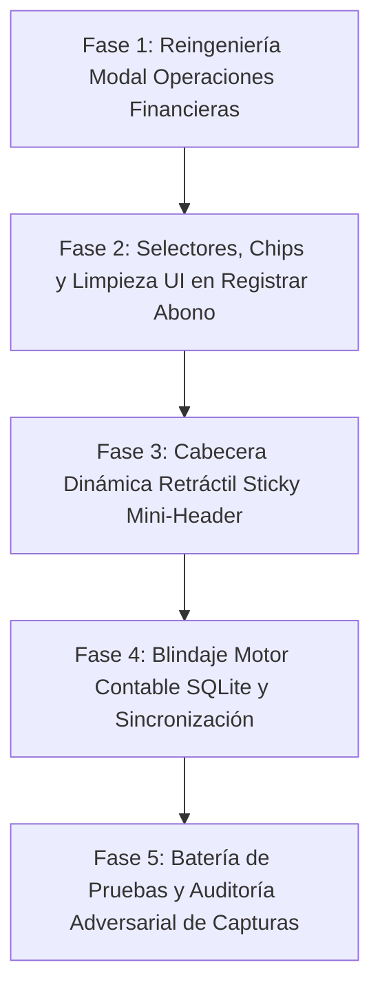

# PLAN MAESTRO PARTE 2: Modales Financieros, Abonos y Lógica Contable en SQLite
**Módulo:** Gestión de Clientes, Créditos y Cartera CRM — `mochilalista-app`  
**Objetivo de Calidad:** Nivel Mobile Awards, fluidez extrema a 60/120fps, velocidad a 0ms en SQLite y verdad contable inquebrantable.  
**Metodología:** Bucle Autónomo (*Planificar -> Construir -> Probar -> Auditar Adversarialmente -> Corregir -> Repetir*).

---

## 📸 1. Diagnóstico Forense de Capturas de Pantalla y Código Fuente

### 1.1. Modal "Operaciones Financieras" — Pestaña "Retirar" (Captura 1)
* **Archivo:** `lib/features/smart_quotation/widgets/crm/client_finance_actions_modal.dart` (Líneas 417-470)
* **Problema Visual y de Flujo:**
  - En la captura 1 se visualiza `"Saldo Disponible: 0,00 S/"` (con formato numérico desfasado de sufijo). Debajo, la aplicación sigue mostrando el campo `"Monto a Retirar"` vacío y los chips de método de entrega, culminando en un botón `"Confirmar Retiro"` deshabilitado sin explicar la razón al comerciante.
  - El usuario queda desorientado sobre para qué sirve esta pestaña si el cliente no tiene dinero a favor.
* **Diagnóstico de Código:**
  - El modal evalúa la condición de deshabilitación únicamente en el botón (`enteredAmount > 0 && !_isLoading`), pero la UI entera permanece en un estado "activo falso".
  - No existen chips de monto rápido (`"Retirar Todo"`, `"50%"`) cuando el cliente sí posee saldo a favor (`saldoAFavor > 0`).

### 1.2. Modal "Operaciones Financieras" — Pestaña "Préstamo" (Captura 2)
* **Archivo:** `lib/features/smart_quotation/widgets/crm/client_finance_actions_modal.dart` (Líneas 480-600)
* **Problema Visual Crítico:**
  - En la sección `"Motivo / Detalle"`, los chips de sugerencia se renderizan dentro de un `ListView` horizontal de altura fija donde el 3er chip se corta en el borde derecho (`"A..."`).
  - El campo de texto de notas (`"Ej. Préstamo personal, Fiado mercadería..."`) **aparece cortado por la mitad horizontalmente**, oculto por el contenedor inferior que aloja el botón `"Registrar Préstamo"`.
  - Lo más grave: la sección de `"Condiciones de Pago"`, cuotas e interés y el botón `"Generar Cronograma"` quedaron totalmente invisibles bajo el corte de scroll. Si el usuario presiona `"Registrar Préstamo"`, el código lanza un SnackBar bloqueante: `"Debes generar o regenerar el cronograma de cuotas antes de continuar."`, sin que el usuario sepa que abajo existían campos ocultos.
* **Diagnóstico de Lógica y SQLite:**
  - En `client_service.dart` (`registerLoan`), se crea un registro en `ventas` con `origen_venta = 'prestamo_personal'`.
  - Sin embargo, la obligatoriedad de presionar manualmente `"Generar Cronograma"` crea una enorme fricción.
  - Todo préstamo o fiado debe tener **por defecto 1 cuota con fecha de vencimiento editable clara** (ej. a 30 días), auto-calculada y lista para guardarse sin pasos redundantes, con la opción de expandir a 2, 3 o N cuotas si el usuario lo desea. Esto garantiza que el préstamo **siempre** ingrese al sistema de cuotas y al motor de alertas de cuotas vencidas.

### 1.3. Modal "Registrar Abono" — UX & Selectores (Captura 3)
* **Archivo:** `lib/features/smart_quotation/widgets/crm/payment_entry_modal.dart` (Líneas 160-230)
* **Problema Visual y de Espacio:**
  - En el selector horizontal de `"Método de Pago"`, el botón de **`"Transferencia"`** se corta abruptamente en el borde derecho mostrando **`"Trar"`**, y el botón `"Tarjeta"` queda fuera de la pantalla.
  - En el `TabBar`, el texto de la pestaña izquierda se trunca mostrando **`"Distribución Automát"`**.
  - El botón inferior **`"PROCESAR PAGO"`** se muestra activo en verde brillante aun cuando el campo de monto a abonar está en `0` o vacío. Al pulsarlo, dispara un SnackBar de error en lugar de indicar visualmente su estado inactivo hasta que se ingrese un monto válido.
  - Faltan chips de conveniencia táctil para el cobro rápido (`"Deuda Total"`, `"Cuota más antigua"`, `"50%"`).

### 1.4. Modal "Registrar Abono" — Falta Crítica de Espacio en "Pago Específico" (Captura 4)
* **Archivo:** `lib/features/smart_quotation/widgets/crm/payment_entry_modal.dart` (Líneas 120-350)
* **Problema de Espacio Vertical:**
  - Como evidencia la Captura 4, el bloque superior estático (título, subtítulo de deuda, input de monto, selector de método de pago, TabBar y banner azul de instrucción) ocupa **más del 65% del modal**.
  - Al usuario solo le queda un 35% de espacio vertical en la parte inferior para ver las deudas pendientes (`"Venta #1"`, `"Préstamo #2"`).
  - Al tocar para desplegar cuotas de cualquier venta o préstamo, las cuotas quedan atrapadas en un área minúscula con scroll asfixiante, imposibilitando una visualización cómoda y clara de fechas y saldos.
* **Solución Arquitectural Requerida:**
  - Implementar una **Cabecera Dinámica / Colapsable (Sticky Mini-Header)**.
  - Al scrollear en la lista o al expandir una venta/préstamo en `"Pago Específico"`, los campos superiores se contraen suavemente transformándose en una barra compacta de una sola línea:
    `[ S/ 18.57 • Efectivo ✏️ ]`
  - Esto libera entre el **80% y 85% de la pantalla**, permitiendo que el listado de ventas a crédito y sus cuotas se desplieguen con holgura absoluta. Tocar la barra compacta o scrollear arriba vuelve a expandir la cabecera completa.

### 1.5. Lógica Contable y Sincronización con "Estado de Cuenta" (Captura 5)
* **Archivos:** `client_service.dart`, `tracking_provider.dart`, `ledger_timeline_tab.dart`, `general_preview_tab.dart`
* **Diagnóstico de Verdad Contable:**
  - Formatos monetarios: la línea de tiempo de la Captura 5 aún muestra `- 240,00 S/`, `Saldo Deuda: 258,57 S/` con coma y sufijo. Deben estandarizarse al 100% con `AppCurrency.format(...)`.
  - Cascada FIFO en "Distribución Automática": verificar que cubra rigurosamente primero las cuotas más antiguas y luego ventas sin cuota, transfiriendo cualquier excedente a Saldo a Favor o Vuelto según la decisión del usuario.
  - Pago Específico: cuando el comerciante toca una cuota o venta específica, el input de monto debe auto-poblarse inteligentemente con el saldo pendiente de esa cuota o venta, permitiendo también amortizaciones parciales.
  - Atomicidad SQLite: asegurar que cada abono y préstamo actualice `cuotas`, `ventas`, `pagos` y `clientes.deuda_total` / `saldo_a_favor` dentro de una única transacción SQLite atómica para garantizar que no existan desincronizaciones en caso de fallos.

---

## 🗺️ 2. Fases de Implementación y Bucle de Calidad

---

### FASE 1: Reingeniería del Modal "Operaciones Financieras" (`Retirar` y `Préstamo`)
**Archivos objetivo:**
- `lib/features/smart_quotation/widgets/crm/client_finance_actions_modal.dart`
- `lib/features/smart_quotation/services/client_service.dart`

**Acciones Concretas:**
1. **Pestaña "Retirar":**
   - Estandarizar moneda con `AppCurrency.format(widget.client.saldoAFavor)`.
   - Si `saldoAFavor <= 0.01`:
     - Renderizar un contenedor informativo de educación financiera de estilo glassmorphism oscuro con ícono `Icons.savings_outlined`, título `"Sin Saldo a Favor Disponible"` y explicación clara:
       > *"El saldo a favor se genera automáticamente cuando el cliente realiza abonos mayores a su deuda o tiene devoluciones pendientes. Actualmente este cliente no tiene saldo a favor para retirar."*
     - Ocultar los inputs de monto y método para evitar estados confusos, manteniendo el diseño limpio.
   - Si `saldoAFavor > 0.01`:
     - Habilitar chips de retiro rápido: `"Retirar Todo (${AppCurrency.format(saldo)})"`, `"50%"`.
     - Validar que el monto no exceda el saldo a favor, mostrando advertencia en tiempo real.
2. **Pestaña "Préstamo":**
   - **Solución al corte visual:** Reemplazar el `ListView` horizontal de motivos por un `Wrap` fluido con spacing armónico o carrusel con límites seguros, evitando que ningún chip (`"Adelanto..."`) quede recortado.
   - **Scroll y Viewport:** Eliminar la altura fija forzada; usar `ListView` con `padding: EdgeInsets.fromLTRB(20, 16, 20, 100)` y gestión de insets de teclado (`MediaQuery.of(context).viewInsets.bottom`), garantizando que el campo de notas jamás sea pisado ni cortado por el botón inferior.
   - **Generación Nativa de Cuotas (Cero Bloqueos Inútiles):**
     - Por defecto, el préstamo se inicializa con **1 cuota a 30 días** (fecha de vencimiento predeterminada pero editable con un DatePicker rápido).
     - Si el comerciante solo ingresa el monto y motivo, el préstamo **ya cuenta con cronograma válido de 1 cuota sin exigir presionar "Generar Cronograma"**.
     - Añadir selector interactivo "¿Fraccionar en cuotas o con interés?" que, al activarse, permite elegir 2, 3, 4, 6 o 12 cuotas con cálculo automático reactivo (0ms) en cada cambio.
     - Formato monetario estandarizado en toda la pestaña (`AppCurrency.format`).

---

### FASE 2: Reingeniería Visual, Selectores y Chips Rápidos en "Registrar Abono"
**Archivos objetivo:**
- `lib/features/smart_quotation/widgets/crm/payment_entry_modal.dart`
- `lib/features/smart_quotation/widgets/crm/general_preview_tab.dart`

**Acciones Concretas:**
1. **Selector de Métodos de Pago Adaptativo:**
   - Rediseñar el selector para que no corte `"Transferencia"` ni oculte métodos.
   - Implementar un diseño de chips compactos o grid responsivo (`Wrap` con chips estilizados: `Efectivo`, `Yape`, `Plin`, `Transferencia`, `Tarjeta` y `Saldo a Favor` si aplica), con íconos vectoriales modernos y badges de selección activos.
2. **TabBar Anti-Truncamiento:**
   - Proteger los títulos del `TabBar` (`"Distribución Automática"` y `"Pago Específico"`) usando `FittedBox` con `BoxFit.scaleDown` y `fontSize: 13.5` / `fontWeight: FontWeight.bold`, garantizando lectura perfecta sin cortes de texto en pantallas angostas (320px-390px).
3. **Chips de Cobro Rápido:**
   - Debajo del campo `"Monto a abonar"`, incorporar fila de chips rápidos de conveniencia:
     - `Deuda Total`: llena `_amountCtrl.text` con `widget.client.totalDebt`.
     - `Cuota Más Antigua`: llena `_amountCtrl.text` con el monto de la cuota vencida o más próxima.
     - `50%`: abono de la mitad de la deuda.
4. **Estado Reactivo del Botón "PROCESAR PAGO":**
   - El botón debe permanecer en un estado visualmente desactivado (fondo gris atenuado, texto sutil, elevación 0) mientras el monto ingresado sea `0.00` o inválido.
   - Tan pronto se digite un monto mayor a 0 (o se seleccione una cuota en Pago Específico), el botón realiza una transición animada suave a verde vibrante con feedback háptico.
5. **Estandarización Monetaria:**
   - Reemplazar todas las instancias de `NumberFormat.currency(locale: 'es_PE', symbol: 'S/ ')` por `AppCurrency.format(...)` para asegurar prefijo `S/ ` invariable sin coma de sufijo.

---

### FASE 3: Arquitectura de Cabecera Colapsable / Retráctil (Sticky Mini-Header) en "Pago Específico"
**Archivos objetivo:**
- `lib/features/smart_quotation/widgets/crm/payment_entry_modal.dart`

**Acciones Concretas:**
1. **Mecanismo de Contracción Dinámica:**
   - Diseñar la cabecera con dos modos fluidos controlados por scroll / expansión:
     - **Modo Extendido (Normal):** Muestra el título, la deuda total, el gran input numérico, el selector de métodos y los chips rápidos.
     - **Modo Colapsado (Sticky Mini-Header < 52px):** Se activa cuando el usuario hace scroll hacia abajo en la lista de deudas o expande una venta para inspeccionar sus cuotas.
   - **El Mini-Header Compacto mostrará:**
     - Monto actual a abonar: `AppCurrency.format(enteredAmount)` en verde negrita.
     - Chip miniatura del método activo (ej. `Efectivo` con ícono).
     - Botón / ícono de edición rápida (`Icons.edit` o `Icons.unfold_more`) que permite re-expandir la cabecera completa con un solo toque.
2. **Liberación de Espacio:**
   - La contracción de la cabecera pasa de ocupar 450px a escasos ~50px, otorgando **más del 80% de la altura del modal** para listar las ventas a crédito, sus cuotas, fechas de vencimiento y amortizaciones.
3. **Flujo Táctil en Selección de Cuotas / Ventas:**
   - Al tocar una cuota en `"Pago Específico"`, el sistema:
     1. Marca el selector visual de la cuota con borde resaltado y check activo.
     2. Autocompleta el campo de monto con la deuda restante exacta de esa cuota.
     3. Si el comerciante desea abonar un monto parcial, puede tocar el mini-header o el badge de la cuota para ajustar el monto.
   - Añadir acción clara `"Limpiar Selección"` que desmarque la cuota y permita volver a la distribución general.

---

### FASE 4: Blindaje del Motor Lógico-Contable en SQLite y Sincronización en Tiempo Real
**Archivos objetivo:**
- `lib/features/smart_quotation/services/client_service.dart`
- `lib/features/smart_quotation/providers/tracking_provider.dart`
- `lib/features/smart_quotation/widgets/crm/ledger_timeline_tab.dart`

**Acciones Concretas:**
1. **Transacciones Atómicas y Conciliación Total:**
   - En `registerPayment`, unificar en una **única transacción SQLite**:
     - Actualización de estado y montos en `cuotas`.
     - Inserción de abono en `pagos`.
     - Actualización de `ventas` (estado de pago, monto pagado, estado de entrega).
     - Registro de saldo a favor en caso de excedente marcado como guardar saldo.
     - Notificación local de cuota cancelada.
   - Invocar inmediatamente `recalculateClientDebt(clientId)` y `recalculateClientSaldoAFavor(clientId)`.
2. **Sincronización Inmediata del Perfil y Estado de Cuenta:**
   - Asegurar que `TrackingProvider` notifique a los oyentes y refresque concurrentemente:
     - `currentClientLedger` (Línea de tiempo del Estado de Cuenta).
     - `currentClientDebts` (Listado de deudas activas).
     - Datos del cliente (`deuda_total`, `saldo_a_favor`).
   - Estandarizar la línea de tiempo en `ledger_timeline_tab.dart`: todas las tarjetas de movimiento (`Préstamo`, `Abono Inicial`, `Venta al Crédito`, `Cuota Pagada`) deben mostrar sus montos y el `Saldo Deuda` resultante con `AppCurrency.format(...)`.
3. **Sincronización con la Alerta de Cuotas Vencidas:**
   - Si un abono cancela una cuota vencida, el contador de cuotas vencidas en `ClientStatsHeader` debe decrementarse en tiempo real y, si llega a 0, la alerta de cuotas vencidas debe desaparecer de inmediato con animación fluida.

---

### FASE 5: Batería de Pruebas Unitarias/Widgets y Auditoría Adversarial de Capturas
**Archivos objetivo:**
- `test/client_crm_part2_financial_modals_and_accounting_test.dart` (Nuevo archivo de pruebas)

**Pruebas Adversariales Específicas:**
1. **Auditoría Captura 1:** Verificar que con saldo a favor 0 el modal de retiro muestre el estado educativo claro y no permita confirmar retiros inválidos. Con saldo > 0, verificar chip "Retirar Todo".
2. **Auditoría Captura 2:** Verificar que en la pestaña Préstamo nada se corte, el texto del motivo sea visible con margen holgado, y se genere por defecto 1 cuota con fecha de vencimiento sin requerir el botón "Generar Cronograma".
3. **Auditoría Captura 3:** Verificar que el método "Transferencia" y "Tarjeta" no se corten, el TabBar no trunque "Distribución Automática", y el botón "PROCESAR PAGO" esté inactivo cuando el monto es 0.
4. **Auditoría Captura 4:** Verificar que en "Pago Específico" la cabecera colapsable libere más del 80% del viewport vertical al expandir una venta o scrollear, permitiendo ver las cuotas y su selección.
5. **Auditoría Captura 5:** Verificar la verdad contable en SQLite: abono parcial, abono total con cancelación de cuota, abono con excedente a saldo a favor, y formato monetario `S/ #,##0.00` en la línea de tiempo.
6. **Validación Estática:** Garantizar `flutter analyze lib test` con **0 errores y 0 advertencias**.

---

## 📋 3. Matriz de Componentes y Responsabilidades

| Componente | Archivo | Responsabilidad Principal |
| :--- | :--- | :--- |
| **Modal Operaciones Financieras** | `client_finance_actions_modal.dart` | Retiros con validación de saldo a favor, explicaciones didácticas en cero, préstamos con cuotas nativas anti-recorte. |
| **Modal Registrar Abono** | `payment_entry_modal.dart` | Selector de métodos responsivo, chips de monto rápido, cabecera retráctil dinámica en pago específico. |
| **Vista Previa Distribución** | `general_preview_tab.dart` | Previsualización en tiempo real de amortización FIFO con `AppCurrency`. |
| **Línea de Tiempo Contable** | `ledger_timeline_tab.dart` | Historial de cargos y abonos con `Saldo Deuda` estandarizado a `S/ #,##0.00`. |
| **Servicio de Base de Datos** | `client_service.dart` | Transacciones atómicas SQLite para pagos, préstamos, retiros y conciliación matemática a 0ms. |
| **Gestor de Estado CRM** | `tracking_provider.dart` | Reactividad instantánea tras cada operación financiera. |

---

## 🎯 4. Criterios de Aceptación para Dar por Buena la Parte 2

1. **Retiros:** Cliente con 0 saldo a favor ve una tarjeta didáctica clara y el formulario inactivo; cliente con saldo a favor puede usar chips rápidos y retirar con validación estricta.
2. **Préstamos:** Ningún texto ni chip cortado; el préstamo genera automáticamente cuotas válidas con fecha de vencimiento y se integra de inmediato a las alertas de cuotas vencidas y al Estado de Cuenta.
3. **Selectores de Abono:** "Transferencia" y todos los métodos se leen completos; TabBar sin cortes; chips de monto rápido operativos; botón inactivo cuando el monto es 0.
4. **Espacio Dinámico en Pago Específico:** La cabecera se colapsa a un Mini-Header compacto (< 52px), liberando más del 80% del modal para examinar ventas y cuotas sin asfixia visual.
5. **Verdad Contable y SQLite:** Todas las operaciones corren en transacciones atómicas; los saldos, cuotas y líneas de tiempo se actualizan al instante sin desfases ni latencia; formato de moneda 100% uniforme con `AppCurrency`.
6. **Validación Estática:** `flutter analyze lib test` sin errores ni advertencias (0 issues).
7. **Suite de Pruebas:** 100% de tests aprobados sin regresiones.
