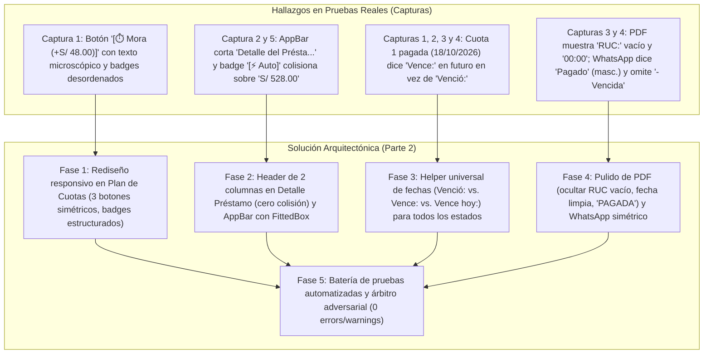

# Plan Maestro de Trabajo (Parte 2): Rediseño Responsivo de Cuotas y Préstamos, Lógica Universal de Fechas y Auditoría de PDF y WhatsApp

**Proyecto:** MochilaLista App (Módulo CRM & Smart Quotation - Gestión Financiera de Créditos y Préstamos)  
**Documento:** `analisis_proyecto/PLAN_PARTE2_REDISENO_CUOTAS_DETALLE_PRESTAMO_PDF_Y_WHATSAPP.md`  
**Estado:** Planificación y Diseño Arquitectónico (Pendiente de Aprobación de Usuario)  
**Versión:** 2.0.0  
**Fecha:** Noviembre 2026  

---

## 1. Diagnóstico Forense y Objetivos del Proyecto

A partir de las pruebas operativas en dispositivos reales sobre el flujo de préstamos (`Préstamo #14`) y la inspección minuciosa de las 5 capturas de pantalla adjuntas, se han detectado 4 áreas de falla visual, inconsistencias lógicas en fechas y asimetrías gramaticales:



---

## 2. Especificación Técnica Detallada por Fases

### FASE 1: Rediseño Responsivo de Etiquetas y Botones en `Plan de Cuotas` (`sale_payment_timeline.dart`) (Ver Captura 1)

#### 1.1 Causa Raíz de la Deformación Tipográfica y Desorden
* **Botón de Mora Comprimido:** En `sale_payment_timeline.dart` (líneas 367–378), el botón izquierdo renderizaba `tieneMora ? "Mora (+S/ ${moraMonto.toStringAsFixed(2)})" : ...` dentro de un `Row` de 3 botones con `Expanded` y `FittedBox(fit: BoxFit.scaleDown)`. Al tener una cadena extensa (`"Mora (+S/ 48.00)"`), el `FittedBox` encoge agresivamente la fuente tipográfica a menos de 7sp en pantallas de 360dp, haciéndola ilegible frente a `Recordar` y `Cobrar`.
* **Redundancia Informativa:** El desglose de mora ya se expone justo arriba (`Orig: S/ 480.00 • + Mora: S/ 48.00`), haciendo innecesario e ineficiente repetir `(+S/ 48.00)` dentro de la etiqueta del botón.
* **Apilamiento Irregular de Badges:** El badge `[⚡ Auto]` y el badge `[VENCIDA (4 d) • CON MORA]` estaban dispersos en filas y contenedores sueltos sin una retícula de espaciado uniforme.
* **Cero Emojis Unicode:** El badge `[⚡ Auto]` utilizaba el emoji `⚡` en lugar de iconos vectoriales nativos.

#### 1.2 Reingeniería de la Tarjeta en `Plan de Cuotas`
Se reestructura el contenedor de cada cuota en tres niveles armónicos y responsivos (`320dp`, `360dp`, `412dp` y tablets):

1. **Nivel 1: Fila Superior (Identidad, Fecha y Monto):**
   * **Izquierda (`Expanded`):** Avatar circular con número de cuota (`1`, `2`, `3`...) + texto de fecha gobernado por la **Regla Universal de Fechas** (`Venció: dd/MM/yyyy`, `Vence hoy: dd/MM/yyyy`, `Vence: dd/MM/yyyy`).
     * Si la cuota está vencida e impaga: color rojo (`Colors.redAccent`).
     * Si está pagada o pendiente al día: color estándar neutro según el tema.
   * **Derecha:** Monto total exigible destacado (`S/ 528.00`, `S/ 480.00`) en tipografía `15sp` `FontWeight.bold`.

2. **Nivel 2: Bloque Informativo Estructurado (`Wrap`):**
   * Se agrupa en un único `Wrap(spacing: 6, runSpacing: 4, crossAxisAlignment: WrapCrossAlignment.center)`:
     * **Badge de Estado:** Contenedor estilizado con borde e icono vectorial:
       * `PAGADA`: Icono `Icons.check_circle_rounded`, verde.
       * `VENCIDA (X d)`: Icono `Icons.error_outline_rounded`, rojo.
       * `PAGO PARCIAL`: Icono `Icons.timelapse_rounded`, naranja.
       * `VENCE HOY`: Icono `Icons.notification_important_outlined`, ámbar.
       * `PENDIENTE`: Icono `Icons.hourglass_top_rounded`, gris/azul.
     * **Badge Modo Automático (`[Auto]`):**
       * Visible únicamente si `moraAuto == true`.
       * Icono vectorial `Icons.bolt_rounded` (12sp) + texto `"Auto"` (10sp bold), color ámbar, sin emojis Unicode.
     * **Píldora de Desglose Financiero (si aplica mora o abono parcial):**
       * Si tiene mora: `Base: ${AppCurrency.format(montoOriginal)} • + Mora: ${AppCurrency.format(moraMonto)}` en color rojo/naranja legible (`11.5sp`, `FontWeight.w600`).
       * Si tiene abono parcial sin completar: `Abonado: ${AppCurrency.format(cuotaPagado)} • Falta: ${AppCurrency.format(saldoFalta)}`.

3. **Nivel 3: Fila de 3 Botones de Acción Simétricos:**
   * Distribución en `Row` con 3 `Expanded` equitativos, altura idéntica (36dp) y tipografía uniforme (`12sp`, `FontWeight.bold`):
     * **Botón 1 (Mora):**
       * Si `tieneMora`: Icono `Icons.timer_outlined`, texto `"Mora"` (fondo rojo suave `alpha: 0.15`, borde `alpha: 0.3`).
       * Si `!tieneMora && isVencido`: Icono `Icons.add_circle_outline_rounded`, texto `"Mora"` (fondo naranja suave).
       * Si `!tieneMora && !isVencido`: Icono `Icons.shield_outlined`, texto `"Prog. Mora"` (fondo azul/gris suave).
     * **Botón 2 (Recordar):** Icono `Icons.chat_rounded`, texto `"Recordar"` (color WhatsApp `#25D366`).
     * **Botón 3 (Cobrar):** Icono `Icons.payments_outlined`, texto `"Cobrar"` (color verde azulado / Teal).

---

### FASE 2: Ajuste Responsivo del AppBar y Eliminación de la Superposición de `Auto` en `Detalle del Préstamo` (`sale_financial_detail_screen.dart`) (Ver Capturas 2 y 5)

#### 2.1 Causa Raíz de los Defectos en `Detalle del Préstamo`
* **Corte del Título en AppBar:** En `sale_financial_detail_screen.dart` (líneas 221–224), `title: Text("Detalle del Préstamo #${...}", fontSize: 20)` carecía de factor de escala adaptativo. Al convivir con el botón de retroceso (`leading`) y dos `IconButton` (`PDF` y `WhatsApp`), el ancho remanente en pantallas de 360dp era insuficiente, provocando la elipsis `Detalle del Présta...`.
* **Colisión Horizontal entre `[⚡ Auto]` y `S/ 528.00`:** El widget utilizaba un `ExpansionTile` donde el `subtitle` incluía un `Row` con `"Venció hace 4 días"` y el badge `[⚡ Auto]`. Dado que el `trailing` del `ExpansionTile` contenía `Column(Text("S/ 528.00"), Text("VENCIDA"))`, ambos bloques competían por el mismo espacio horizontal en pantallas pequeñas, provocando que el contenedor `[⚡ Auto]` se dibujara físicamente encima del texto `S/ 528.00`.
* **Ruptura de Línea Antiestética:** El texto `"Orig: S/ 480.00 • + Mora: S/ 48.00 (10.0%)"` se partía dejando `48.00 (10.0%)` huérfano.

#### 2.2 Reingeniería Visual y Arquitectónica
1. **AppBar 100% Responsivo:**
   * Envolver el título en un `FittedBox`:
     ```dart
     title: FittedBox(
       fit: BoxFit.scaleDown,
       alignment: Alignment.centerLeft,
       child: Text(
         isLoan
             ? "Detalle del Préstamo #${_saleData?['numero_secuencial'] ?? widget.saleId}"
             : "Detalle de Venta #${_saleData?['numero_secuencial'] ?? widget.saleId}",
         style: const TextStyle(fontWeight: FontWeight.bold, fontSize: 18),
       ),
     ),
     ```
   * Reducir márgenes ociosos en los `IconButton` de acciones para otorgar hasta 24dp adicionales al título.

2. **Cabecera de Cuota en Dos Columnas Sin Colisión (`Two-Column Header`):**
   * Se elimina la estructura vulnerable de `ExpansionTile(title: ..., subtitle: ..., trailing: ...)` y se implementa una distribución limpia y controlada:
     * **Columna Izquierda (`Expanded`):**
       * **Línea Superior:** `Text("Cuota ${c['numero_cuota']}", style: TextStyle(fontWeight: FontWeight.bold, fontSize: 16))` + (si `isAutoMora`) chip `[Auto]` con icono vectorial `Icons.bolt_rounded`, integrado en un `Row` con `MainAxisSize.min`.
       * **Línea de Vencimiento:** Texto de fecha gobernado por la **Regla Universal de Fechas** (`Venció: 02/11/2026` / `Venció hace 4 días`).
       * **Línea de Desglose (si hay mora):** `Base: ${AppCurrency.format(cMontoOriginal)} • + Mora: ${AppCurrency.format(cMoraMonto)} (${cMoraPorcentaje.toStringAsFixed(1)}%)` en contenedor píldora estilizado que no quiebra números a la mitad.
     * **Columna Derecha (Alineación a la Derecha, sin solapamiento):**
       * `Text(AppCurrency.format(cMonto), style: TextStyle(fontWeight: FontWeight.w900, fontSize: 16))`.
       * `Text(statusText, style: TextStyle(color: statusColor, fontSize: 11, fontWeight: FontWeight.bold))`.
   * Esta separación física mediante `Expanded` en la columna izquierda y alineación estricta a la derecha en la columna de montos garantiza **imposibilidad matemática de superposición** en cualquier resolución móvil (desde 320dp hasta tablets).

---

### FASE 3: Lógica Universal de Fechas (`Venció:` vs. `Vence:` vs. `Vence hoy:`) en Toda la Aplicación

#### 3.1 Causa Raíz de la Inconsistencia Temporal
Actualmente, las distintas pantallas y generadores evaluaban la fecha con condiciones condicionales dispares:
* En `pdf_generator.dart` (líneas 889 y 949): `final bool isVencida = !pagado && daysOverdue > 0; ... "${isVencida ? 'Venció:' : 'Vence:'} $date"`. Si `pagado == true`, la condición forzaba `"Vence: 18/10/2026"`, a pesar de que el 18 de octubre ya ocurrió en el pasado.
* En `sale_payment_timeline.dart` (líneas 117 y 209): `final bool isVencido = !cuotaPagada && daysDiff > 0; ... "${isVencido ? 'Venció:' : 'Vence:'} $dateFormatted"`. Mismo defecto: cualquier cuota pagada se imprimía en tiempo futuro (`"Vence:"`).
* En `sale_financial_detail_screen.dart` (línea 410): `daysDiff < 0 && !isPaid ? "Venció hace ... " : "Vence: ..."`.
* En `whatsapp_preview_screen.dart` (línea 618): Para cuotas pagadas utilizaba `daysOverdue > 0 ? 'Venció:' : 'Vence:'`, pero sin unificar con la lógica de `"Vence hoy:"` ni extenderlo a las cuotas con mora.

#### 3.2 Helper Universal de Fechas (`CuotaDateHelper`)
Se crea una clase de utilidad centralizada e inmutable:

```dart
class CuotaDateInfo {
  final String dateFormatted; // "18/10/2026"
  final String prefix;        // "Venció:", "Vence hoy:", "Vence:"
  final String fullLabel;     // "Venció: 18/10/2026"
  final int daysDifference;   // >0 si ya pasó, 0 si es hoy, <0 si es futuro
  final bool isPast;
  final bool isToday;
  final bool isFuture;

  const CuotaDateInfo({
    required this.dateFormatted,
    required this.prefix,
    required this.fullLabel,
    required this.daysDifference,
    required this.isPast,
    required this.isToday,
    required this.isFuture,
  });
}

class CuotaDateHelper {
  static CuotaDateInfo evaluate(dynamic rawDueDate, {DateTime? referenceDate}) {
    DateTime? dueDate;
    try {
      if (rawDueDate is DateTime) {
        dueDate = rawDueDate;
      } else if (rawDueDate != null) {
        dueDate = DateTime.parse(rawDueDate.toString().split('T').first);
      }
    } catch (_) {}

    final now = referenceDate ?? DateTime.now();
    final today = DateTime(now.year, now.month, now.day);

    if (dueDate == null) {
      return CuotaDateInfo(
        dateFormatted: rawDueDate?.toString() ?? "-",
        prefix: "Vence:",
        fullLabel: "Vence: ${rawDueDate?.toString() ?? '-'}",
        daysDifference: 0,
        isPast: false,
        isToday: false,
        isFuture: true,
      );
    }

    final dueCalendar = DateTime(dueDate.year, dueDate.month, dueDate.day);
    final int daysDiff = today.difference(dueCalendar).inDays;
    final String dateFormatted = DateFormat('dd/MM/yyyy').format(dueDate);

    if (daysDiff > 0) {
      // Fecha en el pasado (aplica tanto a pagadas como a vencidas)
      return CuotaDateInfo(
        dateFormatted: dateFormatted,
        prefix: "Venció:",
        fullLabel: "Venció: $dateFormatted",
        daysDifference: daysDiff,
        isPast: true,
        isToday: false,
        isFuture: false,
      );
    } else if (daysDiff == 0) {
      // Fecha corresponde al día de hoy
      return CuotaDateInfo(
        dateFormatted: dateFormatted,
        prefix: "Vence hoy:",
        fullLabel: "Vence hoy: $dateFormatted",
        daysDifference: 0,
        isPast: false,
        isToday: true,
        isFuture: false,
      );
    } else {
      // Fecha en el futuro
      return CuotaDateInfo(
        dateFormatted: dateFormatted,
        prefix: "Vence:",
        fullLabel: "Vence: $dateFormatted",
        daysDifference: daysDiff,
        isPast: false,
        isToday: false,
        isFuture: true,
      );
    }
  }
}
```

* **Adopción Universal:**
  * `sale_payment_timeline.dart`
  * `sale_financial_detail_screen.dart`
  * `pdf_generator.dart`
  * `whatsapp_preview_screen.dart`
  * `whatsapp_preview_modal.dart`

---

### FASE 4: Auditoría y Pulido Integral de `Vista Previa PDF` y `Editor WhatsApp` (Ver Capturas 3 y 4)

#### 4.1 Perfeccionamiento del Comprobante en `Vista Previa PDF` (`pdf_generator.dart`)
1. **Ocultamiento Limpio de `RUC:` Vacío (Captura 3):**
   * **Problema:** En el encabezado del negocio (líneas 478 y 527), `if (config.includeShopRuc && bizRuc != null)` renderizaba `"RUC: "` cuando `bizRuc` era una cadena vacía o con espacios.
   * **Corrección:** Validar con rigor: `if (config.includeShopRuc && bizRuc != null && bizRuc.trim().isNotEmpty)`. Si no hay RUC, no se imprime la línea.
2. **Formato Limpio de Fecha de Emisión (Eliminación de `00:00`):**
   * **Problema:** En la fecha bajo el número de comprobante (`N° #000015`), aparecía `02/10/2026 00:00`.
   * **Corrección:** Si la hora y minuto del DateTime de emisión son `00:00` (o la fecha en BD fue registrada sin componente horario), formatear únicamente como `dd/MM/yyyy` (ej. `02/10/2026`). Si existe hora real (ej. `15:45`), mostrar `dd/MM/yyyy HH:mm`.
3. **Tabla `PLAN DE CUOTAS` en el PDF:**
   * Integrar `CuotaDateHelper`: La `Cuota 1` pagada mostrará con total veracidad: `Venció: 18/10/2026`.
   * **Concordancia de Género Femenino:**
     * `PAGADA` (en lugar del masculino `PAGADO`).
     * `VENCIDA ($daysOverdue d) | CON MORA` o `VENCIDA ($daysOverdue d)`.
     * `PAGO PARCIAL (Abonó ${AppCurrency.format(cuotaPagado)} | Falta ${AppCurrency.format(saldoFalta)})`.
     * `PENDIENTE`.
   * Cuadre contable exacto garantizado tanto en **A4** como en **Ticket (80mm/58mm)**.

#### 4.2 Perfeccionamiento Gramatical y Simetría en `Editor WhatsApp` (`whatsapp_preview_screen.dart` y `whatsapp_preview_modal.dart`)
1. **Corrección Gramatical a Femenino:**
   * En `Cuota 1`: cambiar `- Pagado` por `- *Pagada*` (o `- Pagada`).
2. **Restitución del Estado `- *Vencida*` en Cuotas con Mora:**
   * **Problema en Captura 4:** Línea 2 mostraba:
     `🔴 Cuota 2: *S/ 528.00* (Base: S/ 480.00 + Mora: S/ 48.00) - Venció: 02/11/2026 (hace 4 días)` pero omitía el estado al final.
   * **Estandarización Sólida:** Toda línea de cuota en el cronograma seguirá la misma plantilla armónica:
     * `✅ Cuota 1: *S/ 480.00* (Venció: 18/10/2026) - *Pagada*`
     * `🔴 Cuota 2: *S/ 528.00* (Base: S/ 480.00 + Mora: S/ 48.00) (Venció: 02/11/2026) - *Vencida (hace 4 días)*`
     * `⏳ Cuota 3: *S/ 480.00* (Vence: 17/11/2026) - *Pendiente*`
     * `⏳ Cuota 4: *S/ 480.00* (Vence: 04/12/2026) - *Pendiente*`
     * `⏳ Cuota 5: *S/ 480.00* (Vence: 18/12/2026) - *Pendiente*`
3. **Sincronización:** Aplicar la misma lógica idéntica tanto en `whatsapp_preview_screen.dart` como en `whatsapp_preview_modal.dart`.

---

## 3. Matriz de Cambios por Archivo

| Archivo | Responsabilidad en Parte 2 | Cambios Específicos |
| :--- | :--- | :--- |
| **`app_movil/lib/core/utils/cuota_date_helper.dart`** | Nuevo Helper Universal de Fechas | Centraliza la comparación de fecha por día calendario (`Venció:`, `Vence hoy:`, `Vence:`). |
| **`app_movil/lib/features/smart_quotation/widgets/history/detail_widgets/sale_payment_timeline.dart`** | Plan de Cuotas (`sale_payment_timeline.dart`) | 3 botones simétricos `[⏱️ Mora]`, `[💬 Recordar]`, `[💵 Cobrar]`; bloque de badges y desglose en `Wrap`; adopción de `CuotaDateHelper`. |
| **`app_movil/lib/features/smart_quotation/screens/crm/sale_financial_detail_screen.dart`** | Pantalla Detalle del Préstamo | `FittedBox` en AppBar para `"Detalle del Préstamo"`; cabecera de 2 columnas independientes sin superposición de `[Auto]`; adopción de `CuotaDateHelper`. |
| **`app_movil/lib/features/smart_quotation/utils/pdf_generator.dart`** | Generación de Comprobantes PDF | Supresión de `RUC:` si es nulo o vacío; fecha sin `00:00`; estado gramatical `PAGADA`; adopción de `CuotaDateHelper`. |
| **`app_movil/lib/features/smart_quotation/screens/whatsapp_preview_screen.dart`** | Pantalla Editor de WhatsApp | Cierre simétrico `- *Vencida (hace X días)*`; concordancia femenina `- *Pagada*`; regla universal de fechas en cronograma. |
| **`app_movil/lib/features/smart_quotation/widgets/history/detail_widgets/whatsapp_preview_modal.dart`** | Modal Rápido de WhatsApp | Sincronización idéntica de la estructura del cronograma de cuotas y estados en femenino. |

---

## 4. Estrategia de Testing y Verificación Adversarial (Fase 5)

Siguiendo el protocolo estricto contra falsos positivos:
1. **Creación de Test Suite Dedicado:** `test/prestamo_detalle_cuotas_pdf_whatsapp_parte2_test.dart`
   * Test 1: Verificación de `CuotaDateHelper` con fechas pasadas, actuales y futuras (validando `Venció:`, `Vence hoy:`, `Vence:`).
   * Test 2: Validación de renderizado de texto en `sale_payment_timeline.dart` sin truncamiento y con 3 botones equilibrados.
   * Test 3: Simulación de cabecera de cuota en `sale_financial_detail_screen.dart` verificando que no exista colisión de coordenadas en anchos de 320dp y 360dp.
   * Test 4: Verificación del texto del PDF generado: ausencia de `RUC: ` vacío, ausencia de `00:00` en fecha de emisión y presencia de `PAGADA`.
   * Test 5: Verificación del mensaje de WhatsApp: presencia de `(Venció: 18/10/2026) - *Pagada*` y `(Venció: 02/11/2026) - *Vencida (hace 4 días)*`.
2. **Verificación Estricta en Consola:**
   * `flutter analyze --no-pub lib test` ➔ **0 errores, 0 advertencias, 0 infos**.
   * `flutter test --timeout 30s` ➔ **100% pruebas unitarias y de widgets aprobadas**.

---

## 5. Próximos Pasos

1. Presentar este plan detallado al usuario para su revisión y aprobación.
2. Tras recibir la orden de ejecución, implementar secuencialmente las Fases 1 a 4.
3. Ejecutar los tests adversariales y certificar en terminal real.

