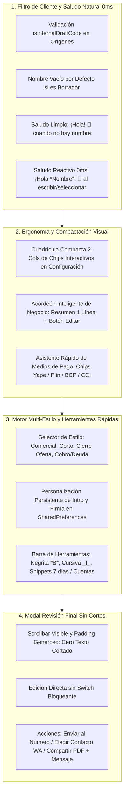
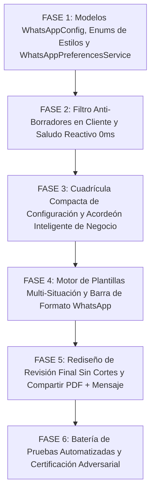

# 📱 PLAN MAESTRO PARTE 2: REDISEÑO INTEGRAL DE EDITOR WHATSAPP, PLANTILLAS MULTI-SITUACIÓN Y MODAL REVISIÓN FINAL

**Documento de Especificación Técnica, Auditoría Forense y Protocolo de Implementación Adversarial**  
**Proyecto:** MochilaLista App (Local-First SQLite, 0ms Latency, Flutter Mobile — Estándar Mobile Awards)  
**Módulos Involucrados:**
- **Pantalla Principal:** `lib/features/smart_quotation/screens/whatsapp_preview_screen.dart`
- **Modelo de Configuración y Plantillas:** `lib/features/smart_quotation/models/whatsapp_config_model.dart`
- **Widgets de Secciones:**
  - `lib/features/smart_quotation/widgets/whatsapp/wa_client_section.dart`
  - `lib/features/smart_quotation/widgets/whatsapp/wa_config_section.dart`
  - `lib/features/smart_quotation/widgets/whatsapp/wa_business_section.dart`
  - `lib/features/smart_quotation/widgets/whatsapp/wa_message_editor.dart`
  - `lib/features/smart_quotation/widgets/whatsapp/wa_final_preview_modal.dart`
- **Servicios Transversales:**
  - `lib/features/smart_quotation/services/whatsapp_preferences_service.dart` *(Nuevo)*
  - `lib/features/smart_quotation/utils/pdf_generator.dart` (para `isInternalDraftCode` y compartir PDF + Mensaje)
  - `lib/core/providers/auth_provider.dart`
**Fecha:** Octubre 2026  
**Metodología:** Loop Autónomo + Árbitro Interno Adversarial Estricto  

---

## 📸 1. AUDITORÍA FORENSE DE LAS 5 CAPTURAS Y DIAGNÓSTICO EN CÓDIGO FUENTE

A partir de la inspección exhaustiva de las 5 capturas remitidas por el usuario y la auditoría línea por línea del código fuente, se identifican las causas raíz técnicas exactas de cada anomalía:

| Captura | Pantalla / Componente | Diagnóstico Forense del Problema | Causa Raíz Exacta en Código Fuente |
| :--- | :--- | :--- | :--- |
| **Captura 1** | **`Editor WhatsApp` (Datos del Cliente y Configuración)** | **1. Precarga Errónea de Código Interno como Cliente:** El campo `Nombre Completo` aparece precargado con `"Cotización Manual #21-174"` (cortado el último dígito por el ancho del input). **2. Sección Gigante Vertical:** `Personalizar Mensaje` usa 6 filas verticales de switches (`Precios y Subtotales`, `Sección de Ahorro`, etc.) que ocupan casi 300dp de alto, empujando la vista previa del mensaje fuera de la pantalla inicial. | • `whatsapp_preview_screen.dart` L95-97: Al inicializar `_clientNameCtrl.text`, se lee `_quotation!.clientName` sin pasar por el filtro de códigos de borrador. Como no había cliente asignado, la cotización tenía guardado `"Cotización Manual #21-1749"` y se inyecta como si fuera el cliente. • `wa_config_section.dart` L30-55: Renderiza un `ExpansionTile` con múltiples `SwitchListTile` apilados verticalmente de forma rígida y dispersa. |
| **Captura 2** | **`Editor WhatsApp` (Mi Negocio & Pagos)** | **1. Formulario Masivo Desplegado:** La tarjeta `Mi Negocio & Pagos` siempre está abierta por defecto ocupando 4 inputs gigantescos (`Teléfono`, `RUC`, `Dirección`, `Cuentas`). **2. Carencia de Asistente de Pagos:** El usuario tiene que teclear manualmente sus cuentas bancarias o billeteras en un input multilínea vacío sin formato. | • `wa_business_section.dart` L40-105: Renderiza un `Card` fijo sin colapsar ni resumir los datos existentes del negocio, obligando a hacer scroll prolongado. Carece de chips de inserción rápida para Yape, Plin o cuentas bancarias. |
| **Captura 3** | **`Editor WhatsApp` (Texto de Pago y Vista Previa)** | **1. Saludo Ridículo y No Profesional:** El mensaje autogenerado saluda diciendo: `¡Hola *Cotización Manual #21-1749*! 👋`. **2. Texto de Cuentas Plano:** El input de cuentas contiene `"yape y plin"` sin números ni formato corporativo. **3. Carencia de Selector de Estilo:** El usuario no puede elegir el tono del mensaje (comercial, corto, urgente, estado de cuenta). | • `whatsapp_preview_screen.dart` L136-138: `sb.writeln("¡Hola *$clientName*! 👋");` donde `clientName` toma el string autogenerado del input sin validar si es un cliente real o si está vacío. • `whatsapp_preview_screen.dart` L129-291: Generador rígido con una sola plantilla fija de texto hardcodeada en código. |
| **Captura 4** | **`Editor WhatsApp` (Detalle del Mensaje y Cierre)** | **1. Carencia de Herramientas de Edición Rápida:** No hay barra de herramientas para aplicar negritas (`*`), cursivas (`_`) ni snippets de validez o entrega. **2. Redacción Monolítica:** Si el comerciante quiere un estilo más conciso o enfocado en urgencia/oferta, debe borrar y reescribir todo el mensaje manualmente. | • `wa_message_editor.dart` L25-55: Un simple `TextField` dentro de un contenedor decorado, sin barra de formato ni inserción rápida de fragmentos de texto. |
| **Captura 5** | **Modal `Revisión Final`** | **1. Texto Críticamente Cortado:** La última línea visible (`Ahorro Total: *1,64 S/* 🎉`) está **cortada por la mitad en el borde inferior**, impidiendo ver el resto del mensaje (`MEDIOS DE PAGO`, `Visítanos...`). **2. Bloqueo Innecesario:** Obliga a encender un switch `Habilitar edición final` para poder interactuar o desplazarse cómodamente. **3. Carencia de Acciones:** Solo tiene un botón de envío que falla si el teléfono no tiene 9 dígitos, y carece de opción para compartir PDF + Mensaje. | • `wa_final_preview_modal.dart` L89-105: `Expanded(child: Container(child: TextField(enabled: allowFinalEdit, maxLines: null)))`. Al estar `enabled: false`, el scroll no responde fluidamente y la altura fija del contenedor clipea la última línea de texto. • `whatsapp_preview_screen.dart` L463-466: Valida rígidamente 9 dígitos bloqueando el envío si el usuario prefiere elegir el destinatario directamente dentro de WhatsApp. |

---

## 🎯 2. PRINCIPIOS RECTORES Y ARQUITECTURA TÉCNICA DE LA SOLUCIÓN

### Principio 1: Cero Códigos Internos y Saludo Natural Reactivo
- **Limpieza Absoluta de Borradores:** Si el origen de datos contiene `"Cotización Manual #..."`, `"Venta #..."`, `"Caja Rápida..."`, `"Sin cliente"` o `"Cliente General"`, el campo `Nombre Completo` se inicializa **completamente vacío (`""`)** con el placeholder `"Nombre del cliente (Opcional)"`.
- **Saludo Dinámico Profesional:**
  - Si el campo está vacío: genera exactamente **`¡Hola! 👋`** (sin asteriscos vacíos, sin la palabra "Cliente", sin códigos de borrador).
  - Al escribir o seleccionar un contacto con `🔍 Buscar`: a 0ms se actualiza de inmediato a: **`¡Hola *$nombre*! 👋`**.

### Principio 2: Ergonomía Visual y Reducción Vertical
- **Cuadrícula de Chips de 2 Columnas para `Personalizar Mensaje`:**  
  Reemplaza las 6 filas verticales masivas por un panel compacto con chips táctiles interactivos que muestran ícono, etiqueta y estado (activo/inactivo), reduciendo la altura vertical en un 60%.
- **Acordeón Resumen para `Mi Negocio & Pagos`:**  
  Si el negocio ya tiene datos registrados, muestra una tarjeta compacta de 1 sola línea (`🏢 Nombre • 📞 Teléfono • 💳 Cuentas configuradas`) con botón `Editar ⌄` para expandir los campos solo cuando el usuario lo decida.
- **Asistente Rápido de Medios de Pago:**  
  Chips de 1 toque (`+ 📱 Yape: [Teléfono]`, `+ 📱 Plin: [Teléfono]`, `+ 🏦 BCP:`, `+ 🏦 CCI:`) que insertan instantáneamente la estructura de cobro corporativa sin errores de digitación.

### Principio 3: Motor de Plantillas por Situación y Formato Rápido
- **4 Estilos de Mensaje Seleccionables:**
  1. **`✨ Comercial Detallado`**: Saludo cordial, introducción profesional, lista detallada con precios/ahorros, resumen, medios de pago y datos de visita.
  2. **`⚡ Resumen Directo / Corto`**: Saludo breve, lista concisa con total final y medios de pago.
  3. **`🔥 Cierre de Oferta / Urgencia`**: Énfasis en el ahorro obtenido (`🎉 ¡Ahorras S/ X.XX!`), llamado a la acción y validez limitada.
  4. **`🔔 Estado de Cuenta / Saldo Pendiente`**: Resalta el total, el abono, el saldo pendiente destacado con advertencia contable, cronograma de cuotas y cuentas de abono.
- **Persistencia de Intro y Firma:** Permite que el comerciante guarde su propio texto de saludo y despedida por defecto en `SharedPreferences`.
- **Barra de Formato de WhatsApp:** Botones táctiles sobre el editor para aplicar `*Negrita*`, `_Cursiva_`, `~Tachado~`, y snippets de validez o entrega con 1 clic.

### Principio 4: Blindaje del Modal `Revisión Final` y Compartir PDF + Texto
- **Cero Cortes de Scroll:** Contenedor con `Scrollbar` visible, `SingleChildScrollView` y padding inferior generoso (`bottom: 24`), garantizando que la última línea de totales y medios de pago nunca se corte.
- **Envío Flexible:**
  - Si el teléfono tiene 9 dígitos: **`➤ Enviar al +51 $phone`**.
  - Si el teléfono está vacío: **`➤ Elegir Contacto en WhatsApp`** (`https://wa.me/?text=...`).
- **Botón `📎 Compartir PDF + Mensaje`:** Genera en memoria el archivo PDF formal con la configuración predeterminada de la Parte 1 y ejecuta `Share.shareXFiles([XFile(pdfPath)], text: messageText)`, enviando el documento oficial y el mensaje de texto formateado en una sola acción de alto impacto.

---

## 🏗️ 3. PLAN DE TRABAJO DETALLADO POR FASES

---

### FASE 1: MODELO `WhatsAppConfig`, ENUMS DE ESTILOS Y SERVICIO DE PREFERENCIAS
**Objetivo:** Extender la configuración de WhatsApp para soportar estilos de plantilla, textos personalizados de intro/cierre y su persistencia en `SharedPreferences`.

- [ ] **1.1. Ampliación de `WhatsAppConfig` (`whatsapp_config_model.dart`):**
  - Incorporar `enum WhatsAppMessageStyle { commercial, compact, urgentOffer, accountDebt }`.
  - Campos nuevos:
    - `WhatsAppMessageStyle style`: Por defecto `commercial`.
    - `String? customIntro`: Frase introductoria personalizada por el usuario.
    - `String? customClosing`: Despedida / firma personalizada.
    - `bool includeDelivery`: Mostrar info de entrega / delivery.
    - `bool includeValidity`: Mostrar nota de validez de la cotización.
  - Actualizar `fromJson`, `toJson` y añadir método `copyWith` preservando compatibilidad.
- [ ] **1.2. Servicio `WhatsAppPreferencesService` (`whatsapp_preferences_service.dart`):**
  - Métodos para guardar (`saveDefaultConfig`) y restaurar (`loadSavedPreferences`) las preferencias de configuración y las plantillas de texto personalizadas en `SharedPreferences`.
  - Método para restaurar los textos de fábrica (`restoreDefaultTemplates`).

---

### FASE 2: FILTRO ANTI-BORRADORES EN CLIENTE Y SALUDO REACTIVO A 0ms
**Objetivo:** Eliminar para siempre que códigos como `"Cotización Manual #21-1749"` aparezcan como cliente o en el saludo de WhatsApp.

- [ ] **2.1. Sanitización en la Carga Inicial (`_loadData` en `whatsapp_preview_screen.dart`):**
  - Utilizar `PdfGenerator.isInternalDraftCode(rawClientName)`:
    - Si el nombre coincide con `Cotización Manual #...`, `Cotización #...`, `Venta #...`, `Cliente General`, `Sin cliente` o es nulo:
      - `_clientNameCtrl.text` se inicializa **vacío (`""`)**.
      - Placeholder en el input: `"Nombre del cliente (Opcional)"`.
    - Si existe un cliente real (`cliente_nombre` legítimo o `ClientModel` vinculado):
      - Se inyecta su nombre y teléfono reales.
- [ ] **2.2. Generador de Saludo Dinámico Natural:**
  - En el armado del mensaje:
    - Si `_clientNameCtrl.text.trim().isEmpty`:
      - Saludo: **`¡Hola! 👋`** (limpio, profesional, sin asteriscos ni código interno).
    - Si el usuario escribe o selecciona un cliente:
      - Saludo: **`¡Hola *$nombre*! 👋`**.
  - Reactividad inmediata a 0ms en el evento `onChanged` de `_clientNameCtrl`.

---

### FASE 3: CUADRÍCULA COMPACTA DE CONFIGURACIÓN Y ACORDEÓN INTELIGENTE DE NEGOCIO
**Objetivo:** Reducir la altura visual de la pantalla en un 60% transformando switches gigantes en chips interactivos y compactando los datos de negocio con asistente de Yape/Plin.

- [ ] **3.1. Reingeniería de `WaConfigSection` (`wa_config_section.dart`):**
  - Sustituir los 6 `SwitchListTile` verticales por una **cuadrícula compacta de 2 columnas con FilterChips / ActionCards estilizados**:
    - `💰 Precios / Subtotales`
    - `🎉 Ahorro Total`
    - `🏷️ Descuento Unitario` (sub-chip)
    - `📊 Importe Total S/.`
    - `🏢 Info del Negocio`
    - `💳 Cuentas / Medios de Pago`
    - Si es venta: `📌 Saldo Pendiente`, `📅 Cuotas`, `📦 Entrega`.
  - Cada chip muestra su ícono, nombre conciso y cambia de color al activarse/desactivarse con feedback háptico.
- [ ] **3.2. Acordeón Inteligente y Asistente de Pagos en `WaBusinessSection` (`wa_business_section.dart`):**
  - Si el negocio ya tiene datos (`phone`, `address`, `ruc`, `paymentInfo`):
    - Muestra tarjeta de resumen de 1 sola fila con datos esenciales y botón `Editar ⌄` para expandir el acordeón.
  - Dentro del campo `Cuentas Bancarias / Yape / Plin`:
    - Incorporar **Chips de Inserción Rápida**:
      - `+ 📱 Yape: [Teléfono]`
      - `+ 📱 Plin: [Teléfono]`
      - `+ 🏦 BCP:`
      - `+ 🏦 BBVA:`
      - `+ 🏦 CCI:`
    - Al pulsar un chip, inserta automáticamente el texto formateado en el cursor o al final del campo.
  - El checkbox `Actualizar mis datos por defecto` persiste los cambios en `AuthProvider` y en `LocalDatabase`.

---

### FASE 4: MOTOR DE PLANTILLAS MULTI-SITUACIÓN Y BARRA DE FORMATO WHATSAPP
**Objetivo:** Ofrecer 4 estilos de mensaje adaptados a la realidad comercial y botones de formato WhatsApp en el editor.

- [ ] **4.1. Selector de Estilo de Mensaje en la Cabecera del Editor:**
  - Selector horizontal con 4 chips de estilo:
    - **`✨ Comercial Detallado`**
    - **`⚡ Resumen Directo / Corto`**
    - **`🔥 Cierre de Oferta / Urgencia`**
    - **`🔔 Estado de Cuenta / Saldo Pendiente`**
  - Al cambiar de chip, `_regenerateMessage()` reestructura el mensaje al instante respetando los datos de la cotización/venta.
- [ ] **4.2. Barra de Herramientas de Edición Rápida sobre `WaMessageEditor` (`wa_message_editor.dart`):**
  - Barra de herramientas compacta sobre el `TextField`:
    - **Botones de formato de WhatsApp:**
      - `*B*` (envuelve el texto seleccionado con `*` o inserta `**` en el cursor).
      - `_I_` (envuelve con `_`).
      - `~S~` (envuelve con `~`).
    - **Snippets Rápidos:**
      - `⏳ + Validez 7 días`
      - `🚚 + Envío / Delivery`
      - `💳 + Mis Cuentas`
      - `🔄 Regenerar auto` (restaura el mensaje autogenerado si estaba en modo manual)
      - `📋 Copiar texto` (copia al portapapeles y notifica con SnackBar).

---

### FASE 5: REDISEÑO DEL MODAL `Revisión Final` SIN CORTES Y COMPARTIR PDF + MENSAJE
**Objetivo:** Eliminar el recorte de texto inferior en el modal, permitir edición directa sin switch bloqueante e incorporar compartir PDF adjunto + mensaje.

- [ ] **5.1. Cero Cortes de Scroll y Edición Ágil en `WaFinalPreviewModal` (`wa_final_preview_modal.dart`):**
  - Eliminar el switch bloqueante `allowFinalEdit`: el texto se puede leer y desplazar libremente siempre.
  - Envolver el mensaje en un `Scrollbar` visible con `SingleChildScrollView` y padding inferior de `24dp`, garantizando que la última línea de resumen total y medios de pago se lea al 100% sin truncamiento.
  - Ofrecer botón sutil `Editar mensaje` si el usuario desea modificarlo directamente en el modal antes de enviar.
- [ ] **5.2. Acciones Potenciadas en la Base del Modal:**
  - Botón Principal:
    - Si hay teléfono de 9 dígitos: **`➤ Enviar al +51 $phone`**.
    - Si el teléfono está vacío: **`➤ Elegir Contacto en WhatsApp`** (`https://wa.me/?text=$encodedMsg`).
  - Botones de Acción Secundaria:
    - **`📋 Copiar Mensaje`**: Copia el texto formateado al portapapeles.
    - **`📎 Compartir PDF + Mensaje`**: Genera el PDF al vuelo con `PdfGenerator.generatePdf` (con la configuración de la Parte 1) y ejecuta `Share.shareXFiles([XFile(pdfPath)], text: messageText)`.

---

### FASE 6: PRUEBAS AUTOMATIZADAS ADVERSARIALES Y CERTIFICACIÓN COMPLETA
**Objetivo:** Verificar que todos los flujos funcionen sin regresiones mediante pruebas automatizadas y análisis estático.

- [ ] **6.1. Creación de Suite de Tests Automatizados:**
  - Archivo de test: `app_movil/test/whatsapp_preview_and_templates_parte2_test.dart`:
    - Test 1: Verificar que `isInternalDraftCode` deje el campo de cliente vacío si recibe códigos autogenerados (`Cotización Manual #...`, etc.).
    - Test 2: Verificar que el saludo generado sea `¡Hola! 👋` cuando no hay cliente, y `¡Hola *Nombre*! 👋` cuando se ingresa un cliente real.
    - Test 3: Verificar la generación de los 4 estilos de mensaje (`comercial`, `compact`, `urgentOffer`, `accountDebt`).
    - Test 4: Verificar la inserción de cuentas de pago (Yape/Plin/Bancos) y cálculo de saldo pendiente deudor.
    - Test 5: Verificar que `WhatsAppPreferencesService` persista y restaure las preferencias y plantillas del usuario.
    - Test 6: Verificar que el modal de revisión final admita envío directo a número y apertura para selección de contacto en WhatsApp.
- [ ] **6.2. Certificación del Árbitro Interno:**
  - `flutter analyze lib test`: 0 errores y 0 advertencias.
  - `flutter test`: 100% de la suite global aprobada.

---

## ⚖️ 4. PROTOCOLO DEL ÁRBITRO INTERNO ADVERSARIAL

Para que el Árbitro apruebe la Parte 2, se verificarán de manera estricta los siguientes puntos:

1. **Prueba Anti-Borradores:** ¿Ha desaparecido por completo el texto `"Cotización Manual #21-174"` del campo de cliente y del saludo de WhatsApp? **(Obligatorio: SÍ)**
2. **Prueba de Saludo Dinámico:** ¿El mensaje saluda con `¡Hola! 👋` si el campo está vacío, y con `¡Hola *Nombre*! 👋` en el instante en que se escribe un cliente? **(Obligatorio: SÍ)**
3. **Prueba de Cuadrícula Compacta:** ¿La sección de configuración utiliza chips interactivos de 2 columnas reduciendo la altura vertical drásticamente? **(Obligatorio: SÍ)**
4. **Prueba de Acordeón de Negocio:** ¿La tarjeta de negocio se muestra resumida en 1 línea si ya está configurada, con botón para editar y chips de Yape/Plin? **(Obligatorio: SÍ)**
5. **Prueba de Estilos de Plantilla:** ¿El usuario puede alternar entre los 4 estilos de mensaje (`Comercial`, `Corto`, `Oferta Urgente`, `Cobro de Deuda`) viendo el resultado en tiempo real? **(Obligatorio: SÍ)**
6. **Prueba de Barra de Formato:** ¿El editor cuenta con botones rápidos para `*Negrita*`, `_Cursiva_`, `~Tachado~` y snippets de validez/cuentas? **(Obligatorio: SÍ)**
7. **Prueba de Cero Recortes en Revisión Final:** ¿Se eliminó por completo el corte de texto en el modal `Revisión Final`, mostrando todo el mensaje con scroll suave y barra visible? **(Obligatorio: SÍ)**
8. **Prueba de Envío Flexible:** ¿Se puede enviar a un número específico o abrir WhatsApp para elegir contacto si no se tiene el teléfono? **(Obligatorio: SÍ)**
9. **Prueba de Compartir PDF + Mensaje:** ¿El modal permite compartir el archivo PDF generado adjunto junto con el texto formateado? **(Obligatorio: SÍ)**
10. **Prueba de Cero Regresiones:** ¿Pasan el 100% de los tests globales en `flutter test` con `flutter analyze` en 0 errores y 0 advertencias? **(Obligatorio: SÍ)**
