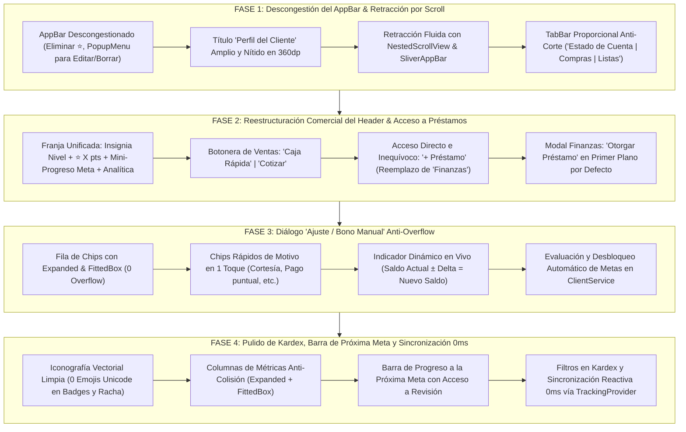

# PLAN MAESTRO PARTE 2: REESTRUCTURACIÓN DEL PERFIL DEL CLIENTE, ACCESO INEQUÍVOCO A PRÉSTAMOS Y KARDEX DE PUNTOS

> **Documento:** Plan de Trabajo Maestro - Parte 2  
> **Módulos Afectados:** `ClientDetailScreen`, `ClientStatsHeader`, `ClientFinanceActionsModal`, `ClientLoyaltyHistoryModal`, `TrackingProvider`, `ClientService`  
> **Versión Objetivo:** v9.20  
> **Metodología:** Loop Autónomo de Desarrollo + Árbitro Adversarial Estricto  
> **Estado:** 🟡 Pendiente de Aprobación por el Usuario  

---

## 1. OBJETIVO ESTRATÉGICO Y DIAGNÓSTICO FORENSE DE LA UI/UX

La pantalla de **Perfil del Cliente** (`ClientDetailScreen`) y su cabecera operativa (`ClientStatsHeader`), junto con los modales de **Operaciones Financieras / Préstamos** (`ClientFinanceActionsModal`) y **Kardex de Puntos / Ajuste Manual** (`ClientLoyaltyHistoryModal`), constituyen el centro neurálgico del CRM móvil de MochilaLista.

Tras la auditoría forense sobre las **5 capturas de pantalla reales** aportadas por el usuario (en resolución móvil estándar de `360x800dp`), se han identificado fallos críticos de saturación visual, ambigüedad comercial, desbordes (`RenderFlex overflowed`) e inconsistencias que degradan la experiencia del comerciante:

### 1.1. Tabla Diagnóstica Forense por Captura de Pantalla

```
┌────────────────────────────────────────────────────────────────────────────────────────┐
│                                DIAGNÓSTICO FORENSE VISUAL                              │
├──────────────────┬─────────────────────────────────────┬───────────────────────────────┤
│ Captura          │ Pantalla / Componente               │ Problema Detectado            │
├──────────────────┼─────────────────────────────────────┼───────────────────────────────┤
│ 1                │ Perfil del Cliente:                 │ • AppBar saturado con 4 iconos│
│ (1.09.04 AM (2)) │ `client_detail_screen.dart`         │   (Info, ⭐, Editar, Borrar). │
│                  │ `client_stats_header.dart`          │ • Título apretado y reducido. │
│                  │                                     │ • Botón ⭐ del AppBar duplica │
│                  │                                     │   el chip de puntos inferior. │
│                  │                                     │ • La cabecera ocupa > 60% de  │
│                  │                                     │   pantalla fija sin retraerse.│
│                  │                                     │ • TabBar: pestaña "Listas"    │
│                  │                                     │   cortada contra el borde der.│
│                  │                                     │ • Botón "Finanzas" confuso:   │
│                  │                                     │   el usuario no encuentra     │
│                  │                                     │   cómo crear préstamos.       │
├──────────────────┼─────────────────────────────────────┼───────────────────────────────┤
│ 2                │ Modal: Ajuste / Bono Manual         │ • BUG VISUAL CRÍTICO: El botón│
│ (1.09.03 AM (1)) │ `client_loyalty_history_modal.dart` │   "- Restar Puntos" desborda  │
│                  │                                     │   hacia la derecha fuera del  │
│                  │                                     │   borde del AlertDialog.      │
│                  │                                     │ • Cero chips de motivos       │
│                  │                                     │   rápidos (obliga a tipear).  │
│                  │                                     │ • Sin preview de nuevo saldo  │
│                  │                                     │   ni alertas de metas.        │
├──────────────────┼─────────────────────────────────────┼───────────────────────────────┤
│ 3                │ Modal: Kardex de Movimientos        │ • Emojis Unicode incrustados: │
│ (1.09.03 AM)     │ `client_loyalty_history_modal.dart` │   "⚠️ Observación", "🔥 0".    │
│                  │                                     │ • Icono de fuego duplicado    │
│                  │                                     │   en cabecera y valor.        │
│                  │                                     │ • Caja de 3 columnas colisiona│
│                  │                                     │   con los divisores verticales│
│                  │                                     │ • Sin barra de progreso a la  │
│                  │                                     │   próxima meta de fidelidad.  │
│                  │                                     │ • Sin filtros en el kardex.   │
├──────────────────┼─────────────────────────────────────┼───────────────────────────────┤
│ 4                │ Modal: Kardex con Movimiento        │ • El usuario escribió "bueno" │
│ (1.09.03 AM (2)) │ `client_loyalty_history_modal.dart` │   por falta de sugerencias.   │
│                  │                                     │ • Si el bono alcanza una meta,│
│                  │                                     │   no se notifica el desbloqueo│
│                  │                                     │   ni se refleja en el modal.  │
├──────────────────┼─────────────────────────────────────┼───────────────────────────────┤
│ 5                │ Sincronización Omnicanal:           │ • Al crear bono o préstamo,   │
│ (1.05.00 AM)     │ Perfil ↔ Kardex ↔ Fidelización      │   debe sincronizarse a 0ms en │
│                  │                                     │   Perfil, Kardex, Directorio  │
│                  │                                     │   y Centro de Fidelización.   │
└──────────────────┴─────────────────────────────────────┴───────────────────────────────┘
```

---

## 2. ARQUITECTURA DE LAS 4 FASES DE IMPLEMENTACIÓN



---

## 3. ESPECIFICACIÓN DETALLADA POR FASE

### FASE 1: Descongestión del Cabezal (`AppBar`), Cabecera Retráctil por Scroll y Corrección de Pestañas en `Perfil del Cliente` (`client_detail_screen.dart`)

#### 1.1. Reorganización del `AppBar` para Devolver Espacio al Título `"Perfil del Cliente"`
* **Problema:** En la Captura 1, la barra superior contiene 4 acciones: `InfoTooltipButton`, botón circular amarillo `⭐`, botón de editar `📝` y botón de eliminar `🗑️`. Esto reduce drásticamente el ancho disponible para el título `"Perfil del Cliente"`, forzando a achicar la tipografía o arriesgando cortes. Además, el botón amarillo `⭐` repite exactamente la misma función que el chip de fidelización que se encuentra unos píxeles más abajo en el encabezado.
* **Solución Técnica:**
  1. **Eliminar el botón circular amarillo `⭐` del AppBar:** Su función reside de forma natural y prominente en la tarjeta de fidelización del cliente.
  2. **Agrupar las acciones de administración secundaria en un `PopupMenuButton` estilizado o menú contextual:**
     * Mantener a la vista: `InfoTooltipButton` (guía de ayuda) y el menú `Icons.more_vert`.
     * Dentro del menú contextual:
       * Opción `Editar datos`: `Icon(Icons.edit_note, color: Colors.blue)` -> Abre `ClientProfileEditor`.
       * Opción `Eliminar cliente`: `Icon(Icons.delete_forever, color: Colors.red)` -> Abre `ClientDeleteModal`.
  3. **Resultado en 360dp:** El título `"Perfil del Cliente"` recupera más de 90dp de ancho horizontal, permitiendo una tipografía de `19sp`, peso `FontWeight.bold`, con `FittedBox(fit: BoxFit.scaleDown, alignment: Alignment.centerLeft)` garantizando 0 colisiones en cualquier tamaño de pantalla.

#### 1.2. Retracción Automática de la Cabecera al Hacer Scroll (`NestedScrollView`)
* **Problema:** Actualmente, la combinación de Avatar, Teléfono, Chips de estado, Botonera operativa (`Caja Rápida`, `Cotizar`, `Finanzas`), Banner de morosidad y `TabBar` ocupa más del 60% del alto útil de la pantalla (ver Captura 1). Cuando el usuario intenta consultar el historial contable o las compras, el espacio visible para los ítems queda asfixiado en menos de 280dp.
* **Solución Técnica:**
  1. Configurar `ClientStatsHeader` dentro del `headerSliverBuilder` de `NestedScrollView` de manera que no esté anclado fijamente:
     * El `SliverAppBar` mantiene `pinned: true` (mostrando solo el título descongestionado).
     * `ClientStatsHeader` reside en un `SliverToBoxAdapter` que se desplaza suavemente hacia arriba fuera de la vista al hacer scroll descendente.
     * El `SliverPersistentHeader` que alberga el `TabBar` se mantiene con `pinned: true`, garantizando que al retraerse la cabecera, las 3 pestañas queden inmediatamente debajo del AppBar, otorgando más del 80% de la altura útil de pantalla para la lista de movimientos o compras.
  2. Garantizar que el scroll de los `ListView` internos en `LedgerTimelineTab`, `ClientSalesHistoryTab` y `ClientQuotationsTab` transmita correctamente la notificación de scroll al `NestedScrollView` primario sin bloqueos ni rebotes indeseados.

#### 1.3. Corrección del Corte en el `TabBar` (`Estado de Cuenta | Historial de Compras | Listas`)
* **Problema:** En la Captura 1 se evidencia que la tercera pestaña **`"Listas"`** queda pegada y cortada contra el borde derecho de la pantalla debido a márgenes rígidos y `isScrollable: true` con `tabAlignment: TabAlignment.center`.
* **Solución Técnica:**
  * Reemplazar la configuración por un `TabBar` no scrollable proporcional (`isScrollable: false`) o calibrar con `labelPadding: const EdgeInsets.symmetric(horizontal: 4)` envolviendo cada texto en `FittedBox(fit: BoxFit.scaleDown)`.
  * Estandarizar las 3 etiquetas limpias:
    1. `Estado de Cuenta`
    2. `Compras` (o `Historial Compras`)
    3. `Listas / Cotiz.`
  * Garantizar que en viewports de `360dp` las 3 pestañas se lean al 100% sin truncamiento de letras ni desbordes.

---

### FASE 2: Reestructuración con Sentido Comercial del Panel Superior y Acceso Inequívoco a Préstamos (`client_stats_header.dart` y `client_finance_actions_modal.dart`)

#### 2.1. Franja Unificada de Fidelización, Reputación y Analítica
* **Problema:** El perfil actual presenta un chip suelto `MOROSO | 0 pts` desconectado del botón `Ver Analítica`, sin jerarquía visual y sin indicarle al comerciante cuán cerca está el cliente de un premio o cómo evoluciona su reputación.
* **Solución Técnica:**
  * Crear una **Tarjeta / Franja Unificada de Fidelización y Reputación** con degradado sutil (`BoxDecoration` con borde redondeado de `14dp`):
    * **Lado izquierdo (Reputación & Puntos):**
      * Insignia vectorial del nivel (`tier.icon` + `tier.badgeText`, respetando la sincronización de `Plata = 500–749 pts`). Si tiene cuotas vencidas, muestra la alerta de riesgo con icono vectorial `Icons.warning_amber_rounded` (sin emojis Unicode).
      * Puntos actuales: `Icon(Icons.stars_rounded, color: Colors.amber)` + `"${client.puntosActuales} pts"`.
      * **Mini-indicador de avance a la próxima meta:** ej. *"A 20 pts de Descuento de Bienvenida"* o una barra de progreso compacta de `3dp` de alto.
      * Al tocar esta sección: Abre directamente `ClientLoyaltyHistoryModal` (Kardex de fidelización).
    * **Lado derecho (Analítica 360°):**
      * Botón integrado de Analítica con icono `Icons.analytics_rounded` y texto `"Analítica"`, abriendo `ClientFullStatsModal`.

#### 2.2. Panel de Acciones Operativas Claramente Jerarquizado (Acceso a Préstamos)
* **Problema:** La etiqueta `"Finanzas"` es abstracta y ambigua. Un usuario comercial que busca otorgar un préstamo o registrar un fiado no asocia "Finanzas" con prestar mercadería o dinero, y al abrirlo cae en una pantalla donde ve primero "Retiro de saldo a favor", convenciéndose erróneamente de que la función no existe en la app.
* **Solución Técnica:**
  * Reestructurar la botonera operativa en una fila equilibrada de 3 botones con iconos expresivos y etiquetas explícitas:
    1. **`Caja Rápida`** (`Icons.point_of_sale_rounded`, color fucsia/magenta): Inicia venta directa vinculada al cliente.
    2. **`Cotizar`** (`Icons.request_quote_outlined`, color índigo/azul): Abre cotización formal.
    3. **`+ Préstamo`** (o **`Préstamos`**, `Icons.account_balance_rounded`, color verde azulado/teal o azul pizarra): Acción comercial inmediata para prestar mercadería o dinero.
  * Al pulsar **`+ Préstamo`**, el modal se abre **directamente enfocado en la creación de préstamos**.

#### 2.3. Rediseño Guiado y Autodescriptivo del Modal `ClientFinanceActionsModal`
* **Problema:** El modal actual inicializa por defecto en `tab = 0` ("Retirar"), mostrando campos de retiro de dinero en efectivo para saldos a favor (que la gran mayoría de clientes con deuda no tienen).
* **Solución Técnica:**
  1. **Invertir el orden de pestañas o definir `Préstamo` como opción principal por defecto:**
     * **Pestaña 1 (Principal por defecto): `Otorgar Préstamo`** (`Icons.account_balance_rounded`).
       * Subtítulo guía superior visible: *"Registra un préstamo de dinero o mercadería en cuotas con fechas de vencimiento"*.
     * **Pestaña 2: `Retirar Saldo / Crédito`** (`Icons.output_rounded`).
       * Subtítulo guía superior visible: *"Gestiona retiros de saldo a favor acumulado por el cliente"*.
  2. **Selector superior de tarjetas amplias:** En lugar de un tabbar genérico pequeño, utilizar un selector de 2 tarjetas interactivas superiores con icono, título y subtítulo explicativo, evitando cualquier ambigüedad.
  3. **Parámetro `initialTab`:** Si el modal se invoca desde el botón `+ Préstamo`, se garantiza que `initialTab = 0` abra la creación de préstamos al 100%.

---

### FASE 3: Eliminación Radical del Overflow y Mejoras Inteligentes en `Ajuste / Bono Manual` (`client_loyalty_history_modal.dart` y `client_service.dart`)

#### 3.1. Eliminación del Desborde en el Botón `"- Restar Puntos"` (Captura 2)
* **Problema:** En el diálogo `Ajuste / Bono Manual`, el botón `ChoiceChip` de `"- Restar Puntos"` sobresale por el lateral derecho del `AlertDialog` (ver Captura 2: `1.09.03 AM (1).jpeg`), provocando un fallo visual antiestético y desproporcionado.
* **Solución Técnica:**
  * Reemplazar los chips no acotados por un selector segmentado o un `Row` donde cada opción esté envuelta en un `Expanded`:
    ```dart
    Row(
      children: [
        Expanded(
          child: ChoiceChip(
            label: const Center(
              child: FittedBox(
                fit: BoxFit.scaleDown,
                child: Text("+ Sumar Puntos"),
              ),
            ),
            selected: isAdding,
            onSelected: (val) => setDialogState(() => isAdding = true),
          ),
        ),
        const SizedBox(width: 8),
        Expanded(
          child: ChoiceChip(
            label: const Center(
              child: FittedBox(
                fit: BoxFit.scaleDown,
                child: Text("- Restar Puntos"),
              ),
            ),
            selected: !isAdding,
            onSelected: (val) => setDialogState(() => isAdding = false),
          ),
        ),
      ],
    )
    ```
  * Garantizar **0 píxeles de overflow** tanto en `320dp` como en `360dp` y con fuentes aumentadas por accesibilidad.

#### 3.2. Chips Rápidos de Motivo en 1 Toque (Capturas 2 y 4)
* **Problema:** En la Captura 4, el usuario escribió manualmente `"bueno"` porque el diálogo no proporciona sugerencias ni motivos predeterminados.
* **Solución Técnica:**
  * Incorporar una fila de chips horizontales rápidos (`SingleChildScrollView` horizontal o `Wrap`) justo debajo del campo de justificación:
    * **Si el modo activo es `+ Sumar Puntos`:**
      * `Bono de cortesía`
      * `Pago puntual`
      * `Compra previa`
      * `Promoción especial`
    * **Si el modo activo es `- Restar Puntos`:**
      * `Corrección de saldo`
      * `Devolución de mercadería`
      * `Ajuste administrativo`
  * Al pulsar cualquiera de estos chips, el texto se inyecta instantáneamente en el controlador del campo `Motivo / Justificación`, ahorrando tiempo al comerciante.

#### 3.3. Indicador Dinámico de Impacto en Vivo y Desbloqueo Automático de Metas
* **Problema:** El comerciante no sabe qué impacto tendrá la suma o resta de puntos sobre el saldo actual del cliente ni si con ese bono alcanzará una recompensa.
* **Solución Técnica:**
  * **Cálculo en vivo en el diálogo:** Conforme el comerciante escribe la cantidad de puntos, se muestra un contenedor dinámico con el balance resultante:
    * `Saldo actual: X pts  ➜  Nuevo saldo: Z pts`
  * **Detección predictiva de metas:** Si `nuevo saldo` supera los puntos requeridos de alguna meta activa del negocio, se muestra un aviso animado en color ámbar/dorado:
    * *"🎉 ¡Este bono alcanzará la meta '[Nombre de la meta]' de [K] pts y quedará lista para revisión!"*
  * **Integración en `ClientService.addManualLoyaltyMovement`:**
    * Asegurar que la transacción ejecute `evaluateAndUnlockRewardGoals` pasando el `usuarioId` y el nombre del cliente, generando la recompensa en estado `'PENDIENTE_REVISION'` y registrando la reserva en el kardex contable.
    * Al confirmar el bono manual, emitir un feedback sonoro/táctil suave y un `CustomSnackBar` confirmando los puntos otorgados y si se desbloqueó un premio.

---

### FASE 4: Pulido Visual del `Kardex de Movimientos`, Próxima Meta y Sincronización en Tiempo Real (`client_loyalty_history_modal.dart`, `tracking_provider.dart`, `client_detail_screen.dart`)

#### 4.1. Iconografía Vectorial Limpia y Anti-Colisión en el Kardex (Capturas 3 y 4)
* **Problema:** En las Capturas 3 y 4 se observan emojis Unicode incrustados (`⚠️ Observación`, `🔥 0`), un icono de fuego repetido dos veces en la misma casilla, y las columnas de métricas chocan contra las líneas divisorias en pantallas de `360dp`.
* **Solución Técnica:**
  * Erradicar todos los emojis Unicode (`⚠️`, `🔥`). Utilizar los iconos nativos de Flutter:
    * Racha de pagos: `Icon(Icons.local_fire_department_rounded, color: Colors.orange, size: 14)` acompañado de texto limpio `"${client.rachaPagosPuntuales} a tiempo"`.
    * Reputación: `tier.icon` vectorial con el color exacto del tier.
  * Envolver las 3 columnas de métricas (`Puntos Actuales | Racha Pagos | Límite Sugerido`) en `Expanded` con `FittedBox(fit: BoxFit.scaleDown)` y padding simétrico de `4dp`, evitando que el texto colisione con los divisores verticales.

#### 4.2. Tarjeta / Barra de Progreso hacia la Próxima Meta
* **Solución Técnica:**
  * Justo debajo de la tarjeta de métricas de 3 columnas, insertar una **Tarjeta de Progreso hacia la Próxima Recompensa**:
    * Consulta las metas activas del negocio y determina la meta más cercana que aún no ha sido alcanzada:
      * Titulo: `Próximo Premio: [Nombre de la Meta]` (ej. *Descuento de Bienvenida*).
      * Barra de progreso horizontal animada (`LinearProgressIndicator` con color ámbar y esquinas redondeadas).
      * Texto de avance: `X / Y pts (Faltan Z pts)`.
    * Si el cliente ya alcanzó una meta y tiene un premio en estado `'PENDIENTE_REVISION'`, la tarjeta cambia a color verde/ámbar con botón directo:
      * *"🎁 1 Premio desbloqueado pendiente de confirmación (Revisar ahora)"*.

#### 4.3. Filtros Rápidos sobre la Lista del Kardex
* **Solución Técnica:**
  * Incorporar chips de filtro interactivos sobre la lista de movimientos:
    * `Todos` (con conteo total)
    * `+ Ganados` (compras, bonos, pagos puntuales)
    * `- Canjes / Ajustes` (puntos reservados, canjes, penalizaciones)
  * Cada tarjeta de movimiento mantiene fecha legible en español, badge de puntos y delta de reputación.

#### 4.4. Sincronización Reactiva a 0ms entre Modales, Perfil del Cliente y Centro de Fidelización
* **Problema:** En la Captura 5 se aprecia cómo clientes como Huk tenían guardado score 500 pero badge "Bronce". Cuando se modifica un dato o bono desde el perfil o kardex, la información debe actualizarse inmediatamente en todas partes.
* **Solución Técnica:**
  * En `TrackingProvider`, sincronizar el cliente actual (`_currentClient`) y notificar a los listeners cuando ocurra cualquier evento de fidelización, abono, retiro o préstamo.
  * Al cerrar o aplicar un cambio en `ClientLoyaltyHistoryModal` o `ClientFinanceActionsModal`, invocar los callbacks de actualización en `ClientDetailScreen`, refrescando:
    * Saldo de deuda total.
    * Saldo de puntos y score de reputación.
    * Insignia del tier (`ReputationTier.fromScore`).
    * Lista de movimientos del estado de cuenta (`LedgerTimelineTab`).
    * Contadores de premios pendientes en el negocio.

---

## 4. MATRIZ ADVERSARIAL DE PRUEBAS Y VERIFICACIÓN (PARTE 2)

Se diseñará una suite de pruebas automatizadas y adversariales en `test/client_profile_and_loyalty_history_test.dart` cubriendo 5 grupos estrictos:

```
┌────────────────────────────────────────────────────────────────────────────────────────┐
│                        MATRIZ DE PRUEBAS ADVERSARIALES - PARTE 2                       │
├───────┬─────────────────────────────────────────────────┬──────────────────────────────┤
│ Grupo │ Área Evaluada                                   │ Criterio de Aprobación       │
├───────┼─────────────────────────────────────────────────┼──────────────────────────────┤
│ G1    │ Descongestión del AppBar en 360dp               │ • Cero botón amarillo ⭐ en  │
│       │                                                 │   el AppBar.                 │
│       │                                                 │ • Menú contextual agrupa     │
│       │                                                 │   Editar y Eliminar.         │
│       │                                                 │ • Título "Perfil del Cliente"│
│       │                                                 │   renderiza completo y       │
│       │                                                 │   holgado sin truncarse.     │
├───────┼─────────────────────────────────────────────────┼──────────────────────────────┤
│ G2    │ Retracción por Scroll y TabBar Proporcional     │ • En 360dp, las 3 pestañas   │
│       │                                                 │   se leen completas (cero    │
│       │                                                 │   corte en "Listas").        │
│       │                                                 │ • Al hacer scroll, la        │
│       │                                                 │   cabecera se retrae y deja  │
│       │                                                 │   espacio a pantalla completa│
│       │                                                 │ • RenderFlex overflowed = 0. │
├───────┼─────────────────────────────────────────────────┼──────────────────────────────┤
│ G3    │ Acceso Inequívoco a Préstamos & Modal Finanzas  │ • Botón "+ Préstamo" presente│
│       │                                                 │   y claramente identificable.│
│       │                                                 │ • Modal abre en "Otorgar     │
│       │                                                 │   Préstamo" por defecto con  │
│       │                                                 │   subtítulo explicativo.     │
│       │                                                 │ • Permite configurar cuotas  │
│       │                                                 │   y fechas con éxito.        │
├───────┼─────────────────────────────────────────────────┼──────────────────────────────┤
│ G4    │ Diálogo "Ajuste / Bono Manual" Anti-Overflow    │ • Viewport 320dp y 360dp:    │
│       │                                                 │   Botones "+ Sumar Puntos"   │
│       │                                                 │   y "- Restar Puntos" con    │
│       │                                                 │   0 píxeles de overflow.     │
│       │                                                 │ • Tocar chip rápido rellena  │
│       │                                                 │   el motivo automáticamente. │
│       │                                                 │ • Si el bono alcanza meta,   │
│       │                                                 │   se desbloquea recompensa   │
│       │                                                 │   en PENDIENTE_REVISION.     │
├───────┼─────────────────────────────────────────────────┼──────────────────────────────┤
│ G5    │ Kardex de Movimientos, Métricas & Sincronización│ • Cero emojis Unicode en     │
│       │                                                 │   badges y racha de pagos.   │
│       │                                                 │ • 3 Columnas sin colisión    │
│       │                                                 │   con divisores verticales.  │
│       │                                                 │ • Barra de próxima meta con  │
│       │                                                 │   avance y puntos faltantes. │
│       │                                                 │ • Sincronización a 0ms en    │
│       │                                                 │   Perfil, Kardex y Fideliz.  │
└───────┴─────────────────────────────────────────────────┴──────────────────────────────┘
```

---

## 5. PLAN DE EJECUCIÓN EN LOOP AUTÓNOMO Y CRITERIOS DE ACEPTACIÓN

1. **Fase 1 (AppBar, Retracción y TabBar):** Implementar y auditar ergonomía en `360dp`.
2. **Fase 2 (Header Comercial y Acceso a Préstamos):** Reestructurar `ClientStatsHeader` y `ClientFinanceActionsModal`.
3. **Fase 3 (Diálogo Bono Manual y Desbloqueo de Metas):** Blindar contra overflows en `320/360dp`, añadir chips de motivo e integrar con `ClientService`.
4. **Fase 4 (Kardex de Movimientos y Sincronización Reactiva):** Pulir iconografía vectorial limpia, barra de próxima meta y reactividad vía `TrackingProvider`.
5. **Certificación del IDE y Terminal:**
   * `dart-mcp-server:analyze_files` en `lib/` y `test/`: **0 errores, 0 warnings, 0 infos**.
   * Ejecución exitosa de la suite adversarial de la Parte 2 y suites preexistentes.

