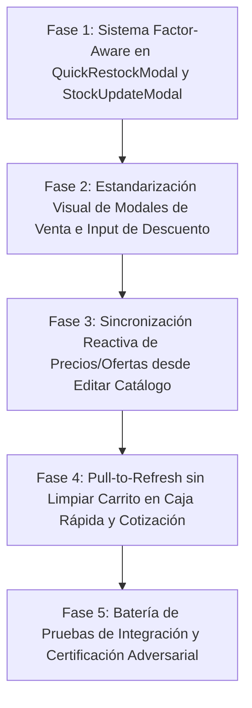

# 📋 PLAN DE TRABAJO PARTE 2: STOCK INTELIGENTE, ESTANDARIZACIÓN DE MODALES DE VENTA Y SINCRONIZACIÓN REACTIVA

> **Documento de Especificación, Arquitectura y Plan de Implementación (Parte 2)**  
> **Proyecto:** MochilaLista App Móvil (Flutter / SQLite Offline-First)  
> **Metodología:** Loop Autónomo Continuo + Árbitro Interno Adversarial  
> **Estado:** 🟡 Pendiente de Aprobación por el Usuario  

---

## 🎯 OBJETIVOS GENERALES DE LA PARTE 2

1. **Abastecimiento y Ajuste de Stock Inteligente (*Factor-Aware*):** Corregir el desequilibrio de stock en variantes que se venden por unidades compuestas (`Par x2`, `Docena x12`, `Pack x6`, `Caja x24`, etc.) en `quick_restock_modal.dart` y `stock_update_modal.dart`. El sistema debe operar en la unidad de venta por defecto, mostrar balances duales en unidades de venta y base (`32 Pares (64 u.) + 1 Par (+2 u.) = 33 Pares (66 u.)`), multiplicar automáticamente por el factor al guardar en SQLite, y proveer un selector opcional para unidades base sueltas con detección y cuadratura rápida de stock impar.
2. **Estandarización y Modernización de Modales de Detalle de Ítem (`ManualQuoteDetailModal` vs `QuickSaleDetailModal`):** Unificar la interfaz del modal de Cotización Manual con la de Caja Rápida, eliminando el `SwitchListTile` obsoleto que aplasta a `"✏️ Editar Catálogo"`, adoptando la arquitectura 2-tier anti-colisión, estandarizando insignias y filas de stock. Además, dotar al campo de texto `"S/ a Descontar"` de un contenedor visible con borde, fondo contrastado, prefijo `S/` y auto-foco en ambos modales.
3. **Sincronización Reactiva Instantánea desde `"✏️ Editar Catálogo"`:** Garantizar que al guardar cambios en `Gestionar Precio` (`PriceUpdateModal`), tanto el modal de detalle del ítem como la pantalla de `Caja Rápida` o `Cotización Manual` actualicen de inmediato sus precios base, ofertas vigentes (`hasOffer` / `effectivePrice`), subtotales y totales sin obligar al usuario a borrar y reingresar el producto.
4. **Función Pull-to-Refresh sin Limpiar la Lista:** Incorporar `RefreshIndicator` con `AlwaysScrollableScrollPhysics` en `QuickSaleScreen` y `ManualQuotationScreen` para refrescar precios, ofertas y stocks desde SQLite en lote para todos los ítems listados, preservando intactos los productos agregados a la venta o cotización.

---

## 🔍 DIAGNÓSTICO FORENSE DE LAS 5 CAPTURAS Y CÓDIGO FUENTE

### Imagen 1: Desequilibrio de Stock en `QuickRestockModal` (`jekeke · Color` - `Par x2`)
* **Ubicación:** `lib/features/catalog/widgets/quick_restock_modal.dart:47-89`.
* **Causa Raíz:** `_currentStock` lee directamente `widget.presentation.stockActual` (64 unidades base). El campo de entrada y los chips `+1`, `+5`, `+10` operan de 1 en 1 como unidades base sueltas. Al presionar `+1`, calcula `64 + 1 = 65` y guarda `stock: 65` en SQLite.
* **Impacto:** Como la variante se vende por `Par (x2)`, 65 unidades base equivalen a `32.5 Pares`. El inventario queda con decimales/fracciones rotas en la unidad de venta.

### Imagen 2: Modal de Detalle de Ítem Desactualizado y Aplastado en Cotización Manual
* **Ubicación:** `lib/features/smart_quotation/widgets/manual/manual_quote_detail_modal.dart` y `lib/features/smart_quotation/widgets/manual/manual_price_modifier.dart:42-77`.
* **Causa Raíz:** Se utiliza `SwitchListTile` con un `subtitle: Row(...)` que contiene `"Precio Base: S/ 1.00"` y `"✏️ Editar Catálogo"`. El switch a la derecha constriñe el ancho horizontal, forzando a `"✏️ Editar Catálogo"` a quedar comprimido y superpuesto debajo del switch. Además, la insignia de empaque muestra `${unit} (x${factor})` en lugar del diseño estándar de Caja Rápida `"Se vende por: ${unit} (Factor: ${factor})"`.

### Imágenes 3 y 4: Caja Rápida y Campo `"S/ a Descontar"` Invisible
* **Ubicación:** `lib/features/smart_quotation/widgets/quick_sale/quick_sale_detail_modal.dart:633-638` y `manual_price_modifier.dart:89-95`.
* **Causa Raíz:** El `TextField` de descuento tiene `decoration: InputDecoration(border: InputBorder.none, prefixText: "- ")`. Al estar vacío o con fondo idéntico al panel, no existe ninguna delimitación visual, viéndose como un espacio en blanco donde el comerciante no sabe que puede tocar para escribir.

### Imagen 5: Modal `Gestionar Precio` y Desconexión con Pantallas de Venta
* **Ubicación:** `quick_sale_detail_modal.dart:562-595`, `manual_quote_detail_modal.dart:700-727`, `quick_sale_provider.dart:300-325`, `manual_quotation_screen.dart:64-70`.
* **Causa Raíz:** 
  1. Al retornar de `PriceUpdateModal`, `QuickSaleDetailModal` solo actualiza `_systemPrice = updatedPres.precioVentaFinal`, pero ignora `updatedPres.hasOffer` y `updatedPres.precioOferta`, no actualiza `_currentSelection`, y `quickProv.syncItemPriceAndStock` no admite actualización ni limpieza de ofertas (`offerPrice`).
  2. En `ManualQuotationScreen`, el estado se maneja en variables locales `_items` y `_overriddenPrices`, pero el modal llamaba a `smartProv.syncItemPriceAndStock` (un provider ajeno al flujo local), dejando la lista de `ManualQuotationScreen` completamente desincronizada.

---

## 🛠️ PLAN DE IMPLEMENTACIÓN EN 5 FASES



---

### FASE 1: Sistema Inteligente *Factor-Aware* de Stock en Modales de Abastecimiento y Ajuste
**Archivos Afectados:**
- `lib/features/catalog/widgets/quick_restock_modal.dart`
- `lib/core/widgets/stock_update_modal.dart`

**Acciones Concretas:**
1. **Detección Dinámica de Unidad de Venta y Factor:**
   - Extraer `unidadVenta = widget.presentation.unidadVenta ?? 'Unidad'` y `factor = widget.presentation.unidadesPorVenta > 0 ? widget.presentation.unidadesPorVenta : 1`.
   - Si `factor > 1`: Activar por defecto el modo **"Por Unidad de Venta"** (ej. Pares, Docenas, Packs).
2. **Selector de Granularidad (Solo visible cuando `factor > 1`):**
   - Incorporar selector compacto: `[ Por Par (x2) | Por Unidad base (x1) ]`.
3. **Panel de Balance Dual Inteligente:**
   - En modo Unidad de Venta (`factor > 1`):
     - `Stock Actual:` `${stockBase ~/ factor} Pares` ${stockBase % factor > 0 ? '+ ${stockBase % factor} u.' : ''} `(${stockBase} u.)`.
     - `Nuevo Ingreso:` `+${input} Pares (+${input * factor} u.)`.
     - `Stock Resultante:` `${nuevoStockBase ~/ factor} Pares` `(${nuevoStockBase} u.)`.
4. **Alerta Inteligente de Stock Impar y Botón Rápido de Cuadratura:**
   - Si el usuario opera en unidades base y el stock resultante no es divisible exactamente entre el factor (`nuevoStockBase % factor != 0`):
     - Mostrar banner ámbar suave: *"⚠️ Stock resultante impar: $nuevoStockBase u. equivalen a ${(nuevoStockBase / factor).toStringAsFixed(1)} Pares. No completa empaques exactos."*
     - Botón de acción rápida: `[ ⚡ Cuadrar a $siguienteMultiplo u. (${siguienteMultiplo ~/ factor} Pares) ]`.
5. **Cálculo Exacto al Guardar en SQLite:**
   - Multiplicar siempre la cantidad según el modo seleccionado para garantizar que `stockActual` en SQLite guarde la cantidad total en unidades base correcta.
6. **Armonización en `StockUpdateModal`:**
   - Asegurar que `StockUpdateModal` muestre con total claridad la unidad de venta (`${val} Pares (${val * factor} u.)`) y verifique la cuadratura.

---

### FASE 2: Estandarización Visual de Modales de Venta e Input de Descuento
**Archivos Afectados:**
- `lib/features/smart_quotation/widgets/manual/manual_quote_detail_modal.dart`
- `lib/features/smart_quotation/widgets/manual/manual_price_modifier.dart`
- `lib/features/smart_quotation/widgets/quick_sale/quick_sale_detail_modal.dart`

**Acciones Concretas:**
1. **Estandarización de `ManualQuoteDetailModal` con `QuickSaleDetailModal`:**
   - Reemplazar `SwitchListTile` en `ManualPriceModifier` por la estructura modular de 2 niveles:
     - **Nivel 1:** Icono `local_offer_outlined` + `"Aplicar Descuento"` + `Switch` de activación a la derecha.
     - **Nivel 2:** Fila horizontal con `"Precio Base: S/ XX.XX"` a la izquierda y botón estilizado `"✏️ Editar Catálogo"` a la derecha con padding táctil amplio. Cero riesgo de colisión o aplastamiento.
   - Estandarizar la insignia de variante superior: `"Se vende por: ${unit}  (Factor: ${factor})"`.
   - Estandarizar la fila de stock: `"Stock disponible: X ${unit}"` junto con el botón azul compacto `[ ✏️ Ajustar ]` que abre `StockUpdateModal`.
2. **Rediseño del Campo `"S/ a Descontar"`:**
   - Envolver el `TextField` dentro de un contenedor estilizado con:
     - Borde redondeado (`BorderRadius.circular(12)`), borde de 1.5px color ámbar/naranja.
     - Fondo contrastado con el tema (blanco o superficie oscura contrastada `0xFF1A1A24`).
     - Prefijo claro `S/ ` y texto numérico destacado.
     - `FocusNode` para enfocar automáticamente el campo cuando el usuario encienda el switch de descuento.
3. **Rediseño Simétrico del Campo `"Precio Final Unit."`:**
   - Mismo contenedor estético con borde azul/acento para que ambos campos luzcan equilibrados y profesionales.

---

### FASE 3: Sincronización Reactiva de Precios y Ofertas desde `"✏️ Editar Catálogo"`
**Archivos Afectados:**
- `lib/features/smart_quotation/models/matching_model.dart`
- `lib/features/smart_quotation/widgets/quick_sale/quick_sale_detail_modal.dart`
- `lib/features/smart_quotation/widgets/manual/manual_quote_detail_modal.dart`
- `lib/features/smart_quotation/providers/quick_sale_provider.dart`
- `lib/features/smart_quotation/screens/manual_quotation_screen.dart`
- `lib/features/smart_quotation/screens/manual/manual_quote_catalog_ext.dart`

**Acciones Concretas:**
1. **Getters Canónicos en `MatchedProduct`:**
   - Incorporar en `MatchedProduct`:
     ```dart
     bool get hasOffer => offerPrice != null && offerPrice! > 0 && offerPrice! < price;
     double get effectivePrice => hasOffer ? offerPrice! : price;
     int get discountPercentRounded => hasOffer ? (((price - offerPrice!) / price) * 100).round() : 0;
     ```
2. **Relectura y Actualización en los Modales de Detalle:**
   - Al cerrar `PriceUpdateModal` tras guardar:
     - Releer la presentación directamente desde SQLite vía `InventoryProvider`.
     - Actualizar `_currentSelection` con su nuevo `price`, `offerPrice` y stock.
     - Si la presentación tiene oferta de catálogo vigente (`hasOffer`):
       - Mostrar en el modal el precio base tachado (`S/ 1.00`), el precio de oferta (`S/ 0.85`) y el badge `-15%`.
       - Establecer `_priceCtrl.text` con el precio efectivo.
     - Si la presentación no tiene oferta o se subió el precio regular:
       - Actualizar `_systemPrice` al nuevo precio de venta regular y reflejarlo en `_priceCtrl.text`.
3. **Sincronización Inmediata con la Pantalla Padre (0ms):**
   - **En Caja Rápida:** Actualizar `QuickSaleProvider.syncItemPriceAndStock` para soportar `newOfferPrice` y `clearOffer`, recalculando totales y utilidades en memoria de inmediato.
   - **En Cotización Manual:** Agregar callback directo `onCatalogPriceUpdated(int presId, double newPrice, double? newOfferPrice, int newStock)` para que `_ManualQuotationScreenState` actualice directamente su lista local `_items` y `_overriddenPrices`, refrescando la tarjeta visible en pantalla sin requerir borrar el ítem.
   - Notificar a `CatalogProvider` y `QuickSearchProvider` para mantener la consistencia en el buscador omnicanal.

---

### FASE 4: Pull-to-Refresh en `QuickSaleScreen` y `ManualQuotationScreen`
**Archivos Afectados:**
- `lib/features/smart_quotation/screens/quick_sale_screen.dart`
- `lib/features/smart_quotation/screens/manual_quotation_screen.dart`

**Acciones Concretas:**
1. **Integración de `RefreshIndicator`:**
   - En `QuickSaleScreen`: envolver el `CustomScrollView` principal con `RefreshIndicator`, configurando `physics: const AlwaysScrollableScrollPhysics()` para permitir arrastrar incluso con 0 o pocos ítems.
   - En `ManualQuotationScreen`: envolver tanto el `CustomScrollView` (estado vacío) como el `ReorderableListView` (lista de productos) con `RefreshIndicator`, también con `AlwaysScrollableScrollPhysics()`.
2. **Lógica de Sincronización en Lote contra SQLite:**
   - **Regla Estricta:** La sincronización **JAMÁS debe vaciar ni limpiar los productos agregados**.
   - Iterar sobre las presentaciones de los ítems actualmente en lista y consultar en SQLite su estado fresco (`precio_venta_final`, `precio_oferta`, `tipo_descuento`, `valor_descuento`, `stock_actual`).
   - Actualizar los objetos en memoria con sus precios y ofertas canónicas actualizadas.
   - Si algún ítem superaba el stock disponible tras una venta externa, alertar amigablemente y ajustar la cantidad al máximo actual.
   - Recalcular subtotales, totales y márgenes de ganancia.
   - Recargar proveedores satélite (`PromotionProvider`, `InventoryProvider`, `QuickSearchProvider`).

---

### FASE 5: Batería de Pruebas de Integración y Certificación Adversarial
**Archivos Afectados:**
- `test/stock_factor_aware_and_sale_modals_sync_test.dart` (Nuevo archivo de suite)

**Casos de Prueba Adversarial:**
1. **Factor-Aware Stock:**
   - Variante `Par (x2)` con 64 u. base (32 pares): ingresar `+1 Par` produce exactamente 66 u. base (33 pares).
   - Chip `+5` en modo `Docena (x12)` suma exactamente 60 u. base.
   - Ingreso de unidad base suelta impar (65 u.) activa alerta con botón de cuadratura a 66 u. (33 pares).
2. **Modales de Detalle y Campo de Descuento:**
   - `ManualQuoteDetailModal`: renderiza el nivel 1 y nivel 2 sin colisión ni aplastamiento de `"✏️ Editar Catálogo"`.
   - Activación de switch enfoca el campo de descuento y muestra contenedor delimitado con prefijo `S/`.
3. **Sincronización Reactiva:**
   - Modificar precio en `PriceUpdateModal` actualiza inmediatamente `QuickSaleDetailModal` y `ManualQuoteDetailModal`.
   - Modificar precio actualiza la tarjeta visible en `QuickSaleScreen` y `ManualQuotationScreen` sin borrar el ítem.
4. **Pull-to-Refresh:**
   - Ejecutar pull-to-refresh en `QuickSaleScreen` y `ManualQuotationScreen` refresca datos desde SQLite y NO elimina los ítems del carrito.
5. **Certificación Final:**
   - `flutter analyze lib test` sin errores ni advertencias (0 issues).
   - `flutter test` aprueba el 100% de la suite global de tests.

---

## ⚖️ CRITERIOS DE ACEPTACIÓN ADVERSARIAL

| Requerimiento | Criterio de Éxito |
|---|---|
| **Stock Factor-Aware** | Ningún ingreso en variantes compuestas (`Par`, `Docena`) genera fracciones o decimales en la unidad de venta a menos que el usuario lo elija explícitamente, con advertencia y cuadratura rápida. |
| **Diseño en Cotización** | `"✏️ Editar Catálogo"` nunca colisiona ni se superpone debajo del switch en ninguna resolución de pantalla. |
| **Input de Descuento** | El campo `"S/ a Descontar"` cuenta con contenedor, borde visible, fondo contrastado y foco automático al encender el switch. |
| **Sincronización Reactiva** | Modificar precio u oferta en `Gestionar Precio` se refleja al instante (0ms) en el modal de detalle y en la tarjeta del carrito/cotización. |
| **Pull-to-Refresh** | El gesto de arrastrar hacia abajo actualiza precios, ofertas y stocks desde SQLite sin vaciar ni alterar los productos seleccionados. |
| **Salud del Código** | `0 errores` y `0 advertencias` en `flutter analyze`, y `100% aprobado` en `flutter test`. |
