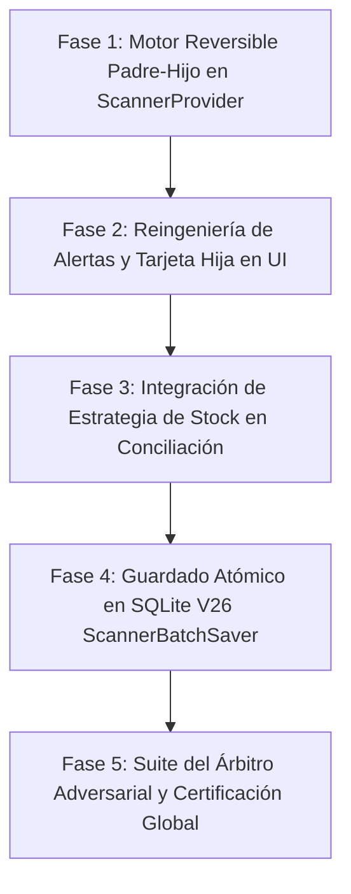

# PLAN MAESTRO DE REINGENIERÍA — PARTE 2: VÍNCULO PADRE-HIJO REACTIVO DE SOBRANTES, REVERSIÓN MATEMÁTICA Y ESTRATEGIA DE STOCK EN CONCILIACIÓN IA

> **Documento de Trabajo y Especificación Técnica**  
> **Módulo:** Escáner de Facturas IA (`Clasificar y Confirmar`) y Guardador por Lotes SQLite (`scanner_batch_saver.dart`)  
> **Proyecto:** MochilaLista App Móvil (Flutter / SQLite V26)  
> **Estado:** 📝 PLANIFICADO PARA REVISIÓN Y APROBACIÓN PREVIA  

---

## 1. Diagnóstico Forense y Análisis Causa-Raíz (Basado en Capturas 1 a 5)

A partir de las pruebas operativas en vivo y el análisis forense de las 5 capturas de pantalla proporcionadas, se han determinado con precisión matemática los siguientes fallos críticos:

### 1.1 Bug Crítico de Desaparición de Stock al Eliminar la Variante Hija (Capturas 4 y 5)
* **Evidencia en Capturas 4 y 5:**
  * En la Captura 2, la variante original *"Latinoamericana"* tenía `4 actual` en BD + `4 ingreso` = `8 unid. base`. Al venderse por `½ Docena (x6)`, se separaron `2 unid.` sobrantes en una `NUEVA VARIANTE`. La madre quedó en `+2 ingreso` (`4 actual + 2 ingreso = 6 unid. base`).
  * En la Captura 4, el usuario presiona la `X` para eliminar la `NUEVA VARIANTE` creada por el sobrante.
  * En la Captura 5, tras confirmar la eliminación, **las 2 unidades base NUNCA regresaron a la madre**. La madre permaneció en `4 actual + 2 ingreso = 6 unid. base` (`Stock exacto: 1 ½ Docena`), desapareciendo 2 unidades compradas en la factura.
* **Causa-Raíz en Código:**
  En `ScannerProvider.removeVariantByUuid(variantUuid)` (líneas 973-989):
  ```dart
  // CÓDIGO DEFECTUOSO ACTUAL:
  int vIndex = group.variantes.indexWhere((v) => v.uuidTemporal == variantUuid);
  if (vIndex != -1) {
    group.variantes.removeAt(vIndex); // ❌ Elimina la fila sin verificar sourceVariantUuid ni restaurar unidades a la madre
    notifyListeners();
  }
  ```
  La variante hija tenía registrado `sourceVariantUuid`, pero `removeVariantByUuid` simplemente ejecuta `removeAt(vIndex)` sin devolver las unidades base ni el costo proporcional a la variante madre.

### 1.2 Invariante de Conservación de Masa Monetaria y Físico de Compra (Capturas 2 y 3)
* **Evidencia en Captura 3:**
  En el formulario desplegable de la `NUEVA VARIANTE` creada por el sobrante:
  * Aparece `Compró: 0`, `P. Total (S/): 0.00` (¡en cero!), a pesar de que en el texto se indica `Costo Unit.: S/ 22.50 | Stock: 2 uds`.
  * La variante madre mantenía el total de pago original de la factura, desbalanceando la contabilidad entre ítems.
* **Causa-Raíz en Código:**
  En `variant_editor_row.dart`, los controladores `_cantCompraCtrl` y `_totalPagoCtrl` se inicializaban leyendo `variant.cantidadUmpComprada` y `variant.totalPagoLote`, pero al haberse creado en memoria sin sincronizar los controladores en el primer frame de expansión, mostraban `0` y `0.00`.
  Además, al transferir sobrantes, la variante madre no ajustaba a la baja su `totalPagoLote` ni su `cantidadUmpComprada`, rompiendo la regla contable de que:
  $$\text{Total Madre} + \text{Total Hija} = \text{Total Factura}$$

### 1.3 Ambigüedad de "Conservar en reserva base" y Doble Check (Captura 1)
* **Evidencia en Captura 1:**
  Aparece el badge:
  `☑️ ✅ 1 ½ Docena (+2 unid. en reserva base) Modificar`
  * Contiene doble icono de confirmación (`☑️` vectorial + `✅` emoji).
  * La leyenda *"en reserva base"* no le explica al comerciante qué significa operativamente ni cómo se venderá ese stock.
* **Solución Exigida:** Reemplazar por 3 opciones transparentes con subtextos pedagógicos y un badge limpio sin emojis duplicados.

### 1.4 Ausencia de Estrategia de Stock (Compartido, Independiente, Mixto) en la Conciliación
* Actualmente, `Clasificar y Confirmar` trata cada ítem como stock independiente. Si un comerciante compra un producto y quiere venderlo simultáneamente en `Unidad`, `Par` y `Docena` desde un **Pool Central Compartido**, se ve forzado a dividir las unidades artificialmente o lidiar con falsas alertas de "sobrante".
* `ScannerBatchSaver` no persistía de forma atómica `modo_stock`, `stock_compartido`, `costo_base` al crear productos nuevos, ni sincronizaba `usa_stock_compartido` y `cupo_maximo_variante`.

---

## 2. Fundamentos Matemáticos y Reglas de Reversibilidad

### 2.1 Ecuaciones de Fraccionamiento (Madre $\rightarrow$ Hija)
Sea una variante madre $M$ con stock BD $S_{BD}$, factor de venta $F_M > 1$, e ingreso de factura $I_{M,0}$.
1. **Unidades Base Totales:**
   $$U_{total} = S_{BD} + I_{M,0}$$
2. **Presentaciones Enteras y Sobrante:**
   $$P = \lfloor U_{total} / F_M \rfloor, \quad \text{Sobrante } R = U_{total} \pmod{F_M}$$
3. **Descuento Estricto del Ingreso de Factura en la Madre:**
   El sobrante $R$ provino de la compra actual de la factura. Por tanto, el nuevo ingreso de factura de la madre debe ser:
   $$I_{M,nuevo} = I_{M,0} - R$$
   De este modo:
   $$S_{BD} + I_{M,nuevo} = S_{BD} + (I_{M,0} - R) = P \times F_M \quad \text{(Exacto sin sobrante)}$$
4. **Conservación de Costo de Compra:**
   Sea el costo unitario base $C_{base} = \text{TotalPagoLote}_{M,0} / I_{M,0}$:
   $$\text{TotalPagoLote}_{Hija} = R \times C_{base}$$
   $$\text{TotalPagoLote}_{M,nuevo} = \text{TotalPagoLote}_{M,0} - \text{TotalPagoLote}_{Hija}$$
   $$\text{CantidadComprada}_{Hija} = R, \quad \text{CantidadComprada}_{M,nuevo} = I_{M,nuevo}$$
   $$\text{TotalPagoLote}_{M,nuevo} + \text{TotalPagoLote}_{Hija} \equiv \text{TotalPagoLote}_{M,0} \quad \text{(100\% Exacto)}$$

### 2.2 Ecuaciones de Reversión Total (Hija $\rightarrow$ Madre al Eliminar)
Al eliminar la variante hija $H$ (que contiene `sourceVariantUuid` de $M$, unidades transferidas $R$ y costo transferido $P_H$):
1. **Restitución Física al Ingreso de Factura:**
   $$I_{M,restaurado} = I_{M,actual} + R$$
2. **Restitución Financiera al Lote de Factura:**
   $$\text{TotalPagoLote}_{M,restaurado} = \text{TotalPagoLote}_{M,actual} + P_H$$
   $$\text{CantidadComprada}_{M,restaurado} = \text{CantidadComprada}_{M,actual} + R$$
3. **Limpieza de Autorizaciones:**
   Se restablece `M.allowLeftoverInReserve = false` y `M.stockIngresanteOverride = I_{M,restaurado}`.
   Inmediatamente, la variante madre recalcula:
   $$U_{total} = S_{BD} + I_{M,restaurado}$$
   Volviendo a detectar el sobrante $R$ y reabriendo la alerta interactiva de forma 100% natural.

---

## 3. Plan de Fases de Implementación (Metodología Loop Autónomo)



---

### FASE 1: Motor Reversible Padre-Hijo en Modelos y `ScannerProvider`

#### 1.1 Modelos de Datos (`scanner_models.dart`)
1. En `StagingVariant`:
   * Agregar campos explícitos de auditoría de transferencia:
     ```dart
     int? allocatedBaseUnits; // Unidades transferidas desde la madre
     double? allocatedPurchaseCost; // Costo de compra transferido desde la madre
     bool usaStockCompartido = false; // Flag para modo Compartido/Mixto
     int? cupoMaximoVariante; // Cupo opcional para variantes compartidas
     ```
   * Asegurar que se serialicen y deserialicen en `toJson()` y `fromJson()`.
   * Incluirlos en `takeSnapshot()` y `restoreFromSnapshot()`.

#### 1.2 Lógica de Transferencia y Reversión en `ScannerProvider` (`scanner_provider.dart`)
1. **Refactorizar `createLeftoverVariant`:**
   * Calcular $I_{M,nuevo} = I_{M,actual} - \text{leftoverAmount}$.
   * Descontar proporcionalmente `totalPagoLote` y `cantidadUmpComprada` de la madre.
   * Asignar en la hija:
     * `sourceVariantUuid = madre.uuidTemporal`
     * `allocatedBaseUnits = leftoverAmount`
     * `allocatedPurchaseCost = totalPagoSobrante`
     * `cantidadUmpComprada = leftoverAmount.toDouble()`
     * `totalPagoLote = totalPagoSobrante`
     * `precioUmpProveedor = costoBase`
     * `costoUnitarioSugerido = costoBase`
     * `stockIngresanteOverride = leftoverAmount`
2. **Crear `revertLeftoverToMother(String childUuid)`:**
   * Localizar la variante hija y su madre vía `sourceVariantUuid`.
   * Sumar `allocatedBaseUnits` (o `stockIngresanteOverride`) de vuelta al ingreso de la madre:
     ```dart
     int unitsToRestore = child.allocatedBaseUnits ?? child.stockIngresanteOverride ?? 0;
     double costToRestore = child.allocatedPurchaseCost ?? (unitsToRestore * costoBase);
     mother.stockIngresanteOverride = (mother.stockIngresanteOverride ?? mother.stockIngresanteBase) + unitsToRestore;
     mother.totalPagoLote += costToRestore;
     mother.cantidadUmpComprada += unitsToRestore;
     mother.allowLeftoverInReserve = false;
     ```
3. **Conectar en `removeVariantByUuid(String variantUuid)`:**
   * Antes de remover la variante de `group.variantes`, comprobar si tiene `sourceVariantUuid != null`.
   * Si es hija, ejecutar automáticamente `revertLeftoverToMother(variantUuid)`.
   * Notificar con `notifyListeners()`.
4. **Diálogo de Confirmación Dinámico (`staging_product_group_card.dart`):**
   * En `_confirmDeleteVariant`:
     * Si la variante tiene `sourceVariantUuid != null`, el diálogo muestra:
       > *"Esta variante nació de un stock sobrante. Al eliminarla, sus X unidades base regresarán automáticamente a la variante original."*
     * Si es una variante común:
       > *"Esta fila se descartará y no ingresará al inventario."*

---

### FASE 2: Reingeniería de la Alerta en Tarjeta y Formulario de la Nueva Variante

#### 2.1 Sustitución de "Conservar en reserva base" por 3 Opciones Claras
* **Archivos:** `variant_editor_row.dart` y `modal_stock_section.dart`.
* **Eliminación Total:**
  * Erradicar el badge con doble check `☑️ ✅`.
  * Erradicar el texto genérico *"Conservar en reserva base"*.
* **Nuevas 3 Opciones Estructuradas:**
  1. **Opción 1 (Separar en Nueva Variante):**
     * Botón: `Icons.call_split` + `"Enviar las X unid. a variante 'Unidad (x1)'"`
     * Acción: Ejecuta `createLeftoverVariant`, auto-scroll y resalte en verde.
  2. **Opción 2 (Activar Stock Compartido):**
     * Botón: `Icons.link` + `"Activar Stock Compartido (Pool único)"`
     * Subtexto: *"Las 8 unidades se venderán por ½ Docena y Unidad desde un stock único sin dejar saldos atrapados."*
     * Acción: Conmuta el grupo a `modoStock = 'COMPARTIDO'` y vincula las variantes al pool central.
  3. **Opción 3 (Acumular en Almacén para Próxima Compra):**
     * Botón: `Icons.inventory_2_outlined` + `"Acumular las X unid. para tu próxima compra"`
     * Subtexto: *"Hoy tendrás 1 × ½ Docena disponible para vender y las X unid. base restantes quedarán guardadas en almacén para completarse en tu siguiente compra."*
     * Badge resultante limpio (1 solo icono vectorial `Icons.inventory_2_outlined`):
       ```dart
       "1 × ½ Docena disponible hoy (+2 unid. base acumuladas en almacén)" [Modificar]
       ```

#### 2.2 Limpieza y Sincronización en la Tarjeta de `NUEVA VARIANTE` (`variant_editor_row.dart`)
1. **Limpieza de Emojis Duplicados en Formulario Desplegable:**
   * Cambiar `🛒 Datos de Compra (Factura)` por `Datos de Compra (Factura)` (con su `Icon(Icons.shopping_cart_outlined)`).
   * Cambiar `💰 Venta y Precio` por `Venta y Precios` (con su `Icon(Icons.sell_outlined)`).
   * Cambiar `📦 Identificación` por `Identificación` (con su `Icon(Icons.badge_outlined)`).
2. **Sincronización Inmediata de Controladores en la Variante Hija:**
   * Asegurar que `_cantCompraCtrl.text` se inicialice con `allocatedBaseUnits.toString()`.
   * Asegurar que `_totalPagoCtrl.text` se inicialice con `AppCurrency.format(allocatedPurchaseCost)`.
   * Asegurar que `_costoUnitarioCtrl.text` se inicialice con el costo base real.

---

### FASE 3: Integración de Estrategia de Stock (`Compartido`, `Independiente`, `Mixto`)

#### 3.1 Soporte en `StagingProductGroup` (`scanner_models.dart`)
* Agregar a `StagingProductGroup`:
  ```dart
  String modoStock = 'INDEPENDIENTE'; // 'COMPARTIDO', 'INDEPENDIENTE', 'MIXTO'
  int stockCompartido = 0; // Pool central en unidades base
  double costoBase = 0.0; // Costo base unitario del pool
  ```

#### 3.2 UI para Productos Nuevos (`+ Nuevo Producto`) en `staging_product_group_card.dart`
* En la cabecera o barra de herramientas de un grupo nuevo (especialmente si tiene $\ge 2$ variantes):
  * Mostrar selector de Estrategia de Stock en chips estilizados:
    * `🔗 Compartido` | `📦 Independiente` | `⚡ Mixto`
  * **Al activar `🔗 Compartido`:**
    * El total de unidades base de la factura ingresa al **Pool Compartido (`stockCompartido`)**.
    * Las variantes vinculadas consumen de este pool. Cada variante muestra su disponibilidad proyectada:
      * `Pool: 8 unid. base` $\rightarrow$ `= 8 Unidades`, `= 4 Pares`, `= 1 ½ Docena (+2 sueltas en pool)`.
    * No se disparan alertas de stock sobrante si el pool cuenta con al menos una variante unitaria (`factor = 1`).
    * Se permite ingresar opcionalmente `cupoMaximoVariante` por presentación.

#### 3.3 UI para Productos Existentes (`En Inventario`)
* Cargar `p.modo_stock`, `p.stock_compartido`, `p.costo_base` desde la BD local al realizar el matching.
* Mostrar badge de estrategia actual del producto:
  * `🔗 Stock Compartido (Pool: X unid.)`
  * `📦 Stock Independiente`
  * `⚡ Modo Mixto`
* Permitir cambiar la estrategia desde un botón interactivo rápido en la cabecera.
* Si el producto existente ya es `COMPARTIDO`:
  * El nuevo ingreso de la factura se suma directamente a `p.stock_compartido`.
  * La tarjeta calcula y renderiza el balance central del pool.

---

### FASE 4: Guardado Transaccional Atómico en SQLite V26 (`scanner_batch_saver.dart`)

Al pulsar **`"GUARDAR E INGRESAR STOCK"`**:
1. **En la tabla `productos`:**
   * Guardar `modo_stock = group.modoStock`.
   * Si es `COMPARTIDO` o `MIXTO`:
     * Calcular el nuevo stock central del pool:
       $$\text{stock\_compartido} = (\text{stock\_actual\_pool} + \text{ingreso\_base})$$
     * Guardar `stock_compartido` y `costo_base` unitario del producto.
2. **En la tabla `presentaciones_producto`:**
   * Para cada presentación:
     * Guardar `usa_stock_compartido = (v.usaStockCompartido ? 1 : 0)`.
     * Guardar `cupo_maximo_variante = v.cupoMaximoVariante`.
     * Si `usa_stock_compartido == 1`:
       * `stock_actual = stock_compartido` (todas las presentaciones compartidas reflejan el pool total).
     * Si `usa_stock_compartido == 0`:
       * `stock_actual` mantiene su conteo independiente de lote.
3. **Registro en `stock_ledger` y `product_history`:**
   * Registrar la transacción `COMPRA_LOTE` asociada a la factura y presentación.
   * Si hubo cambio de estrategia de stock (`INDEPENDIENTE` $\rightarrow$ `COMPARTIDO`), registrar en `product_history` la auditoría de cambio de modo.
4. **Sincronización Inmediata a 0ms:**
   * Notificar a `InventoryProvider` para recarga atómica en memoria.

---

### FASE 5: Suite del Árbitro Adversarial y Validación Global

Crear la suite de pruebas unitarias y de widgets:
`test/scanner_parent_child_stock_strategy_test.dart`

#### Casos de Auditoría Adversarial:
1. **Auditoría 1: Descuento Estricto de Ingreso en la Madre:**
   * Iniciar madre con `4 actual` y `4 ingreso` (Total: `8`, Factor: `6`).
   * Separar `2 unid.` sobrantes.
   * Verificar: Madre pasa a `+2 ingreso` (`4 actual + 2 ingreso = 6 base`).
   * Hija recibe `+2 ingreso`.
   * Suma de costos de compra de Madre + Hija coincide al céntimo con la factura original.
2. **Auditoría 2: Reversión Completa al Eliminar la Variante Hija:**
   * Eliminar la variante hija recién creada.
   * Verificar: Las `2 unid.` y su costo de compra regresan automáticamente a la madre.
   * La madre vuelve a `+4 ingreso` (`8 base totales`).
   * La alerta de sobrante reaparece de inmediato sin recargar la pantalla.
3. **Auditoría 3: Alertas Reingenierizadas y Limpieza de Emojis:**
   * Verificar que `"Conservar en reserva base"` ya no exista.
   * Verificar que la opción de acumulación muestre `"1 × ½ Docena disponible hoy (+2 unid. base acumuladas en almacén)"` con 1 solo icono vectorial.
   * Verificar que en el formulario desplegable no existan emojis dobles en títulos.
4. **Auditoría 4: Persistencia Atómica de Estrategia de Stock:**
   * Guardar lote con producto nuevo en modo `COMPARTIDO`.
   * Verificar en SQLite V26 que `productos.modo_stock = 'COMPARTIDO'`, `productos.stock_compartido = 8`, y las presentaciones compartidas tengan `usa_stock_compartido = 1`.
5. **Auditoría 5: Análisis Estático y Suite Global:**
   * `flutter analyze lib test` $\rightarrow$ 0 errores, 0 warnings.
   * `flutter test` $\rightarrow$ 100% pruebas pasando.

---

## 4. Matriz de Archivos a Modificar

| Archivo | Responsabilidad en la Parte 2 |
| :--- | :--- |
| `lib/features/scanner/models/scanner_models.dart` | Campos `allocatedBaseUnits`, `allocatedPurchaseCost`, `modoStock`, `usaStockCompartido`, `cupoMaximoVariante` |
| `lib/features/scanner/providers/scanner_provider.dart` | Matemática exacta en `createLeftoverVariant`, método `revertLeftoverToMother`, y reversión en `removeVariantByUuid` |
| `lib/features/scanner/widgets/staging/variant_editor_row.dart` | Reingeniería de alerta de sobrante, opciones pedagógicas, limpieza de emojis duplicados y sincronización de inputs de compra |
| `lib/features/scanner/widgets/staging/comparative_modal/ui/modal_stock_section.dart` | Sustitución de "Conservar en reserva base" por acumulación pedagógica y Stock Compartido |
| `lib/features/scanner/widgets/staging/staging_product_group_card.dart` | Selector de estrategia de stock para nuevos, badge para existentes y diálogo contextual al eliminar variante hija |
| `lib/features/scanner/services/scanner_matching_engine.dart` | Lectura de `modo_stock`, `stock_compartido`, `costo_base` y datos compartidos de presentaciones |
| `lib/features/scanner/services/scanner_batch_saver.dart` | Inserción/actualización atómica de `modo_stock`, `stock_compartido`, `costo_base`, `usa_stock_compartido` y `cupo_maximo_variante` |
| `test/scanner_parent_child_stock_strategy_test.dart` | Nueva suite adversarial de verificación de reversibilidad y estrategia de stock |

---

> 🚀 **Fin del Plan Maestro — Listo para revisión y aprobación previa del usuario.**
