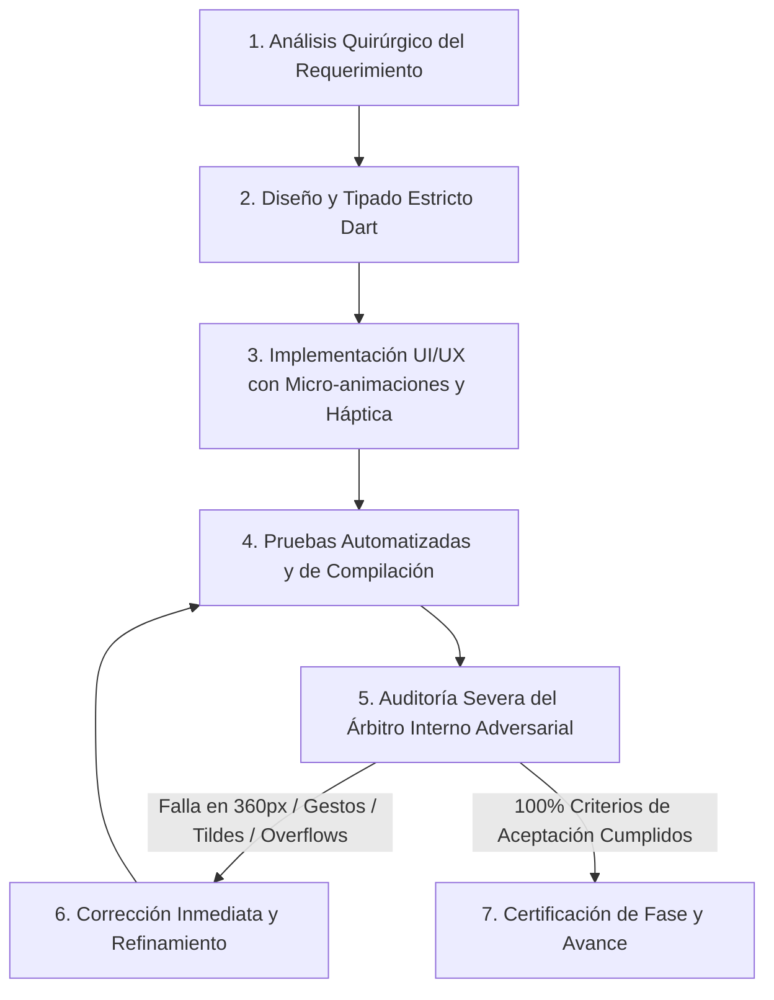

# PLAN MAESTRO DE TRABAJO: PERFECCIONAMIENTO UX/UI "MOBILE AWARDS" PARA VISTA PREVIA PDF Y EDITOR WHATSAPP

**Proyecto:** Mochila Lista (App Móvil POS / CRM / Catálogo)  
**Versión de Planificación:** v10.5 (Revisión Integral Forense y Mobile Awards)  
**Metodología:** Loop Autónomo Continuo + Árbitro Adversarial Interno  
**Archivos Clave en Alcance:**  
* `app_movil/lib/features/smart_quotation/models/pdf_config_model.dart`
* `app_movil/lib/features/smart_quotation/utils/pdf_generator.dart`
* `app_movil/lib/features/smart_quotation/utils/pdf_image_helper.dart`
* `app_movil/lib/features/smart_quotation/services/pdf_preferences_service.dart`
* `app_movil/lib/features/smart_quotation/screens/pdf_preview_screen.dart`
* `app_movil/lib/features/smart_quotation/models/whatsapp_config_model.dart`
* `app_movil/lib/features/smart_quotation/services/whatsapp_preferences_service.dart`
* `app_movil/lib/features/smart_quotation/screens/whatsapp_preview_screen.dart`
* `app_movil/lib/features/smart_quotation/widgets/whatsapp/wa_config_section.dart`
* `app_movil/lib/features/smart_quotation/widgets/whatsapp/wa_message_editor.dart`
* `app_movil/lib/features/smart_quotation/widgets/whatsapp/wa_business_section.dart`
* `app_movil/lib/features/smart_quotation/widgets/whatsapp/wa_final_preview_modal.dart`
* `app_movil/lib/features/smart_quotation/widgets/whatsapp/wa_dynamic_popover.dart` *(Nuevo)*
* `app_movil/lib/core/widgets/info_tooltip_button.dart` *(Reutilización e integración)*

---

## 1. DIAGNÓSTICO FORENSE Y AUDITORÍA VISUAL DE LAS 5 CAPTURAS

A partir del análisis exhaustivo de las capturas provistas y la inspección del código fuente activo, se determinan con precisión quirúrgica las causas raíz de cada falla detectada:

```
┌────────────────────────────────────────────────────────────────────────────────────────┐
│                        MAPA DE PROBLEMAS DETECTADOS EN EL DISPOSITIVO                  │
├────────────────────────────────────────────────────────────────────────────────────────┤
│ [IMG 1: Vista Previa PDF]                                                              │
│  ├── ❌ Ausencia total de indicadores de Zoom (el usuario no sabe que puede acercar).   │
│  ├── ❌ 4to círculo de color (B&N) invisible en Dark Mode (gris oscuro sin borde).    │
│  ├── ❌ Pérdida de tildes: "COTIZACION", "Descripcion", "Anticaida", "N.".              │
│  └── ❌ Marco de logo rígido: riesgo de distorsión en imágenes con aspect ratio alto.  │
│                                                                                        │
│ [IMG 2: Modal Opciones de Documento]                                                   │
│  ├── ❌ Tabs cortadas en 360px: "Negocio/Clien..." y "Columnas/Tot...".                 │
│  ├── ❌ Nombre de cliente contaminado: "Freddy #22-0146 (2) - Manual" (código interno).│
│  ├── ❌ Falta de buscador rápido del directorio (🔍) y botón de limpieza (✕).          │
│  ├── ❌ Condiciones al pie básicas sin chips preconfigurados de 1 toque.               │
│  └── ❌ Solo 1 diseño de documento básico (faltan plantillas por situación comercial). │
│                                                                                        │
│ [IMG 3: WhatsApp - Personalizar Mensaje]                                               │
│  ├── ❌ Colapso de grilla a 1 columna angosta a la izquierda (mitad derecha vacía).    │
│  ├── ❌ Todos los 8 chips con texto truncado: "Precios y Su...", "Sección de A...", etc│
│  └── ❌ "Toca para insertar" choca directamente con el título de cuentas de pago.      │
│                                                                                        │
│ [IMG 4: WhatsApp - Editor y Barra de Herramientas]                                     │
│  ├── ❌ Estilo de plantilla y barra de snippets en listas horizontales cortadas.      │
│  ├── ❌ Cero historial de edición: sin botones de Deshacer (Undo) ni Rehacer (Redo).   │
│  └── ❌ Desbordamiento horizontal (RenderFlex overflow) en aviso "Modo manual activo". │
│                                                                                        │
│ [IMG 5: WhatsApp - Modal Revisión Final]                                               │
│  ├── ❌ Conflicto en arena de gestos: el scroll del texto pelea con el arrastre modal. │
│  └── ❌ Fin del mensaje cortado ("*Visítanos en librería BAZAR") y sin formato visual. │
│                                                                                        │
│ [TRANSVERSAL: Info Tooltip]                                                            │
│  └── ❌ Ambas ventanas carecen del botón estándar de Info Tooltip que tiene la app.   │
└────────────────────────────────────────────────────────────────────────────────────────┘
```

---

## 2. METODOLOGÍA DEL LOOP AUTÓNOMO Y ÁRBITRO INTERNO ADVERSARIAL

Para garantizar una ejecución impecable sin regresiones y con nivel de **Mobile Awards**, este plan se rige por el ciclo cerrado de desarrollo:



### Reglas de Hierro del Árbitro Interno Adversarial:
1. **Regla de 360px:** Ningún texto, botón, pestaña o chip puede cortarse con `...` ni desbordar la pantalla en viewports pequeños de 360dp de ancho.
2. **Regla de Gestos Fluidos:** Ningún scroll interno puede trabarse ni competir con el arrastre de cierre de un BottomSheet.
3. **Regla de Integridad Tipográfica:** Todo texto en español debe soportar tildes (`á, é, í, ó, ú, Á, É, Í, Ó, Ú`), eñes (`ñ, Ñ`) y caracteres de moneda/símbolos (`S/`, `N°`, `¿`, `¡`).
4. **Regla de Micro-Interacción Mobile Awards:** Cada acción principal debe contar con respuesta háptica sutil (`HapticFeedback.lightImpact()` o `selectionClick()`) y transiciones de 150-250ms con curvas de animación naturales (`Curves.easeOutCubic`).

---

## 3. PLAN DETALLADO DE IMPLEMENTACIÓN POR FASES

---

### FASE 1: Sanitización Centralizada de Clientes y Restauración Lingüística Latin-1

#### 1. Objetivos Técnicos
* Erradicar la fuga de códigos internos y sufijos técnicos en el nombre del cliente (`#22-0146`, `(2)`, `- Manual`, `- Cotización`, `- Pedido`, etc.) tanto en la vista previa y generación de PDF como en los mensajes generados para WhatsApp.
* Restaurar la ortografía formal en español dentro de `PdfGenerator` (`COTIZACIÓN`, `Descripción`, `Anticaída`, `N°`, `Método`, `Interés`, `Préstamo`), asegurando que el motor de renderizado PDF conserve los caracteres Latin-1 estándar sin errores y filtre únicamente emojis no soportados.
* Mejorar el marco del logo en el PDF para soportar logos de cualquier proporción con `pw.BoxFit.contain` dentro de un marco balanceado y elegante.

#### 2. Archivos a Intervenir
* `app_movil/lib/features/smart_quotation/utils/pdf_generator.dart`
* `app_movil/lib/features/smart_quotation/utils/pdf_image_helper.dart`
* `app_movil/lib/features/smart_quotation/screens/pdf_preview_screen.dart`
* `app_movil/lib/features/smart_quotation/screens/whatsapp_preview_screen.dart`

#### 3. Especificación Técnica
* **Motor de Sanitización:**
  ```dart
  static String cleanClientDisplayName(String? raw) {
    if (raw == null) return "";
    if (isInternalDraftCode(raw)) return "";
    String clean = raw.trim();
    // 1. Elimina sufijos de códigos numéricos/horarios (ej. #22-0146, #1234, - 14:30)
    clean = clean.replaceAll(RegExp(r'\s*#\d+[\w-]*', caseSensitive: false), '');
    // 2. Elimina sufijos de duplicados entre paréntesis (ej. (2), (copia))
    clean = clean.replaceAll(RegExp(r'\s*\(\d+\)', caseSensitive: false), '');
    // 3. Elimina etiquetas de origen de borrador
    clean = clean.replaceAll(
      RegExp(r'\s*-\s*(?:Manual|Cotizaci[oó]n|Venta|Pedido|Borrador|POS|R[aá]pida).*$', caseSensitive: false), 
      ''
    );
    clean = clean.trim();
    return isInternalDraftCode(clean) ? "" : clean;
  }
  ```
* **Restauración de Acentos Latin-1 en PDF:**
  * Sustituir `"COTIZACION"` por `"COTIZACIÓN"`.
  * Sustituir `"COMPROBANTE DE PRESTAMO"` por `"COMPROBANTE DE PRÉSTAMO"`.
  * Sustituir encabezado `'Descripcion'` por `'Descripción'`.
  * Sustituir `"N. #"` por `"N° #"`.
  * Sustituir `"Metodo:"` por `"Método:"` e `"Interes Acordado:"` por `"Interés Acordado:"`.
  * Reforzar `PdfImageHelper.extractInitials` para no eliminar caracteres acentuados ni la letra `Ñ`.

---

### FASE 2: Nuevas Plantillas Estructurales PDF y Paletas Cromáticas

#### 1. Objetivos Técnicos
* Proveer versatilidad documental permitiendo al comerciante elegir entre **4 Estructuras de Diseño** adaptadas al giro de la venta, además del formato (A4 vs Ticket).
* Expandir las opciones cromáticas con 2 nuevas paletas premium: `Borgoña Elegante` e `Índigo Real`.
* Persistir la plantilla seleccionada en `PdfPreferencesService` para recordar el estilo preferido por el usuario.

#### 2. Archivos a Intervenir
* `app_movil/lib/features/smart_quotation/models/pdf_config_model.dart`
* `app_movil/lib/features/smart_quotation/services/pdf_preferences_service.dart`
* `app_movil/lib/features/smart_quotation/utils/pdf_generator.dart`

#### 3. Especificación Técnica
* **Modelo `PdfConfigModel`:**
  ```dart
  enum PdfLayoutTemplate {
    executiveModern,  // Franja de acento superior, cabeceras redondeadas, tarjeta flotante de totales
    corporateFramed,  // Cajas formales enmarcadas para Negocio/Cliente, grilla cuadriculada, sello/firma
    commercialCatalog,// Mayor protagonismo fotográfico (42x42), badges llamativos de oferta/ahorro
    compactWholesale, // Alta densidad de líneas, filas compactas para 15-25 ítems por hoja
  }
  ```
* **Paletas Cromáticas Nuevas en `PdfTheme`:**
  * `burgundy` (`Borgoña Elegante`): Primario `#880E4F`, Acento `#FCE4EC`, Texto `#1A1A1A`.
  * `indigo` (`Índigo Real`): Primario `#1A237E`, Acento `#E8EAF6`, Texto `#1A1A1A`.
* **Renderizado Diferenciado en `PdfGenerator`:**
  * `executiveModern`: Banner con degradado simulado de acento y esquinas redondeadas en tarjetas.
  * `corporateFramed`: Bordes perimetrales de 0.8pt en bloque de datos de cliente y negocio, tabla con bordes internos continuos y pie con línea de firma `Firma y Sello Autorizado`.
  * `commercialCatalog`: Celdas de imagen ampliadas a `42x42`, chips `OFERTA` en rojo/verde y tarjeta de ahorro resaltada.
  * `compactWholesale`: Padding de celdas reducido a 2.5pt vertical, fuentes en 8pt, omitiendo espacios muertos para maximizar ítems por página.

---

### FASE 3: Vista Previa PDF: Controles de Zoom, Píldora Interactiva y Alto Contraste

#### 1. Objetivos Técnicos
* Resolver la falta de indicación visual sobre el zoom en `PdfPreviewScreen` (`Imagen 1`).
* Brindar doble mecanismo de interacción: **gestual** (pellizcar / doble toque) y **controles táctiles rápidos** (`[ - ]  100%  [ + ]  [ ⛶ Ajustar ]`).
* Corregir el contraste del 4to círculo (`B&N`) en la barra rápida superior para que sea 100% distinguible en modo oscuro.

#### 2. Archivos a Intervenir
* `app_movil/lib/features/smart_quotation/screens/pdf_preview_screen.dart`

#### 3. Especificación Técnica y de Diseño
* **Píldora Flotante Desvanecible:**
  * Badge superior centrado: `🔍 Pellizca o toca 2 veces para Zoom`.
  * Animación de entrada con `FadeTransition` y auto-atenuación (`opacity = 0`) tras 3.5 segundos o tan pronto como el usuario cambie el zoom.
* **Barra Flotante Discreta de Zoom:**
  * Ubicada en la esquina inferior derecha o suspendida sobre el visor con estilo Glassmorphism (`Colors.black54` con desenfoque o tarjeta oscura redondeada).
  * Botón `[-]` (reduce escala en pasos de 15%).
  * Indicador dinámico del nivel actual: `100%`, `125%`, `150%`.
  * Botón `[+]` (aumenta escala hasta 250%).
  * Botón `[⛶]` (restablece inmediatamente a vista ajustada 100%).
* **Contraste de Círculos Cromáticos:**
  * Agregar a todos los círculos de la barra rápida superior un borde visible de contraste (`Border.all(color: isDark ? Colors.white24 : Colors.black12, width: 1.2)` cuando no está seleccionado, y `color: Colors.white, width: 2.4` con resplandor cuando está seleccionado).
  * El círculo B&N (`#212121`) tendrá contorno gris plata nítido, garantizando visibilidad total sobre fondos azul marino o gris carbón.

---

### FASE 4: Rediseño del Modal "Opciones de Documento" (Anti-Cortes 360px)

#### 1. Objetivos Técnicos
* Erradicar el corte de nombres en las pestañas del modal (`Negocio/Clien` y `Columnas/Tot` en `Imagen 2`).
* Enriquecer la pestaña `Negocio y Cliente`:
  * Agregar botón directo para **buscar/vincular cliente del directorio (`🔍`)** usando `ClientSearchModal`.
  * Agregar botón rápido para **limpiar campo (`✕`)**.
  * Reemplazar la digitación tediosa en `Condiciones al Pie` con **Chips Rápidos de 1 toque**.
* Enriquecer la pestaña `Diseño`:
  * Integrar el selector de las **4 Plantillas Estructurales** mediante tarjetas visuales compactas.
  * Añadir las 2 nuevas paletas (`Borgoña` e `Índigo`).

#### 2. Archivos a Intervenir
* `app_movil/lib/features/smart_quotation/screens/pdf_preview_screen.dart`

#### 3. Especificación Técnica
* **Barra de Pestañas Adaptativa:**
  * Uso de pestañas con ícono + etiqueta optimizada (`🎨 Diseño`, `🏪 Negocio y Cliente`, `📋 Tabla y Totales`) encapsuladas con `FittedBox` y padding compacto para que ninguna pantalla de 360px corte una sola letra.
* **Acciones en Nombre del Cliente:**
  * Campo con `prefixIcon` y `suffixIcon`:
    * Botón `🔍`: Abre `ClientSearchModal.show(context)` para importar cliente con 1 toque.
    * Botón `✕`: Limpia el nombre con animación instantánea y feedback háptico.
* **Chips Rápidos de Condiciones / Validez al Pie:**
  * Fila desplazable o `Wrap` de chips interactivos:
    * `+ ⏳ Válida por 7 días`
    * `+ ⏳ Válida por 15 días`
    * `+ 🚚 Entrega inmediata`
    * `+ 🧾 Precios incluyen IGV`
    * `+ 🤝 Gracias por su compra`
  * Al tocarlos, agregan o concatenan elegantemente la cláusula en el `TextEditingController` de notas.

---

### FASE 5: Rediseño Integral de "Personalizar Mensaje" en WhatsApp (Grilla 2 Col)

#### 1. Objetivos Técnicos
* Solucionar el defecto de la `Imagen 3`: chips comprimidos en 1 sola columna estrecha con texto cortado (`...`).
* Reestructurar `WaConfigSection` con una **Grilla Real de 2 Columnas balanceadas (50% / 50%)**.
* Garantizar que **cada opción muestre su título completo sin `...`** más un **micro-subtítulo explicativo de 1 línea**.
* Resolver el choque visual en `Mi Negocio & Pagos` entre el título y `"Toca para insertar"`.

#### 2. Archivos a Intervenir
* `app_movil/lib/features/smart_quotation/widgets/whatsapp/wa_config_section.dart`
* `app_movil/lib/features/smart_quotation/widgets/whatsapp/wa_business_section.dart`

#### 3. Especificación Técnica y de Diseño
* **Tarjetas Interactivas de 2 Columnas (`LayoutBuilder` + Pares o `GridView`):**
  * `💰 Precios Unitarios` -> *"Muestra precio por ítem"*
  * `🏷️ Antes / Ahora` -> *"Precio normal tachado"*
  * `🎉 Ahorro Total` -> *"Resalta ahorro del cliente"*
  * `🧮 Importe Total` -> *"Suma total a pagar"*
  * `🏪 Datos de Tienda` -> *"Dirección y teléfono"*
  * `💳 Medios de Pago` -> *"Yape, Plin y cuentas"*
  * `⏳ Validez` -> *"Tiempo límite de oferta"*
  * `🚚 Entrega` -> *"Condiciones de envío"*
* **Separación de Título en `WaBusinessSection`:**
  * Envolver el encabezado de medios de pago en un `Row` con `Expanded` y margen inferior adecuado, impidiendo cualquier colisión tipográfica en pantallas de 360px.

---

### FASE 6: Reingeniería del Editor de Mensajes: Cuadrícula 2x3, Barra con Deshacer/Rehacer y Popover Dinámico

#### 1. Objetivos Técnicos
* Reemplazar la lista horizontal cortada de `Estilos de Plantilla` (`Imagen 4`) por una **cuadrícula visible de tarjetas compactas (2x2 o 2x3)** que incluya las 6 situaciones comerciales.
* Implementar una **Barra de Herramientas de Edición en 2 Niveles** equipada con **Historial de Deshacer (`↶`) y Rehacer (`↷`)**.
* Corregir el aviso `"Modo manual activo..."` para evitar el desbordamiento horizontal.
* Crear una **Ventanilla Flotante Dinámica (`Popover / Tooltip Animado`)** para brindar ayuda contextual detallada con mini-ejemplos al mantener presionado (`onLongPress`) o tocar `(ⓘ)`.

#### 2. Archivos a Intervenir y Crear
* `app_movil/lib/features/smart_quotation/models/whatsapp_config_model.dart`
* `app_movil/lib/features/smart_quotation/widgets/whatsapp/wa_message_editor.dart`
* `app_movil/lib/features/smart_quotation/screens/whatsapp_preview_screen.dart`
* `app_movil/lib/features/smart_quotation/widgets/whatsapp/wa_dynamic_popover.dart` *(Nuevo widget)*

#### 3. Especificación Técnica
* **Ampliación de Estilos de Plantilla:**
  ```dart
  enum WhatsAppMessageStyle {
    commercial,   // ✨ Comercial Detallado
    compact,      // ⚡ Resumen Directo
    urgentOffer,  // 🔥 Oferta / Urgencia
    accountDebt,  // 🔔 Cobro / Estado de Cuenta
    followUp,     // 🤝 Seguimiento Cordial
    deliveryReady,// 📦 Listo para Entrega
  }
  ```
* **Pila de Historial `Undo` / `Redo`:**
  * Estructura: `List<String> _undoStack = []`, `List<String> _redoStack = []`.
  * Cada cambio de texto o inserción de snippet registra una instantánea en la pila.
  * Botones `↶ Deshacer` y `↷ Rehacer` habilitados o atenuados dinámicamente según el estado de la pila.
* **Barra de Herramientas en 2 Niveles:**
  * **Nivel 1 (Formato & Control):** `[ ↶ Deshacer ]` `[ ↷ Rehacer ]` `|` `[ *B* ]` `[ _I_ ]` `[ ~S~ ]` `|` `[ 🔄 Restaurar ]` `[ 📋 Copiar ]`.
  * **Nivel 2 (Snippets Inteligentes):** `Wrap` con chips claros: `+ ⏳ Validez`, `+ 🚚 Envío`, `+ 💳 Cuentas`, `+ 👋 Saludo`, `+ 🙏 Agradecimiento`, que insertan el bloque exactamente en la posición del cursor o al final si no hay selección.
* **Popover Flotante Dinámico (`WaDynamicPopover`):**
  * Activado por `onLongPress` en cualquier chip o botón de herramienta.
  * Animación con `ScaleTransition` + `FadeTransition` (200ms) y micro-háptica `HapticFeedback.lightImpact()`.
  * Muestra tarjeta flotante con ícono, título explicativo, para qué sirve y un bloque de previsualización ("Ejemplo de cómo se verá").

---

### FASE 7: Modal "Revisión Final": Vista de Burbuja WhatsApp Realista y Blindaje de Scroll

#### 1. Objetivos Técnicos
* Resolver la causa raíz del bloqueo de scroll en el modal `Revisión Final` (`Imagen 5`): la pugna de eventos entre el `TextField` y el arrastre de `InteractiveSheetWrapper`.
* Implementar una **Vista de Burbuja de WhatsApp Realista** que renderice el mensaje con formato auténtico de chat (negritas, cursivas, saltos de línea y emojis reales).
* Incorporar botón flotante **`✏️ Editar texto`** que active el modo edición solo cuando el usuario requiera cambiar palabras específicas.
* Garantizar que el scroll con física `BouncingScrollPhysics` permita recorrer el 100% del mensaje hasta la última línea sin atascos ni recortes.

#### 2. Archivos a Intervenir
* `app_movil/lib/features/smart_quotation/widgets/whatsapp/wa_final_preview_modal.dart`

#### 3. Especificación Técnica
* **Aislamiento de Gestos:**
  * Desactivar el arrastre de descarte (`enableDrag: false` o encapsulación con `NotificationListener` cancelatorio) dentro del contenedor de la burbuja. El gesto vertical en esa área se reserva con prioridad absoluta para el scroll fluido del texto.
* **Renderizado Visual de Burbuja:**
  * Fondo con temática sutil de chat (patrón o verde WhatsApp `#DCF8C6` en modo claro / verde oscuro `#005C4B` en modo oscuro) con cola de mensaje.
  * Parser interno de WhatsApp Markdown: interpreta `*texto*` como negrita, `_texto_` como cursiva y `~texto~` como tachado usando `RichText` y `TextSpan`.
* **Alternador Modo Lectura / Modo Edición:**
  * **Por defecto:** Burbuja de chat renderizada de solo lectura con scroll libre y botón flotante `✏️ Editar`.
  * **Al tocar `✏️ Editar`:** La burbuja se convierte suavemente en un `TextField` editable con teclado enfocado.
  * **Al tocar `✓ Listo`:** Regresa a la vista de burbuja renderizada para confirmación final antes de enviar.

---

### FASE 8: Estandarización de `InfoTooltipButton` en Ambas Ventanas

#### 1. Objetivos Técnicos
* Integrar en el `AppBar` de `PdfPreviewScreen` y `WhatsAppPreviewScreen` el componente corporativo `InfoTooltipButton` ya presente en las demás pantallas de la app.
* Proporcionar al comerciante un manual interactivo accesible de 1 toque explicando todas las capacidades de cada pantalla.

#### 2. Archivos a Intervenir
* `app_movil/lib/features/smart_quotation/screens/pdf_preview_screen.dart`
* `app_movil/lib/features/smart_quotation/screens/whatsapp_preview_screen.dart`

#### 3. Especificación Técnica
* **En `PdfPreviewScreen`:**
  * **Título:** `"Vista Previa y Documentos PDF"`
  * **Descripción:** `"Genera comprobantes y cotizaciones en PDF listos para imprimir en rollos térmicos de 80mm o compartir en hojas completas A4."`
  * **Tips:**
    * 🔍 **Zoom y Ajuste:** *"Pellizca con 2 dedos o usa los controles flotantes para acercar o alejar el documento."*
    * 🎨 **Formatos y Estilos:** *"Alterna entre A4 formal y Ticket 80mm, o pulsa 'OPCIONES' para elegir entre 4 plantillas y 6 paletas."*
    * ⚙️ **Personalización:** *"Oculta o muestra fotos de productos, columnas de precios, cuentas bancarias y notas de validez."*
    * 💾 **Guardar por Defecto:** *"Guarda tu estilo favorito para que se aplique automáticamente a tus próximas ventas."*
* **En `WhatsAppPreviewScreen`:**
  * **Título:** `"Editor de Mensajes WhatsApp"`
  * **Descripción:** `"Prepara mensajes inteligentes y persuasivos adaptados al momento comercial de tu cliente antes de enviarlos."`
  * **Tips:**
    * ⚡ **Estilos de Plantilla:** *"Elige entre 6 estilos según el contexto: resumen directo, cierre de oferta, cobro o entrega."*
    * 🎛️ **Personalización Rápida:** *"Activa o apaga precios unitarios, ahorros, datos de tienda o condiciones de entrega."*
    * ✍️ **Herramientas de Edición:** *"Usa negrita, cursiva, o deshaz y rehén cambios con los botones de la barra de herramientas."*
    * 💬 **Revisión Final:** *"Previsualiza el mensaje tal como lo verá tu cliente en su WhatsApp antes de despacharlo."*

---

### FASE 9: Blindaje de Pruebas Automatizadas y Matriz de Verificación del Árbitro

#### 1. Objetivos Técnicos
* Desarrollar una suite completa de pruebas unitarias y de widgets que garantice la ausencia de regresiones.
* Validar sanitización de clientes, persistencia de preferencias, descarte de emojis en PDF y comportamiento de la pila de deshacer/rehacer.

#### 2. Archivo a Crear
* `app_movil/test/pdf_and_whatsapp_ux_refinement_test.dart`

#### 3. Casos de Prueba Automatizados
1. `testSanitizeClientName_stripsInternalCodes()`: Verifica que `"Freddy #22-0146 (2) - Manual"` se limpie a `"Freddy"`.
2. `testSanitizeClientName_detectsPureDraftCodes()`: Verifica que `"Cotización #001"` o `"Borrador"` retornen cadena vacía.
3. `testPdfTheme_allThemesGenerateValidPdf()`: Comprueba la compilación PDF bajo los 6 temas (incluyendo `burgundy` e `indigo`).
4. `testPdfLayoutTemplate_allLayoutsRenderCorrectly()`: Comprueba que los 4 layouts (`executiveModern`, `corporateFramed`, `commercialCatalog`, `compactWholesale`) generen bytes válidos.
5. `testLatin1Accents_preservesSpanishCharacters()`: Valida que palabras con tildes (`COTIZACIÓN`, `Descripción`, `Anticaída`) se mantengan intactas.
6. `testWhatsAppUndoRedo_stackBehavior()`: Prueba que escribir, insertar snippets, deshacer y rehacer modifique el texto correctamente.
7. `testWhatsAppStyle_allSixStylesGenerateExpectedText()`: Comprueba la generación de mensajes en los 6 estilos de plantilla.

---

## 4. MATRIZ DE CRITERIOS DE ACEPTACIÓN DEL ÁRBITRO ADVERSARIAL

| # | Área | Criterio de Aceptación Innegociable | Verificación |
|---|---|---|---|
| **CA-01** | **PDF - Zoom** | Píldora `🔍 Pellizca o toca 2 veces para Zoom` aparece y se desvanece suavemente. Controles `[ - ] 100% [ + ] [ ⛶ ]` permiten ajustar el zoom sin saltos bruscos. | Prueba visual en dispositivo. |
| **CA-02** | **PDF - Contraste** | El 4to círculo (`B&N`) en la barra rápida tiene borde plateado/blanco contrastante 100% visible sobre fondo oscuro. | Inspección en modo oscuro. |
| **CA-03** | **PDF - Tildes** | El documento PDF muestra `COTIZACIÓN`, `Descripción`, `Anticaída` y `N°` sin omisión de caracteres ni fallas Latin-1. | Generación y lectura de PDF. |
| **CA-04** | **PDF - Opciones** | Las 3 pestañas del modal (`🎨 Diseño`, `🏪 Negocio y Cliente`, `📋 Tabla y Totales`) se leen completas sin `...` en pantallas de 360px. | Dispositivo / emulador 360dp. |
| **CA-05** | **PDF - Cliente** | El nombre de cliente muestra únicamente `Freddy` limpio. Incluye botón `🔍` (directorio) y `✕` (limpiar). Chips de notas insertan texto con 1 toque. | Interacción modal. |
| **CA-06** | **PDF - Plantillas** | Selector de 4 estructuras PDF funcional y persistente en SharedPreferences. | Cambio y regeneración PDF. |
| **CA-07** | **WA - Opciones** | Sección `Personalizar Mensaje` organizada en grilla balanceada de 2 columnas con títulos completos + subtítulo de 1 línea sin ningún `...`. | Inspección visual en pantalla 360px. |
| **CA-08** | **WA - Plantillas** | Cuadrícula visible de 6 estilos de plantilla sin corte horizontal ni desbordes. | Prueba de selección en editor. |
| **CA-09** | **WA - Toolbar** | Barra de 2 niveles con botones `↶ Deshacer` y `↷ Rehacer` plenamente funcionales. Inserción de snippets en el cursor activo. | Edición activa en mensaje. |
| **CA-10** | **WA - Popover** | Mantener presionado cualquier chip o estilo abre popover animado con micro-háptica explicando su función con ejemplo. | Gestos `onLongPress`. |
| **CA-11** | **WA - Revisión** | El scroll en el modal `Revisión Final` es 100% fluido de inicio a fin. Renderizado en burbuja de WhatsApp realista con botón alternador `✏️ Editar`. | Prueba de arrastre y lectura completa. |
| **CA-12** | **Transversal** | `InfoTooltipButton` presente y operativo en el AppBar de ambas ventanas con explicaciones completas. | Apertura de hoja de ayuda. |

---

## 5. RESUMEN DE ENTREGA Y PRÓXIMOS PASOS

1. **Estado Actual:** Fase de Planificación, Diagnóstico Forense y Auditoría Visual completada.
2. **Archivos de Código:** No se ha modificado ningún archivo de código Dart en este paso, respetando la directiva de espera y revisión.
3. **Orden de Ejecución Sugerida tras Aprobación:**
   * **Bloque 1 (Fundaciones y PDF):** Fases 1, 2, 3 y 4.
   * **Bloque 2 (WhatsApp, Editor y Modales):** Fases 5, 6 y 7.
   * **Bloque 3 (Info Tooltip y Pruebas Automatizadas):** Fases 8 y 9.
