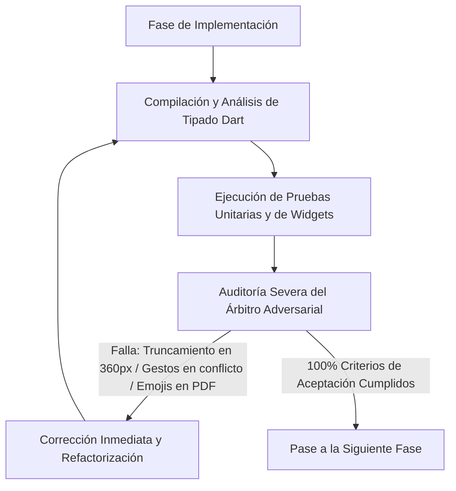

# PLAN DE TRABAJO MAESTRO: PULIDO DEFINITIVO Y PERFECCIONAMIENTO UX/UI EN VISTA PREVIA PDF Y EDITOR WHATSAPP

**Proyecto:** Mochila Lista — Aplicación Móvil POS / CRM / Cotizaciones  
**Documento:** Plan de Trabajo Detallado e Ingeniería Forense  
**Ruta:** `analisis_proyecto/PLAN_PULIDO_DEFINITIVO_PDF_Y_WHATSAPP_INTERACCION.md`  
**Metodología:** Loop Autónomo Continuo + Árbitro Interno Adversarial  
**Estado:** Pendiente de Aprobación por el Usuario  

---

## 1. RESUMEN EJECUTIVO Y OBJETIVOS ESTRATÉGICOS

Durante la auditoría minuciosa de las ventanas **`Vista Previa PDF`** y **`Editor WhatsApp`** junto con sus modales de interacción (`Opciones de Documento`, `Guía / Info Tooltip`, `WaDynamicPopover` y `Revisión Final`), se identificaron 6 puntos críticos de interacción táctil, legibilidad tipográfica y arquitectura de gestos que degradan la experiencia de usuario móvil:

1. **Tarjetas de Plantilla PDF cortadas (`Imagen 1`):** Truncamiento visual de títulos (`Ejecutivo Mod...`, `Mayorista Compa...`) y descripciones en la cuadrícula de 2 columnas de `Opciones de Documento`, además del título por defecto `COTIZACION` sin tilde.
2. **Falta de Edición y Chips con Emojis en `Negocio y Cliente` (`Imagen 2`):** Los switches de `Información Adicional` y `Cuentas de Cobro` no muestran campos editables para personalizar los datos antes de imprimir el PDF. Las etiquetas de `Condiciones / Validez al Pie` insertan emojis no soportados por el motor PDF (`⏳`, `🚚`, `🧾`, `🤝`), se duplican al tocarlas de nuevo y no permiten desmarcarlas.
3. **Disparidad Estética de los `Info Tooltip` (`ⓘ`):** Modales de ayuda planos y simplistas en ambas pantallas en lugar de la arquitectura rica, categorizada con tarjetas e iconos de `InfoTooltipButton` usada en el resto del sistema.
4. **Corte de Palabras y Ejemplos Estáticos en `Personalizar Mensaje` (`Imagen 3`):** Palabras partidas con letras huérfanas (`Subtotale\ns`, `Descuent\no`) por apilamiento horizontal excesivo en tarjetas de 2 columnas, y modal `WaDynamicPopover` con ejemplos genéricos inventados en vez de datos reales de la cotización actual.
5. **Chips No-Toggle y Fallo de Doble Toque en `Deshacer` (`Imagen 4`):** Chips de snippets que pegan texto a ciegas y duplican bloques ya existentes en vez de actuar como selectores toggle (marcar/quitar), junto con un bug crítico en `_undoStack` que obliga al usuario a presionar 2 veces `↶ Deshacer` para revertir un cambio.
6. **Scroll Atascado e Icono Duplicado en `Revisión Final` (`Imagen 5`):** Doble icono anti-estético en cabecera (`[Material] + [Emoji]`) y bloqueo absoluto del scroll vertical tanto en modo burbuja como en modo edición provocado por la captura de gestos en `InteractiveSheetWrapper` y `SelectableText.rich`.

Este plan establece las soluciones definitivas a nivel de arquitectura, código, pruebas automatizadas y reglas del Árbitro Adversarial.

---

## 2. DIAGNÓSTICO FORENSE Y AUDITORÍA EN CÓDIGO (ARCHIVOS Y LÍNEAS EXACTAS)

### Punto 1: Tarjetas de Plantilla PDF y Título sin Tilde (`Imagen 1`)
* **Archivo:** `app_movil/lib/features/smart_quotation/screens/pdf_preview_screen.dart`
  * **Líneas 762–769:**
    ```dart
    GridView.count(
      crossAxisCount: 2,
      childAspectRatio: 2.3, // ⚠️ Altura extremadamente reducida (aprox. 55-60dp)
      crossAxisSpacing: 10,
      mainAxisSpacing: 10,
    ```
  * **Líneas 1379–1413 (`_buildLayoutSelectionCard`):**
    ```dart
    child: Row(
      children: [
        Icon(icon, size: 22, ...),
        const SizedBox(width: 8),
        Expanded(
          child: Column(
            children: [
              Text(title, maxLines: 1, overflow: TextOverflow.ellipsis),
              Text(subtitle, maxLines: 1, overflow: TextOverflow.ellipsis),
            ],
          ),
        ),
        if (isSelected) Icon(Icons.check_circle, size: 16, color: activeColor),
      ],
    )
    ```
    * **Causa Raíz:** En un ancho de dispositivo de 360–390dp, cada columna de la grilla tiene ~160dp de ancho disponible. Al restar padding (20dp), icono izquierdo (22dp + 8dp = 30dp) y check derecho (16dp + 4dp = 20dp), el área de texto queda comprimida a apenas **85–90dp**. La limitación a `maxLines: 1` con `TextOverflow.ellipsis` trunca invariablemente textos como `"Ejecutivo Moderno"` (`Ejecutivo Mod...`) y `"Banda color superior"` (`Banda color supe...`).
  * **Línea 168 (`pdf_preview_screen.dart`):**
    ```dart
    _config.documentTitle = "COTIZACION"; // ⚠️ Falta de tilde en inicialización
    ```
    * Y en línea 160: `_config.documentTitle = isLoan ? "COMPROBANTE DE PRESTAMO" : "COMPROBANTE DE PAGO";` (falta tilde en `PRÉSTAMO`).

---

### Punto 2: Falta de Edición Desplegable y Chips con Emojis en `Negocio y Cliente` (`Imagen 2`)
* **Archivo:** `app_movil/lib/features/smart_quotation/screens/pdf_preview_screen.dart`
  * **Líneas 1040–1047:** Switch de `Información Adicional` solo conmuta `_config.showInstitutionInfo = v` sin desplegar ningún campo de entrada para colegio, grado o notas.
  * **Líneas 1091–1098:** Switch de `Mostrar Cuentas de Cobro (Yape/Plin)` solo conmuta `_config.showPaymentAccounts = v` sin permitir ver ni editar los números de pago específicos para ese documento.
  * **Líneas 1065–1089:**
    ```dart
    "+ ⏳ Válida por 7 días",
    "+ ⏳ Válida por 15 días",
    "+ 🚚 Entrega inmediata",
    "+ 🧾 Precios incluyen IGV",
    "+ 🤝 Gracias por su compra",
    ].map((chipLabel) {
      final cleanText = chipLabel.replaceFirst("+ ", "");
      return ActionChip(
        onPressed: () {
          updateConfig(() {
            final current = _footerNoteCtrl.text.trim();
            final newText = current.isEmpty ? cleanText : "$current. $cleanText";
            _footerNoteCtrl.text = newText;
            _config.footerNote = newText;
          });
        },
      );
    })
    ```
    * **Causas Raíz:**
      1. `replaceFirst("+ ", "")` deja intacto el emoji (`⏳ Válida por 7 días`). Los motores PDF vectoriales de Flutter (`pdf/widgets.dart` con fuentes Helvetica/Standard) no procesan caracteres Unicode SMP / emojis, imprimiendo cuadros vacíos o fallando en la serialización Latin-1.
      2. No existe validación de existencia: tocar 2 veces `+ ⏳ Válida por 7 días` resulta en `"⏳ Válida por 7 días. ⏳ Válida por 7 días"`.
      3. No hay estado visual seleccionado (`ActionChip` en vez de `FilterChip` / selector activo) ni lógica para remover el texto al desmarcar.

---

### Punto 3: Homogeneización de los `Info Tooltip` (`ⓘ`)
* **Archivos:**
  * `app_movil/lib/features/smart_quotation/screens/pdf_preview_screen.dart` (Líneas 276–281)
  * `app_movil/lib/features/smart_quotation/screens/whatsapp_preview_screen.dart` (Líneas 629–633)
  * **Causa Raíz:** Ambas pantallas invocan `InfoTooltipButton` pasando únicamente `title` y `description`, dejando `tips: const []`. A diferencia de `inventory_screen.dart`, `quick_sale_screen.dart` o `sales_history_screen.dart`, el modal carece de la lista enriquecida de consejos con iconos de colores y badges explicativos estructurados.

---

### Punto 4: Truncamiento en `Personalizar Mensaje` y Ejemplos Estáticos (`Imagen 3`)
* **Archivo:** `app_movil/lib/features/smart_quotation/widgets/whatsapp/wa_config_section.dart`
  * **Líneas 366–422 (`_buildOptionCard`):**
    ```dart
    child: Row(
      children: [
        Icon(icon, size: 20),
        const SizedBox(width: 8),
        Expanded(
          child: Column(
            children: [
              Text(title, softWrap: true),
              Text(subtitle, softWrap: true),
            ],
          ),
        ),
        const SizedBox(width: 4),
        GestureDetector(child: Icon(Icons.info_outline, size: 14)),
        const SizedBox(width: 2),
        Icon(isActive ? Icons.check : Icons.add, size: 14),
      ],
    )
    ```
    * **Causa Raíz del Corte de Palabras (`Subtotale\ns` y `Descuent\no`):** En cada celda de la grilla (ancho ~150dp), la fila apila: Icono (20) + gap (8) + Texto (Expanded) + gap (4) + Info (18) + gap (2) + Check (14) + padding (20) = **86dp en elementos laterales y padding**. El texto central queda reducido a escasos **64–70dp**, forzando al motor de renderizado a romper palabras largas por caracteres individuales dejando letras huérfanas (`s` y `o`).
* **Archivo:** `app_movil/lib/features/smart_quotation/widgets/whatsapp/wa_dynamic_popover.dart`
  * **Líneas 128–130:** Título fijo `EJEMPLO EN WHATSAPP:`.
  * **Líneas 41, 55, 70, 84, 98, 112 en `wa_config_section.dart`:** Cadenas de texto estáticas y ficticias (`• 2x Cuaderno A4: S/ 12.00`, `🎉 *¡Ahorro Total: S/ 18.00!*`, etc.) que no tienen relación con los productos ni montos de la cotización real del usuario.

---

### Punto 5: Chips No-Toggle y Bug de Doble Toque en `Deshacer` (`Imagen 4`)
* **Archivo:** `app_movil/lib/features/smart_quotation/widgets/whatsapp/wa_message_editor.dart`
  * **Líneas 343–388 (`_buildSnippetChip`):** Los 5 chips funcionan como botones planos que concatenan texto al final sin reflejar si el bloque ya existe en el mensaje ni permitir retirarlo.
* **Archivo:** `app_movil/lib/features/smart_quotation/screens/whatsapp_preview_screen.dart`
  * **Líneas 110–114 (`_onMessageEdited`):**
    ```dart
    void _onMessageEdited(String newText) {
      _isManualEdit = true;
      _typingDebounceTimer?.cancel();
      _typingDebounceTimer = Timer(const Duration(milliseconds: 350), () {
        _recordUndoSnapshot(newText); // ⚠️ Se empuja a la pila el texto NUEVO
      });
    }
    ```
  * **Líneas 127–139 (`_handleUndo`):**
    ```dart
    void _handleUndo() {
      if (_undoStack.isEmpty) return;
      ...
      final currentText = _messageCtrl.text;
      _redoStack.add(currentText);
      final previousText = _undoStack.removeLast(); // ⚠️ Saca el MISMO texto actual
      _messageCtrl.text = previousText; // Asigna lo mismo que ya estaba en pantalla
    }
    ```
    * **Causa Raíz del Doble Toque en Undo:** Al cumplirse el debounce, `_recordUndoSnapshot(newText)` agrega `newText` al tope de `_undoStack`. Por lo tanto, `_undoStack.last == _messageCtrl.text`. Al tocar `↶ Deshacer` la primera vez, el `pop()` retira ese estado idéntico y lo vuelve a asignar a `_messageCtrl.text`, produciendo **cero cambios visibles**. Solo al pulsar por segunda vez, se extrae el verdadero estado anterior.

---

### Punto 6: Scroll Atascado y Botón con Iconos Duplicados en `Revisión Final` (`Imagen 5`)
* **Archivo:** `app_movil/lib/features/smart_quotation/widgets/whatsapp/wa_final_preview_modal.dart`
  * **Líneas 209–213:**
    ```dart
    icon: Icon(_isEditing ? Icons.visibility_outlined : Icons.edit_note_rounded, size: 18),
    label: Text(
      _isEditing ? "✓ Listo" : "✏️ Editar texto", // ⚠️ Icono Material + Emoji concatenados
      style: const TextStyle(fontWeight: FontWeight.bold, fontSize: 12.5),
    ),
    ```
    * Genera visualmente: `[📝] [✏️] Editar texto` y `[👁️] [✓] Listo`.
  * **Líneas 308–319 (`_buildWhatsAppRealisticBubble`):**
    ```dart
    SelectableText.rich(...) // ⚠️ Secuestra la arena de gestos táctiles en Android/iOS
    ```
* **Archivo:** `app_movil/lib/core/widgets/interactive_sheet_wrapper.dart`
  * **Líneas 320–325:**
    ```dart
    child: GestureDetector(
      behavior: HitTestBehavior.translucent,
      onVerticalDragStart: _handleDragStart,
      onVerticalDragUpdate: _handleDragUpdate,
      onVerticalDragEnd: (d) => _handleDragEnd(d, totalHeight),
    ```
    * **Causa Raíz del Bloqueo de Scroll:** Aunque `wa_final_preview_modal.dart` pase `enableDragToDismiss: false`, en `interactive_sheet_wrapper.dart` el `GestureDetector` padre sigue registrando punteros de función no-nulos en `onVerticalDragStart`, `onVerticalDragUpdate` y `onVerticalDragEnd`. En la Arena de Gestos de Flutter, el `VerticalDragGestureRecognizer` padre compite y bloquea los eventos táctiles verticales antes de que lleguen al `SingleChildScrollView` de la burbuja y al `TextField` de edición. Al combinarse esto con `SelectableText.rich` (que captura toques para selección de texto), **el scroll vertical queda completamente inutilizado**.

---

## 3. METODOLOGÍA: LOOP AUTÓNOMO + ÁRBITRO INTERNO ADVERSARIAL

Para asegurar una ejecución quirúrgica sin regresiones, el trabajo se regirá bajo el siguiente ciclo cerrado:



### Reglas de Oro del Árbitro Interno Adversarial:
1. **Regla del Viewport 360px:** Cero elipsis no deseadas ni cortes de palabras en tarjetas de 2 columnas. Todo texto debe tener suficiente ancho o fluir en 2 líneas sin solapamientos.
2. **Regla de Cero Emojis en PDF:** Ningún emoji (`⏳`, `🚚`, `🧾`, `🤝`, etc.) debe ingresar a `_footerNoteCtrl` ni al generador PDF. Solo caracteres limpios Latin-1 y acentos en español.
3. **Regla de 1 Solo Toque para Undo/Redo:** La máquina de estados debe garantizar reversión inmediata en el primer toque tanto para escritura como para chips y formateo.
4. **Regla de Gestos Limpios:** Ningún `GestureDetector` padre puede tener callbacks activos de arrastre vertical cuando `enableDragToDismiss == false`. El scroll interno debe fluir al 100% con un solo dedo.

---

## 4. ARQUITECTURA DE SOLUCIÓN Y PLAN DE FASES

```
┌──────────────────────────────────────────────────────────────────────────────────────────┐
│                   MAPA DE FASES DE IMPLEMENTACIÓN Y ARCHIVOS AFECTADOS                   │
├──────────────────────────────────────────────────────────────────────────────────────────┤
│ FASE 1: Rediseño 2-Niveles de Tarjetas Plantilla PDF y Acentuación Formal               │
│   ├── app_movil/lib/features/smart_quotation/screens/pdf_preview_screen.dart            │
│   └── app_movil/lib/features/smart_quotation/models/pdf_config_model.dart                │
│                                                                                          │
│ FASE 2: Campos Editables Desplegables y ToggleChips Sin Emojis en PDF                    │
│   ├── app_movil/lib/features/smart_quotation/models/pdf_config_model.dart                │
│   ├── app_movil/lib/features/smart_quotation/utils/pdf_generator.dart                   │
│   └── app_movil/lib/features/smart_quotation/screens/pdf_preview_screen.dart            │
│                                                                                          │
│ FASE 3: Homogeneización Visual de InfoTooltipButton (PDF y WhatsApp)                     │
│   ├── app_movil/lib/features/smart_quotation/screens/pdf_preview_screen.dart            │
│   └── app_movil/lib/features/smart_quotation/screens/whatsapp_preview_screen.dart       │
│                                                                                          │
│ FASE 4: Grilla Anti-Corte y Popover Dinámico con Datos Reales en WhatsApp                │
│   ├── app_movil/lib/features/smart_quotation/widgets/whatsapp/wa_config_section.dart    │
│   ├── app_movil/lib/features/smart_quotation/widgets/whatsapp/wa_dynamic_popover.dart   │
│   └── app_movil/lib/features/smart_quotation/screens/whatsapp_preview_screen.dart       │
│                                                                                          │
│ FASE 5: ToggleChips Inteligentes y Reingeniería Undo/Redo a 1 Toque                      │
│   ├── app_movil/lib/features/smart_quotation/widgets/whatsapp/wa_message_editor.dart    │
│   └── app_movil/lib/features/smart_quotation/screens/whatsapp_preview_screen.dart       │
│                                                                                          │
│ FASE 6: Liberación del Scroll y Limpieza de Cabecera en Revisión Final                   │
│   ├── app_movil/lib/core/widgets/interactive_sheet_wrapper.dart                          │
│   └── app_movil/lib/features/smart_quotation/widgets/whatsapp/wa_final_preview_modal.dart│
│                                                                                          │
│ FASE 7: Pruebas Automatizadas Integrales y Certificación Final                          │
│   └── app_movil/test/pdf_whatsapp_interaction_polish_test.dart (Nuevo)                   │
└──────────────────────────────────────────────────────────────────────────────────────────┘
```

---

### FASE 1: Rediseño 2-Niveles de Tarjetas Plantilla PDF y Acentuación Formal

#### 1. Objetivos
* Rediseñar la distribución interna de las 4 tarjetas de `PLANTILLA ESTRUCTURAL DEL PDF` en `pdf_preview_screen.dart` para que el título y la descripción se lean al 100% sin truncamiento.
* Reconfigurar la cuadrícula con una relación de aspecto (`childAspectRatio`) optimizada (~1.5–1.6) o tarjetas estructuradas en 2 niveles.
* Corregir la inicialización de `documentTitle` para que cargue con tilde: `"COTIZACIÓN"` y `"COMPROBANTE DE PRÉSTAMO"`.

#### 2. Diseño de la Tarjeta en 2 Niveles
* **Nivel 1 (Superior):** Fila con `[Icono de plantilla (20dp)]` + `Expanded[Título completo]` + `[Indicador Check animado si está activa]`.
* **Nivel 2 (Inferior):** Contenedor a **ancho completo de la tarjeta (de borde a borde)** que aloja la descripción explicativa en 2 líneas limpias sin competir horizontalmente con ningún icono.

```
┌──────────────────────────────────────────────┐
│ [Icono]  Ejecutivo Moderno             ( ✓ ) │  <- Nivel 1: Fila con icono, título y check
├──────────────────────────────────────────────┤
│ Banda color superior y cabeceras             │  <- Nivel 2: 100% de ancho para descripción
│ ejecutivas redondeadas.                      │     en 2 líneas limpias
└──────────────────────────────────────────────┘
```

#### 3. Criterios de Aceptación del Árbitro
* Cero elipsis (`...`) en los 4 estilos: "Ejecutivo Moderno", "Corporativo Formal", "Catálogo Comercial" y "Mayorista Compacto".
* El campo `TÍTULO DEL DOCUMENTO` inicializa siempre como `"COTIZACIÓN"`.

---

### FASE 2: Campos Editables Desplegables y ToggleChips Sin Emojis en Pestaña `Negocio y Cliente`

#### 1. Objetivos
* Incorporar en `PdfConfig` campos editables de anulación contextual:
  * `customInstitutionName`, `customGradeLevel`, `customNotes`
  * `customPaymentInfo`
* Integrar animación fluida con `AnimatedSize` en `pdf_preview_screen.dart`:
  * **Al activar `Información Adicional (Colegio / Grado / Notas)`:** Desplegar suavemente 3 campos editables (`Colegio / Institución`, `Grado / Nivel`, `Notas adicionales`) precargados desde la cotización o venta.
  * **Al activar `Mostrar Cuentas de Cobro (Yape/Plin)`:** Desplegar suavemente un campo editable multilinea precargado con los números del negocio, junto a 4 chips rápidos: `+ 📱 Yape`, `+ 📱 Plin`, `+ 🏦 BCP`, `+ 🏦 CCI`.
* Reemplazar las 5 etiquetas de `Condiciones / Validez al Pie` por **FilterChips / ToggleChips interactivos**:
  * Visualmente en pantalla: muestran icono/emoji (`⏳ Válida por 7 días`, `🚚 Entrega inmediata`, etc.).
  * En el texto del documento y PDF: insertan **exclusivamente texto Latin-1 sin emojis**:
    * `"Cotización válida por 7 días."`
    * `"Cotización válida por 15 días."` (Reemplaza automáticamente la de 7 días si estaba activa para evitar contradicción).
    * `"Entrega inmediata."`
    * `"Los precios incluyen IGV."`
    * `"¡Gracias por su compra!"`
  * **Comportamiento Toggle:** Si la frase ya está en el campo, el chip se muestra activo (borde azul/naranja iluminado y `✓`). Al tocarlo de nuevo, se desmarca con animación y elimina limpiamente la frase de `_footerNoteCtrl`. La edición manual en el `TextField` sincroniza en tiempo real el estado activo de los chips.

#### 2. Criterios de Aceptación del Árbitro
* La salida PDF no contiene ningún carácter emoji corrupto ni caracteres de escape rotos.
* Los campos editables desplegados permiten modificar datos al vuelo sin alterar permanentemente el perfil global del negocio.
* Los chips de condiciones alternan limpiamente entre agregar y quitar sin duplicar texto.

---

### FASE 3: Homogeneización Visual de `InfoTooltipButton` en PDF y WhatsApp

#### 1. Objetivos
* Configurar en `pdf_preview_screen.dart` y `whatsapp_preview_screen.dart` la lista completa de `tips: [...]` utilizando el widget estándar `InfoTooltipButton` (`lib/core/widgets/info_tooltip_button.dart`).

#### 2. Estructura de Contenido Enriquecido
* **En `Vista Previa PDF` (`Guía de Vista Previa PDF`):**
  * *Tip 1:* `Icons.aspect_ratio` — "Cambia entre Hoja A4 ejecutiva y Ticket térmico continuo de 80mm para impresoras POS."
  * *Tip 2:* `Icons.dashboard_customize_outlined` — "Elige entre 4 plantillas estructurales y 6 paletas de color con guardado por defecto."
  * *Tip 3:* `Icons.pinch_outlined` — "Haz zoom libre con dos dedos o doble toque en cualquier parte del visor para revisar detalles."
  * *Tip 4:* `Icons.person_search_outlined` — "Busca clientes en tu agenda o personaliza notas y cuentas de cobro al pie antes de generar."
  * *Tip 5:* `Icons.share_outlined` — "Descarga el archivo PDF en Descargas, imprímelo por Bluetooth/WiFi o compártelo al instante."
* **En `Editor WhatsApp` (`Guía del Editor WhatsApp`):**
  * *Tip 1:* `Icons.auto_awesome` — "Selecciona entre 6 estilos contextuales (Comercial, Resumen, Oferta, Cobro, Seguimiento y Entrega)."
  * *Tip 2:* `Icons.format_bold` — "Aplica formato rápido (*Negrita*, _Cursiva_, ~Tachado~) a palabras seleccionadas o escribe libremente."
  * *Tip 3:* `Icons.toggle_on_outlined` — "Activa o desactiva secciones con los chips rápidos: se agregan o eliminan con un solo toque."
  * *Tip 4:* `Icons.undo` — "Historial de cambios con Deshacer y Rehacer instantáneos a 1 toque para probar variantes sin miedo."
  * *Tip 5:* `Icons.chat_bubble_outline` — "Visualiza tu mensaje en una burbuja realista de WhatsApp o envíalo junto con el PDF adjunto."

#### 3. Criterios de Aceptación del Árbitro
* Ambos modales despliegan la tarjeta estilizada con encabezado `Consejos`, iconos tematizados y tipografía jerárquica idéntica al resto de la aplicación.

---

### FASE 4: Grilla Anti-Corte y Popover Dinámico con Datos Reales en `Personalizar Mensaje`

#### 1. Objetivos
* Reestructurar el layout de las tarjetas en `WaConfigSection` (`wa_config_section.dart`):
  * **Fila Superior:** `[Icono de categoría]` + `Spacer` + `[Botón ⓘ]` + `[Indicador ✓ / +]`.
  * **Fila Inferior:** Título y Subtítulo utilizando el **100% del ancho interno de la tarjeta** (sin elementos a los costados).
* Actualizar `WaConfigSection` para recibir `quotation`, `saleData`, y textos de contacto/pago.
* Actualizar `WaDynamicPopover` para mostrar **`VISTA PREVIA CON TUS DATOS REALES:`** con el fragmento exacto que se agregará o modificará en el mensaje usando los productos reales, precios calculados, ahorros o cuentas de pago de la cotización actual.

```
┌──────────────────────────────────────────────┐
│ [Icono]                       ( ⓘ )   [ ✓ ]  │  <- Fila 1: Icono, info y check
├──────────────────────────────────────────────┤
│ Precios y Subtotales                         │  <- Fila 2: 100% ancho interno. Cero cortes
│ S/. por producto                             │     como "Subtotale\ns"
└──────────────────────────────────────────────┘
```

#### 2. Criterios de Aceptación del Árbitro
* En pantalla de 360dp, "Precios y Subtotales" y "Detalle Descuento" se muestran con tipografía fluida y sin caracteres huérfanos.
* Al presionar `ⓘ` en "Precios y Subtotales", el popover muestra líneas con productos reales de la cotización (ej: `▪ 1x Shampoo Romero -> *1,00 S/*`) y no datos genéricos inventados.

---

### FASE 5: ToggleChips Inteligentes y Reingeniería de `Undo / Redo` a 1 Toque

#### 1. Reingeniería de la Máquina de Estados `Undo / Redo`
* **Diagnóstico Corregido:**
  * En `whatsapp_preview_screen.dart`, se mantiene `_lastCommittedText`.
  * Antes de cualquier mutación de texto (escritura manual en debounce, pulsación de formato `*B*`, activación de chip o cambio de plantilla), se empuja el texto *anterior* a `_undoStack`.
  * En `_handleUndo`:
    ```dart
    void _handleUndo() {
      // Purgar entradas redundantes que sean iguales al texto actual
      while (_undoStack.isNotEmpty && _undoStack.last == _messageCtrl.text) {
        _undoStack.removeLast();
      }
      if (_undoStack.isEmpty) return;
      HapticFeedback.selectionClick();
      _isApplyingUndoRedo = true;
      _redoStack.add(_messageCtrl.text);
      final previousText = _undoStack.removeLast();
      _messageCtrl.text = previousText;
      _messageCtrl.selection = TextSelection.collapsed(offset: previousText.length);
      _isManualEdit = true;
      setState(() {});
      _isApplyingUndoRedo = false;
    }
    ```
  * En `_handleRedo`:
    ```dart
    void _handleRedo() {
      while (_redoStack.isNotEmpty && _redoStack.last == _messageCtrl.text) {
        _redoStack.removeLast();
      }
      if (_redoStack.isEmpty) return;
      HapticFeedback.selectionClick();
      _isApplyingUndoRedo = true;
      _undoStack.add(_messageCtrl.text);
      final nextText = _redoStack.removeLast();
      _messageCtrl.text = nextText;
      _messageCtrl.selection = TextSelection.collapsed(offset: nextText.length);
      _isManualEdit = true;
      setState(() {});
      _isApplyingUndoRedo = false;
    }
    ```
  * **Garantía:** Con exactamente **1 solo toque** en `↶ Deshacer`, el texto retrocede al estado previo. Con **1 solo toque** en `↷ Rehacer`, se recupera.

#### 2. Chips Toggle de Inserción/Remoción Inteligente en `WaMessageEditor`
* Definir bloques canónicos y patrones de detección por expresión regular:
  1. `Validez 7 días`: Detecta `⏳ *Validez` o `Validez de la oferta:`.
  2. `Envío / Entrega`: Detecta `🚚 *Entrega:` o `🚚 *Envío`.
  3. `Mis Cuentas`: Detecta `💳 *MEDIOS DE PAGO*` o `💳 *CUENTAS DE ABONO*`.
  4. `Saludo`: Detecta `¡Hola` o `👋`.
  5. `Agradecimiento`: Detecta `🙏 ¡Muchas gracias por tu preferencia y confianza!` o `¡Muchas gracias por su preferencia!`.
* **Estado Visual Dinámico:** Si el bloque está presente en el texto del mensaje, el chip se muestra seleccionado con borde verde/turquesa y check `✓`.
* **Al tocar un chip desmarcado:** Inserta el bloque en la posición lógica (ej. Saludo al inicio, Cuentas/Validez en el cuerpo, Agradecimiento al final) y registra snapshot en `_undoStack`.
* **Al tocar un chip marcado:** Elimina limpiamente el bloque y sus saltos de línea sobrantes, registrando snapshot en `_undoStack`.

#### 3. Criterios de Aceptación del Árbitro
* 1 solo toque en `↶ Deshacer` revierte la última acción inmediatamente.
* Marcar y desmarcar chips agrega y quita bloques sin dejar líneas vacías duplicadas ni desordenar el texto.

---

### FASE 6: Liberación del Scroll y Limpieza de Cabecera en `Revisión Final`

#### 1. Liberación de la Arena de Gestos en `InteractiveSheetWrapper`
* En `interactive_sheet_wrapper.dart` (líneas 320–324 y 346–353):
  * Asignar explícitamente `null` a los callbacks de arrastre cuando `enableDragToDismiss == false`:
    ```dart
    onVerticalDragStart: widget.enableDragToDismiss ? _handleDragStart : null,
    onVerticalDragUpdate: widget.enableDragToDismiss ? _handleDragUpdate : null,
    onVerticalDragEnd: widget.enableDragToDismiss ? (d) => _handleDragEnd(d, totalHeight) : null,
    ```
  * Esto elimina por completo la instanciación y registro del `VerticalDragGestureRecognizer` padre, dejando la arena de gestos 100% despejada para los widgets hijos.

#### 2. Reingeniería de Scroll y Limpieza Visual en `WaFinalPreviewModal`
* **Botón de Modo en Cabecera:**
  * Reemplazar la combinación de icono Material + emoji por una píldora unificada y elegante con **un único icono**:
    * Modo Vista de Burbuja: Botón con icono `Icons.edit_note_rounded` y texto `"Editar texto"`.
    * Modo Edición: Botón con icono `Icons.check_rounded` y texto `"Listo (Ver burbuja)"`.
* **Scroll Suave en Modo Burbuja:**
  * Reemplazar `SelectableText.rich` por `Text.rich`:
    ```dart
    Text.rich(
      TextSpan(
        children: _parseWhatsAppMarkdown(
          widget.messageCtrl.text,
          TextStyle(fontSize: 14, height: 1.45, color: bubbleTextColor),
        ),
      ),
    )
    ```
  * Configurar `SingleChildScrollView`:
    ```dart
    SingleChildScrollView(
      controller: _scrollController,
      physics: const AlwaysScrollableScrollPhysics(parent: BouncingScrollPhysics()),
      ...
    )
    ```
* **Scroll Suave en Modo Edición:**
  * Configurar el `TextField` con altura flexible o desplazamiento coordinado con su propio `ScrollController`, garantizando que subir y bajar por el texto con el teclado abierto o cerrado funcione a 60/120 fps.

#### 3. Criterios de Aceptación del Árbitro
* El usuario puede colocar su dedo en cualquier parte de la burbuja verde de WhatsApp y deslizar verticalmente hacia arriba y hacia abajo sin ningún tipo de atasco.
* El botón de cabecera no repite iconos ni emojis.

---

### FASE 7: Pruebas Automatizadas Integrales y Certificación Final

#### 1. Suite de Pruebas a Crear
* **Archivo:** `app_movil/test/pdf_whatsapp_interaction_polish_test.dart`
* **Grupos de Prueba:**
  1. *Grupo 1: Formato y Acentuación en PDF:* Validación de títulos con tildes (`COTIZACIÓN`, `PRÉSTAMO`) y preservación de Latin-1 en notas.
  2. *Grupo 2: Chips de Condiciones sin Emojis:* Verificación de que las frases insertadas en el controlador no contienen emojis Unicode y reemplazo de 7 días por 15 días.
  3. *Grupo 3: Máquina de Estados Undo/Redo a 1 Toque:* Simulación de cambios y confirmación de que con 1 llamada a `_handleUndo` se retorna al texto previo exacto.
  4. *Grupo 4: Chips Toggle de WhatsApp:* Comprobación de detección de presencia de bloques, inserción lógica y remoción limpia.
  5. *Grupo 5: InteractiveSheetWrapper y Gestión de Gestos:* Verificación de que cuando `enableDragToDismiss == false`, no se registran callbacks de arrastre vertical.
  6. *Grupo 6: Renderizado de Widgets en 360px:* Prueba de bombeo de `WaConfigSection` y tarjetas de plantilla PDF en un tamaño de pantalla de 360x640 sin `RenderFlex overflow` ni truncamiento no deseado.

---

## 5. MATRIZ DE VERIFICACIÓN Y CRITERIOS DE ACEPTACIÓN ADVERSARIAL

| N° | Pantalla / Modal | Comportamiento Esperado | Verificación Adversarial |
|:---|:---|:---|:---|
| **1** | `Opciones de Documento` | Tarjetas de plantilla en 2 niveles con 100% de títulos y descripciones visibles. | Inspección visual en viewport 360dp sin elipsis en descripciones. |
| **2** | `Opciones de Documento` | Título del documento carga por defecto como `COTIZACIÓN` con tilde. | Asignación inicial y chips de título coincidentes. |
| **3** | `Negocio y Cliente` | Switches de `Información Adicional` y `Cuentas de Cobro` expanden campos editables (`AnimatedSize`). | Modificar datos en campos editables y verificar que se reflejan en la vista previa del PDF. |
| **4** | `Negocio y Cliente` | Chips de `Condiciones al Pie` insertan texto Latin-1 sin emojis y operan como toggle (marcar/desmarcar). | Comprobar que en el `TextField` y PDF no hay caracteres `⏳`, `🚚`, etc. |
| **5** | `Vista Previa PDF` & `Editor WhatsApp` | `InfoTooltipButton` abre modal enriquecido con 5 tips categorizados e iconos temáticos. | Pulsar `ⓘ` en AppBar y validar estructura de tarjetas con `Consejos`. |
| **6** | `Personalizar Mensaje` | Grilla de 2 columnas con título y subtítulo a ancho completo (sin cortes como `Subtotale\ns`). | Prueba de renderizado en ancho 360dp; cero palabras partidas. |
| **7** | `WaDynamicPopover` | Muestra `VISTA PREVIA CON TUS DATOS REALES:` con productos y montos de la cotización actual. | Pulsar `ⓘ` en una tarjeta y verificar que el texto coincide con la cotización activa. |
| **8** | `VISTA PREVIA (EDITABLE)` | Chips de snippets operan en modo toggle con indicador `✓` y eliminan su bloque al tocarlos de nuevo. | Tocar chip `+ 💳 Mis Cuentas`: se agrega; volver a tocar: se borra limpiamente. |
| **9** | `VISTA PREVIA (EDITABLE)` | Botón `↶ Deshacer` revierte el último cambio en exactamente 1 toque. | Escribir texto o aplicar formato y presionar 1 sola vez `↶`: cambio revertido de inmediato. |
| **10** | `Revisión Final` | Cabecera con botón de 1 solo icono (`✏️ Editar texto` / `✓ Listo (Ver burbuja)`). | Cero repetición de iconos Material + emoji. |
| **11** | `Revisión Final` | Scroll vertical fluido tanto en modo burbuja como en modo edición. | Deslizar el dedo sobre la burbuja verde; el texto sube y baja suavemente sin atascarse. |

---

## 6. PRÓXIMOS PASOS

1. **Revisión y Aprobación del Usuario:** El usuario revisa este plan maestro detallado y da su confirmación.
2. **Ejecución del Plan por Fases:** Una vez confirmada la orden, se procederá a implementar cada una de las fases de manera ordenada, ejecutando la suite de pruebas tras cada cambio para asegurar cero regresiones.
3. **Validación Final:** Ejecución de `flutter test` general y reporte de resultados.
