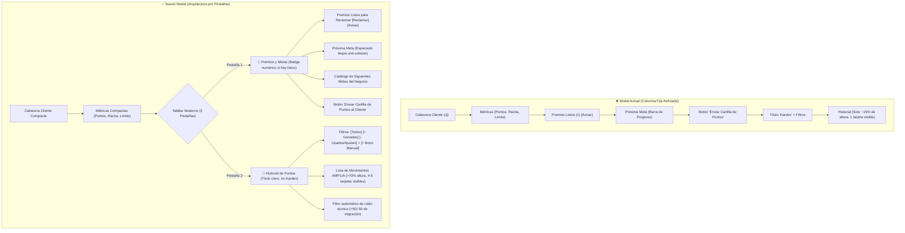

# PLAN MAESTRO DE PULIDO INTEGRAL: UI/UX DE HISTORIAL DE PUNTOS, REGLAS DEL NEGOCIO, CARTILLA WHATSAPP Y REPUTACIÓN

**Documento:** `analisis_proyecto/PLAN_PULIDO_INTEGRAL_UI_UX_HISTORIAL_PUNTOS_REGLAS_CARTILLA_Y_REPUTACION.md`  
**Fecha:** Noviembre 2026  
**Versión:** 1.0 — Diseño de Arquitectura, Especificación Visual y Plan de Ejecución Definitivo  
**Estado:** Pendiente de Aprobación por el Usuario (Cero Código Modificado en esta Fase de Planificación)  
**Metodología:** Loop Autónomo con Árbitro Interno Adversarial (Test-Driven, Cero Regresiones, 0ms SQLite, 320dp/360dp Ready, Cero Emojis en Widgets UI)

---

## 1. RESUMEN EJECUTIVO Y DIAGNÓSTICO BASADO EN LAS 8 CAPTURAS REALES

Tras la implementación de la arquitectura de fidelización por acumulación libre, se realizaron pruebas exhaustivas en dispositivos físicos con pantallas móviles estándar (`360dp` y `390dp`). A través de **8 capturas de pantalla reales**, se identificaron problemas concretos de distribución espacial, saturación visual, terminología contable poco amigable, duplicidad de controles, truncamiento de textos y mensajes emergentes persistentes.

### 1.1. Matriz de Hallazgos por Captura de Pantalla

| Captura | Archivo Principal | Problema Específico Detectado | Impacto en UX / Negocio |
| :--- | :--- | :--- | :--- |
| **Captura 1** (`5.39.05 PM.jpeg`) | `client_loyalty_history_modal.dart` | El 80% vertical del modal está saturado por tarjetas fijas (métricas, premios listos, próxima meta, botón cartilla), dejando solo 1 tarjeta visible de movimientos. Término *"Kardex"* confuso. Próxima meta pegada a *"Faltan 50 pts"*. Texto genérico *"Beneficio especial"* en vez del beneficio real. Ruido técnico por registros de migración (+50/-50). | Asfixia visual, navegación incómoda del historial de puntos, desmotivación del cliente. |
| **Captura 2** (`5.39.04 PM (1).jpeg`) | `client_loyalty_history_modal.dart` (Bono Manual) | En el modal de Ajuste/Bono Manual, el tercer chip de motivo se corta a la mitad diciendo `[ Co`. Faltan chips rápidos de puntos (`+10`, `+25`, `+50`, `+100`) para carga en 1 toque. El teclado no se oculta al tocar fuera. | Truncamiento visual antiestético, lentitud al tipear puntos manualmente. |
| **Captura 3** (`5.39.04 PM (2).jpeg`) | `loyalty_center_screen.dart` (Recompensas) | Botón duplicado para Reglas de Puntos: icono `Icons.tune` en el `AppBar` naranja y botón `[Reglas de Puntos]` abajo. Métrica superior dice *"Por Revisar: 0 pendientes"* cuando Jj tiene 1 premio listo. Sección huérfana vacía *"Premios Desbloqueados por Revisar"*. | Duplicidad innecesaria en AppBar, métricas desincronizadas, títulos fantasma sin contenido. |
| **Captura 4** (`5.39.04 PM (3).jpeg`) | `loyalty_center_screen.dart` (Catálogo / Historial) | En *"Historial Reciente de Premios"*, aparece texto crudo y partido: `Jj • ganador — Estado: MIGRADA_A_SALD / O_LIBRE` y badge gris duplicado. | Apariencia de error técnico interno de base de datos expuesto al comerciante. |
| **Captura 5** (`5.39.04 PM (4).jpeg`) | `loyalty_rules_config_modal.dart` | Título cortado: `"Configurar Reglas de Punt..."`. Títulos de reglas cortados: `"1. Compras al Contado (Caj..."` y `"3. Abono Inicial en Ventas a..."`. Botón `[Valores por Defecto]` con texto apretado sin margen lateral. SnackBar verde pegado en pantalla tras guardar. | Mala adaptación responsive en 360dp, mensajes flotantes molestos que persisten al salir. |
| **Captura 6** (`5.39.03 PM.jpeg`) | `loyalty_whatsapp_service.dart` | Encabezado de cartilla WhatsApp con mezcla de minúsculas y mayúsculas desordenadas: `"librería BAZAR LUZAM"`. | Falta de profesionalismo en mensajes salientes de WhatsApp dirigidos al cliente final. |
| **Captura 7** (`5.39.03 PM (1).jpeg`) | `loyalty_whatsapp_service.dart` | Redundancias entre paréntesis en el catálogo WhatsApp: `10% de Ahorro Especial (10% de Descuento)` y `Línea de Crédito Preferencial VIP (Línea de Crédito S/ 800.00)`. Al abrir sin cliente seleccionado, el botón intenta abrir WhatsApp sin destinatario en vez de usar el selector nativo de compartir (`Share.share`). | Mensaje reiterativo e inflado. Imposibilidad de compartir la cartilla a estados o grupos. |
| **Captura 8** (`5.39.03 PM (2).jpeg`) | `loyalty_center_screen.dart` (Reputación) | Métrica superior `0 pendientes` desincronizada. No hay filtro `"Con Premio Listo"`. Clientes con teléfono ficticio `000000000`. Icono de reloj `⏱️` diminuto e imperceptible para abrir el historial. | Dificultad para auditar clientes con premios alcanzados; iconografía críptica. |

---

## 2. ARQUITECTURA TÉCNICA Y DIAGRAMAS DE FLUJO

### 2.1. Reestructuración del Modal de Historial de Puntos (`client_loyalty_history_modal.dart`)



### 2.2. Flujo Omnicanal de la Cartilla WhatsApp y Compartir Nativo

```mermaid
flowchart LR
    A["Usuario pulsa [Cartilla WhatsApp]"] --> B{"¿Contexto de Apertura?"}
    B -->|Sin cliente fijo (Desde Recompensas)| C["Modal Cartilla General"]
    C --> C1["Barra de Personalización: [Completo] [Resumen] [Promo]"]
    C --> C2["Toggles: [✓ Ganar Puntos] [✓ Premios] [✓ Tienda]"]
    C --> C3["Botón Principal: [📤 Compartir Cartilla] (Share.share nativo Android)"]
    C --> C4["Permite enviar a: Estados WhatsApp, Grupos, Telegram, Facebook, etc."]
    
    B -->|Con cliente seleccionado (Perfil Jj)| D["Modal Cartilla Personalizada"]
    D --> D1["Saldo actual y nombre del cliente inyectados"]
    D --> D2["Botón Principal: [Enviar por WhatsApp] a su número directo"]
    D --> D3["Botón Secundario: [📤 Compartir] nativo + [Copiar]"]
```

---

## 3. PLAN DETALLADO POR FASES DE IMPLEMENTACIÓN

---

### FASE 1: Reestructuración por Pestañas / Scroll, Espacio Amplio y Claridad en el Modal de Puntos del Cliente (`client_loyalty_history_modal.dart`)

#### 1.1. Diagnóstico de Código Actual
* **Archivo:** `app_movil/lib/features/smart_quotation/widgets/crm/client_loyalty_history_modal.dart`
* **Líneas 619–844:** El modal define un `Column` que contiene secuencialmente:
  1. `Row` cabecera cliente (Avatar, Nombre, Badge, Score, Cerrar).
  2. Tarjeta resumen de 3 métricas (`Puntos Actuales`, `Racha Pagos`, `Límite Sugerido`).
  3. `_buildClaimableRewardsAndProgressSection` (Premios listos, premios pendientes, próxima meta, botón enviar cartilla).
  4. `Row` de título `"Kardex de Movimientos"` y botón `"Bono Manual"`.
  5. `_buildFilterChips`.
  6. `Expanded` para `_filteredMovements`.
* **Causa raíz del problema:** Todo el bloque 1 al 5 mide entre 420dp y 480dp. En pantallas estándar con altura visible de ~680dp (descontando teclado/barras), el `Expanded` recibe apenas ~140dp, permitiendo renderizar únicamente 1 tarjeta y media cortada.

#### 1.2. Especificación del Rediseño por Pestañas
1. **Cabecera y Resumen Compactos (Fijos arriba):**
   * Mantener el avatar circular del cliente, nombre, badge de reputación y score.
   * Mantener la tarjeta de 3 métricas ejecutivas (`Puntos Actuales`, `Racha Pagos`, `Límite Sugerido`), con padding calibrado de 8dp vertical para optimizar espacio.
2. **Implementación de `TabBar` de 2 Pestañas con `DefaultTabController` o `TabController`:**
   * **Pestaña 1: `🎁 Premios y Metas`** (con badge dinámico si hay premios listos, ej. `Premios y Metas (1)`):
     * **Sección `Premios Listos para Reclamar`:**
       * Muestra cada meta alcanzada por el cliente.
       * Botón **`[Reclamar]`** destacado (abre `RewardReviewModal` para confirmación inmediata).
       * Botón **`[Avisar]`** por WhatsApp con preview editable.
       * **Corrección de descripción (Captura 1):** Reemplazar el texto genérico `"50 pts • Beneficio especial"` por la descripción configurada del beneficio:
         * Si es `PRODUCTO_REGALO` con valor: `"${g.puntosRequeridos} pts • ${g.nombre} (Producto de Regalo - ${AppCurrency.format(g.valorBeneficio)})"`.
         * Si es descuento: `"${g.puntosRequeridos} pts • Descuento de ${AppCurrency.format(g.valorBeneficio)}"`.
     * **Sección `Próxima Meta` (Captura 1):**
       * Corregir el choque visual entre el título y el faltante:
         ```dart
         Row(
           children: [
             Icon(Icons.workspace_premium_rounded, size: 16, color: Colors.amber[700]),
             const SizedBox(width: 8),
             Expanded(
               child: Text(
                 "Próxima Meta: ${nextGoal.titulo}",
                 style: const TextStyle(fontSize: 12, fontWeight: FontWeight.bold),
                 maxLines: 1,
                 overflow: TextOverflow.ellipsis,
               ),
             ),
             const SizedBox(width: 10), // <-- Espaciador defensivo garantizado
             Text(
               missing <= 0 ? "¡Meta alcanzada!" : "Faltan $missing pts",
               style: TextStyle(
                 fontSize: 11,
                 fontWeight: FontWeight.bold,
                 color: missing <= 0 ? Colors.green : Colors.amber[800],
               ),
             ),
           ],
         )
         ```
       * Barra de progreso horizontal con porcentaje.
     * **Catálogo de Siguientes Metas:**
       * Renderizar una lista vertical compacta con las siguientes metas del negocio (`100 pts`, `300 pts`, `500 pts`, `1000 pts`) para motivar al cliente a seguir acumulando puntos.
     * **Botón `[Enviar Cartilla de Puntos al Cliente]`:**
       * Botón ancho y estilizado al final de la pestaña para compartir su estado por WhatsApp.
   * **Pestaña 2: `📜 Historial de Puntos` (Reemplazo del término "Kardex"):**
     * **Cabecera de Pestaña:**
       * Chips de filtro: `[Todos (X)]`, `[+ Ganados]`, `[- Usados / Ajustes]`.
       * Botón destacado a la derecha: **`[+ Bono Manual]`** (icono `Icons.add_circle_outline_rounded`).
     * **Área de Movimientos:**
       * Ocupa **más del 70% de la altura total del modal**, permitiendo visualizar holgadamente entre 4 y 5 movimientos simultáneos con scroll fluido y física `BouncingScrollPhysics`.
     * **Filtrado de Ruido Técnico de Migración:**
       * En `_filteredMovements`, excluir de la vista del usuario los registros donde `tipoMovimiento == 'RESTAURACION_MIGRACION'` o cuyo motivo contenga `"Restauración de puntos por cambio a acumulación libre"` y el correspondiente `"Puntos reservados por desbloqueo de meta"` previo, evitando mostrar al cliente operaciones técnicas de base de datos que se cancelaron mutuamente a saldo 0.

#### 1.3. Corrección del Diálogo `Ajuste / Bono Manual` (Captura 2)
* **Líneas 337–359 en `client_loyalty_history_modal.dart`:**
  * Actualmente usa `SingleChildScrollView(scrollDirection: Axis.horizontal, child: Row(...))`, lo que provoca que en pantallas angostas el tercer chip se corte como `[ Co`.
* **Solución:**
  1. Reemplazar el `Row` horizontal por un `Wrap` responsivo con `spacing: 6, runSpacing: 6`.
  2. Agregar una fila de **Chips Rápidos de Cantidad de Puntos** (`+10`, `+25`, `+50`, `+100`):
     * Al tocar un chip, asigna automáticamente el valor al `pointsCtrl.text` y recalcula en vivo el saldo proyectado.
  3. Envolver los `TextField` con `onTapOutside: (_) => FocusScope.of(context).unfocus()` para cerrar el teclado táctil al interactuar con los chips.

---

### FASE 2: Limpieza y Perfeccionamiento de la Pestaña `Recompensas` (`loyalty_center_screen.dart`)

#### 2.1. Eliminación del Botón Duplicado de `Reglas de Puntos` (Captura 3)
* **Archivo:** `app_movil/lib/features/smart_quotation/screens/crm/loyalty_center_screen.dart`
* **Línea 354–359:** Eliminar el `IconButton(icon: Icon(Icons.tune_rounded), tooltip: "Reglas de Puntos", onPressed: _openRulesConfig)` del `AppBar` naranja.
* **Resultado:** El `AppBar` superior queda limpio y balanceado con:
  1. Título: `"Fidelización y Premios"`.
  2. Acción 1: Botón refrescar (`Icons.refresh_rounded`).
  3. Acción 2: InfoTooltipButton explicativo.
* **Barra de Acciones en Tab Recompensas (Líneas 1200–1230):**
  * Conservar y mejorar la barra de dos botones ejecutivos:
    * Botón 1: **`[⚙️ Reglas de Puntos]`** (OutlinedButton con borde ambarino, icono `Icons.tune_rounded`).
    * Botón 2: **`[📢 Cartilla WhatsApp]`** (OutlinedButton estilizado, icono `Icons.menu_book_rounded`).

#### 2.2. Sincronización de Contadores y Eliminación de Secciones Huérfanas (Captura 3)
* **Métrica Superior Central (Línea 530–538):**
  * Actualmente calcula: `"${_pendingRewards.length} pendientes"`.
  * En acumulación libre, los premios listos están en `_clientsWithClaimableRewards`.
  * **Modificación:**
    ```dart
    final int premiosListosTotal = _clientsWithClaimableRewards.fold<int>(
      0, (sum, item) => sum + ((item['claimable_goals'] as List?)?.length ?? 0)
    );
    // Mostrar:
    _buildExecutiveMetric(
      "Premios Listos",
      premiosListosTotal > 0 ? "$premiosListosTotal disponible(s)" : "0 pendientes",
      Icons.notifications_active_rounded,
      premiosListosTotal > 0 ? Colors.green[700]! : Colors.grey,
      textColor,
      isDark,
    );
    ```
* **Eliminación del Título Huérfano `"Premios Desbloqueados por Revisar"` (Líneas 1270–1334):**
  * Condicionar la sección para que **solo se renderice si realmente existen elementos** (`if (_pendingRewards.isNotEmpty)`). Si la lista está vacía, no mostrar el título huérfano ni el contenedor de relleno.
* **Mejora de la Tarjeta `Premios Disponibles para Reclamar`:**
  * En `_buildClaimableClientCard` (línea 1420), cada chip o fila de meta alcanzada debe incluir explícitamente un botón visible **`[Reclamar]`** al lado del botón de avisar por WhatsApp.

#### 2.3. Erradicación del Texto Crudo `MIGRADA_A_SALDO_LIBRE` en `Historial Reciente de Premios` (Captura 4)
* **Archivo:** `loyalty_center_screen.dart` (Líneas 134–144 y 1810–1876):
* **Filtro SQL en `_loadData`:**
  ```sql
  SELECT rc.*, c.nombre_completo AS cliente_nombre, c.telefono AS cliente_telefono,
         c.puntos_actuales AS cliente_puntos, mr.nombre AS meta_titulo,
         mr.tipo_beneficio AS meta_tipo_beneficio, mr.valor_beneficio AS meta_valor_beneficio
  FROM recompensas_cliente rc
  JOIN clientes c ON rc.cliente_id = c.id
  JOIN metas_recompensas mr ON rc.meta_id = mr.id
  WHERE mr.negocio_id = ? 
    AND rc.estado NOT IN ('PENDIENTE_REVISION', 'MIGRADA_A_SALDO_LIBRE')
  ORDER BY rc.fecha_canje DESC, rc.fecha_aprobacion DESC, rc.fecha_desbloqueo DESC
  LIMIT 40
  ```
* **Formateo Amigable en `_buildPastRewardCard`:**
  * Traducir estados crudos a español comercial:
    * `'CANJEADA'` / `'ENTREGADA'` $\rightarrow$ `"Premio Entregado"` (Badge verde, icono `Icons.check_circle_rounded`).
    * `'APROBADA_NOTIFICADA'` $\rightarrow$ `"Listo para Canje"` (Badge azul).
    * `'DESCARTADA'` $\rightarrow$ `"Descartado"` (Badge gris).
  * Evitar partir palabras en dos líneas y eliminar la redundancia de mostrar `"Estado: X"` y al lado el badge `"X"`.

---

### FASE 3: Pulido Responsivo de `Configurar Reglas de Puntos` y Nuevo Sistema de Notificaciones Animadas (Toasts Locales) (`loyalty_rules_config_modal.dart`)

#### 3.1. Corrección de Cortes de Texto y Botones (Captura 5)
* **Archivo:** `app_movil/lib/features/smart_quotation/widgets/crm/loyalty_rules_config_modal.dart`
* **1. Título del Encabezado (Línea 224):**
  * Envolver en `FittedBox(fit: BoxFit.scaleDown, alignment: Alignment.centerLeft)` con tipografía calibrada a 16sp para que `"Configurar Reglas de Puntos"` jamás se trunque con puntos suspensivos en pantallas de 320dp o 360dp.
* **2. Títulos de las Reglas (Líneas 263, 309, 331, 351, 373, 410):**
  * En `_buildRuleCard` (línea 522), cambiar `maxLines: 1` a `maxLines: 2`.
  * Permitir que títulos largos como `"1. Compras al Contado (Caja Rápida)"` y `"3. Abono Inicial en Ventas al Crédito"` se muestren en dos líneas limpias sin cortar palabras ni invocar elipsis.
* **3. Botón `[Valores por Defecto]` (Líneas 439–452):**
  * Ajustar las proporciones del `Row` de botones footer: cambiar `flex: 4 / flex: 6` por `flex: 5 / flex: 5` (o proporciones equilibradas).
  * Añadir margen interno holgado con `padding: const EdgeInsets.symmetric(horizontal: 10, vertical: 12)`.
  * Envolver en `FittedBox` para garantizar cero desbordamientos y legibilidad limpia.
* **4. Cierre de Teclado:**
  * Añadir `onTapOutside: (_) => FocusScope.of(context).unfocus()` a todos los campos `_buildSmallNumberField`.

#### 3.2. Sistema de Notificaciones Animadas y Auto-Ocultables (Toasts Locales)
* **Problema:** El uso de `ScaffoldMessenger.of(context).showSnackBar(...)` hace que el banner inferior se quede pegado en la pantalla incluso después de cerrar el modal con `Navigator.pop(context)` o cambiar de pestaña.
* **Solución Arquitectónica:**
  * Crear un helper unificado: `LoyaltyToastFeedback.showSuccess(BuildContext context, String message)` y `LoyaltyToastFeedback.showInfo(BuildContext context, String message)`.
  * Características:
    1. Ejecuta siempre `ScaffoldMessenger.of(context).clearSnackBars()` antes de desplegar un nuevo mensaje.
    2. Utiliza `SnackBarBehavior.floating` con márgenes horizontales de `16dp` y redondeo de `12dp`.
    3. Duración calibrada exactamente a **`1800 ms` (1.8 segundos)**.
    4. Animación suave con icono vectorial (`Icons.check_circle_rounded` en verde esmeralda o `Icons.info_outline_rounded` en azul).
    5. Se limpia automáticamente si el modal se cierra o el contexto se desmonta.

---

### FASE 4: Evolución del Modal `Cartilla de Puntos y Premios` — Compartir Nativo en Android y Herramientas de Personalización (`loyalty_whatsapp_service.dart`)

#### 4.1. Integración con el Sistema Nativo de Compartir de Android (`Share.share`) (Capturas 6 y 7)
* **Dependencia disponible:** `share_plus: ^12.0.1` ya se encuentra instalada en `pubspec.yaml`.
* **Comportamiento Diferenciado según Contexto:**
  1. **Apertura General (Sin cliente / `phone` vacío):**
     * El botón principal inferior será **`[📤 Compartir Cartilla]`** (con icono `Icons.share_rounded`, color primario naranja/ámbar).
     * Al pulsarse, ejecuta:
       ```dart
       await Share.share(
         msgCtrl.text.trim(),
         subject: "Programa de Puntos y Premios - $businessName",
       );
       ```
     * Esto despliega el selector nativo de Android (`ShareSheet`), permitiendo publicar la cartilla en Estados de WhatsApp, Grupos de clientes, Canales de Telegram, Facebook o enviar por cualquier app.
     * Botón secundario: **`[📋 Copiar]`**.
  2. **Apertura Específica (Desde el perfil de un cliente con teléfono válido):**
     * Botón principal: **`[Enviar por WhatsApp]`** (abre el chat directo del cliente).
     * Botón adicional en la barra de acciones: **`[📤 Compartir]`** nativo y **`[📋 Copiar]`**.

#### 4.2. Barra Compacta de Personalización Rápida
* **Ubicación:** Justo encima del cuadro de texto editable, sin restar más de 45dp al editor (garantizando entre el 60% y 65% del alto del modal para el texto).
* **Controles:**
  1. **Selector de Formato / Longitud:**
     * `[✨ Completo]`: Incluye introducción, todas las reglas activas de ganancia, catálogo completo de premios y despedida.
     * `[⚡ Resumen Corto]`: Versión sintetizada en 3 viñetas esenciales (ideal para lectura rápida en WhatsApp).
     * `[🔥 Invitación Promocional]`: Enfoque publicitario motivador para invitar al cliente a visitar la tienda.
  2. **Toggles Rápidos de Secciones:**
     * `[✓ Cómo ganar]`: Agrega o retira la sección de reglas de compra/pagos.
     * `[✓ Catálogo premios]`: Agrega o retira la lista de premios.
     * `[✓ Datos tienda]`: Agrega o retira dirección, medios de pago y horarios.
     * Botón **`[↺ Restaurar]`**: Vuelve al texto original estándar en 1 toque.
  3. Al cambiar cualquier opción, el texto se regenera instantáneamente en el `msgCtrl.text` permitiendo seguir editándolo a mano libremente con `onTapOutside` activo.

#### 4.3. Corrección de Redundancias y Formato del Mensaje Generado (Capturas 6 y 7)
* **1. Capitalización del Negocio:**
  * Aplicar formato en mayúsculas sostenidas o Title Case respetuoso: `"LIBRERÍA BAZAR LUZAM"` en lugar del desordenado `"librería BAZAR LUZAM"`.
* **2. Supresión de Redundancias en Paréntesis:**
  * En la Captura 7 se observa:
    `• *300 pts:* 10% de Ahorro Especial (10% de Descuento)`
    `• *1000 pts:* Línea de Crédito Preferencial VIP (Línea de Crédito S/ 800.00)`
  * **Regla de Formateo Limpio:** Si el título de la meta ya contiene el valor (`10% de Ahorro Especial`), no reiterar entre paréntesis `(10% de Descuento)`. Formatear de forma elegante:
    * `• *50 pts:* ganador (Producto de Regalo - S/ 10.00)`
    * `• *100 pts:* Descuento de Bienvenida (S/ 5.00 en tu compra)`
    * `• *300 pts:* 10% de Ahorro Especial (En útiles y mercadería)`
    * `• *500 pts:* Bono Especial Fidelidad (S/ 30.00 de descuento)`
    * `• *1000 pts:* Línea de Crédito VIP (Línea de hasta S/ 800.00)`

---

### FASE 5: Mejoras de Alto Impacto en la Pestaña `Reputación` (`loyalty_center_screen.dart`) (Captura 8)

#### 5.1. Sincronización del Contador Superior y Nuevo Filtro `"Con Premio Listo"`
* **Métrica Central Superior:** Actualizada en vivo a `Premios Listos: X disponibles`.
* **Fila de Chips de Filtro (Línea 650):**
  * Incorporar el chip: **`🎁 Con Premio Listo (${_clientsWithClaimableRewards.length})`** ubicado inmediatamente después de `Todos` y `Casi en la Meta`.
  * Al activarse, filtra la lista para mostrar exclusivamente aquellos clientes con metas alcanzadas pendientes de entrega.

#### 5.2. Perfeccionamiento de las Tarjetas de Cliente en `Reputación` (Captura 8)
* **1. Tratamiento de Teléfonos Ficticios:**
  * Si `client.phone` está vacío, nulo o es igual a `'000000000'`, mostrar discretamente el texto `"Sin teléfono"` en color gris tenue, evitando exhibir ceros ficticios.
* **2. Reemplazo del Diminuto Reloj `⏱️` por Botón Explícito:**
  * En la fila inferior de cada tarjeta (`50 pts | Límite Sug.: S/ 0.00 | ⏱️`), el icono `Icons.history_rounded` de 15dp es casi invisible.
  * Reemplazarlo por un chip/botón interactivo claro: **`[⭐ Ver Puntos >]`** o **`[Historial >]`** con tipografía legible y padding táctil confortable.
* **3. Mini-Indicador de Próxima Meta y Score:**
  * En clientes que no tengan premios listos, renderizar una micro-barra de progreso con el avance hacia su próxima meta (ej. `Próxima meta: 50/100 pts (50%)`).
  * En clientes con premios listos (como Jj), mantener el banner dorado con botón directo **`[Reclamar]`**.

---

## 4. ÁRBITRO INTERNO ADVERSARIAL: MATRIZ DE RIESGOS Y MEDIDAS DE BLINDAJE

| Dimensión Adversarial | Riesgo Crítico Identificado | Consecuencia Potencial | Medida de Blindaje Obligatoria en la Implementación |
| :--- | :--- | :--- | :--- |
| **Integridad de Datos** | Reclamo concurrente de premio desde modal de historial y desde pestaña de recompensas. | Saldo negativo o premio entregado dos veces. | Validación atómica en SQLite: `UPDATE clientes SET puntos_actuales = puntos_actuales - ? WHERE id = ? AND puntos_actuales >= ?`. Si filas afectadas == 0, abortar y refrescar. |
| **Responsividad UI (320dp/360dp)** | Overflows en títulos de reglas y chips de motivos rápidos al abrir el teclado. | Aparición de franjas amarillas/negras de error (`RenderFlex overflowed by X pixels`). | Envolver títulos en `maxLines: 2` con `softWrap: true`. Chips en `Wrap(spacing: 6, runSpacing: 6)`. Teclado con `InteractiveSheetWrapper` y `onTapOutside`. |
| **Persistencia de Texto en Cartilla** | Pérdida de cambios manuales al presionar un chip de formato. | Frustración del comerciante si ya había escrito notas personalizadas. | Al tocar un chip de sección o formato, solicitar confirmación rápida o preservar los párrafos personalizados del usuario. |
| **Regresiones en Tests** | Incompatibilidad con tests existentes que esperan strings anteriores o estados legados. | Fallo en suites de prueba (`loyalty_free_accumulation_rules_engine_and_guide_test.dart`). | Actualizar los asserts de los tests para reflejar la terminología pulida (`Historial de Puntos`, `Share.share`, badges en español). |

---

## 5. ESTRATEGIA DE VERIFICACIÓN Y CONTROL DE CALIDAD

1. **Análisis Estático con Dart Analyzer (MCP):**
   * Ejecución de `analyze_files` sobre todos los archivos intervenidos, garantizando 0 errores y 0 warnings.
2. **Suite de Pruebas Automatizadas:**
   * Ejecución de tests existentes con `run_tests`:
     * `test/loyalty_free_accumulation_rules_engine_and_guide_test.dart`
     * `test/loyalty_reputation_and_gamification_test.dart`
     * `test/client_profile_and_loyalty_history_test.dart`
     * `test/loyalty_center_redesign_and_smart_search_test.dart`
3. **Verificación Visual Responsive:**
   * Inspección de constraints en pantallas angostas (`320dp` y `360dp`), validando que ningún título se corte y que los botones mantengan márgenes holgados.

---

## 6. PRÓXIMOS PASOS TRAS LA APROBACIÓN DEL USUARIO

Una vez aprobado este Plan Maestro por el usuario, el orden estricto de ejecución en el código será:
* **Paso 1:** Implementar la reestructuración por pestañas y pulido de bono manual en `client_loyalty_history_modal.dart`.
* **Paso 2:** Limpiar accesos duplicados, sincronizar métricas y purgar registros técnicos en `loyalty_center_screen.dart`.
* **Paso 3:** Corregir truncamientos y desplegar el nuevo sistema de Toasts en `loyalty_rules_config_modal.dart`.
* **Paso 4:** Integrar `Share.share`, barra de personalización y limpieza de redundancias en `loyalty_whatsapp_service.dart`.
* **Paso 5:** Incorporar filtro `"Con Premio Listo"`, botón de historial y limpieza de teléfonos en la pestaña `Reputación`.
* **Paso 6:** Ejecutar Dart Analyzer y suite de tests para certificar 0 errores.

