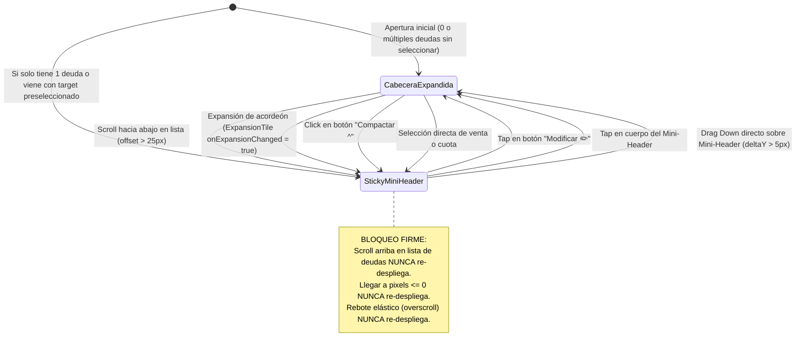
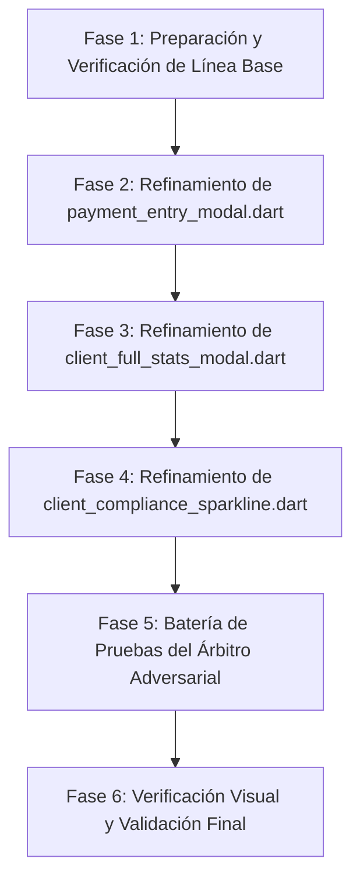

# PLAN DE TRABAJO: REFINAMIENTO DE MODALES DE ABONO Y ANALÍTICA DEL CLIENTE (MOBILE AWARDS LEVEL)

> **Documento:** Plan de Refinamiento Quirúrgico de Interfaz, Espacio y Dinámica de Scroll  
> **Fecha:** 22 de Octubre de 2026  
> **Archivos Involucrados:**  
> - `app_movil/lib/features/smart_quotation/widgets/crm/payment_entry_modal.dart`  
> - `app_movil/lib/features/smart_quotation/widgets/crm/client_full_stats_modal.dart`  
> - `app_movil/lib/features/smart_quotation/widgets/crm/client_compliance_sparkline.dart`  
> - `app_movil/test/client_crm_surgical_finish_test.dart` (Batería del Árbitro Adversarial)  
> **Metodología:** Loop Autónomo de Refinamiento + Árbitro Adversarial con Verificación Automatizada

---

## 1. RESUMEN EJECUTIVO Y OBJETIVO

A partir de la auditoría visual y funcional sobre 5 capturas reales en dispositivos móviles, se identificaron cuatro grupos de problemas críticos de layout, colapso dinámico, truncamiento tipográfico y representación lógica de datos en el **Modal de Registrar Abono** (`payment_entry_modal.dart`) y en el **Modal de Analítica del Cliente** (`client_full_stats_modal.dart` y `client_compliance_sparkline.dart`):

1. **Desperdicio Crítico de Espacio Vertical en Registrar Abono:** Los chips de monto rápido y los selectores de método de pago se quiebran en 2 filas cada uno (4 filas en total), consumiendo casi el 40% del espacio vertical del modal expandido.
2. **Re-expansión Accidental Molesta al Scrollear Deudas:** En la pestaña "Pago Específico", una vez que la cabecera se compacta a `Sticky Mini-Header`, hacer scroll ascendente o el rebote elástico (*overscroll bounce*) al tope de la lista dispara automáticamente la expansión de la cabecera completa, tapando la vista de cuotas y arruinando la ergonomía de navegación.
3. **Mutilación Sistemática de Títulos KPI en Analítica:** Los nombres de casi todas las tarjetas estadísticas están recortados con elipsis (`...`) por usar `maxLines: 1` en tarjetas de 2 columnas ("Ticket Prom...", "Frecuencia ...", "N° de Compr...", "Última Comp...", "Deuda (Solo ...", "Deuda por Pr...", "Préstamos A...", "Total Históri..."). Adicionalmente, el filtro superior corta el chip de rango en el borde derecho ("Ra...").
4. **Desbordamiento Visual y Fallo de Renderizado en Gráficos:**
   - La tarjeta *"Comparativa Compras vs. Abonos"* desborda horizontalmente la etiqueta `"21.2% Cubierto"`, cortándola por el borde del modal (`"21.2% C..."`), y muestra una barra monocolor plana que no refleja la dualidad Pagado vs. Pendiente.
   - La curva de *"Tendencia Comercial"* inventa una pendiente ascendente falsa cuando el cliente tiene una sola compra (creando un punto al 95%), carece de fechas en el eje X y triplica redundante el mismo valor en Mínimo, Promedio y Máximo.

El objetivo de este plan es diseñar, documentar y planificar la solución milimétrica para cada uno de estos 4 bloques, asegurando una experiencia táctil y estética digna de **Mobile Awards**, sin alterar negativamente la lógica de negocio ni romper los tests existentes.

---

## 2. DIAGNÓSTICO EN CÓDIGO Y MATRIZ DE CAUSAS RAÍZ

### 2.1 Modal Registrar Abono (`payment_entry_modal.dart`)

| Componente | Líneas de Código | Diagnóstico Actual | Causa Raíz Identificada |
| :--- | :--- | :--- | :--- |
| **Chips de Monto Rápido** | Líneas 521–555 | `Wrap(children: [ActionChip(...), ...])` | `"Deuda Total (S/ 258.57)"` mide más de 200dp de ancho con tipografía y paddings; supera la mitad del ancho de pantalla disponible y fuerza un salto de línea inmediato, dejando `"Cuota Antigua"` y `"50% Deuda"` en la fila 2. |
| **Métodos de Pago** | Líneas 585–637 | `Wrap(children: [ChoiceChip(...), ...])` | 5 o 6 métodos de pago (`Saldo a Favor`, `Efectivo`, `Yape`, `Plin`, `Transferencia`, `Tarjeta`) con texto y padding ocupan ~480dp totales. En pantallas de 360–390dp se dividen obligatoriamente en 2 filas completas (~85dp de altura). |
| **Listener de Scroll en Pago Específico** | Líneas 83–91 | `_specificScrollCtrl.addListener(...)` | Condición: `else if (_specificScrollCtrl.offset <= 0 && _isHeaderCollapsed && _selectedTargetId == null) { setState(() => _isHeaderCollapsed = false); }`. Cada vez que el usuario sube a la primera cuota o la lista rebota con `BouncingScrollPhysics`, `offset <= 0` se evalúa verdadero y vuelve a abrir toda la cabecera, frustrando la navegación de cuotas. |

### 2.2 Modal Analítica del Cliente (`client_full_stats_modal.dart` & `client_compliance_sparkline.dart`)

| Componente | Líneas de Código | Diagnóstico Actual | Causa Raíz Identificada |
| :--- | :--- | :--- | :--- |
| **Tarjetas Estadísticas KPI** | Líneas 308–341 | `_buildStatCard(...)` con `maxLines: 1, overflow: TextOverflow.ellipsis` | Ancho disponible para el título dentro de cada celda del `GridView.count` es de apenas 85–100dp. Al tener `maxLines: 1`, cualquier título mayor a 11 caracteres se corta con `...`. Además, el `childAspectRatio: 1.4` no brinda espacio vertical suficiente para 2 líneas. |
| **Filtros de Tiempo Superiores** | Líneas 654–671 | `SingleChildScrollView(scrollDirection: Axis.horizontal, ...)` | El último chip (`"Rango 📅"`) queda cortado abruptamente en el borde derecho (`"Ra..."`) sin un margen final ni un degradado de continuidad visual que comunique scroll horizontal. |
| **Comparativa Compras vs Abonos (Header)** | Líneas 401–442 | `Row(mainAxisAlignment: MainAxisAlignment.spaceBetween, children: [Row(Icon, Text), Container(Text)])` | El título `"Comparativa Compras vs. Abonos"` mide ~230dp + icono ~34dp + badge ~95dp = 359dp. En pantalla móvil (ancho útil 312dp dentro del modal), no cabe y empuja el badge `"21.2% Cubierto"` fuera de la pantalla, recortándose a `"21.2% C..."`. |
| **Barra Comparativa de Progreso** | Líneas 446–456 | `LinearProgressIndicator(...)` | Barra simple mono-color naranja/ámbar que no coincide con los 3 colores semánticos inferiores (Azul compras, Verde abonos, Rojo saldo) ni permite interacción. |
| **Sparkline Tendencia Comercial (1 compra)** | Líneas 84–88 en `client_compliance_sparkline.dart` | `if (displayPoints.length == 1) { displayPoints = [displayPoints.first * 0.95, displayPoints.first]; }` | Inventa deliberadamente un punto previo falso en `23.57 * 0.95 = 22.39`, generando una pendiente ascendente artificial. No hay fechas en el eje X y abajo repite 3 veces `S/ 23.57`. |

---

## 3. ARQUITECTURA DE LA SOLUCIÓN TÉCNICA (LOS 4 BLOQUES)

### BLOQUE 1: Optimización de Espacio en 1 Sola Fila Horizontal en `payment_entry_modal.dart`

#### 1.1 Selector de Métodos de Pago en 1 Sola Fila
* **Estructura:** Reemplazar el `Wrap` por un strip horizontal deslizable (`SingleChildScrollView` horizontal) con física elástica `BouncingScrollPhysics`, padding horizontal de 2px y altura compacta contenida (~38px).
* **Indicador de Continuidad Visual:** Implementar un sutil sombreado de desvanecimiento a la derecha (`FadingEdge` o `ShaderMask` suave) para que en pantallas estrechas el usuario perciba de forma natural que el strip tiene más métodos hacia la derecha.
* **Estilizado de Píldoras (Pill Chips):**
  - Cada método de pago se renderiza como una cápsula compacta con icono sutil + etiqueta:
    - `Saldo a Favor` (si saldo > 0): icono `Icons.savings_outlined`, acento ámbar/dorado con badge de saldo disponible.
    - `Efectivo`: icono `Icons.payments_outlined`, acento verde esmeralda.
    - `Yape`: icono `Icons.qr_code_2_rounded`, tono morado/fucsia sutil o verde activo.
    - `Plin`: icono `Icons.bolt_rounded`, tono celeste/cian sutil o verde activo.
    - `Transferencia`: icono `Icons.account_balance_outlined`, tono azul marino suave.
    - `Tarjeta`: icono `Icons.credit_card_outlined`, tono índigo suave.
  - Altura contenida: 36px, borde redondeado de 18px (`BorderRadius.circular(18)`), padding horizontal de 12px y vertical de 6px.
  - Al seleccionar, se preserva íntegramente la lógica existente de auto-rellenado cuando se elige `Saldo a Favor`.

#### 1.2 Chips de Monto Rápido en 1 Sola Fila Equitativa
* **Estructura:** Sustituir el `Wrap` por una fila horizontal (`Row`) con 3 tarjetas compactas distribuidas equitativamente mediante `Expanded`:
  - **Tarjeta 1 (Total Deuda):**
    - Etiqueta superior: `"Total"` (10px, `FontWeight.w700`, color secundario).
    - Monto inferior: `${AppCurrency.format(client.totalDebt)}` (12px, `FontWeight.w800`, color de texto principal).
  - **Tarjeta 2 (Cuota Antigua / Acceso Rápido):**
    - Si existe cuota antigua pendiente: etiqueta `"Cuota Ant."` (10px, naranja) y monto `${AppCurrency.format(oldestInstallmentAmt)}` (12px, naranja en `FontWeight.w800`).
    - Si NO existe cuota antigua: se redistribuye armónicamente a 2 tarjetas (`Total` y `50%`) o muestra `"25% Deuda"` para mantener el balance visual de 3 slots.
  - **Tarjeta 3 (50% de la Deuda):**
    - Etiqueta superior: `"50%"` (10px, `FontWeight.w700`).
    - Monto inferior: `${AppCurrency.format(client.totalDebt / 2)}` (12px, `FontWeight.w800`).
* **Estilo Visual:** Contenedores tipo tarjeta con esquinas redondeadas (10px), borde de 1px sutil, fondo `white10` (dark) / `grey[100]` (light), con micro-animación de tap (`InkWell`).
* **Ahorro de Espacio Vertical:** De 4 filas dispersas a solo 2 filas limpias y compactas, liberando entre 80px y 100px verticales en la vista expandida.

---

### BLOQUE 2: Blindaje de la Lógica de Compactación en "Pago Específico" (`payment_entry_modal.dart`)



#### Reglas de Implementación en Código:
1. **Eliminación del Disparador Inadvertido:**
   - En `_specificScrollCtrl.addListener(...)`, eliminar radicalmente la cláusula:
     ```dart
     // ELIMINAR:
     // else if (_specificScrollCtrl.offset <= 0 && _isHeaderCollapsed && _selectedTargetId == null) {
     //   setState(() => _isHeaderCollapsed = false);
     // }
     ```
   - El listener únicamente se encargará de contraer cuando `offset > 25 && !_isHeaderCollapsed`.
2. **Únicas Vías Autorizadas para Re-desplegar la Cabecera:**
   - **Vía A (Toque Explícito):** Botón `"Modificar ✏️"` o toque en el contenedor del `Sticky Mini-Header` invoca `setState(() => _isHeaderCollapsed = false)`.
   - **Vía B (Gesto Táctil de Arrastre Descendente sobre el Header):**
     - Envolver el `Sticky Mini-Header` en un `GestureDetector`:
       ```dart
       GestureDetector(
         onVerticalDragUpdate: (details) {
           if (details.primaryDelta != null && details.primaryDelta! > 5) {
             setState(() => _isHeaderCollapsed = false);
           }
         },
         child: _buildCollapsedStickyMiniHeader(...),
       )
       ```
3. **Transición Visual Suave:**
   - Envolver el cambio entre cabecera expandida y mini-header con `AnimatedSize` o `AnimatedSwitcher` con duración de 260ms y curva `Curves.easeInOutCubic`, garantizando transiciones elásticas sin saltos de layout ni parpadeos.

---

### BLOQUE 3: Corrección de Nombres Cortados en Tarjetas Estadísticas y Filtro Superior (`client_full_stats_modal.dart`)

#### 3.1 Tarjetas Estadísticas en 2 Líneas Legibles (`_buildStatCard`)
* **Problema:** En pantallas estándar, el ancho de 85–100dp en 1 sola línea mutila 8 de los títulos de las tarjetas.
* **Solución de Diseño:**
  - Cambiar `maxLines: 1` por `maxLines: 2` en el `Text` del título, con `softWrap: true`, `fontSize: 12.5px`, `height: 1.18` y `fontWeight: FontWeight.w700`.
  - Reestructurar el encabezado de la tarjeta:
    - Alineación: `CrossAxisAlignment.start`.
    - Fila superior con micro-badge del icono (contenedor cuadrado redondeado de 26x26px con color tintado al 15% de opacidad) alineado arriba con `crossAxisAlignment: CrossAxisAlignment.start`.
    - Título al costado en `Expanded`: permite acomodar hasta 2 líneas limpias sin desbordes.
  - Ajuste de cuadrícula en los 3 `GridView.count`:
    - Cambiar `childAspectRatio: 1.4` a **`childAspectRatio: 1.20`** (en `Rendimiento Comercial`, `Estado Actual` y `Préstamos Personales`).
    - Esto otorga aprox. 18–22px adicionales de altura vertical a cada tarjeta, suficiente para albergar la segunda línea de texto sin comprometer la visualización de los valores numéricos grandes (`_buildAnimatedNumber`).
* **Verificación de Títulos:**
  - `"Ticket Promedio"`: 1 o 2 líneas completas (según ancho).
  - `"Frecuencia Media"` / `"Frecuencia de Compra"`: 2 líneas completas.
  - `"N° de Compras"`: 1 línea completa.
  - `"Última Compra"`: 1 o 2 líneas completas.
  - `"Deuda (Solo Compras)"`: 2 líneas completas (`"Deuda"` / `"(Solo Compras)"`).
  - `"Deuda por Préstamos"`: 2 líneas completas (`"Deuda por"` / `"Préstamos"`).
  - `"Préstamos Activos"`: 2 líneas completas.
  - `"Total Histórico Prestado"`: 2 líneas completas (`"Total Histórico"` / `"Prestado"`).

#### 3.2 Barra de Filtros de Periodo Superior
* En el `SingleChildScrollView` de filtros:
  - Cambiar el label `"Rango 📅"` por `"Rango 📅"` con padding final adecuado: `padding: const EdgeInsets.fromLTRB(20, 0, 24, 0)`.
  - Asegurar que el último chip tenga espacio de respiro y no se pegue al borde derecho.
  - Incorporar soporte visual de continuidad o espaciado calibrado para pantallas angostas.

---

### BLOQUE 4: Evolución Visual e Interactiva de los 2 Gráficos en Analítica del Cliente

#### 4.1 Gráfico 1: "Comparativa Compras vs. Abonos" (`client_full_stats_modal.dart`)
1. **Blindaje de Layout Antidesbordamiento:**
   - La fila de encabezado de la tarjeta se reestructura con `Expanded`:
     ```dart
     Row(
       children: [
         Container(Icon),
         SizedBox(width: 8),
         Expanded(
           child: Text(
             "Comparativa Compras vs. Abonos",
             style: TextStyle(fontSize: 13.5, fontWeight: FontWeight.bold),
             maxLines: 1,
             overflow: TextOverflow.ellipsis,
           ),
         ),
         const SizedBox(width: 8),
         Container(
           padding: EdgeInsets.symmetric(horizontal: 8, vertical: 4),
           child: Text("${tasaCobro.toStringAsFixed(1)}% Cubierto"),
         ),
       ],
     )
     ```
   - Gracias a `Expanded`, el título cede espacio ordenadamente y el badge `"${tasaCobro.toStringAsFixed(1)}% Cubierto"` **permanece 100% visible dentro de la tarjeta** en cualquier pantalla móvil (resolviendo la Captura 1 donde se cortaba `"21.2% C..."`).
2. **Barra Comparativa Segmentada y Apilada (Dual-Bar Visual Excellence):**
   - Se reemplaza el `LinearProgressIndicator` plano por un widget personalizado de barra bi-color apilada (`height: 14px`, esquinas redondeadas de 7px):
     - **Segmento Abonado (Izquierda):** Proporción `(totalPagado / totalComprado).clamp(0.0, 1.0)`, pintado en **Verde Esmeralda brillante** (`Color(0xFF00C853)` / `Color(0xFF2E7D32)`), representando lo amortizado.
     - **Segmento Pendiente (Derecha):** Proporción `(saldoPendiente / totalComprado).clamp(0.0, 1.0)`, pintado en **Rojo Coral / Ámbar suave** (`Color(0xFFFF5252)` / `Color(0xFFE53935)`), representando el saldo que falta cobrar.
     - Animación fluida de apertura mediante `TweenAnimationBuilder<double>` de 600ms con curva `Curves.easeOutCubic`.
3. **Interactividad Táctil:**
   - Las tres métricas inferiores (`Total Compras`, `Total Abonos`, `Saldo Pendiente`) incorporan feedback táctil (`InkWell` con micro-animación) para resaltar visualmente el segmento correspondiente de la barra al ser presionadas.

#### 4.2 Gráfico 2: "Tendencia Comercial" (`client_compliance_sparkline.dart`)
1. **Eliminación de la Curva Falsa para 1 Sola Compra:**
   - Eliminar el bloque de duplicación artificial:
     ```dart
     // ELIMINAR:
     // if (displayPoints.length == 1) {
     //   displayPoints = [displayPoints.first * 0.95, displayPoints.first];
     // }
     ```
   - **Renderizado Coherente de 1 Registro:**
     - Cuando `sales.length == 1`:
       - Se dibuja una **Línea Base Horizontal de Referencia** en el canvas con opacidad elegante (línea guía punteada o tenue).
       - En el centro exacto `(x = width / 2, y = height / 2)` se dibuja un **Nodo Central Destacado**: un círculo con halo exterior brillante en color de estado (`lineColor`) y núcleo interior limpio.
       - En el eje horizontal inferior, se muestra la fecha centrada: `${DateFormat('dd/MM/yyyy').format(saleDate)}`.
       - Debajo, en el bloque de métricas, en lugar de triplicar `"Mínimo: S/ 23.57 | Promedio: S/ 23.57 | Máximo: S/ 23.57"`, se muestra una distribución coherente para compra única:
         - Chip 1: `"Operación"` -> `"Compra Única"`
         - Chip 2: `"Fecha"` -> `${DateFormat('dd/MM/yy').format(saleDate)}`
         - Chip 3: `"Monto"` -> `${AppCurrency.format(sale.total)}`
2. **Evolución del Sparkline para Múltiples Compras (>= 2):**
   - Curva Bézier cúbica suave real.
   - Referencias temporales en el eje X: fecha de la primera compra a la izquierda y fecha de la última compra a la derecha.
   - Nodos interactivos visibles en cada compra para invitar al tacto.
   - Al deslizar el dedo sobre el gráfico (`onPanUpdate`), se selecciona el punto más cercano actualizando la tarjeta interactiva superior con la venta exacta, fecha, cantidad de ítems y monto.
   - Si todos los montos son idénticos (ej. 3 compras de S/ 50), los chips inferiores muestran `"Monto Fijo"` y `"N° Ventas"` en vez de repetir el mismo valor 3 veces.

---

## 4. FASES DE IMPLEMENTACIÓN Y PROCEDIMIENTOS QUIRÚRGICOS



### Fase 1: Línea Base y Pruebas Previas
- Ejecutar `flutter test test/client_crm_surgical_finish_test.dart` y `flutter test test/client_crm_part2_financial_modals_and_accounting_test.dart` para confirmar que el entorno pasa al 100% antes de tocar código.
- Respaldar mentalmente los selectores de widgets usados en tests (`find.text('Modificar')`, `find.text('Monto a abonar')`, `find.text('Comparativa Compras vs. Abonos')`, `find.text('Ticket Promedio')`, `find.text('Frecuencia Media')`, etc.) para asegurar retrocompatibilidad estricta.

### Fase 2: Implementación en `payment_entry_modal.dart`
- Reestructurar los chips de monto rápido en una fila `Row` con 3 `Expanded` compactos.
- Reemplazar el `Wrap` de métodos de pago por un strip horizontal deslizable con píldoras estilizadas y desvanecimiento lateral.
- Eliminar el listener de auto-expansión por scroll hacia arriba (`offset <= 0`).
- Envolver `_buildCollapsedStickyMiniHeader` en `GestureDetector` con `onVerticalDragUpdate` para arrastre descendente.
- Añadir transición suave `AnimatedSwitcher` / `AnimatedCrossFade` entre estados colapsado y expandido.

### Fase 3: Implementación en `client_full_stats_modal.dart`
- Modificar `_buildStatCard` para soportar `maxLines: 2`, `height: 1.18`, icono en micro-badge superior alineado con `CrossAxisAlignment.start`.
- Actualizar `childAspectRatio` de `1.4` a `1.20` en los `GridView.count` de las 3 secciones.
- Reestructurar el encabezado de `_buildCommercialBalanceCard` usando `Expanded` en el título para evitar el recorte del badge porcentual.
- Implementar la barra segmentada dual (Abonado vs. Saldo Pendiente) con `TweenAnimationBuilder`.
- Ajustar el padding horizontal y márgenes del `SingleChildScrollView` de filtros de periodo.

### Fase 4: Implementación en `client_compliance_sparkline.dart`
- Eliminar la creación artificial de puntos en `displayPoints = [displayPoints.first * 0.95, ...]`.
- Implementar en `_SparklinePainter` el modo de visualización para 1 solo registro: línea base de referencia y nodo central con halo.
- Agregar fechas en los extremos del eje X para múltiples ventas y fecha central para venta única.
- Condicionar los chips inferiores de Mínimo/Promedio/Máximo para mostrar datos contextuales cuando `sales.length == 1` o cuando todos los valores son iguales.

### Fase 5: Batería de Pruebas del Árbitro Adversarial
- Actualizar y ampliar la suite `test/client_crm_surgical_finish_test.dart` con pruebas dedicadas a:
  1. Verificar que hacer scroll hacia arriba o fling en `PaymentEntryModal` no re-despliega la cabecera compactada.
  2. Verificar que tocar "Modificar" o hacer drag descendente sí re-despliega la cabecera.
  3. Verificar que los chips de monto rápido y métodos de pago conviven en 1 sola fila sin desbordamiento.
  4. Verificar que `ClientFullStatsModal` muestra títulos completos en 2 líneas y el badge de comparativa no se desborda en ancho angosto (360dp).
  5. Verificar que `ClientComplianceSparkline` con 1 sola compra renderiza el modo central sin pendientes ficticias.

---

## 5. PROTOCOLO DEL ÁRBITRO ADVERSARIAL Y CRITERIOS DE ACEPTACIÓN

El Árbitro Adversarial ejecutará la verificación estricta de los siguientes criterios antes de otorgar el aprobado:

| # | Criterio de Aceptación | Prueba del Árbitro | Resultado Requerido |
| :--- | :--- | :--- | :--- |
| **C1** | **Método de Pago en 1 Fila** | Renderizar en ancho 360dp con "Saldo a Favor" y 5 métodos. | 1 sola fila horizontal deslizable, altura < 45dp, sin desbordamiento horizontal (`RenderFlex overflowed`). |
| **C2** | **Chips de Monto Rápido en 1 Fila** | Renderizar con deuda S/ 258.57, cuota S/ 15.00 y 50%. | 3 tarjetas equitativas en 1 fila horizontal, sin quiebres a fila 2. |
| **C3** | **Bloqueo de Re-expansión en Pago Específico** | Simular scroll hacia arriba con `tester.drag(find.byType(ListView), const Offset(0, 300))` y `pumpAndSettle()`. | El mini-header sigue compacto (`find.text('Modificar')` existe, `find.text('Monto a abonar')` no se muestra). |
| **C4** | **Re-expansión Controlada** | Simular tap en botón "Modificar" o drag descendente en mini-header. | La cabecera se despliega suavemente y se ven los inputs completos. |
| **C5** | **Legibilidad de Nombres KPI en 2 Líneas** | Verificar en pantalla de 360dp que no existan elipsis truncadas en los títulos de tarjetas. | Títulos "Ticket Promedio", "Frecuencia Media", "Deuda (Solo Compras)", "Total Histórico Prestado" completamente legibles. |
| **C6** | **Badge Comparativa Antidesbordamiento** | Renderizar en 360dp la tarjeta de "Comparativa Compras vs. Abonos". | `"${tasaCobro}% Cubierto"` completamente visible dentro de la tarjeta, cero desbordamiento por la derecha. |
| **C7** | **Barra Segmentada Dual** | Inspeccionar el widget de barra en Comparativa. | Barra segmentada animada con segmento verde para abonos y rojo para saldo pendiente. |
| **C8** | **Sparkline para 1 Compra Coherente** | Cargar cliente con 1 sola compra (S/ 23.57). | Cero pendiente falsa hacia arriba; nodo central destacado con fecha visible y métricas contextuales sin triplicación absurda. |

---

## 6. PRÓXIMO PASO
Quedo a la espera de tu revisión y confirmación de este plan de trabajo para iniciar la implementación quirúrgica de las Fases 1 a 5 de forma limpia, estructurada y sin regresiones.
