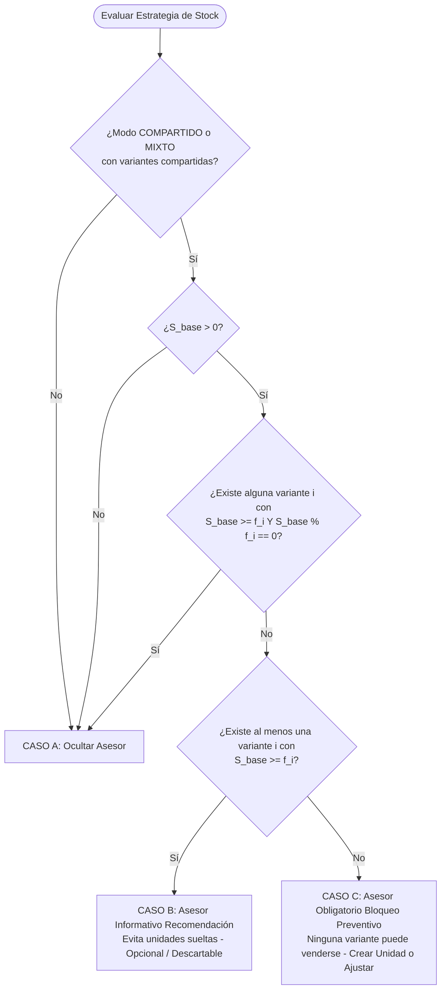

# PLAN MAESTRO: REFINAMIENTO DE STOCK COMPARTIDO, ASESOR MATEMÁTICO INTELIGENTE, MODAL DE CUPOS Y VISTA DETALLE DE PRODUCTO

**Documento:** `analisis_proyecto/PLAN_REFINAMIENTO_STOCK_COMPARTIDO_ASESOR_MODAL_Y_DETALLE.md`  
**Fecha:** 30 de Octubre de 2026  
**Versión:** 1.0 — Especificación Técnica Definitiva (Mobile Awards Quality)  
**Estado:** Esperando Aprobación de Plan de Trabajo (Paso 1: Diagnóstico Forense y Diseño Arquitectónico — CÓDIGO INTACTO)  
**Metodología:** Loop Autónomo + Árbitro Interno Adversarial (Test-Driven, Zero-Regressions & Zero-Overflows)

---

## 1. RESUMEN EJECUTIVO Y OBJETIVOS ESTRATÉGICOS

### 1.1. Contexto y Diagnóstico Global
Tras la auditoría exhaustiva de la aplicación en dispositivos móviles reales y el análisis forense de las **5 capturas de pantalla** aportadas por el usuario, se ha detectado una desconexión crítica entre el modelo conceptual de inventario físico y la experiencia operativa del comerciante.

El inventario de la aplicación soporta tres estrategias: **Compartido** (un solo lote físico en unidades base del cual descuentan varias presentaciones de venta), **Independiente** (cada presentación gestiona sus propias existencias físicas) y **Mixto** (coexistencia de presentaciones compartidas e independientes dentro del mismo producto). 

Sin embargo, a lo largo de las 4 pantallas interconectadas:
1. **Crear y Editar Producto** (`ProductCreateScreen` / `ProductEditScreen`, `ProductStockStrategySelector`, `PresentationStockSection`).
2. **Modal de Ajustar Cupo de Stock** (`StockUpdateModal`).
3. **Detalle del Producto** (`ProductDetailScreen`, `ProductDetailVariantSelector`, `ProductDetailFinancialDashboard`, `ProductDetailStockAlert`).
4. **Pestaña PRODUCTOS en Gestión de Negocio** (`InventoryScreen`, `ProductsTab`, `InventoryItemTile`, `CustomSearchBar`).

Se evidenciaron fallos severos de **sincronización reactiva en tiempo real (desfase entre inputs y tarjetas)**, **cálculos matemáticos descontextualizados en el Asesor de Stock**, **persistencia indebida de cambios no confirmados al cerrar modales**, **terminología técnica abstracta ("Pool") que desorienta al comerciante**, **elementos gráficos recortados por gradientes y anchos fijos**, y **falta de inteligencia reactiva cuando el cupo asignado para vender se agota pero el almacén físico aún cuenta con unidades disponibles**.

---

### 1.2. Objetivos Principales del Refinamiento

```mermaid
graph TD
    A[Inventario Base Compartido] --> B[Crear/Editar Producto]
    A --> C[Modal Ajustar Cupo]
    A --> D[Detalle de Producto]
    A --> E[Gestión de Negocio - Tab Productos]

    B --> B1[Chips reubicados sin recortes]
    B --> B2[Resumen visual estructurado por variante]
    B --> B3[Asesor de Stock con 3 Reglas Estrictas: A-B-C]
    B --> B4[Reactividad 0ms en Tarjeta de Variante y botón 'Usar máximo']

    C --> C1[Aislamiento transaccional: Solo guarda con APLICAR CAMBIOS]
    C --> C2[Chips adaptados dinámicamente al rango [0..maxFormable]]
    C --> C3[Lenguaje comercial sin 'Pool' y purga de emojis duplicados]

    D --> D1[Selector: '8 disp.' sin prefijo 'Pool:']
    D --> D2[Card Principal: 'STOCK DISPONIBLE' con valor real vendible]
    D --> D3[Franja informativa: Unidades base y Máximo formable]
    D --> D4[Alerta Inteligente de Desabastecimiento de Cupo]

    E --> E1[Botón stock limpio '8 ½ Docenas' sin (+2u)]
    E --> E2[Buscador superior con FittedBox responsivo]
```

1. **Sección de Estrategia de Stock y Asesor en Crear/Editar Producto (`Imagen 1`):**
   * Reubicar los chips de incremento rápido (`+10 und | +50 und | +100 und | +500 und`) debajo de los campos de stock base (evitando que queden bajo `Costo Base Unitario`) y eliminar el `ShaderMask` agresivo que recorta el primer chip (`und`).
   * Rediseñar el resumen **`Stock Final Calculado por Variante`** en tarjetas o píldoras limpias e independientes por variante, indicando claramente **Stock para Venta** y **Máximo Formable** (`Principal (Par x2): 23 p/ venta (de 34 máx.)`).
   * Implementar las **3 Reglas Matemáticas Estrictas del Asesor de Stock**:
     * **Caso A (Oculto):** Si al menos una variante compartida divide de forma exacta las unidades base (`stockBaseTotal >= factor && stockBaseTotal % factor == 0`, lo que incluye automáticamente si existe `factor == 1`).
     * **Caso B (Recomendación amigable, no bloqueante):** Si hay variantes que alcanzan a formar paquetes (`stockBaseTotal >= factor`), pero en todas queda residuo (`stockBaseTotal % factor != 0`).
     * **Caso C (Obligatorio / Bloqueo preventivo de guardado):** Si `stockBaseTotal > 0`, pero en todas las variantes `stockBaseTotal < factor` (imposible vender físicamente nada con las variantes actuales). Solución en 1 toque.
   * Blindar la autocreación de la variante por Unidad: sin emoji `✨` en el texto del botón, con costo y margen coherentes, y con un algoritmo de **prevención de colisión de nombres** (`"Unidad"`, `"Venta por Unidad"`, `"Unidad Individual"`).
   * Evitar que el AppBar de edición se trunque a `"Editar Prod..."` mediante ajuste responsivo y `FittedBox`.

2. **Reactividad y Lenguaje Claro en la Tarjeta de Variante Compartida (`Imagen 2`):**
   * Corregir el bug que desincroniza el `TextField` de stock con la píldora superior (`= 2 Par disp.`) y el cuadro lateral (`Cupo Limitado: 2 de 34 Par máx.`). Sincronización en vivo a **0ms**.
   * Validar que el valor ingresado jamás supere el máximo físico formable (`stockBaseTotal ~/ factor`), con clamping automático y aviso inmediato.
   * Incorporar la acción rápida **`Usar máximo (X)`** para restaurar el cupo completo en un solo toque.
   * Desterrar la palabra `"Pool"` reemplazándola por términos comerciales naturales (`"Stock Compartido de la Variante"`, `"Inventario base compartido: X und. (Máximo: Y Pares)"`, `"Stock disponible para vender"`).
   * Eliminar el emoji `🟢` duplicado dentro del banner verde `Margen Óptimo`.

3. **Reingeniería del Modal `Ajustar Cupo de Stock` (`Imagen 3`):**
   * **Aislamiento transaccional estricto:** Los cambios se manipulan en memoria local y **SOLO** se persisten en SQLite / Provider al presionar el botón `APLICAR CAMBIOS`. Si el modal se cierra tocando la `X`, el backdrop o deslizando hacia abajo, las mutaciones se descartan sin afectar el estado exterior.
   * Rediseño del banner explicativo: directo, sin la palabra "Pool", con indicador discreto de inventario base compartido y máximo de paquetes formables.
   * **Chips inteligentes dependientes del límite real:** Generar chips contextuales acordes al rango `[0 ... maxPosible]`, agregando un chip **`Máx (X)`** e impidiendo que los botones incrementales registren un valor por encima del físico.
   * Purgar el emoji `⚠️` duplicado del banner temporal de exceso.

4. **Claridad de Datos en Detalle del Producto (`Imagen 4`) y Pestaña PRODUCTOS (`Imagen 5`):**
   * En `ProductDetailScreen`:
     * Selector superior: sustituir `"Pool: 8 disp."` por **`8 disp.`** manteniendo el icono vectorial de stock compartido.
     * Tarjeta principal: cambiar `"POOL DISP."` por **`STOCK DISPONIBLE`** (o **`STOCK P/ VENTA`**), exhibir en grande el **stock real disponible para vender según lo asignado por el usuario (`8`)** y retirar la leyenda `(68 base)` de debajo de ese número.
     * Implementar una franja informativa limpia, elegante y unificada debajo de la fila de Precio y Stock Disponible que comunique con total precisión el inventario base físico y el máximo formable.
   * En `ProductsTab` (`InventoryScreen`):
     * Botón naranja de stock: mostrar limpiamente el stock vendible elegido por el usuario (**`8 ½ Docenas`**), eliminando el dato extra `(+2u)`.
     * Buscador superior: aplicar `FittedBox` y rediseño de ancho para que el placeholder `"Buscar producto, marca, código..."` jamás aparezca cortado como `"Buscar producto, marca, c..."`.
   * **Inteligencia ante desabastecimiento de cupo con existencias físicas en almacén:**
     * **Caso 1:** El cupo vendible de la variante llegó a 0 pero aún quedan unidades base en inventario que permiten formar paquetes. Mostrar banner inteligente con botón directo para **"Liberar cupo / Poner a la venta"**.
     * **Caso 2:** Las unidades base restantes no alcanzan para armar ningún paquete existente. Mostrar `0 disp. (Quedan X u. base sueltas)` con botón directo para crear la variante por Unidad o editar el producto.

---

## 2. DIAGNÓSTICO FORENSE EN CÓDIGO (ARCHIVOS, LÍNEAS EXACTAS Y CAUSA RAÍZ)

### 2.1. Desubicación de Chips, Recorte con ShaderMask y Truncamiento de AppBar (`Imagen 1`)
* **Archivos Involucrados:**
  * `lib/features/catalog/widgets/form/product_stock_strategy_selector.dart` (Líneas 394–462, 610–685)
  * `lib/features/catalog/screens/product_edit_screen.dart` (Líneas 732–765)
* **Evidencia en Código:**
  ```dart
  // product_stock_strategy_selector.dart: Líneas 394-462
  // MODO EDITAR PRODUCTO:
  Row(children: [ ... /* Stock Base Actual */, ... /* + Ingreso */, ... /* = Stock Final */ ]),
  const SizedBox(height: 10),
  // Costo Base Unitario en Edición
  Column(children: [ ... TextFormField(controller: widget.baseCostController, ...) ]),
  const SizedBox(height: 10),
  // ❌ ERROR 1: Los chips rápidos están ubicados DEBAJO del Costo Base Unitario
  ShaderMask(
    shaderCallback: (Rect bounds) {
      return const LinearGradient(
        colors: [Colors.transparent, Colors.black, Colors.black, Colors.transparent],
        stops: [0.0, 0.04, 0.96, 1.0], // ❌ ERROR 2: El stop 0.04 en transparent corta el chip '+10 und' haciéndolo parecer 'und'
      ).createShader(bounds);
    },
    child: SingleChildScrollView(scrollDirection: Axis.horizontal, child: Row(...)),
  ),
  ```
  ```dart
  // product_edit_screen.dart: Líneas 732-765
  appBar: AppBar(
    title: const Text("Editar Producto", style: TextStyle(fontWeight: FontWeight.bold)),
    actions: [
      // ❌ ERROR 3: Cuando _hasUnsavedChanges es true, se renderizan:
      // Deshacer (Undo) + Restaurar + InfoTooltip + Botón Guardar Verde + Botón Volver Leading.
      // En dispositivos con pantalla angosta (<= 380dp), el título no cabe y Flutter aplica ellipsis: "Editar Prod...".
    ],
  )
  ```
* **Causa Raíz:**
  1. Los chips rápidos incrementan unidades de stock, pero el layout de edición los situó después del campo de costo monetario.
  2. El `ShaderMask` aplica desvanecimiento desde el borde izquierdo `0.0` a `0.04`, cortando el prefijo del primer chip.
  3. El `AppBar` acumula hasta 5 botones en la fila de acciones sin usar `titleSpacing: 0` ni `FittedBox` en el título.
  4. `_buildSharedVariantsSummary` une todas las variantes con `summaryItems.join(' • ')` en un único `Text`, generando un párrafo apelmazado y difícil de digerir visualmente.

---

### 2.2. Reglas Obsoletas en el `Asesor de Stock` (`Imagen 1`)
* **Archivo Involucrado:**
  * `lib/features/catalog/widgets/form/product_stock_strategy_selector.dart` (Líneas 688–780)
* **Evidencia en Código:**
  ```dart
  bool _shouldShowUnitAdvisor() {
    if (widget.selectedStrategy != 'COMPARTIDO' && widget.selectedStrategy != 'MIXTO') return false;
    ...
    // ❌ ERROR: Solo verifica si existe factor == 1:
    final hasUnitVariant = sharedItems.any((c) {
      final factor = int.tryParse((c['unidadesVenta'] as TextEditingController?)?.text ?? '1') ?? 1;
      return factor == 1;
    });
    return !hasUnitVariant; // Si no hay factor 1, SIEMPRE lo muestra, ignorando el stock total y los factores existentes.
  }
  ```
* **Causa Raíz:**
  En la captura `Imagen 1`, el producto tiene `68 unidades base` y la variante `Principal (Par x2)` tiene `Factor 2`. Como `68 % 2 == 0` (división exacta en 34 pares sin ningún residuo), ¡no sobra ninguna unidad suelta! Sin embargo, la función actual retornaba `true` ciegamente porque ninguna variante tenía explícitamente `factor == 1`. Además, el botón tiene un emoji string `"✨ Crear..."` en vez de usar icono vectorial puro.

---

### 2.3. Desincronización y Sobrescritura Reactiva en Tarjeta de Variante (`Imagen 2`)
* **Archivos Involucrados:**
  * `lib/core/widgets/presentation_card/presentation_stock_section.dart` (Líneas 107–119, 280–365)
  * `lib/core/widgets/presentation_card/presentation_math_engine.dart` (Líneas 180–204, 332–347)
  * `lib/core/widgets/product_presentation_card.dart` (Líneas 372–404)
  * `lib/core/widgets/presentation_card/presentation_margin_indicator.dart` (Líneas 62–66, 78–82)
* **Evidencia en Código:**
  ```dart
  // presentation_math_engine.dart: Líneas 332-347 y 180-191
  void recalcularHaciaAtrasDesdeVisual({bool fromMargen = true}) {
    bool isEdit = controllerMap['isEditMode'] == true;
    if (isEdit) {
      matematicaSimpleEdicion(); // ❌ ERROR CRÍTICO: Se ejecuta en cada pulsación del stock visual
      recalcularPrecios(fromMargen: fromMargen);
      return;
    }
  }

  void matematicaSimpleEdicion() {
    int inicial = int.tryParse(stockInicialCtrl.text) ?? 0;
    int ingreso = int.tryParse(nuevoIngresoCtrl.text) ?? 0;
    int descuento = int.tryParse(stockDescuentoCtrl.text) ?? 0;
    int finalVisual = inicial + ingreso - descuento;
    stockFinalCtrl.text = finalVisual.toString(); // ❌ SOBRESCRIBE el valor de cupo con el stock inicial!
  }
  ```
  ```dart
  // presentation_stock_section.dart: Líneas 107-111
  final int? customCupo = widget.controllerMap?['cupoMaximoVariante'] as int?;
  final int effectiveCupo = customCupo != null
      ? (customCupo <= availableSalesUnits ? customCupo : availableSalesUnits)
      : availableSalesUnits;
  // ❌ Si el usuario escribe 23 en stockFinalCtrl, pero controllerMap['cupoMaximoVariante'] 
  // quedó en 2 (o en null), effectiveCupo muestra 2 (o 34) mientras el TextField tiene 23.
  ```
* **Causa Raíz:**
  1. `matematicaSimpleEdicion` no discrimina si la variante opera en modo `usaStockCompartido`. En modo compartido, los campos `stockInicialCtrl`, `nuevoIngresoCtrl` y `stockDescuentoCtrl` no aplican; al dispararse `onStockChanged`, el motor ejecutaba la fórmula de stock independiente, generando desajustes con el texto del `TextField`.
  2. `PresentationStockSection` no sincronizaba de forma bidireccional inmediata (0ms) el valor parseado de `stockFinalCtrl` hacia `controllerMap['cupoMaximoVariante']` ni notificaba a la pantalla padre `ProductEditScreen` para actualizar el resumen superior `_buildSharedVariantsSummary`.
  3. En `presentation_margin_indicator.dart`: la línea 64 contiene el string `"🟢 Margen Óptimo..."`, mientras que la línea 80 dibuja `Icon(semaforoIcon, ...)`. Al combinarse, se visualiza un círculo verde vectorial al lado del emoji verde `🟢` duplicado.

---

### 2.4. Fuga de Estado al Cancelar y Falta de Chips Contextuales en Modal de Cupo (`Imagen 3`)
* **Archivo Involucrado:**
  * `lib/core/widgets/stock_update_modal.dart` (Líneas 105–120, 243–265, 930–948)
* **Evidencia en Código:**
  ```dart
  // stock_update_modal.dart: Líneas 933-946
  // Chips rápidos rígidos:
  if (_isShared || _selectedMode == 1) _buildChip("-5", -5, isDark),
  _buildChip("+1", 1, isDark),
  _buildChip("+5", 5, isDark),
  _buildChip("+10", 10, isDark), // ❌ Si el máximo formable es 11, un chip +10 o +50
  _buildChip("+50", 50, isDark), // dispara advertencias de desborde y no es útil para el comerciante.
  ```
  ```dart
  // stock_update_modal.dart: Líneas 482 y 495
  Icon(Icons.warning_amber_rounded, ...),
  Text("⚠️ No puedes aumentar más del máximo permitido..."), // ❌ Emoji ⚠️ duplicado con el icono vectorial
  ```
* **Causa Raíz:**
  1. Diversos llamadores (`manual_quote_detail_modal.dart`, `quick_sale_detail_modal.dart`, `quick_sale_screen.dart`) invocaban `await StockUpdateModal.show(...)` y luego ejecutaban recargas incondicionales de variantes sin validar `if (result == true)`.
  2. Los chips rápidos eran constantes hardcodeadas `[-5, +1, +5, +10, +50]` sin calcular dinámicamente qué incrementos son lógicamente alcanzables según `_maxPhysicalUnits`.
  3. Redundancia gráfica de emojis en cadenas de texto adyacentes a componentes `Icon`.

---

### 2.5. Inconsistencia entre Selector y Dashboard Financiero en Detalle del Producto (`Imagen 4`)
* **Archivos Involucrados:**
  * `lib/features/catalog/widgets/detail/product_detail_variant_selector.dart` (Líneas 176–190)
  * `lib/features/catalog/widgets/detail/product_detail_financial_dashboard.dart` (Líneas 55–60, 400–448)
* **Evidencia en Código:**
  ```dart
  // product_detail_variant_selector.dart: Línea 177
  Text(p.usaStockCompartido ? "Pool: ${p.unidadesVendiblesDisponibles} disp." : "${p.unidadesVendiblesDisponibles} disp.")
  // Muestra "Pool: 8 disp." (usa correctamente el cupo configurado = 8, pero con prefijo técnico "Pool:").
  ```
  ```dart
  // product_detail_financial_dashboard.dart: Líneas 57-59 y 410-444
  final int stockVisual = factorVenta > 0
      ? (selectedPresentation.stockActual ~/ factorVenta) // ❌ Calcula 68 ~/ 6 = 11 (máximo físico)
      : selectedPresentation.stockActual;                 // ¡Ignora selectedPresentation.unidadesVendiblesDisponibles!

  Text(selectedPresentation.usaStockCompartido ? "POOL DISP." : "STOCK DISP.") // Título técnico
  Text("$stockVisual") // ❌ Muestra 11 en vez de 8
  Text("(${selectedPresentation.stockActual} base)") // Texto ambiguo debajo del número
  ```
* **Causa Raíz:**
  `ProductDetailFinancialDashboard` calculaba `stockVisual` directamente como `stockActual ~/ factorVenta`, desconociendo por completo `cupoMaximoVariante` y la propiedad `unidadesVendiblesDisponibles` que sí utilizaba el selector superior. Además, empleaba títulos con terminología técnica ("POOL DISP.") y carecía de una sección informativa que explicara con claridad la relación entre unidades físicas base y presentaciones formables.

---

### 2.6. Ruido Visual en la Pestaña PRODUCTOS y Placeholder Cortado (`Imagen 5`)
* **Archivos Involucrados:**
  * `lib/features/catalog/models/inventory_wrapper.dart` (Líneas 100–106, 156–170)
  * `lib/core/widgets/inventory_item_tile.dart` (Líneas 105, 301–340)
  * `lib/core/widgets/custom_search_bar.dart` (Líneas 97–110)
* **Evidencia en Código:**
  ```dart
  // inventory_wrapper.dart: Líneas 156-164
  String get displayStockText {
    if (displayStock <= 0) return "Agotado";
    String unidad = presentation.unidadVenta ?? presentation.umpCompra ?? "Unidad";
    final pluralized = pluralize(unidad, displayStock);
    if (hasLooseUnits) {
      return "$displayStock $pluralized (+${stockRemainder}u)"; // ❌ Agrega (+2u) que confunde al usuario
    }
    return "$displayStock $pluralized";
  }
  ```
  ```dart
  // custom_search_bar.dart: Líneas 90-110
  // TextField con hintText "Buscar producto, marca, código..." dentro de un contenedor reducido por el botón de filtro.
  // Al no usar FittedBox o reducción controlada de fuente en pantallas pequeñas, se corta en "...marca, c...".
  ```
* **Causa Raíz:**
  1. `displayStockText` concatena `(+${stockRemainder}u)` para variantes con factor, lo cual es relevante para inventarios independientes con desajustes, pero para una variante de stock compartido donde el comerciante ya fijó su stock para vender (ej. 8 cajas), ver `(+2u)` genera confusión.
  2. En el buscador superior, el ancho horizontal efectivo para el campo de texto es estrecho debido a los márgenes y al botón de filtro adyacente, provocando el truncamiento del `hintText`.

---

## 3. ESPECIFICACIÓN DE FÓRMULAS MATEMÁTICAS Y REGLAS DE NEGOCIO ESTRICTAS

### 3.1. Reglas de Negocio Exactas para el Asesor de Stock en Crear/Editar Producto

Dado un producto en modo `COMPARTIDO` o `MIXTO`:
* Sea $S_{\text{base}}$ el stock base total disponible en el inventario compartido ($S_{\text{base}} \ge 0$).
* Sea $V_{\text{compartidas}} = \{v_1, v_2, \dots, v_n\}$ el conjunto de variantes activas que tienen `usaStockCompartido == true`.
* Para cada variante $v_i$, sea $f_i$ su factor de conversión ($f_i = \text{unidadesPorVenta}_i \ge 1$).



#### Fórmulas de Decisión:
1. **CASO A — NO DEBE APARECER (Oculto):**
   $$\exists v_i \in V_{\text{compartidas}} \quad \text{tal que} \quad (S_{\text{base}} \ge f_i) \land (S_{\text{base}} \bmod f_i = 0)$$
   * *Explicación:* Si existe al menos una presentación activa compartida que logra dividir con exactitud matemática el stock base sin dejar ni una sola unidad física huérfana, **el asesor permanece oculto**. Nota: Si ya existe una variante con factor 1 ($f_i = 1$), como $S_{\text{base}} \bmod 1 \equiv 0$ siempre, la condición se cumple automáticamente y el asesor nunca se muestra.

2. **CASO B — APARECE COMO RECOMENDACIÓN (No Bloqueante, Amable, Descartable):**
   $$\left(\exists v_i \in V_{\text{compartidas}} : S_{\text{base}} \ge f_i\right) \land \left(\forall v_j \in V_{\text{compartidas}} : S_{\text{base}} \bmod f_j \ne 0\right)$$
   * *Explicación:* Al menos una variante compartida puede formar paquetes para la venta ($S_{\text{base}} \ge f_i$), pero en **todas** las variantes compartidas la división deja un residuo físico no liquidable con esa presentación. El asesor se muestra con diseño morado elegante, botón con icono vectorial puro `Icons.add_shopping_cart_rounded` y una `X` para descartar amablemente sin bloquear el guardado.

3. **CASO C — APARECE COMO OBLIGATORIO (Bloqueo Preventivo con Solución en 1 Toque):**
   $$(S_{\text{base}} > 0) \land \left(\forall v_i \in V_{\text{compartidas}} : S_{\text{base}} < f_i\right)$$
   * *Explicación:* Hay unidades físicas en inventario ($S_{\text{base}} > 0$), pero **ninguna variante compartida alcanza a formar siquiera 1 unidad de venta** (ej. hay 4 unidades base y la única variante es `Media Docena x6`). Si el usuario intentara guardar, tendría inventario físico con stock vendible en 0.
   * *Comportamiento:* El asesor pasa a estado de alerta ámbar/rojo con borde destacado, indicando que el producto no tiene variantes capaces de vender el stock actual. El botón `GUARDAR CAMBIOS` se deshabilita temporalmente (o al pulsarlo hace scroll automático hacia el asesor) y se ofrece el botón de acción directa en 1 toque para crear la variante por Unidad automáticamente o ajustar el stock/factor.

---

### 3.2. Algoritmo Anticolisión para la Creación Automática de la Variante por Unidad
Al tocar el botón **`Crear variante por Unidad automáticamente`**:
1. **Datos base garantizados:**
   * `unidadVenta = 'Unidad'`
   * `unidadesVenta = '1'` (Factor = 1)
   * `costoPres = costoBaseUnitario` (o el costo base unitario configurado)
   * `margen = 1.35` (35% de ganancia por defecto o el margen configurado en el producto)
   * `precioVenta = costoBaseUnitario * margen` (con redondeo a 2 decimales)
   * `usaStockCompartido = true`
   * `stockFinal = S_base`
   * `cupoMaximoVariante = null` (sin límite artificial)
2. **Generación de Nombre sin Colisiones:**
   Sea $N_{\text{existentes}}$ el conjunto de nombres (`specificName` y `unidadVenta`) ya presentes en el formulario normalizados a minúsculas y sin espacios extra.
   ```dart
   String generateSafeUnitVariantName(List<String> existingNames) {
     const candidates = [
       "Unidad",
       "Venta por Unidad",
       "Unidad Individual",
       "Unidad Suelta",
       "Pieza Individual",
     ];
     for (final name in candidates) {
       if (!existingNames.contains(name.toLowerCase())) {
         return name;
       }
     }
     // Fallback numerado
     int counter = 2;
     while (existingNames.contains("unidad $counter")) {
       counter++;
     }
     return "Unidad $counter";
   }
   ```
3. **Limpieza de Texto:** Eliminar cualquier emoji `✨` del texto del botón o de los snackbars resultantes, usando estrictamente iconos vectoriales (`Icon(Icons.add_shopping_cart_rounded)`).

---

### 3.3. Reactividad Inmediata (0ms) en la Tarjeta de Variante Compartida
En `PresentationStockSection`:
1. **Separación de Lógica Compartida vs. Independiente:**
   * Cuando `isShared == true`, el evento `onChanged` de `stockFinalCtrl` **NO** debe delegar en `matematicaSimpleEdicion()` (que calcula `inicial + ingreso - descuento`).
   * Debe ejecutar un handler especializado `_onSharedStockFinalChanged(String val)`:
     ```dart
     final int maxFisico = safeFactor > 0 ? (sharedBase ~/ safeFactor) : sharedBase;
     final raw = val.trim();
     if (raw.isEmpty) {
       widget.controllerMap?['cupoMaximoVariante'] = null;
     } else {
       final entered = int.tryParse(raw) ?? 0;
       if (entered > maxFisico) {
         _showMaxQuotaWarning(maxFisico, unidadLabel);
         widget.stockFinalCtrl.text = maxFisico.toString();
         widget.stockFinalCtrl.selection = TextSelection.collapsed(offset: widget.stockFinalCtrl.text.length);
         widget.controllerMap?['cupoMaximoVariante'] = null; // o maxFisico
       } else if (entered <= 0) {
         widget.controllerMap?['cupoMaximoVariante'] = 0;
       } else {
         widget.controllerMap?['cupoMaximoVariante'] = (entered >= maxFisico) ? null : entered;
       }
     }
     // Actualización inmediata 0ms
     setState(() {});
     widget.onStockChanged(); // Notifica al motor para precios/descuentos
     widget.onStateChange(true); // 🔥 Notifica al formulario padre (ProductEditScreen) para refrescar el resumen superior
     ```
2. **Acción Rápida en Tarjeta:**
   * En el recuadro lateral, si `customCupo != null` (cupo limitado), mostrar botón estilizado **`Usar máximo ($availableSalesUnits)`** que en 1 toque restaure el valor máximo formable.

---

### 3.4. Reglas Estrictas del Modal `StockUpdateModal` (`Ajustar Cupo de Stock`)
1. **Aislamiento Transaccional:**
   * La instancia de `StockUpdateModal` mantiene su propio estado local (`_parsedInput`, `_selectedMode`).
   * **JAMÁS** muta `widget.presentation`, ni la base de datos SQLite, ni invoca métodos de `InventoryProvider` en respuesta a pulsaciones de chips, steppers o texto.
   * La persistencia en `InventoryProvider.updateVariantQuota` o `InventoryProvider.updatePresentation` se ejecuta **ÚNICA Y EXCLUSIVAMENTE** al hacer clic en el botón `APLICAR CAMBIOS`.
   * Si el usuario descarta el modal mediante la `X`, tocando fuera del modal o deslizando hacia abajo (gesto de arrastre), el modal retorna `Navigator.pop(context, false)` (o `null`), y ningún cambio tiene efecto.
   * Todos los llamadores (`products_tab.dart`, `product_detail_screen.dart`, `manual_quote_detail_modal.dart`, `quick_sale_detail_modal.dart`, `quick_sale_screen.dart`) deben blindarse con:
     ```dart
     final result = await StockUpdateModal.show(...);
     if (result == true && mounted) {
       await _refreshData(); // Recarga solo si se confirmó la aplicación
     }
     ```
2. **Chips Contextuales según el Rango `[0 ... maxPosible]`:**
   * Para una variante compartida con $M = \text{maxPhysicalUnits}$:
     * Si $M \le 5$: Chips `[-1, +1, Máx ($M$)]`.
     * Si $5 < M \le 20$: Chips `[-5, +1, +5, Máx ($M$)]`.
     * Si $M > 20$: Chips `[-10, -5, +5, +10, Máx ($M$)]`.
   * Todo chip cuyo incremento supere el límite físico se ajusta automáticamente para completar hasta el máximo exacto o se deshabilita visualmente.
   * Purgar el emoji `⚠️` duplicado del banner temporal de advertencia.

---

### 3.5. Modelo de Datos y Visualización en Detalle del Producto (`ProductDetailScreen`)
1. **Selector de Variantes:**
   * Cambiar `"Pool: 8 disp."` por **`8 disp.`** (con icono `Icons.hub_rounded` de stock compartido).
2. **Tarjeta Principal del Dashboard:**
   * Encabezado: **`STOCK DISPONIBLE`** (o **`STOCK P/ VENTA`**).
   * Número gigante principal: **`selectedPresentation.unidadesVendiblesDisponibles`** (ej. `8`).
   * Eliminar el texto `(68 base)` de debajo del número gigante para evitar saturación y confusión.
3. **Franja Informativa Unificada de Stock Físico Compartido:**
   * Justo debajo de la fila horizontal de `PRECIO DE VENTA` y `STOCK DISPONIBLE`, desplegar una franja informativa premium estilizada con fondo azul translúcido (`0xFF1E3A8A` con opacidad suave):
     * Icono: `Icons.hub_rounded`.
     * Texto: `Inventario base compartido: $sharedBase und. · Máximo formable: $maxFormable $unidadPlural`.
     * Si el cupo está limitado (`unidadesVendiblesDisponibles < maxFormable`): agregar un badge sutil ámbar: `Cupo asignado: $unidadesVendiblesDisponibles de $maxFormable`.
4. **Alerta Inteligente de Desabastecimiento de Cupo:**
   * **Escenario 1 (Cupo agotado pero almacén con stock formable):**
     * Condición: `selectedPresentation.unidadesVendiblesDisponibles <= 0 && maxFormable > 0`.
     * Mensaje: `⚠️ Cupo de venta agotado. Quedan $sharedBase und. base en almacén (hasta $maxFormable ${unidadPlural} más).`
     * Botón CTA: `Liberar Cupo` (abre `StockUpdateModal`).
   * **Escenario 2 (Unidades base no alcanzan para formar ningún paquete):**
     * Condición: `selectedPresentation.unidadesVendiblesDisponibles <= 0 && sharedBase > 0 && maxFormable == 0`.
     * Mensaje: `0 ${unidadPlural} disp. (Quedan $sharedBase und. base sueltas que no alcanzan para 1 ${unidadSingular}).`
     * Botón CTA: `Crear Variante Unidad` / `Editar Producto` (abre `ProductEditScreen`).

---

### 3.6. Correcciones en Pestaña PRODUCTOS (`InventoryScreen`)
1. **Botón Naranja de Stock:**
   * Modificar `InventoryWrapper.displayStockText` o crear una propiedad específica `displayStockCardText` para las tarjetas de inventario:
     * Para variantes compartidas: exhibir estrictamente `"$displayStock $pluralized"` (ej. `8 ½ Docenas`), omitiendo por completo el sufijo `(+2u)`.
2. **Buscador Superior Responsivo:**
   * En `CustomSearchBar`, envolver el layout del placeholder con ajuste responsivo (`FittedBox` con `BoxFit.scaleDown` y `alignment: Alignment.centerLeft`) o recortar el texto a `"Buscar producto, marca..."` asegurando que en pantallas angostas (`360dp`) jamás se corte con elipsis (`"Buscar producto, marca, c..."`).

---

## 4. DISEÑO VISUAL PROPUESTO Y COMPARATIVA ANTES VS. DESPUÉS

| Pantalla / Elemento | Estado Actual Defectuoso (Capturas) | Diseño Propuesto Refinado |
| :--- | :--- | :--- |
| **Editar Producto — Chips Rápidos (`Imagen 1`)** | Ubicados debajo de `Costo Base Unitario`. El primer chip aparece cortado como `und` por culpa del `ShaderMask`. | Reubicados inmediatamente debajo de `Stock Base Actual / + Ingreso / = Stock Final`. Scroll horizontal suave sin máscara destructiva; primer chip siempre 100% visible (`+10 und`). |
| **Editar Producto — Resumen de Variantes (`Imagen 1`)** | Párrafo apelmazado en un solo `Text`: `Principal (Par x2): 23 disp. • Caja (½ Docena x6): 8 disp.`. | Grilla / Píldoras independientes y estructuradas con separación visual: `Principal (Par x2): 23 p/ venta (de 34 máx.)` y `Caja (½ Docena x6): 8 p/ venta (de 11 máx.)`. |
| **Editar Producto — Asesor de Stock (`Imagen 1`)** | Aparece incluso cuando 68 unidades se dividen exactamente entre Factor 2 (sin sobrantes). Botón con emoji `✨`. | Cumple estrictamente las reglas A, B y C. No se muestra cuando hay división exacta. Botón limpio con icono vectorial `Icons.add_shopping_cart_rounded` y sin colisiones de nombre. |
| **Editar Producto — AppBar (`Imagen 1`)** | Truncado como `Editar Prod...` por saturación de acciones. | `titleSpacing: 0` + `FittedBox` en el título; lectura completa `"Editar Producto"` garantizada en cualquier dispositivo. |
| **Tarjeta Variante Compartida (`Imagen 2`)** | Escribir 23 en el input deja la píldora en `= 2 Par disp.` y la tarjeta en `Cupo Limitado: 2 de 34 Par máx.`. | Sincronización en vivo a **0ms**: píldora superior, tarjeta lateral y resumen superior reflejan inmediatamente el valor digitado. Botón `Usar máximo (34)` en 1 toque. |
| **Terminología General (`Imagen 2, 3, 4`)** | "Pool Central", "Stock del Pool", "Cupo Total Pool", "POOL DISP.". | Español comercial natural: "Stock Compartido", "Inventario base compartido", "Stock disponible para vender", "STOCK DISPONIBLE". |
| **Banner Margen Óptimo (`Imagen 2`)** | Check verde vectorial + emoji `🟢` duplicado. | Icono vectorial único `Icons.check_circle_outline` + texto limpio `Margen Óptimo (35.0%) - Excelente margen`. |
| **Modal Ajustar Cupo (`Imagen 3`)** | Chips fijos `+10` y `+50` que superan el máximo formable de 11. Cambios que persisten sin dar APLICAR CAMBIOS. | Estado estrictamente local descartable al cerrar. Chips adaptados `[0..11]` con chip `Máx (11)`. Emoji `⚠️` purgado del banner. |
| **Detalle de Producto (`Imagen 4`)** | Selector dice `Pool: 8 disp.`; tarjeta dice `POOL DISP. 11 (68 base)` mostrando el máximo en vez de lo elegido. | Selector dice `8 disp.`; tarjeta dice `STOCK DISPONIBLE: 8`. Franja inferior unificada con `68 und. base disponibles · Máximo formable: 11 ½ Docenas`. |
| **Pestaña Productos (`Imagen 5`)** | Botón naranja dice `8 ½ Docenas (+2u)`. Buscador cortado `Buscar producto, marca, c...`. | Botón naranja limpio dice `8 ½ Docenas`. Placeholder responsivo sin cortes de texto mediante `FittedBox`. |

---

## 5. PLAN DE EJECUCIÓN FASE POR FASE (CHECKLIST DETALLADO)

### Fase 1: Corrección Estructural, Chips y Asesor Inteligente en `ProductStockStrategySelector`
* [ ] **1.1. Reubicación y visibilidad de Chips Rápidos:**
  * Mover el bloque de chips rápidos en `product_stock_strategy_selector.dart` para que se posicione justo debajo de la fila de `Stock Base Actual / + Ingreso (Nuevas) / = Stock Final` en modo edición (y bajo `Stock Base Total` en modo creación).
  * Eliminar el gradiente agresivo del `ShaderMask` que iniciaba en `0.04` o reemplazarlo por un `SingleChildScrollView` horizontal limpio con padding lateral equilibrado para que `+10 und` nunca se corte.
* [ ] **1.2. Rediseño del Resumen `Stock Final Calculado por Variante`:**
  * Transformar la función `_buildSharedVariantsSummary` para que renderice una lista o Wrap de chips/tarjetas elegantes separadas:
    * Nombre de variante, unidad y factor (ej. `Principal (Par x2)`).
    * Indicador de stock para venta vs. físico: `23 p/ venta (de 34 máx.)` o `34 disp. (máx. físico)`.
* [ ] **1.3. Implementación de las Reglas A, B y C del `Asesor de Stock`:**
  * Reemplazar `_shouldShowUnitAdvisor()` por la evaluación formal de sobrantes:
    * `Caso A`: Si `stockBaseTotal > 0` y alguna variante compartida cumple `stockBaseTotal >= factor && stockBaseTotal % factor == 0`, retornar `false` (ocultar).
    * `Caso B`: Si alguna variante cumple `stockBaseTotal >= factor` pero todas dejan residuo, mostrar como recomendación no bloqueante con botón de cierre.
    * `Caso C`: Si `stockBaseTotal > 0` y todas las variantes tienen `stockBaseTotal < factor`, mostrar en modo alerta obligatoria (bloqueo preventivo de guardado).
* [ ] **1.4. Limpieza de Texto y Anticolisión en Creación de Variante Unit:**
  * Eliminar el emoji `✨` del botón `Crear variante por Unidad automáticamente` en `product_stock_strategy_selector.dart`.
  * Implementar el generador anticolisión de nombres en `ProductCreateScreen` y `ProductEditScreen` para evitar nombres duplicados (`"Unidad"`, `"Venta por Unidad"`, `"Unidad Individual"`).
* [ ] **1.5. Responsividad del AppBar en `ProductEditScreen`:**
  * Envolver el título en `FittedBox(fit: BoxFit.scaleDown, alignment: Alignment.centerLeft, child: Text("Editar Producto"))` y ajustar `titleSpacing: 0` para impedir truncamientos a `"Editar Prod..."`.

---

### Fase 2: Reactividad 0ms, Validación de Cupo y Limpieza UI en Tarjeta de Variante
* [ ] **2.1. Desacoplamiento de `matematicaSimpleEdicion` en Modo Compartido:**
  * En `presentation_math_engine.dart`, condicionar `matematicaSimpleEdicion()` para que solo recalcule `stockFinalCtrl` si la presentación opera en modo independiente (`!usaStockCompartido`).
* [ ] **2.2. Sincronización en Vivo (0ms) en `PresentationStockSection`:**
  * Implementar `_onSharedStockFinalChanged` en `presentation_stock_section.dart`:
    * Actualizar `controllerMap['cupoMaximoVariante']` en tiempo real.
    * Validar que no supere `availableSalesUnits` (haciendo clamp con aviso visual si se excede).
    * Disparar `widget.onStateChange(true)` para que el resumen superior de `ProductEditScreen` se actualice a 0ms sin requerir guardar.
  * Añadir el botón rápido **`Usar máximo (X)`** en el cuadro de estado lateral cuando el cupo esté limitado.
* [ ] **2.3. Purga de Términos "Pool" y Emojis Duplicados:**
  * Reemplazar `"Stock del Pool Central"` por `"Stock Compartido de la Variante"`.
  * Reemplazar `"Pool Central: X unidades base"` por `"Inventario base compartido: X und. (Máximo: Y Pares)"`.
  * Reemplazar `"Stock Final (Cupo)"` por `"Stock disponible para vender"`.
  * En `presentation_margin_indicator.dart`: eliminar los emojis `🔴`, `🟡`, `🟢` del texto de semáforo para evitar duplicación con el icono vectorial.

---

### Fase 3: Reingeniería del Modal `StockUpdateModal` (`Ajustar Cupo de Stock`)
* [ ] **3.1. Aislamiento Transaccional Estricto:**
  * Garantizar que `StockUpdateModal` no modifique ningún registro de SQLite ni dispare llamadas al provider hasta que se presione `APLICAR CAMBIOS`.
  * Revisar todos los llamadores (`manual_quote_detail_modal.dart`, `quick_sale_detail_modal.dart`, `quick_sale_screen.dart`, `products_tab.dart`, `product_detail_screen.dart`) asegurando que solo recarguen datos si el modal retorna `true`.
* [ ] **3.2. Explicación Concisa y Sin Términos Técnicos:**
  * Rediseñar el banner superior explicando sencillamente que aquí se define cuántas unidades de esta presentación se ponen a la venta.
  * Mostrar indicador discreto: `Inventario base compartido: X und. · Máximo posible: Y ${unidadPlural}`.
* [ ] **3.3. Chips Rápidos Contextuales y Purgado de Emojis:**
  * Generar chips adaptativos según `_maxPhysicalUnits` (incluyendo chip directo `Máx (X)` y bloqueando incrementos inviables).
  * Retirar el emoji `⚠️` del texto del banner temporal de exceso.

---

### Fase 4: Claridad y Verdad Contable en `ProductDetailScreen`
* [ ] **4.1. Selector de Variantes Superior:**
  * En `product_detail_variant_selector.dart`, cambiar el texto `"Pool: X disp."` por `"X disp."` manteniendo el icono vectorial `Icons.hub_rounded`.
* [ ] **4.2. Tarjeta Principal del Dashboard Financiero:**
  * En `product_detail_financial_dashboard.dart`, cambiar el título `"POOL DISP."` por `"STOCK DISPONIBLE"`.
  * Mostrar como valor principal `selectedPresentation.unidadesVendiblesDisponibles` (ej. `8`) en lugar del máximo teórico (`11`).
  * Eliminar el texto `(68 base)` de debajo del número gigante.
* [ ] **4.3. Franja Informativa Unificada de Stock Compartido:**
  * Insertar debajo de la fila de Precio y Stock una franja limpia con fondo sutil: `🔗 Inventario base compartido: X und. · Máximo formable: Y ${unidadPlural}`.
* [ ] **4.4. Alerta Inteligente de Desabastecimiento de Cupo:**
  * En `product_detail_stock_alert.dart`:
    * Caso 1: Cupo en 0 pero unidades base > 0 y formables $\rightarrow$ Banner informativo + Botón `Liberar Cupo`.
    * Caso 2: Unidades base > 0 pero paquetes formables en 0 $\rightarrow$ Banner explicativo de unidades sueltas + Botón `Crear Variante Unidad`.

---

### Fase 5: Limpieza en Pestaña PRODUCTOS y Placeholder Responsivo
* [ ] **5.1. Botón de Stock Limpio en Lista de Inventario:**
  * En `inventory_wrapper.dart` / `inventory_item_tile.dart`, asegurar que el botón de stock para variantes compartidas muestre exclusivamente el stock vendible elegido (`8 ½ Docenas`), retirando el confuso dato adicional `(+2u)`.
* [ ] **5.2. Placeholder Responsivo en `CustomSearchBar`:**
  * Envolver el placeholder en `FittedBox(fit: BoxFit.scaleDown, alignment: Alignment.centerLeft)` o ajustar tamaño de fuente para que jamás se corte como `Buscar producto, marca, c...` en pantallas pequeñas.

---

### Fase 6: Pruebas Automatizadas y Protocolo del Árbitro Interno Adversarial
* [ ] **6.1. Ejecución y Actualización de Pruebas Existentes:**
  * Actualizar `test/stock_compartido_parte1_reactividad_asesor_y_cupos_test.dart` y `test/stock_compartido_parte2_ventas_cotizaciones_y_modales_test.dart` para reflejar las nuevas reglas del asesor (divisores exactos), nuevos textos sin "Pool" y ausencia de emojis duplicados.
* [ ] **6.2. Creación de Nueva Suite de Pruebas de Regresión:**
  * Crear `test/stock_refinamiento_asesor_modal_y_detalle_test.dart` cubriendo los 4 puntos críticos y las 5 capturas.
* [ ] **6.3. Validación con `flutter test` y Análisis Estático:**
  * Garantizar cero errores de compilación, cero warnings de deprecación y 100% de tests aprobados.

---

## 6. MATRIZ DE PRUEBAS UNITARIAS, DE WIDGET Y REGRESIÓN

| ID Test | Archivo de Prueba | Caso de Prueba Específico | Criterio de Éxito |
| :--- | :--- | :--- | :--- |
| **T-01** | `test/stock_refinamiento_asesor_modal_y_detalle_test.dart` | Asesor de Stock con 68 u. base y variante Par x2 (Caso A). | El widget del Asesor **NO** debe aparecer en el árbol (`findsNothing`). |
| **T-02** | `test/stock_refinamiento_asesor_modal_y_detalle_test.dart` | Asesor de Stock con 65 u. base y variantes x2 y x6 (Caso B). | El Asesor aparece como recomendación no obligatoria; botón cerrar funciona. |
| **T-03** | `test/stock_refinamiento_asesor_modal_y_detalle_test.dart` | Asesor de Stock con 4 u. base y variante x6 (Caso C). | El Asesor aparece en modo obligatorio/bloqueo; botón crear unidad resuelve. |
| **T-04** | `test/stock_refinamiento_asesor_modal_y_detalle_test.dart` | Creación de variante Unidad cuando ya existe una llamada "Unidad". | Genera "Venta por Unidad" o "Unidad Individual" sin colisiones de nombre. |
| **T-05** | `test/stock_refinamiento_asesor_modal_y_detalle_test.dart` | Edición reactiva de cupo en vivo a 0ms en tarjeta compartida. | Al escribir 23, la píldora muestra `= 23`, el recuadro muestra `23 de 34` y el resumen superior se actualiza de inmediato. |
| **T-06** | `test/stock_refinamiento_asesor_modal_y_detalle_test.dart` | Botón "Usar máximo (X)" en tarjeta de variante compartida. | Al pulsarlo, el cupo se restaura al máximo físico formable (`34`) en 1 toque. |
| **T-07** | `test/stock_refinamiento_asesor_modal_y_detalle_test.dart` | Descarte del modal `StockUpdateModal` sin pulsar APLICAR CAMBIOS. | El stock y cupo de la presentación permanecen intactos; no se emiten mutaciones a BD/Provider. |
| **T-08** | `test/stock_refinamiento_asesor_modal_y_detalle_test.dart` | Chips contextuales en `StockUpdateModal` con máx formable = 11. | Chips `+10` y `+50` se adaptan o limitan; aparece chip `Máx (11)`. |
| **T-09** | `test/stock_refinamiento_asesor_modal_y_detalle_test.dart` | Detalle del Producto para variante Caja con cupo = 8 y máx = 11. | Selector muestra `8 disp.`; card muestra `STOCK DISPONIBLE 8` y franja informa 68 base y máx 11. |
| **T-10** | `test/stock_refinamiento_asesor_modal_y_detalle_test.dart` | Pestaña Productos muestra botón de stock limpio. | Muestra `8 ½ Docenas` sin el texto adicional `(+2u)`. |
| **T-11** | `test/stock_refinamiento_asesor_modal_y_detalle_test.dart` | Responsividad en 360dp de `CustomSearchBar` y AppBar. | Sin overflow de RenderFlex; títulos y placeholders completos sin truncamiento indebido. |

---

## 7. PROTOCOLO DEL ÁRBITRO INTERNO ADVERSARIAL

Para asegurar la calidad de nivel **Mobile Awards** y evitar regresiones en ventas, cotizaciones o escaneo de facturas, el Árbitro Interno Adversarial someterá los cambios a las siguientes pruebas de estrés:

1. **Ataque de Cascada Matemática (Modo Mixto Extremo):**
   * Configurar un producto con 1 variante compartida (Docena x12) y 2 variantes independientes (Unidad y Pack x3).
   * Verificar que cambiar el costo o stock del pool compartido **ÚNICAMENTE** altere la variante compartida y jamás contamine los costos o existencias de las variantes independientes.
2. **Ataque de Cierre Forzoso en Modales:**
   * Abrir `StockUpdateModal`, modificar el valor a un número extremo, simular cierre por gesto de swipe-down hacia abajo y verificar que ninguna tabla SQLite ni estado en memoria haya sido modificado.
3. **Ataque de Simulación de Pantalla Angosta (320dp y 360dp):**
   * Configurar `tester.view.physicalSize = const Size(360, 640)` con `devicePixelRatio = 1.0`.
   * Verificar que no exista ningún aviso amarillo/negro de RenderFlex Overflow en AppBar, buscador, chips o tarjetas informativas.
4. **Verificación de Cero Emojis Duplicados:**
   * Comprobar que en ninguna pantalla convivan iconos vectoriales temáticos con emojis idénticos adyacentes (`🟢`, `⚠️`, `✨`, `🔗`, `📦`).

---

## 8. CONCLUSIÓN Y PRÓXIMOS PASOS

Este documento representa el **Paso 1: Diagnóstico Forense y Plan de Trabajo Detallado**. Ninguna línea de código ha sido modificada aún en el proyecto, preservando intacto el estado actual del repositorio.

Quedo a la espera de tu revisión y aprobación de este plan para iniciar de inmediato la ejecución de la **Fase 1**.
