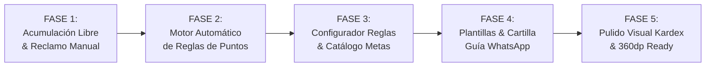
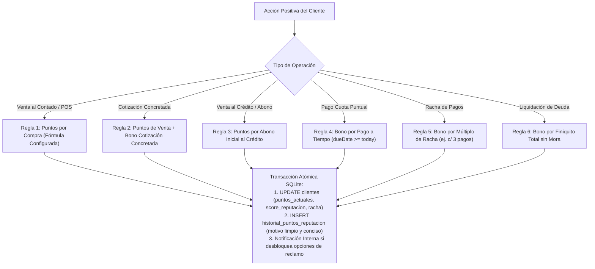

# PLAN MAESTRO DE REINGENIERÍA: ACUMULACIÓN LIBRE DE PUNTOS, MOTOR AUTOMÁTICO DE REGLAS DE GANANCIA, CONFIGURADOR DEL NEGOCIO Y GUÍA DE PREMIOS POR WHATSAPP

**Documento:** `analisis_proyecto/PLAN_REINGENIERIA_ACUMULACION_LIBRE_MOTOR_REGLAS_PUNTOS_Y_GUIA_CLIENTE.md`  
**Fecha:** Noviembre 2026  
**Versión:** 1.0 — Diseño de Arquitectura, Especificación Técnica y Plan de Ejecución Definitivo  
**Estado:** Pendiente de Aprobación por el Usuario (Cero Código Modificado en esta Fase de Planificación)  
**Metodología:** Loop Autónomo con Árbitro Adversarial (Test-Driven, Cero Regresiones, 0ms SQLite, 320dp/360dp Ready, Cero Emojis en Widgets UI)

---

## 1. RESUMEN EJECUTIVO Y DIAGNÓSTICO DEL PROBLEMA REAL

Tras la implementación de la base de fidelización y gamificación en MochilaLista, las pruebas reales en campo con clientes y comerciantes revelaron una limitación estructural crítica en la experiencia de usuario y en la lógica de negocio.

### 1.1. Evidencia en Campo y Análisis de la Captura Adjunta (`11.47.32 AM.jpeg`)
En la captura de pantalla real del cliente `Jj` se identificaron las siguientes fallas:


1. **Descuento Automático Forzado e Inflexible:**
   * Al cliente `Jj` se le otorgaron `+50 pts` (`bueno`, Saldo: 50 pts).
   * Inmediatamente, la rutina `evaluateAndUnlockRewardGoals` en `ClientService` detectó que la meta `"ganador"` requería `50 pts` y ejecutó un **descuento automático** de `-50 pts` con el motivo `"Puntos reservados por desbloqueo de meta: gan..."`.
   * **Consecuencia de Negocio:** El saldo del cliente quedó en **`Puntos Actuales: 0 pts`**. Al cliente se le bloqueó la capacidad de seguir acumulando puntos para metas más atractivas (`100 pts`, `300 pts` o `500 pts`) y se le obligó de forma prematura a quedar atado al premio menor de `50 pts`.
2. **Truncamiento Visual en Pantallas de 360dp:**
   * El título del movimiento en el Kardex se visualiza cortado como `"Puntos reservados por desbloqueo de meta: gan..."`, perdiendo legibilidad comercial.
3. **Falta de Automatización Omnicanal en Ganancia de Puntos:**
   * El comerciante percibe que los puntos solo se ganan mediante `"Bono Manual"` o compras básicas, sin premiar automáticamente pagos de cuotas a tiempo, rachas consecutivas, abonos iniciales ni cotizaciones concretadas.
4. **Ausencia de un Panel de Configuración de Reglas para el Usuario:**
   * Las reglas de cálculo de puntos estaban cableadas en duro en el código (`1 pt por S/ 1.00`, `25 pts por cuota puntual`), impidiendo que el dueño de la tienda defina su propia política comercial de fidelización.
5. **Comunicación WhatsApp Incompleta:**
   * No existe una herramienta para enviar al cliente su cartilla dinámica de cómo ganar puntos y qué premios puede reclamar hoy mismo según las reglas activas de la tienda.

---

## 2. ARQUITECTURA GENERAL: COMPARATIVA DE PARADIGMAS

```mermaid
flowchart TD
    subgraph PARADIGMA_ANTERIOR["❌ Paradigma Anterior (Descuento Automático Bloqueante)"]
        A1["Cliente gana 50 pts"] --> B1{"evaluateAndUnlockRewardGoals"}
        B1 -->|Meta de 50 pts alcanzada| C1["Resta AUTOMÁTICA: currentPuntos - 50 = 0 pts"]
        C1 --> D1["Crea ClientRewardModel en 'PENDIENTE_REVISION'"]
        D1 --> E1["Cliente queda en 0 pts. No puede ahorrar para 100 ni 300 pts"]
    end

    subgraph NUEVO_PARADIGMA["✅ Nuevo Paradigma (Acumulación Libre y Reclamo Manual)"]
        A2["Cliente gana 50 pts (Saldo: 50 pts)"] --> B2["Puntos acumulados LIBREMENTE en puntos_actuales"]
        B2 --> C2["Calculador en Tiempo Real de Premios Reclamables"]
        C2 --> D2{"Comerciante y Cliente deciden:"}
        D2 -->|Opción A: Reclamar Ahora| E2["Toca [Reclamar / Entregar Premio]"]
        E2 --> F2["Abre RewardReviewModal -> Confirma beneficio"]
        F2 --> G2["RECIÉN AQUÍ se descuentan los 50 pts y se entrega el premio"]
        D2 -->|Opción B: Seguir Ahorrando| H2["No tocan reclamo. Cliente sigue sumando a 100, 300, 500 pts"]
    end
```



---

## 3. PLAN DETALLADO POR FASES DE IMPLEMENTACIÓN



---

### FASE 1: Cambio de Paradigma — Acumulación Libre de Puntos sin Descuento Automático y Elección Manual de Premios

#### 1.1. Supresión del Descuento Automático
* **Archivo:** `app_movil/lib/features/smart_quotation/services/client_service.dart`.
* **Modificación en `evaluateAndUnlockRewardGoals` y llamadas derivadas:**
  * Eliminar la deducción `currentPuntos -= req;` y la actualización destructiva de `puntos_actuales` en la tabla `clientes`.
  * La función dejará de actuar como "bloqueador de saldo" y pasará a actuar como un **Evaluador de Metas Alcanzables**:
    * Verifica si el cliente cruzó el umbral de alguna meta activa.
    * Si cruzó una meta por primera vez o tiene una meta disponible que aún no ha sido notificada, genera una **notificación interna** al comerciante:
      `"¡$name alcanzó los puntos para '${m['nombre']}'! Saldo: $currentPuntos pts. Puede reclamar su premio o seguir acumulando."`
    * Cero movimientos negativos en `historial_puntos_reputacion` al simplemente superar un puntaje.

#### 1.2. Rutina de Migración y Reparación de Datos Legacy (`local_db.dart` V33)
* **Objetivo:** Resolver inmediatamente el caso de `Jj` (y de cualquier otro cliente en producción con puntos injustamente restados).
* **Lógica SQL de Reparación Idempotente:**
  ```sql
  -- Identificar recompensas en PENDIENTE_REVISION con puntos consumidos > 0
  -- 1. Restaurar puntos a clientes
  UPDATE clientes 
  SET puntos_actuales = puntos_actuales + COALESCE((
      SELECT SUM(puntos_consumidos) 
      FROM recompensas_cliente 
      WHERE cliente_id = clientes.id AND estado = 'PENDIENTE_REVISION'
  ), 0)
  WHERE id IN (
      SELECT DISTINCT cliente_id 
      FROM recompensas_cliente 
      WHERE estado = 'PENDIENTE_REVISION' AND puntos_consumidos > 0
  );

  -- 2. Registrar asiento de restauración en Kardex
  INSERT INTO historial_puntos_reputacion (
      negocio_id, cliente_id, tipo_movimiento, puntos_delta, 
      puntos_saldo_resultante, score_delta, score_resultante, 
      motivo, referencia_tipo, fecha_registro
  )
  SELECT 
      rc.negocio_id, rc.cliente_id, 'RESTAURACION_MIGRACION', rc.puntos_consumidos,
      c.puntos_actuales, 0, c.score_reputacion,
      'Restauración de puntos por cambio a acumulación libre', 'sistema', datetime('now')
  FROM recompensas_cliente rc
  JOIN clientes c ON rc.cliente_id = c.id
  WHERE rc.estado = 'PENDIENTE_REVISION' AND rc.puntos_consumidos > 0;

  -- 3. Marcar recompensas legacy como canceladas/migradas para no duplicar
  UPDATE recompensas_cliente 
  SET estado = 'MIGRADA_A_SALDO_LIBRE', puntos_consumidos = 0, nota_revision = 'Puntos devueltos al saldo del cliente'
  WHERE estado = 'PENDIENTE_REVISION' AND puntos_consumidos > 0;
  ```
* **Resultado para `Jj`:** Su saldo de `0 pts` vuelve instantáneamente a **`50 pts`**.

#### 1.3. Listado Inteligente de Premios Reclamables vs. Próximas Metas en Tiempo Real
* En `ClientService`, crear método reactivo de alto rendimiento:
  `Future<ClientClaimableRewardsSummary> getClientRewardsSummary(int clientId, int negocioId)`
  * `claimableGoals`: Lista de `RewardGoalModel` activos donde `puntos_actuales >= puntosRequeridos`.
  * `upcomingGoals`: Lista de `RewardGoalModel` activos donde `puntos_actuales < puntosRequeridos` ordenados por cercanía.
  * `approvedPendingRedemption`: Lista de recompensas ya aprobadas/reclamadas que están pendientes de ser canjeadas en una venta.
* **Componentes de Interfaz Actualizados:**
  * `ClientLoyaltyHistoryModal`:
    * Reemplazar la tarjeta estática de `"Premio pendiente de revisión"` por la sección:
      **`Premios Disponibles para Reclamar con sus X pts`**.
    * Si el cliente tiene 1 o más premios alcanzables, mostrar tarjetas claras con el nombre del premio, el beneficio y el botón de acción: **`[Reclamar / Entregar Premio]`**.
    * Al tocarlo, abre `RewardReviewModal` permitiendo al comerciante ajustar el premio o autorizarlo de inmediato.
    * **Solo al presionar `"Confirmar y Entregar / Reclamar"` en el modal**, se debitan atómicamente los puntos requeridos de `puntos_actuales`, se inserta la recompensa en estado `'APROBADA_NOTIFICADA'` o `'CANJEADA'` y se genera el movimiento de salida en el Kardex: `"-X pts • Canje de premio: [Nombre del Premio]"`.
    * Si el cliente no desea reclamar, simplemente no toca nada y sus puntos se mantienen intactos para seguir ahorrando.

---

### FASE 2: Motor Automático de Ganancia de Puntos por Todas las Acciones Positivas del Cliente

Actualmente, las ventas y pagos otorgan puntos bajo reglas duras y limitadas. Se implementará un motor de reglas omnicanal (`LoyaltyPointsEngine`) que evalúe y ejecute las ganancias atómicamente a 0ms en SQLite:



#### 2.1. Especificación de las 6 Reglas de Ganancia Automática:
1. **Regla 1 — Compras al Contado (`SalesService.createSale`):**
   * Aplica cuando `metodo_pago != 'credito'` y `cuotas.isEmpty`.
   * Puntos otorgados: `((montoPagado / montoBaseCompra) * puntosPorUnidad).floor()`, respetando `compraMinimaParaPuntos`.
   * Motivo en Kardex: `"Compra al contado #N (S/ XX.XX)"`.
2. **Regla 2 — Cotizaciones Concretadas / Convertidas en Venta (`saleData['cotizacion_id'] != null`):**
   * Otorga los puntos normales de la compra más el bono extra configurado (ej. `+10 pts`).
   * Motivo en Kardex: `"Bono por concretar cotización #N"`.
3. **Regla 3 — Abono Inicial en Compras al Crédito (`SalesService.createSale` con `cuotas.isNotEmpty` y `abonoInicial > 0`):**
   * Otorga puntos sobre el monto efectivamente pagado en el acto como enganche/adelanto.
   * Motivo en Kardex: `"Abono inicial en venta a crédito #N (S/ XX.XX)"`.
4. **Regla 4 — Pago de Cuota a Tiempo (`ClientService.registerPayment`):**
   * Se evalúa por cada cuota pagada completamente (`cStatus == 'pagado'`).
   * Condición matemática: `dueDate.isNotEmpty && todayStr.compareTo(dueDate) <= 0`.
   * Puntos otorgados: `puntosPagoPuntual` (ej. `+25 pts`), incremento de score (`+15 pts`) y aumento de racha `rachaPagosPuntuales + 1`.
   * Motivo en Kardex: `"Pago puntual de cuota #N (Racha: $newRacha)"`.
5. **Regla 5 — Bono por Racha de Pagos Puntuales:**
   * Si `newRacha > 0 && (newRacha % cadaCuantasCuotasRacha == 0)`:
   * Otorga automáticamente el bono adicional de constancia (ej. `+30 pts`).
   * Motivo en Kardex: `"Bono racha: $newRacha pagos puntuales consecutivos"`.
6. **Regla 6 — Liquidación Total de Crédito o Préstamo sin Mora:**
   * Cuando se liquida la última cuota pendiente de una venta/préstamo y ninguna cuota de dicha operación incurrió en mora activa:
   * Otorga bono especial de finiquito (ej. `+50 pts`).
   * Motivo en Kardex: `"Bono liquidación de crédito sin mora #N"`.

#### 2.2. Reversión Atómica Total (`voidSale` y `revertirPago`)
* **Anulación de Venta (`SalesService.voidSale`):**
  * Consulta todos los movimientos en `historial_puntos_reputacion` asociados a la venta (`referencia_tipo = 'venta' AND referencia_id = saleId`).
  * Descuenta de forma atómica la totalidad de los puntos otorgados al cliente y anula recompensas generadas.
  * Registra contra-asiento en Kardex: `"Reversión de puntos por anulación de Venta #N"`.
* **Reversión de Abono / Pago (`ClientService.revertirPago`):**
  * Identifica los puntos otorgados por ese pago específico (`referencia_tipo = 'cuota'` o `referencia_tipo = 'pago'`).
  * Descuenta los puntos otorgados, decrementa la racha si fue puntual y registra el contrasiento auditado.

---

### FASE 3: Control Total para el Usuario — "Configurador de Reglas de Puntos y Premios" (`LoyaltyRulesConfigModal`)

#### 3.1. Persistencia SQLite: Nueva Tabla `reglas_puntos_negocio` (Migración V33)
```sql
CREATE TABLE IF NOT EXISTS reglas_puntos_negocio (
    negocio_id INTEGER PRIMARY KEY,
    puntos_por_compra_activo INTEGER DEFAULT 1,
    puntos_por_unidad_moneda INTEGER DEFAULT 1,
    monto_base_compra REAL DEFAULT 1.0,
    compra_minima_para_puntos REAL DEFAULT 0.0,
    bono_cotizacion_activo INTEGER DEFAULT 1,
    puntos_bono_cotizacion INTEGER DEFAULT 10,
    puntos_abono_inicial_activo INTEGER DEFAULT 1,
    bono_pago_puntual_activo INTEGER DEFAULT 1,
    puntos_pago_puntual INTEGER DEFAULT 25,
    bono_racha_activo INTEGER DEFAULT 1,
    cada_cuantas_cuotas_racha INTEGER DEFAULT 3,
    puntos_bono_racha INTEGER DEFAULT 30,
    bono_liquidacion_sin_mora_activo INTEGER DEFAULT 1,
    puntos_liquidacion_sin_mora INTEGER DEFAULT 50,
    updated_at TEXT NOT NULL,
    FOREIGN KEY (negocio_id) REFERENCES negocios (id) ON DELETE CASCADE
);
```

#### 3.2. Modelo Dart `LoyaltyRulesModel`
* Ubicación: `app_movil/lib/features/smart_quotation/models/crm_models.dart`.
* Métodos: `fromJson`, `toSqlite`, `copyWith`, `defaultRules(int negocioId)`.

#### 3.3. Nuevo Modal `LoyaltyRulesConfigModal`
* Ubicación: `app_movil/lib/features/smart_quotation/widgets/crm/loyalty_rules_config_modal.dart`.
* Acceso destacado en `LoyaltyCenterScreen` (Pestaña 2: Metas de Recompensas):
  Botón visible **`[⚙️ Reglas de Puntos]`** junto a `[+ Nueva Meta]`.
* **Contenido de la Interfaz:**
  * Tarjeta de Compras al Contado: Switch on/off, input de puntos ganados y monto base (ej. "Ganar [1] pto por cada S/ [1.00]", compra mínima opcional).
  * Tarjeta de Cotizaciones: Switch on/off, input de bono por concretar cotización (ej. "[10] pts").
  * Tarjeta de Abono Inicial a Crédito: Switch on/off para premiar el pago inicial al llevar mercadería.
  * Tarjeta de Puntualidad en Cuotas: Switch on/off, input de bono por pago puntual (ej. "[25] pts").
  * Tarjeta de Racha de Pagos: Switch on/off, selector de frecuencia (ej. cada "[3]" pagos puntuales) y bono extra (ej. "[30] pts").
  * Tarjeta de Liquidación sin Mora: Switch on/off, bono por finalizar crédito sin retrasos (ej. "[50] pts").
  * Botón footer: **`[Restaurar Valores Recomendados]`** y **`[Guardar Configuración]`**.

#### 3.4. Refinamiento del Catálogo de Metas (`metas_recompensas`)
* Permitir crear, editar, activar/desactivar y eliminar metas en cualquier momento.
* Ordenamiento automático estricto por `puntos_requeridos ASC`.

---

### FASE 4: Mensajes Personalizados de WhatsApp — "Premios que Puedes Reclamar" y "Guía / Cartilla de Cómo Ganar Puntos"

#### 4.1. Mensaje de Situación del Cliente y Premios Disponibles
* Ubicación: `LoyaltyWhatsAppService`.
* Estructura del Mensaje:
  ```text
  🎉 *¡Hola, [Nombre del Cliente]!* 🎉
  Te saludamos con aprecio desde *[Nombre del Negocio]*.

  Queremos felicitarte por tu excelente récord con nosotros:
  ⭐ *Saldo de Puntos:* [X] puntos acumulados
  🏆 *Categoría:* [Plata / Oro / Diamante VIP]

  🎁 *PREMIOS QUE YA PUEDES RECLAMAR HOY:*
  • [Premio 1]: [Beneficio 1] (Requiere [X] pts)
  • [Premio 2]: [Beneficio 2] (Requiere [Y] pts)

  📈 *¿PREFIERES SEGUIR AHORRANDO PUNTOS?*
  Tu saldo sigue creciendo libremente. Si prefieres ahorrar para metas mayores:
  🎯 Próxima meta: *[Meta Superior]* (¡Solo te faltan [Z] pts!)

  Ven a la tienda en tu próxima visita o escríbenos para reclamar tu premio o seguir ahorrando. ¡Gracias por tu preferencia! ✨
  ```

#### 4.2. Nueva Función: "Cartilla / Guía de Cómo Ganar Puntos y Premios" por WhatsApp
* Botón de acceso directo: **`[📜 Enviar Guía de Puntos y Premios]`** tanto en `LoyaltyCenterScreen` como en `ClientLoyaltyHistoryModal`.
* **Construcción Dinámica Inteligente:**
  * Lee en tiempo real las reglas activas configuradas por el comerciante (Fase 3).
  * Excluye automáticamente cualquier regla que el comerciante tenga desactivada.
  * Lista las metas y premios activos ordenados por puntaje.
* **Plantilla Dinámica:**
  ```text
  📜 *GUÍA OFICIAL DE PUNTOS Y PREMIOS • [Nombre del Negocio]* 🎁

  Estimado(a) *[Nombre del Cliente]*, te presentamos nuestro programa de lealtad para que aproveches al máximo cada una de tus compras y pagos:

  💡 *¿CÓMO GANAR PUNTOS EN NUESTRA TIENDA?*
  [Si regla compra activa] ✅ *Compras al Contado:* Ganas [X] pto por cada S/ [Y] de compra.
  [Si regla cotización activa] ✅ *Cotizaciones Concretadas:* +[X] pts de bono al confirmar tu pedido.
  [Si regla abono activo] ✅ *Compras al Crédito:* Ganas puntos proporcionales a tu abono inicial.
  [Si regla puntual activa] ✅ *Pagos Puntuales:* +[X] pts cada vez que pagas tu cuota a tiempo.
  [Si regla racha activa] 🔥 *Racha Impecable:* +[X] pts extra cada [N] pagos puntuales consecutivos.
  [Si regla liquidación activa] 🏆 *Compromiso Total:* +[X] pts al cancelar tu crédito sin mora.

  🎁 *CATÁLOGO DE PREMIOS QUE PUEDES CANJEAR:*
  • *[Meta 1]* ([Puntos 1] pts) ➡️ [Beneficio 1]
  • *[Meta 2]* ([Puntos 2] pts) ➡️ [Beneficio 2]
  • *[Meta 3]* ([Puntos 3] pts) ➡️ [Beneficio 3]

  ⭐ *Tu saldo actual:* [Puntos Actuales] pts disponibles.
  ¡Mantén tus pagos al día y suma puntos en cada visita! Estamos para servirte. ✨
  ```
* **Modal de Vista Previa Editable:** Permite al usuario revisar y modificar el texto antes de lanzarlo a la app de WhatsApp.

---

### FASE 5: Pulido Visual del Modal `Kardex de Puntos` en `360dp`

#### 5.1. Solución de Títulos Truncados en `ClientLoyaltyHistoryModal`
* En `_buildMovementCard`:
  * Corregir el layout flexible que provocaba que `"Puntos reservados por desbloqueo de meta: gan..."` quedara mutilado.
  * Permitir hasta 2 líneas limpias de texto con `maxLines: 2`, `softWrap: true`, y asegurar que la columna descriptiva y el badge numérico (`+50 pts` / `-50 pts`) mantengan una proporción adecuada sin asfixiar el texto.
  * Acortar y profesionalizar los textos de sistema en el generador de motivos:
    * En vez de textos kilométricos de 50 caracteres, usar formatos claros y estructurados:
      * `"Compra al contado #104 (S/ 50.00)"`
      * `"Pago puntual de cuota #2 (Racha: 2)"`
      * `"Canje de premio: Descuento S/ 10.00"`
      * `"Restauración de puntos por descarte de premio"`

#### 5.2. Garantía de Cero Pixeles de Overflow en 320dp y 360dp
* Utilizar `FittedBox` con `BoxFit.scaleDown` en los valores numéricos y badges de saldo.
* Envolver filas críticas con `Wrap` o `LayoutBuilder` defensivo para pantallas extra estrechas.
* Inspeccionar paddings horizontales garantizando clearances mínimos en bordes.

#### 5.3. Cumplimiento de Cero Emojis Unicode en Widgets de Interfaz Flutter
* Verificar que ningún widget de texto en Flutter utilice emojis Unicode como iconos decorativos.
* Reemplazarlos estrictamente por iconos vectoriales de la librería oficial (`Icons.stars_rounded`, `Icons.local_fire_department_rounded`, `Icons.card_giftcard_rounded`, `Icons.credit_score_rounded`, `Icons.settings_rounded`, `Icons.description_rounded`).
* *Nota:* Los emojis se reservan **únicamente para los textos generados para WhatsApp**, donde son el estándar de formato y legibilidad del usuario.

---

## 4. MATRIZ DEL ÁRBITRO ADVERSARIAL: CASOS BORDE E INVARIANTES DE INTEGRIDAD

| Caso Borde / Escenario Crítico | Riesgo Identificado | Solución y Salvaguarda Arquitectural |
| :--- | :--- | :--- |
| **Cliente con puntos reservados antes de V33 (Caso `Jj`)** | Que `Jj` siga viendo 0 pts tras la actualización. | Migración idempotente en `local_db.dart` V33 que detecta `recompensas_cliente` en `PENDIENTE_REVISION`, devuelve los puntos a `puntos_actuales` y registra contra-asiento de auditoría. |
| **Cliente alcanza 100 pts teniendo metas de 50 y 100 pts** | Que el sistema intente reclamar una automáticamente. | Los puntos se mantienen en 100 pts. La interfaz le muestra que puede reclamar la de 50 pts O la de 100 pts, o ninguna y seguir ahorrando. Solo se descuentan puntos si toca explícitamente reclamar. |
| **Reclamo manual concurrente** | Que el usuario toque dos veces rápido "Reclamar". | Transacción SQLite atómica (`db.transaction`). Valida que `puntos_actuales >= req` dentro de la transacción antes de restar. Si ya no alcanza, aborta limpiamente. |
| **Anulación de venta que dio bono de cotización** | Que solo se reviertan los puntos de la venta y quede huérfano el bono. | El método de anulación busca por `referencia_tipo = 'venta' AND referencia_id = saleId` y revierte todos los deltas vinculados a esa operación en un solo bloque. |
| **Pago parcial de cuota** | Que un pago de S/ 5 en una cuota de S/ 50 otorgue el bono puntual de cuota. | La Regla 4 exige estrictamente que el estado de la cuota sea `'pagado'` (`cStatus == 'pagado'`). Los abonos parciales no disparan el bono de cuota hasta que se cancele la totalidad a tiempo. |
| **Comerciante desactiva todas las reglas de ganancia** | Crash por división entre cero o queries nulos. | `LoyaltyRulesModel` incluye valores por defecto defensivos y el motor verifica flags booleanos (`if (!rules.puntosPorCompraActivo) return;`). |
| **Cliente sin teléfono al enviar Cartilla WhatsApp** | Crash de `url_launcher` o pantalla congelada. | `LoyaltyWhatsAppService` valida longitud mínima, limpia caracteres y muestra `CustomSnackBar` amigable si el teléfono es inválido sin romper la UI. |
| **Dispositivo ultra compacto de 320dp** | RenderFlex overflow de 4px en la fila del Kardex. | Ancho del badge fijado de forma flexible con `ConstrainedBox` y `maxLines: 2` con elipsis inteligente. |

---

## 5. ARCHIVOS IDENTIFICADOS PARA LA FASE DE EJECUCIÓN

| Archivo del Proyecto | Responsabilidad en la Reingeniería |
| :--- | :--- |
| `app_movil/lib/core/database/local_db.dart` | Migración V33: Tabla `reglas_puntos_negocio`, semillas por defecto y rutina de restauración de puntos reservados. |
| `app_movil/lib/features/smart_quotation/models/crm_models.dart` | Nuevos modelos: `LoyaltyRulesModel`, `ClientClaimableRewardsSummary`, actualización de `ClientRewardModel` y constantes. |
| `app_movil/lib/features/smart_quotation/services/client_service.dart` | Supresión de descuentos automáticos, métodos de consulta de reglas, cálculo de premios reclamables y reversión de puntos en `revertirPago`. |
| `app_movil/lib/features/smart_quotation/services/sales_service.dart` | Integración del motor de reglas en `createSale` (compras al contado, cotizaciones concretadas y abonos a crédito) con reversión atómica. |
| `app_movil/lib/features/smart_quotation/services/loyalty_whatsapp_service.dart` | Plantillas dinámicas de premios disponibles y Cartilla / Guía interactiva de puntos y premios. |
| `app_movil/lib/features/smart_quotation/widgets/crm/client_loyalty_history_modal.dart` | Rediseño de sección de premios reclamables, pulido visual de títulos en Kardex (360dp) y botón para enviar Cartilla WhatsApp. |
| `app_movil/lib/features/smart_quotation/screens/crm/loyalty_center_screen.dart` | Botón `[⚙️ Reglas de Puntos]`, acceso a la Cartilla de Premios y refresco automático. |
| `app_movil/lib/features/smart_quotation/widgets/crm/loyalty_rules_config_modal.dart` | **Nuevo Modal:** Pantalla de configuración completa de reglas de negocio para ganancia de puntos. |
| `app_movil/lib/features/smart_quotation/widgets/crm/reward_review_modal.dart` | Adaptación para procesar reclamos manuales deduciendo puntos únicamente al confirmar la entrega. |

---

## 6. PROTOCOLO DE VERIFICACIÓN Y PRUEBAS ADVERSARIALES

Una vez aprobada la ejecución, se implementarán los siguientes tests automatizados y de integración:
1. **Test Unitario de Migración V33:** Simular un cliente con 50 pts ganados y -50 pts reservados; verificar que tras la migración su saldo sea 50 pts exactos y el Kardex refleje la restauración.
2. **Test Unitario de Acumulación Libre:** Registrar múltiples compras y verificar que los puntos suban continuamente (50 $\rightarrow$ 120 $\rightarrow$ 350 pts) sin deducción automática.
3. **Test de Reclamo Manual:** Verificar que al tocar `[Reclamar]` en una meta de 100 pts teniendo 150 pts, el saldo final sea 50 pts y se genere el registro de canje correspondiente.
4. **Test del Motor de Reglas Omnicanal:** Evaluar en SQLite las 6 reglas de ganancia automática y comprobar que los puntos coincidan exactamente con la configuración de `reglas_puntos_negocio`.
5. **Test de Anulación y Reversión:** Anular una venta y revertir un pago puntual, verificando que los puntos y rachas se sincronicen perfectamente sin fugas de saldo.
6. **Test de Renderizado Visual en 320dp y 360dp:** Ejecutar `flutter test` con dimensiones de pantalla reducidas verificando 0 overflow pixels en `ClientLoyaltyHistoryModal` y `LoyaltyRulesConfigModal`.

