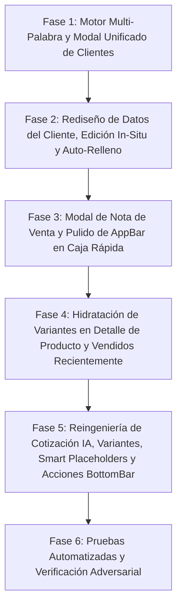

# PLAN MAESTRO: REINGENIERÍA INTEGRAL DE CAJA RÁPIDA, COTIZACIÓN INTELIGENTE (IA) Y BUSCADOR UNIFICADO DE CLIENTES

**Documento:** `analisis_proyecto/PLAN_REINGENIERIA_CAJA_RAPIDA_COTIZACION_IA_Y_CLIENTES.md`  
**Fecha:** Octubre 2026  
**Versión:** 2.0 — Planificación Técnica Definitiva con Casos Borde Integrados  
**Estado:** Listo para Aprobación y Ejecución  
**Metodología:** Loop Autónomo con Árbitro Adversarial (Test-Driven & Zero-Regressions)  

---

## 1. RESUMEN EJECUTIVO Y OBJETIVOS ESTRATÉGICOS

La ventana de **Caja Rápida** (`quick_sale_screen.dart`), el **Buscador de Clientes** (`client_search_modal.dart`) y la pantalla de **Cotización Inteligente / Conciliación IA** (`matching_screen.dart` con `product_quote_detail_modal.dart`) conforman el núcleo operativo de alta frecuencia de MochilaLista. Son las herramientas donde el comerciante atiende directamente al público en mostrador, cobra ventas al paso, concilia listas escolares leídas por IA y gestiona la relación comercial con sus clientes.

Tras una inspección exhaustiva de código y análisis de las capturas de pantalla proporcionadas, se han diagnosticado problemas críticos de diseño, colisión tipográfica, desbordamiento de widgets y falta de responsividad:

1. **Uso ineficiente del espacio en "Datos del Cliente" (Caja Rápida):** Gran ocupación vertical que desplaza el catálogo fuera de la pantalla, con ausencia de datos detallados (DNI/RUC, dirección, saldos) e imposibilidad de editar o registrar clientes al vuelo in-situ sin abandonar la venta.
2. **Superposición de textos y búsqueda pegajosa en el Buscador de Clientes:** Colisión directa entre el número telefónico y la deuda en rojo en la tarjeta del cliente (`ListTile`), búsqueda SQLite básica sensible a tildes y falta de aislamiento de estado que contamina búsquedas previas entre pantallas.
3. **Drawer lateral sobredimensionado para "Nota de Venta":** Ocupa el 100% de la altura de la pantalla con un 70% de espacio vacío innecesario y sin chips de notas frecuentes.
4. **Colisión en "Aplicar Descuento" y miniaturas rotas:** En `quick_sale_detail_modal.dart`, el texto del precio base y el botón de edición de catálogo colisionan contra el `Switch` de descuento; además se superpone una lupa de zoom sobre cuadros grises "Sin imagen". Título `"Caja Rá..."` truncado en el AppBar de Caja Rápida y corte horizontal de `"⚡ Vendidos Recientemente"`.
5. **Modal de Cotización IA sin márgenes y problemas de layout en Conciliación:** `product_quote_detail_modal.dart` se expande de borde a borde sin márgenes horizontales; en `matching_screen.dart` el título se corta debido a una marquesina animada (`MarqueeText`), el campo `"Grado"` se trunca verticalmente, las tarjetas de la lista escolar quiebran palabras a mitad de sílaba (`"universitari / o"`), las miniaturas de `matching_item_row.dart` siguen mostrando el recuadro gris antiguo "Sin imagen", y el botón flotante verde (`FAB`) tapa las tarjetas de productos de la columna derecha.

Este plan establece una reingeniería quirúrgica, modular y estética ("Mobile Awards") para corregir cada uno de estos defectos garantizando **cero regresiones**, manejo seguro de variantes y persistencia transparente en SQLite.

---

## 2. DIAGNÓSTICO TÉCNICO EN CÓDIGO (EVIDENCIAS EXACTAS)

### 2.1. Bloque 1: Sección "Datos del Cliente" en Caja Rápida (`quick_sale_header.dart`)
* **Archivos involucrados:**
  * `lib/features/smart_quotation/widgets/quick_sale/quick_sale_header.dart` (Líneas 131–375)
  * `lib/features/smart_quotation/providers/quick_sale_provider.dart` (Líneas 16–22, 59–66, 124–132)
* **Diagnóstico en código:**
  1. **Desperdicio de espacio vertical:** `MorphingAccordion` alberga un `Container` con `padding: EdgeInsets.all(20)`. En su interior, un botón `OutlinedButton.icon` de `height: 50` ("Buscar Cliente en BD"), seguido de un contenedor de `padding: 16` con avatar circular de `radius: 26`, y debajo un `TextButton.icon` rojo ("Desvincular Cliente") con `vertical: 12`. Todo se apila linealmente, consumiendo más de 280 píxeles verticales en pantalla antes de llegar al buscador.
  2. **Ausencia de información clave y edición in-situ:** El objeto de cliente solo expone `fullName` y `phone`. Si el cliente solicita actualizar su DNI/RUC, su dirección o registrar una nota especial, el comerciante está forzado a cancelar la venta, salir a la pantalla principal, ir al módulo de Clientes/CRM, buscar el cliente, editarlo, volver a Caja Rápida y armar el carrito desde cero.
  3. **Inexistencia de registro rápido para clientes de paso:** Si se ingresa un cliente manual de mostrador, no existe un mecanismo para promoverlo a cliente registrado en SQLite con 1 toque.
  4. **Modelo en Provider limitado:** `QuickSaleState` almacena únicamente `clientId`, `clientName`, `clientPhone`, `clientNote`, `saleNote` y `clientSaldo`, descartando el objeto completo `ClientModel` (que posee `docNumber`, `address`, `email`, `nivelConfianza`, `totalDebt`, etc.).

---

### 2.2. Bloque 2: Buscador de Clientes (`client_search_modal.dart` y duplicidades)
* **Archivos involucrados:**
  * `lib/features/smart_quotation/widgets/quick_sale/quick_sale_header.dart` (Líneas 417–635: `_ClientSearchModal`)
  * `lib/features/smart_quotation/widgets/manual/client_search_modal.dart` (Líneas 9–135: `ClientSearchModal`)
  * `lib/features/smart_quotation/repositories/client_repository.dart` (Líneas 44–70: `searchClientsRaw`)
  * `lib/features/smart_quotation/screens/matching_screen.dart` (Línea 176–186)
  * `lib/features/smart_quotation/screens/manual/manual_quote_client_ext.dart` (Líneas 34–43)
  * `lib/features/smart_quotation/screens/whatsapp_preview_screen.dart` (Líneas 446–520)
* **Diagnóstico en código:**
  1. **Superposición visual en `ListTile` (Screenshot 2):**
     * En `quick_sale_header.dart` (Líneas 564–627), el item se construye usando un `ListTile` estándar donde `subtitle` contiene el teléfono y las etiquetas, mientras que `trailing` contiene un `Row(mainAxisSize: MainAxisSize.min)` compuesto por un `Column` con el monto de deuda (`-${currency.format(c.totalDebt)}`) y un `ElevatedButton("Asignar")`.
     * En pantallas de 360px–390px, el ancho que ocupa `trailing` supera los 150px. El algoritmo de layout de `ListTile` encoge el área de `subtitle` sin recortar el contenido desbordado, haciendo que el texto rojo `"-258,57 S/"` se superponga físicamente sobre los dígitos `"910 888 652"`, mientras la etiqueta `"VIP • CLI..."` se corta abruptamente.
  2. **Búsqueda SQLite elemental sin soporte de tildes ni multi-token:**
     * En `ClientRepository.searchClientsRaw`:
       ```dart
       whereClause += ' AND (nombre_completo LIKE ? OR dni_ruc LIKE ? OR telefono LIKE ?)';
       ```
     * SQLite `LIKE` estándar no maneja tildes (por ejemplo, buscar `"perez"` no encuentra `"Pérez"`). Tampoco busca en campos como `notas` o `direccion`.
  3. **Duplicidad y falta de aislamiento de estado (Búsquedas Pegajosas):**
     * Existen múltiples implementaciones divergentes del modal: una privada en `quick_sale_header.dart`, otra en `manual/client_search_modal.dart`, y otra inline en `whatsapp_preview_screen.dart`.
     * En varias pantallas, los controladores de texto o estados de búsqueda no se limpian de forma efímera e independiente al cerrar y reabrir el modal, provocando que búsquedas anteriores permanezcan pegadas al cambiar de flujo.

---

### 2.3. Bloque 3: Estructura de "Nota de Venta" en Caja Rápida (`quick_sale_screen.dart`)
* **Archivos involucrados:**
  * `lib/features/smart_quotation/screens/quick_sale_screen.dart` (Líneas 220–291, 379, 420–429)
* **Diagnóstico en código:**
  1. **Drawer sobredimensionado:** `endDrawer: _buildNotesDrawer(...)` ocupa el 100% de la altura de la pantalla verticalmente. Entre el `TextField` superior y el botón inferior `"Confirmar Nota"` hay un `Spacer()` que deja más del 70% de la pantalla completamente en blanco.
  2. **Inflexibilidad operativa:** No cuenta con sugerencias de 1 toque ni chips de acceso rápido para motivos comunes de venta (ej. despacho a domicilio, entrega pendiente, etc.).
  3. **Falta de visibilidad:** El icono en el AppBar no comunica con suficiente claridad si la venta actual ya tiene una nota cargada.

---

### 2.4. Bloque 4: Modal de Detalles de Producto y Pulido de Caja Rápida (`quick_sale_detail_modal.dart` y `quick_sale_screen.dart`)
* **Archivos involucrados:**
  * `lib/features/smart_quotation/widgets/quick_sale/quick_sale_detail_modal.dart` (Líneas 272–310, 340–450)
  * `lib/features/smart_quotation/widgets/quick_sale/quick_sale_cart_item.dart` (Líneas 100–116)
  * `lib/features/smart_quotation/screens/quick_sale_screen.dart` (Líneas 380–431, 445–580)
* **Diagnóstico en código:**
  1. **Colisión en "Aplicar Descuento" (Screenshot 3):** En la tarjeta de descuento de `quick_sale_detail_modal.dart`, el texto `"Precio Base: 1,00 S/"` y el enlace `"✏️ Editar Catálogo"` comparten fila o carecen de restricción frente al `Switch` de activación, montándose por debajo del mismo.
  2. **Miniaturas y superposición de lupa sin imagen real:** En las líneas 307–308 de `quick_sale_detail_modal.dart`, se superpone de forma incondicional un contenedor negro semitransparente con `Icon(Icons.zoom_in)` sobre el cuadro de imagen, incluso cuando el producto no posee fotografía real (`imageUrl == null`), resultando en una lupa flotando sobre el texto "Sin imagen".
  3. **Gestión de reemplazo de presentación incompleta:** Si el usuario selecciona otra presentación en el modal y esa presentación ya existía en el carrito de compras, `QuickSaleProvider.updateItemFromModal` no realiza una fusión de cantidades (`merge`), pudiendo duplicar el ítem en la lista o pisar estados.
  4. **AppBar con título truncado `"Caja Rá..."`:** En `quick_sale_screen.dart`, el AppBar tiene 4 botones de acción (`eye`, `info`, `delete_sweep`, `note`) más el botón de retroceso (`leading`), consumiendo ~250px en una pantalla de 360px y forzando el truncamiento del título principal.
  5. **Sección `"⚡ Vendidos Recientemente"` solapada:** El `SliverAppBar` pinned con `toolbarHeight: 90` y bordes curvos cubre parcialmente el encabezado de "Vendidos Recientemente" durante el desplazamiento.
  6. **Miniatura en `quick_sale_cart_item.dart`:** Se pasa `categoryName: brandName` a `UniversalImage`, omitiendo la categoría real del producto y desaprovechando los iconos contextuales del Smart Visual Placeholder.

---

### 2.5. Bloque 5: Cotización Inteligente (`matching_screen.dart` y `product_quote_detail_modal.dart`)
* **Archivos involucrados:**
  * `lib/features/smart_quotation/widgets/matching/product_quote_detail_modal.dart` (Líneas 578–660)
  * `lib/features/smart_quotation/screens/matching_screen.dart` (Líneas 526–558, 740–798)
  * `lib/features/smart_quotation/widgets/matching/matching_item_row.dart` (Líneas 103–108, 198–212, 529–551)
  * `lib/features/smart_quotation/widgets/manual/manual_quote_institution_header.dart` (Líneas 48–64)
  * `lib/features/smart_quotation/widgets/matching/matching_smart_bottom_bar.dart` (Líneas 18–63)
* **Diagnóstico en código:**
  1. **Modal `product_quote_detail_modal.dart` pegado a los bordes (Screenshot 4):**
     * En la línea 594, `InteractiveSheetWrapper` aloja un `child: Column(...)` sin ningún `padding` horizontal. La imagen, los textos de configuración de precio, las opciones radiales y el botón inferior tocan directamente el borde físico de la pantalla (cero margen lateral).
  2. **Ausencia de selector de variantes:** `ProductQuoteDetailModal` hidrata `_fullProduct`, pero no expone un selector de presentaciones hermanas para alternar entre Unidad, Paquete o Caja.
  3. **Título cortado por animación en `matching_screen.dart`:**
     * En la línea 529, el título del AppBar está envuelto en `MarqueeText`. Este widget anima el desplazamiento horizontal continuo del texto, provocando que se lea recortado (`"otización Inteligente"` o `"Cotización Inteligen"`) según el ciclo de animación.
  4. **Campo `"Grado"` recortado verticalmente en `ManualQuoteInstitutionHeader`:**
     * `_miniTextField` utiliza `contentPadding: EdgeInsets.symmetric(vertical: 14, horizontal: 12)` con `isDense: true` y `labelText: "Grado"`. Al flotar la etiqueta dentro del `ExpansionTile`, el texto superior se corta contra el borde del input y textos como `"7° Básico a 4° Medio"` se truncan por falta de ancho relativo (división rígida 50/50).
  5. **Corte de sílabas en tarjetas de lista escolar:**
     * En `matching_item_row.dart` (línea 106), la columna izquierda tiene un ancho fijo de `MediaQuery.of(context).size.width * 0.30` (~84px netos de contenido). Palabras comunes como `"universitario"` requieren ~95px, provocando que la letra final caiga sola a la siguiente línea (`"universitari / o"`).
  6. **Miniaturas antiguas en `matching_item_row.dart`:**
     * En la línea 207 de `matching_item_row.dart`, se llama a `UniversalImage(path: product.imageUrl, fit: BoxFit.contain)` sin proveer `productName` ni `categoryName`, generando un fallback genérico o el recuadro gris antiguo `"Sin imagen"`.
  7. **Botón flotante verde (`FAB`) tapando tarjetas de productos y riesgo de recorte:**
     * El `FloatingActionButton` está posicionado en `bottom: 115, right: 16`. Se superpone directamente sobre la columna derecha de las tarjetas de productos emparejados. Si se integra dentro de `MatchingSmartBottomBar` sin un modal superior, las opciones de Speed Dial quedarían cortadas por el límite de la barra.

---

## 3. AUDITORÍA INTEGRAL DE PANTALLAS CON BÚSQUEDA DE CLIENTES

Para garantizar una arquitectura limpia y eliminar la duplicidad de código, se auditó la totalidad de la base de código. Los siguientes módulos interactúan con la búsqueda de clientes:

| Pantalla / Módulo | Archivo Fuente | Implementación Actual | Plan de Unificación |
| :--- | :--- | :--- | :--- |
| **Caja Rápida** | `quick_sale_header.dart` | Clase privada `_ClientSearchModal` con error de superposición en `ListTile`. | Reemplazar por `ClientSearchModal.show()` estándar unificado. |
| **Cotización Manual** | `manual_quote_client_ext.dart` | Invoca `ClientSearchModal` desde `manual/client_search_modal.dart`. | Utilizar el nuevo `ClientSearchModal` perfeccionado con métricas y motor multi-palabra. |
| **Cotización Inteligente** | `matching_screen.dart` | Invoca `ClientSearchModal` (sección "Datos del Cliente y Colegio"). | Utilizar el nuevo `ClientSearchModal` perfeccionado con auto-relleno exhaustivo de DNI y dirección. |
| **WhatsApp Preview** | `whatsapp_preview_screen.dart` | Modal inline con `showModalBottomSheet` propio y `FutureBuilder`. | Migrar al nuevo `ClientSearchModal.show()` garantizando coherencia visual. |
| **Checkout de Ventas** | `sales_checkout_screen.dart` | Utiliza `ClientBottomSheet` (pestañas Buscar / Nuevo). | Mantener pestaña "Nuevo" pero sincronizar la lista de búsqueda con el motor multi-palabra. |

### Garantía de Aislamiento de Estado (Cero Búsquedas Pegajosas)
* **Ciclo de vida efímero:** Cada llamada a `ClientSearchModal.show(context, onClientSelected: ...)` instanciará un `StatefulWidget` completamente nuevo.
* **Controladores locales:** El `TextEditingController`, el timer de debounce y la lista de resultados residirán estrictamente dentro del `State` local del modal.
* **Prohibición de persistencia compartida:** Ningún estado de búsqueda de clientes se guardará en providers globales ni variables estáticas. Al cerrar el modal (`Navigator.pop`), el controlador y su estado se desechan (`dispose()`), garantizando que al abrir el modal desde cualquier otra ventana, el campo inicie limpio y mostrando los clientes recientes por defecto.

---

## 4. ESPECIFICACIÓN DETALLADA DEL REDISEÑO VISUAL Y CASOS BORDE

### 4.1. Rediseño de la Sección "Datos del Cliente" y Edición In-Situ (Caja Rápida)
* **Objetivo de Diseño:** Reducir la altura visual en un 45%, eliminar huecos laterales y permitir la visualización y edición instantánea del cliente seleccionado en la misma pantalla.
* **Comportamiento en Modo Sin Cliente:**
  * Barra horizontal estilizada con botón compacto `"Buscar en Directorio"` y opción de desplegar 2 campos en línea para cliente rápido/de paso (Nombre y Teléfono).
  * **Caso Borde: Registro de Cliente de Paso en 1 Toque:** Si el comerciante escribe los datos de un cliente de paso (`clientId == null`), puede desplegar opcionalmente los campos de DNI/RUC y Dirección, y activar el botón/switch `"Guardar en mi Directorio de Clientes"`. Al presionar guardar, invoca `ClientService().createClient(clientData, activeBusinessId, userId)`, registrándolo en SQLite y vinculando su nuevo `id` en `QuickSaleProvider` de inmediato sin salir de Caja Rápida.
* **Comportamiento en Modo Cliente Seleccionado:**
  * **Tarjeta Resumen Compacta:**
    * Avatar circular con iniciales y color determinístico según el nombre.
    * Nombre completo (bold, 16sp) y teléfono formateado (`910 888 652`).
    * Badges en línea: Deuda en rojo si posee (`-S/ 258.57`), Saldo a Favor en verde (`+S/ 50.00`), o Badge de Confianza (VIP / Confiable).
    * Botonera rápida horizontal en fila:
      * `[✏️ Ver / Editar Datos]` (Alterna la sub-sección in-situ con animación suave `AnimatedSize`).
      * `[🔄 Cambiar]` (Abre el buscador de clientes).
      * `[❌ Desvincular]` (Retira el cliente del carrito).
  * **Sub-sección Desplegable In-Situ ("Ver / Editar Datos del Cliente"):**
    * Contenedor interno estilizado con borde sutil.
    * Campos editables: Nombre Completo, Celular/WhatsApp (con formateador), DNI/RUC, Dirección y Notas.
    * Métricas en tarjetas informativas: Saldo a favor, deuda acumulada, nivel de confianza.
    * Botón primario `"Guardar Cambios del Cliente"`: Ejecuta `ClientService().updateClient(id, data)` actualizando SQLite (`clientes`) y refrescando de inmediato el estado en `QuickSaleProvider` sin recargar la pantalla ni perder los productos del carrito.

### 4.2. Reingeniería del Modal Unificado de Búsqueda de Clientes (`ClientSearchModal`)
* **Motor de Búsqueda Multi-Palabra Nivel Google:**
  * En `ClientRepository.searchClientsRaw`, implementar normalización `_sqlUnaccent` con 12 niveles de sustitución para SQLite (á, é, í, ó, ú, Á, É, Í, Ó, Ú, ü, Ü).
  * Tokenizar la consulta por espacios en blanco. Cada token se buscará en Dart y SQLite de forma cruzada contra:
    * `nombre_completo`
    * `dni_ruc`
    * `telefono`
    * `direccion`
    * `notas`
  * Coincidencia flexible en cualquier orden (ej. `"Freddy 910"`, `"Perez Juan"`, `"Av Grau"`).
* **Diseño Anti-Colisión "Mobile Awards":**
  * Eliminar el uso de `ListTile` con `trailing` saturado.
  * Diseñar cada resultado como una tarjeta moderna con estructura vertical/horizontal balanceada:
    * **Fila Superior:** Avatar circular con badge de nivel + Nombre Completo destacado + Etiqueta "APP" si está vinculado a usuario.
    * **Fila Media:** Teléfono formateado con icono + Chip de DNI/RUC (si existe) + Dirección (si existe).
    * **Fila Inferior:** Badges financieros independientes (Deuda roja / Saldo verde) a la izquierda, y botón ergonómico `"Asignar"` a la derecha, garantizando separación física total entre montos y números telefónicos.

### 4.3. Estructura Moderna para "Nota de Venta" en Caja Rápida
* **Sustitución del Drawer por Bottom Sheet (`QuickSaleNoteModal`):**
  * Desplegado mediante `InteractiveSheetWrapper` con altura adaptativa y soporte de teclado (`viewInsets.bottom`).
* **Chips de Notas Rápidas de 1 Toque:**
  * Chips interactivos: `"Entrega pendiente"`, `"Envío a domicilio"`, `"Cliente recoge en tienda"`, `"Pago mixto / por confirmar"`, `"Empaque para regalo"`.
  * Al pulsar un chip, el texto se añade o concatena automáticamente en el campo de texto.
* **Control y Feedback:**
  * `TextField` de 3–4 líneas con contador de caracteres.
  * Botones: `"Borrar Nota"` y `"Guardar Nota"`.
  * **Indicador en AppBar:** Si `quickProv.saleNote` contiene texto, el icono del AppBar muestra un indicador distintivo (badge o resalte ámbar) para alertar al comerciante antes de procesar el cobro.

### 4.4. Pulido de `quick_sale_detail_modal.dart` y `quick_sale_screen.dart`
* **Desacople en "Aplicar Descuento":**
  * Reestructurar la tarjeta de descuento en 2 niveles: fila superior para el título `"Aplicar Descuento"` y el `Switch`; fila inferior independiente con margen adecuado para `"Precio Base: S/ X.XX"` y `"✏️ Editar Catálogo"`, eliminando cualquier colisión visual.
* **Miniatura y Lupa Condicional:**
  * Conectar `UniversalImage` con `productName` y la verdadera `categoryName`.
  * Mostrar el overlay oscuro y el icono de lupa `Icons.zoom_in` **únicamente si el producto tiene una imagen válida** (`imageUrl != null && imageUrl.isNotEmpty && imageUrl != 'null'`). En productos sin imagen, mostrar el Smart Visual Placeholder limpio.
* **Caso Borde: Hidratación y Fusión de Variantes en Carrito:**
  * Al abrir `QuickSaleDetailModal`, hidratar todas las presentaciones hermanas desde SQLite (`InventoryProvider.fetchProductById(productId)`).
  * Si el comerciante selecciona una nueva presentación:
    * Se recalculan los precios y el stock disponible (`stockActual ~/ factor`). Si la cantidad previa supera el stock de la nueva variante, se ajusta al stock máximo disponible.
    * Al confirmar en `QuickSaleProvider.updateItemFromModal`, si la nueva presentación **ya existía en el carrito**, se fusionan limpiamente las cantidades (`existingQty + newQty`), respetando el stock disponible y eliminando el ítem de la variante previa.
* **Optimización del AppBar en Caja Rápida:**
  * Ajustar `titleSpacing: 0` y reducir paddings en los `IconButton` de acciones (`visualDensity: VisualDensity.compact`, restricciones mínimas de 38x38px), asegurando que `"Caja Rápida"` se lea íntegro en cualquier resolución.
* **Alineación de "⚡ Vendidos Recientemente":**
  * Ajustar el margen superior y el comportamiento del scroll para que el encabezado no quede mordido por el `SliverAppBar` pinned.

### 4.5. Reingeniería de Cotización Inteligente (`matching_screen.dart` y `product_quote_detail_modal.dart`)
* **Márgenes y Estructura en `product_quote_detail_modal.dart`:**
  * Añadir márgenes horizontales estándar (`padding: EdgeInsets.fromLTRB(20, 8, 20, 16)`) envolviendo el contenido en un `SingleChildScrollView`.
  * Aplicar el Smart Visual Placeholder con icono de zoom condicional.
  * **Hidratación y Selección de Presentación:** Mostrar selector horizontal de variantes a partir de `_fullProduct.presentaciones`. Al cambiar de presentación, actualizar precio base, factor y stock, y al guardar ejecutar `MatchingProvider.updatePairProduct` con la nueva presentación.
* **Correcciones en `matching_screen.dart`:**
  * **AppBar:** Sustituir `MarqueeText` por un título estático `Text("Cotización Inteligente")` con `titleSpacing: 0` y estilo responsive, eliminando el corte artificial de texto.
  * **Auto-Relleno Completo de Clientes:** En `_selectClient(ClientModel client)`, rellenar exhaustivamente: Nombre, Teléfono, DNI/RUC y Dirección dentro del panel desplegable `"Más detalles"`, y limpiar todos los controladores de forma atómica en `_clearClient()`.
  * **Sección Colegio y Grado (`ManualQuoteInstitutionHeader`):** Ajustar `contentPadding` y `floatingLabelBehavior`, y redistribuir el ancho de la fila (Colegio flex 3, Grado flex 2) para que la etiqueta `"Grado"` y los textos largos no se corten.
  * **Columna Izquierda de Lista Escolar (`MatchingItemRow`):** Ampliar el ancho de la tarjeta izquierda del 30% al 35%–36% del ancho de pantalla y refinar la tipografía (13sp con `softWrap`), evitando que palabras como `"universitario"` dividan una letra en otra línea.
  * **Smart Visual Placeholder en `matching_item_row.dart`:** Invocar `UniversalImage` pasando `productName` y `categoryName` (marca/categoría), eliminando cualquier recuadro gris residual "Sin imagen".
  * **Caso Borde: Prevención de Clipping en Speed Dial / Reubicación de Botón de Acciones:**
    * El botón de acción principal se integra en el extremo derecho de `MatchingSmartBottomBar` (junto al `"TOTAL A PAGAR"`).
    * Para evitar cualquier corte vertical (`clipping`) por los límites de altura de la barra, al presionar este botón se despliega un **Modal Inferior de Acciones Rápidas (`MatchingActionsBottomSheet`)** mediante `InteractiveSheetWrapper` (o se proyecta el Speed Dial en el `Stack` raíz de la pantalla por encima del scroll y de la barra), ofreciendo acceso directo y completo a:
      1. *"Guardar y ver Mesa de Trabajo"*
      2. *"Generar PDF Directo"*
      3. *"Enviar por WhatsApp"*
    * Esto garantiza que las tarjetas de productos queden 100% libres de obstrucciones mientras el usuario edita o revisa la cotización.

---

## 5. PLAN DE EJECUCIÓN PASO A PASO (FASES TÉCNICAS)



### FASE 1: Motor Multi-Palabra, Sin Tildes y Modal Unificado de Clientes
* **Acciones:**
  1. En `client_repository.dart`, actualizar `searchClientsRaw` integrando la normalización de 12 niveles con `_sqlUnaccent` y tokenización multi-palabra sobre `nombre_completo`, `dni_ruc`, `telefono`, `direccion` y `notas`.
  2. Rediseñar y estandarizar `lib/features/smart_quotation/widgets/manual/client_search_modal.dart`:
     * Incorporar tarjetas modernas con avatar, badges financieros independientes (deuda roja, saldo verde), DNI y botón "Asignar".
     * Eliminar el `ListTile` que generaba la superposición entre el teléfono y la deuda.
     * Garantizar ciclo de vida efímero sin variables estáticas ni contaminación entre pantallas.
  3. Reemplazar la clase privada `_ClientSearchModal` de `quick_sale_header.dart` y el modal inline de `whatsapp_preview_screen.dart` por el componente unificado.
* **Criterio de Aceptación:** Búsqueda instantánea multi-palabra insensible a tildes (ej. `"perez freddy 910"`), cero superposición visual de textos y aislamiento absoluto de búsquedas entre pantallas.

### FASE 2: Rediseño de "Datos del Cliente", Edición In-Situ y Auto-Relleno
* **Acciones:**
  1. En `quick_sale_provider.dart`:
     * Ampliar `QuickSaleState` para almacenar el `ClientModel? selectedClient` completo.
     * Añadir método `updateSelectedClientData(Map<String, dynamic> updatedFields)`.
  2. En `quick_sale_header.dart`:
     * Rediseñar la sección para reducir su altura vertical a un formato compacto y elegante.
     * En modo cliente seleccionado, mostrar tarjeta resumen con badges financieros y botones en fila: Editar In-Situ, Cambiar Cliente y Desvincular.
     * Crear el panel desplegable (`AnimatedSize`) "Ver / Editar Datos del Cliente": campos editables (Nombre, Teléfono, DNI/RUC, Dirección, Notas) y métricas de confianza/deuda.
     * Implementar guardado en SQLite vía `ClientService().updateClient()` actualizando `QuickSaleProvider` en memoria al instante.
     * Para clientes de paso (`clientId == null`), añadir campos opcionales expandibles y opción `"Guardar en mi Directorio de Clientes"` para registrarlos en SQLite en 1 toque.
  3. En `matching_screen.dart`:
     * En `_selectClient(ClientModel client)`, auto-rellenar exhaustivamente Nombre, Teléfono, DNI y Dirección.
     * En `_clearClient()`, limpiar de forma atómica todos los controladores asociados.
* **Criterio de Aceptación:** Edición in-situ y registro de clientes de paso funcional en Caja Rápida; auto-relleno y limpieza integral de datos del cliente en Cotización IA.

### FASE 3: Modal de Nota de Venta y Pulido de AppBar en Caja Rápida
* **Acciones:**
  1. Crear `lib/features/smart_quotation/widgets/quick_sale/quick_sale_note_modal.dart` utilizando `InteractiveSheetWrapper` con chips de notas frecuentes de 1 toque, campo de texto con contador y botones de acción.
  2. En `quick_sale_screen.dart`, eliminar el `endDrawer` sobredimensionado y conectar el botón de notas del AppBar para abrir `QuickSaleNoteModal.show()`.
  3. Añadir indicador visual en el icono de notas del AppBar cuando `quickProv.saleNote` tenga contenido.
  4. Optimizar el AppBar de Caja Rápida: `titleSpacing: 0` y ajuste de paddings en las acciones para que el título `"Caja Rápida"` se lea completo sin truncarse.
* **Criterio de Aceptación:** Modal de notas compacto y ergonómico, chips de 1 toque funcionales e indicador activo en el AppBar.

### FASE 4: Hidratación de Variantes en Detalle de Producto y Vendidos Recientemente
* **Acciones:**
  1. En `quick_sale_detail_modal.dart`:
     * Separar en dos niveles la tarjeta de "Aplicar Descuento", eliminando la colisión con el `Switch`.
     * Hacer condicional el overlay oscuro y el icono de lupa para que solo se muestren si hay una imagen real.
     * Conectar `UniversalImage` con `categoryName` real.
     * Hidratar todas las presentaciones hermanas con `InventoryProvider.fetchProductById` y permitir cambiar de presentación recalculando precios y stock.
  2. En `quick_sale_provider.dart`:
     * En `updateItemFromModal`, si la nueva presentación ya existía en el carrito, fusionar cantidades limpiamente (`existingQty + newQty`) respetando el stock disponible, sin duplicar entradas.
  3. En `quick_sale_cart_item.dart`, resolver la categoría real para el Smart Visual Placeholder.
  4. En `quick_sale_screen.dart`, ajustar el espaciado superior de la sección `"⚡ Vendidos Recientemente"` para evitar el corte horizontal con el buscador.
* **Criterio de Aceptación:** Cero colisiones en la tarjeta de descuento, fusión de variantes correcta al cambiar de presentación en Caja Rápida y miniaturas perfectas.

### FASE 5: Reingeniería de Cotización IA, Variantes, Smart Placeholders y Acciones
* **Acciones:**
  1. En `product_quote_detail_modal.dart`:
     * Envolver el contenido en un `SingleChildScrollView` con `padding: EdgeInsets.fromLTRB(20, 8, 20, 16)`, dando aire y márgenes adecuados a todos los elementos.
     * Implementar lupa condicional según existencia de imagen real.
     * Incorporar selector horizontal de presentaciones a partir de `_fullProduct.presentaciones`, permitiendo cambiar de variante del ítem emparejado y actualizando `MatchingProvider`.
  2. En `matching_item_row.dart`:
     * Actualizar `UniversalImage` pasando `productName: product.productName` y `categoryName: product.brand` (o categoría), eliminando cualquier recuadro gris "Sin imagen".
     * Ampliar el ancho de la tarjeta izquierda al 35%–36% y afinar estilos tipográficos para evitar que palabras como `"universitario"` se rompan a mitad de sílaba.
  3. En `manual_quote_institution_header.dart`:
     * Ajustar proporciones de la fila (Colegio flex 3, Grado flex 2) y corregir `contentPadding` para que la etiqueta `"Grado"` y los textos largos no se corten.
  4. En `matching_screen.dart` y `matching_smart_bottom_bar.dart`:
     * Eliminar `MarqueeText` del AppBar y colocar `Text("Cotización Inteligente")` estático con `titleSpacing: 0`.
     * Integrar el botón de acción principal en el extremo derecho de `MatchingSmartBottomBar`.
     * Para evitar el corte (`clipping`) del Speed Dial, desplegar el menú de acciones (Guardar en Mesa de Trabajo, PDF, WhatsApp) mediante `InteractiveSheetWrapper` (`MatchingActionsBottomSheet`) o proyectando el overlay en el `Stack` raíz de la pantalla por encima de la barra, liberando al 100% las tarjetas de productos de cualquier obstrucción visual.
* **Criterio de Aceptación:** Modal de cotización con márgenes impecables, variantes intercambiables, smart placeholders consistentes en toda la lista, y menú de acciones inferior ergonómico sin cortes ni tapar productos.

### FASE 6: Matriz de Verificación Adversarial y Pruebas Automatizadas
* **Acciones:**
  1. Crear archivo de pruebas automatizadas: `test/caja_rapida_cotizacion_clientes_reengineering_test.dart`.
  2. Probar unitariamente:
     * Motor multi-palabra con `_sqlUnaccent` simulado para clientes con tildes y diéresis.
     * Aislamiento de estado del controlador de búsqueda de clientes.
     * Lógica de actualización in-situ y registro de clientes de paso en SQLite y `QuickSaleProvider`.
     * Fusión de cantidades al cambiar de presentación en el carrito de Caja Rápida.
     * Concatenación e inserción de chips de notas rápidas.
  3. Ejecutar análisis estático con `flutter analyze` y asegurar cero errores de compilación o warnings en los archivos intervenidos.
* **Criterio de Aceptación:** Suite de pruebas pasando al 100% y cero advertencias de análisis estático.

---

## 6. MATRIZ DE RIESGOS Y MEDIDAS DE CONTENCIÓN

| Riesgo Técnico Identificado | Impacto | Medida Preventiva y Mitigación |
| :--- | :--- | :--- |
| **Incompatibilidad de campos al editar clientes in-situ:** Modificar campos de un cliente en Caja Rápida podría provocar inconsistencias si no se sincroniza la base de datos local SQLite. | Alto | Reutilizar el método oficial `ClientService().updateClient()`, que ya maneja transacciones seguras sobre la tabla `clientes`, y actualizar el `ClientModel` en `QuickSaleProvider` de forma atómica. |
| **Fusión incorrecta de variantes al cambiar presentación:** Cambiar a una presentación que ya existe en el carrito podría duplicar la fila o sobrepasar el stock físico. | Alto | En `QuickSaleProvider.updateItemFromModal`, detectar si el nuevo `presentationId` ya existe; si existe, sumar cantidades validando contra `stockActual` y remover la variante previa. |
| **Corte (Clipping) del menú Speed Dial en BottomBar:** Intentar renderizar un Speed Dial dentro de `MatchingSmartBottomBar` provocaría que las opciones queden cortadas por la altura de la barra. | Medio | Implementar el menú de acciones como un `BottomSheet` modal (`InteractiveSheetWrapper`) o montar el overlay en el `Stack` raíz de `matching_screen.dart`, fuera de los límites de la barra. |
| **Pérdida del estado del carrito en Caja Rápida:** Abrir modales o navegar al buscador de clientes podría resetear el carrito si se maneja incorrectamente el contexto. | Crítico | Mantener el `QuickSaleProvider` intacto en el árbol de widgets superior; los modales solo consumen y retornan valores sin reiniciar el provider. |
| **Desbordamiento tipográfico en pantallas ultra estrechas (<340px):** El AppBar con 4 acciones y título podría seguir truncándose en dispositivos muy pequeños. | Medio | Implementar `FittedBox` con `BoxFit.scaleDown` en el título del AppBar y definir restricciones compactas (`VisualDensity.compact`) en los botones de acción. |

---

## 7. CRITERIOS DE ACEPTACIÓN DEFINITIVOS

1. **Caja Rápida — Datos del Cliente:** Sección compacta sin espacios muertos, visualización clara de balances/deuda, edición in-situ y registro de clientes de paso funcional en SQLite sin salir de la venta.
2. **Buscador de Clientes:** Cero solapamiento entre teléfonos y deudas, motor multi-palabra funcional con tolerancia a tildes, e independencia absoluta de búsquedas entre ventanas.
3. **Nota de Venta:** Bottom Sheet moderno con chips de 1 toque e indicador visible en el AppBar cuando hay nota activa.
4. **Modales de Producto:** Cero colisiones en la tarjeta de descuento, Smart Visual Placeholder en productos sin imagen (sin lupas falsas encima), hidratación de variantes y fusión segura de cantidades en el carrito.
5. **Cotización Inteligente:** Modal con márgenes laterales adecuados (20–24px), títulos de AppBar íntegros sin marquesinas engañosas, auto-relleno exhaustivo de clientes, etiquetas de Colegio/Grado sin recortes, tarjetas de lista escolar sin palabras rotas, Smart Placeholders en toda la lista y menú de acciones inferior ergonómico sin recortes ni tapar productos.
6. **Calidad de Código:** Compilación limpia, cero regresiones y pruebas automatizadas verificadas con éxito.
