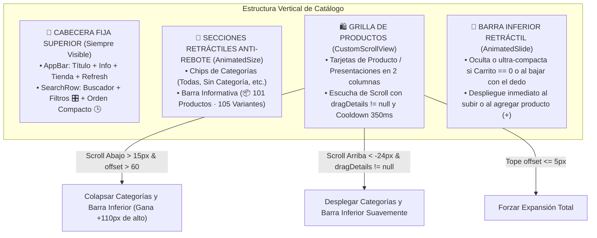
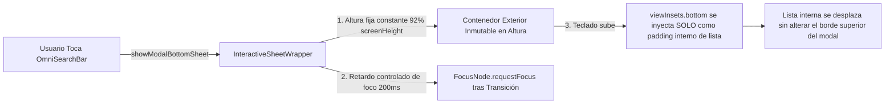

# PLAN MAESTRO: REINGENIERÍA DE CATÁLOGO DE VENTAS, BÚSQUEDA OMNICANAL LOCAL Y OPERACIONES FINANCIERAS

> **Fecha:** 26 de Octubre de 2026  
> **Estado:** Listo para Revisión y Aprobación del Usuario  
> **Áreas de Intervención:** 
> 1. `Catálogo de Ventas` (`catalog_screen.dart`, `catalog_header.dart`, `catalog_filter_header.dart`, `catalog_provider.dart`, `product_repository.dart`)
> 2. `Búsqueda Omnicanal Local` (`omni_search_bar.dart`, `interactive_sheet_wrapper.dart`)
> 3. `Operaciones Financieras CRM` (`client_finance_actions_modal.dart`, `tracking_provider.dart`, `client_service.dart`, `main.dart`, `pubspec.yaml`)  
> **Metodología:** Loop Autónomo TDD + Árbitro Interno Adversarial Estricto  

---

## 1. RESUMEN EJECUTIVO Y DIAGNÓSTICO TÉCNICO DE LAS 5 CAPTURAS

A partir de la inspección exhaustiva del código fuente del repositorio y el análisis detallado de las 5 capturas provistas por el usuario en su entorno real, se desglosa el diagnóstico milimétrico de las fallas y las soluciones arquitectónicas:

```
+----------------------------------------------------------------------------------------------------+
|                                    MAPA DE ANÁLISIS DE CAPTURAS                                    |
+------------------------------------+-----------------------------------+---------------------------+
| Capturas 1 y 2 (5:10 AM)           | Captura 3 (5:15 AM)               | Capturas 4 y 5 (1:35 PM)  |
| Catálogo de Ventas                 | Búsqueda Omnicanal Local          | Operaciones Financieras   |
| - Desaparición del buscador        | - "Doble Salto" de apertura       | - Borrador volátil        |
| - Pérdida de espacio vertical      | - Conflicto teclado / animación   | - Fechas en inglés        |
| - Barra inferior ocupa espacio     | - Redimensionamiento brusco       | - Fechas duplicadas (27)  |
| - Ordenamiento limitado (A-Z)      |                                   | - Recortes visuales UI    |
+------------------------------------+-----------------------------------+---------------------------+
```

---

### 1.1 Diagnóstico en `Catálogo de Ventas` (`Imágenes 1 y 2` — `5:10 AM`)

| # | Problema Detectado | Causa Raíz en Código | Impacto en Usuario |
|---|--------------------|----------------------|--------------------|
| **1.1.1** | **Buscador se oculta y no reaparece al subir un poco:** En `Imagen 1` están visibles AppBar, Buscador, Categorías y Contador. Al bajar por los productos, todo desaparece excepto el contador (`Imagen 2`). Al subir un poco con el dedo, reaparece el título pero **el Buscador sigue sepultado** hasta llegar a la cima absoluta (`offset == 0`). | En `catalog_screen.dart` (líneas 536-726), el `SliverAppBar` tiene `floating: true, snap: true`, pero el buscador (`CatalogHeader`) está envuelto en un `SliverToBoxAdapter` ordinario. Por ende, el `snap` solo recupera el título y deja el buscador fuera de la pantalla. Además, no existe un motor de scroll anti-rebote que controle la visibilidad según la intención de arrastre táctil. | El usuario pierde acceso al buscador mientras navega por los 100+ productos; se ve forzado a scrollear hasta arriba del todo. |
| **1.1.2** | **Desperdicio de espacio vertical por barra inferior fija:** En `Imágenes 1 y 2`, la barra `^ VER CARRITO Y LISTA (0)` ocupa ~56-72px continuos en el fondo de la pantalla incluso con 0 productos y mientras se exploran productos. | En `catalog_screen.dart` (líneas 1140-1185), `_buildDynamicBottomBar` renderiza un contenedor estático en el `bottomNavigationBar` del `Scaffold` que permanece visible e inamovible independientemente del scroll. | Disminuye el área de visualización de las tarjetas de productos en más de un 15%, limitando la visión de catálogo a apenas 2 filas visibles. |
| **1.1.3** | **Ordenamiento incompleto (solo A-Z / Z-A):** El selector de orden solo conmuta alfabéticamente. Falta organizar por fecha de creación (los recién agregados primero, o los más antiguos) y por precio. | En `CatalogProvider` (línea 387), `toggleSortOrder()` solo conmuta un booleano `_isSortAscending`. En `product_repository.dart` (líneas 117-126), la cláusula SQL hardcodea `ORDER BY LOWER(p.nombre) $sortDir` o `ORDER BY pr.id DESC` cuando no hay búsqueda, sin parametrización real de `sortBy`. | Imposibilidad de ver los productos recién ingresados al negocio o de ordenar por precios de menor a mayor. |

---

### 1.2 Diagnóstico en `Búsqueda Omnicanal Local` (`Imagen 3` — `5:15 AM`)

| # | Problema Detectado | Causa Raíz en Código | Impacto en Usuario |
|---|--------------------|----------------------|--------------------|
| **1.2.1** | **"Doble Salto" brusco al abrir el modal:** Al tocar la barra de búsqueda en el Home, el modal sube, pero una fracción de segundo después salta y cambia de tamaño bruscamente. | En `interactive_sheet_wrapper.dart` (líneas 274-306):<br>1. `maxAllowedHeight` se calcula como `math.min(screenHeight * maxHeightFactor, screenHeight - keyboardInset - topPadding - 16)`.<br>2. Se envuelve con `AnimatedPadding(padding: EdgeInsets.only(bottom: keyboardInset), duration: 180ms)`.<br>3. En `_OmniSearchSheet` (línea 820), el `TextField` tiene `autofocus: true`.<br>Al iniciarse la transición de entrada del bottom sheet, el teclado de Android comienza a subir a mitad de camino, provocando que `keyboardInset` cambie abruptamente de `0` a `~300px`, encogiendo la altura del contenedor exterior e impulsándolo hacia arriba mientras el `ModalBottomSheetRoute` aún está completando su animación. | Experiencia visual defectuosa, salto perceptible y sensación de inestabilidad en la interfaz. |

---

### 1.3 Diagnóstico en `Operaciones Financieras` (`Imágenes 4 y 5` — `1:35 PM` y `1:36 PM`)

| # | Problema Detectado | Causa Raíz en Código | Impacto en Usuario |
|---|--------------------|----------------------|--------------------|
| **1.3.1** | **Borrador volátil (Pérdida de datos al cambiar de pestaña o cerrar modal):** | En `client_finance_actions_modal.dart` (líneas 73-82), el listener del `TabController` ejecuta explícitamente `_amountCtrl.clear()`, `_noteCtrl.clear()`, `_installments.clear()`, etc. Además, no existe un repositorio o gestor de borrador en memoria para retener la configuración si el usuario cierra el modal para consultar un dato en otra pantalla. | Frustración del comerciante: si estaba configurando 24 cuotas y cambia a revisar la pestaña de Retiro o cierra el modal, pierde todo el progreso. |
| **1.3.2** | **Falta botón de Limpiar independiente:** No hay forma de resetear una pestaña con 1 toque sin tener que borrar manualmente el monto, la nota, cuotas y switch. | No existe botón de acción de reseteo (`🧹 Limpiar`). | Pérdida de tiempo al querer reconfigurar una operación desde cero. |
| **1.3.3** | **Calendario y Fechas en Inglés:** Al abrir el `DatePicker` para seleccionar fechas de cuotas, los meses ("October", "November") y días ("S M T W T F S") aparecen en inglés. | `pubspec.yaml` no incluye `flutter_localizations: sdk: flutter`. `MaterialApp` en `main.dart` (línea 191) no define `localizationsDelegates` (`GlobalMaterialLocalizations.delegate`), `supportedLocales` ni `locale: const Locale('es', 'ES')`. Además, los `showDatePicker` no pasan el parámetro `locale`. | Confusión y poca familiaridad para el comerciante hispanohablante. |
| **1.3.4** | **Falta selector de Días de Cobro (Ej. No cobrar Domingos) y Fechas Duplicadas (`Imagen 5`):** En `Imagen 5`, la cuota 1 cayó domingo `25/10/2026`. Al intentar corregir la cuota 2 al martes `27/10/2026`, ¡las cuotas 2 y 3 quedaron ambas con la misma fecha `27/10/2026`! | En `_editInstallmentDate` (líneas 154-179), al cambiar la fecha de la cuota `index`, solo se actualiza esa cuota en particular; **no existe recálculo en cascada** para las cuotas posteriores (`index + 1 .. N`). Tampoco existe lógica para omitir días inhábiles o domingos (`DateTime.sunday`). | Cronogramas financieros corruptos con fechas duplicadas y cuotas en días no laborables sin posibilidad de ordenamiento automático. |
| **1.3.5** | **Recortes visuales en scroll interno (`Imágenes 4 y 5`):** En `Imagen 4`, el chip inferior queda cortado por la barra de acción. En `Imagen 5`, el switch superior y su texto `"Fraccionado en cuotas periódicas"` quedan cortados contra el borde del TabBar. | En `client_finance_actions_modal.dart`, el `TabBarView` corta bruscamente con `Clip.hardEdge` por defecto sin margen superior de desvanecimiento, y el `ListView` interior tiene restricciones rígidas contra el contenedor del botón inferior. | Infracción estética de nivel "Mobile Awards" (componentes rebanados). |

---

## 2. ARQUITECTURA DE SOLUCIÓN TÉCNICA Y DISEÑO DETALLADO

---

### 2.1 Módulo 1: `Catálogo de Ventas` — Cabecera Inteligente, Anti-Rebote y Ordenamiento



#### A. Cabecera Compacta Inteligente con Buscador Fijo:
1. **Zona Siempre Fija:**
   * La cabecera superior se ensambla mediante un `SliverPersistentHeader(pinned: true)` o un layout fijo que contiene:
     * Fila 1: `Catálogo de Ventas` + botones de acción (`ⓘ`, `🏪 Tienda`, `🔄`).
     * Fila 2: `TextField` de búsqueda (`🔍 Buscar producto, marca...`) + botón de filtros avanzados (`🎛️`) con badge reactivo + **botón de Ordenamiento integrado**.
2. **Zona Retráctil Anti-Rebote:**
   * Contiene la lista horizontal de **Chips de Categorías** y la barra de **Contador de Productos/Variantes**.
   * Integrada con el motor anti-rebote validado en `workbench_screen.dart`:
     * Requiere `notification.dragDetails != null` para evitar rebotes de inercia o de fin de lista.
     * Cooldown de `350ms` para ignorar micro-movimientos generados por las animaciones de tamaño.
     * Colapsa suavemente con `AnimatedSize` (curva `Curves.easeInOutCubic`, duración `280ms`) al bajar, liberando espacio para las tarjetas.
     * Reaparece de inmediato al deslizar hacia arriba apenas `-24px`, sin requerir llegar a la cima de la pantalla.

#### B. Optimización de la Barra Inferior de Carrito:
1. Cuando el carrito y la lista de utilidades suman `0` (`prov.cartCount + prov.utilityCount == 0`), la barra se repliega a una altura mínima de `0px` o se oculta suavemente mediante `AnimatedSlide(offset: Offset(0, 1))`.
2. Si el usuario tiene productos en el carrito (`> 0`):
   * Mientras desliza activamente hacia abajo explorando productos, la barra se retrae suavemente hacia abajo.
   * Apenas desliza hacia arriba o en el milisegundo en que presiona el botón `+` de cualquier producto para añadir una unidad, la barra **emerge de inmediato**, confirmando la acción y mostrando el conteo actualizado.
   * **Ganancia neta:** Se recuperan más de **50px a 60px verticales**, permitiendo que las tarjetas de productos se aprecien completas en pantallas de cualquier tamaño.

#### C. Sistema Completo de Ordenamiento Temporal, Alfabético y de Precios:
1. **Opciones Disponibles (`CatalogSortOption`):**
   * `🕒 Más recientes primero` (`sortBy = 'created_at'`, `sortDir = 'DESC'`).
   * `🕰️ Más antiguos primero` (`sortBy = 'created_at'`, `sortDir = 'ASC'`).
   * `🔤 Nombre (A - Z)` (`sortBy = 'name'`, `sortDir = 'ASC'`).
   * `🔤 Nombre (Z - A)` (`sortBy = 'name'`, `sortDir = 'DESC'`).
   * `💰 Precio: Menor a Mayor` (`sortBy = 'price'`, `sortDir = 'ASC'`).
   * `💰 Precio: Mayor a Menor` (`sortBy = 'price'`, `sortDir = 'DESC'`).
2. **Integración en Capa de Datos:**
   * Actualizar `product_repository.dart` (`fetchInventoryRaw`) para construir dinámicamente la cláusula `ORDER BY` en SQLite según `queryParams['sortBy']` y `queryParams['sortDir']`:
     * Para `created_at`: `ORDER BY pr.id $sortDir` o `ORDER BY p.id $sortDir, pr.id $sortDir`.
     * Para `name`: `ORDER BY LOWER(p.nombre) $sortDir`.
     * Para `price`: `ORDER BY IFNULL(pr.precio_oferta, pr.precio_venta_final) $sortDir`.
   * En `CatalogProvider`: actualizar `_displayItems.sort(...)` para ordenar en memoria de forma coherente con la opción seleccionada.
   * Botón selector de ordenamiento accesible directamente desde la fila del buscador o en el contador, abriendo un bottom sheet con micro-animaciones táctiles y selección en 1 toque.

---

### 2.2 Módulo 2: `Búsqueda Omnicanal Local` — Eliminación del "Doble Salto"



#### Diagnóstico y Solución Arquitectónica:
1. **Fijar la geometría exterior del modal:**
   * Modificar el dimensionamiento de `InteractiveSheetWrapper` (o crear un modo `isSearchModal: true`) para que el contenedor exterior se fije a una altura constante del `92%` del alto de pantalla (`screenHeight * 0.92`), **sin encoger el contenedor cuando `keyboardInset` crece**.
   * La cabecera superior (`Búsqueda Omnicanal Local`, campo de texto y chips de categoría) permanece estática en su coordenada superior fija.
2. **Aislamiento del Inset del Teclado:**
   * El `MediaQuery.viewInsetsOf(context).bottom` se aplica **exclusivamente al padding inferior de la lista interna de resultados** (`ListView.builder(padding: EdgeInsets.only(bottom: keyboardInset + 16))`), permitiendo que los resultados de búsqueda se desplacen libremente por encima del teclado sin empujar la carcasa exterior del modal.
3. **Sincronización Suave de Foco (`FocusNode`):**
   * En lugar de `autofocus: true` simultáneo al arranque de la animación del `BottomSheet`, programar la solicitud de foco (`_focusNode.requestFocus()`) en un callback sincronizado al finalizar la animación de entrada del modal (`ModalRoute.of(context)?.animation?.addStatusListener` o tras `220ms`), logrando una apertura continua, fluida y con cero saltos dobles.

---

### 2.3 Módulo 3: `Operaciones Financieras` — Borrador, Limpiar, Español y Cascada

```mermaid
flowchart TD
    subgraph FinanceModalArchitecture [Arquitectura del Modal Operaciones Financieras]
        DraftManager["💾 ClientFinanceDraftManager (En Memoria por Cliente)\n• Retiro: Monto, Método\n• Préstamo: Monto, Método, Motivo, Frecuencia, Cuotas, Interés, Días Excluidos, Cronograma"]
        
        TabSwitch["🔄 Cambio de Pestañas (Retirar <-> Préstamo)"]
        TabSwitch -->|Guarda estado actual y restaura el otro| DraftManager
        
        CleanBtn["🧹 Botón 'Limpiar' en cada Pestaña"]
        CleanBtn -->|Resetea solo los campos de la pestaña activa| DraftManager
        
        DatePickerES["📅 DatePicker 100% en Español"]
        DatePickerES -->|GlobalMaterialLocalizations + Locale('es', 'ES')| CalendarView[Meses y Días en Español]
        
        ScheduleEngine["⚙️ Motor Inteligente de Cronograma de Cuotas"]
        DaySelector["🗓️ Selector Días de Cobro (L, M, M, J, V, S, D)\nChips: Omitir Domingos | Solo Lun-Vie | Todos"]
        DaySelector --> ScheduleEngine
        
        CascadeTrigger["✏️ Edición / Salto de Fecha en Cuota #k"]
        CascadeTrigger -->|Recálculo en Cascada Automático| ScheduleEngine
        ScheduleEngine -->|Cuotas #k+1 a #N avanzan respetando frecuencia y días válidos| ValidSchedule["Cronograma Válido: Sin fechas repetidas y con día abreviado (Lun, 26/10/2026)"]
        
        SaveAction["💾 Guardar Operación (Retiro o Préstamo)"]
        SaveAction -->|Verificación estricta en SQLite + Limpia Borrador| DBSave[(SQLite ventas / cuotas)]
    end
```

#### A. Persistencia Temporal de Borrador y Botón Limpiar:
1. **Gestor de Borrador `ClientFinanceDraftManager`:**
   * Clase utilitaria en memoria con caché indexada por `clientId`:
     * Pestaña Retirar: monto escrito, método seleccionado (`Efectivo`, `Yape`, etc.).
     * Pestaña Préstamo: monto, método, motivo, switch fraccionamiento, número de cuotas, porcentaje de interés, frecuencia (`diario`, `semanal`, `quincenal`, `mensual`), fecha de inicio, set de días excluidos (`excludedWeekdays`) y lista personalizada de cuotas (`_installments`).
2. **Persistencia Automática:**
   * Al cambiar de pestaña con el `TabBar`: se guarda automáticamente el borrador de la pestaña saliente y se restaura el borrador de la pestaña entrante (¡erradicando el `clear()` destructivo de las líneas 73-82!).
   * Al cerrar el modal sin confirmar y volver a abrirlo para el mismo cliente: se restaura el borrador intacto.
3. **Botón `🧹 Limpiar` / `Reiniciar`:**
   * Ubicado en la cabecera o junto a las pestañas de forma sutil y elegante (`TextButton.icon(icon: Icon(Icons.cleaning_services_outlined), label: Text("Limpiar"))`).
   * Al presionarlo, vacía únicamente los campos y el borrador de la pestaña activa, dejando la otra pestaña intacta.
4. **Verificación Estricta al Guardar:**
   * Al presionar `Confirmar Retiro` o `Registrar Préstamo`, se valida que los datos coincidan exactamente con la última versión de los controladores y del cronograma.
   * Tras la inserción exitosa en SQLite, se limpia el borrador correspondiente de ese cliente.

#### B. Calendario y Fechas 100% en Español:
1. **Configuración de Dependencias e Inicialización:**
   * Agregar `flutter_localizations` a `pubspec.yaml`:
     ```yaml
     dependencies:
       flutter_localizations:
         sdk: flutter
     ```
   * En `main.dart`, configurar `MaterialApp`:
     ```dart
     localizationsDelegates: const [
       GlobalMaterialLocalizations.delegate,
       GlobalWidgetsLocalizations.delegate,
       GlobalCupertinoLocalizations.delegate,
     ],
     supportedLocales: const [
       Locale('es', 'ES'),
       Locale('en', 'US'),
     ],
     locale: const Locale('es', 'ES'),
     ```
2. **Forzar Localización en `showDatePicker` y Formateadores:**
   * En todos los `showDatePicker` de `ClientFinanceActionsModal`, pasar explícitamente `locale: const Locale('es', 'ES')`.
   * Todos los formateadores de fechas utilizarán el locale español: `DateFormat('EEE, dd/MM/yyyy', 'es')`.

#### C. Selector de Días de Cobro y Recálculo en Cascada:
1. **Selector Visual de Días de Cobro (`Omitir días en el cronograma`):**
   * Selector interactivo con los 7 días de la semana: `[L] [M] [M] [J] [V] [S] [D]`.
   * Chips rápidos de 1 toque:
     * `🚫 Omitir Domingos`: Desmarca domingo (`DateTime.sunday = 7`).
     * `💼 Solo Lunes a Viernes`: Marca 1..5, desmarca 6 y 7.
     * `📅 Todos los días`: Marca 1..7.
   * Campo selector de **Fecha de Inicio (1ra cuota)** para permitir empezar hoy, mañana o en una fecha futura específica.
2. **Motor de Cronograma con Exclusión de Días:**
   * Función matemática determinista:
     ```dart
     DateTime _getNextValidDate(DateTime fromDate, String frequency, Set<int> excludedWeekdays) {
       DateTime next = _advanceByFrequency(fromDate, frequency);
       while (excludedWeekdays.contains(next.weekday)) {
         next = next.add(const Duration(days: 1));
       }
       return next;
     }
     ```
   * Si la 1ra cuota cae en un día excluido (ej. Domingo en `Imagen 5`), se rueda automáticamente al primer día hábil permitido (Lunes).
3. **Recálculo Inteligente en Cascada:**
   * Al editar la fecha de la cuota `#k` con el calendario (o mediante una acción de saltar fecha):
     1. Se valida que la nueva fecha no sea anterior a la cuota `#k-1`.
     2. Si la nueva fecha cae en día excluido, se rueda al siguiente día hábil.
     3. La cuota `#k` se fija con esa fecha.
     4. **En cascada:** Todas las cuotas posteriores (`#k+1` hasta `#N`) se recalculan automáticamente hacia adelante a partir de la fecha de la cuota `#k` respetando la frecuencia (`diario`, `semanal`, etc.) y omitiendo los días desmarcados.
     5. **Garantía matemática:** Jamás quedarán dos cuotas con la misma fecha (`27/10/2026` duplicado en `Imagen 5`) ni fechas desordenadas.
4. **Formato en Cronograma Generado:**
   * Cada fila del cronograma mostrará el día de la semana abreviado en español junto a la fecha:
     * `Lun, 26/10/2026` • `S/ 41.67`
     * `Mar, 27/10/2026` • `S/ 41.67`
     * `Mié, 28/10/2026` • `S/ 41.67`

#### D. Corrección de Recortes Visuales en `ClientFinanceActionsModal`:
1. Reemplazar el recorte rígido del `TabBarView` por un layout con `Clip.none` o padding superior generoso (`padding: EdgeInsets.only(top: 12)`).
2. Ajustar el padding inferior de los `ListView` de las pestañas (`padding: EdgeInsets.fromLTRB(20, 16, 20, 32)`) para que ni los chips de motivos ni los switches superiores rocen o queden rebanados por los bordes superior o inferior.

---

## 3. PLAN DE TRABAJO ESTRUCTURADO EN FASES (LOOP AUTÓNOMO)

---

### FASE 1: Reingeniería de Navegación, Espacio Vertical y Ordenamiento en `Catálogo de Ventas`
* **Archivos a modificar:**
  * `lib/features/catalog/screens/catalog/catalog_screen.dart`
  * `lib/core/widgets/catalog_header.dart`
  * `lib/features/catalog/screens/catalog/widgets/catalog_filter_header.dart`
  * `lib/features/catalog/providers/catalog_provider.dart`
  * `lib/features/catalog/repositories/product_repository.dart`
* **Acciones:**
  1. Reorganizar la estructura de `CustomScrollView` para fijar el `AppBar` y la fila de búsqueda superior (`CatalogHeader` compacto con botón de ordenamiento).
  2. Implementar el motor de scroll anti-rebote (`dragDetails != null`, cooldown `350ms`, `accumulatedDelta`) para replegar y desplegar suavemente las categorías y el contador.
  3. Modificar `_buildDynamicBottomBar` para replegarse al deslizar hacia abajo o cuando el carrito esté en `0`, desplegándose de inmediato al deslizar hacia arriba o al presionar `+`.
  4. Agregar enum `CatalogSortOption` (`recentFirst`, `oldestFirst`, `nameAsc`, `nameDesc`, `priceAsc`, `priceDesc`), con soporte completo en `fetchInventoryRaw` (SQLite) y `CatalogProvider`.
  5. Diseñar el selector/sheet de ordenamiento con micro-animaciones táctiles.

---

### FASE 2: Eliminación del "Doble Salto" en `Búsqueda Omnicanal Local`
* **Archivos a modificar:**
  * `lib/core/widgets/interactive_sheet_wrapper.dart`
  * `lib/core/widgets/omni_search_bar.dart`
* **Acciones:**
  1. Modificar `InteractiveSheetWrapper` para admitir una modalidad de altura fija inmutable al abrir el teclado (`maintainFixedHeightOnKeyboard: true`), evitando que el contenedor exterior salte o cambie de tamaño.
  2. Inyectar el `keyboardInset` únicamente en el padding inferior de la lista de resultados de `_OmniSearchSheet`.
  3. Desacoplar el `autofocus: true` inmediato y reemplazarlo por una solicitud de foco coordinada tras la animación de entrada del modal.

---

### FASE 3: Localización y Calendario 100% en Español
* **Archivos a modificar:**
  * `pubspec.yaml`
  * `lib/main.dart`
  * `lib/features/smart_quotation/widgets/crm/client_finance_actions_modal.dart`
* **Acciones:**
  1. Agregar `flutter_localizations: sdk: flutter` a `pubspec.yaml`.
  2. Configurar delegados y locale `es_ES` en el `MaterialApp` de `main.dart`.
  3. Forzar `locale: const Locale('es', 'ES')` en todos los `showDatePicker` de `ClientFinanceActionsModal` y asegurar que `DateFormat` use `'es'` para mostrar los días y meses en español.

---

### FASE 4: Reingeniería del Modal `Operaciones Financieras` (Borrador, Cascada, Exclusión y UI)
* **Archivos a modificar:**
  * `lib/features/smart_quotation/widgets/crm/client_finance_actions_modal.dart`
  * `lib/features/smart_quotation/providers/tracking_provider.dart`
* **Acciones:**
  1. Crear la estructura en memoria `ClientFinanceDraftManager` para guardar temporalmente el progreso de cada pestaña (`Retirar` y `Préstamo`) por cliente.
  2. Eliminar el borrado destructivo al cambiar de pestaña; sincronizar el guardado y restauración automática de borradores.
  3. Agregar el botón `🧹 Limpiar` independiente por pestaña con alerta de confirmación o reseteo inmediato en 1 toque.
  4. Implementar el selector visual de días de cobro (`L`, `M`, `M`, `J`, `V`, `S`, `D`) y chips rápidos (`🚫 Omitir Domingos`, `💼 Solo Lun-Vie`, `📅 Todos los días`) + selector de Fecha de Inicio.
  5. Desarrollar el algoritmo de recálculo en cascada al editar o saltar la fecha de una cuota `#k`.
  6. Mostrar el día abreviado en español en cada fila del cronograma (`Sáb, 24/10/2026`).
  7. Corregir los recortes visuales de padding y clipping en las pestañas y el TabBarView.
  8. Asegurar la persistencia limpia y sin fugas en SQLite al presionar `Registrar Préstamo` o `Confirmar Retiro`, limpiando el borrador tras guardar.

---

### FASE 5: Batería de Pruebas Automatizadas y Arbitraje Adversarial
* **Archivos a crear / actualizar:**
  * `test/catalogo_navegacion_espacio_ordenamiento_test.dart`
  * `test/busqueda_omnicanal_suave_sin_doble_salto_test.dart`
  * `test/operaciones_financieras_borrador_cascada_espanol_test.dart`
* **Validaciones Obligatorias del Árbitro Adversarial:**
  1. Verificar que el Buscador de Catálogo se mantenga fijo arriba y que las categorías y el contador se replieguen/desplieguen con el motor anti-rebote.
  2. Verificar que la barra inferior de catálogo se repliegue al deslizar hacia abajo o al estar vacía `(0)`.
  3. Verificar los 6 modos de ordenamiento en Catálogo (fechas, alfabético y precios).
  4. Verificar que el modal de Búsqueda Omnicanal abra con altura constante sin doble salto visual.
  5. Verificar que el modal de Operaciones Financieras retenga borradores al alternar pestañas o cerrar el modal.
  6. Verificar que el botón `🧹 Limpiar` vacíe solo la pestaña activa.
  7. Verificar que el cronograma omita domingos y recalcule en cascada sin duplicar fechas.
  8. Verificar que los textos de días y meses aparezcan en español.
  9. Ejecución completa de tests con `flutter test` y confirmación de 0 regresiones.

---

## 4. MATRIZ DE CRITERIOS DE ACEPTACIÓN ("MOBILE AWARDS")

| Requerimiento | Criterio de Éxito Estricto |
|---------------|----------------------------|
| **Buscador Siempre Fijo** | En `Catálogo de Ventas`, el campo de búsqueda permanece accesible al 100% en el tope mientras se navegan cientos de productos. |
| **Categorías y Contador Retráctiles** | Se repliegan suavemente al bajar y reaparecen inmediatamente al subir `-24px` con el dedo, sin rebotes por inercia (`dragDetails != null`). |
| **Barra Inferior Inteligente** | Desaparece o se colapsa cuando el carrito está vacío o al deslizar hacia abajo, ganando >50px para las tarjetas de productos. |
| **Ordenamiento Temporal y Precios** | 6 opciones funcionales (`🕒 Más recientes primero`, `🕰️ Más antiguos primero`, `🔤 A-Z`, `🔤 Z-A`, `💰 Precio Min-Max`, `💰 Precio Max-Min`). |
| **Cero Doble Salto en Búsqueda Omnicanal** | Apertura fluida en un único movimiento suave a altura constante (~92%), con el teclado integrándose sin saltos en la carcasa. |
| **Borrador Seguro en Operaciones Financieras** | Cero pérdida de datos al conmutar entre `Retirar` y `Préstamo` o al cerrar el modal accidentalmente. |
| **Botón Limpiar Independiente** | Reseteo instantáneo de la pestaña activa en 1 toque. |
| **Calendario 100% en Español** | Nombres de meses y días traducidos y formateados en español en toda la aplicación. |
| **Exclusión de Días y Cascada** | Posibilidad de omitir domingos o fines de semana; al editar cualquier cuota `#k`, todas las siguientes avanzan ordenadas en cascada sin fechas duplicadas. |
| **Cero Recortes Visuales** | Ni un solo widget, texto o switch cortado a la mitad en ningún modal ni lista. |
