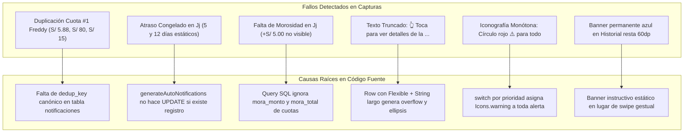
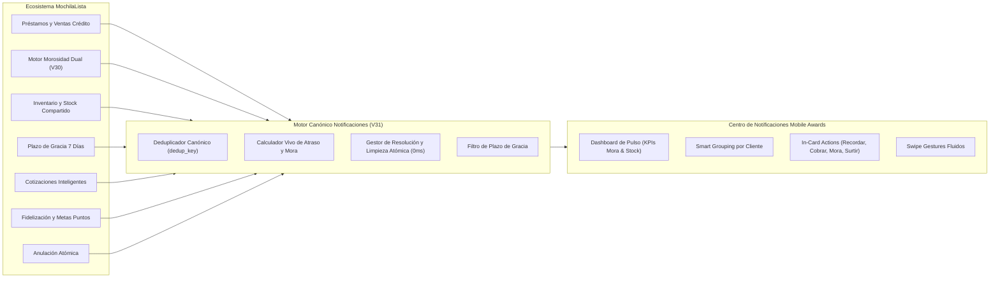
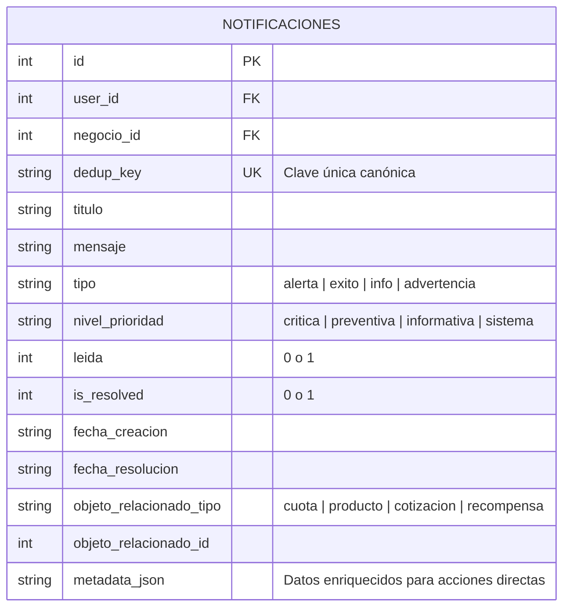
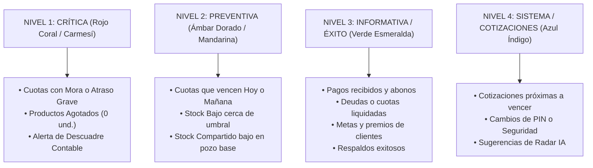
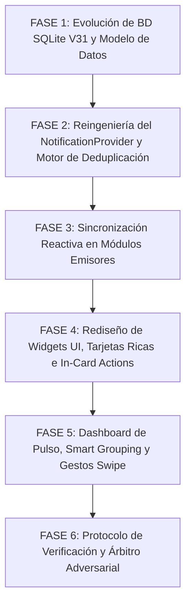
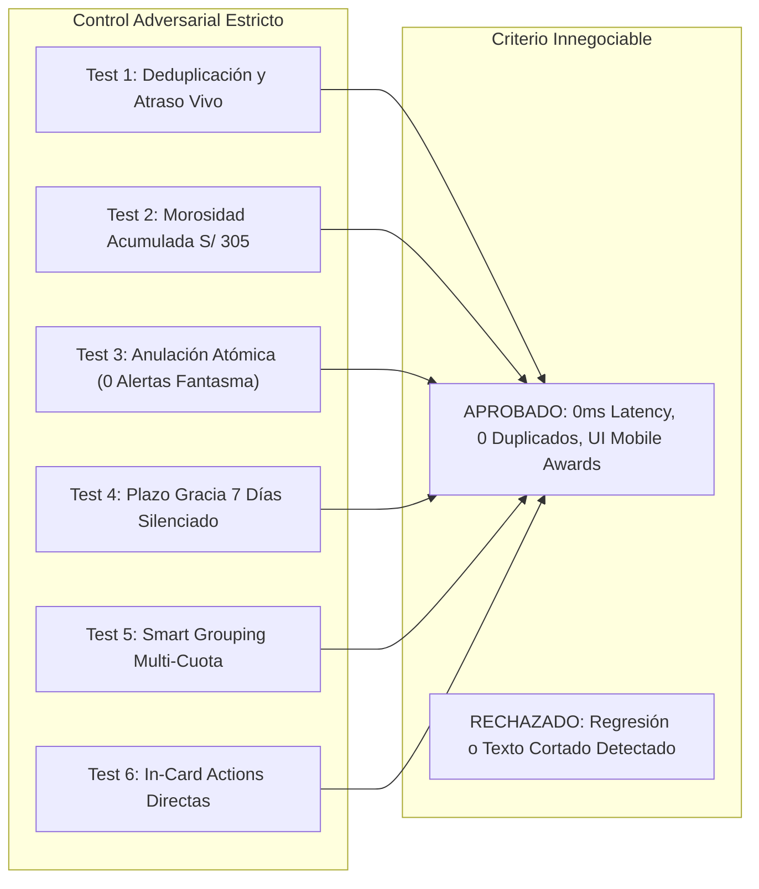

# 🚀 PLAN MAESTRO DE REINGENIERÍA: CENTRO DE NOTIFICACIONES INTELIGENTE Y ECOSISTEMA DE ALERTAS EN TIEMPO REAL

**Documento de Especificación Técnica, Diagnóstico Forense, Reingeniería Arquitectónica y Protocolo Adversarial**  
**Proyecto:** MochilaLista App (Local-First SQLite, 0ms Latency, Flutter Mobile - Estándar Mobile Awards)  
**Fecha:** Noviembre 2026  
**Metodología:** Loop Autónomo + Árbitro Interno Adversarial Estricto  
**Estado:** 📋 EN REVISIÓN (Fase de Auditoría y Planificación - Sin modificaciones de código ejecutadas)

---

## 📑 ÍNDICE GENERAL

1. [Ficha Técnica y Alcance de la Reingeniería](#-1-ficha-técnica-y-alcance-de-la-reingeniería)
2. [Diagnóstico Forense de las 5 Capturas y Causa Raíz en Código Fuente](#-2-diagnóstico-forense-de-las-5-capturas-y-causa-raíz-en-código-fuente)
3. [Auditoría Global de Emisión y Sincronización en Toda la App](#-3-auditoría-global-de-emisión-y-sincronización-en-toda-la-app)
4. [Arquitectura del Motor Canónico de Notificaciones (SQLite V31 y Deduplicación Canónica)](#-4-arquitectura-del-motor-canónico-de-notificaciones-sqlite-v31-y-deduplicación-canónica)
5. [Jerarquía de 4 Niveles y Taxonomía Unificada de Alertas](#-5-jerarquía-de-4-niveles-y-taxonomía-unificada-de-alertas)
6. [Rediseño UX/UI Nivel "Mobile Awards" (Dinamismo, Agrupación y Acciones Directas)](#-6-rediseño-uxui-nivel-mobile-awards-dinamismo-agrupación-y-acciones-directas)
7. [Plan de Trabajo Detallado por Fases de Implementación](#-7-plan-de-trabajo-detallado-por-fases-de-implementación)
8. [Protocolo del Árbitro Interno Adversarial y Matriz de Pruebas](#-8-protocolo-del-árbitro-interno-adversarial-y-matriz-de-pruebas)

---

## 📌 1. FICHA TÉCNICA Y ALCANCE DE LA REINGENIERÍA

El sistema actual de notificaciones de MochilaLista fue concebido como un registrador básico de eventos unidireccionales y estáticos. Tras la implementación exitosa de los motores avanzados del sistema (**Motor de Morosidad Dual V30**, **Préstamos Históricos y Personales**, **Anulación Atómica de Ventas**, **Kardex de Puntos de Reputación**, **Stock Compartido Multivariante** y el **Plazo de Gracia de 7 Días** para productos nuevos), el centro de notificaciones quedó desincronizado, acumulando alertas huérfanas, duplicados estáticos y textos truncados que degradan la experiencia del comerciante.

### Módulos y Archivos Involucrados en la Auditoría:
* **Centro de Notificaciones (UI & Widgets):**
  * `app_movil/lib/features/profile/screens/notifications_screen.dart`
  * `app_movil/lib/features/profile/widgets/notifications/notification_item_card.dart`
  * `app_movil/lib/features/profile/widgets/notifications/notification_filter_bar.dart`
  * `app_movil/lib/features/profile/widgets/notifications/notification_empty_state.dart`
* **Capa de Datos y Estado (Core):**
  * `app_movil/lib/core/models/notification_model.dart`
  * `app_movil/lib/core/providers/notification_provider.dart`
  * `app_movil/lib/core/database/local_db.dart` (Evolución a Schema V31)
  * `app_movil/lib/core/services/local_notification_service.dart`
* **Módulos Emisores y Sincronizadores:**
  * **Ventas y Finanzas:** `app_movil/lib/features/smart_quotation/services/sales_service.dart`
  * **Clientes y Cobranzas:** `app_movil/lib/features/smart_quotation/services/client_service.dart`
  * **Proveedores de Estado:** `app_movil/lib/features/smart_quotation/providers/sale_provider.dart`, `app_movil/lib/features/catalog/providers/inventory_provider.dart`
  * **Catálogo y Modelos:** `app_movil/lib/features/catalog/models/product_model.dart`
  * **Modales de Acción:** `app_movil/lib/features/smart_quotation/widgets/history/detail_widgets/whatsapp_preview_modal.dart`, `app_movil/lib/features/smart_quotation/widgets/crm/payment_entry_modal.dart`, `app_movil/lib/features/smart_quotation/widgets/history/detail_widgets/cuota_morosidad_modal.dart`

---

## 📸 2. DIAGNÓSTICO FORENSE DE LAS 5 CAPTURAS Y CAUSA RAÍZ EN CÓDIGO FUENTE

A partir de la inspección pixel a pixel de las 5 capturas adjuntas por el usuario y la auditoría exhaustiva del código fuente, se identifican las fallas críticas y sus causas raíces:



### Matriz de Diagnóstico Forense Detallado:

| Captura | Pantalla / Pestaña | Problemas Específicos Detectados | Causa Raíz Técnica en Código Fuente |
| :--- | :--- | :--- | :--- |
| **Imagen 1** | **`Notificaciones` → Pestaña `Pendientes` (Vista superior)** | **1. Notificaciones con datos estáticos de atraso:** Para el cliente `Jj`, la tarjeta indica `lleva 5 días de atraso` (cuota #2) y `lleva 12 días de atraso` (cuota #1) con fecha fijada a las `03:02`. No se recalculan dinámicamente con los días transcurridos hoy.<br>**2. Texto azul cortado:** Ambas tarjetas terminan en `👆 Toca para ver detalles de la ...`.<br>**3. Duplicación de Emojis e Iconos:** Círculo rojo con `⚠️` a la izquierda, y en el título repite `💰 Cuota Vencida`.<br>**4. Botón de filtro rígido:** Dropdown `Todas ☰` ocupa espacio horizontal sin aportar valor directo. | • `notification_provider.dart` (L108-L127): `generateAutoNotifications` comprueba `if (existing.isEmpty) { insert }`. Si el registro ya existe, no hace `UPDATE`, dejando para siempre el texto generado el primer día.<br>• `notification_item_card.dart` (L120-L137): `_getActionText` retorna `"Toca para ver detalles de la deuda"`. Dentro de un `Row` con `Expanded` y `TextOverflow.ellipsis`, en pantallas estándar (360-390dp) se desborda y se trunca.<br>• `notification_item_card.dart` (L30-L34): Prioridad `'alta'` fuerza `iconData = Icons.warning_amber_rounded` y color rojo, sin discriminar el tipo de entidad.<br>• `notification_filter_bar.dart` (L33-L44): `DropdownButton` básico sin contadores ni chips de dominio. |
| **Imagen 2** | **`Notificaciones` → Pestaña `Pendientes` (Scroll intermedio)** | **1. Múltiples 'Cuota #1' para Freddy:** Aparecen 2 tarjetas distintas para Freddy: `Cuota #1 (S/ 80.00)` y `Cuota #2 (S/ 3.57)`. Más abajo había otra `Cuota #1 (S/ 5.88)`. No indica a qué venta o préstamo corresponde cada una.<br>**2. Stock Bajo idéntico a Cuota Vencida:** La tarjeta de `Stock Bajo: Aceite` usa el mismo color rojo y el mismo icono de peligro `⚠️`, generando fatiga de alertas.<br>**3. Mensaje genérico de stock:** *"Una venta reciente provocó que el stock cayera por debajo del nivel de alerta..."* sin indicar cuánto stock queda ni cuál es el mínimo. | • `notification_provider.dart` (L86-L95): Consulta `cuotas c JOIN ventas v` sin diferenciar si es préstamo o venta, ni mostrar el folio (`Recibo #X` o `Préstamo #Y`).<br>• `sales_service.dart` (L334-L358): Inserta texto rígido sin consultar el stock actual exacto ni la unidad de medida, ni verifica el plazo de gracia de 7 días (`isGracePeriodActive`).<br>• `notification_item_card.dart` (L30-L45): Trata igual una cuota vencida de S/ 300 que un stock bajo preventivo. |
| **Imagen 3** | **`Notificaciones` → Pestaña `Resueltas`** | **1. Freddy tiene Cuota #1 resuelta mientras en Pendientes tiene otras dos Cuota #1:** Muestra `Cuota Vencida - Freddy: La cuota #1 tiene S/ 15.00... Resuelta automáticamente`. El usuario no entiende por qué unas cuotas #1 están resueltas y otras siguen pendientes.<br>**2. Texto residual innecesario:** Conserva la frase `"Toca para ver detalles."` dentro del cuerpo a pesar de estar ya resuelta. | • `notification_provider.dart` (L44-L65): Resuelve en memoria evaluando `paidCuotaIds.contains(notif.objetoRelacionadoId)`. Al ser cuotas de diferentes préstamos/ventas de prueba, se mezclan sin contexto de folio de transacción.<br>• `local_db.dart` (L752): La tabla `notificaciones` carece de una columna física `is_resolved` y `fecha_resolucion`, dependiendo de queries secundarias en tiempo de lectura. |
| **Imagen 4** | **`Notificaciones` → Pestaña `Historial` (Vista superior)** | **1. Notificación 'Cuota Pagada' demasiado vaga:** Texto: *"El cliente Freddy acaba de cancelar la cuota"*. No indica qué cuota canceló, cuánto dinero pagó, ni qué saldo le queda.<br>**2. Banner permanente invasivo:** La franja azul *"Mantén presionado sobre una notificación para seleccionar y eliminar"* ocupa ~50dp fijos en toda la pantalla.<br>**3. Desincronización con Morosidad:** Las tarjetas de Jj siguen mostrando S/ 300.00 sin reflejar la mora de S/ 5.00 ni el total de S/ 305.00 que ya calculó el motor contable V30. | • `client_service.dart` (L628-L641): Inserta un mensaje hardcodeado: `"El cliente $cName acaba de cancelar la cuota."` sin inyectar `c.numero_cuota`, `monto_pagado` ni `saldo_restante`.<br>• `notifications_screen.dart` (L465-L482): Banner rígido azul permanente si `tabIndex == 2`.<br>• `sales_service.dart` (L1692-L1796): `evaluarMorosidadPeriodica` y `aplicarMorosidadManual` actualizan la tabla `cuotas` y `ventas`, pero jamás actualizan la tabla `notificaciones`. |
| **Imagen 5** | **`Notificaciones` → Pestaña `Historial` (Scroll inferior)** | **1. Acumulación desordenada sin Smart Grouping:** Coexisten múltiples alertas viejas de Freddy intercaladas con `Bebida Aloe Vera Uva con Gajos` sin categorizar.<br>**2. Falta de indicación de Plazo de Gracia:** Alertas de stock bajo de productos recién creados que no debieron emitirse.<br>**3. Acciones nulas:** En el Historial no se puede interactuar fluidamente con la cuota o producto. | • `notifications_screen.dart` (L90-L103): Agrupa únicamente por fecha (`Hoy`, `Ayer`, `Anteriores`), ignorando la entidad (cliente o producto).<br>• `sales_service.dart` (L334): No valida `product.isGracePeriodActive`.<br>• Falta de swipe gestures nativos (`Dismissible`). |

---

## 🔍 3. AUDITORÍA GLOBAL DE EMISIÓN Y SINCRONIZACIÓN EN TODA LA APP

Se ha auditado el 100% de los módulos de la aplicación para identificar qué alertas se están generando, qué alertas faltan y cómo deben interactuar en tiempo real:



### 3.1. Módulo de Préstamos, Ventas al Crédito y Motor de Morosidad
1. **Falta de Aviso Preventivo (Nivel Ámbar - Vence Hoy / Vence Mañana):**
   * Actualmente solo se avisa cuando la cuota ya está vencida (`date(c.fecha_vencimiento) < date('now', 'localtime')`).
   * **Requerimiento:** Generar notificación preventiva amigable para cuotas activas que vencen hoy o mañana, permitiendo al comerciante enviar un recordatorio cordial antes del vencimiento.
2. **Cálculo Estático vs Dinámico de Mora y Días de Atraso:**
   * Actualmente el texto se inserta una sola vez con los días del momento del insert.
   * **Requerimiento:** La notificación debe ser **viva**. Cada vez que se consulta la lista o se ejecuta la sincronización, el motor calcula:
     $$\text{Días de Atraso} = \max(0, \text{Hoy} - \text{Fecha Vencimiento})$$
     $$\text{Saldo Exigible} = (\text{Monto Base} - \text{Monto Pagado}) + \text{Mora Acumulada}$$
     Mostrando: *"Cuota #2 • S/ 300.00 base + S/ 5.00 mora = S/ 305.00 exigible (6 días de atraso)"*.
3. **Limpieza Atómica al Anular o Reprogramar (0ms Latency):**
   * En `sales_service.dart:856-858`, cuando una venta o préstamo se anula (`is_archived = 1` y cuotas pasan a `estado = 'anulada'`), la tabla `notificaciones` no se actualiza. La cuota anulada sigue apareciendo en `Pendientes` como una alerta fantasma.
   * En `client_service.dart:435-465`, cuando una cuota se reprograma a una fecha futura (`newDate >= today`), la alerta de cuota vencida debe marcarse inmediatamente como resuelta o eliminarse.
4. **Enriquecimiento del Recibo de Cuota Pagada:**
   * En `client_service.dart:628`, reemplazar el mensaje vago por:
     *"Freddy pagó S/ 150.00 de la Cuota #1 (Préstamo #3). Saldo restante: S/ 0.00 [Liquidado]"*.

### 3.2. Módulo de Inventario, Plazo de Gracia y Stock Compartido
1. **Respeto Estricto al Plazo de Gracia de 7 Días (`isGracePeriodActive`):**
   * `Product.isGracePeriodActive` (definido en `product_model.dart:390`) indica que los productos creados hace menos de 7 días están en fase de catalogación y no deben hostigar al usuario con alertas de stock bajo.
   * En `sales_service.dart:334`, no se valida esta bandera. Debe bloquearse la generación de alertas para estos productos y limpiarse retroactivamente las existentes.
2. **Diferenciación entre Agotado (0 und.) y Stock Bajo:**
   * `0 Unidades`: Nivel Crítico (Rojo Coral), título: *"🚨 Producto Agotado: [Nombre]"*, acción directa: `[📦 Abastecer Ahora]`.
   * `> 0 y <= Umbral`: Nivel Preventivo (Ámbar Dorado), título: *"⚠️ Stock Bajo: [Nombre]"*, subtítulo: *"Quedan 3 und. (Umbral: 10 und.)"*, acción directa: `[📦 Reabastecer]`.
3. **Soporte de Pozo de Stock Compartido (`COMPARTIDO` / `MIXTO`):**
   * En productos donde varias presentaciones descuentan del mismo pozo base (`stock_compartido`), si el pozo cae a nivel crítico, no emitir 5 alertas repetidas por presentación, sino una única alerta consolidada:
     *"⚠️ Stock Compartido Crítico: [Producto] • Quedan 4 und. en pozo base (Afecta a 3 presentaciones)"*.
4. **Resolución Automática al Abastecer:**
   * Cuando se ingresa una factura en el Escáner (`facturas_carga`) o se actualiza el stock manualmente vía Kardex / Modal de Stock (`stock_ledger`), el sistema debe marcar automáticamente la notificación como `is_resolved = 1` y moverla a la pestaña `Resueltas`.

### 3.3. Módulo de Cotizaciones Inteligentes (`smart_quotations`)
1. **Aviso de Cotización por Vencer:** Alerta preventiva 48h/24h antes del vencimiento del campo `valid_until`.
2. **Conflicto de Stock en Cotización Guardada:** Si una cotización pendiente (`PENDING`) requiere productos que se agotaron en Caja Rápida, notificar para evitar comprometer stock inexistente.

### 3.4. Módulo de Metas y Fidelización
1. **Consistencia con Recompensas:** Enriquecer las alertas de premios desbloqueados con botón directo para abrir el modal de aprobación de premio (`RewardReviewModal`).

---

## 🗄️ 4. ARQUITECTURA DEL MOTOR CANÓNICO DE NOTIFICACIONES (SQLITE V31 Y DEDUPLICACIÓN CANÓNICA)

Para garantizar **0 duplicados** y sincronización en tiempo real a **0ms**, la tabla `notificaciones` evolucionará en la migración de base de datos V31 de SQLite.



### 4.1. Nueva Estructura de Tabla e Índices (Migración V31)
```sql
-- Columnas agregadas a la tabla notificaciones en migración V31:
ALTER TABLE notificaciones ADD COLUMN dedup_key TEXT;
ALTER TABLE notificaciones ADD COLUMN is_resolved INTEGER DEFAULT 0;
ALTER TABLE notificaciones ADD COLUMN fecha_resolucion TEXT;
ALTER TABLE notificaciones ADD COLUMN nivel_prioridad TEXT DEFAULT 'informativa';
ALTER TABLE notificaciones ADD COLUMN metadata_json TEXT;

-- Índices de alto rendimiento para búsquedas instantáneas:
CREATE UNIQUE INDEX IF NOT EXISTS idx_notif_dedup ON notificaciones(negocio_id, dedup_key);
CREATE INDEX IF NOT EXISTS idx_notif_objeto ON notificaciones(negocio_id, objeto_relacionado_tipo, objeto_relacionado_id);
CREATE INDEX IF NOT EXISTS idx_notif_estado ON notificaciones(negocio_id, is_resolved, leida);
```

### 4.2. Estrategia de `dedup_key` Canónico (UPSERT Garantizado)
Cada tipo de notificación tendrá un generador determinista de clave única:

| Entidad / Evento | Patrón de `dedup_key` | Comportamiento al Reincidir |
| :--- | :--- | :--- |
| **Cuota Vencida** | `cuota_vencida_{cuota_id}` | `UPSERT`: Actualiza saldo exigible, días de atraso y mora calculada hoy. No crea fila nueva. |
| **Cuota por Vencer (Preventiva)** | `cuota_preventiva_{cuota_id}` | Si la cuota entra en mora, la preventiva se limpia y se activa la de mora. |
| **Producto Agotado** | `stock_agotado_{product_id}` | Si pasa a stock > 0, se resuelve automáticamente. |
| **Stock Bajo** | `stock_bajo_{product_id}` | Se actualiza si baja más. Se resuelve al reabastecer. |
| **Stock Compartido** | `stock_compartido_{product_id}` | Una sola alerta para todo el pozo base. |
| **Cotización por Vencer** | `cotizacion_vence_{quotation_id}` | Alerta temporal única. Se resuelve al vender o archivar. |
| **Premio Desbloqueado** | `recompensa_meta_{reward_id}` | Se resuelve al aprobar o rechazar el canje. |

### 4.3. Campo `metadata_json` para In-Card Actions Instantáneas
Para evitar consultas costosas y bloqueantes (`JOIN` con múltiples tablas) cuando el usuario pulsa un botón en la tarjeta, la notificación almacenará en `metadata_json`:
```json
{
  "cliente_id": 14,
  "cliente_nombre": "Jj",
  "cliente_telefono": "987654321",
  "cuota_numero": 2,
  "venta_id": 45,
  "es_prestamo": false,
  "monto_base": 300.00,
  "mora_acumulada": 5.00,
  "saldo_total": 305.00,
  "dias_atraso": 6,
  "fecha_vencimiento": "2026-11-01"
}
```

---

## 🎨 5. JERARQUÍA DE 4 NIVELES Y TAXONOMÍA UNIFICADA DE ALERTAS

Reemplazo total del enfoque primitivo donde cualquier notificación con prioridad alta se pintaba con el mismo círculo rojo y el mismo icono de peligro `⚠️`.



### Tabla Taxonómica de Componentes Visuales:

| Nivel | Nombre Semántico | Paleta Dark / Light | Icono Distintivo | Acciones Principales |
| :--- | :--- | :--- | :--- | :--- |
| **Nivel 1** | **Crítica** | Background: `Colors.red.withOpacity(0.12)` / `Colors.red[50]`<br>Acento: `#E53935` / `#FF5252`<br>Borde: `Colors.red.withOpacity(0.3)` | `Icons.error_outline_rounded` (Cuota Mora)<br>`Icons.remove_shopping_cart_rounded` (Agotado) | `[💵 Cobrar]` `[⚙️ Mora]` `[📦 Abastecer]` |
| **Nivel 2** | **Preventiva** | Background: `Colors.amber.withOpacity(0.12)` / `Colors.amber[50]`<br>Acento: `#FB8C00` / `#FFA726`<br>Borde: `Colors.amber.withOpacity(0.3)` | `Icons.schedule_rounded` (Por Vencer)<br>`Icons.inventory_2_outlined` (Stock Bajo) | `[💬 Recordar WA]` `[📦 Reabastecer]` |
| **Nivel 3** | **Informativa / Éxito** | Background: `Colors.green.withOpacity(0.12)` / `Colors.green[50]`<br>Acento: `#43A047` / `#66BB6A`<br>Borde: `Colors.green.withOpacity(0.3)` | `Icons.check_circle_outline_rounded` (Pago)<br>`Icons.military_tech_rounded` (Premio) | `[👁️ Ver Recibo]` `[🏆 Ver Premio]` |
| **Nivel 4** | **Sistema / Cotización** | Background: `Colors.indigo.withOpacity(0.12)` / `Colors.indigo[50]`<br>Acento: `#3949AB` / `#5C6BC0`<br>Borde: `Colors.indigo.withOpacity(0.3)` | `Icons.receipt_long_rounded` (Cotización)<br>`Icons.shield_outlined` (Seguridad) | `[📋 Ver Cotización]` `[⚙️ Ajustes]` |

---

## 💎 6. REDISEÑO UX/UI NIVEL "MOBILE AWARDS" (DINAMISMO, AGRUPACIÓN Y ACCIONES DIRECTAS)

### 6.1. Resumen Ejecutivo Superior (Dashboard de Pulso en `Pendientes`)
Un componente colapsable elegante ubicado sobre la lista de pendientes:
* **KPI 1: Deuda en Mora Exigible:** Monto total acumulado en mora (`S/ X.XX`) y cantidad de cuotas vencidas (`N cuotas`), con fondo degradado sutil rojo-vino.
* **KPI 2: Salud de Inventario:** Cantidad de productos agotados (`X`) y en stock bajo (`Y`), con micro-pill ámbar/rojo.
* Permite al comerciante pulsar sobre cualquiera de los 2 KPIs para auto-filtrar la vista inmediatamente.

### 6.2. Barra de Chips Deslizables y Badges Numéricos en Pestañas
1. **Badges en TabBar:**
   * `Pendientes (4)`: Con badge rojo dinámico cuando hay alertas activas.
   * `Resueltas (12)`: Con badge gris/verde de histórico resuelto.
   * `Historial (16)`: Total histórico.
2. **Filtro Horizontal Rediseñado:**
   * Adiós al dropdown `Todas ☰`.
   * Fila deslizable horizontalmente con chips modernos:
     * `Todas (4)`
     * `💰 Cobranzas (2)`
     * `📦 Inventario (2)`
     * `📋 Cotizaciones (0)`
     * Separador vertical sutil
     * Chips temporales: `Todo`, `Hoy`, `7 Días`.

### 6.3. Agrupación Inteligente (*Smart Grouping*) por Cliente
Si un cliente (ej. `Jj` o `Freddy`) tiene 2 o más cuotas vencidas pendientes:
* Se consolidan en una **Tarjeta Maestra Agrupada Expandible** con animación ultra-suave (`AnimatedSize` + `AnimatedCrossFade`):
  * **Cabecera Agrupada:** Avatar con iniciales, Nombre del Cliente (`Jj`), Badge: `2 Cuotas Vencidas`, Total Exigible: `S/ 605.00 (incluye +S/ 5.00 mora)`.
  * **Acción Consolidada Directa:** Botón destacado `[💬 Recordatorio Consolidado]` que abre directamente `WhatsAppPreviewModal.showOverdueSummary(...)`.
  * **Despliegue de Sub-tarjetas:** Flecha animada que al expandirse muestra el desglose exacto de la Cuota #1 y la Cuota #2 con sus días de mora individuales y botones individuales `[💵 Cobrar]` y `[⚙️ Mora]`.

### 6.4. Tarjetas Ricas con In-Card Actions (Eliminación del Texto Truncado)
Se elimina definitivamente el texto redundante y el enlace inferior truncado `👆 Toca para ver detalles de la ...`.
En su lugar, cada tarjeta incorpora una barra inferior de acciones rápidas estilizadas (`Wrap` / `Row` responsivo con iconos vectoriales y feedback háptico):
* **En Cuota Vencida / Por Vencer:**
  * `[💬 Recordar]` → Abre `WhatsAppPreviewModal.showCuotaReminder(...)` con el texto de cobranza pre-armado y personalizado.
  * `[💵 Cobrar]` → Abre directamente `PaymentEntryModal` con el cliente y cuota pre-seleccionados para registrar el abono al instante.
  * `[⚙️ Mora]` → Abre `CuotaMorosidadModal.show(...)` para exonerar, congelar o editar la mora de esa cuota.
* **En Stock Bajo / Agotado:**
  * `[📦 Abastecer]` → Abre modal de ingreso rápido de stock o edición de producto.
  * `[📊 Kardex]` → Abre el modal de análisis de últimos movimientos y stock.
* **En Cotización:**
  * `[📋 Ver Cotización]` → Navega a `QuotationDetailScreen`.

### 6.5. Gestos Nativos de Deslizamiento Horizontal (`Dismissible`)
Se elimina el banner estático azul del Historial. En su lugar, el comerciante gestiona sus notificaciones de manera táctil y natural:
* **Swipe hacia la Derecha (Verde):** Marcar como resuelta / leída con icono `Icons.done_all_rounded`.
* **Swipe hacia la Izquierda (Rojo):** Eliminar / archivar notificación con icono `Icons.delete_outline_rounded`.
* Vibración háptica ligera (`HapticFeedback.lightImpact()`) al completar el umbral del gesto.

---

## 🏗️ 7. PLAN DE TRABAJO DETALLADO POR FASES DE IMPLEMENTACIÓN



### FASE 1: Evolución de BD SQLite V31 y Enriquecimiento del Modelo
* **Archivos:** `app_movil/lib/core/database/local_db.dart`, `app_movil/lib/core/models/notification_model.dart`.
* **Acciones:**
  1. Incrementar versión de BD en `LocalDatabase` de `30` a `31`.
  2. Implementar migración `oldVersion < 31` para añadir columnas: `dedup_key`, `is_resolved`, `fecha_resolucion`, `nivel_prioridad`, `metadata_json`.
  3. Crear índices únicos `idx_notif_dedup` e índices de búsqueda `idx_notif_objeto` y `idx_notif_estado`.
  4. Migrar retroactivamente las notificaciones existentes asignando un `dedup_key` canónico y resolviendo las cuotas ya pagadas o anuladas.
  5. Actualizar `NotificationModel` con getters tipados para acceder a la metadata deserializada sin crasheos (`clientName`, `clientPhone`, `montoBase`, `moraMonto`, `diasAtraso`, `esPrestamo`, etc.).

### FASE 2: Reingeniería del `NotificationProvider` y Motor de Deduplicación
* **Archivos:** `app_movil/lib/core/providers/notification_provider.dart`.
* **Acciones:**
  1. Refactorizar `generateAutoNotifications` para implementar lógica **UPSERT Canónica**:
     * Consulta cuotas activas que vencen hoy o están vencidas, excluyendo `ventas.is_archived = 1` y `cuotas.estado = 'anulada'`.
     * Calcula dinámicamente los días de atraso exactos al día de hoy.
     * Lee `monto_original` y `mora_monto` para reflejar el total exigible real.
     * Si la notificación ya existe con ese `dedup_key`, ejecuta `UPDATE` actualizando el texto, días de atraso y monto exigible. Si no existe, ejecuta `INSERT`.
  2. Generar alertas preventivas para cuotas que vencen hoy o mañana.
  3. Implementar métodos transaccionales para resolver o limpiar alertas:
     * `resolveCuotaNotification(int cuotaId)`
     * `cleanNotificationsForSale(int saleId)`
     * `resolveProductStockNotification(int productId)`
  4. Sincronizar en memoria y SQLite de forma optimista con reversión ante errores.

### FASE 3: Sincronización Reactiva en Módulos Emisores (0ms Latency)
* **Archivos:** `sales_service.dart`, `client_service.dart`.
* **Acciones:**
  1. **Anulación Atómica de Venta / Préstamo (`sales_service.dart:anularVenta`):**
     * Dentro de la transacción SQLite, actualizar inmediatamente todas las notificaciones asociadas a cuotas de esa venta marcándolas como resueltas o eliminándolas, asegurando que no queden alertas fantasma.
  2. **Reprogramación de Cuota (`client_service.dart:rescheduleCuotaDate`):**
     * Cuando se reprograma una cuota vencida a una fecha futura, resolver o archivar inmediatamente la alerta de cuota vencida.
  3. **Abono o Cancelación de Cuota (`client_service.dart:payInstallment`):**
     * Marcar atómicamente la notificación de cuota vencida como `is_resolved = 1` con `fecha_resolucion = DateTime.now()`.
     * Generar la notificación de éxito con texto enriquecido: número de cuota, monto pagado en `S/`, folio del préstamo/venta y saldo restante.
  4. **Motor de Morosidad (`sales_service.dart:evaluarMorosidadPeriodica` & `aplicarMorosidadManual`):**
     * Cuando se calcule o modifique la morosidad, invocar el refresco de la notificación asociada para reflejar el nuevo saldo exigible (`Base + Mora`).
  5. **Inventario y Plazo de Gracia (`sales_service.dart` y repositorios):**
     * Validar `Product.isGracePeriodActive`. Si el producto tiene menos de 7 días, suprimir la generación de alerta de stock bajo.
     * Discriminar entre `0 unidades` (Agotado) y `> 0 y <= Umbral` (Stock Bajo).
     * Soportar pozo de stock compartido para emitir alertas consolidadas.

### FASE 4: Rediseño de Widgets UI, Tarjetas Ricas e In-Card Actions
* **Archivos:** `notification_item_card.dart`, `notification_filter_bar.dart`, `notification_empty_state.dart`.
* **Acciones:**
  1. Reemplazar la iconografía monótona por la paleta y formas de los 4 Niveles Semánticos (Rojo Coral, Ámbar Dorado, Verde Esmeralda, Azul Índigo).
  2. Eliminar la frase redundante *"Toca para ver detalles."* y el link truncado `👆 Toca para ver detalles de la ...`.
  3. Implementar la botonera inferior de acciones directas (`In-Card Actions`) en cada tarjeta:
     * Botones interactivos con bordes suaves, iconos vectoriales y labels concisos: `[💬 Recordar]`, `[💵 Cobrar]`, `[⚙️ Mora]`, `[📦 Abastecer]`.
  4. Conectar cada botón con los modales correspondientes (`WhatsAppPreviewModal`, `PaymentEntryModal`, `CuotaMorosidadModal`).
  5. Crear un `NotificationFilterBar` moderno con chips deslizables y contadores numéricos.

### FASE 5: Dashboard de Pulso, Smart Grouping y Gestos Swipe
* **Archivos:** `notifications_screen.dart`.
* **Acciones:**
  1. Construir el **Dashboard de Pulso Ejecutivo** en la cabecera de `Pendientes` mostrando la deuda total exigible en mora y las alertas de inventario.
  2. Implementar el motor de **Smart Grouping** por cliente:
     * Detectar clientes con $\ge 2$ cuotas vencidas y renderizar una tarjeta maestra expandible animada.
     * Conectar el botón de recordatorio consolidado con `WhatsAppPreviewModal.showOverdueSummary`.
  3. Incorporar gestos **`Dismissible`** fluidos en cada tarjeta con feedback visual (verde a la derecha, rojo a la izquierda) y feedback háptico.
  4. Eliminar el banner estático azul del Historial.
  5. Incorporar badges numéricos reactivos en los tabs: `Pendientes (X)`, `Resueltas (Y)`, `Historial (Z)`.

### FASE 6: Protocolo de Verificación y Árbitro Adversarial
* **Acciones:** Ejecución de la batería de pruebas y validación exhaustiva de no regresión en todo el ecosistema de la app.

---

## ⚖️ 8. PROTOCOLO DEL ÁRBITRO INTERNO ADVERSARIAL Y MATRIZ DE PRUEBAS

Para certificar que la reingeniería cumpla con el estándar de robustez industrial y no genere regresiones contables ni visuales, se establece la siguiente matriz de verificación adversarial estricta:



### Matriz de Pruebas de Calidad Innegociable:

| # | Prueba / Escenario Adversarial | Comportamiento Esperado (Criterio de Aprobación) | Resultado de Falla (Rechazo) |
| :--- | :--- | :--- | :--- |
| **T1** | **Deduplicación Canónica en Cuotas Múltiples de Freddy** | Cada cuota vencida de Freddy tiene un solo registro canónico vivo. Si es de préstamos distintos, muestra claramente el folio (`Préstamo #1`, `Préstamo #2`). No existen duplicados idénticos. | Aparecen múltiples notificaciones para la misma cuota #1 o sin identificar la venta/préstamo. |
| **T2** | **Reflejo Dinámico de Morosidad en Jj (+S/ 5.00)** | La notificación de Jj muestra el saldo real con mora: `S/ 305.00 (Base S/ 300.00 + Mora S/ 5.00)` y los días de atraso exactos calculados hoy (6 y 13 días). | Sigue mostrando S/ 300.00 congelado o días de atraso viejos. |
| **T3** | **Anulación Atómica de Venta / Préstamo** | Al anular una venta con cuotas en mora, las notificaciones asociadas desaparecen de `Pendientes` inmediatamente a 0ms. | La notificación sigue mostrándose en Pendientes tras anular la operación. |
| **T4** | **Reprogramación de Cuota a Fecha Futura** | Al cambiar la fecha de vencimiento a una fecha futura, la notificación de cuota vencida se resuelve o limpia automáticamente. | Queda la alerta de mora activa a pesar de estar reprogramada en plazo. |
| **T5** | **Plazo de Gracia de 7 Días en Nuevos Productos** | Un producto nuevo con stock 0 o menor al umbral no genera notificación de stock bajo durante sus primeros 7 días de vida. | Aparece alerta de stock bajo para productos dentro de su semana de gracia. |
| **T6** | **Diferenciación Visual y Textos sin Truncamiento** | Ninguna tarjeta muestra textos cortados con `...` en pantallas de 360dp a 420dp. Stock Bajo y Cuota Vencida tienen iconos y colores totalmente diferentes. | Reaparición de `👆 Toca para ver detalles de la ...` o iconos rojos para todo. |
| **T7** | **In-Card Actions Funcionales** | Pulsar `[💬 Recordar]` abre el modal de WhatsApp con mensaje personalizado. Pulsar `[💵 Cobrar]` abre el modal de abono listo para registrar. | El botón no responde, da error de ID o abre una URL vacía. |
| **T8** | **Smart Grouping Expandible de Jj** | Jj (2 cuotas vencidas) aparece en una única tarjeta maestra colapsada con total consolidado (S/ 605.00), expandible con animación suave. | Aparecen 2 tarjetas idénticas desordenadas ocupando el doble de espacio. |
| **T9** | **Gestos Swipe Horizontales** | Deslizar a la derecha resuelve la alerta; deslizar a la izquierda la elimina, con animación limpia y respuesta táctil. | El gesto se traba o no actualiza SQLite ni la lista en pantalla. |

---

> [!IMPORTANT]
> **REGLA DE ORO:** Este plan permanece en estado de propuesta hasta recibir la confirmación explícita del usuario para iniciar la **FASE 1**. Ninguna línea de código del proyecto ha sido modificada durante esta etapa de auditoría.

