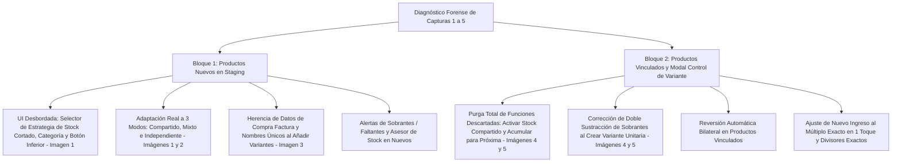
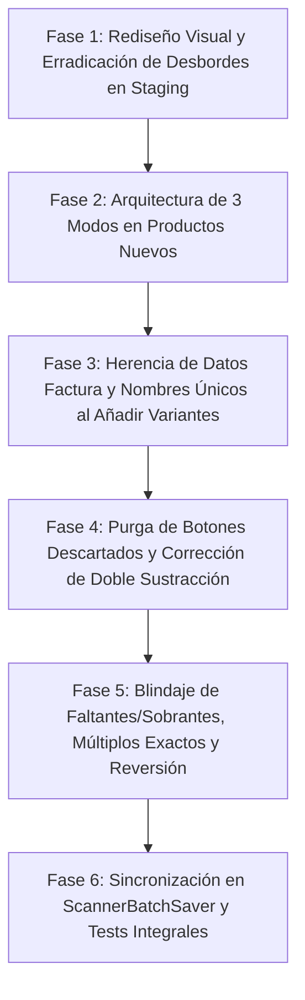

# PLAN MAESTRO: REINGENIERÍA DE 'CLASIFICAR Y CONFIRMAR', MODOS DE STOCK Y CONTROL DE VARIANTE

**Documento:** `analisis_proyecto/PLAN_REINGENIERIA_CLASIFICAR_CONFIRMAR_MODOS_STOCK_Y_CONTROL_VARIANTE.md`  
**Fecha:** 31 de Octubre de 2026  
**Versión:** 1.0 — Especificación Técnica Definitiva (Mobile Awards Quality)  
**Estado:** Esperando Aprobación de Plan de Trabajo (Paso 1: Diagnóstico Forense y Diseño Arquitectónico — CÓDIGO INTACTO)  
**Metodología:** Loop Autónomo + Árbitro Interno Adversarial (Test-Driven, Zero-Regressions & Zero-Overflows)

---

## 1. RESUMEN EJECUTIVO Y DIAGNÓSTICO FORENSE DE LAS 5 CAPTURAS

Tras la realización de pruebas exhaustivas en el módulo de escaneo de facturas, específicamente en la pantalla **`Clasificar y Confirmar`** (`InvoiceStagingScreen`) y en su modal interactivo **`Control de Variante`** (`ComparativeUpdateModal`), se evidenciaron inconsistencias críticas tanto en la experiencia visual (UI/UX) como en la herencia de datos contables y la lógica matemática de stock para **Productos Nuevos** y **Productos Vinculados** a la base de datos.



---

### 1.1. Matriz Comparativa Forense por Captura de Pantalla

| Captura | Pantalla / Componente | Timestamp | Problema Evidenciado | Causa Raíz Identificada | Impacto en el Negocio / UX |
| :--- | :--- | :--- | :--- | :--- | :--- |
| **Imagen 1** | `Clasificar y Confirmar` (`StagingProductGroupCard`) | `10:25 PM` | **1.** `Estrategia de Stock:` muestra `[✓ 🔗 Compartido] [📦 Indepe...]` cortado a la derecha sin scroll horizontal; la opción `Mixto` está totalmente inaccesible.<br>**2.** Uso de emojis Unicode (`🔗`, `📦`).<br>**3.** Selector de Categoría truncado a `"Seleccion..."`.<br>**4.** Botón inferior `+ Añadir otra presentación (Fraccionamien...` colisiona con el botón flotante `[^]` (`_showScrollToTop`). | Fila construida con `Row` no acotado horizontalmente y `Wrap` interno en `staging_product_group_card.dart` (líneas 653–672). Emojis introducen renderizado inconsistente según el SO Android. | **Crítico UX / Accesibilidad:** Imposibilita al usuario elegir la estrategia `Mixto` o `Independiente` en teléfonos de 320–380dp de ancho. |
| **Imagen 2** | `Clasificar y Confirmar` (`VariantEditorRow` en Nuevo Producto) | `10:26 PM` | Aunque el usuario seleccionó `Estrategia de Stock: Compartido`, la tarjeta de la variante sigue mostrando los inputs de compra independientes (`Empaque: DOC`, `Unid x Empaque: 12`, `Compró: 0.5`, `P. Total: S/ 86.80`, `Costo Unit.: S/ 14.47`). | `VariantEditorRow` (líneas 995–1245) renderiza siempre el bloque de compra independiente para variantes no vinculadas, ignorando `group.modoStock == 'COMPARTIDO'`. No existe un Bloque Maestro de Compra Compartida a nivel de grupo. | **Severo / Confusión Conceptual:** El usuario no percibe la ventaja de la compra compartida centralizada y se confunde creyendo que cada variante comprará medio docena por separado. |
| **Imagen 3** | `Clasificar y Confirmar` (`addNewVariantToGroup`) | `10:26 PM` | Al presionar `+ Añadir otra presentación`, la nueva tarjeta nace con `"Nueva presentación"` y todos los costos y montos en **`0.00`** (`UND`, `1`, `1`, `P. Total: 0.00`, `P. Venta: 0.00`), forzando al usuario a digitar todo desde cero. | `ScannerProvider.addNewVariantToGroup` (líneas 1248–1282) instancia un `StagingVariant` con valores dummy en cero y nombre estático `"Nueva presentación"`, sin heredar el costo unitario base extraído de la factura ni derivar un nombre único. | **Severo UX / Pérdida de Datos:** Fricción innecesaria; alto riesgo de error humano al reescribir costos y colisión de nombres de variantes en SQLite. |
| **Imagen 4** | `Clasificar y Confirmar` (`VariantEditorRow` en Producto Vinculado) | `10:28 PM` | **1.** Presencia de los 2 botones obsoletos: `Activar Stock Compartido (Pool único)` y `Acumular las 2 unid. para tu próxima compra`.<br>**2.** Si se presiona `+ Enviar las 2 unid. a variante 'Unidad (x1)'`, el stock resultante no cuadra de forma bidireccional si se elimina la tarjeta hija. | En `variant_editor_row.dart` (líneas 745–772) persisten botones que fueron descartados en las especificaciones maestras de negocio. | **Confusión Operativa:** Ofrece activar pools globales o acumular residuos en el limbo, contradiciendo el blindaje contable de no dejar unidades sueltas sin vender. |
| **Imagen 5** | Modal `Control de Variante` (`ComparativeUpdateModal` / `ModalStockSection`) | `10:29 PM` | **1.** Presencia idéntica de los 2 botones obsoletos (`Activar Stock Compartido` y `Acumular`).<br>**2.** `_crearVarianteSobrante` en `comparative_update_modal.dart` (líneas 657–669) resta el sobrante del ingreso y luego llama a `createLeftoverVariant` que vuelve a restarlo, provocando una **doble sustracción** del stock ingresante. | En `comparative_update_modal.dart` (líneas 657–658), se asigna `adjustedStock = currentIngreso - sobrante` a `stockIngresanteOverride`, y dentro de `scanner_provider.dart` (línea 839) se vuelve a restar `leftoverAmount`. | **Crítico / Corrupción Matemática:** Si el ingreso era 4 y sobraban 2, el stock ingresante de la madre pasaba a `4 - 2 = 2` y luego a `2 - 2 = 0` unid. base, desapareciendo 2 unidades del inventario. |

---

## 2. AUDITORÍA FORENSE EN CÓDIGO (ARCHIVOS Y LÍNEAS EXACTAS)

### 2.1. `staging_product_group_card.dart`
* **Líneas 649–711 (`_buildStrategySelectorChips`):**
  ```dart
  // ❌ DESBORDE HORIZONTAL:
  Row(
    children: [
      Text("Estrategia de Stock:"),
      const SizedBox(width: 8),
      Wrap(
        spacing: 6,
        children: [
          _buildStrategyChoiceChip(group, 'COMPARTIDO', '🔗 Compartido', Colors.teal, isDark),
          _buildStrategyChoiceChip(group, 'INDEPENDIENTE', '📦 Independiente', Colors.blueGrey, isDark),
          _buildStrategyChoiceChip(group, 'MIXTO', '⚡ Mixto', Colors.amber, isDark),
        ],
      ),
    ],
  )
  ```
  * **Causa Raíz:** `Row` entrega ancho no acotado (`unbounded constraints`) a sus hijos. Un `Wrap` dentro de un `Row` no rompe en múltiples líneas y se desborda a la derecha. Además, los strings contienen emojis Unicode redundantes (`🔗`, `📦`, `⚡`).
* **Líneas 619–640 (`SmartDropdownSearch` de Categoría):**
  * El `Expanded(flex: 5)` en pantallas estrechas contrae el input provocando el truncamiento del hint `"Seleccion..."`. Requiere optimización de padding y auto-escalado de fuente.
* **Líneas 471–488 (Botón Inferior `+ Añadir otra presentación`):**
  * El botón abarca todo el ancho pero el contenedor inferior carece de margen derecho respecto al botón flotante `_showScrollToTop` (`[^]`), provocando que el FAB oculte parcialmente el texto del botón o cause toques erróneos.

---

### 2.2. `scanner_provider.dart`
* **Líneas 1248–1282 (`addNewVariantToGroup`):**
  ```dart
  // ❌ NACE CON DATOS EN CERO Y NOMBRE ESTÁTICO:
  group.variantes.add(
    StagingVariant(
      nombreEspecifico: "Nueva presentación", // Colisión asegurada si se añaden varias
      umpCompra: "UND",
      cantidadUmpComprada: 1.0,
      precioUmpProveedor: 0.0,
      totalPagoLote: 0.0,
      unidadesPorLote: 1,
      unidadVenta: "Unidad",
      unidadesPorVenta: 1,
      costoUnitarioSugerido: 0.0,
      factorGananciaVentaSugerido: 1.35,
      precioVentaSugerido: 0.0,
      ...
    ),
  );
  ```
  * **Causa Raíz:** No consulta el producto escaneado original (`group.variantes.first` o datos del lote) para heredar el costo base, la cantidad del lote o la estrategia compartida.
* **Líneas 1079–1093 (`setGroupStockStrategy`):**
  ```dart
  void setGroupStockStrategy(String groupUuid, String modoStock) {
    var group = _findGroup(groupUuid);
    if (group == null) return;
    group.modoStock = modoStock;
    if (modoStock == 'COMPARTIDO') {
      for (var v in group.variantes) { v.usaStockCompartido = true; }
    } else if (modoStock == 'INDEPENDIENTE') {
      for (var v in group.variantes) { v.usaStockCompartido = false; }
    }
    notifyListeners();
  }
  ```
  * **Causa Raíz:** Al cambiar a `COMPARTIDO`, NO calcula `group.stockCompartido` ni `group.costoBase` basándose en el lote ingresante de la factura. El grupo queda con `stockCompartido = 0` y `costoBase = 0.0` hasta que se guarde o se ejecute otro método.
* **Líneas 817–870 (`createLeftoverVariant`):**
  * Resta `leftoverAmount` de `sourceVariant.stockIngresanteOverride`:
    ```dart
    int nuevoIngresoPrincipal = max(0, currentIngresoBase - leftoverAmount);
    sourceVariant.stockIngresanteOverride = nuevoIngresoPrincipal;
    ```
    Cuando se llama desde `comparative_update_modal.dart` (línea 658), el modal ya había hecho `stockIngresanteOverride = currentIngreso - sobrante;`, produciendo una doble resta errónea.
* **Líneas 164–205 (`unresolvedStockErrorsCount`):**
  * Utiliza flags descartadas `v.allowDeficitApproved` y `v.allowLeftoverInReserve`, y evalúa todas las variantes por separado aún cuando el grupo esté en modo `COMPARTIDO`, ignorando las reglas del Asesor de Stock.

---

### 2.3. `variant_editor_row.dart`
* **Líneas 745–772 (Botones Descartados en la Alerta de Sobrante):**
  * Mantiene `Activar Stock Compartido (Pool único)` (líneas 745–758) y `Acumular las X unid. para tu próxima compra` (líneas 759–772).
* **Líneas 995–1248 (Renderizado de Nueva Variante):**
  * No adapta su formulario según la estrategia de stock (`COMPARTIDO`, `MIXTO`, `INDEPENDIENTE`). Muestra siempre los 4 inputs de compra (`Empaque Prov.`, `Unid x Empaque`, `Compró`, `P. Total`) aún cuando la variante tome stock y costo del pozo compartido central.

---

### 2.4. `comparative_update_modal.dart` y `modal_stock_section.dart`
* **`comparative_update_modal.dart` Líneas 649–675 (`_crearVarianteSobrante`):**
  ```dart
  // ❌ DOBLE SUSTRACCIÓN DE SOBRANTE:
  int adjustedStock = currentIngreso - sobrante;
  widget.variant.stockIngresanteOverride = adjustedStock; // Resta 1
  ...
  final newVariantUuid = widget.provider.createLeftoverVariant(
    widget.variant.uuidTemporal, sobrante // createLeftoverVariant vuelve a restar sobrante! (Resta 2)
  );
  ```
* **`modal_stock_section.dart` Líneas 482–531 (Botones Descartados dentro del Modal):**
  * Botón 2: `Activar Stock Compartido (Pool único)` (líneas 482–505).
  * Botón 3: `Acumular las X unid. para tu próxima compra` (líneas 516–531).
* **Falta de Botones Rápidos de Ajuste al Múltiplo Exacto:**
  * En Sobrantes: No ofrece ajustar el nuevo ingreso a `completas * factor - stockBD` ni completar a `(completas + 1) * factor - stockBD`.
  * En Faltantes: No ofrece enviar el stock a variante unitaria `(x1)`.

---

### 2.5. `invoice_staging_screen.dart`
* **Líneas 242–252 y 268–302 (`_scrollToFirstStockConflict` y `_showStockErrorModal`):**
  * Verifican `!variant.allowDeficitApproved` y `!variant.allowLeftoverInReserve`, manteniendo viva la lógica de acumulación descartada y generando bloqueos falsos en modo compartido.

---

### 2.6. `scanner_batch_saver.dart`
* **Líneas 109–141 y 355–395 (Persistencia de Grupos y Variantes Nuevas):**
  * Requiere garantizar que las variantes creadas por sobrante se vinculen correctamente con su variante madre en auditoría (`stock_ledger`), y que el pool compartido y costo base se graben íntegros en SQLite.

---

## 3. ARQUITECTURA DE LOS 3 MODOS DE STOCK EN PRODUCTOS NUEVOS

Para que la experiencia en `Clasificar y Confirmar` sea intuitiva, robusta y matemáticamente intachable, el diseño de la tarjeta de producto nuevo (`StagingProductGroupCard`) y de sus variantes (`VariantEditorRow`) se adaptará en tiempo real según la estrategia elegida:

```
┌─────────────────────────────────────────────────────────────────────────────┐
│ 5  NUEVO PRODUCTO GENERAL                                      [🔍 Buscar] │
│    En Factura: 'DC/A IFIS COLORS UNIV 17...'                                │
│    [Nombre Principal: Diccionario/Agenda                          ]        │
│    [Marca: Ifis ▾ ]             [Categoría: General ▾ ]                    │
│                                                                             │
│    Estrategia de Stock:                                                     │
│    ┌───────────────────┬─────────────────────┬───────────────────┐         │
│    │  🔗 Compartido    │   📦 Independiente  │     🔀 Mixto      │ (100% W)│
│    └───────────────────┴─────────────────────┴───────────────────┘         │
└─────────────────────────────────────────────────────────────────────────────┘
```

### 3.1. Modo `Compartido` (`Stock Compartido Centralizado`)
1. **Bloque Maestro de Compra Compartida:**
   * Al seleccionar `Compartido`, la cabecera del grupo muestra un panel maestro compacto con los datos extraídos de la factura:
     * **Stock Base Ingresando:** `Compró × Unid x Empaque` (ej. `0.5 × 12 = 6 unid. base`).
     * **Costo Base Unitario:** `P. Total ÷ Stock Base` (ej. `S/ 86.80 ÷ 6 = S/ 14.47`).
     * **Total Compra Factura:** `S/ 86.80`.
2. **Comportamiento de las Tarjetas de Variantes Hijas:**
   * **Costo Automático:** Se calcula y muestra en tiempo real como `Costo Base Unitario × Factor de Venta` (no editable directamente en la variante secundaria, garantizando coherencia).
   * **Sección de Stock (Cupo Vendible):**
     * Muestra el stock físico máximo vendible: `stockBaseCompartido ~/ factorVenta`.
     * Campo opcional: **Stock disponible para vender (Cupo)**.
     * **Regla Inquebrantable:** `cupo <= (stockBaseCompartido ~/ factorVenta)`. Si el usuario ingresa un número mayor, se bloquea y se clampa visualmente al máximo formable.
   * **No duplicidad de compras:** Las variantes secundarias no muestran inputs de compra de lote (`DOC`, `12`, `0.5`, `86.80`), eliminando confusión.
3. **Asesor de Stock en Modo Compartido:**
   * **Caso A (Verde / Oculto):** Si al menos una variante compartida divide exactamente el pool (`stockBase % factor == 0`), el grupo está en verde y listo para guardar.
   * **Caso B (Recomendación Informativa):** Si todas las variantes dejan residuo pero forman al menos 1 paquete, el Asesor sugiere en un banner compacto crear la variante unitaria `(x1)` para liquidar sueltas.
   * **Caso C (Bloqueo Obligatorio):** Si `stockBase < factor` para todas las variantes (0 paquetes formables en total), se bloquea el guardado e instruye crear la variante unitaria `(x1)` en 1 toque.

---

### 3.2. Modo `Mixto` (`Convivencia Compartido / Stock Propio`)
1. **Identidad del Grupo:**
   * El grupo mantiene un pool compartido para aquellas variantes que lo activen, mientras permite que otras variantes gestionen su propio inventario.
2. **Selector por Variante:**
   * Cada tarjeta de variante (`VariantEditorRow`) incluye un selector segmentado limpio:
     * `[ 🔗 Compartido ]` vs. `[ 📦 Stock Propio ]`
   * Si la variante está en `Compartido`: Se alimenta del pozo base y calcula su costo según el costo unitario base del grupo.
   * Si la variante está en `Stock Propio`: Despliega sus propios inputs de compra (`Empaque`, `Unid x Empaque`, `Compró`, `P. Total`) y aplica las reglas de sobrantes/faltantes independientes.

---

### 3.3. Modo `Independiente` (`Stock Propio`)
1. Cada variante gestiona su propio lote de compra, costo unitario y stock entrante.
2. Si `0 < stockBase < factor` (Déficit) o `stockBase % factor != 0` (Sobrante), se activa la tarjeta de alerta interactiva bloqueante con las 3 soluciones en 1 toque.

---

## 4. HERENCIA DE DATOS Y REGLA DE NOMBRES ÚNICOS AL AÑADIR VARIANTES

### 4.1. Primera Variante (Principal)
* Carga de forma 100% fiel con los datos detectados por la IA o el escáner:
  * `nombreEspecifico`: Nombre exacto del ítem escaneado (ej. `Colors Univ 170 hojas 60gr`).
  * `umpCompra`: `DOC` (o según factura).
  * `unidadesPorLote`: `12`.
  * `cantidadUmpComprada`: `0.5`.
  * `totalPagoLote`: `86.80`.
  * `costoUnitarioSugerido`: `14.47`.
  * `factorGananciaVentaSugerido`: `1.35`.
  * `precioVentaSugerido`: `19.53`.

### 4.2. A partir de la Segunda Variante (2.ª, 3.ª, etc.)
Cuando el usuario pulsa `+ Añadir otra presentación (Fraccionamiento)`:
1. **Herencia Inteligente de Datos:**
   * **En Modo Compartido:** La nueva variante hereda el pozo compartido (`usaStockCompartido = true`), el costo base `S/ 14.47`, margen `1.35`, unidad sugerida `Unidad` (`factor = 1`), calculando inmediatamente costo `S/ 14.47` y precio sugerido `S/ 19.53`.
   * **En Modo Independiente:** Hereda los parámetros base de costo unitario del producto escaneado, inicializando con empaque sugerido y factor `1`, pero sin valores en cero.
2. **Garantía Algorítmica de Nombres Únicos (Anti-Colisiones):**
   * El nombre de la nueva variante se genera dinámicamente mediante una función determinista `generateUniqueVariantName(group, baseUnit)`:
     * Toma el nombre base del ítem principal.
     * Añade la especificación de presentación: ej. `Colors Univ 170 hojas 60gr - Unidad (x1)` o `Colors Univ 170 hojas 60gr - Fracción #2`.
     * Si ya existe una variante con ese nombre en el grupo, añade un contador incremental: `Colors Univ 170 hojas 60gr - Unidad (x1) (2)`.
     * **Regla Estricta:** Jamás nacerá con `"Nueva presentación"` genérico ni repetirá el nombre de la variante principal ni de ninguna existente.
     * En Modo Mixto: Si coexisten variantes independientes y compartidas, se añade un distintivo limpio en la tarjeta (`[Compartido]` o `[Stock Propio]`).

---

## 5. BLINDAJE DE PRODUCTOS VINCULADOS Y MODAL `Control de Variante`

### 5.1. Purga Total de Funciones Descartadas (`Imágenes 4 y 5`)
* **Eliminar Definitivamente:**
  1. `Activar Stock Compartido (Pool único)` (tanto de la tarjeta `VariantEditorRow` como del modal `ComparativeUpdateModal`).
  2. `Acumular las X unid. para tu próxima compra` (tarjeta y modal).
* **Eliminar Código Muerto Asociado:**
  * Flags: `allowLeftoverInReserve`, `allowDeficitApproved`.
  * Métodos en `ScannerProvider`: `authorizeLeftoverInReserve`, `authorizeDeficitRegistration`.
  * Banners de acumulación: `formatAccumulationBadgeText`.

---

### 5.2. Corrección del Bug de Doble Sustracción y Creación de Variante Unitaria
* **Diagnóstico del Bug:**
  * En `comparative_update_modal.dart` (línea 657), `_crearVarianteSobrante` restaba `sobrante` de `stockIngresanteOverride`.
  * Luego llamaba a `widget.provider.createLeftoverVariant(..., sobrante)`, la cual volvía a restar `leftoverAmount` de `sourceVariant.stockIngresanteOverride`.
* **Solución Arquitectónica Unificada:**
  * Toda la matemática de división de stock y traspaso de compra reside de forma atómica y centralizada en `ScannerProvider.createLeftoverVariant`.
  * `_crearVarianteSobrante` únicamente guardará los campos normales de la variante y delegará el fraccionamiento a `createLeftoverVariant`, eliminando la sustracción local previa.
* **Flujo Exacto en Producto Vinculado (`Imágenes 4 y 5`):**
  * `Stock Actual: 4 unid. base` + `Ingreso Factura: +4 unid. base` = `Nuevo Total: 8 unid. base`.
  * Factor: `6` (`½ Docena`).
  * Completas: `1 ½ Docena (6 unid. base)`. Sobrante: `2 unid. base sueltas`.
  * Al pulsar `+ Enviar las 2 unid. a variante 'Unidad (x1)'`:
    1. El ingreso de la variante actual pasa de `+4 unid.` a **`+2 unid.`**.
    2. El `Nuevo Total` pasa de `8 unid.` a **`4 actuales + 2 ingreso = 6 unid. base = 1 ½ Docena exacta`**. La variante queda en verde sin errores.
    3. Si el producto ya cuenta con otra variante con `factor == 1` en BD/staging (que no sea la misma que se acaba de modificar a `x6`), las `2 unid.` se asignan a esa variante.
    4. Si no existe otra variante con `factor == 1` (caso de las `Imágenes 4 y 5`), se crea automáticamente en el grupo una **nueva variante unitaria `'Unidad (x1)'`**:
       * Nombre: Derivado limpio sin colisión (ej. `Latinoamericana - Unidad (x1)`).
       * Factor: `1`.
       * Stock entrante: `2 unid. base`.
       * Costo unitario base: `S/ 22.50`.
       * Margen: `1.35`.
       * Precio venta sugerido calculado coherentemente.
       * Metadatos de trazabilidad: `sourceVariantUuid = uuidMadre`, `allocatedBaseUnits = 2`, `allocatedPurchaseCost = costoSobrante`.
    5. Todo el producto queda 100% válido y listo para guardar.

---

### 5.3. Reversión Automática Bilateral
* Si el usuario elimina esa variante unitaria creada con las `2 unid.` sobrantes:
  1. `ScannerProvider.removeVariantByUuid` detecta `variantToRemove.sourceVariantUuid != null`.
  2. Llama a `revertLeftoverToMother(variantUuid)`.
  3. Las `2 unid. base` y su costo proporcional regresan automáticamente a la variante vinculada madre (`2 + 2 = 4 unid. de ingreso; total 4 + 4 = 8 unid. base`).
  4. Los controladores de texto de la madre se resincronizan inmediatamente mediante `didUpdateWidget`.
  5. La alerta naranja de `Sobrante detectado: forman 1 ½ Docena + 2 unid. sueltas` se reactiva instantáneamente, impidiendo guardar con datos inconsistentes.

---

### 5.4. Opciones Rápidas en 1 Toque (Sobrantes y Faltantes)
1. **En Caso de Sobrantes (`completas >= 1 && sobrante > 0`):**
   * Chip 1: `Divisores Exactos sugeridos (1 solo toque)` (`Unidad x1 -> 8 Unidades`, `Par x2 -> 4 Pares`, `Pack x4 -> 2 Packs`, `Pack x8 -> 1 Pack`).
   * Chip 2 (Ajuste Rápido al Múltiplo Inferior):
     * Fórmula: `targetIngreso = (completas * factor) - stockBD`.
     * Ejemplo en Imagen 4/5: `(1 * 6) - 4 = 2 unid.` -> `Ajustar ingreso a +2 unid. (Total: 6 u. = 1 ½ Docena)`.
   * Chip 3 (Completar al Múltiplo Superior):
     * Fórmula: `targetIngreso = ((completas + 1) * factor) - stockBD`.
     * Ejemplo en Imagen 4/5: `(2 * 6) - 4 = 8 unid.` -> `Completar ingreso a +8 unid. (Total: 12 u. = 2 ½ Docenas)`.
   * Botón Principal: `+ Enviar las X unid. a variante 'Unidad (x1)'`.
2. **En Caso de Faltantes (`0 < totalBase < factor`):**
   * Muestra claramente: `"Faltan X unid. para completar 1 [Unidad] (x[Factor])"`.
   * Opción 1: `Divisores Exactos sugeridos` de las unidades existentes (ej. si hay 4: `Unidad x1`, `Par x2`, `Pack x4`).
   * Opción 2: `Completar ingreso a +[faltan] unid. (Total: [factor] u. = 1 [Unidad])`.
   * Opción 3: `Enviar las unidades a variante 'Unidad (x1)'`.

---

## 6. PLAN DE TRABAJO DETALLADO POR FASES

El plan está estructurado bajo nuestra metodología de **Loop Autónomo + Árbitro Interno Adversarial**. Cada fase cuenta con sus archivos intervenidos, objetivos técnicos precisos y compuerta de validación (tests unitarios/widgets automatizados y verificación de cero desbordes en pantalla).



---

### Fase 1: Rediseño Visual y Erradicación de Desbordes en `InvoiceStagingScreen` y `StagingProductGroupCard`
* **Archivos a Intervenir:**
  * `lib/features/scanner/widgets/staging/staging_product_group_card.dart`
  * `lib/features/scanner/screens/invoice_staging_screen.dart`
* **Tareas Específicas:**
  1. Rediseñar el selector de `Estrategia de Stock` en `StagingProductGroupCard` (`_buildStrategySelectorChips`):
     * Sustituir el `Row` + `Wrap` desbordado por un contenedor de ancho completo (`Column` con subtítulo arriba y barra segmentada o chips expansivos abajo).
     * Envolver cada opción (`Compartido`, `Independiente`, `Mixto`) en `Expanded` + `FittedBox` para garantizar accesibilidad al 100% en pantallas desde `320dp` a tablets.
     * **Eliminar todos los emojis Unicode** (`🔗`, `📦`, `⚡`), empleando únicamente iconos vectoriales: `Icons.all_inclusive_rounded`, `Icons.inventory_2_outlined`, `Icons.shuffle_rounded`.
  2. Ajustar `SmartDropdownSearch` de `Categoría` para evitar el truncamiento `"Seleccion..."`.
  3. Ajustar el padding inferior de la lista en `InvoiceStagingScreen` y el margen del botón `+ Añadir otra presentación` para que no colisione visual ni táctilmente con el botón flotante `[^]` (`_showScrollToTop`).
* **Compuerta de Validación Fase 1:**
  * Test de layout en pantallas estrechas (`width = 320dp` y `width = 360dp`).
  * Verificación de que las 3 opciones de estrategia son visibles y clickeables sin desbordes amarillos/negros (`Aestethics and Responsiveness`).

---

### Fase 2: Arquitectura y Adaptación Real a los 3 Modos de Stock en Productos Nuevos
* **Archivos a Intervenir:**
  * `lib/features/scanner/widgets/staging/staging_product_group_card.dart`
  * `lib/features/scanner/widgets/staging/variant_editor_row.dart`
  * `lib/features/scanner/providers/scanner_provider.dart`
  * `lib/features/scanner/models/scanner_models.dart`
* **Tareas Específicas:**
  1. Actualizar `ScannerProvider.setGroupStockStrategy`:
     * Al cambiar a `COMPARTIDO`: Calcular automáticamente el pool compartido inicial en unidades base (`group.stockCompartido = sum(cant * unidPorLote)`) y el costo unitario base promedio (`group.costoBase = totalPago / stockBase`).
  2. Crear en `StagingProductGroupCard` el **Bloque Maestro de Compra Compartida**:
     * Mostrar claramente: `Stock Base Ingresando: X unid. base`, `Costo Base Unitario: S/ Y`, `Total Compra Factura: S/ Z`.
  3. Adaptar `VariantEditorRow` cuando la variante es `COMPARTIDO`:
     * Ocultar inputs de compra de lote repetitivos en las variantes.
     * Calcular automáticamente el costo de la presentación como `costoBase * factorVenta`.
     * Incluir campo interactivo de **Cupo vendible** con clamping estricto: `cupo <= stockBaseCompartido ~/ factorVenta`.
  4. Adaptar `VariantEditorRow` cuando el grupo está en `MIXTO`:
     * Mostrar switch segmentado en la variante: `[ Compartido ]` vs `[ Stock Propio ]`.
* **Compuerta de Validación Fase 2:**
  * Test unitario de cálculo de pool y costo base al conmutar entre los 3 modos.
  * Test de UI: En modo compartido no se muestran inputs de compra redundantes y el costo se deriva del pozo base.

---

### Fase 3: Herencia Inteligente de Datos de Compra y Generador de Nombres Únicos
* **Archivos a Intervenir:**
  * `lib/features/scanner/providers/scanner_provider.dart`
  * `lib/features/scanner/widgets/staging/staging_product_group_card.dart`
  * `lib/features/scanner/widgets/staging/variant_editor_row.dart`
* **Tareas Específicas:**
  1. Reemplazar la instanciación vacía de `addNewVariantToGroup` en `scanner_provider.dart`:
     * Obtener los datos base del producto escaneado (de la primera variante).
     * Heredar costo unitario base, empaque de compra o pozo compartido según el modo activo.
  2. Implementar `generateUniqueVariantName`:
     * Derivar el nombre a partir de la variante principal y la unidad/fraccionamiento (ej. `Colors Univ 170 hojas 60gr - Fracción #2`).
     * Comprobar contra todos los nombres existentes en el grupo para garantizar **cero colisiones**.
     * Eliminar el texto por defecto `"Nueva presentación"`.
  3. Primera variante (Principal): Blindar para que conserve íntegros sus datos escaneados sin alteración.
* **Compuerta de Validación Fase 3:**
  * Test automatizado: Al añadir 3 variantes consecutivas a un producto escaneado, todas heredan el costo base y reciben nombres únicos diferentes entre sí y distintos de la principal.

---

### Fase 4: Purga de Botones Descartados y Corrección de Doble Sustracción en Sobrantes
* **Archivos a Intervenir:**
  * `lib/features/scanner/widgets/staging/variant_editor_row.dart`
  * `lib/features/scanner/widgets/staging/comparative_modal/comparative_update_modal.dart`
  * `lib/features/scanner/widgets/staging/comparative_modal/ui/modal_stock_section.dart`
  * `lib/features/scanner/providers/scanner_provider.dart`
* **Tareas Específicas:**
  1. **Eliminar de raíz los dos botones descartados:**
     * `Activar Stock Compartido (Pool único)` (en `variant_editor_row.dart` líneas 745–758 y `modal_stock_section.dart` líneas 482–505).
     * `Acumular las X unid. para tu próxima compra` (en `variant_editor_row.dart` líneas 759–772 y `modal_stock_section.dart` líneas 516–531).
  2. Purgar las flags y métodos obsoletos: `allowLeftoverInReserve`, `allowDeficitApproved`, `authorizeLeftoverInReserve`, `authorizeDeficitRegistration`.
  3. **Corregir el bug de Doble Sustracción en `comparative_update_modal.dart` (`_crearVarianteSobrante`):**
     * Eliminar `widget.variant.stockIngresanteOverride = adjustedStock;` antes de `createLeftoverVariant`.
     * Delegar la disminución exacta y el ajuste de costo de la madre exclusivamente a `ScannerProvider.createLeftoverVariant`.
* **Compuerta de Validación Fase 4:**
  * Test de stock: Variante vinculada con 4 actuales + 4 ingreso (total 8) al vender por ½ Docena (x6): al enviar 2 unid. a variante unitaria, la madre queda exactamente con 2 unid. de ingreso (total 6 = 1 ½ Docena exacta) y la hija unitaria con 2 unid. base (suma total conservada = 8).

---

### Fase 5: Blindaje de Alertas, Múltiplos Exactos y Reversión Automática
* **Archivos a Intervenir:**
  * `lib/features/scanner/widgets/staging/comparative_modal/ui/modal_stock_section.dart`
  * `lib/features/scanner/widgets/staging/variant_editor_row.dart`
  * `lib/features/scanner/providers/scanner_provider.dart`
  * `lib/features/scanner/screens/invoice_staging_screen.dart`
* **Tareas Específicas:**
  1. En `modal_stock_section.dart` y `variant_editor_row.dart`:
     * Incorporar los chips de **Ajuste Rápido al Múltiplo Exacto**:
       * En Sobrantes: Opción de ajustar ingreso a `(completas * factor) - stockBD` y completar a `((completas + 1) * factor) - stockBD`.
       * En Faltantes: Bloquear guardado mostrando faltante exacto y ofrecer: (1) Divisores exactos, (2) Completar a 1 paquete, (3) Enviar a variante unitaria `(x1)`.
  2. Perfeccionar `ScannerProvider.createLeftoverVariant` y `revertLeftoverToMother` para productos vinculados:
     * Si la variante hija unitaria es eliminada, reintegrar las unidades y el costo exacto a la madre vinculada y reactivar la alerta de sobrante.
  3. Actualizar `unresolvedStockErrorsCount` en `ScannerProvider` e `InvoiceStagingScreen`:
     * Erradicar referencias a `allowLeftoverInReserve` y `allowDeficitApproved`.
     * Aplicar reglas del Asesor de Stock en grupos compartidos (no bloquear falsamente si hay divisores exactos).
* **Compuerta de Validación Fase 5:**
  * Test de ciclo de vida completo: Sobrante detectado -> Creación de variante unitaria -> Eliminación de variante unitaria -> Reversión exacta a la madre con reactivación de alerta.

---

### Fase 6: Sincronización en `ScannerBatchSaver` y Batería de Pruebas Automatizadas
* **Archivos a Intervenir:**
  * `lib/features/scanner/services/scanner_batch_saver.dart`
  * Nueva suite de tests: `test/scanner_staging_modos_stock_y_control_variante_test.dart`
* **Tareas Específicas:**
  1. En `scanner_batch_saver.dart`:
     * Asegurar que al persistir un producto nuevo en modo `COMPARTIDO`, `stock_compartido` y `costo_base` se graben en la tabla `productos` y en todas las `presentaciones_producto` asociadas.
     * Garantizar que las variantes unitarias creadas por sobrante se guarden con su respectivo movimiento en `stock_ledger` y auditoría.
  2. Implementar suite exhaustiva de tests automatizados (`scanner_staging_modos_stock_y_control_variante_test.dart`):
     * Test 1: Selector de Estrategia de Stock sin desbordes y 100% clickeable en 320dp.
     * Test 2: Modo Compartido calcula pool maestro y cupos en variantes.
     * Test 3: Herencia de datos y nombres únicos al pulsar `+ Añadir otra presentación`.
     * Test 4: Verificación de ausencia de botones descartados (`Activar Stock Compartido` y `Acumular`).
     * Test 5: Resolución de sobrante en producto vinculado sin doble resta contable.
     * Test 6: Reversión automática de unidades al eliminar la variante unitaria.
     * Test 7: Botones rápidos de redondeo a múltiplos exactos en modal y tarjeta.
* **Compuerta de Validación Fase 6:**
  * Ejecución exitosa de `flutter test test/scanner_staging_modos_stock_y_control_variante_test.dart` con 100% de aserciones aprobadas y `flutter analyze` con cero errores.

---

## 7. PROTOCOLO DEL ÁRBITRO INTERNO ADVERSARIAL

Durante toda la ejecución de las Fases, el **Árbitro Interno Adversarial** evaluará cada cambio con los siguientes criterios intransigentes:

1. **Invarianza Contable:**  
   `Stock Físico Entrante + Stock Físico en BD == Stock Total Distribuido`. Jamás se admitirá la creación o destrucción espontánea de unidades base ni la acumulación en reservas invisibles.
2. **Cero Desbordes Visuales (`No Overflows`):**  
   Toda fila o contenedor interactivo debe ajustarse fluidamente desde dispositivos ultra-angostos (`320dp`) hasta pantallas grandes. Ningún texto o botón puede quedar recortado ni inaccesible.
3. **Cero Emojis en Código Nuevo:**  
   Uso exclusivo de iconos vectoriales `Icons.*` de Flutter para mantener una apariencia profesional y uniforme en cualquier versión del sistema operativo.
4. **Respeto a las Reglas de Negocio Aprobadas:**  
   No revivir conceptos obsoletos como `"Acumular para tu próxima compra"` ni `"Activar Pool único"` desde tarjetas de producto individuales.
5. **No-Regresión en Base de Datos:**  
   La transacción atómica de `ScannerBatchSaver` debe mantener total compatibilidad con las tablas `productos`, `presentaciones_producto`, `facturas_carga` y `stock_ledger`.
