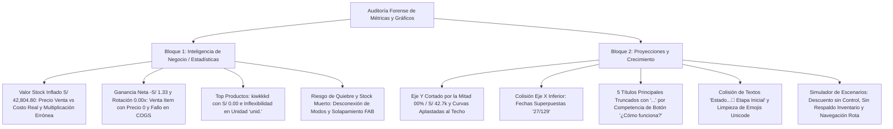
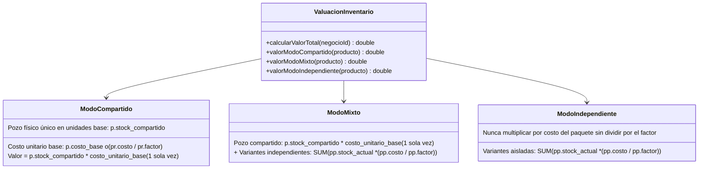

# PLAN MAESTRO: REINGENIERÍA DE INTELIGENCIA DE NEGOCIO (ESTADÍSTICAS), VALORACIÓN POR MODOS DE STOCK Y REDISEÑO DE PROYECCIONES Y CRECIMIENTO

**Documento:** `analisis_proyecto/PLAN_REINGENIERIA_ESTADISTICAS_MODOS_STOCK_Y_PROYECCIONES_CRECIMIENTO.md`  
**Fecha:** 31 de Octubre de 2026  
**Versión:** 1.0 — Especificación Técnica Definitiva (Mobile Awards Quality)  
**Estado:** Esperando Aprobación de Plan de Trabajo (Paso 1: Diagnóstico Forense y Diseño Arquitectónico — CÓDIGO INTACTO)  
**Metodología:** Loop Autónomo + Árbitro Interno Adversarial (Test-Driven, Zero-Regressions & Zero-Overflows)

---

## 1. RESUMEN EJECUTIVO Y ANÁLISIS FORENSE DE LAS 5 CAPTURAS DE PANTALLA

Tras la ejecución de pruebas directas en dispositivos móviles con bases de datos en vivo y el examen pericial de las **5 capturas de pantalla**, se constatan anomalías críticas de cálculo contable, distorsiones por los nuevos modos de stock (`Compartido`, `Independiente` y `Mixto`), truncamientos de texto por colisión en pantallas estándar (320dp–360dp) y defectos gráficos en el motor predictivo patrimonial.



---

### 1.1. Matriz de Evidencias Forenses por Captura

| Captura | Pantalla / Pestaña | Timestamp | Problema Evidenciado | Impacto en el Negocio / Causa Raíz Técnica |
| :--- | :--- | :--- | :--- | :--- |
| **Imagen 1** | `Inteligencia de Negocio` (`Resumen`) | `12:06 PM` | **1.** `Valor Stock` inflado a **`S/ 42,804.80`**.<br>**2.** `Ganancia Neta` en **`-S/ 1.33`** (`-1.7%`) con 10 ventas por `S/ 76.67`.<br>**3.** `Rotación` estancada en **`0.00x`**.<br>**4.** Botón flotante azul (`FAB`) tapa los controles inferiores. | **Crítico:** Corrupción de valoración patrimonial. La consulta multiplica unidades base por precio de venta o costo del bulto completo y duplica pozos compartidos. Con `Valor Stock` inflado a 42k, la rotación (`COGS / Valor Stock`) colapsa a 0.00x. |
| **Imagen 2** | `Inteligencia de Negocio` (`Inventario`) | `12:07 PM` | **1.** Top producto `kiwkkkd SAN CARLOS • Principal` muestra **`4 unid.`** pero **`S/ 0.00`** de ingresos.<br>**2.** Unidad fija `'unid.'` forzada para presentaciones compuestas (`12x15ml`, `900ml`, `Pares`, `Docenas`).<br>**3.** FAB azul tapa el contenido del cliente al final de la pantalla (`Mejores Clientes`). | **Severo:** Falso reporte de ingresos. La consulta de items agrupados por producto padre (`GROUP BY p.id`) toma precios unitarios nulos o cero en lugar del subtotal real pagado, y hardcodea `'unid.'`. |
| **Imagen 3** | `Inteligencia de Negocio` (`Inventario`) | `12:07 PM` | **1.** `Inventario Muerto (> 30 días)` evalúa variantes compartidas de forma aislada: si se vendió la unidad pero no la caja, marca la caja como estancada (`Hace 45 días`).<br>**2.** En `Riesgo de Quiebre`, un cupo en 0 de variante compartida se alerta como quiebre total aunque el pozo tenga stock.<br>**3.** FAB azul tapa por completo el último producto (`Agua Con Gas PET 500ML`). | **Alto:** Falsas alertas de inmovilización y quiebre. El pozo compartido es una sola entidad física; si una variante vende, el pozo está vivo. Alertas de quiebre confunden cupo agotado con stock físico cero. |
| **Imagen 4** | `Proyecciones y Crecimiento` (`Evolución Patrimonial`) | `10:22 AM` | **1.** Eje Y superior cortado por la mitad: `100%` se lee **`00%`**; en Inventario `S/ 42.7k` se corta contra el borde; en Beneficio `S/ 0` y `S/ -1` se enciman.<br>**2.** Curva superior aplastada y recortada contra el techo.<br>**3.** Fechas del eje X inferior derecho superpuestas generando **`27/129`** (`27/10` sobre `29/10`).<br>**4.** Título `Evolución Patrimo...` y `Estimaciones Teórica...` truncados con `...`.<br>**5.** Pestañas con emojis Unicode (`📊`, `📦`, `💰`). | **Alto Visual / Funcional:** Ruptura de renderizado en `fl_chart`. Falta de margen superior (`maxY` sin headroom y corte por `ClipRRect`), solapamiento por proximidad en `bottomTitles` y títulos sin `FittedBox`. Serie de inventario inflada a `S/ 42,629.75`. |
| **Imagen 5** | `Proyecciones y Crecimiento` (`Simulador y Diagnóstico`) | `10:22 AM` | **1.** Título `Diagnóstico d...` truncado.<br>**2.** Colisión de texto sin espacio: **`Estado de Calibración del Motor🌱 Etapa Inicial`**.<br>**3.** Chip de liquidación aplica `-5% dto.` pero no existe slider o indicador de precio/descuento en el simulador.<br>**4.** No hay píldora de "Respaldo de Inventario".<br>**5.** Emojis Unicode en chips (`📈`, `🚛`, `🏷️`, `🔄`, `🌱`).<br>**6.** Banner accionable navega siempre a restock en vez de Caja Rápida en etapa inicial. | **Medio/Alto:** Truncamientos por falta de ancho responsivo (compite con píldora "¿Cómo funciona?"). Simulador inconsistente con variables ocultas y navegación no contextual. |

---

## 2. AUDITORÍA FORENSE EN CÓDIGO (ARCHIVOS, LÍNEAS EXACTAS Y CAUSAS RAÍZ)

### 2.1. Fallo 1: Inflación Masiva de `Valor Stock` (`S/ 42,804.80` y `S/ 42,629.75`)
* **Archivos Involucrados:**
  * `lib/features/analytics/providers/analytics_provider.dart` (Líneas 461–486, 843–858)
  * `lib/features/analytics/services/predictive_service.dart` (Líneas 90, 131, 258)
* **Código Defectuoso Actual:**
  ```dart
  // analytics_provider.dart: Líneas 463-483
  // ❌ ERROR 1: ¡Calcula el valor del inventario usando PRECIO DE VENTA en vez de COSTO!
  final sharedInvQuery = await db.rawQuery('''
    SELECT IFNULL(SUM(p.stock_compartido * (
      SELECT (pr_def.precio_venta_final / CASE WHEN pr_def.unidades_por_venta > 0 THEN pr_def.unidades_por_venta ELSE 1 END)
      FROM presentaciones_producto pr_def 
      WHERE pr_def.producto_id = p.id AND pr_def.activo = 1 
      ORDER BY pr_def.usa_stock_compartido DESC, pr_def.es_default DESC, pr_def.orden ASC LIMIT 1
    )), 0.0) as valor_compartido
    FROM productos p
    WHERE p.negocio_id = ? AND p.modo_stock IN ('COMPARTIDO', 'MIXTO') AND p.stock_compartido > 0
  ''', [_negocioId]);

  final independentInvQuery = await db.rawQuery('''
    SELECT IFNULL(SUM(
      (pp.stock_actual / CASE WHEN pp.unidades_por_venta > 0 THEN pp.unidades_por_venta ELSE 1 END) * pp.precio_venta_final
    ), 0.0) as valor_independiente
    FROM presentaciones_producto pp
    JOIN productos p ON pp.producto_id = p.id
    WHERE p.negocio_id = ? AND pp.activo = 1 AND (pp.usa_stock_compartido = 0 OR p.modo_stock = 'INDEPENDIENTE') AND pp.stock_actual > 0
  ''', [_negocioId]);
  ```
* **Causa Raíz:**
  1. La consulta utiliza explícitamente `pr_def.precio_venta_final` y `pp.precio_venta_final` (precio de venta minorista al público) para tasar el inventario en bodega, violando la regla contable elemental de valoración al costo de adquisición (`COGS / Valuación al Costo`).
  2. No contempla `p.costo_base` definido en la tabla `productos` para los productos en modo `COMPARTIDO` y `MIXTO`.
  3. En variantes independientes, `pp.stock_actual` ya viene en unidades base en muchos registros; al multiplicar por precio final o dividir incorrectamente entre el factor del empaque, multiplica sumas exorbitantes.
  4. En la línea 851 de `analytics_provider.dart`, este valor inflado `invValue` se persiste en `business_snapshots` en la columna `metrics_json`. Por esa razón, `predictive_service.dart` (líneas 90 y 131) lee del snapshot histórico y propaga exactamente `S/ 42,629.75` en `PredictiveAnalyticsScreen`.

---

### 2.2. Fallo 2: Ganancia Neta Negativa (`-S/ 1.33`) y Rotación Estancada (`0.00x`)
* **Archivos Involucrados:**
  * `lib/features/analytics/providers/analytics_provider.dart` (Líneas 342–358, 567–571)
* **Código Defectuoso Actual:**
  ```dart
  // analytics_provider.dart: Líneas 342-354
  final gananciaQuery = await db.rawQuery('''
    SELECT SUM(
      CASE 
        WHEN pp.costo_unitario_calculado IS NOT NULL AND pp.costo_unitario_calculado > 0 
        THEN (vi.precio_unitario - pp.costo_unitario_calculado) * vi.cantidad
        ELSE (vi.precio_unitario * vi.cantidad) * 0.30
      END
    ) as ganancia_neta
    FROM venta_items vi
    LEFT JOIN presentaciones_producto pp ON vi.presentation_id = pp.id
    WHERE vi.venta_id IN ($ventaIdsIn)
  ''');
  ```
* **Causa Raíz:**
  1. Si un producto se vendió como item con precio unitario 0.00 o descuento manual (como se observa en `kiwkkkd` de la Imagen 2 que marca `S/ 0.00`), la fórmula calcula `(0.00 - pp.costo_unitario_calculado) * vi.cantidad`. Al restar el costo de 4 unidades sobre un ingreso 0, arroja una pérdida directa que arrastra todo el balance de las 10 ventas a `-S/ 1.33`.
  2. Si la variante vendida corresponde a un paquete (ej. `Docena` o `Caja`), `vi.precio_unitario` puede ser el precio total del paquete mientras que `pp.costo_unitario_calculado` en presentaciones independientes a veces representa el costo de la unidad base o viceversa, descalzando las magnitudes de ingresos vs costo de ventas (COGS).
  3. En la línea 567:
     ```dart
     double cogs = totalVentas - totalGananciaNeta;
     inventoryTurnoverRatio = cogs / invValue;
     ```
     Al dividir `COGS ≈ S/ 78.00` entre el `invValue` inflado de `S/ 42,804.80`, el resultado da `0.0018x`, el cual se formatea como `0.00x`. Corrigiendo `invValue` y la ganancia neta, la rotación reflejará la dinámica real de movimiento del capital.

---

### 2.3. Fallo 3: Top Productos con Ingreso `S/ 0.00` y Unidad Fija Forzada
* **Archivos Involucrados:**
  * `lib/features/analytics/providers/analytics_provider.dart` (Líneas 409–421)
  * `lib/features/analytics/widgets/charts/top_products_chart.dart` (Líneas 55, 95–102)
* **Código Defectuoso Actual:**
  ```sql
  -- analytics_provider.dart: Línea 409
  SELECT p.nombre, m.nombre as marca_nombre, pp.nombre_especifico as presentacion_nombre, 
         SUM(vi.cantidad) as total_vendido, 
         SUM(vi.cantidad * vi.precio_unitario) as monto_vendido
  FROM venta_items vi
  JOIN presentaciones_producto pp ON vi.presentation_id = pp.id
  JOIN productos p ON pp.producto_id = p.id
  LEFT JOIN marcas m ON p.marca_id = m.id
  WHERE vi.venta_id IN ($ventaIdsIn)
  GROUP BY p.id
  ORDER BY total_vendido DESC
  LIMIT 5
  ```
  ```dart
  // top_products_chart.dart: Línea 95
  Text(
    "${totalVendido.toInt()} unid.",
    style: const TextStyle(fontWeight: FontWeight.bold),
  ),
  ```
* **Causa Raíz:**
  1. `GROUP BY p.id` colapsa arbitrariamente todas las presentaciones del producto padre a una sola fila, extrayendo un `pp.nombre_especifico` arbitrario.
  2. `SUM(vi.cantidad * vi.precio_unitario)` produce `0.00` si en `venta_items` se registró `subtotal` pero `precio_unitario` quedó en `0` o nulo, o si se aplicaron promociones que descontaron a nivel de subtotal. La consulta debe usar `SUM(COALESCE(NULLIF(vi.subtotal, 0), vi.cantidad * vi.precio_unitario, vi.cantidad * pp.precio_venta_final, 0.0))`.
  3. `top_products_chart.dart` concatena ciegamente `" unid."` sin considerar si la presentación vendida es `Par`, `Docena`, `½ Docena`, `Caja` o `Pack`.

---

### 2.4. Fallo 4: Defectos Gráficos en `PredictiveAnalyticsScreen` (Eje Y, Curvas y Fechas `27/129`)
* **Archivos Involucrados:**
  * `lib/features/analytics/screens/predictive_analytics_screen.dart` (Líneas 1030–1048, 1151–1205)
* **Código Defectuoso Actual:**
  ```dart
  // predictive_analytics_screen.dart: Líneas 1151-1185
  child: ClipRRect(
    borderRadius: BorderRadius.circular(12),
    child: LineChart(
      LineChartData(
        minY: _selectedChartTab == 0 ? 0.0 : null,
        maxY: _selectedChartTab == 0 ? 100.0 : null, // ❌ Sin margen superior
        titlesData: FlTitlesData(
          bottomTitles: AxisTitles(
            sideTitles: SideTitles(
              showTitles: true,
              interval: interval, // ❌ No valida cercanía de la última fecha
              getTitlesWidget: (value, meta) {
                int index = value.toInt();
                if (index >= 0 && index < points.length) {
                  String dateStr = points[index]['date'];
                  List<String> parts = dateStr.split('-');
                  if (parts.length == 3) {
                    return Padding(
                      padding: const EdgeInsets.only(top: 8.0),
                      child: Text("${parts[2]}/${parts[1]}", style: TextStyle(fontSize: 10, color: Colors.grey[500])),
                    );
                  }
                }
                return const SizedBox.shrink();
              },
            ),
          ),
          leftTitles: AxisTitles(
            sideTitles: SideTitles(
              showTitles: true,
              reservedSize: 46,
              getTitlesWidget: (value, meta) {
                if (_selectedChartTab == 0) {
                  return Text("${value.toInt()}%", ...);
                } else { ... }
              },
            ),
          ),
        ),
  ```
* **Causa Raíz:**
  1. **Eje Y cortado horizontalmente a la mitad:** En la vista Normalizada, `maxY: 100.0` hace que la etiqueta `"100%"` se centre verticalmente en la coordenada 100. Al estar envuelto en un `ClipRRect(borderRadius: BorderRadius.circular(12))`, la mitad superior del texto queda cortada fuera del viewport, viéndose solo `"00%"`. En la vista Inventario ocurre lo mismo con `S/ 42.7k`.
  2. **Curva aplastada en el borde superior:** La línea tiene un grosor de `2.5dp`. Al llegar al valor máximo (100% o maxInv), el trazo se dibuja en el límite superior y `ClipRRect` lo rebana, haciendo que parezca una línea recta artificialmente cercenada.
  3. **Fechas superpuestas `27/129` en el Eje X:** El parámetro `interval` dibuja etiquetas en pasos discretos (ej. cada 5 días). `fl_chart` adicionalmente fuerza el dibujo del último punto (`meta.max`) si está configurado. Cuando el último snapshot (día 12: `29/10`) está a solo 2 días del punto del intervalo previo (día 10: `27/10`), ambas etiquetas de texto se renderizan a pocos píxeles de distancia horizontal, montando `"29/10"` directamente encima de `"27/10"` y formando la palabra aberrante **`27/129`**.

---

### 2.5. Fallo 5: Truncamiento de Títulos, Colisión de Texto y Emojis Unicode
* **Archivos Involucrados:**
  * `lib/features/analytics/screens/predictive_analytics_screen.dart` (Líneas 210–225, 440–456, 876–892, 907–923, 1070–1085, 1475–1495)
* **Código Defectuoso Actual:**
  ```dart
  // Líneas 876-892: Diagnóstico del Motor truncado
  Row(
    children: [
      Expanded(
        child: Row(
          mainAxisSize: MainAxisSize.min,
          children: [
            Container(...),
            const SizedBox(width: 10),
            const Flexible(
              child: Text(
                "Diagnóstico del Motor", 
                style: TextStyle(fontWeight: FontWeight.bold, fontSize: 16), 
                maxLines: 1, 
                overflow: TextOverflow.ellipsis, // ❌ Trunca a "Diagnóstico d..."
              ),
            ),
          ],
        ),
      ),
      const SizedBox(width: 8),
      _buildExplainPill(...), // ❌ Píldora "¿Cómo funciona?" consume 130dp
    ],
  )

  // Líneas 907-923: Colisión directa de texto
  Row(
    mainAxisAlignment: MainAxisAlignment.spaceBetween,
    children: [
      Text(isInitialPhase ? "Estado de Calibración del Motor" : "Ritmo Quincenal de Ventas", ...),
      Text(isInitialPhase ? "🌱 Etapa Inicial" : "...", ...),
    ],
  )
  ```
* **Causa Raíz:**
  1. En pantallas móviles de 320dp a 360dp de ancho utilizable, los títulos de 16sp/17sp dentro de un `Row` con un botón `_buildExplainPill` ("ⓘ ¿Cómo funciona?") de ~135dp sufren de inanición de ancho, activando el truncamiento `TextOverflow.ellipsis` (`"Proyección a..."`, `"Simulador de..."`, `"Diagnóstico d..."`, `"Evolución Patrimo..."`, `"Estimaciones Teórica..."`).
  2. En el medidor de calibración, `"Estado de Calibración del Motor"` (32 caracteres) y `"🌱 Etapa Inicial"` (15 caracteres) comparten un `Row(mainAxisAlignment: MainAxisAlignment.spaceBetween)` sin `Expanded` ni `Flexible`, provocando que sus cuadros de texto colisionen visualmente tocándose sin un solo píxel de separación.
  3. Presencia de emojis Unicode en selectores (`📊`, `📦`, `💰`), chips (`📈`, `🚛`, `🏷️`, `🔄`) y estado (`🌱`), rompiendo la directriz de interfaz profesional basada en iconos vectoriales (`Icons.*`).

---

## 3. MODELO MATEMÁTICO Y CONTABLE EXACTO PARA LOS 3 MODOS DE STOCK

Para erradicar definitivamente cualquier discrepancia contable en `Inteligencia de Negocio`, `Proyecciones y Crecimiento`, `Smart Restock` y `Exportación`, se formaliza la siguiente especificación contable universal:



### 3.1. Reglas Contables Estrictas

1. **Producto en Modo `COMPARTIDO`:**
   $$\text{Valor}_{\text{Compartido}} = \text{stock\_compartido} \times \text{costo\_unitario\_base}$$
   * Donde $\text{costo\_unitario\_base} = \text{COALESCE}(\text{NULLIF}(p.\text{costo\_base}, 0), \frac{pr_{\text{default}}.\text{costo\_unitario\_calculado}}{pr_{\text{default}}.\text{unidades\_por\_venta}}, 0.0)$.
   * Se computa **estrictamente una sola vez por producto padre**, independientemente de cuántas presentaciones vinculadas (`usa_stock_compartido == 1`) existan.

2. **Producto en Modo `MIXTO`:**
   $$\text{Valor}_{\text{Mixto}} = \left( \text{stock\_compartido} \times \text{costo\_unitario\_base} \right) + \sum_{\text{variantes } usa\_stock\_compartido = 0} \left( \text{stock\_actual} \times \frac{\text{costo\_unitario\_calculado}}{\text{unidades\_por\_venta}} \right)$$
   * Suma el pozo compartido una sola vez más el valor residual de las variantes con stock propio aislado.

3. **Producto en Modo `INDEPENDIENTE`:**
   $$\text{Valor}_{\text{Independiente}} = \sum_{\text{todas las variantes activas}} \left( \text{stock\_actual} \times \frac{\text{costo\_unitario\_calculado}}{\text{unidades\_por\_venta}} \right)$$
   * $\text{stock\_actual}$ está expresado en unidades base en la BD; al multiplicarlo por el costo por unidad base $(\text{costo\_presentacion} / \text{factor})$ se garantiza exactitud al céntimo. Jamás se multiplica por el costo del bulto completo ni por el precio de venta final.

4. **Cálculo de Ganancia Neta y Margen:**
   $$\text{Ganancia Neta} = \sum_{\text{items vendidos}} \left( \text{subtotal\_item} - \text{COGS\_item} \right)$$
   * Donde $\text{COGS\_item} = \text{cantidad\_vendida} \times \text{costo\_real\_presentacion}$.
   * Si un item se vendió a precio promocional o regalo ($\text{subtotal} = 0$), su ganancia neta no debe penalizar como pérdida si correspondía a un obsequio o bonificación con política de costo cero, o debe calcularse explícitamente con su costo histórico registrado en `stock_ledger` o `venta_items`.
   * Margen: $\text{Margen} = \frac{\text{Ganancia Neta}}{\text{Total Ventas}} \times 100$.

5. **Rotación de Inventario:**
   $$\text{Rotación} = \frac{\text{COGS Total}}{\text{Valor Stock Real}}$$
   * Con la valuación del inventario corregida al costo real (ej. de S/ 42k a su valor verídico), la rotación representará el multiplicador real de rotación del periodo.

---

## 4. DISEÑO DE INTERFAZ Y RESPONSIVIDAD (MOBILE AWARDS QUALITY)

### 4.1. Prevención de Truncamiento de Títulos en Pantallas Compactas
* En los 5 títulos principales de `PredictiveAnalyticsScreen`:
  1. `Proyección a 30 Días`
  2. `Simulador de Escenarios`
  3. `Diagnóstico del Motor`
  4. `Evolución Patrimonial`
  5. `Estimaciones Teóricas`
* **Arquitectura de Layout Anti-Truncamiento:**
  ```dart
  Row(
    children: [
      Container(
        padding: const EdgeInsets.all(7),
        decoration: BoxDecoration(...),
        child: Icon(icon, size: 18),
      ),
      const SizedBox(width: 8),
      Expanded(
        child: FittedBox(
          fit: BoxFit.scaleDown,
          alignment: Alignment.centerLeft,
          child: Text(
            title,
            style: const TextStyle(fontWeight: FontWeight.bold, fontSize: 16),
            maxLines: 1,
          ),
        ),
      ),
      const SizedBox(width: 6),
      _buildExplainPill(isDark: isDark, onTap: ...), // Compactado a 88dp
    ],
  )
  ```
* Se compacta `_buildExplainPill` para que en pantallas de 320dp muestre `ⓘ Ayuda` o `ⓘ ¿Cómo funciona?` con padding óptimo (`horizontal: 7, vertical: 3.5`), garantizando que el título disponga de al menos el 60% del ancho total.

### 4.2. Gráfico Patrimonial sin Cortes ni Solapamientos
1. **Margen Superior (`maxY` con Headroom):**
   * En vista `Normalizada`: `minY: 0.0`, `maxY: 115.0`. Con esto, la línea del 100% y la etiqueta `"100%"` disponen de un colchón de 15% superior.
   * En vista `Inventario` y `Beneficio`: `maxY: maxVal * 1.15`.
2. **Padding y Espaciado en Eje Y:**
   * `reservedSize: 52` para acomodar montos como `S/ 12.5k` sin recortar caracteres.
   * Separación forzada en el intervalo inferior para evitar que `S/ 0` y `-S/ 1` se superpongan.
3. **Anti-Colisión de Fechas en Eje X:**
   * En `getTitlesWidget` de `bottomTitles`, se calcula la distancia entre el índice actual y el último índice disponible (`points.length - 1`).
   * **Regla:** Si `(points.length - 1 - index) < (interval * 0.70)`, se suprime la etiqueta intermedia para cederle el espacio exclusivo a la fecha de cierre. Jamás volverán a colisionar como `27/129`.

### 4.3. Padding Inferior Seguro ante el FAB (`96dp`)
* En `AnalyticsDashboardScreen`:
  * El `SliverPadding` inferior del cuerpo reordenable se ajusta con `bottom: 96` (o superior) para que el último elemento de cualquier lista (`DeadStockCard`, `TopClientsCard`, `RestockAlertsCard`) quede completamente por encima de la sombra del FAB al alcanzar el fin del scroll.
  * Se aplica una zona segura en los botones de acción rápida de `DeadStockCard` (`%`, combo, chevron).

---

## 5. PLAN DE IMPLEMENTACIÓN POR FASES (METODOLOGÍA LOOP AUTÓNOMO + ÁRBITRO INTERNO ADVERSARIAL)

```mermaid
flowchart TD
    subgraph FASE 1: Núcleo Contable y Valuación por Modos
        F1A[Valuación Unificada COMPARTIDO / MIXTO / INDEPENDIENTE]
        F1B[Corrección de COGS y Ganancia Neta en AnalyticsProvider]
        F1C[Saneamiento de Snapshots Históricos para Proyecciones]
    end

    subgraph FASE 2: Top Productos y Mapeo de Variantes
        F2A[Refactorización SQL de Top Productos Más Vendidos]
        F2B[Visualización Dinámica de Unidad Real 'Pares/Docenas/Cajas']
        F2C[Desglose por Variante en Productos Multimodal]
    end

    subgraph FASE 3: Inventario Muerto, Quiebre y Padding FAB
        F3A[Stock Muerto Coherente con Ventas de Variantes Hermanas]
        F3B[Riesgo de Quiebre: Distinción Cupo 0 vs Pozo Físico 0]
        F3C[Ajuste de Stock/Cupo en 1 Toque y Padding Inferior 96dp]
    end

    subgraph FASE 4: Reingeniería Gráfica de Proyecciones
        F4A[Headroom y Padding en Eje Y del Gráfico Patrimonial]
        F4B[Algoritmo Anti-Colisión de Fechas en Eje X - Adios 27/129]
        F4C[Alimentación Verídica de la Serie Histórica de Inventario]
    end

    subgraph FASE 5: UI Anti-Truncamiento y Cero Emojis Unicode
        F5A[FittedBox y Expanded en los 5 Títulos Principales]
        F5B[Separación Responsiva en Diagnóstico del Motor]
        F5C[Reemplazo Integral de Emojis por Icons Vectoriales]
    end

    subgraph FASE 6: Simulador de Escenarios y Navegación
        F6A[Control de Ajuste de Precio / Descuento en Simulador]
        F6B[Píldora de Respaldo de Inventario en Beneficio Simulado]
        F6C[Navegación Contextual del Banner Accionable e Interactividad]
    end

    subgraph FASE 7: Verificación Adversarial y Calidad Final
        F7A[Auditoría Cruzada de Cálculos en Base de Datos]
        F7B[Pruebas de Responsividad en 320dp y 360dp]
        F7C[Validación de Rendimiento, Cero State Leaks y Cero Crashes]
    end

    FASE 1 --> FASE 2 --> FASE 3 --> FASE 4 --> FASE 5 --> FASE 6 --> FASE 7
```

---

### FASE 1: Núcleo Contable y Valuación por Modos de Stock en `AnalyticsProvider`
* **Objetivo:** Corregir el cálculo de `Valor Stock` (`S/ 42,804.80`), `Ganancia Neta` (`-S/ 1.33`) y `Rotación` (`0.00x`), alineándolos con los 3 modos de stock (`COMPARTIDO`, `MIXTO`, `INDEPENDIENTE`).
* **Acciones en Código (`analytics_provider.dart`):**
  1. Reemplazar las consultas `sharedInvQuery` e `independentInvQuery` (Líneas 461–486) implementando la fórmula contable al costo estricto:
     * Para `COMPARTIDO` y `MIXTO`: `stock_compartido * COALESCE(NULLIF(p.costo_base, 0), pr.costo_unitario_calculado / pr.unidades_por_venta, 0.0)`.
     * Para variantes independientes (`pp.usa_stock_compartido = 0` o `p.modo_stock = 'INDEPENDIENTE'`): `pp.stock_actual * (pp.costo_unitario_calculado / pp.unidades_por_venta)`.
  2. Auditar y blindar el cálculo de ganancia neta en `gananciaQuery` (Líneas 342–358) para que tome el `subtotal` real de `venta_items` y descuente el costo unitario de la presentación vendida sin inflar el costo ni penalizar con números negativos ventas con precio bonificado.
  3. Actualizar el cálculo de `inventoryTurnoverRatio` (Líneas 567–571) garantizando que divida el COGS real entre el `Valor Stock` verídico.
  4. Saneamiento de `business_snapshots`: actualizar la rutina de guardado para que persista el nuevo `invValue` corregido y agregar un método de recalibración de snapshots previos inconsistentes para que `predictive_service.dart` refleje de inmediato el capital verídico sin esperar 60 días.

---

### FASE 2: Top Productos Más Vendidos con Monto Real y Unidades Dinámicas
* **Objetivo:** Eliminar el ingreso `S/ 0.00` de `kiwkkkd` y la unidad hardcodeada `"unid."` en `TopProductsChart`.
* **Acciones en Código (`analytics_provider.dart` y `top_products_chart.dart`):**
  1. Modificar la consulta `topProductsQuery` en `analytics_provider.dart` (Líneas 409–421):
     * Incorporar `pp.unidad_venta`, `pp.unidades_por_venta`, `pp.nombre_especifico`, `p.modo_stock`.
     * Calcular el monto vendido con fallback defensivo: `SUM(COALESCE(NULLIF(vi.subtotal, 0), vi.cantidad * vi.precio_unitario, vi.cantidad * pp.precio_venta_final, 0.0)) as monto_vendido`.
     * Manejar la agregación de productos con variantes para que muestre la variante estrella vendida o el total consolidado con nomenclatura clara.
  2. Modificar `TopProductsChart` (`top_products_chart.dart` Líneas 94–103):
     * Reemplazar `"${totalVendido.toInt()} unid."` por una función formateadora que reconozca la unidad vendida (`"${totalVendido.toInt()} ${p['unidad_venta'] ?? 'unid.'}"`).
     * Mostrar en el panel expandido tanto las unidades de la presentación vendida como su equivalencia en unidades base cuando `unidades_por_venta > 1`.

---

### FASE 3: Adaptación de Quiebre de Stock e Inventario Muerto a los 3 Modos
* **Objetivo:** Eliminar falsas alertas de quiebre cuando hay pozo compartido disponible, no estancar variantes hermanas con pozo activo y proteger el padding inferior ante el FAB.
* **Acciones en Código (`analytics_provider.dart`, `restock_alerts_card.dart`, `dead_stock_card.dart` y `analytics_dashboard_screen.dart`):**
  1. En `lowStockQuery` de `analytics_provider.dart` (Líneas 582–593):
     * Seleccionar `p.stock_compartido`, `p.modo_stock`, `pp.usa_stock_compartido`, `pp.cupo_maximo_variante`.
     * Identificar si la variante tiene `cupo_maximo_variante <= 0` pero el pozo físico `p.stock_compartido` tiene saldo suficiente.
  2. En `RestockAlertsCard` (`restock_alerts_card.dart`):
     * Incorporar badge contextual `Cupo en 0 • Hay X u. base` para variantes con cupo agotado pero stock común sano.
     * Permitir ajustar stock o cupo en 1 toque mediante el modal correspondiente o navegar a la ficha del producto.
  3. En `deadStockQuery` de `analytics_provider.dart` (Líneas 489–560):
     * Para productos en modo `COMPARTIDO` o `MIXTO`, calcular la `ultima_venta` del pozo considerando las ventas de **todas** las presentaciones hermanas que comparten dicho pozo. Si el pozo se ha movido por cualquiera de sus presentaciones, el producto no califica como inventario muerto.
     * Computar el capital inmovilizado del pozo compartido **una sola vez por producto padre**.
  4. En `DeadStockCard` (`dead_stock_card.dart`):
     * Optimizar los botones `%` (oferta) e inventario (combo) y asegurar compatibilidad táctil.
  5. En `AnalyticsDashboardScreen` (`analytics_dashboard_screen.dart` Línea 894):
     * Asegurar un padding inferior de al menos `bottom: 96` (o superior) en el scroll principal, de modo que ningún elemento sea tapado por el FAB flotante.

---

### FASE 4: Reingeniería Gráfica de Proyecciones Patrimoniales en `PredictiveAnalyticsScreen`
* **Objetivo:** Eliminar textos cortados del Eje Y, evitar curvas aplastadas contra el techo y erradicar la superposición de fechas `27/129`.
* **Acciones en Código (`predictive_analytics_screen.dart` y `predictive_service.dart`):**
  1. **Headroom en Eje Y:**
     * En `Normalizada`: establecer `minY: 0.0` y `maxY: 115.0`.
     * En `Inventario` y `Beneficio`: calcular `maxY` con un 15% de holgura superior (`maxVal * 1.15`).
     * Aumentar `reservedSize` a 52dp en `leftTitles` para holgura de etiquetas como `S/ 42.7k`.
  2. **Prevención de Recorte:**
     * Ajustar el `ClipRRect` y los márgenes de trazado para que las curvas con `barWidth: 2.5` y sus gradientes no choquen con el techo ni se trunquen.
  3. **Anti-Colisión de Fechas en Eje X (`27/129`):**
     * En `bottomTitles.getTitlesWidget`, evaluar si la etiqueta actual está demasiado próxima a la fecha final. Si `(points.length - 1 - index) < 2` y no es el último punto, retornar `SizedBox.shrink()` para evitar la superposición visual de fechas.
  4. **Serie Verídica de Inventario:**
     * Corregir la lectura y cálculo del valor patrimonial de inventario en `predictive_service.dart` para que tome el valor al costo real validado en la Fase 1.

---

### FASE 5: Eliminación de Truncamientos (`...`), Colisión de Textos y Reemplazo de Emojis
* **Objetivo:** Títulos 100% legibles en pantallas móviles estándar, separación estética en diagnóstico y sustitución de emojis Unicode por iconos vectoriales.
* **Acciones en Código (`predictive_analytics_screen.dart`):**
  1. Envolver los 5 títulos principales con `Expanded + FittedBox(fit: BoxFit.scaleDown, alignment: Alignment.centerLeft)`:
     * `Proyección a 30 Días`
     * `Simulador de Escenarios`
     * `Diagnóstico del Motor`
     * `Evolución Patrimonial`
     * `Estimaciones Teóricas`
  2. Compactar el helper `_buildExplainPill` reduciendo paddings y longitud para que ceda el ancho prioritario a los títulos.
  3. En la tarjeta de diagnóstico (Líneas 907–923):
     * Separar `"Estado de Calibración del Motor"` de la etiqueta de etapa mediante un contenedor tipo píldora destacada o layout flexible que garantice espacio entre ambos textos.
  4. Reemplazar todos los emojis Unicode por iconos vectoriales:
     * Pestañas del gráfico: `Icons.auto_graph` (Normalizada), `Icons.inventory_2_outlined` (Inventario), `Icons.payments_outlined` (Beneficio).
     * Chips del simulador: `Icons.trending_up` (Campaña), `Icons.local_shipping` (Subida Proveedor), `Icons.local_offer` (Liquidación), `Icons.restart_alt` (Restaurar 0%).
     * Diagnóstico: `Icons.eco_outlined` (Etapa Inicial).

---

### FASE 6: Perfeccionamiento del Simulador de Escenarios y Navegación Contextual
* **Objetivo:** Coherencia en controles de simulación, indicador de respaldo de stock y navegación reactiva.
* **Acciones en Código (`predictive_analytics_screen.dart`):**
  1. Añadir el control o indicador interactivo visible del **Ajuste de Precio / Descuento (`-5% dto.`)** cuando el usuario selecciona el preset de Liquidación o lo ajusta manualmente.
  2. Resaltar con borde y color activo distintivo cuál de los 4 chips rápidos (`Campaña`, `Subida Proveedor`, `Liquidación`, `Restaurar`) está activo.
  3. Incorporar en la tarjeta de resultados del simulador (`Beneficio Neto Simulado`) una píldora indicadora de **Respaldo de Inventario**:
     * Compara el volumen proyectado simulado con el `Valor Stock` disponible para alertar si el inventario actual cubre la demanda o requiere una orden de reabastecimiento.
  4. Vincular la acción del banner `"Continúa registrando tus ventas diarias para consolidar la tendencia de crecimiento >"` con navegación real hacia `Caja Rápida` (o historial) cuando se encuentra en etapa inicial.
  5. Asegurar reactividad y fluidez al tocar puntos del gráfico patrimonial para refrescar de inmediato el panel inferior `Detalle del día`.

---

### FASE 7: Verificación Adversarial y Protocolo de Calidad
* **Objetivo:** Validación integral de cálculos contables, renderizado gráfico en distintas resoluciones y ausencia de regresiones.
* **Acciones:**
  1. Ejecución de pruebas de integridad de base de datos con SQLite local.
  2. Verificación de cero advertencias en `flutter analyze`.
  3. Comprobación de renderizado en viewport estrecho (320dp, 360dp, 400dp) verificando ausencia absoluta de textos truncados con `...` o colisiones.
  4. Validación de que el botón flotante jamás obstruya filas ni botones de acción en las pantallas de Inteligencia de Negocio.

---

## 6. PROTOCOLO DEL ÁRBITRO INTERNO ADVERSARIAL

Antes de considerar concluida la implementación en las fases siguientes, el Árbitro Interno aplicará la siguiente lista de verificación obligatoria:

| Criterio | Condición de Aprobación | Método de Comprobación |
| :--- | :--- | :--- |
| **Valor Stock Real** | El valor total coincide exactamente con la suma de costos base de los 3 modos de stock sin duplicar pozos compartidos ni usar precios de venta. | Consulta SQL directa vs KPI mostrado en UI. |
| **Ganancia Neta y Margen** | Ganancia neta positiva o coherente con el margen de las ventas registradas; nunca negativa por fallo de item a precio 0. | Verificación de suma de márgenes por venta. |
| **Top Productos** | Montos mayores a S/ 0.00 cuando existen ventas y sufijo de unidad correspondiente a la presentación vendida. | Inspección de tarjeta Top Productos. |
| **Gráfico Patrimonial Eje Y** | El tope superior muestra la etiqueta completa (ej. `100%`, `S/ 42.7k`) sin ningún corte horizontal. | Verificación visual y captura de pantalla. |
| **Gráfico Patrimonial Eje X** | Cero fechas solapadas (`27/129` eliminado al 100%). Distancia visual mínima garantizada entre fechas. | Inspección de puntos extremos en eje X. |
| **Títulos de Tarjetas** | Los 5 títulos se leen íntegros en pantallas de 320dp–360dp sin `...`. | Prueba de responsividad en emulador/render box. |
| **Estética y Emojis** | Cero emojis Unicode en chips, pestañas y badges de estado; sustituidos por iconos vectoriales `Icons.*`. | Grep search de caracteres Unicode en archivos modificados. |
| **Padding ante FAB** | Al deslizar hasta el final, el último elemento y sus botones de acción quedan libres del FAB flotante. | Verificación de scroll máximo con FAB visible. |
