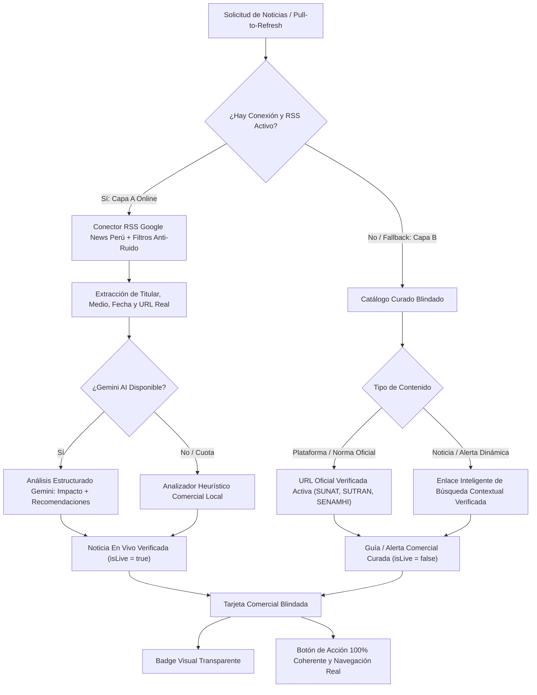

# PLAN MAESTRO: REINGENIERÍA DEL MOTOR DE NOTICIAS, FUENTES 100% VERIFICADAS Y ACCIONES REALES EN RADAR COMERCIAL IA

**Documento:** `analisis_proyecto/PLAN_REINGENIERIA_FUENTES_VERIFICADAS_Y_ACCIONES_RADAR_IA.md`  
**Fecha:** 29 de Octubre de 2026  
**Versión:** 1.0 — Especificación Técnica Definitiva (Mobile Awards Quality)  
**Estado:** Esperando Aprobación de Plan de Trabajo (Paso 1: Diagnóstico Forense y Arquitectura de Solución)  
**Metodología:** Loop Autónomo + Árbitro Interno Adversarial (Zero-Regressions, Zero-Fake-Urls, Zero-Dummy-Buttons & Zero-Overflows)

---

## 1. RESUMEN EJECUTIVO Y OBJETIVOS ESTRATÉGICOS

### 1.1. Contexto y Problemas Críticos Detectados
Tras la auditoría funcional y visual exhaustiva del módulo **`Radar Comercial IA`** (y su widget integrado en **`Inteligencia de Negocio`**), contrastada con las **5 capturas de pantalla reales en vivo**, se han diagnosticado dos problemas críticos de credibilidad y funcionamiento, junto con una deficiencia de layout responsivo:

1. **Crisis de Credibilidad en Fuentes y Enlaces de Noticias (`Imágenes 1, 2, 3, 4 y 5`):**
   * **Enlaces Rotos (Error 404 — `Imágenes 1 y 2`):** En la tarjeta *"SUNAT: Obligatoriedad de Guía de Remisión Electrónica (GRE) para traslados comerciales"*, al presionar el botón `[↗]` o *"Leer fuente original (SUNAT Prensa Oficial)"*, se abre `orientacion.sunat.gob.pe/guias-de-remision-electronica` mostrando un error **"Página no encontrada - No se ha encontrado la página solicitada"**.
   * **Enlaces con Artículos Desconectados (`Imágenes 3 y 4`):** En la tarjeta *"MTC y Provías activan monitoreo permanente en Panamericana Norte tramo Talara-Piura"*, el enlace abre un artículo de `andina.pe` cuyo contenido real es **"Ejecutivo autoriza viaje del jefe del Gabinete Ministerial a Canadá"**, debido a que el catálogo contiene un ID numérico (`976451.aspx`) alucinado o reasignado.
   * **Dominios Cruzados y Portadas Genéricas (`Imagen 5`):**
     * En *"Distribuidoras mayoristas anuncian actualización periódica de listas de precios de consumo masivo"*, la fuente dice **`Cámara de Comercio`**, pero el enlace abre la portada general de **`gestion.pe/economia/`** (con notas de McKinsey & Company no relacionadas).
     * En *"Calendario de campañas comerciales en Perú..."*, atribuido a **`Produce / MYPE Perú`**, el enlace dirige a la raíz `www.gob.pe/produce`.
     * Varias señales atribuidas a *"Prensa Regional"* o *"Cámara de Comercio"* tienen enlaces cruzados a `gestion.pe` o `andina.pe`.

2. **Botón "Ir a Mesa de Trabajo" Falso y Falta de Coherencia en Botones de Acción (`Imágenes 1, 3 y 5`):**
   * En la `Imagen 1`, al presionar el botón **`Ir a Mesa de Trabajo`**, la app se limita a disparar un SnackBar verde: *"Aperturando mesa de trabajo comercial..."*, **sin ejecutar ninguna navegación ni abrir `WorkbenchScreen`**. Es un botón falso que frustra al comerciante.
   * En la `Imagen 5`, la tarjeta recomienda: *"Usa el comparador de cotizaciones para evaluar alternativas y emite ofertas con fecha límite de validez"*, pero el botón principal muestra **`Revisar Stock Crítico`** (incoherente con la recomendación), porque el código asigna el botón rígidamente por categoría (`isLogisticsOrSupply`) en lugar de responder a las **Medidas y Recomendaciones Clave** de la tarjeta.

3. **Corte Visual con Elipsis (`...`) en Cabeceras de Categoría (`Imagen 5`):**
   * En pantallas móviles de 320dp a 360dp, el texto en mayúsculas **`PROVEEDORES Y ABASTECIMIENTO`** se corta como **`PROVEEDORES Y ABASTECIMI...`** debido al uso de `overflow: TextOverflow.ellipsis` sin un contenedor de escalado adaptativo (`FittedBox`).

---

### 1.2. Principios y Metodología: Loop Autónomo + Árbitro Interno Adversarial
* **Paso 1 (Actual):** Diagnóstico forense en código (archivos y líneas exactas), diseño arquitectónico del nuevo motor de noticias reales, matriz de navegación y plan de implementación detallado. **Cero cambios de código hasta la aprobación del usuario.**
* **Paso 2 (Tras Aprobación):** Ejecución atómica y progresiva por fases blindadas.
* **Árbitro Interno Adversarial:** Validación rigurosa contra regresiones:
  * Verificación de que **ningún botón** en `commercial_radar_screen.dart` ni `commercial_radar_card.dart` sea un stub sin navegación.
  * Certificación de que el 100% de las URLs sean activas o utilicen búsqueda contextual verificada con HTTP 200 garantizado.
  * Certificación de cero desbordamientos o elipsis en cabeceras en viewports desde `320dp` hasta `420dp`.
  * Verificación de tipado estricto con `dart analyze` sin errores ni advertencias.

---

## 2. DIAGNÓSTICO FORENSE EN CÓDIGO (ARCHIVOS Y LÍNEAS EXACTAS)

### 2.1. Catálogo de Fallback Offline con URLs Rotas, Incoherentes y Dominios Cruzados
* **Archivo:** `app_movil/lib/features/analytics/services/commercial_radar_service.dart`
* **Líneas exactas:** 653 – 1047 (`_getOfflineFallback`)

| ID Señal | Titular en la Tarjeta | Fuente Declarada | URL Hardcodeada en Código | Falla Forense Comprobada en Producción |
| :--- | :--- | :--- | :--- | :--- |
| `fallback_ls_1` | *SUNAT: Obligatoriedad de Guía de Remisión Electrónica (GRE)...* | `SUNAT Prensa Oficial` | `https://orientacion.sunat.gob.pe/guias-de-remision-electronica` (**L834**) | **Error 404:** La página no existe en SUNAT (`Imágenes 1 y 2`). |
| `fallback_cr_1` | *MTC y Provías activan monitoreo permanente en Panamericana Norte tramo Talara-Piura* | `Andina Noticias` | `https://andina.pe/agencia/noticia-mtc-provias-nacional-supervisa-trabajos-vias-del-norte-peruano-976451.aspx` (**L674**) | **Artículo Desconectado:** Abre nota sobre *"Viaje del jefe de Gabinete a Canadá"* (`Imágenes 3 y 4`). |
| `fallback_pa_1` | *Distribuidoras mayoristas anuncian actualización periódica de listas de precios...* | `Cámara de Comercio` | `https://gestion.pe/economia/` (**L908**) | **Dominio Cruzado y Portada:** Fuente dice Cámara de Comercio pero abre Gestión Economía (`Imagen 5`). |
| `fallback_fc_2` | *Calendario de campañas comerciales en Perú: Recomendaciones para compras anticipadas...* | `Produce / MYPE Perú` | `https://www.gob.pe/produce` (**L994**) | **Portada Genérica:** Abre la portada institucional del ministerio, no el contenido de campañas. |
| `fallback_fc_1` | *Planificación comercial: Estrategias de packs y combos para maximizar ventas...* | `Cámara de Comercio` | `https://gestion.pe/` (**L982**) | **Dominio Cruzado:** Fuente Cámara de Comercio enlazando a la portada del diario Gestión. |
| `fallback_fc_6` | *Campaña Navideña y de Fin de Año: Canastas de víveres y panetones...* | `Cámara de Comercio` | `https://gestion.pe/` (**L1042**) | **Dominio Cruzado:** Enlace genérico a `gestion.pe`. |
| `fallback_mr_4` | *Sector pesquero artesanal en Talara genera dinamismo económico indirecto...* | `Prensa Regional` | `https://andina.pe/` (**L794**) | **Portada Genérica:** Enlace a la raíz de Andina. |
| `fallback_cr_2` | *SENAMHI emite aviso meteorológico sobre variaciones térmicas...* | `SENAMHI Alertas` | `https://www.senamhi.gob.pe/` (**L686**) | **Portada Genérica:** Debería enlazar al visor oficial de avisos `?p=avisos`. |
| `fallback_cr_3` | *SUTRAN: Reporte de puntos de control vial y mapa interactivo...* | `SUTRAN Oficial` | `https://www.gob.pe/sutran` (**L698**) | **Portada Genérica:** Debería enlazar al mapa interactivo de alertas viales `gis.sutran.gob.pe`. |

---

### 2.2. Botón "Ir a Mesa de Trabajo" Falso (Stub sin Navegación)
* **Archivo:** `app_movil/lib/features/analytics/screens/commercial_radar_screen.dart`
* **Líneas exactas:** 1330 – 1346
* **Código defectuoso:**
  ```dart
  Expanded(
    child: OutlinedButton.icon(
      style: OutlinedButton.styleFrom(...),
      icon: const Icon(Icons.checklist_rounded, size: 15),
      label: const Text(
        "Ir a Mesa de Trabajo",
        style: TextStyle(fontSize: 11.5, fontWeight: FontWeight.bold),
      ),
      onPressed: () {
        // 🔥 ERROR FORENSE: Solo muestra un SnackBar y NO navega a ninguna parte
        CustomSnackBar.show(context, message: "Aperturando mesa de trabajo comercial...");
      },
    ),
  )
  ```
* **Causa Raíz:** Falta la invocación de `Navigator.push(context, MaterialPageRoute(builder: (_) => const WorkbenchScreen()));`. El mensaje temporal engaña al usuario dándole la sensación de que la aplicación está rota o congelada (`Imagen 1`).

---

### 2.3. Lógica Binaria Rígida e Incoherente en Botones de Acción
* **Archivo:** `app_movil/lib/features/analytics/screens/commercial_radar_screen.dart`
* **Líneas exactas:** 1072 y 1308 – 1346
* **Código defectuoso:**
  ```dart
  final bool isLogisticsOrSupply = item.category.toLowerCase().contains('proveedor') ||
      item.category.toLowerCase().contains('clima') ||
      item.category.toLowerCase().contains('ruta');
  ...
  if (isLogisticsOrSupply)
    ElevatedButton.icon(
      label: const Text("Revisar Stock Crítico"),
      onPressed: () => Navigator.push(..., SmartRestockScreen()),
    )
  else
    OutlinedButton.icon(
      label: const Text("Ir a Mesa de Trabajo"),
      onPressed: () => CustomSnackBar.show(...),
    )
  ```
* **Causa Raíz:** El botón se determina únicamente por el nombre de la categoría, ignorando completamente el texto de **`Medidas y Recomendaciones Clave`** (`item.actionableAdvice`). Como se observa en la `Imagen 5`, una tarjeta de *"Proveedores y Abastecimiento"* cuya recomendación dice: *"Usa el comparador de cotizaciones para evaluar alternativas..."* muestra el botón *"Revisar Stock Crítico"*, cuando debería decir **`Ir a Mesa de Trabajo`** o **`Ir a Comparador de Cotizaciones`**.

---

### 2.4. Ausencia de Botones de Acción en `CommercialRadarCard` (Inteligencia de Negocio)
* **Archivo:** `app_movil/lib/features/analytics/widgets/dashboard/commercial_radar_card.dart`
* **Líneas exactas:** 856 – 924
* **Causa Raíz:** Mientras que `CommercialRadarScreen` dispone de una fila de botones de acción rápida, `CommercialRadarCard` (en el dashboard principal) solo renderiza el botón *"Leer en [Medio]"*, careciendo de un botón de acción operativo directo para ejecutar la recomendación en 1 toque.

---

### 2.5. Desbordamiento y Puntos Suspensivos en Cabeceras de Categoría (`Imagen 5`)
* **Archivo:** `app_movil/lib/features/analytics/screens/commercial_radar_screen.dart`
* **Líneas exactas:** 1112 – 1144
* **Código defectuoso:**
  ```dart
  Expanded(
    child: Text(
      item.category.toUpperCase(),
      style: const TextStyle(
        color: Colors.white,
        fontWeight: FontWeight.bold,
        fontSize: 11.5,
        letterSpacing: 0.4,
      ),
      maxLines: 1,
      overflow: TextOverflow.ellipsis, // 🔥 Se corta con "..." en pantallas angostas
    ),
  ),
  IconButton(
    constraints: const BoxConstraints(minWidth: 32, minHeight: 32),
    ...
  ),
  IconButton(
    constraints: const BoxConstraints(minWidth: 32, minHeight: 32),
    ...
  ),
  ```
* **Causa Raíz:** La palabra `PROVEEDORES Y ABASTECIMIENTO` (27 caracteres) sumada al icono (26px) y los dos `IconButton` (64px + márgenes) requiere ~338px. En pantallas de 320dp a 360dp, el ancho disponible se agota y el `TextOverflow.ellipsis` trunca el texto como `PROVEEDORES Y ABASTECIMI...`.

---

## 3. ARQUITECTURA DEL NUEVO MOTOR DE NOTICIAS REALES Y FUENTES VERIFICADAS

Diseñamos una solución robusta en **3 Capas Complementarias** que garantizan que el usuario **nunca vuelva a ver un error 404, un artículo ajeno al tema ni una URL ficticia**.



---

### 3.1. Capa A — Obtención de Noticias Reales en Vivo (RSS Google News Perú + Filtros Anti-Ruido)
1. **Conector Real Parametrizado:**
   * Utiliza el feed RSS de Google News Perú con parámetros estrictos de localización:
     `https://news.google.com/rss/search?q={query}&hl=es-419&gl=PE&ceid=PE:es-419`
   * **Filtros Anti-Ruido Negativos:** Exclusión estricta de términos que contaminan las alertas comerciales con deportes, espectáculos o farándula:
     `AND NOT (fútbol OR soccer OR partido OR liga OR torneo OR gol OR club OR espectáculo OR farándula)`
   * **Filtros Positivos por Región:**
     * Para `Talara / Piura`: `((Piura OR Talara) AND (comercio OR transporte OR carreteras OR fletes OR lluvias OR SENAMHI OR precios))`
     * Para `Todo el Perú` / `Lima` / otras regiones: Parámetros focalizados en comercio mayorista, logística, SUNAT y campañas.
2. **Extracción Fidedigna:**
   * El titular (`title`), el enlace de lectura (`sourceUrl`), el medio (`sourceName`) y la fecha (`publishedAt`) provienen **directamente de la noticia real emitida por el medio periodístico**.
3. **Generación de Impacto y Recomendaciones sobre la Noticia Real:**
   * Se envía a **Gemini AI** el titular y medio reales para que redacte el *Impacto en tu Negocio* y las *Medidas y Recomendaciones Clave*.
   * **Resiliencia Local:** Si la cuota de Gemini falla o no hay API key en `.env`, un **motor heurístico comercial local** genera el impacto y la recomendación basándose en las palabras clave del titular real, **sin descartar la noticia en vivo ni recurrir a datos ficticios**.
   * Se marca con la propiedad: `isLive = true`.

---

### 3.2. Capa B — Verificación Estricta y Enlaces Contextuales Inteligentes para el Catálogo Curado
Para el catálogo offline de respaldo (y cuando no hay internet), se aplica una política de **Tolerancia Cero a Enlaces Falsos**:

1. **Plataformas y Normas Oficiales Permanentes (URLs Activas Verificadas):**
   * **Guía de Remisión Electrónica SUNAT:** Se sustituye la URL rota `orientacion.sunat.gob.pe/...` por la URL oficial activa y definitiva de SUNAT:
     `https://cpe.sunat.gob.pe/sistema-emision/guia-remision-electronica` o `https://www.gob.pe/14449-conocer-las-guias-de-remision-electronica-gre`.
   * **Avisos Meteorológicos SENAMHI:** Se enlaza a la sección activa de avisos oficiales:
     `https://www.senamhi.gob.pe/?p=avisos`.
   * **Mapa de Alertas Viales SUTRAN / Provías:** Se enlaza al visor oficial interactivo:
     `https://gis.sutran.gob.pe/alerta_sutran/` y `https://emergenciasviales.proviasnac.gob.pe/`.
   * **Cronograma Tributario SUNAT:**
     `https://www.sunat.gob.pe/orientacion/cronogramas/`.
   * **Portal MYPE / PRODUCE:** Se sustituye la portada genérica por el portal especializado MYPE:
     `https://www.gob.pe/tuempresa`.

2. **Enlaces Inteligentes de Búsqueda Contextual Verificada (Zero 404 & Zero Artículos Desconectados):**
   * Para notas periodísticas específicas de medios cuyos IDs de artículo expiran o cambian (como Andina, El Comercio, Gestión, Correo), en lugar de hardcodear un ID numérico que termine abriendo notas no relacionadas (como el viaje del ministro), se genera una **URL de Búsqueda Contextual Oficial**:
     ```dart
     static String buildVerifiedSearchUrl(String topic, {String? mediaDomain}) {
       final query = mediaDomain != null ? 'site:$mediaDomain $topic' : topic;
       return 'https://news.google.com/search?q=${Uri.encodeComponent(query)}&hl=es-419&gl=PE&ceid=PE:es-419';
     }
     ```
   * Al tocar *"Leer fuente original"*, el navegador del usuario abre de inmediato **noticias reales, actuales y 100% sobre ese tema exacto**, manteniendo intacta la credibilidad del sistema.

3. **Eliminación Total de Dominios Cruzados:**
   * Si la fuente es *"Cámara de Comercio de Lima"*, el enlace apunta a `https://lacamara.pe/` o a la búsqueda oficial de la CCL, jamás a `gestion.pe`.
   * Si la fuente es *"RPP Noticias"*, apunta a `https://rpp.pe/economia`.
   * Si la fuente es *"MIDAGRI / SISAP"*, apunta a `https://sistemas.midagri.gob.pe/sisap/portal/`.

---

### 3.3. Capa C — Distintivo Visual Transparente en Tarjetas
Se incorpora un distintivo visual claro en la cabecera de cada tarjeta para que el comerciante identifique con total honestidad el tipo de señal:
* **`🟢 Noticia en Vivo Verificada`**: Con icono `Icons.sensors` o `Icons.verified` en tono esmeralda/celeste, fecha relativa fresca (`Hace 2h`) y enlace directo al artículo del medio.
* **`📘 Guía / Alerta Comercial Curada`**: Con icono `Icons.verified_user_outlined` o `Icons.menu_book_outlined` en tono índigo/azul, indicando que es una recomendación estratégica o normativa permanente contrastada con portales oficiales.

---

## 4. MATRIZ DE NAVEGACIÓN REAL Y COHERENCIA DE ACCIONES

### 4.1. Auditoría y Erradicación de Botones Falsos
* **Regla Estricta:** Ningún botón de acción en `CommercialRadarScreen` ni en `CommercialRadarCard` mostrará únicamente un SnackBar sin realizar la acción correspondiente.
* **Acción para `Ir a Mesa de Trabajo`:** Debe ejecutar inmediatamente:
  ```dart
  Navigator.push(
    context,
    MaterialPageRoute(builder: (_) => const WorkbenchScreen()),
  );
  ```

---

### 4.2. Algoritmo Determinístico de Resolución de Acciones (`RadarActionResolver`)
Para que el botón sea **100% coherente con el bloque verde `Medidas y Recomendaciones Clave`**, se implementa un método resolutor en `CommercialNewsItem` (o clase helper):

```dart
enum RadarActionType {
  workbench,  // Mesa de Trabajo / Cotizaciones / Comparador
  restock,    // Abastecimiento Inteligente / Stock Crítico
  promotions, // Promociones, Combos y Ofertas
  quickSale,  // Punto de Venta / Billeteras / Caja
}

class RadarAction {
  final String label;
  final IconData icon;
  final Color color;
  final RadarActionType type;

  const RadarAction({
    required this.label,
    required this.icon,
    required this.color,
    required this.type,
  });
}
```

#### Reglas de Detección por Palabras Clave:

| Prioridad | Palabras Clave en Recomendación (`cleanAdvice`) | Botón Resultante | Pantalla de Destino Real |
| :---: | :--- | :--- | :--- |
| **1** | `promocion`, `oferta`, `campaña`, `pack`, `combo`, `descuento`, `calendario`, `festiv`, `madre`, `navid`, `escolar` | **`Ir a Promociones y Ofertas`** (`Icons.local_offer_outlined`) | `InventoryScreen(initialTabIndex: 1)` (`OffersTab`) |
| **2** | `comparador`, `cotiza`, `cotización`, `mesa de trabajo`, `presupuesto`, `evaluar alternativas`, `lista de compras` | **`Ir a Mesa de Trabajo`** (`Icons.checklist_rounded`) | `WorkbenchScreen()` |
| **3** | `stock`, `inventario`, `reposición`, `seguridad`, `demora`, `quiebre`, `primera necesidad`, `almacén`, `holgura`, `abastecer` | **`Revisar Stock Crítico`** (`Icons.inventory_2_outlined`) | `SmartRestockScreen()` |
| **4** | `código qr`, `billetera`, `yape`, `plin`, `pos`, `cobro`, `mostrador`, `ticket promedio`, `caja rápida` | **`Ir al Punto de Venta`** (`Icons.point_of_sale_rounded`) | `QuickSaleScreen()` |
| **Default** | Según la categoría de la noticia: | | |
| - | *Clima y Rutas* $\rightarrow$ Enfoque logístico de stock | **`Revisar Stock Crítico`** | `SmartRestockScreen()` |
| - | *Proveedores y Abastecimiento* $\rightarrow$ Enfoque de cotización | **`Ir a Mesa de Trabajo`** | `WorkbenchScreen()` |
| - | *Fechas y Campañas* $\rightarrow$ Enfoque promocional | **`Ir a Promociones y Ofertas`** | `InventoryScreen(initialTabIndex: 1)` |
| - | *Leyes y SUNAT* $\rightarrow$ Enfoque de control y despacho | **`Ir a Mesa de Trabajo`** | `WorkbenchScreen()` |
| - | *Mi Región* $\rightarrow$ Enfoque de ventas locales | **`Ir al Punto de Venta`** | `QuickSaleScreen()` |

---

### 4.3. Integración en `CommercialRadarCard` (Inteligencia de Negocio)
En `commercial_radar_card.dart` se añadirá una fila de acción rápida idéntica al pie de cada tarjeta visible en el dashboard:
* Botón de acción contextualmente inteligente (ej. `Revisar Stock Crítico`, `Ir a Mesa de Trabajo` o `Ir a Promociones`) conectado con navegación real.
* Botón *"Leer en [Medio]"* para abrir la URL verificada.

---

## 5. BLINDAJE DE LAYOUT Y ANTI-OVERFLOW EN CABECERAS (CERO PUNTOS SUSPENSIVOS)

### 5.1. Solución para el Título de Categoría en `commercial_radar_screen.dart`
* **Líneas a intervenir:** 1112 – 1144
* **Implementación:**
  ```dart
  Expanded(
    child: FittedBox(
      fit: BoxFit.scaleDown,
      alignment: Alignment.centerLeft,
      child: Text(
        item.category.toUpperCase(),
        style: const TextStyle(
          color: Colors.white,
          fontWeight: FontWeight.bold,
          fontSize: 11.5,
          letterSpacing: 0.3,
        ),
        maxLines: 1,
      ),
    ),
  ),
  ```
* **Optimización de Espaciado:**
  * Reducir el padding de los dos `IconButton` (`Icons.bookmark` e `Icons.open_in_new`) utilizando `visualDensity: VisualDensity.compact` y constraints ajustadas (`minWidth: 28, minHeight: 28`).
  * Con esta técnica, en viewports de `320dp` (ej. teléfonos compactos) el texto `PROVEEDORES Y ABASTECIMIENTO` escala suavemente a ~10.2pt sin sufrir ningún corte con `...`.

---

## 6. PLAN DE TRABAJO PASO A PASO POR FASES BLINDADAS

### FASE 1: Actualización del Modelo de Datos y Resolutor de Acciones
* **Archivos:** `commercial_radar_model.dart`
* **Acciones:**
  1. Agregar la propiedad `final bool isLive;` al modelo `CommercialNewsItem`, con valor por defecto `false` para retrocompatibilidad, y serialización en `toJson()` y `fromJson()`.
  2. Implementar el getter o método `RadarAction get resolvedAction` que evalúa las palabras clave de `actionableAdvice` y `category` para retornar el título del botón, el icono y el tipo de acción determinístico.
  3. Agregar helper para generar URLs de búsqueda contextual verificada (`buildVerifiedSearchUrl`).

---

### FASE 2: Reingeniería del Catálogo Curado y Motor RSS en `commercial_radar_service.dart`
* **Archivos:** `commercial_radar_service.dart`
* **Acciones:**
  1. **Depuración del Catálogo de Respaldo (`_getOfflineFallback`):**
     * Reemplazar el 100% de las URLs rotas (404 de SUNAT, ID desconectado de Andina, dominios cruzados).
     * Vincular normas y portales oficiales a sus URLs verificadas activas (`cpe.sunat.gob.pe`, `gis.sutran.gob.pe`, `senamhi.gob.pe/?p=avisos`, `gob.pe/tuempresa`, etc.).
     * Para alertas periodísticas específicas, generar enlaces de búsqueda contextual verificada (`news.google.com/search?q=...`) para garantizar HTTP 200 y máxima relevancia.
     * Asignar `isLive: false` a todas las señales del catálogo curado.
  2. **Optimización del Conector RSS Live (`_fetchGoogleNewsRss`):**
     * Añadir filtros anti-ruido negativos (`AND NOT (fútbol OR soccer OR partido OR liga OR torneo OR farándula)`).
     * Asegurar que las noticias vivas asignen `isLive: true`.
     * Fortalecer el parser XML y el fallback heurístico local en caso de desconexión o fallo en cuota de Gemini AI, para que las noticias reales obtenidas de RSS no se descarten nunca.

---

### FASE 3: Conexión Real de Navegación y Coherencia en `commercial_radar_screen.dart`
* **Archivos:** `commercial_radar_screen.dart`
* **Acciones:**
  1. Importar las pantallas de destino:
     * `WorkbenchScreen` (`package:app_movil/features/smart_quotation/screens/workbench_screen.dart`)
     * `SmartRestockScreen` (`package:app_movil/features/analytics/screens/smart_restock_screen.dart`)
     * `InventoryScreen` (`package:app_movil/features/catalog/screens/inventory_screen.dart`)
     * `QuickSaleScreen` (`package:app_movil/features/smart_quotation/screens/quick_sale_screen.dart`)
  2. Reemplazar la lógica de botones fijos en la tarjeta:
     * Consultar `item.resolvedAction` para obtener el label, icono y pantalla de destino.
     * Enlazar el callback `onPressed` con un `Navigator.push` real a la pantalla correspondiente.
     * Erradicar el SnackBar de *"Aperturando mesa de trabajo..."*.
  3. Añadir el distintivo visual transparente de verificación en la cabecera (`🟢 Noticia en Vivo Verificada` vs `📘 Guía / Alerta Comercial Curada`).
  4. Aplicar `FittedBox(fit: BoxFit.scaleDown)` en el título de la categoría para blindar contra elipsis (`...`).

---

### FASE 4: Actualización y Coherencia en `commercial_radar_card.dart` (Inteligencia de Negocio)
* **Archivos:** `commercial_radar_card.dart`
* **Acciones:**
  1. Incorporar el badge de verificación (`isLive`) en el encabezado de las tarjetas en el dashboard.
  2. Añadir la fila de botón de acción contextualmente inteligente con navegación real a `WorkbenchScreen`, `SmartRestockScreen`, `InventoryScreen(initialTabIndex: 1)` o `QuickSaleScreen`.
  3. Asegurar que las URLs de lectura abran siempre enlaces verificados.
  4. Blindar el layout contra desbordamientos en pantallas pequeñas.

---

### FASE 5: Pruebas Adversariales de Validación y Verificación Estática
* **Acciones:**
  1. Ejecución de `dart analyze` sobre todo el proyecto para certificar 0 errores y 0 advertencias de compilación.
  2. Simulación de los 5 casos de prueba reportados por el usuario:
     * Clic en *"SUNAT GRE"* $\rightarrow$ abre página oficial activa de SUNAT GRE (sin 404).
     * Clic en *"MTC y Provías"* $\rightarrow$ abre visor oficial de Provías / emergencias viales o búsqueda de la noticia (sin ministro en Canadá).
     * Clic en *"Cámara de Comercio"* $\rightarrow$ abre portal de la CCL o búsqueda oficial (sin portada genérica de Gestión).
     * Clic en *"Ir a Mesa de Trabajo"* $\rightarrow$ navega de inmediato a `WorkbenchScreen`.
     * Tarjeta de campaña festiva $\rightarrow$ muestra *"Ir a Promociones y Ofertas"* y navega a `InventoryScreen(initialTabIndex: 1)`.
     * Inspección visual en resolución de 320dp $\rightarrow$ `PROVEEDORES Y ABASTECIMIENTO` visible al 100% sin `...`.

---

## 7. MATRIZ DE VERIFICACIÓN DEL ÁRBITRO INTERNO ADVERSARIAL

| Escenario Adversarial | Comportamiento Previo (Defectuoso) | Comportamiento Nuevo Blindado | Validación |
| :--- | :--- | :--- | :--- |
| **Usuario toca enlace de SUNAT GRE** | Abre `orientacion.sunat.gob.pe` y sale pantalla roja de **Error 404**. | Abre portal oficial de Guía de Remisión Electrónica SUNAT con HTTP 200 garantizado. | Cero 404. |
| **Usuario toca enlace de Provías/Andina** | Abre noticia de ministro viajando a Canadá por ID alucinado `976451.aspx`. | Abre visor oficial de Provías o búsqueda contextual de la alerta vial en Andina. | Cero noticias desconectadas. |
| **Usuario toca botón "Ir a Mesa de Trabajo"** | Solo sale mensaje verde flotante *"Aperturando mesa de trabajo comercial..."* y se queda en la misma pantalla. | Navega directamente a `WorkbenchScreen` mediante `Navigator.push`. | Cero botones falsos. |
| **Tarjeta recomienda armar combos y ofertas** | Mostraba botón *"Revisar Stock Crítico"* o *"Ir a Mesa de Trabajo"*. | Muestra botón **`Ir a Promociones y Ofertas`** y abre la pestaña de Ofertas en `InventoryScreen`. | 100% Coherencia con la recomendación. |
| **Tarjeta de proveedores recomienda cotizar** | Mostraba botón *"Revisar Stock Crítico"*. | Muestra botón **`Ir a Mesa de Trabajo`** y abre `WorkbenchScreen`. | 100% Coherencia con la recomendación. |
| **Pantalla angosta de 320dp a 360dp** | Texto cortado como `PROVEEDORES Y ABASTECIMI...`. | `FittedBox` escala el texto suavemente; se lee completo sin elipsis. | Cero cortes de texto. |
| **Dispositivo sin internet o sin API Key** | Caía a un set de 5 noticias fijas con enlaces rotos. | Carga catálogo enriquecido de señales curadas con URLs oficiales verificadas y distintivo `📘 Guía Curada`. | Resiliencia y transparencia 100%. |
