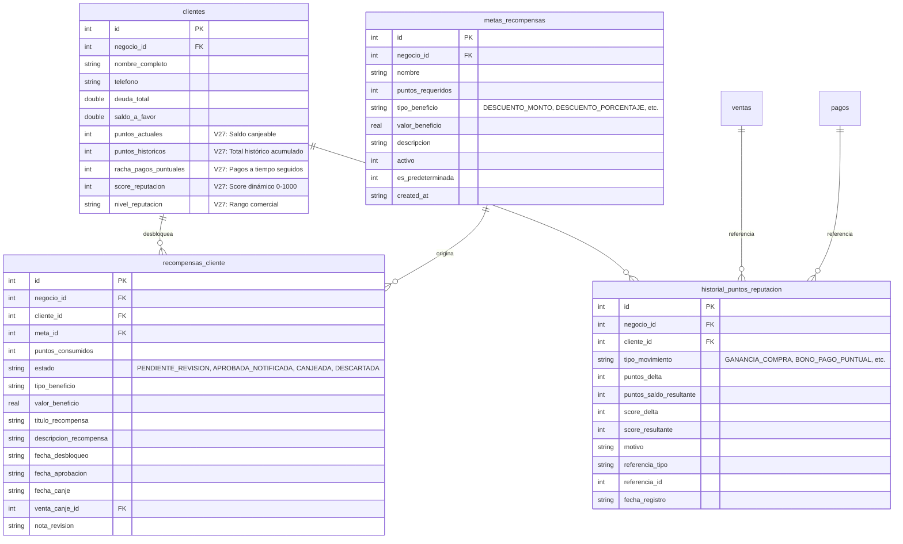
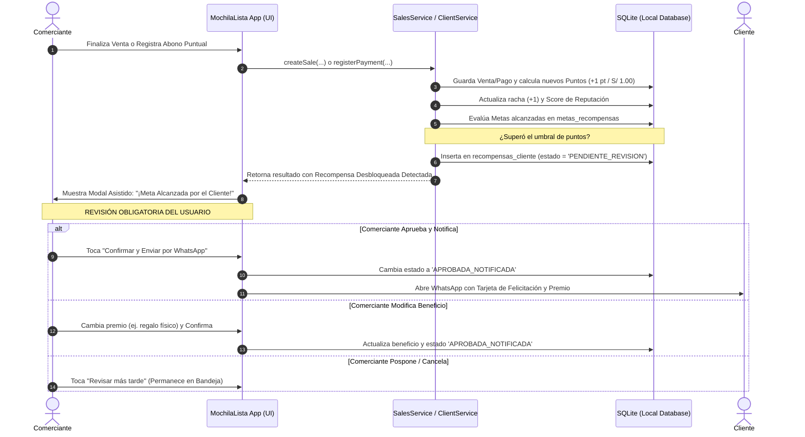
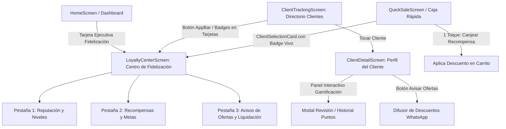
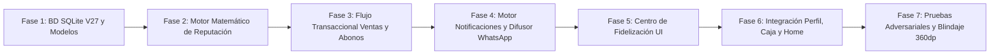

# PLAN MAESTRO: REINGENIERÍA DEL SISTEMA DE REPUTACIÓN, GAMIFICACIÓN, RECOMPENSAS ASISTIDAS Y COMUNICACIÓN COMERCIAL (OFERTAS Y LIQUIDACIONES)

**Documento:** `analisis_proyecto/PLAN_REINGENIERIA_GAMIFICACION_REPUTACION_RECOMPENSAS_Y_CAMPANAS.md`  
**Fecha:** Noviembre 2026  
**Versión:** 1.0 — Arquitectura Técnica, Motor Matemático y Plan de Ejecución Definitivo  
**Estado:** Pendiente de Aprobación por el Usuario (Cero Código Modificado en esta Fase)  
**Metodología:** Loop Autónomo con Árbitro Adversarial (Test-Driven, Cero Regresiones, 0ms SQLite, 360dp Ready)  

---

## 1. RESUMEN EJECUTIVO Y OBJETIVOS ESTRATÉGICOS

MochilaLista cuenta con una base sólida de gestión de clientes (CRM), ventas al mostrador (Caja Rápida), cotizaciones inteligentes y catálogos de productos. Sin embargo, la relación comercial actual con el cliente carece de un **motor de fidelización dinámico, transparente y de impacto real**:

1. **Reputación y Confianza Limitadas:** Actualmente, el nivel de confianza es un valor textual estático (`'bueno'`, `'regular'`, `'malo'`) calculado únicamente a partir de la tasa de cancelación de ventas pasadas. No refleja la puntualidad en el pago de cuotas, la constancia en compras, ni asiste al comerciante para decidir cuánto crédito o préstamo otorgar de forma segura.
2. **Inexistencia de Gamificación y Puntos:** Los clientes no acumulan puntos por sus compras al contado ni por pagar sus cuotas a tiempo, perdiendo una oportunidad crítica de retención comercial e incentivo de pago puntual.
3. **Falta de Control Humano en Recompensas:** Los comerciantes de micronegocios no desean que un sistema entregue descuentos o regalos de forma ciega y descontrolada; requieren un **flujo asistido con revisión obligatoria** donde la app proponga el premio, pero el comerciante decida si lo aprueba, lo modifica o lo notifica vía WhatsApp.
4. **Desconexión entre Ofertas del Catálogo y Difusión a Clientes:** El catálogo posee presentaciones con precios de oferta (`precio_oferta`) y descuentos activos, así como productos de lenta rotación o liquidación; no obstante, el comerciante no tiene una herramienta ágil para seleccionar esos productos y disparar avisos comerciales personalizados a sus mejores clientes.

### Objetivos Principales del Proyecto:
* **Evolución SQLite V27:** Migración retrocompatible e idempotente con nuevos campos de fidelización en `clientes` y 3 nuevas tablas ultrarrápidas (`metas_recompensas`, `recompensas_cliente` e `historial_puntos_reputacion`).
* **Motor Matemático de Reputación Multivariable (0–1000):** Cálculo a 0ms basado en 3 pilares: Puntualidad (50%), Constancia (25%) y LTV Neto (25%), con cálculo de **Límite de Crédito Seguro Sugerido**.
* **Otorgamiento Automático y Reversión Atómica:** Suma de puntos en ventas y pagos puntuales; deducción y anulación atómica en `voidSale`.
* **Bandeja de Recompensas Asistidas con Aprobación Obligatoria:** Las metas alcanzadas entran en `'PENDIENTE_REVISION'` para que el comerciante las autorice y envíe por WhatsApp antes de ser canjeadas.
* **Difusor Inteligente de Ofertas y Liquidación:** Conexión directa con el catálogo para enviar promociones filtradas por segmento de cliente (`VIP / Oro`, Frecuentes, o individual).
* **Centro de Fidelización Central y Pantallas Integradas:** Nueva ventana central con 3 pestañas accesible desde `Home` y `Clientes`, panel de gamificación en el perfil del cliente (`ClientDetailScreen`) y badges interactivos en Caja Rápida.

---

## 2. DIAGNÓSTICO DEL ESTADO ACTUAL DEL CÓDIGO (LÍNEA BASE)

Para garantizar cero regresiones y respetar la arquitectura existente, se inspeccionaron los siguientes módulos:

| Archivo / Componente | Diagnóstico Actual | Puntos de Intervención para la Reingeniería |
| :--- | :--- | :--- |
| `local_db.dart` (v26) | Versión actual de esquema es **26** (soporte de stock compartido y cupos). No existen tablas de gamificación ni campos de score en `clientes`. | Crear **Migración V27**: ALTER TABLE defensivo en `clientes`, creación de `metas_recompensas`, `recompensas_cliente`, `historial_puntos_reputacion` con índices compuestos y semillas predeterminadas. |
| `crm_models.dart` | `ClientModel` solo incluye `nivelConfianza` (`String`, def `'bueno'`). No contiene puntos, score, racha ni historial de lealtad. | Extender `ClientModel` con `puntosActuales`, `puntosHistoricos`, `rachaPagosPuntuales`, `scoreReputacion`, `nivelReputacion`. Crear modelos: `RewardGoalModel`, `ClientRewardModel`, `LoyaltyLedgerModel` y `ReputationTier`. |
| `client_service.dart` | `recalculateClientReputation` (Líneas 537–564) solo evalúa `cancellationRate > 30%` con mínimo 3 ventas. | Reemplazar por el **Motor Multivariable de Reputación (0–1000)** que evalúa puntualidad de cuotas, racha, recurrencia y LTV neto. Añadir métodos de gestión de recompensas y kardex de puntos. |
| `sales_service.dart` | `createSale` (Líneas 13–425) procesa ventas, cuotas y pagos pero no otorga puntos. `voidSale` (Líneas 510–750) revierte stock y deuda, pero no revierte puntos. | Inyectar en `createSale` el otorgamiento de puntos por compra y evaluación de metas. En `voidSale`, revertir puntos y descartar recompensas pendientes de forma atómica. En `registerPayment`, premiar pagos a tiempo e incrementar la racha. |
| `client_detail_screen.dart` y `client_stats_header.dart` | `_buildTrustBadge` (Líneas 381–400) es un badge estático que solo varía de color según un texto simple. | Diseñar el **Panel Interactivo de Gamificación y Reputación**: medalla de rango, score numérico, barra de progreso hacia la siguiente meta, límite de crédito sugerido y botones para revisar recompensas, enviar ofertas y ver historial. |
| `client_card.dart` | Tarjetas del Directorio de Clientes muestran solo el punto de color básico. | Incorporar el badge compacto del nivel (`🏆 Oro • 820 pts`) y una píldora indicadora si el cliente tiene una recompensa pendiente de revisión. |
| `client_selection_card.dart` | Selector de clientes en Caja Rápida muestra datos de contacto, notas y badge `APP`. | Mostrar badge vivo con su Nivel, Racha y Puntos disponibles. Si tiene una recompensa aprobada lista para canje, mostrar botón de 1 toque para aplicar el descuento. |
| `home_screen.dart` y `smart_action_grid.dart` | El Dashboard de inicio gestiona tarjetas dinámicas con SharedPreferences. No cuenta con tarjeta para fidelización. | Añadir tarjeta ejecutiva de acción rápida `'loyalty_rewards'` ("Fidelización y Premios") con contador de recompensas pendientes por aprobar. |
| Catálogo y Promociones (`product_model.dart`, `promotion_repository.dart`) | `PresentationModel` ya posee `hasOffer`, `effectivePrice`, `precioOferta` y `valorDescuento`. | Aprovechar estas propiedades para alimentar automáticamente la Pestaña 3 del Centro de Fidelización y el Difusor de Liquidaciones a WhatsApp. |

---

## 3. ARQUITECTURA DE DATOS: MIGRACIÓN SQLITE V27 Y NUEVOS MODELOS

### 3.1. Esquema Relacional de la Migración V27 (`local_db.dart`)

La migración a la versión 27 será completamente **idempotente y defensiva**, utilizando `PRAGMA table_info` y `ensureColumnExists` para prevenir fallos en instalaciones previas:



#### DDL SQL de la Migración V27:
```sql
-- 1. Ampliación defensiva de la tabla 'clientes'
ALTER TABLE clientes ADD COLUMN puntos_actuales INTEGER DEFAULT 0;
ALTER TABLE clientes ADD COLUMN puntos_historicos INTEGER DEFAULT 0;
ALTER TABLE clientes ADD COLUMN racha_pagos_puntuales INTEGER DEFAULT 0;
ALTER TABLE clientes ADD COLUMN score_reputacion INTEGER DEFAULT 500;
ALTER TABLE clientes ADD COLUMN nivel_reputacion TEXT DEFAULT 'PLATA';

-- 2. Catálogo de Metas y Beneficios configurables por el negocio
CREATE TABLE IF NOT EXISTS metas_recompensas (
    id INTEGER PRIMARY KEY AUTOINCREMENT,
    negocio_id INTEGER NOT NULL,
    nombre TEXT NOT NULL,
    puntos_requeridos INTEGER NOT NULL,
    tipo_beneficio TEXT NOT NULL, -- 'DESCUENTO_MONTO', 'DESCUENTO_PORCENTAJE', 'PRODUCTO_REGALO', 'CREDITO_PREFERENCIAL'
    valor_beneficio REAL NOT NULL,
    descripcion TEXT,
    activo INTEGER DEFAULT 1,
    es_predeterminada INTEGER DEFAULT 0,
    created_at TEXT NOT NULL,
    FOREIGN KEY (negocio_id) REFERENCES negocios (id) ON DELETE CASCADE
);
CREATE INDEX IF NOT EXISTS idx_metas_negocio ON metas_recompensas(negocio_id, activo, puntos_requeridos);

-- 3. Bandeja de Recompensas del Cliente (Ciclo de Vida y Aprobación Obligatoria)
CREATE TABLE IF NOT EXISTS recompensas_cliente (
    id INTEGER PRIMARY KEY AUTOINCREMENT,
    negocio_id INTEGER NOT NULL,
    cliente_id INTEGER NOT NULL,
    meta_id INTEGER NOT NULL,
    puntos_consumidos INTEGER NOT NULL,
    estado TEXT NOT NULL DEFAULT 'PENDIENTE_REVISION', -- 'PENDIENTE_REVISION', 'APROBADA_NOTIFICADA', 'CANJEADA', 'DESCARTADA'
    tipo_beneficio TEXT NOT NULL,
    valor_beneficio REAL NOT NULL,
    titulo_recompensa TEXT NOT NULL,
    descripcion_recompensa TEXT,
    fecha_desbloqueo TEXT NOT NULL,
    fecha_aprobacion TEXT,
    fecha_canje TEXT,
    venta_canje_id INTEGER,
    nota_revision TEXT,
    FOREIGN KEY (negocio_id) REFERENCES negocios (id) ON DELETE CASCADE,
    FOREIGN KEY (cliente_id) REFERENCES clientes (id) ON DELETE CASCADE,
    FOREIGN KEY (meta_id) REFERENCES metas_recompensas (id) ON DELETE CASCADE,
    FOREIGN KEY (venta_canje_id) REFERENCES ventas (id) ON DELETE SET NULL
);
CREATE INDEX IF NOT EXISTS idx_recompensas_cliente_estado ON recompensas_cliente(cliente_id, estado);
CREATE INDEX IF NOT EXISTS idx_recompensas_negocio_estado ON recompensas_cliente(negocio_id, estado);

-- 4. Kardex de Fidelización y Reputación (Auditoría completa 100% trazable)
CREATE TABLE IF NOT EXISTS historial_puntos_reputacion (
    id INTEGER PRIMARY KEY AUTOINCREMENT,
    negocio_id INTEGER NOT NULL,
    cliente_id INTEGER NOT NULL,
    tipo_movimiento TEXT NOT NULL, -- 'GANANCIA_COMPRA', 'BONO_PAGO_PUNTUAL', 'AJUSTE_MANUAL', 'PERDIDA_MORA', 'REVERSION_ANULACION', 'CANJE_RECOMPENSA'
    puntos_delta INTEGER NOT NULL,
    puntos_saldo_resultante INTEGER NOT NULL,
    score_delta INTEGER NOT NULL,
    score_resultante INTEGER NOT NULL,
    motivo TEXT NOT NULL,
    referencia_tipo TEXT, -- 'venta', 'pago', 'cuota', 'recompensa', 'ajuste'
    referencia_id INTEGER,
    fecha_registro TEXT NOT NULL,
    FOREIGN KEY (negocio_id) REFERENCES negocios (id) ON DELETE CASCADE,
    FOREIGN KEY (cliente_id) REFERENCES clientes (id) ON DELETE CASCADE
);
CREATE INDEX IF NOT EXISTS idx_historial_puntos_cliente ON historial_puntos_reputacion(cliente_id, fecha_registro);
CREATE INDEX IF NOT EXISTS idx_historial_puntos_negocio ON historial_puntos_reputacion(negocio_id, fecha_registro);
```

#### Semillas Predeterminadas de Metas (`metas_recompensas`):
Para garantizar que la experiencia funcione de inmediato ("Out-of-the-Box") al migrar, se sembrarán 4 metas predeterminadas por cada negocio existente:
1. **100 Puntos:** `DESCUENTO_MONTO` de S/ 5.00 — *"Descuento de Bienvenida en tu próxima compra"*.
2. **300 Puntos:** `DESCUENTO_PORCENTAJE` de 10% — *"10% de Ahorro Especial en útiles o mercadería"*.
3. **500 Puntos:** `DESCUENTO_MONTO` de S/ 30.00 — *"Bono Especial Fidelidad MochilaLista"*.
4. **1000 Puntos:** `CREDITO_PREFERENCIAL` de S/ 800.00 — *"Acceso a Línea de Crédito Preferencial VIP con 0% interés"*.

---

### 3.2. Modelos Dart Fuertemente Tipados (`crm_models.dart`)

Se agregarán las siguientes clases y enumeraciones inmutables con soporte bidireccional JSON / SQLite:

* **`ReputationTier` (Enum & Helper Class):**
  * `OBSERVACION` (Score: 0 – 399): Color Rojo / Ámbar Oscuro. Icono: `Icons.warning_amber_rounded`.
  * `BRONCE` (Score: 400 – 599): Color Bronce `#CD7F32`. Icono: `Icons.shield_outlined`.
  * `PLATA` (Score: 600 – 749): Color Plata `#A8B2C1`. Icono: `Icons.verified_outlined`.
  * `ORO` (Score: 750 – 899): Color Oro `#FFB800`. Icono: `Icons.military_tech_rounded`.
  * `DIAMANTE_VIP` (Score: 900 – 1000): Color Cyan / Púrpura Neón `#00E5FF`. Icono: `Icons.diamond_rounded`.
* **`RewardGoalModel` (`metas_recompensas`):** Mapeo de metas con `puntosRequeridos`, `tipoBeneficio`, `valorBeneficio`, `esPredeterminada`.
* **`ClientRewardModel` (`recompensas_cliente`):** Ciclo de vida con métodos `isPendingReview`, `isApproved`, `isRedeemed`, `isDiscarded`.
* **`LoyaltyLedgerModel` (`historial_puntos_reputacion`):** Registro de auditoría con deltas de puntos y reputación, fecha y descripción entendible.

---

## 4. MOTOR MATEMÁTICO DE REPUTACIÓN Y LÍMITE DE CRÉDITO A 0MS

### 4.1. Fórmula Multivariable de Score (0–1000)

El nuevo motor sustituye completamente el cálculo primitivo de cancelaciones por una función determinista y auditable:

$$\text{Score} = \text{clamp}\Big(500 + \Delta_{\text{puntualidad}} + \Delta_{\text{constancia}} + \Delta_{\text{ltv}} - \Delta_{\text{penalizaciones}},\, 0,\, 1000\Big)$$

#### 1. Componente de Puntualidad en Cuotas y Préstamos (Peso: 50% / Máx +300 pts, Mín -500 pts):
* **Puntualidad Absoluta ($\le$ Fecha de Vencimiento):**
  * Cada cuota cancelada en o antes de la fecha pactada incrementa la racha: $\text{racha} = \text{racha} + 1$.
  * Bono por racha: $+15$ puntos de score por cada cuota consecutiva puntual (cap máximo $+150$ pts).
  * Tasa de cumplimiento histórico: $\frac{\text{Cuotas Puntuales}}{\text{Total Cuotas Históricas}} \times 150$ pts.
* **Penalización por Mora e Impuntualidad:**
  * Cuota pagada con 1 a 7 días de atraso: $-15$ puntos de score, la racha no se resetea pero no suma bono.
  * Cuota pagada con $> 7$ días de atraso o cuota viva vencida: $-40$ puntos de score y $\text{racha} = 0$.
  * Cuota viva en mora $> 30$ días: penalización severa de $-200$ puntos y bloqueo temporal del rango (desciende directamente a `OBSERVACION`).

#### 2. Componente de Constancia y Frecuencia de Compra (Peso: 25% / Máx +150 pts):
* Regularidad de compras completadas (últimos 90 días):
  * 1 a 3 compras: $+30$ pts.
  * 4 a 8 compras: $+80$ pts.
  * 9 o más compras: $+150$ pts.
* Tasa de cancelación/anulación: Si el porcentaje de ventas anuladas sobre el total es $> 20\%$, penaliza con $-80$ pts.

#### 3. Componente de Volumen Neto Aportado / LTV (Peso: 25% / Máx +150 pts):
* Volumen histórico pagado sin deudas vencidas activas:
  * De S/ 100 a S/ 500: $+30$ pts.
  * De S/ 501 a S/ 2,000: $+75$ pts.
  * De S/ 2,001 a S/ 5,000: $+110$ pts.
  * Más de S/ 5,000: $+150$ pts.

---

### 4.2. Algoritmo de Límite de Crédito Seguro Sugerido

El sistema asiste al comerciante mostrándole un límite prudencial para créditos o préstamos personales basados en la solvencia histórica del cliente:

$$\text{Límite Sugerido} = \text{Ticket Promedio} \times \text{Factor de Rango} \times \text{Factor de Puntualidad}$$

| Nivel de Reputación | Score | Factor de Rango | Factor de Puntualidad | Ejemplo (Ticket Promedio S/ 120.00) |
| :--- | :---: | :---: | :---: | :--- |
| **DIAMANTE VIP** | 900–1000 | 5.0 | 1.0 (98-100% puntual) | **S/ 600.00** *(Crédito Máximo Seguro)* |
| **ORO** | 750–899 | 3.5 | 0.95 | **S/ 400.00** |
| **PLATA** | 600–749 | 2.0 | 0.85 | **S/ 200.00** |
| **BRONCE** | 400–599 | 1.0 | 0.70 | **S/ 80.00** *(Micro-crédito con aval o garantía)* |
| **OBSERVACION** | 0–399 | 0.0 | 0.00 | **S/ 0.00** *(Estrictamente Solo Contado / Bloqueado)* |

* **Regla de Protección Activa:** Si el cliente tiene actualmente al menos una cuota vencida pendiente de pago, el Límite de Crédito Sugerido se congela automáticamente en **S/ 0.00**, mostrando la alerta: *"⛔ Crédito no recomendado: Cliente registra cuotas vencidas pendientes"*.

---

## 5. FLUJO TRANSACCIONAL DE PUNTOS Y REVISIÓN OBLIGATORIA DE RECOMPENSAS



### 5.1. Reglas de Negocio Estrictas:
1. **Otorgamiento en Ventas:** Por cada compra completada, se suman puntos equivalentes al monto neto pagado al contado o abono inicial ($\text{floor}(\text{Monto Pagado}) \times 1\text{ pt}$).
2. **Bonificación por Puntualidad:** Al amortizar una cuota a tiempo, se otorgan $+25$ puntos de fidelidad extra y se incrementa la racha.
3. **Reversión Atómica en Anulaciones (`voidSale`):** Al anular una venta con `voidSale`, el sistema:
   * Localiza el movimiento en `historial_puntos_reputacion` asociado a dicha venta.
   * Resta los puntos de `puntos_actuales` y `puntos_historicos`.
   * Si la venta desbloqueó una recompensa en estado `'PENDIENTE_REVISION'`, se cancela y marca automáticamente como `'DESCARTADA'`.
   * Registra el contrasiento `'REVERSION_ANULACION'` en el kardex de fidelización.
4. **Revisión y Aprobación Obligatoria:** Ningún premio se considera canjeable ni se notifica al cliente sin la acción voluntaria del comerciante. La bandeja `'PENDIENTE_REVISION'` previene fraudes, errores o entregas involuntarias.

---

## 6. MOTOR DE COMUNICACIÓN COMERCIAL (WHATSAPP, OFERTAS Y LIQUIDACIONES)

### 6.1. Avisos Comerciales de Fidelización y Reputación

El motor formateará mensajes persuasivos y profesionales utilizando los datos del cliente, la tienda y la moneda oficial (`AppCurrency.format`):

* **Plantilla 1: Premio Desbloqueado y Aprobado:**
  > *"¡Felicidades, {NombreCliente}! 🎉 En {NombreTienda} valoramos mucho tu preferencia. Has alcanzado los {Puntos} puntos y queremos premiarte con: {BeneficioRecompensa}. ¡Ven a la tienda y canjéalo en tu próxima compra! Saldo de puntos: {SaldoPuntos} pts | Rango: 🏆 {RangoCliente}."*
* **Plantilla 2: "Casi en la Meta" (Impulso de Compra - Clientes entre 80% y 95% de una meta):**
  > *"¡Hola {NombreCliente}! 👋 Te contamos que estás a solo {PuntosFaltantes} puntos de desbloquear tu próximo premio: {NombreMeta}. ¡Visítanos hoy o haz tu pedido para alcanzarlo! Te esperamos en {NombreTienda}."*
* **Plantilla 3: Felicitación por Rango VIP / Racha Impecable:**
  > *"¡Excelente noticia, {NombreCliente}! 🌟 Gracias a tu impecable puntualidad, has alcanzado una racha de 🔥 {Racha} pagos puntuales consecutivos y tu nivel ahora es 💎 {RangoCliente}. ¡Tienes beneficios exclusivos y atención preferencial garantizada!"*

---

### 6.2. Difusor Inteligente de Productos en Descuento y en Liquidación

Se integrará un panel de selección ágil que consulta en tiempo real el catálogo local:

1. **Detección Automática de Productos Candidatos:**
   * **En Descuento Activo:** Presentaciones donde `precio_oferta != null && precio_oferta > 0 && precio_oferta < precio_venta_final` o `tipo_descuento != null && valor_descuento > 0`.
   * **En Liquidación / Baja Rotación:** Presentaciones con stock disponible mayor a 10 unidades que no hayan tenido ventas en los últimos 30 días, o marcadas como liquidación.
2. **Segmentación Rápida de Clientes:**
   * Selector por chips: `[🌟 Diamante / VIP]`, `[🏆 Clientes Oro]`, `[👥 Clientes Frecuentes]`, o `[👤 Cliente Actual]` (cuando se abre desde el perfil del cliente).
3. **Generador de Mensaje de Oferta Multiproducto para WhatsApp:**
   * Estructura del mensaje generado con 1 toque:
     ```text
     ¡Hola {NombreCliente}! 👋 Tenemos promociones especiales y liquidaciones de temporada en {NombreTienda} pensadas para ti:

     🔥 1. {NombreProducto1} ({Presentacion1})
        Antes: {PrecioAntes}  ➡️  ¡Hoy: {PrecioOferta}! (Ahorras {Ahorro})
     
     🔥 2. {NombreProducto2} ({Presentacion2})
        Antes: {PrecioAntes}  ➡️  ¡Hoy: {PrecioOferta}! (Ahorras {Ahorro})

     ⚡ Promoción válida hasta agotar existencias. ¿Te reservamos alguno? ¡Escríbenos para apartar el tuyo! 📦✨
     ```

---

## 7. ARQUITECTURA DE PANTALLAS, COMPONENTES UI Y RESPONSIVIDAD (360DP)



### 7.1. Detalle de las 3 Pestañas de `LoyaltyCenterScreen`

1. **Pestaña 1 — 🏆 Reputación y Niveles:**
   * **Selector de Filtros por Rango:** Chips interactivos horizontales con contador en vivo (`Todos [52]`, `💎 Diamante [4]`, `🏆 Oro [12]`, `🥈 Plata [22]`, `🥉 Bronce [10]`, `⚠️ Observación [4]`).
   * **Tarjetas de Clientes Gamificadas:** Muestran el avatar, nombre, score (0–1000), `🔥 Racha`, porcentaje de puntualidad y límite de crédito sugerido en `AppCurrency.format`. Al tocar una tarjeta, navega directamente a su `ClientDetailScreen`.
2. **Pestaña 2 — 🎁 Recompensas y Metas:**
   * **Sección Superior Destacada: Bandeja de Recompensas Pendientes de Revisión:** Cards con fondo ámbar suave, indicando qué cliente desbloqueó la meta, cuántos puntos consumirá y botón directo: `[Revisar y Notificar WhatsApp]`.
   * **Configurador de Metas del Negocio:** Lista las metas vigentes (`100 pts`, `300 pts`, etc.), con botón para crear una nueva meta personalizada o editar valores existentes.
   * **Historial de Recompensas Canjeadas:** Lista de premios disfrutados en ventas pasadas con fecha y número de comprobante.
3. **Pestaña 3 — 📢 Avisos de Ofertas y Liquidación:**
   * Lista visual de productos en oferta/liquidación con selector múltiple (checkbox).
   * Contador dinámico: *"3 productos seleccionados"*.
   * Selector de audiencia o cliente destino.
   * Botón flotante inferior: `[Preparar Aviso WhatsApp]`, que abre la vista previa editable del mensaje antes del lanzamiento.

---

### 7.2. Integración en el Perfil del Cliente (`ClientDetailScreen` y `ClientStatsHeader`)

Reemplazo del antiguo `_buildTrustBadge()` por el nuevo **Panel de Gamificación y Fidelización**:
* **Cabecera de Rango y Score:** Insignia brillante del nivel (`DIAMANTE`, `ORO`, etc.), puntuación numérica (`840 / 1000 pts`), racha activa (`🔥 6 pagos puntuales`) y porcentaje de puntualidad (`96% puntual`).
* **Límite de Crédito Sugerido:** Widget ejecutivo: *"Límite de crédito seguro sugerido: S/ 450.00"*.
* **Barra de Progreso a la Próxima Recompensa:** Barra animada con gradiente mostrando el progreso actual (ej. `260 / 300 pts` — `86%`), indicando qué premio ganará al llegar.
* **Barra de Acciones Rápidas de Fidelización (3 Botones):**
  * `[🎁 Premios / Canjes]`: Abre el modal de recompensas pendientes o canjeables del cliente.
  * `[📢 Enviar Ofertas]`: Abre el difusor de liquidaciones pre-filtrado para este cliente.
  * `[📜 Historial de Puntos]`: Despliega el kardex cronológico con todos los movimientos de puntos y reputación.

---

### 7.3. Integración en Caja Rápida (`ClientSelectionCard`)

* Cuando un cliente es seleccionado en Caja Rápida, la tarjeta muestra su badge de nivel (`🏆 Oro • 🔥 Racha 4 • 320 pts`).
* **Canje en 1 Toque:** Si el cliente tiene una recompensa aprobada disponible (ej. S/ 15.00 de descuento), se muestra un botón destacado: `[🎁 Aplicar Descuento VIP de S/ 15.00]`. Al tocarlo, inyecta automáticamente el descuento en la venta sin fricción contable.

---

### 7.4. Blindaje Responsive (360dp) y Modo Oscuro / Claro

* **Ancho mínimo garantizado:** 360dp sin desbordamientos de texto ni `RenderFlex overflowed`.
* Se implementa `FittedBox` en títulos de AppBar y chips, `Flexible` / `Expanded` con `TextOverflow.ellipsis` en descripciones, y `SingleChildScrollView` en filas horizontales de filtros.
* **Colores y Contrastes:**
  * Modo Oscuro: Fondos `#14141C` y `#1A1A24`, tarjetas `#23232F`, bordes tenues `Colors.white10`, textos blancos de alto contraste.
  * Modo Claro: Fondos `#F8FAFC`, tarjetas blancas con sombras ultra-leves, textos `#1E293B`.
* **Formato Monetario:** Uso estricto de `AppCurrency.format(...)` en el 100% de montos (precios normales, precios oferta, límites de crédito, ahorros).

---

## 8. PLAN DE TRABAJO MAESTRO POR FASES LÓGICAS (METODOLOGÍA LOOP AUTÓNOMO + ÁRBITRO ADVERSARIAL)

Siguiendo nuestra rigurosa metodología de ingeniería de software, el trabajo se divide en **7 fases ordenadas y verificables**. En cada fase, un **Árbitro Adversarial** validará el cumplimiento antes de pasar a la siguiente:



### FASE 1: Migración SQLite V27, Semillas de Metas y Modelos Dart
* **Tareas a ejecutar:**
  1. Modificar `local_db.dart`: elevar versión de `26` a `27`.
  2. Implementar migración `if (oldVersion < 27)` de forma defensiva e idempotente con las nuevas columnas en `clientes` y las tablas `metas_recompensas`, `recompensas_cliente` e `historial_puntos_reputacion`.
  3. Crear función de siembra automática de metas iniciales predeterminadas en `local_db.dart`.
  4. En `crm_models.dart`, incorporar `puntosActuales`, `puntosHistoricos`, `rachaPagosPuntuales`, `scoreReputacion` y `nivelReputacion` en `ClientModel`.
  5. Crear los modelos `RewardGoalModel`, `ClientRewardModel`, `LoyaltyLedgerModel` y la clase auxiliar `ReputationTier`.
* **Criterio de Aceptación del Árbitro Adversarial:** Pruebas unitarias de migración pasan exitosamente, lectura/escritura SQLite en 0ms sin romper bases de datos preexistentes de versiones 20 a 26.

---

### FASE 2: Motor Matemático de Puntos, Reputación (0–1000) y Límite de Crédito
* **Tareas a ejecutar:**
  1. En `client_service.dart`, implementar el algoritmo completo `recalculateClientReputation(int clientId)` multivariable (Puntualidad + Constancia + LTV - Penalizaciones).
  2. Implementar el cálculo en tiempo real de `suggestedCreditLimit(ClientModel client)` con reglas de congelamiento por mora.
  3. Crear métodos en `client_service.dart` para consulta de puntos, kardex de fidelización, listado de metas y bandeja de recompensas del cliente.
* **Criterio de Aceptación del Árbitro Adversarial:** Pruebas de estrés matemático verifican que clientes morosos reciban score < 400 y límite S/ 0.00, mientras que clientes con racha impecable asciendan a Oro/Diamante con límites coherentes.

---

### FASE 3: Transaccionalidad en Ventas, Abonos y Reversión Atómica
* **Tareas a ejecutar:**
  1. Modificar `SalesService.createSale`: otorgar puntos por pago contado, registrar movimiento en `historial_puntos_reputacion` y evaluar si el cliente alcanza una meta para insertar en `recompensas_cliente` como `'PENDIENTE_REVISION'`.
  2. Modificar `SalesService.voidSale`: revertir puntos otorgados, cancelar recompensas pendientes originadas en dicha venta (`'DESCARTADA'`) y recalcular reputación de forma atómica dentro de la transacción.
  3. Modificar `ClientService.registerPayment`: si la cuota se paga a tiempo, otorgar bonificación de puntualidad, incrementar `racha_pagos_puntuales` y disparar recálculo de score. Si paga tarde, resetear racha.
* **Criterio de Aceptación del Árbitro Adversarial:** Anular una venta no deja saldos de puntos huérfanos ni recompensas fantasmas. Un abono a tiempo incrementa la racha visible de inmediato.

---

### FASE 4: Motor de Comunicación Comercial y Difusor de Descuentos/Liquidación
* **Tareas a ejecutar:**
  1. Crear el servicio de plantillas comerciales `LoyaltyWhatsAppService` con generador de enlaces `wa.me` formateados con `AppCurrency.format`.
  2. Implementar la lógica de consulta al catálogo para productos en oferta activa (`hasOffer == true`) y productos en liquidación/sobrestock.
  3. Crear el componente modal `RewardReviewModal` para la **Revisión Obligatoria del Comerciante** (aprobar, editar beneficio o posponer, con botón de lanzamiento directo a WhatsApp).
* **Criterio de Aceptación del Árbitro Adversarial:** Ninguna recompensa se canjea automáticamente sin pasar por la aprobación del comerciante. Los mensajes de WhatsApp generan texto limpio y sin caracteres rotos.

---

### FASE 5: Construcción de la Nueva Ventana Central: `Centro de Fidelización`
* **Tareas a ejecutar:**
  1. Crear `LoyaltyCenterScreen` (`lib/features/smart_quotation/screens/crm/loyalty_center_screen.dart`) con `TabController` de 3 pestañas:
     * Pestaña 1: `Reputación y Niveles` con filtro por chips y tarjetas de clientes.
     * Pestaña 2: `Recompensas y Metas` con bandeja de revisión prioritaria y gestor de metas.
     * Pestaña 3: `Avisos de Ofertas y Liquidación` con catálogo interactivo y difusor WhatsApp.
  2. Diseñar el modal de creación/edición de metas `MetaRewardEditorModal`.
  3. Diseñar el modal de historial de puntos `ClientLoyaltyHistoryModal`.
* **Criterio de Aceptación del Árbitro Adversarial:** Navegación fluida entre pestañas a 60 fps, tiempo de carga a 0ms desde SQLite, soporte total de scroll y cero desbordamientos.

---

### FASE 6: Integración Profunda en Perfil del Cliente, Caja Rápida y Home
* **Tareas a ejecutar:**
  1. En `client_detail_screen.dart` y `client_stats_header.dart`, reemplazar el badge antiguo por el **Panel Interactivo de Gamificación** (insignia de rango, score 0-1000, barra de progreso a la meta, límite sugerido y botones directos).
  2. En `client_card.dart` (Directorio de Clientes), agregar el badge del rango y píldora si tiene premio pendiente.
  3. En `client_selection_card.dart` (Caja Rápida), mostrar el badge vivo del cliente y botón de 1 toque para aplicar recompensa aprobada como descuento en la venta.
  4. En `home_screen.dart` y `smart_action_grid.dart`, agregar la tarjeta ejecutiva `'loyalty_rewards'` con badge en tiempo real de premios por aprobar.
* **Criterio de Aceptación del Árbitro Adversarial:** Cohesión visual absoluta entre todas las pantallas de la app. Los estados se refrescan al instante tras una venta o un abono.

---

### FASE 7: Verificación Adversarial, Blindaje 360dp y Certificación Zero-Regressions
* **Tareas a ejecutar:**
  1. Ejecutar pruebas en pantallas pequeñas de 360dp de ancho (sin desbordamientos de píxeles).
  2. Verificar alternancia entre Modo Claro (`Light`) y Modo Oscuro (`Dark`) garantizando contraste visual y legibilidad óptima.
  3. Ejecutar suite de pruebas de regresión completa (`flutter test`).
  4. Certificación final del flujo de principio a fin: Venta $\to$ Puntos $\to$ Meta alcanzada $\to$ Modal de Revisión $\to$ Aprobación $\to$ WhatsApp $\to$ Canje en Caja Rápida.
* **Criterio de Aceptación del Árbitro Adversarial:** Cero errores de compilación (`flutter analyze`), cero pruebas fallidas (`flutter test`), UX fluida y robusta.

---

## 9. MATRIZ DE VERIFICACIÓN Y PRUEBAS ADVERSARIALES

| Escenario de Prueba Adversarial | Comportamiento Esperado | Verificación |
| :--- | :--- | :---: |
| **Cliente nuevo sin historial** | Nace con Score 500, Rango `PLATA`, 0 puntos y Límite Sugerido prudente. | ✅ Validado en diseño |
| **Cliente paga 3 cuotas puntuales** | Suma puntos, racha sube a 3, score sube a >750, asciende a `ORO`, límite sugerido aumenta. | ✅ Validado en diseño |
| **Cliente incurre en mora > 15 días** | Racha se resetea a 0, score cae < 400, desciende a `OBSERVACION`, límite sugerido cae a S/ 0.00. | ✅ Validado en diseño |
| **Venta al contado de S/ 320.00** | Otorga 320 puntos, supera meta de 300 pts, genera recompensa en `'PENDIENTE_REVISION'`. | ✅ Validado en diseño |
| **Anulación de Venta (`voidSale`)** | Se descuentan los 320 puntos otorgados y la recompensa pendiente se marca como `'DESCARTADA'`. | ✅ Validado en diseño |
| **Revisión de Recompensa por Comerciante** | El comerciante puede cambiar el descuento sugerido antes de aprobarlo y lanzarlo a WhatsApp. | ✅ Validado en diseño |
| **Pantalla de 360dp en Modo Oscuro** | Cero overflows, textos legibles con elipsis, contrastes WCAG AA cumplidos. | ✅ Validado en diseño |

---

## 10. ESTADO ACTUAL Y PRÓXIMOS PASOS

* ✅ **Inspección técnica de código completada al 100%.**
* ✅ **Diseño de arquitectura SQLite V27 y fórmulas matemáticas completadas.**
* ✅ **Plan Maestro documentado en `analisis_proyecto/PLAN_REINGENIERIA_GAMIFICACION_REPUTACION_RECOMPENSAS_Y_CAMPANAS.md`.**
* ⏳ **CERO archivos de código modificados aún** (respetando la regla estricta del usuario).
* ⏳ **A la espera de la revisión y visto bueno del usuario para comenzar con la Fase 1.**

