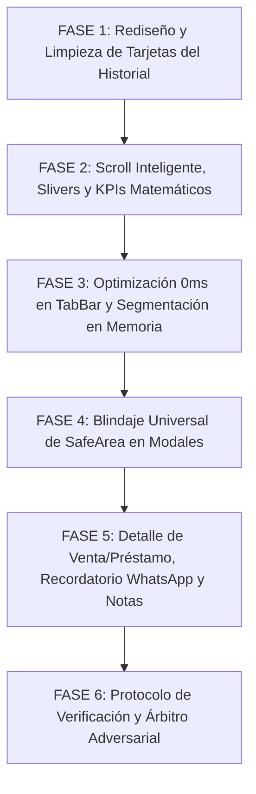

# 🚀 PLAN MAESTRO DE REINGENIERÍA: HISTORIAL DE VENTAS, SLIVERS INTELIGENTES, BLINDAJE DE MODALES Y DETALLE DE RECIBO / PRÉSTAMO

**Documento de Especificación Técnica, Diagnóstico Forense y Protocolo Adversarial**  
**Proyecto:** MochilaLista App (Local-First SQLite, 0ms Latency, Flutter Mobile - Estándar Mobile Awards)  
**Módulos Involucrados:**
- **Historial de Ventas (UI & Slivers):** `sales_history_screen.dart`, `sales_list_builder.dart`, `history_filter_bar.dart`, `history_dashboard_cards.dart`.
- **Detalle de Venta y Préstamo:** `sale_history_detail_screen.dart`, `detail_header_card.dart`, `detail_status_card.dart`, `detail_notes_card.dart`, `sale_payment_timeline.dart`, `sale_action_footer.dart`, `sale_action_bottom_sheet.dart`.
- **Servicios y Estado:** `sale_provider.dart`, `sales_service.dart`, `sale_repository.dart`, `client_service.dart`, `crm_models.dart`.
- **Componentes Transversales:** `interactive_sheet_wrapper.dart`, `currency_formatter.dart` (`AppCurrency`).
**Fecha:** Octubre 2026  
**Metodología:** Loop Autónomo + Árbitro Interno Adversarial Estricto  

---

## 📸 1. AUDITORÍA FORENSE DE LAS 5 CAPTURAS Y DIAGNÓSTICO EN CÓDIGO FUENTE

A partir de la inspección exhaustiva de las 5 capturas remitidas por el usuario y la auditoría línea por línea del código fuente, se determina la causa raíz técnica exacta de cada anomalía:

| Captura | Pantalla / Componente | Diagnóstico Forense del Problema | Causa Raíz Exacta en Código Fuente |
| :--- | :--- | :--- | :--- |
| **Captura 1** | **`Historial de Ventas` (Vista Superior en Reposo)** | **1. Folio de Recibo/Préstamo Truncado:** En la primera fila se corta como `"Recibo ..."` o `"P..."`.<br>**2. Emojis en Badges de Origen:** Emojis incrustados (`⚡`, `🏦`, `📋`) que desentonan con la estética.<br>**3. Duplicidad de Deuda y Subtítulo:** Texto rojo `"Debe: S/ 240.00"` redundante bajo el monto, y subtítulo en cursiva repite `"Préstamo personal"`.<br>**4. Espacio Vacío y Cortes en KPIs:** Mucho aire arriba/abajo del buscador; títulos de KPIs cortados como `"Cobrado (..."` y `"Por Cobrar..."`; Tab `"Caja Rápida"` ligeramente cortado a la derecha.<br>**5. Inconsistencia Matemática en KPIs:** Muestra `2 Operaciones` y `Por Cobrar: 18,57 S/` cuando abajo hay 3 operaciones listadas y una deuda de `240,00 S/`. | • `sales_list_builder.dart` L114-150: En una sola `Row` compiten el folio (`Flexible`), el badge de origen y la fecha completa (`"dd/MM/yyyy • hh:mm a"`). Al tener la fecha ~145px y el badge ~125px, solo quedan ~30px para el folio, truncándolo a `"Recibo ..."` o `"P..."`.<br>• `sales_list_builder.dart` L62-72: Textos con emojis fijos: `"🏦 Préstamo Personal"`, `"⚡ Caja Rápida"`, `"📋 Cotización Vendida"`.<br>• `sales_list_builder.dart` L246-264: Se pinta `"Debe: S/ ..."` bajo el monto principal a pesar de que el `Wrap` inferior ya incluye el badge explícito `"PENDIENTE DE COBRO • S/ 240.00"`.<br>• `history_dashboard_cards.dart` L20-21: Títulos `"Cobrado (S/)"` y `"Por Cobrar (S/)"` saturan el ancho de las mini tarjetas en 360dp.<br>• `sale_repository.dart` L152-154: `getStatsRaw` excluye forzosamente préstamos con `AND origen_venta != 'prestamo_personal'` cuando `origenVenta == "todas"`, mientras que `getSalesRaw` sí los incluye en la lista. |
| **Captura 2** | **`Historial de Ventas` (Scroll Down / Desplazamiento Activo)** | **1. Franja Vacía Superior y Colisión del Buscador:** Al hacer scroll down, queda un hueco negro arriba del buscador y la parte inferior del buscador corta por la mitad horizontalmente la primera tarjeta (`"Cliente eventual"`).<br>**2. Lentitud al Cambiar Pestañas:** Al tocar `"Cotizaciones Vendidas"` o `"Caja Rápida"`, la pantalla parpadea y demora en responder. | • `sales_history_screen.dart` L264-424: `NestedScrollView` usa múltiples `SliverAppBar` sin `SliverOverlapAbsorber` ni `SliverOverlapInjector`. Al colapsar los filtros, el inner `ListView` desconoce la altura de los slivers anclados y se posiciona detrás del buscador.<br>• `sales_history_screen.dart` L403-407: `SliverAppBar` con `toolbarHeight: 0` y `bottom: PreferredSize` sin márgenes calculados.<br>• `sale_provider.dart` L411-416 & L628-632: `setTab` vacía la lista en memoria `_salesHistory = []` (provocando parpadeo y spinner) y dispara múltiples llamadas asíncronas secuenciales a SQLite (`getHistory` + `_loadDynamicStats`) en lugar de usar filtrado instantáneo en memoria. |
| **Captura 3** | **Modal `"Filtrar periodo de tiempo"`** | **Solapamiento Crítico con Botones de Android:** La última opción (`"Rango Personalizado..."`) queda completamente tapada por la barra de navegación de 3 botones de Android (`< O \|\|\|`). | • `history_filter_bar.dart` L154-190: `_showPeriodOptions` utiliza un `Container` plano dentro de `showModalBottomSheet` sin envolverlo en `SafeArea(bottom: true)` ni contemplar `MediaQuery.paddingOf(context).bottom` o `InteractiveSheetWrapper`. Lo mismo ocurre en `_showSortOptions`. |
| **Captura 4** | **Detalle de Préstamo (`sale_history_detail_screen.dart`)** | **1. Desbordamiento Horizontal en Fila Financiera:** `"Interés / Financiamiento (20.0%) + 40,00 S/"` choca contra el borde derecho y se sale de su contenedor.<br>**2. Corte Inferior de Cuotas:** La tarjeta `"Plan de Cuotas (3)"` queda cortada por la barra inferior fija de acciones (`PDF`, `Nota`, `Cobrar Deuda`).<br>**3. Moneda Desestandarizada:** Muestra `"200,00 S/"`, `"+ 40,00 S/"`, `"240,00 S/"` con coma y símbolo al final. | • `detail_status_card.dart` L25-36 & L169-174: `_buildSummaryRow` usa un `Row` con `MainAxisAlignment.spaceBetween` sin `Expanded` ni `Flexible`. Al sumar el texto largo de la etiqueta y el monto, supera los ~290px útiles del card.<br>• `sale_history_detail_screen.dart` L688: Solo deja `SizedBox(height: 100)`, insuficiente para compensar la altura de `SaleActionFooter` (90px) + barra de navegación del sistema (48px).<br>• `detail_status_card.dart` L40: Usa `NumberFormat.currency(locale: 'es_PE', symbol: 'S/ ')` en lugar de `AppCurrency.format(...)`. |
| **Captura 5** | **Detalle de Préstamo (`sale_history_detail_screen.dart`)** | **1. Error Crítico al Agregar Nota:** Mensaje flotante rojo: `"No se puede agregar nota a esta venta (ID Inválido)"`.<br>**2. Recorte Superior del Monto Gigante:** El monto de cabecera (`240,00 S/`) aparece cortado por la mitad horizontalmente contra el borde superior del AppBar. | • `sale_history_detail_screen.dart` L518-522: Valida estrictamente `if (cotizacionId > 0)`. Como un préstamo no nace de una cotización, `cotizacionId` es 0 o `null`, arrojando el error y bloqueando el registro.<br>• `sale_history_detail_screen.dart` L594: `AppBar(backgroundColor: Colors.transparent)`. Al hacer scroll dentro del `SingleChildScrollView`, el contenido se desliza por debajo del AppBar transparente sin una barrera sólida de recorte.<br>• `detail_notes_card.dart` L82: Tenía deshabilitada la edición de notas si `isLoan` era `true`. |

---

## 🎯 2. PRINCIPIOS RECTORES Y ARQUITECTURA DE REINGENIERÍA

### Principio 1: Desacoplamiento Espacial y Jerarquía Inmune a Recortes (Mobile Awards)
- Cada fila y tarjeta debe tener una jerarquía de información lógica y no comprimir elementos antagónicos en una misma línea.
- El folio identificador (`Recibo #1`, `Préstamo #2`) es el ancla principal de la transacción y se ubica en la esquina superior izquierda de forma prominente con ancho garantizado.
- La fecha y hora se posiciona en la esquina superior derecha con tipografía secundaria y espacio protegido.
- El origen (`Caja Rápida`, `Préstamo Personal`, `Cotización Vendida`) se convierte en un tag/pill refinado sin emojis, ubicado armoniosamente junto al método de pago en el cuerpo central de la tarjeta.

### Principio 2: Verdad Contable y Paridad Estadística Absoluta
- Los KPIs superiores de la pestaña `"Todas"` deben reflejar exactamente la suma matemática de las transacciones activas visibles en dicha pestaña:
  * `Operaciones` = Ventas de Cotización + Ventas de Caja Rápida + Préstamos Personales desembolsados activos.
  * `Cobrado` = Montos pagados reales de todas las operaciones activas del periodo.
  * `Por Cobrar` = Saldo deudor exigible total (ventas con saldo pendiente + préstamos pendientes de cobro).
- Se elimina cualquier disparidad o filtro excluyente no documentado en las consultas SQL de estadísticas.

### Principio 3: Scroll Inteligente con `SliverOverlapAbsorber` y Transición Suave (0 Saltos)
- Implementación de la arquitectura canónica de Flutter para `NestedScrollView`:
  * `SliverAppBar` principal con `TabBar` (`pinned: true`).
  * `SliverToBoxAdapter` con `HistoryDashboardCards` (colapsa fluidamente al bajar).
  * `SliverAppBar` del Buscador (`pinned: true`), acoplado inmediatamente bajo el `TabBar` con `12px` de margen inferior y fondo sólido del tema.
  * `SliverAppBar` de Chips de Filtro (`floating: true, snap: true`), que se oculta al bajar y reaparece al primer gesto de subida.
  * La lista interna (`SalesListBuilder`) incorpora `SliverOverlapInjector` para que la primera tarjeta inicie siempre con una separación limpia y jamás quede truncada o aplastada.

### Principio 4: Reactividad Instantánea a 0ms en Navegación entre Pestañas
- Al conmutar de pestaña en el `TabBar`, la UI no debe borrar la lista ni mostrar spinners de carga:
  * El `SaleProvider` mantendrá el dataset completo del periodo en memoria.
  * El cambio de pestaña aplica segmentación en memoria a 0ms (`todas`, `smart_quotation`, `pos_rapido`, `archivadas`).
  * Los 3 KPIs se recalculan instantáneamente desde la memoria para la pestaña activa.
  * La paginación en SQLite solo se activa en segundo plano si el usuario hace scroll hacia el final de la lista.

### Principio 5: Blindaje Universal de `SafeArea` (Estándar `InteractiveSheetWrapper`)
- Ningún modal o bottom sheet volverá a usar contenedores crudos que colisionen con los 3 botones de navegación de Android (`< O |||`) o la barra gestual de iOS.
- Todos los modales del módulo se migran a `InteractiveSheetWrapper(applyEffectiveBottomPadding: true)`.

### Principio 6: Adaptabilidad Semántica Completa entre Venta y Préstamo
- Cuando el usuario visualiza o gestiona un Préstamo:
  * Los textos cambian dinámicamente: `"Préstamo #X"`, `"Motivo del Préstamo"`, `"Capital Inicial Prestado"`, `"Total a Devolver"`, `"Cobrar Deuda"`.
  * La creación y edición de notas opera directamente sobre el campo `nota_prestamo` de la tabla `ventas` mediante `saleId`, sin depender de `cotizacionId`.

---

## 🏗️ 3. PLAN DE TRABAJO DETALLADO POR FASES



---

### 🎨 FASE 1: Rediseño, Desacoplamiento y Limpieza Visual de las Tarjetas del Historial

**Archivos a Modificar:**
- [sales_list_builder.dart](file:///c:/Users/vjuli/Documents/mochilalista-app/app_movil/lib/features/smart_quotation/widgets/history/sales_list_builder.dart)

#### 1.1. Desacoplamiento de la Cabecera de la Tarjeta (Folio vs. Fecha/Hora)
- **Problema:** Actualmente la Fila 1 intenta meter el folio (`Flexible`), el badge de origen y la fecha completa en un solo `Row`.
- **Arquitectura de Solución:**
  * **Fila 1 (Cabecera Superior):**
    - Izquierda: Folio limpio y completo: `Recibo #3` o `Préstamo #2` en `FontWeight.bold`, `fontSize: 14`, color de alto contraste según tema (`isDark ? Colors.grey[200] : Colors.grey[800]`). Ancho protegido, sin `Flexible` compitiendo contra badges largos.
    - Derecha: Fecha y hora completa: `13/10/2026 • 08:08 PM` con tipografía limpia (`fontSize: 12`, color gris tenue).
  * **Cuerpo Central (Metadatos):**
    - La etiqueta de origen (`Caja Rápida`, `Préstamo Personal`, `Cotización Vendida`) se traslada a la fila de tags contextuales junto al método de pago (`YAPE`, `EFECTIVO`), donde encaja naturalmente sin saturar la cabecera.

#### 1.2. Erradicación de Emojis en Etiquetas de Origen
- Se eliminan los emojis incrustados (`⚡`, `🏦`, `📋`).
- Se rediseña `_OriginBadge` como un pill minimalista y elegante:
  * Contenedor con borde sutil (`0.8px`), fondo con opacidad del 10% del color temático.
  * Punto de color semántico sutil (`•`) o micro-icono vectorial nativo `IconData`:
    - Préstamo Personal: color ámbar (`Colors.amber[800]`), micro-icono `Icons.account_balance_wallet_outlined` (12px).
    - Caja Rápida: color verde azulado / teal (`Colors.teal[700]`), micro-icono `Icons.flash_on_rounded` (12px).
    - Cotización Vendida: color azul / naranja (`Colors.blue[800]`), micro-icono `Icons.request_quote_outlined` (12px).
  * Texto en `FontWeight.w700`, `fontSize: 10.5`, `letterSpacing: 0.2`.

#### 1.3. Eliminación de Duplicidad de Deuda y Subtítulo Contextual
- **Eliminación del texto rojo duplicado:** En la columna derecha de importes (L246-264), se suprime por completo el texto `Text("Debe: S/ ...")`.
  * Se preserva únicamente `Text("Abonado: S/ ...", style: TextStyle(color: Colors.green))` cuando la venta o préstamo tenga pago parcial (`sale.isPartialPayment`), ya que complementa al badge inferior.
- **Subtítulo contextual del cliente:**
  * Para préstamos: Se inspecciona `sale.notes` (`nota_prestamo`). Si contiene una observación real (ej. `"Para mercadería escolar"`), se muestra en cursiva. Si está vacío o contiene el texto genérico `"Préstamo personal"`, se renderiza `"Préstamo sin observación"` o se oculta el subtítulo para no repetir la etiqueta de origen.
  * Para ventas: Se mantiene `"Cliente vinculado"`, `"Venta en mostrador"` o la nota de la venta.

#### 1.4. Estandarización Monetaria Oficial (`AppCurrency`)
- Se reemplaza `NumberFormat.currency(locale: 'es_PE', symbol: 'S/ ')` y los `toStringAsFixed(2)` manuales por el helper oficial del proyecto:
  * Monto total principal: `AppCurrency.format(sale.trueTotalAmount)` -> `S/ 4.40`, `S/ 240.00`, `S/ 23.57`.
  * Monto abonado: `AppCurrency.format(sale.paidAmount)` -> `Abonado: S/ 5.00`.
  * Badges de estado de cobro: `AppCurrency.format(sale.pendingDebt)` -> `PAGO PARCIAL · Debe S/ 18.57` y `PENDIENTE DE COBRO · S/ 240.00`.

---

### 📜 FASE 2: Scroll Inteligente (`Slivers`), Acoplamiento del Buscador y Paridad Matemática de KPIs

**Archivos a Modificar:**
- [sales_history_screen.dart](file:///c:/Users/vjuli/Documents/mochilalista-app/app_movil/lib/features/smart_quotation/screens/sales_history_screen.dart)
- [history_filter_bar.dart](file:///c:/Users/vjuli/Documents/mochilalista-app/app_movil/lib/features/smart_quotation/widgets/history/history_filter_bar.dart)
- [history_dashboard_cards.dart](file:///c:/Users/vjuli/Documents/mochilalista-app/app_movil/lib/features/smart_quotation/widgets/history/history_dashboard_cards.dart)
- [sale_repository.dart](file:///c:/Users/vjuli/Documents/mochilalista-app/app_movil/lib/features/smart_quotation/repositories/sale_repository.dart)

#### 2.1. Eliminación de Espacios Vacíos y Cortes en KPIs / TabBar
- **Espacio muerto alrededor del buscador:**
  * En `history_filter_bar.dart` (`HistorySearchBar`), se compacta el padding interno a `EdgeInsets.symmetric(horizontal: 16, vertical: 6)`.
  * En `sales_history_screen.dart`, se elimina el `toolbarHeight: 0` y se configura el `SliverAppBar` del buscador con una altura fija y exacta (`preferredSize: Size.fromHeight(52)`).
- **Cortes de texto en KPIs superiores (`Cobrado (..."`, `"Por Cobrar..."`):**
  * En `history_dashboard_cards.dart` L20-21: Se eliminan los sufijos redundantes `"(S/)"`.
  * Quedan limpios: `"Operaciones"`, `"Cobrado"`, `"Por Cobrar"`.
  * Los montos se formatean con `AppCurrency.format(animatedValue)`.
- **Ajuste del `TabBar`:**
  * Se ajusta `labelPadding: const EdgeInsets.symmetric(horizontal: 12)` y `physics: const BouncingScrollPhysics()` para que todas las pestañas se deslicen suavemente y la pestaña `"Caja Rápida"` tenga aire suficiente sin recortes visuales.

#### 2.2. Paridad Matemática en `sale_repository.dart`
- **Causa raíz:** En `sale_repository.dart` L152-154, `getStatsRaw` tenía:
  ```dart
  if (origenVenta != null && origenVenta != "todas") {
    query += " AND origen_venta = ?";
    args.add(origenVenta);
  } else {
    query += " AND origen_venta != 'prestamo_personal'"; // 🚨 EXCLUSIÓN INDEBIDA
  }
  ```
- **Solución:** Eliminar la exclusión de `prestamo_personal`. Cuando `origenVenta` es `"todas"` o `null`, los préstamos activos computan en `total_ingresos`, `total_deuda` y `cantidad_ventas`, garantizando paridad matemática exacta con la lista.

#### 2.3. Perfeccionamiento de la Interacción de Scroll (`Slivers` / `NestedScrollView`)
- **Implementación de `SliverOverlapAbsorber` y `SliverOverlapInjector`:**
  * En `sales_history_screen.dart`, envolver los slivers pinned (`SliverAppBar` principal + `SliverAppBar` del buscador) dentro de un `SliverOverlapAbsorber` vinculado al `NestedScrollView.sliverOverlapAbsorberHandleFor(context)`.
  * En `sales_list_builder.dart`, anteponer un `SliverOverlapInjector` al `ListView` (o estructurarlo como `CustomScrollView` con `SliverList`).
- **Comportamiento de Scroll Dinámico:**
  1. **Scroll Down:**
     - `HistoryDashboardCards` colapsa fluidamente.
     - `HistoryFilterChips` (`SliverAppBar(floating: true, snap: true)`) se oculta suavemente.
     - `HistorySearchBar` (`pinned: true`) permanece firmemente anclada bajo el `TabBar`, con un padding inferior de seguridad (10px) y fondo sólido acoplado al AppBar.
     - La primera tarjeta de la lista queda con margen limpio y **jamás es cortada ni colisiona con el buscador**.
  2. **Scroll Up (micro-gesto hacia arriba):**
     - `HistoryFilterChips` se despliega inmediatamente debajo del buscador flotando con animación instantánea, permitiendo cambiar filtros sin tener que regresar al inicio.
     - `HistoryDashboardCards` reaparece únicamente al llegar al tope (offset 0).

---

### ⚡ FASE 3: Optimización Extrema de Velocidad de Navegación entre Pestañas (0ms)

**Archivos a Modificar:**
- [sale_provider.dart](file:///c:/Users/vjuli/Documents/mochilalista-app/app_movil/lib/features/smart_quotation/providers/sale_provider.dart)
- [sales_history_screen.dart](file:///c:/Users/vjuli/Documents/mochilalista-app/app_movil/lib/features/smart_quotation/screens/sales_history_screen.dart)

#### 3.1. Diagnóstico y Erradicación del Cuello de Botella
- Actualmente, cada cambio en el `TabController` ejecuta `setTab()` en `sale_provider.dart`, el cual vacía la lista `_salesHistory = []`, emite `notifyListeners()` mostrando el spinner, y luego lanza `_loadDynamicStats()` y `getHistory()` a disco SQLite. Si el usuario pasa rápido de una pestaña a otra, se producen hasta 4 consultas pesadas en cola.
- Además, `TabController.addListener` en Flutter dispara el callback dos veces por cada transición (inicio y fin de animación).

#### 3.2. Arquitectura de Segmentación en Memoria (0ms Latency)
- Se introduce un buffer maestro en memoria para el periodo y filtro de búsqueda activos: `List<SaleModel> _masterSales = []`.
- Cuando se carga o refresca el periodo activo:
  * Se obtienen las transacciones vigentes y se almacenan en `_masterSales`.
  * Se pre-computan o filtran en memoria las vistas de las 4 pestañas:
    - `todas`: Elementos no archivados (`!s.isArchived`).
    - `smart_quotation`: Cotizaciones no archivadas (`s.origenVenta == 'smart_quotation' && !s.isArchived`).
    - `pos_rapido`: Caja rápida no archivada (`s.origenVenta == 'pos_rapido' && !s.isArchived`).
    - `archivadas`: Elementos anulados (`s.isArchived`).
- Al cambiar de pestaña:
  * Se comprueba `!_tabController.indexIsChanging` para evitar llamadas duplicadas.
  * La lista de la pestaña activa se actualiza instantáneamente en memoria (0ms) sin parpadeo ni `CircularProgressIndicator`.
  * Las estadísticas (KPIs) se computan instantáneamente sobre el subconjunto de memoria mediante operaciones de agregación síncronas (`fold`/`where`).
  * La llamada a SQLite solo se activa en modo paginado (`_isLoadingMore`) si la lista de la pestaña excede el límite de página.

---

### 🛡️ FASE 4: Blindaje Universal de `SafeArea` Inferior en Todos los Modales

**Archivos a Modificar:**
- [history_filter_bar.dart](file:///c:/Users/vjuli/Documents/mochilalista-app/app_movil/lib/features/smart_quotation/widgets/history/history_filter_bar.dart)
- [sale_history_detail_screen.dart](file:///c:/Users/vjuli/Documents/mochilalista-app/app_movil/lib/features/smart_quotation/screens/sale_history_detail_screen.dart)
- [sale_action_bottom_sheet.dart](file:///c:/Users/vjuli/Documents/mochilalista-app/app_movil/lib/features/smart_quotation/widgets/history/sale_action_bottom_sheet.dart)

#### 4.1. Migración de Modales de Filtro y Ordenamiento a `InteractiveSheetWrapper`
- En `history_filter_bar.dart`:
  * `_showPeriodOptions`: Reemplazar el `Container` plano por `InteractiveSheetWrapper(applyEffectiveBottomPadding: true)`.
  * `_showSortOptions`: Reemplazar el `Container` plano por `InteractiveSheetWrapper(applyEffectiveBottomPadding: true)`.
  * El cálculo dinámico `InteractiveSheetWrapper.getEffectiveBottomPadding(context)` garantiza un colchón inferior que absorbe la barra de 3 botones de Android (`< O |||`), asegurando que `"Rango Personalizado..."` y la última opción de ordenamiento se lean completas y con holgura táctil.

#### 4.2. Blindaje de Modales Secundarios en Detalle de Venta
- En `sale_history_detail_screen.dart`:
  * `_showAddNoteMenu`: Migrar a `InteractiveSheetWrapper(applyEffectiveBottomPadding: true)`.
  * `_showDuplicateOptionsModal`: Migrar a `InteractiveSheetWrapper(applyEffectiveBottomPadding: true)`.
  * Modales de anulación / confirmación: verificar que el `bottom` de los diálogos y sheets no sea invadido por insets del sistema o teclado.

---

### 💎 FASE 5: Reingeniería de la Ventana de Detalle (`sale_history_detail_screen.dart`), Recordatorio de Cuotas y Gestión de Notas en Préstamos

**Archivos a Modificar:**
- [sale_history_detail_screen.dart](file:///c:/Users/vjuli/Documents/mochilalista-app/app_movil/lib/features/smart_quotation/screens/sale_history_detail_screen.dart)
- [detail_status_card.dart](file:///c:/Users/vjuli/Documents/mochilalista-app/app_movil/lib/features/smart_quotation/widgets/history/detail_widgets/detail_status_card.dart)
- [detail_header_card.dart](file:///c:/Users/vjuli/Documents/mochilalista-app/app_movil/lib/features/smart_quotation/widgets/history/detail_widgets/detail_header_card.dart)
- [detail_notes_card.dart](file:///c:/Users/vjuli/Documents/mochilalista-app/app_movil/lib/features/smart_quotation/widgets/history/detail_widgets/detail_notes_card.dart)
- [sale_payment_timeline.dart](file:///c:/Users/vjuli/Documents/mochilalista-app/app_movil/lib/features/smart_quotation/widgets/history/detail_widgets/sale_payment_timeline.dart)
- [sale_provider.dart](file:///c:/Users/vjuli/Documents/mochilalista-app/app_movil/lib/features/smart_quotation/providers/sale_provider.dart)
- [sales_service.dart](file:///c:/Users/vjuli/Documents/mochilalista-app/app_movil/lib/features/smart_quotation/services/sales_service.dart)

#### 5.1. Solución a Desbordamientos y Cortes en Detalle (Capturas 4 y 5)
- **Fila `"Interés / Financiamiento"` en `detail_status_card.dart`:**
  * Reestructurar `_buildSummaryRow` para que el label esté contenido en un `Expanded` (con soporte `maxLines: 2` y salto de línea elegante) y el valor en un `Flexible` o `Row` con `AppCurrency.format(...)`.
  * Nunca se desbordará ni en teléfonos de 320dp ni con tasas o montos extensos.
- **Corte Superior del Monto Gigante (`240,00 S/` en Captura 5):**
  * En `sale_history_detail_screen.dart`, el `AppBar` tiene actualmente `backgroundColor: Colors.transparent`. Al hacer scroll, el texto gigante sube por detrás del AppBar y choca con el título.
  * Solución: Asignar un color de fondo sólido o dinámico al AppBar (`isDark ? const Color(0xFF1A1A24) : Colors.white`) o acoplar la cabecera dentro de un `SliverAppBar(pinned: true, expandedHeight: ...)`, garantizando que el monto principal pertenezca a la superficie del scroll con clipping seguro.
  * Formatear el monto con `AppCurrency.format(totalAmount)` en lugar de `currency.format(...)`.
- **Corte Inferior del `"Plan de Cuotas (3)"`:**
  * En `sale_history_detail_screen.dart`, aumentar el padding inferior del `SingleChildScrollView`:
    `padding: EdgeInsets.only(bottom: kBottomNavigationBarHeight + MediaQuery.of(context).viewPadding.bottom + 40)`.
  * Las cuotas se podrán scrollear holgadamente por encima de la barra fija `SaleActionFooter`.

#### 5.2. Modal de Confirmación para `"Recordar"` por WhatsApp en `"Plan de Cuotas"`
- **Ubicación:** `sale_payment_timeline.dart`.
- **Comportamiento Nuevo:**
  * Al presionar el botón verde `"Recordar"`, en lugar de disparar `launchUrl` a ciegas, se abre un modal de confirmación moderno (`CuotaReminderModal` construido con `InteractiveSheetWrapper`).
  * **Componentes del Modal:**
    1. **Encabezado:** Icono de WhatsApp verde, título `"Recordatorio de Cuota"`, subtítulo `"Confirma los datos antes de abrir WhatsApp"`.
    2. **Datos del Cliente y Celular:**
       - Campo de texto para el Número de Celular: pre-llenado con el teléfono del cliente si existe. Si está vacío o es incorrecto, el usuario puede ingresarlo o corregirlo en el momento (con validación de 9 dígitos peruanos).
       - Nombre del cliente visible o editable si es genérico.
    3. **Resumen de la Cuota:**
       - Chip estilizado con: N° de Cuota (ej. `Cuota #1`), Monto a cobrar (`AppCurrency.format(c['monto'])`), Fecha de Vencimiento y Estado.
    4. **Preview del Mensaje:**
       - Caja de texto estilizada que muestra el mensaje exacto a enviar:
         > *"Hola [Nombre] 👋. Le recordamos que su cuota #[N°] por [S/ XX.XX] vence el [Fecha]. Puede realizar su pago mediante Yape, Plin o en tienda física. ¡Muchas gracias!"*
    5. **Botones de Acción:**
       - Botón secundario `"Cancelar"`.
       - Botón principal `"Enviar por WhatsApp"`, que valida el número, construye el enlace `https://wa.me/51[celular]?text=...` y abre WhatsApp.

#### 5.3. Corrección Crítica de Notas en Préstamos y Adaptación Semántica
- **Causa raíz del error:** En `sale_history_detail_screen.dart` L518, el código evaluaba `if (cotizacionId > 0)`. Como un préstamo tiene `cotizacionId == null` o `0`, arrojaba `"No se puede agregar nota a esta venta (ID Inválido)"`.
- **Solución Arquitectural en Backend/Provider:**
  * En `sales_service.dart`: Implementar método `updateSaleNote(int saleId, String newNote)`:
    ```dart
    Future<bool> updateSaleNote(int saleId, String newNote) async {
      final db = await dbHelper.database;
      final rows = await db.update(
        'ventas',
        {'nota_prestamo': newNote},
        where: 'id = ?',
        whereArgs: [saleId],
      );
      return rows > 0;
    }
    ```
  * En `sale_provider.dart`: Exponer `updateSaleNote(int saleId, String newNote)` y refrescar el detalle silenciosamente.
  * En `sale_history_detail_screen.dart`:
    - Si la operación es un préstamo (`isLoan`) o `cotizacionId == 0`: llamar a `saleProv.updateSaleNote(saleId, newText)` y actualizar `_saleData['nota_prestamo'] = newText`.
    - Si es una cotización vendida (`cotizacionId > 0`): mantener `saleProv.updateQuotationNote(cotizacionId, newText)`.
- **Adaptación Semántica del Modal Flotante de Notas:**
  * Si `isLoan == true`:
    - Título: `currentSaleNote.isEmpty ? "Agregar Nota del Préstamo" : "Editar Nota del Préstamo"`.
    - Subtítulo: `"Observaciones o condiciones específicas de este préstamo."`.
    - Hint: `"Escribe el motivo u observación del préstamo aquí..."`.
    - Icono: `Icons.description_outlined` en lugar de `Icons.speaker_notes`.
  * En `detail_notes_card.dart` L82: Habilitar el botón de edición para préstamos cuando `saleNote` esté presente o se pulse desde la cabecera.

---

## 🧪 4. PROTOCOLO DE PRUEBAS ADVERSARIALES Y CRITERIOS DE ACEPTACIÓN

Se creará una suite de pruebas automatizadas especializada:  
`app_movil/test/sales_history_and_detail_reengineering_test.dart`

### Criterios de Aceptación Innegociables:
1. **Prueba de Tarjeta Anti-Truncamiento (Bloque 1):**
   * En un viewport estrecho (360x640dp), el folio (`Recibo #1`, `Préstamo #2`) se renderiza completo sin `"..."`.
   * Cero emojis en las etiquetas de origen.
   * Cero texto duplicado `"Debe: S/ ..."` bajo el monto principal.
   * Todos los montos formateados estrictamente con `AppCurrency.format(...)` (`S/ #,##0.00`).
2. **Prueba de Paridad Matemática y Scroll de Slivers (Bloque 2):**
   * Los KPIs reflejan exactamente las operaciones activas, cobros reales y deudas pendientes de las transacciones visibles en `"Todas"`.
   * Al hacer scroll down, el buscador se mantiene `pinned` sin hueco superior y con separación inferior de 10-12px sin colisionar con la primera tarjeta.
   * Al hacer scroll up, los chips de filtro reaparecen fluidamente.
3. **Prueba de Latencia 0ms en TabBar (Bloque 3):**
   * Al conmutar entre pestañas, la lista y KPIs responden de inmediato (0ms) sin parpadeo de pantalla ni borrado de lista.
4. **Prueba de Blindaje SafeArea en Modales (Bloque 4):**
   * El modal `"Filtrar periodo de tiempo"` y `"Ordenar por"` muestran su última opción (`"Rango Personalizado..."`) con al menos 16px de margen efectivo sobre el borde inferior o barra de navegación.
5. **Prueba de Responsividad en Detalle y Notas en Préstamos (Bloque 5):**
   * La fila `"Interés / Financiamiento"` no genera desbordamiento (0 overflow pixels) con etiquetas largas.
   * Se pueden crear, editar y guardar notas en un préstamo con `cotizacionId == null` exitosamente y sin errores de ID.
   * El botón `"Recordar"` abre el modal de confirmación con datos del cliente y cuota antes de invocar WhatsApp.

---

## 📋 5. RESUMEN DE ARCHIVOS QUE SERÁN INTERVENIDOS EN LA FASE DE EJECUCIÓN

| Archivo | Rol en la Solución |
| :--- | :--- |
| `lib/features/smart_quotation/widgets/history/sales_list_builder.dart` | Rediseño de tarjeta, desacoplamiento de folio y fecha, remoción de emojis, eliminación de deuda redundante, `AppCurrency`. |
| `lib/features/smart_quotation/screens/sales_history_screen.dart` | Arquitectura canónica de Slivers (`SliverOverlapAbsorber`), eliminación de huecos del buscador, optimización de TabBar. |
| `lib/features/smart_quotation/widgets/history/history_filter_bar.dart` | Blindaje SafeArea con `InteractiveSheetWrapper`, compactación de buscador. |
| `lib/features/smart_quotation/widgets/history/history_dashboard_cards.dart` | Eliminación de `(S/)` en títulos para evitar recortes, integración de `AppCurrency`. |
| `lib/features/smart_quotation/repositories/sale_repository.dart` | Corrección de exclusión indebida de préstamos en `getStatsRaw` para paridad contable. |
| `lib/features/smart_quotation/providers/sale_provider.dart` | Segmentación en memoria (0ms latency), nuevo método `updateSaleNote` para préstamos. |
| `lib/features/smart_quotation/services/sales_service.dart` | Lógica de persistencia de `updateSaleNote` en SQLite (`ventas.nota_prestamo`). |
| `lib/features/smart_quotation/screens/sale_history_detail_screen.dart` | AppBar sólido anti-cortes, padding inferior anti-colisión, corrección de notas en préstamos y adaptación semántica. |
| `lib/features/smart_quotation/widgets/history/detail_widgets/detail_status_card.dart` | Fila `"Interés / Financiamiento"` responsiva con `Expanded`/`Flexible`, `AppCurrency`. |
| `lib/features/smart_quotation/widgets/history/detail_widgets/detail_header_card.dart` | Estandarización a `AppCurrency.format(...)` y protección de layout. |
| `lib/features/smart_quotation/widgets/history/detail_widgets/detail_notes_card.dart` | Habilitación de edición de notas para préstamos. |
| `lib/features/smart_quotation/widgets/history/detail_widgets/sale_payment_timeline.dart` | Integración del nuevo Modal de Confirmación para `"Recordar"` por WhatsApp. |
| `test/sales_history_and_detail_reengineering_test.dart` | Nueva suite integral de pruebas automatizadas adversariales. |
