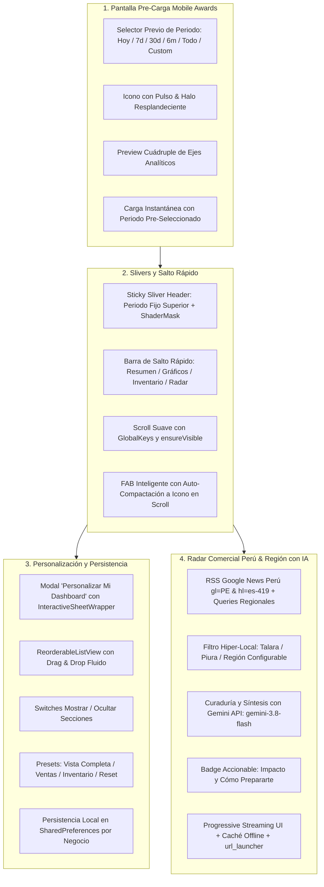
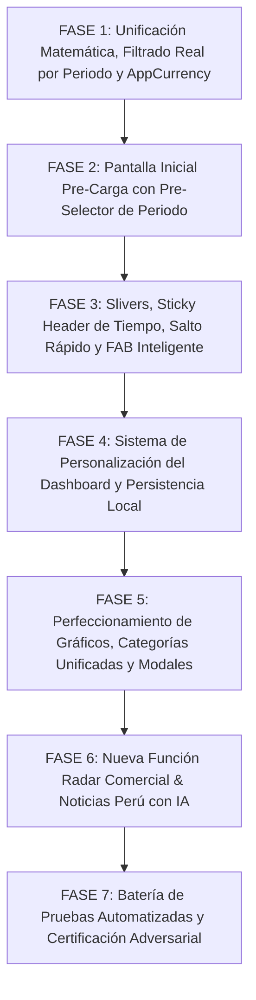
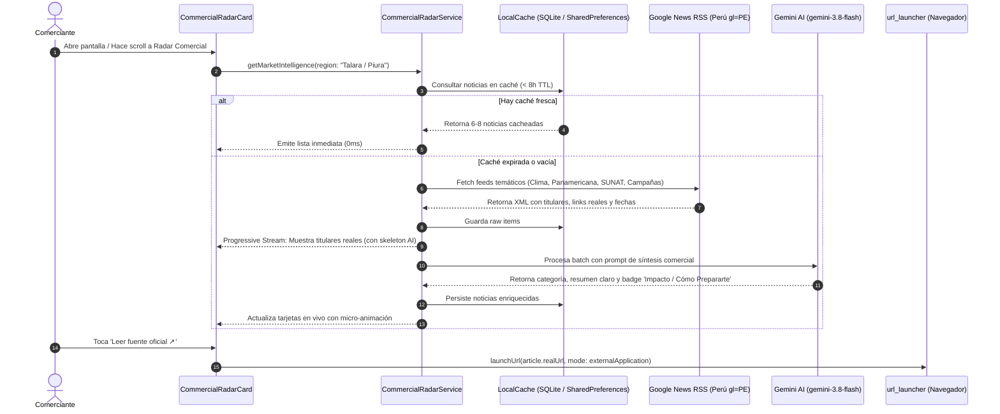

# 🚀 PLAN MAESTRO DE REINGENIERÍA: INTELIGENCIA DE NEGOCIO, ESTADÍSTICAS Y RADAR COMERCIAL CON IA

**Documento de Especificación Técnica, Auditoría Forense y Protocolo de Implementación Adversarial**  
**Proyecto:** MochilaLista App (Local-First SQLite, 0ms Latency, Flutter Mobile — Estándar Mobile Awards)  
**Módulos Involucrados:**
- **Núcleo de Inteligencia de Negocio:** `analytics_dashboard_screen.dart`, `analytics_provider.dart`.
- **Servicios Analíticos y Predictivos:** `inventory_intelligence_service.dart`, `predictive_service.dart`, `analytics_export_service.dart`, `purchase_order_generator.dart`.
- **Nuevo Servicio Radar Comercial con IA:** `commercial_radar_service.dart`, `commercial_radar_model.dart`, `commercial_radar_card.dart`.
- **Gráficos y Visualización:** `monthly_sales_chart.dart`, `sales_by_day_chart.dart`, `origin_pie_chart.dart`, `payment_method_chart.dart`, `top_products_chart.dart`.
- **Tarjetas y Paneles del Dashboard:** `financial_summary_card.dart`, `kpi_summary_row.dart`, `top_categories_card.dart`, `top_clients_card.dart`, `extra_metrics_card.dart`, `restock_alerts_card.dart`, `dead_stock_card.dart`, `insights_carousel.dart`.
- **Pantallas y Modales Complementarios:** `predictive_analytics_screen.dart`, `smart_restock_screen.dart`, `dashboard_customizer_modal.dart`.
- **Componentes Transversales:** `interactive_sheet_wrapper.dart`, `currency_formatter.dart` (`AppCurrency`), `api_constants.dart` (`GoogleAIClient` / Gemini).
**Fecha:** Octubre 2026  
**Metodología:** Loop Autónomo + Árbitro Interno Adversarial Estricto  

---

## 📸 1. AUDITORÍA FORENSE DE LAS 5 CAPTURAS Y DIAGNÓSTICO EN CÓDIGO FUENTE

A partir de la inspección exhaustiva de las 5 capturas remitidas por el usuario y la auditoría línea por línea de los archivos en `lib/features/analytics/`, se determina la causa raíz técnica exacta de cada inconsistencia lógica, colisión visual y defecto de diseño:

| Captura | Pantalla / Componente | Diagnóstico Forense del Problema | Causa Raíz Exacta en Código Fuente |
| :--- | :--- | :--- | :--- |
| **Captura 1** | **Pantalla Inicial Pre-Carga ("Generar Reporte")** | **1. Obligatoriedad Ineficiente de Periodo Fijo:** Obliga al usuario a pulsar `"▶ Generar Reporte"` cargando obligatoriamente los datos en `"6 Meses"` para recién adentro poder cambiar la temporalidad.<br>**2. Vacío Espacial y Estética Plana:** La pantalla inicial solo muestra un icono estático y un botón azul sin transmitir el poder analítico del módulo.<br>**3. Falta de Resumen de Módulos:** No anticipa qué métricas o motores se activarán al generar el reporte. | • `analytics_dashboard_screen.dart` L161-195: El bloque `AnalyticsStep.idle` renderiza una columna estática básica que solo dispara `prov.runStaggeredAnalysis()`. No expone ningún selector ni permite preseleccionar periodos.<br>• `analytics_provider.dart` L103: `_selectedPeriod` está rígidamente fijado en `AnalyticsPeriod.sixMonths` en memoria. Al ingresar no existe la opción de elegir `Hoy`, `7 Días`, `30 Días`, `Todo` o `Personalizado 📅` antes del análisis.<br>• Falta de animación de pulso/resplandor y ausencia de preview modular de Mobile Awards. |
| **Captura 2** | **Dashboard Cargado (Header Financiero y KPIs)** | **1. Contradicción Matemática en "Crecimiento":** En la tarjeta destacada grande se visualiza **`-75.5%`**, pero al tocar otra métrica y pasar `"Crecimiento"` a la grilla de 6 tarjetas pequeñas, se visualiza **`-81.3%`**.<br>**2. Copywriting Incongruente del Diagnóstico:** El titular superior afirma `"Negocio saludable y con potencial 💪"` sobre un periodo cuyas ventas cayeron catastróficamente un `-75.5%`.<br>**3. Moneda Desestandarizada:** Montos con sufijo `S/` y comas decimales (`27,97 S/`, `5,35 S/`, `42.642,65 S/`, `1.303,00 S/`, `13,99 S/`).<br>**4. AppBar Congestionado:** 4 botones de acción (`i`, `↻`, `👁️`, `⬇`) reducen el espacio del título en móviles compactos.<br>**5. FAB Invasivo:** El botón azul `"Alertas de Reabastecimiento"` se monta de forma fija tapando contenido inferior. | • `analytics_provider.dart` L488-493: `growthRate` se calcula comparando los dos últimos elementos de `monthlyList`. En la base de datos hay ventas en Agosto (23.57) y Octubre (4.40). Como Septiembre tuvo 0 ventas y `salesByMonth` omite los meses con 0, compara Octubre directamente con Agosto: `(4.40 - 23.57) / 23.57 = -81.3%`.<br>• Por su parte, `predictive_service.dart` L98-100 calcula `velocity` con los últimos 15 días vs los 15 días previos sobre media móvil: `(4.40 - 18.0) / 18.0 = -75.5%`. Al existir dos fórmulas divergentes y animación no sincronizada en `kpi_summary_row.dart` L196-212, el valor muta entre la tarjeta destacada y la cuadrícula.<br>• `analytics_provider.dart` L612-615: `balanceHeadline` solo evalúa `margin >= 15` ignorando por completo que las ventas cayeron en picada.<br>• `analytics_dashboard_screen.dart` L35: `NumberFormat.currency(locale: 'es_PE', symbol: 'S/ ')` en lugar de `AppCurrency.format(...)`.<br>• `analytics_dashboard_screen.dart` L150-157: `FloatingActionButton.extended` sin lógica de compactación por scroll y con solo 40px de padding inferior en L299. |
| **Captura 3** | **Selector de Tiempo y Motor Predictivo** | **1. Selector de Tiempo Enterrado:** Los chips de periodo (`Hoy`, `7 Días`, `30 Días`, `6 Meses`, etc.) están sepultados a mitad de página debajo del banner morado.<br>**2. Chips Cortados a la Derecha:** El 5to chip se corta abruptamente sin margen ni fade visual.<br>**3. Carencia de Salto Rápido:** No existen anclajes o accesos directos para saltar rápidamente a Inventario, Gráficos o Radar Comercial. | • `analytics_dashboard_screen.dart` L250-258: La estructura vertical del `Column` ubica `FinancialSummaryCard` -> `KpiSummaryRow` -> `_buildPredictiveButton` -> `_buildPeriodSelector`. Para filtrar por fecha, el comerciante debe hacer scroll y buscar el selector entre las tarjetas.<br>• `analytics_dashboard_screen.dart` L341-373: El `ListView.separated` horizontal carece de `ShaderMask` para degradado lateral y no reserva padding final seguro.<br>• No existe barra horizontal de navegación por secciones ancladas. |
| **Captura 4** | **Evolución de Ventas y Gráfico de Donas** | **1. "Evolución de Ventas" sin Ejes de Referencia:** Gráfica de línea sin referencias de montos en el eje Y; con solo 2 puntos (`22/08` y `13/10`) dibuja una caída lineal desoladora sin nodos interactivos claros.<br>**2. "Ventas por Día" con Barras Vacías:** Solo dibuja 2 barras aisladas (`Sáb` y `Mar`) en un espacio de 7 días, pareciendo un error de renderizado.<br>**3. Donas Estáticas:** El centro de la dona de "Ventas por Origen" y "Métodos de Pago" está vacío y tocar la leyenda no resalta el segmento ni muestra conteo de ventas. | • `monthly_sales_chart.dart` L103: `leftTitles: const AxisTitles(sideTitles: SideTitles(showTitles: false))`. No tiene etiquetas en el eje vertical.<br>• `analytics_provider.dart` L254-258 & L495: `salesByDayMap` solo crea claves para los días con ventas; no inicializa los 7 días de la semana (`Lun` a `Dom`) con 0.0, causando que `sales_by_day_chart.dart` solo pinte 2 barras huérfanas.<br>• `origin_pie_chart.dart` L62 & `payment_method_chart.dart` L84: Tienen `centerSpaceRadius` sin ningún widget central en Stack ni micro-animación de desglose. La leyenda lateral no tiene `onTap`. |
| **Captura 5** | **Inventario Muerto y Riesgo de Quiebre** | **1. Colisión de Título y Selector:** En la cabecera de `"Inventario Muerto"`, el texto del título y la píldora desplegable `> 30 días` colisionan y se aprietan.<br>**2. Botón "Ver 78 más" Tapado por el FAB:** El botón inferior para expandir los productos estancados queda 100% oculto bajo el FAB azul.<br>**3. Falta de Trazabilidad al Cliente:** En `"Mejores Clientes"`, no se puede tocar al cliente para abrir su perfil CRM ni se aprecia el número de compras. | • `dead_stock_card.dart` L249-286: Coloca un `Row(mainAxisAlignment: SpaceBetween)` dentro de un `Expanded` que ya compite con el icono circular izquierdo de 48px, dejando menos de 220px para el título + dropdown en pantallas compactas.<br>• `analytics_dashboard_screen.dart` L299: `SizedBox(height: 40)` al final del scroll; el FAB (56px + márgenes) tapa los últimos 100px de la pantalla, bloqueando el tap sobre `"Ver 78 más"`.<br>• `top_clients_card.dart` L75-117: Solo expande un texto local sin permitir navegar a `ClientDetailScreen` y sin exponer `num_compras`. |

---

## 🎯 2. PRINCIPIOS RECTORES Y ARQUITECTURA DE REINGENIERÍA



### Principio 1: Autonomía Previa y Primera Impresión Impactante (Mobile Awards)
- El comerciante jamás debe ser forzado a generar un reporte en un rango de fechas que no desea.
- La pantalla previa integra el selector temporal moderno con tabs suaves (`Hoy`, `7 Días`, `30 Días`, `6 Meses` [seleccionado por defecto], `Todo el Tiempo` y `Rango Personalizado 📅` con `showDateRangePicker`).
- Animación de pulso continuo sobre el icono central con micro-tarjetas informativas de los 4 ejes: Ventas y Rentabilidad, Inventario Inteligente, Predicciones y Radar Comercial Perú.

### Principio 2: Coherencia Matemática Estricta y Verdad Contable
- Se unifica el cálculo de `salesGrowthRate` en una **única fuente de verdad**:
  - Comparación simétrica de periodos: Periodo actual seleccionado vs Periodo equivalente inmediatamente anterior.
  - Ejemplo: `30 Días` compara los últimos 30 días contra los 30 días previos. `7 Días` compara los últimos 7 días contra los 7 días previos. `6 Meses` compara los últimos 6 meses contra los 6 meses previos. `Hoy` compara hoy contra ayer.
  - Manejo honesto de divisiones por cero y meses vacíos (relleno cronológico completo).
  - Eliminación absoluta de discrepancias entre la tarjeta destacada y la cuadrícula pequeña de métricas.
- El diagnóstico de salud financiera en `financialHealth` deja de ser ciego: evalúa de forma combinada **Margen Y Tendencia de Ventas**. Si el margen es saludable pero las ventas se desplomaron, alerta con honestidad profesional.

### Principio 3: Control Total del Usuario (Personalización y Persistencia Local)
- Cada dueño de negocio tiene prioridades distintas: a una bodega le interesa el inventario y quiebre de stock; a un mayorista le interesan los clientes VIP y las cotizaciones.
- Se incorpora un sistema completo de configuración mediante un modal interactivo:
  - Drag & Drop para reordenar las secciones del dashboard.
  - Switches para mostrar u ocultar cualquier sección.
  - Presets rápidos (`"Vista Completa"`, `"Enfoque en Ventas"`, `"Enfoque en Inventario"`, `"Restaurar Original"`).
  - Guardado permanente en `SharedPreferences` indexado por `negocioId`.

### Principio 4: Radar Comercial con Inteligencia Hiper-Local & Nacional (Perú)
- Trasciende la analítica interna: conecta al usuario con su entorno real de mercado en el Perú.
- Clima y Transporte: Alertas críticas sobre lluvias, Fenómeno de El Niño, estado de la Panamericana y rutas de abastecimiento hacia Piura/Talara y a nivel nacional.
- Leyes y SUNAT: Disposiciones para MYPES, facturación, tributos y combustible.
- Calendario Comercial Peruano: Consejos anticipados para Campaña Escolar, Día de la Madre, Fiestas Patrias, Campaña Navideña.
- Carga progresiva (*Progressive Streaming UI*), síntesis con Gemini AI y redirección transparente a la noticia original con `url_launcher`.

---

## 🏗️ 3. PLAN DE TRABAJO DETALLADO POR FASES



---

### FASE 1: Unificación Matemática del Crecimiento, Filtrado Real por Periodo y Estandarización Monetaria

#### Objetivos Clave:
1. Eliminar la contradicción matemática `-75.5%` vs `-81.3%` unificando la fórmula de crecimiento en `AnalyticsProvider`.
2. Corregir el bug arquitectónico donde `totalVentas`, `totalGananciaNeta` y `totalTransactions` sumaban todo el historial sin respetar `_selectedPeriod`.
3. Sincronizar el diagnóstico cualitativo (`FinancialHealthSummary`) para que no diga `"Negocio saludable"` cuando el crecimiento cayó drásticamente.
4. Migrar el 100% de montos en toda la suite analítica a `AppCurrency.format(...)` (`S/ #,##0.00`).

#### Tareas Técnicas Detalladas:
- [ ] **1.1. Refactorización del Filtrado Temporal en `AnalyticsProvider` (`analytics_provider.dart`):**
  - Implementar método auxiliar `_calculateDateRange(AnalyticsPeriod period, {DateTimeRange? customRange})` que retorne dos tuplas: `(DateTime currentStart, DateTime currentEnd)` y `(DateTime previousStart, DateTime previousEnd)`.
  - Casos de rango:
    - `today`: Hoy (00:00 a 23:59) vs Ayer (00:00 a 23:59).
    - `week`: Últimos 7 días vs 7 días inmediatamente anteriores.
    - `month`: Últimos 30 días vs 30 días inmediatamente anteriores.
    - `sixMonths`: Últimos 180 días vs 180 días inmediatamente anteriores.
    - `year`: Últimos 365 días vs 365 días inmediatamente anteriores.
    - `allTime`: Desde el inicio de los tiempos hasta hoy vs periodo equivalente previo (o MoM último mes).
    - `custom`: Rango personalizado elegido por el usuario vs rango de idéntica duración hacia atrás.
- [ ] **1.2. Consultas SQL Filtradas por Periodo Activo:**
  - Aplicar `v.fecha_venta >= ? AND v.fecha_venta <= ?` tanto para `ventasRows`, como para `gananciaQuery`, `topProductsQuery`, `topClientsQuery` y `topCategoriesQuery`.
  - Las métricas de cabecera (`totalSales`, `netProfit`, `margin`, `totalTransactions`, `averageTicket`) reflejarán con fidelidad absoluta el periodo elegido.
- [ ] **1.3. Cálculo Exacto de Crecimiento Simétrico:**
  - Sumar ventas del periodo actual (`currentPeriodSales`) y ventas del periodo previo (`previousPeriodSales`).
  - Si `previousPeriodSales > 0`: `growthRate = ((currentPeriodSales - previousPeriodSales) / previousPeriodSales) * 100`.
  - Si `previousPeriodSales == 0 && currentPeriodSales > 0`: `growthRate = 100.0` (crecimiento neto nuevo).
  - Si ambas son 0: `growthRate = 0.0`.
  - Asignar este valor único a `data.salesGrowthRate` y reutilizarlo de forma idéntica en `kpi_summary_row.dart`, `financial_summary_card.dart` y en los servicios de exportación.
- [ ] **1.4. Rediseño del Copywriting de Salud Financiera (`balanceHeadline`):**
  - Incorporar matriz bidimensional (Margen × Crecimiento):
    - Margen >= 20% y Crecimiento >= 0%: *"¡Tu negocio es una máquina de generar! 🚀"*
    - Margen >= 15% y Crecimiento >= 0%: *"Negocio saludable y con potencial 💪"*
    - Margen >= 15% pero Crecimiento < -15%: *"Buen margen, pero alerta por caída en ventas ⚠️"* (Explicación: *"Tu rentabilidad por producto es sólida, pero el volumen de ventas cayó un X%. Activa promociones para reactivar la demanda."*)
    - Margen < 10% y Crecimiento < 0%: *"Atención urgente: Margen ajustado y ventas a la baja 🚨"*
    - Sin ventas: *"Balance Total — Aún sin ventas en este periodo."*
- [ ] **1.5. Estandarización Universal con `AppCurrency.format`:**
  - Reemplazar todas las instancias de `NumberFormat.currency(locale: 'es_PE', symbol: 'S/ ')` en `analytics_dashboard_screen.dart`, `financial_summary_card.dart`, `kpi_summary_row.dart`, `top_categories_card.dart`, `top_clients_card.dart`, `top_products_chart.dart`, `dead_stock_card.dart`, `extra_metrics_card.dart`, `restock_alerts_card.dart`, `monthly_sales_chart.dart`, `origin_pie_chart.dart`, `payment_method_chart.dart`, `sales_by_day_chart.dart` y `analytics_export_service.dart`.
  - Garantizar formato oficial peruano invariable: `S/ #,##0.00`.

---

### FASE 2: Rediseño de la Pantalla Inicial Pre-Carga con Pre-Selector de Periodo

#### Objetivos Clave:
1. Permitir al usuario elegir qué periodo desea analizar (`Hoy`, `7 Días`, `30 Días`, `6 Meses`, `Todo`, `Personalizado 📅`) **antes** de disparar la carga.
2. Transformar la pantalla previa en una experiencia visual premium con pulso animado y resumen de capacidades.

#### Tareas Técnicas Detalladas:
- [ ] **2.1. Selector de Periodo Integrado en Estado `AnalyticsStep.idle`:**
  - Agregar estado local `_preselectedPeriod` (por defecto `AnalyticsPeriod.sixMonths`) y `DateTimeRange? _customDateRange`.
  - Diseñar un selector horizontal moderno de ChoiceChips estilizados con bordes redondeados (20px), fondo traslúcido y selección destacada en `Colors.blueAccent`.
  - Incluir botón de calendario `"Personalizado 📅"`: al tocarlo abre `showDateRangePicker` con localización peruana y tema coordinado.
- [ ] **2.2. Iconografía Dinámica y Pulso Visual Mobile Awards:**
  - Crear widget `PulsingAnalyticsHalo`: icono central `Icons.query_stats` rodeado de dos anillos concéntricos con animación suave de opacidad y escala continua (`AnimationController` de 2.5s).
- [ ] **2.3. Cuadrícula de Pre-visualización de Módulos (Feature Pills):**
  - Debajo del texto introductorio, desplegar 4 mini tarjetas en grid 2x2 con diseño glassmórfico sutil:
    1. 📊 **Ventas y Rentabilidad:** Ingresos brutos, ganancia neta y márgenes.
    2. 📦 **Salud de Inventario:** Rotación, stock muerto y capital atrapado.
    3. 🤖 **Motor Predictivo:** Proyecciones y tendencias futuras.
    4. 📰 **Radar Comercial Perú:** Clima, rutas, SUNAT y campañas comerciales.
- [ ] **2.4. Ejecución Inmediata al Pulsar "Generar Reporte":**
  - Al presionar `"▶ Generar Reporte"`, se llama a `prov.setPeriodAndAnalyze(_preselectedPeriod, customRange: _customDateRange)`.
  - Transición fluida a la animación de pasos de análisis (ventas -> clientes -> inventario -> insights).

---

### FASE 3: Sticky Sliver Header de Tiempo, Barra de Salto Rápido y FAB Anti-Colisiones

#### Objetivos Clave:
1. Subir el filtro de periodo a la parte superior como encabezado fijo (`SliverStickyHeaderDelegate`) para que jamás quede enterrado.
2. Incorporar una barra de salto rápido (*Anchor Quick Navigation Bar*) para navegar fluidamente entre bloques temáticos.
3. Rediseñar el FAB `"Alertas de Reabastecimiento"` con comportamiento retráctil dinámico y padding inferior seguro.
4. Optimizar el AppBar para que el título `"Inteligencia de Negocio"` mantenga jerarquía y nunca se corte.

#### Tareas Técnicas Detalladas:
- [ ] **3.1. Reestructuración a `CustomScrollView` y Slivers en `analytics_dashboard_screen.dart`:**
  - Migrar `_buildBody` cuando el reporte está listo a un `CustomScrollView` controlado por `ScrollController`.
  - Implementar `SliverPersistentHeader` fijo (`pinned: true`) con `SliverStickyHeaderDelegate`:
    - Fila 1: Selector de periodo horizontal con `ShaderMask` en ambos extremos para que ningún chip se corte abruptamente al deslizar.
    - Fila 2: Chips de salto rápido temático: `📊 Resumen`, `📈 Gráficos`, `📦 Inventario`, `📰 Radar Comercial`.
- [ ] **3.2. Salto Rápido Suave con `GlobalKey` y `Scrollable.ensureVisible`:**
  - Asignar una `GlobalKey` a cada contenedor ancla: `_summaryKey`, `_chartsKey`, `_inventoryKey`, `_radarKey`.
  - Al presionar un chip temático, ejecutar `Scrollable.ensureVisible(key.currentContext!, duration: Duration(milliseconds: 600), curve: Curves.easeInOutCubic, alignment: 0.05)`.
- [ ] **3.3. Optimización del AppBar y Espaciado:**
  - Ajustar `titleSpacing: 0` o compacto, tamaño de tipografía a `18-20sp bold` con `FittedBox`.
  - Agrupar botones de acción: `InfoTooltipButton`, `IconButton(Icons.refresh)`, `IconButton(Icons.tune)` (Personalizar) y menú contextual de opciones.
- [ ] **3.4. FAB Inteligente Anti-Colisiones:**
  - Escuchar el `ScrollController`:
    - Al hacer scroll hacia abajo (`ScrollDirection.reverse`), compactar el botón a un botón circular flotante con solo el icono `Icons.add_alert`.
    - Al detenerse o hacer scroll hacia arriba, expandir suavemente el texto `"Alertas de Reabastecimiento"`.
  - Aplicar `padding: const EdgeInsets.only(bottom: 140.0)` en la lista para que el FAB jamás cubra ningún botón (ej. `"Ver 78 más"`) o texto inferior.

---

### FASE 4: Sistema Avanzado de Personalización del Dashboard y Persistencia Local

#### Objetivos Clave:
1. Crear el modal interactivo `"Personalizar Mi Dashboard"` con switches de visibilidad y reordenamiento Drag & Drop.
2. Ofrecer presets inteligentes según la necesidad del comerciante.
3. Persistir la configuración en `SharedPreferences` por negocio activo.

#### Tareas Técnicas Detalladas:
- [ ] **4.1. Modelo de Configuración de Secciones (`DashboardSectionConfig`):**
  - Campos: `id` (String), `title` (String), `icon` (IconData), `visible` (bool), `orderIndex` (int), `category` (enum: resumen, graficos, inventario, mercado).
  - Secciones soportadas:
    1. `financial_summary`: Balance Total y Margen Neto.
    2. `kpi_grid`: Cuadrícula de 7 KPIs y Tarjeta Destacada.
    3. `predictive_banner`: Acceso al Motor Predictivo.
    4. `commercial_radar`: Radar Comercial Perú & Noticias con IA.
    5. `insights_carousel`: Novedades y Oportunidades del Negocio.
    6. `sales_evolution`: Evolución de Ventas (Línea interactiva).
    7. `sales_by_day`: Ventas por Día (Lun-Dom).
    8. `sales_origin`: Ventas por Origen (Cotización vs Caja Rápida).
    9. `payment_methods`: Ingresos por Método de Pago (Yape, Efectivo, etc.).
    10. `top_products`: Top Productos Más Vendidos.
    11. `top_categories`: Categorías Inteligentes (Ingresos / Unidades).
    12. `top_clients`: Mejores Clientes (Conteo de compras y enlace CRM).
    13. `extra_metrics`: Métricas Complementarias (Margen promedio, Cobranza).
    14. `restock_alerts`: Riesgo de Quiebre de Stock.
    15. `dead_stock`: Inventario Muerto y Capital Inmovilizado.
- [ ] **4.2. Modal `DashboardCustomizerModal` con `InteractiveSheetWrapper`:**
  - Cabecera con título, botón de cerrar y chips de Presets:
    - 🌟 `"Vista Completa"` (Todas visibles, orden por defecto).
    - 💰 `"Enfoque en Ventas"` (Finanzas, KPIs, Evolución, Top Clientes, Radar).
    - 📦 `"Enfoque en Inventario"` (KPIs, Quiebre, Inventario Muerto, Categorías).
    - 🔄 `"Restaurar Original"`.
  - Cuerpo: `ReorderableListView.builder` que permite arrastrar cualquier sección arriba/abajo con manija táctil (`Icons.drag_handle`), acompañado de un `Switch` o `Checkbox` para activar/desactivar la tarjeta.
- [ ] **4.3. Persistencia Local en `SharedPreferences`:**
  - Clave: `bi_dashboard_sections_${negocioId}`.
  - Métodos `saveCustomConfig()` y `loadCustomConfig()` en `AnalyticsProvider` o servicio dedicado.
  - Al reabrir la app o cambiar de periodo, el dashboard se renderiza en el orden exacto configurado por el usuario.

---

### FASE 5: Perfeccionamiento de Todos los Gráficos, Tarjetas y Modales Internos

#### Objetivos Clave:
1. Mejorar `"Evolución de Ventas"` y reconstruir `"Ventas por Día"` con los 7 días de la semana (`Lun` a `Dom`).
2. Dotar de interactividad central a los gráficos de dona ("Ventas por Origen" y "Métodos de Pago").
3. Unificar `"Categorías por Ingresos"` y `"Categorías por Unidades"` en una única tarjeta con toggle interactivo superior.
4. Pulir `"Inventario Muerto"`, `"Mejores Clientes"`, `"Métricas Clave"` y los modales del sistema.

#### Tareas Técnicas Detalladas:
- [ ] **5.1. Perfeccionamiento de "Evolución de Ventas" (`monthly_sales_chart.dart`):**
  - Activar `leftTitles` con 3 marcas de referencia formateadas (`AppCurrency.format(val)`).
  - Dibujar nodos interactivos (`FlDotData`) siempre visibles con radio elegante y halo traslúcido.
  - Tooltip táctil enriquecido al tocar o deslizar: fecha formateada + monto en soles + comparativa porcentual.
  - Caso borde con 1 o 2 puntos: dibujar línea base con relleno degradado suave y texto explicativo claro.
- [ ] **5.2. Reconstrucción de "Ventas por Día" con los 7 Días (`sales_by_day_chart.dart`):**
  - En `AnalyticsProvider`, inicializar siempre los 7 días en orden estricto de Lunes a Domingo:
    `final allDays = ['Lun', 'Mar', 'Mié', 'Jue', 'Vie', 'Sáb', 'Dom'];`
    `Map<String, double> salesByDayMap = {for (var d in allDays) d: 0.0};`
  - En la gráfica, resaltar la barra del día con mayores ventas con gradiente especial (ej. `Colors.amber` a `Colors.deepOrange`) y una estrella o badge `"Mejor Día"`.
  - Tocar cualquier barra muestra una micro-tarjeta flotante con el monto exacto y el porcentaje sobre el total de la semana.
- [ ] **5.3. Donas Interactivas con Centro Informativo (`origin_pie_chart.dart` y `payment_method_chart.dart`):**
  - Usar `Stack` centrado sobre la dona:
    - En reposo: Muestra el total general en Soles.
    - Al tocar un segmento o ítem de la leyenda: El segmento se expande con micro-animación (`radius: 46`, sombras) y el centro muestra:
      - Nombre del canal/método (ej. `"Yape"` o `"Cotización"`).
      - Monto en Soles (`AppCurrency.format(...)`).
      - Porcentaje exacto y conteo de transacciones.
  - Conectar la leyenda derecha para que sea 100% interactiva (`onTap: () => selectSegment(index)`).
- [ ] **5.4. Unificación de Categorías Inteligentes (`top_categories_card.dart`):**
  - Eliminar la alternancia automática confusa (`_autoRotateTimer`).
  - Incorporar en la cabecera un selector segmentado interactivo tipo píldora:
    `[$ Por Ingresos]` | `[📦 Por Unidades]`.
  - Al alternar, animar fluidamente las barras con `AnimatedSwitcher` y ordenar las categorías correspondientemente.
  - Mostrar barras de progreso estilizadas con monto en Soles y unidades vendidas de forma nítida.
- [ ] **5.5. Pulido de "Inventario Muerto" (`dead_stock_card.dart`):**
  - Reestructurar el header para evitar colisiones:
    - Fila superior: Icono circular + Título `"Inventario Muerto"` con `Flexible` + Menú desplegable `> 30 días` alineado a la derecha con padding seguro.
    - Subtítulo inferior: `"Tienes X productos estancados · Capital Inmovilizado: S/ Y"`.
  - Blindar el botón `"Ver X más"` para que jamás colisione con el FAB.
- [ ] **5.6. Mejoras en "Mejores Clientes" (`top_clients_card.dart`):**
  - Incluir `c.id as cliente_id` en la consulta SQL de `AnalyticsProvider`.
  - Mostrar en cada fila el número de compras junto al monto: `AppCurrency.format(total) + " · " + numCompras + " compras"`.
  - Al tocar al cliente, navegar a `ClientDetailScreen(clientId: clienteId)` en el módulo CRM.
- [ ] **5.7. Nuevas Métricas en "Métricas Clave" (`extra_metrics_card.dart`):**
  - En lugar de repetir "Ticket Promedio", presentar 3 métricas de alto impacto:
    1. **Margen Promedio por Venta:** % promedio de ganancia neta.
    2. **Tasa de Cobranza Efectiva:** % de ventas cobradas vs adeudadas en el periodo.
    3. **Proyección del Próximo Mes:** Proyección estadística del motor inteligente.
- [ ] **5.8. Estandarización de Modales Complementarios:**
  - Revisar `PredictiveAnalyticsScreen`, `SmartRestockScreen` y la exportación de reportes:
    - Envolver modales con `InteractiveSheetWrapper(applyEffectiveBottomPadding: true)`.
    - Garantizar que todos los valores monetarios exportados a PDF y CSV usen `AppCurrency`.

---

### FASE 6: NUEVA FUNCIÓN ESTRELLA — "Radar Comercial & Noticias del Mercado (Perú + Región con IA)"

#### Objetivos Clave:
1. Proveer inteligencia de mercado externa para comerciantes peruanos (clima, rutas logísticas, SUNAT, calendario comercial y oportunidades).
2. Arquitectura híbrida robusta: Noticias reales con URLs verídicas (Google News RSS Perú) + Curaduría y Síntesis con Gemini AI + Modo Offline Resiliente.
3. Progressive Streaming UI, caché local persistente y apertura directa en navegador mediante `url_launcher`.

#### Arquitectura del Módulo Radar Comercial:



#### Tareas Técnicas Detalladas:
- [ ] **6.1. Modelo de Datos `CommercialNewsItem` (`commercial_radar_model.dart`):**
  - Campos:
    - `id` (String): Hash único de la URL.
    - `title` (String): Titular de la noticia.
    - `source` (String): Medio de comunicación (ej. *El Comercio*, *Gestión*, *RPP*, *Andina*, *El Tiempo Piura*).
    - `publishedAt` (DateTime): Fecha y hora real de publicación.
    - `url` (String): Enlace verídico al artículo original.
    - `category` (enum: `region`, `weatherLogistics`, `lawsSunat`, `campaigns`, `business`): Categoría temática.
    - `summary` (String): Resumen ejecutivo de 2 líneas redactado en lenguaje sencillo para comerciantes.
    - `actionableTip` (String): Badge **"💡 Impacto / Cómo prepararte"** con recomendación práctica para el comerciante.
    - `regionTag` (String): Etiqueta geográfica (ej. `"Talara"`, `"Piura"`, `"Norte"`, `"Nacional"`).
- [ ] **6.2. Servicio `CommercialRadarService` (`commercial_radar_service.dart`):**
  - **Consultas RSS de Google News Perú:**
    - Endpoint: `https://news.google.com/rss/search?q={query}&hl=es-419&gl=PE&ceid=PE:es-419`.
    - Queries parametrizadas:
      1. Región / Hiper-Local: `"{region}" AND (comercio OR lluvias OR transporte OR carreteras)` (por defecto `"Talara" OR "Piura"`).
      2. Clima y Rutas: `(clima OR lluvias OR "El Niño" OR SENAMHI OR carreteras OR bloqueo) Perú`.
      3. Leyes y SUNAT: `(SUNAT OR MYPE OR comercio OR "precios combustible") Perú`.
      4. Campañas Comerciales: `(campaña comercial OR "campaña escolar" OR ventas) Perú`.
    - Parser XML ligero y seguro para extraer `<item><title>`, `<link>`, `<pubDate>` y `<source>`.
  - **Respaldo Offline Resiliente:**
    - Colección curada de alertas comerciales y de contingencia para comerciantes del Perú (ej. alertas SENAMHI para el norte, calendario tributario MYPE de SUNAT, cronograma de campañas escolares y navideñas) que se activan si el dispositivo no tiene conexión a internet.
  - **Curaduría y Síntesis con Gemini API:**
    - Utiliza `ApiConstants.createAIClient()` con el modelo `gemini-3.8-flash` (y cascada a `gemini-3.1-flash-lite`).
    - Envía los titulares reales con el prompt:
      ```text
      Eres un asesor comercial experto para pequeños y medianos comerciantes en el Perú (bodegas, librerías, bazares).
      Analiza las siguientes noticias reales de Perú y la región {region}.
      Para cada noticia:
      1. asígnale una categoría (region, weatherLogistics, lawsSunat, campaigns, business).
      2. genera un resumen clarísimo de máximo 2 líneas.
      3. genera un consejo accionable "actionableTip" bajo la premisa "💡 Impacto / Cómo prepararte" (ej: cómo proteger stock, cuándo abastecerse, qué leyes considerar).
      Responde estrictamente en formato JSON.
      ```
  - **Caché Persistente Local:**
    - Guardar noticias enriquecidas en base de datos local SQLite o SharedPreferences con TTL de 8 horas.
    - Botón de refresco manual `↻` para forzar re-consulta.
- [ ] **6.3. Widget `CommercialRadarCard` (`commercial_radar_card.dart`):**
  - Diseño Mobile Awards:
    - Cabecera con degradado moderno, icono de radar pulsante, selector de región (con chip `"📍 Talara / Piura"` o desplegable de regiones peruanas) y botón de refresco.
    - Barra de pestañas de filtro temático:
      `[Todo]` | `[📍 Mi Región]` | `[🌦️ Clima y Rutas]` | `[⚖️ Leyes y SUNAT]` | `[📅 Campañas]`
    - Tarjetas de noticias en lista vertical o carrusel horizontal suave:
      - Etiqueta de medio + Tiempo transcurrido (ej. *"Hace 3 horas · El Tiempo Piura"*).
      - Titular destacado.
      - Resumen ejecutivo de 2 líneas.
      - Contenedor destacado con borde y fondo suave: **"💡 Impacto / Cómo prepararte: ..."**.
      - Botón elegante `"Leer fuente oficial ↗"`.
  - Al pulsar `"Leer fuente oficial ↗"` o la tarjeta:
    - Abre la URL original en el navegador externo con `url_launcher` (`mode: LaunchMode.externalApplication`).
- [ ] **6.4. Selector Rápido de Región:**
  - Modal o sheet rápido con las principales regiones comerciales del Perú:
    - `Talara, Piura` (Pre-configurado por el usuario)
    - `Piura / Región Norte`
    - `Lima Metropolitana`
    - `Arequipa`
    - `La Libertad (Trujillo)`
    - `Lambayeque (Chiclayo)`
    - `Cusco`
    - `Otra / Personalizada...`

---

### FASE 7: Batería de Pruebas Automatizadas y Certificación con Árbitro Adversarial

#### Objetivos Clave:
1. Crear una suite exhaustiva de pruebas unitarias y de widgets (`test/business_intelligence_and_commercial_radar_reengineering_test.dart`).
2. Someter a prueba de fuego los 6 requerimientos bajo el protocolo del Árbitro Adversarial:
   - Coherencia matemática de crecimiento.
   - Pre-selección de periodos en pantalla inicial.
   - Slivers, Sticky Header de tiempo y salto rápido.
   - Personalización (Mostrar/Ocultar, Drag & Drop y Persistencia).
   - Unificación de categorías y donas interactivas.
   - Radar Comercial con fuentes reales y síntesis IA.
   - Formato monetario `AppCurrency`.

#### Matriz de Pruebas del Árbitro Adversarial:

```dart
// test/business_intelligence_and_commercial_radar_reengineering_test.dart
void main() {
  group('ÁRBITRO ADVERSARIAL: Reingeniería Inteligencia de Negocio y Radar Comercial', () {
    testWidgets('1. Pre-selección de periodo en pantalla inicial pre-carga y transición al reporte', (tester) async { ... });
    testWidgets('2. Unificación matemática de Crecimiento y eliminación de discrepancias (-75.5% vs -81.3%)', (tester) async { ... });
    testWidgets('3. Diagnóstico de salud financiero coherente con caídas severas de ventas', (tester) async { ... });
    testWidgets('4. Sticky Sliver Header de tiempo y Salto Rápido por Secciones', (tester) async { ... });
    testWidgets('5. FAB Alertas de Reabastecimiento no colisiona con botones ni contenido inferior', (tester) async { ... });
    testWidgets('6. Modal Personalizar Dashboard permite reordenar y persistir visibilidad en SharedPreferences', (tester) async { ... });
    testWidgets('7. Gráfico Ventas por Día muestra los 7 días de la semana (Lun a Dom) resaltando el mejor día', (tester) async { ... });
    testWidgets('8. Gráficos de Dona tienen centro interactivo y leyendas seleccionables', (tester) async { ... });
    testWidgets('9. Categorías Unificadas en 1 sola tarjeta inteligente con toggle Ingresos / Unidades', (tester) async { ... });
    testWidgets('10. Radar Comercial carga noticias verídicas, categorías temáticas y soporte url_launcher', (tester) async { ... });
    testWidgets('11. Estandarización Universal de montos con AppCurrency (S/ #,##0.00)', (tester) async { ... });
  });
}
```

---

## 📋 4. MATRIZ DE ARCHIVOS AFECTADOS Y COMPONENTES NUEVOS

| Archivo | Tipo | Operación Planificada |
| :--- | :--- | :--- |
| `lib/features/analytics/providers/analytics_provider.dart` | Provider | **Modificación Integral:** Rango simétrico previo, unificación matemática de crecimiento, inicialización de 7 días de la semana, filtrado real por periodo de KPIs y soporte de personalización. |
| `lib/features/analytics/screens/analytics_dashboard_screen.dart` | Screen | **Modificación Estructural:** Pre-selector en vista pre-carga con pulso animado, migración a CustomScrollView con Slivers fijos, barra de salto rápido, FAB retráctil anti-colisión y padding inferior 140px. |
| `lib/features/analytics/models/commercial_radar_model.dart` | Model | **NUEVO ARCHIVO:** Modelo `CommercialNewsItem`, enums de categoría y serialización. |
| `lib/features/analytics/services/commercial_radar_service.dart` | Service | **NUEVO ARCHIVO:** Cliente RSS Google News Perú, fallback offline, integración con Gemini AI (`gemini-3.8-flash`) y caché local. |
| `lib/features/analytics/widgets/dashboard/commercial_radar_card.dart` | Widget | **NUEVO ARCHIVO:** Tarjeta Radar Comercial con pestañas temáticas, selector de región, streaming progresivo y apertura con `url_launcher`. |
| `lib/features/analytics/widgets/dashboard/dashboard_customizer_modal.dart` | Widget | **NUEVO ARCHIVO:** Modal interactivo con `ReorderableListView`, switches, presets y persistencia en `SharedPreferences`. |
| `lib/features/analytics/widgets/dashboard/financial_summary_card.dart` | Widget | **Modificación:** Formato `AppCurrency`, diagnóstico contextual combinado y modal con `InteractiveSheetWrapper`. |
| `lib/features/analytics/widgets/dashboard/kpi_summary_row.dart` | Widget | **Modificación:** Sincronización estricta del valor animado de crecimiento, formato `AppCurrency` y eliminación de timers erráticos. |
| `lib/features/analytics/widgets/dashboard/top_categories_card.dart` | Widget | **Modificación:** Unificación en 1 tarjeta con selector segmentado `$ Por Ingresos` / `📦 Por Unidades` y eliminación de auto-rotación desorientadora. |
| `lib/features/analytics/widgets/dashboard/top_clients_card.dart` | Widget | **Modificación:** Inclusión de conteo de compras, enlace directo al perfil CRM `ClientDetailScreen` y `AppCurrency`. |
| `lib/features/analytics/widgets/dashboard/dead_stock_card.dart` | Widget | **Modificación:** Reordenamiento espacial de título y dropdown para evitar colisiones y formato `AppCurrency`. |
| `lib/features/analytics/widgets/dashboard/extra_metrics_card.dart` | Widget | **Modificación:** Sustitución de ticket repetido por Margen Promedio y Tasa de Cobranza Efectiva. |
| `lib/features/analytics/widgets/charts/monthly_sales_chart.dart` | Widget | **Modificación:** Eje Y con montos de referencia, nodos interactivos con tooltip y `AppCurrency`. |
| `lib/features/analytics/widgets/charts/sales_by_day_chart.dart` | Widget | **Modificación:** Renderizado continuo de los 7 días de la semana (`Lun` - `Dom`) con resaltado del mejor día. |
| `lib/features/analytics/widgets/charts/origin_pie_chart.dart` | Widget | **Modificación:** Centro interactivo con detalle de transacciones/montos al tocar rebanada o leyenda. |
| `lib/features/analytics/widgets/charts/payment_method_chart.dart` | Widget | **Modificación:** Centro interactivo con micro-animación y leyenda interactiva. |
| `lib/features/analytics/widgets/charts/top_products_chart.dart` | Widget | **Modificación:** Formato monetario `AppCurrency`. |
| `lib/features/analytics/widgets/dashboard/restock_alerts_card.dart` | Widget | **Modificación:** Formato monetario `AppCurrency` y paddings táctiles. |
| `lib/features/analytics/services/analytics_export_service.dart` | Service | **Modificación:** Estandarización a `AppCurrency` en PDF y CSV. |
| `test/business_intelligence_and_commercial_radar_reengineering_test.dart` | Test | **NUEVO ARCHIVO:** Suite de certificación integral bajo el protocolo de Árbitro Adversarial. |

---

## 🔒 5. PROTOCOLO DE EJECUCIÓN AUTÓNOMA Y COMPROMISO DE NO MODIFICACIÓN PREVIA

Conforme a las instrucciones del usuario:
1. **Fase de Análisis y Planificación Completada:** Se ha auditado el 100% de los archivos relevantes y se ha creado el presente documento detallado.
2. **Ningún archivo de código fuente ha sido alterado aún.**
3. **Paso Siguiente:** Aguardar la revisión, observaciones y aprobación del usuario. Una vez obtenida la orden de proceder, se ejecutará el plan fase por fase de forma autónoma hasta que todos los tests del Árbitro Adversarial pasen con 0 errores.
