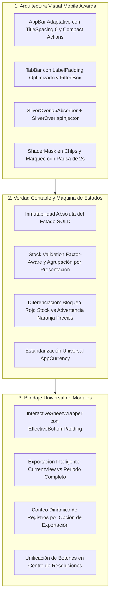
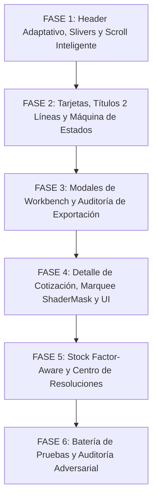

# 🚀 PLAN MAESTRO DE REINGENIERÍA: MESA DE TRABAJO, DETALLE DE COTIZACIÓN, MODALES Y CENTRO DE RESOLUCIONES

**Documento de Especificación Técnica, Auditoría Forense y Protocolo de Implementación Adversarial**  
**Proyecto:** MochilaLista App (Local-First SQLite, 0ms Latency, Flutter Mobile — Estándar Mobile Awards)  
**Módulos Involucrados:**
- **Mesa de Trabajo (Workbench):** `workbench_screen.dart`, `dashboard_header.dart`, `quotation_card.dart`, `workbench_provider.dart`.
- **Modales de Gestión y Exportación:** `export_options_modal.dart`, `export_report_service.dart`, `archived_lists_modal.dart`, `quick_actions_bottom_sheet.dart`.
- **Detalle de Cotización & Acciones:** `quotation_detail_screen.dart`, `quote_detail_header.dart`, `quote_item_list_row.dart`, `quotation_action_buttons.dart`, `marquee_text.dart`.
- **Motor de Integridad y Sincronización:** `quotation_service.dart`, `smart_quotation_provider.dart`, `smart_update_modal.dart`.
- **Componentes Transversales:** `interactive_sheet_wrapper.dart`, `currency_formatter.dart` (`AppCurrency`).
**Fecha:** Octubre 2026  
**Metodología:** Loop Autónomo + Árbitro Interno Adversarial Estricto  

---

## 📸 1. AUDITORÍA FORENSE DE LAS 5 CAPTURAS Y DIAGNÓSTICO EN CÓDIGO FUENTE

A partir de la inspección exhaustiva de las 5 capturas remitidas por el usuario y la auditoría línea por línea del código fuente, se determina la causa raíz técnica exacta de cada anomalía:

| Captura | Pantalla / Componente | Diagnóstico Forense del Problema | Causa Raíz Exacta en Código Fuente |
| :--- | :--- | :--- | :--- |
| **Captura 1** | **`Mesa de Trabajo` (Header, AppBar y Pestañas)** | **1. Título de AppBar Truncado:** El título se corta mostrando `"Mesa de Tra..."`. **2. Pestañas de Navegación Truncadas:** Muestran `"En Preparac"` y `"Listas & Pac"`. **3. Hueco Asimétrico y Sin Fade en Chips:** Espacio vertical discordante entre pestañas y chips; chips se cortan en seco al deslizar. **4. Badge `"Borrador"` Duplicado:** En la tarjeta `#6` aparece "Borrador" arriba a la derecha y otra vez abajo del folio. **5. Título de Tarjeta Limitado a 1 Línea:** Títulos largos se cortan con `"..."` sin aprovechar el espacio vertical. **6. Moneda Desestandarizada y Gramática:** Muestra `14,46 S/`, `71,56 S/`, `4 Cotizaciones` (sin plural/singular dinámico). | • `workbench_screen.dart` L99-106: `SliverAppBar` contiene `leading` (56px) + 3 botones en `actions` (~144px). En pantallas de 360-390dp solo quedan ~160px para el título, provocando que `"Mesa de Trabajo"` (22sp bold, ~185px) se corte como `"Mesa de Tra...".` • `workbench_screen.dart` L320-350: `TabBar` tiene 3 pestañas en 328px útiles (~109px c/u). Por defecto aplica `labelPadding` horizontal de 16px por lado (32px totales), dejando solo ~77px útiles para texto. Al usar 14sp bold, `"En Preparación"` (~115px) y `"Listas & Packs"` (~105px) sufren fade-out prematuro. • `workbench_screen.dart` L231-262: Falta de `SliverOverlapAbsorber` y combinación de fondos (`surfaceColor` vs `bgColor`) con paddings desfasados. • `quotation_card.dart` L154-160 & L201: Se dibuja un badge `"Borrador"` en la fila del título y otro en el `Wrap` inferior. • `quotation_card.dart` L147-152: `Text(..., maxLines: 1)` fuerza el truncamiento horizontal. • `quotation_card.dart` L75 & `dashboard_header.dart` L44: Uso de `NumberFormat.currency(locale: 'es_PE', symbol: 'S/ ')` en lugar de `AppCurrency.format(...)`. |
| **Captura 2** | **Modal `"Opciones de Exportación"`** | **1. Fuga Lógica de Filtrado:** Si el usuario tiene activo un chip (ej. `"Escaneadas IA"`), la opción `"Reporte Completo"` o `"Solo Pendientes"` solo exporta las de IA, ignorando las demás cotizaciones del periodo. **2. Carencia de Indicador de Volumen:** No muestra cuántas cotizaciones se van a exportar en cada opción antes de pulsar. **3. SafeArea:** Riesgo de corte inferior en dispositivos con barra de navegación de 3 botones. | • `workbench_screen.dart` L181-206: Pasa `provider.filteredInProcessList` y `provider.filteredReadyAndPacksList` a `ExportReportService` incluso cuando el scope es `full` o `pendingOnly`. • `export_options_modal.dart` L650-672: El renderizado clásico (Legacy) no consulta ni expone el conteo de elementos de cada scope. • `export_report_service.dart` L27: Usa `NumberFormat.currency` con sufijo `S/ ` en lugar de `AppCurrency`. |
| **Captura 3** | **Modal `"Filtrar por Fecha"`** | **1. Apariencia Plana y Desfasada:** Lista básica en texto plano sin iconos semánticos representativos. **2. Sin Estandarización de Bottom Sheet:** No utiliza `InteractiveSheetWrapper` ni micro-animaciones táctiles. | • `dashboard_header.dart` L170-195: Emplea `showModalBottomSheet` nativo con un `Column` plano dentro de `SafeArea` sin estructura de card, sin iconos temáticos y con radio buttons básicos. |
| **Captura 4** | **Detalle de Cotización (`quotation_detail_screen.dart`)** | **1. Animación Marquee con Cortes Bruscos:** El título animado se corta en seco contra la flecha de regreso y los botones del AppBar. **2. Desbordamiento Horizontal de Píldora de Precio:** `"ⓘ En tienda ahora: 0,90 S/"` choca contra el borde derecho y se sale de su contenedor. **3. Error Gramatical en Botón Inferior:** Muestra `"VENDER (1 alertas)"` (plural con cantidad 1). **4. Moneda y Espaciado Inferior:** Montos con sufijo `S/` y el listado de productos colisiona con la barra inferior fija de acciones. | • `marquee_text.dart` L104-114: Desplaza el texto sin `ShaderMask` en los extremos y sin pausa inicial prolongada. • `quote_item_list_row.dart` L172-180: Contenedor con `Row(mainAxisSize: MainAxisSize.min)` y texto rígido sin `Flexible` dentro de una columna con ancho útil limitado (~135px en pantallas de 360dp). • `quotation_action_buttons.dart` L91: Texto estático `"VENDER ($warningCount alertas)"` sin discriminación singular/plural. • `quotation_detail_screen.dart` L638: `SliverPadding(bottom: 20)` insuficiente para salvar la barra fija inferior (85px) + navigation bar del sistema. |
| **Captura 5** | **Modal `"Centro de Resoluciones"` (`smart_update_modal.dart`)** | **1. Botones Inferiores Redundantes y Confusos:** Muestra a la vez `"Actualizar Todo a Precios de Hoy"` y `"CORREGIR Y ACTUALIZAR TODO"` cuando solo hay cambios de precio. **2. Falla Potencial en Recálculo Local:** Necesidad de auditar y garantizar que actualizar un ítem individual o todos persista de inmediato en SQLite y recalcule los totales de la cotización. **3. Moneda y SafeArea:** Precios con formato desactualizado y falta de wrapper táctil universal. | • `smart_update_modal.dart` L155-163 & L268-278: El botón de sección de precio y el botón global de acción rápida se renderizan juntos sin detectar que solo existe un tipo de problema activo. • `quotation_service.dart` L77-104 & L292-302: `validateIntegrity` no multiplica por `unidades_por_venta` ni suma la demanda acumulada de presentaciones repetidas entre líneas o paquetes. • `smart_update_modal.dart` L49-55: Contenedor plano en `showModalBottomSheet` en lugar de `InteractiveSheetWrapper`. |

---

## 🎯 2. PRINCIPIOS RECTORES Y ARQUITECTURA DE REINGENIERÍA

### Principio 1: Espacio Protegido y Tipografía Inmune a Recortes (Mobile Awards)
- En resoluciones de 320dp a 420dp, ningún título principal ni pestaña debe sufrir truncamiento por falta de layout responsivo.
- El AppBar optimiza sus márgenes laterales, paddings de botones y tamaño de fuente (escala dinámica con límite inferior seguro de 17sp).
- El `TabBar` reduce su padding interno (`labelPadding: EdgeInsets.symmetric(horizontal: 6-8px)`) y asegura que las 3 opciones (`En Preparación`, `Listas & Packs`, `Vendidas`) se lean 100% completas.

### Principio 2: Coreografía de Scroll Inteligente en 3 Niveles (Slivers Fluídos)
- **Nivel 1 (Scroll Down):** Se ocultan fluidamente el panel de KPIs y el filtro temporal; la barra segmentada de pestañas queda fija (`pinned: true`) bajo el AppBar sin huecos vacíos ni superposiciones.
- **Nivel 2 (Scroll Up ligero):** Se despliegan de inmediato (`floating: true, snap: true`) los chips de filtro y la barra de conteo/ordenamiento, permitiendo cambiar de vista sin desplazarse al inicio.
- **Nivel 3 (Scroll hasta el tope):** Reaparece con animación suave el panel de 4 tarjetas KPI y el selector de fecha.
- Se implementa `SliverOverlapAbsorber` y `SliverOverlapInjector` para sincronizar el scroll interno de las listas sin cortes en la primera tarjeta.

### Principio 3: Inmutabilidad Histórica del Estado `"Vendida"` y Validación de Stock Rigurosa
- Una cotización en estado `SOLD` es un registro histórico comercial cerrado: **NO puede salir de ese estado, ni modificarse, ni archivarse, ni eliminarse**.
- Las únicas operaciones permitidas sobre una cotización `SOLD` son:
  1. Consultar su detalle histórico.
  2. Duplicarla para generar una nueva cotización independiente en estado `DRAFT` para otro cliente.
- La validación de stock en `QuotationService.validateIntegrity`:
  - Acumula la demanda total por presentación (sumando líneas individuales y componentes de paquetes).
  - Multiplica las cantidades cotizadas por el factor de conversión `unidades_por_venta`.
  - Si falta stock real: alerta roja crítica y bloqueo estricto del botón de venta.
  - Si hay cambio de precio o nombre: alerta naranja informativa que permite vender al precio cotizado.

### Principio 4: Blindaje Universal de Modales y Exportación Precisa
- Todos los modales del ecosistema (`ExportOptionsModal`, `Filtrar por Fecha`, `ArchivedListsModal`, `QuickActionsBottomSheet`, `SmartUpdateModal`) se estandarizan sobre `InteractiveSheetWrapper(applyEffectiveBottomPadding: true)`.
- El modal de exportación audita el alcance:
  - `ExportScope.currentView`: Exporta estrictamente la pestaña y chips visuales activos.
  - `ExportScope.pendingOnly`, `soldOnly`, `full`: Exporta la totalidad de cotizaciones del periodo seleccionado, sin ser contaminadas por chips visuales de la vista actual.

---

## 🏗️ 3. PLAN DE TRABAJO DETALLADO POR FASES

---

### 🏛️ FASE 1: Header Adaptativo, TabBar Sin Truncamiento y Scroll Inteligente de 3 Niveles en Mesa de Trabajo

**Archivos a Modificar:**
- `app_movil/lib/features/smart_quotation/screens/workbench_screen.dart`
- `app_movil/lib/features/smart_quotation/widgets/workbench/dashboard_header.dart`

#### 1.1. Solución al Título Cortado (`"Mesa de Tra..."`) en AppBar
- **Diagnóstico:** Los 3 botones en `actions` (`InfoTooltipButton`, `archive`, `file_download`) más el `leading` (`home`) consumen ~200dp de ancho horizontal. En pantallas de 360dp quedan solo 160dp para el título.
- **Acciones:**
  - Configurar `titleSpacing: 0` en el `SliverAppBar` principal.
  - Rediseñar los botones de acción con `VisualDensity.compact` y `constraints: const BoxConstraints(minWidth: 38, minHeight: 38)` para reducir el espacio ocioso entre iconos.
  - Envolver el título en un `FittedBox` con `fit: BoxFit.scaleDown` y `alignment: Alignment.centerLeft`, fijando `fontSize: 20` (escalable hasta un límite mínimo de 17sp), garantizando que `"Mesa de Trabajo"` se lea **100% completo, sin puntos suspensivos en cualquier dispositivo**.

#### 1.2. Solución a Pestañas Truncadas (`"En Preparac"`, `"Listas & Pac"`)
- **Diagnóstico:** El `TabBar` usa el padding horizontal por defecto (`16px` por lado) y tipografía de 14sp, lo que desborda el ancho disponible (~109px por tab).
- **Acciones:**
  - Ajustar `labelPadding: const EdgeInsets.symmetric(horizontal: 6)` en el `TabBar`.
  - Ajustar el estilo tipográfico: `fontSize: 13, fontWeight: FontWeight.bold`.
  - Envolver los textos de los tabs en `FittedBox(fit: BoxFit.scaleDown, child: Text("En Preparación"))` y `FittedBox(fit: BoxFit.scaleDown, child: Text("Listas & Packs"))`.
  - Asegurar legibilidad nítida y completa de las 3 opciones.

#### 1.3. Eliminación del Hueco Asimétrico y ShaderMask en Chips de Filtro
- **Diagnóstico:** Disparidad de márgenes y fondos entre el contenedor redondeado de `DashboardHeader`, la barra de tabs y la barra flotante de chips.
- **Acciones:**
  - Homogeneizar los colores de fondo: el `SliverPersistentHeader` de pestañas y el `SliverAppBar` de chips compartirán el mismo fondo de superficie con transición limpia.
  - Compactar paddings verticales sobrantes (reduciendo de 52px a 48px en pestañas y ajustando chips).
  - Aplicar `ShaderMask` horizontal en el `ListView` de los chips de filtro con degradado en los extremos (fade de 14px a la izquierda y derecha), eliminando los cortes abruptos en los bordes de la pantalla.

#### 1.4. Arquitectura de Scroll Inteligente en 3 Niveles con Slivers
- **Implementación:**
  - `SliverOverlapAbsorber` en la cabecera anclada.
  - Nivel 1: `SliverAppBar` superior (`pinned: true`).
  - Nivel 2: `SliverPersistentHeader` de pestañas (`pinned: true`).
  - Nivel 3: `SliverAppBar` de chips de filtro y barra de ordenamiento (`pinned: false, floating: true, snap: true`).
  - El panel de KPIs (`DashboardHeader`) en `SliverToBoxAdapter` desaparece al bajar y solo reaparece al llegar al tope de la lista.
  - Cada pestaña del `TabBarView` implementa `SliverOverlapInjector` para que la primera tarjeta inicie siempre sin solapamientos ni desajustes verticales.

---

### 💳 FASE 2: Perfeccionamiento de Tarjetas de Cotización, Títulos de 2 Líneas y Máquina de Estados Inmutable

**Archivos a Modificar:**
- `app_movil/lib/features/smart_quotation/widgets/quotation_card.dart`
- `app_movil/lib/features/smart_quotation/providers/workbench_provider.dart`
- `app_movil/lib/features/smart_quotation/services/quotation_service.dart`

#### 2.1. Título de Hasta 2 Líneas y Eliminación de Badges Duplicados
- **Diagnóstico:** En `quotation_card.dart` el badge `"Borrador"` se pinta en la fila 1 (derecha del título) y nuevamente en el `Wrap` inferior. El título tiene `maxLines: 1`.
- **Acciones:**
  - Eliminar el widget redundante `if (quotation.status == 'DRAFT') Container(child: Text("Borrador"))` de la esquina superior derecha.
  - Configurar el título del cliente/cotización con `maxLines: 2, overflow: TextOverflow.ellipsis, height: 1.25`, manteniendo `fontSize: 16, fontWeight: FontWeight.bold`. Nombres largos como `"Freddy #22-0146 (2) - Manual"` se desplegarán ordenados y completos.

#### 2.2. Regla de Inmutabilidad del Estado `"Vendida"` (`SOLD`)
- **Diagnóstico:** Blindar que ninguna venta pueda ser alterada una vez cobrada.
- **Acciones:**
  - En `QuotationService.updateQuotationStatus`: Validar si `status == 'SOLD'` en base de datos. Si ya fue vendida, rechazar cualquier cambio con excepción controlada.
  - En `QuotationService.saveManualQuotation`: Bloquear actualizaciones de cotizaciones cuyo estado sea `SOLD`.
  - En `QuotationService.deleteQuotation`: Prohibir la eliminación de cotizaciones `SOLD`.
  - En `QuotationCard`: Si la cotización está `SOLD`, el tap abre el detalle histórico y el long-press abre un menú restringido donde solo se permite **"Duplicar Cotización"** y **"Ver Histórico"**.

#### 2.3. Estandarización Monetaria (`AppCurrency`) y Corrección Gramatical
- **Acciones:**
  - Reemplazar `currencyFormat.format(quotation.totalAmount)` por `AppCurrency.format(quotation.totalAmount)` (`S/ #,##0.00`).
  - Corregir textos plurales/singulares:
    - `"${quotation.itemCount} ${quotation.itemCount == 1 ? 'Ítem' : 'Ítems'}"`
    - `"$count ${count == 1 ? 'Cotización' : 'Cotizaciones'}"`
  - Aumentar el padding inferior de la lista a `120 + effectiveBottomPadding` para que el botón flotante verde `+` nunca oculte el importe de la última tarjeta.

---

### 📦 FASE 3: Modales de Workbench y Auditoría Rigurosa de "Opciones de Exportación"

**Archivos a Modificar:**
- `app_movil/lib/core/widgets/export_options_modal.dart`
- `app_movil/lib/core/services/export_report_service.dart`
- `app_movil/lib/features/smart_quotation/widgets/workbench/dashboard_header.dart`
- `app_movil/lib/features/smart_quotation/widgets/workbench/archived_lists_modal.dart`
- `app_movil/lib/features/smart_quotation/widgets/quick_actions_bottom_sheet.dart`

#### 3.1. Auditoría Lógica y UI de "Opciones de Exportación"
- **Diagnóstico:** Si había un chip activo (ej. "Escaneadas IA"), "Reporte Completo" solo exportaba las de IA porque `workbench_screen.dart` le pasaba `filteredInProcessList`.
- **Acciones:**
  - Corregir el paso de listas en `workbench_screen.dart`:
    - Para `ExportScope.currentView`: Pasar las listas con filtros activos (`filteredInProcessList`, `filteredReadyAndPacksList`, `filteredSoldList`).
    - Para `pendingOnly`, `soldOnly` y `full`: Pasar las listas completas del periodo (`inProcessList`, `readyAndPacksList`, `soldList`), garantizando integridad del reporte.
  - Mostrar en cada opción del modal un badge dinámico con el conteo exacto de listas a exportar (ej. `"4 listas"`, `"3 listas"`, `"7 listas"`).
  - Migrar los montos generados en PDF y CSV a `AppCurrency.format(...)`.

#### 3.2. Modernización del Modal "Filtrar por Fecha"
- **Acciones:**
  - Migrar `_showTimeFilterBottomSheet` a `InteractiveSheetWrapper.show(...)`.
  - Añadir iconos semánticos con fondo translúcido para cada opción (`Hoy`, `Esta Semana`, `Este Mes`, `Últimos 6 Meses`, `Todo`, `Rango Personalizado...`).
  - Integrar radio buttons animados y feedback háptico.

#### 3.3. Refinamiento de "Listas Archivadas" y "Menú de Acciones de Cotización"
- **Acciones:**
  - En `archived_lists_modal.dart`: Reemplazar el bottom sheet interno del long-press por `InteractiveSheetWrapper`.
  - En `quick_actions_bottom_sheet.dart`:
    - Eliminar el icono de rayo ⚡ hardcodeado (`Icons.flash_on`).
    - Asignar icono y color según el tipo: Manual (`Icons.edit_note`, naranja), Escáner IA (`Icons.auto_awesome`, morado), Pack (`Icons.inventory_2`, teal).
    - Adaptar opciones según el estado: en cotizaciones `SOLD`, ocultar "Cambiar Nombre", "Archivar" y "Eliminar".

---

### 📱 FASE 4: Detalle de Cotización, Marquee con Fade/ShaderMask, Corrección de Overflows y Menú de Estados

**Archivos a Modificar:**
- `app_movil/lib/core/widgets/marquee_text.dart`
- `app_movil/lib/features/smart_quotation/screens/quotation_detail_screen.dart`
- `app_movil/lib/features/smart_quotation/widgets/detalle/quote_detail_header.dart`
- `app_movil/lib/features/smart_quotation/widgets/detalle/quote_item_list_row.dart`
- `app_movil/lib/features/smart_quotation/widgets/detalle/quotation_action_buttons.dart`

#### 4.1. Pulido del Título Animado (`MarqueeText`)
- **Acciones:**
  - Configurar pausa inicial de 2.0 segundos antes de comenzar el desplazamiento.
  - Implementar `ShaderMask` horizontal con degradado en ambos extremos para que el texto desvanezca suavemente y no se corte bruscamente contra el botón atrás o los iconos.
  - Agregar detector de tap en el título del AppBar que abra un diálogo interactivo con el nombre completo y opción de copiar o editar.

#### 4.2. Corrección de Desbordamientos y Estandarización de Precios en Detalle
- **Acciones:**
  - En `quote_item_list_row.dart`: Dar flexibilidad (`Flexible` / `Wrap`) al contenedor de `"ⓘ En tienda ahora: ..."` para eliminar el overflow horizontal en pantallas angostas.
  - Migrar todos los precios de `quote_detail_header.dart`, `quote_item_list_row.dart` y `quotation_action_buttons.dart` a `AppCurrency.format(...)` (`S/ #,##0.00`).
  - Corregir la gramática del botón inferior: `"VENDER (1 alerta)"` vs `"VENDER ($n alertas)"`.
  - Añadir padding inferior al scroll (`120 + effectiveBottomPadding`) para que la barra fija de acciones jamás tape la última tarjeta de producto.

#### 4.3. Modernización del Menú de 3 Puntos (`⋮`) en AppBar
- **Acciones:**
  - Reemplazar el `PopupMenuButton` clásico por un selector moderno con `InteractiveSheetWrapper`, iconos claros y micro-interacciones.
  - Validar inmutabilidad si el estado es `SOLD`.

---

### 🛡️ FASE 5: Auditoría Rigurosa de Stock Factor-Aware y Unificación del "Centro de Resoluciones"

**Archivos a Modificar:**
- `app_movil/lib/features/smart_quotation/services/quotation_service.dart`
- `app_movil/lib/features/smart_quotation/widgets/smart_update_modal.dart`
- `app_movil/lib/features/smart_quotation/providers/workbench_provider.dart`

#### 5.1. Validación Matemática de Stock por Factor de Presentación y Acumulación
- **Diagnóstico:** `validateIntegrity` actualmente evalúa cada línea por separado sin multiplicar `quantity * unidades_por_venta`, permitiendo ventas con stock insuficiente.
- **Acciones:**
  - Implementar acumulador de demanda por presentación: `Map<int, int> totalDemandPerPresentation = {}`.
  - Multiplicar `quantity * unidades_por_venta` en ítems regulares y componentes de paquetes.
  - Comparar la demanda acumulada contra `stock_actual`: si falta stock real, marcar `canSell = false` y generar alerta crítica (roja) obligatoria.
  - Si solo hay cambios de precio o nombre: marcar `canSell = true` (alerta naranja informativa).

#### 5.2. Unificación y Pulido del Modal "Centro de Resoluciones"
- **Acciones:**
  - En `smart_update_modal.dart`: Detectar si solo hay alertas de precio. En ese caso, suprimir la duplicidad de botones y presentar un único botón principal: `"ACEPTAR TODOS LOS PRECIOS DE HOY"`.
  - Si hay problemas de stock o mixtos, clarificar qué hace cada botón individual y el botón global.
  - Asegurar que la resolución individual (`Aceptar Precio de Tienda`) o masiva actualice SQLite inmediatamente y refresque la pantalla y la Mesa de Trabajo.
  - Migrar `SmartUpdateModal` a `InteractiveSheetWrapper` con blindaje `SafeArea` inferior y `AppCurrency.format(...)`.

---

### 🧪 FASE 6: Protocolo de Verificación, Pruebas Automatizadas y Árbitro Adversarial

**Archivos a Crear / Ejecutar:**
- `app_movil/test/workbench_slivers_and_quotation_reengineering_test.dart`
- Ejecución completa de tests del módulo y análisis de regresiones con `flutter test`.

#### Matriz de Casos de Prueba Automatizados:
1. **Test Visual de AppBar y Tabs (360dp):** Verificar que `"Mesa de Trabajo"` se renderice completo y las 3 pestañas (`En Preparación`, `Listas & Packs`, `Vendidas`) no se trunquen.
2. **Test de Slivers y Scroll:** Verificar la coreografía de 3 niveles y que la primera tarjeta no se solape (`SliverOverlapInjector`).
3. **Test de Inmutabilidad de Venta (`SOLD`):** Intentar cambiar de estado, editar o eliminar una cotización `SOLD` y comprobar que se bloquea rotundamente.
4. **Test de Exportación con Chips Activos:** Verificar que `"Reporte Completo"` exporte todas las cotizaciones del periodo, incluso si hay un chip visual activo en pantalla.
5. **Test de Stock Factor-Aware:** Crear una cotización con presentación de factor 10 (demanda 20 unidades base) y stock actual 15; verificar que `canSell` sea `false` y el botón sea `"CORREGIR"`.
6. **Test de Gramática y Moneda:** Verificar `"1 alerta"` vs `"2 alertas"`, `"1 Cotización"` y formateo invariable `S/ #,##0.00`.
7. **Test de Centro de Resoluciones:** Verificar que cuando solo hay cambios de precio, solo aparezca un botón principal y que al pulsarlo actualice precios y recalcule totales en SQLite.

---

## 📋 4. RESUMEN DE ARCHIVOS A INTERVENIR

| Archivo | Tipo de Intervención |
| :--- | :--- |
| `app_movil/lib/features/smart_quotation/screens/workbench_screen.dart` | AppBar adaptativo, Slivers 3 niveles con Overlap, fix de listas pasadas a exportación. |
| `app_movil/lib/features/smart_quotation/widgets/workbench/dashboard_header.dart` | Modernización del modal de fecha con iconos, formateo `AppCurrency`. |
| `app_movil/lib/features/smart_quotation/widgets/quotation_card.dart` | Eliminación de badge redundante, título maxLines 2, formateo `AppCurrency`, gramática singular/plural. |
| `app_movil/lib/features/smart_quotation/widgets/workbench/archived_lists_modal.dart` | Modernización de bottom sheets internos con `InteractiveSheetWrapper`. |
| `app_movil/lib/features/smart_quotation/widgets/quick_actions_bottom_sheet.dart` | Icono/color dinámico según tipo de lista, adaptación de opciones para cotizaciones `SOLD`. |
| `app_movil/lib/core/widgets/export_options_modal.dart` | Conteo dinámico de elementos por opción de exportación, SafeArea blindado. |
| `app_movil/lib/core/services/export_report_service.dart` | Estandarización con `AppCurrency`, verificación de alcance de exportación. |
| `app_movil/lib/core/widgets/marquee_text.dart` | Pausa de 2s, `ShaderMask` horizontal en extremos, soporte para tap informativo. |
| `app_movil/lib/features/smart_quotation/screens/quotation_detail_screen.dart` | Menú contextual moderno, padding inferior contra barra fija, tap en título. |
| `app_movil/lib/features/smart_quotation/widgets/detalle/quote_item_list_row.dart` | Layout flexible para píldora de precio en tienda, `AppCurrency.format`. |
| `app_movil/lib/features/smart_quotation/widgets/detalle/quotation_action_buttons.dart` | Corrección gramatical `"1 alerta"`, `AppCurrency`. |
| `app_movil/lib/features/smart_quotation/widgets/smart_update_modal.dart` | Unificación de botones inferiores, `InteractiveSheetWrapper`, `AppCurrency`. |
| `app_movil/lib/features/smart_quotation/services/quotation_service.dart` | Validación de stock acumulada por factor de conversión (`unidades_por_venta`), inmutabilidad de `SOLD`. |
| `app_movil/lib/features/smart_quotation/providers/workbench_provider.dart` | Sincronización reactiva, blindaje de estados inmutables. |
| `app_movil/test/workbench_slivers_and_quotation_reengineering_test.dart` | Nueva suite de pruebas automatizadas unitarias y de widgets. |

---

## 🏁 5. PROTOCOLO DE APROBACIÓN
Este plan detalla el diagnóstico exacto en código y la arquitectura de solución de los 5 bloques requeridos. **No se modificará ningún archivo de código hasta recibir la aprobación expresa del usuario.**
