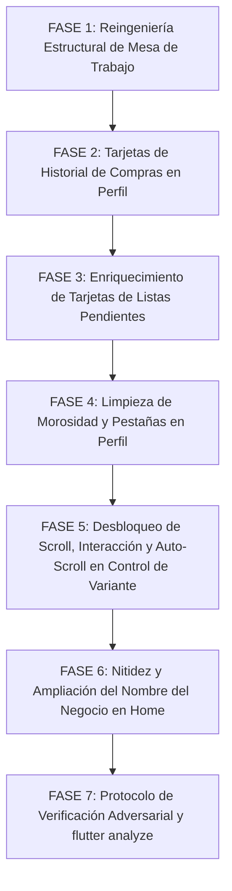

# 🚀 PLAN MAESTRO DE REINGENIERÍA: MESA DE TRABAJO, PERFIL DEL CLIENTE, MODAL CONTROL DE VARIANTE Y CABECERA HOME

**Documento de Especificación Técnica, Diagnóstico Forense y Protocolo Adversarial**  
**Proyecto:** MochilaLista App (Local-First SQLite, 0ms Latency, Flutter Mobile - Mobile Awards Standard)  
**Módulos Involucrados:**
- **Mesa de Trabajo (Smart Quotation):** `workbench_screen.dart`, `dashboard_header.dart` (workbench), `quotation_card.dart`.
- **Perfil del Cliente (CRM):** `client_detail_screen.dart`, `client_sales_history_tab.dart`, `client_quotations_tab.dart`, `client_stats_header.dart`.
- **Escáner IA / Staging (Clasificar y Confirmar):** `comparative_update_modal.dart`, `modal_variant_cards.dart`, `modal_sale_section.dart`, `modal_stock_section.dart`, `modal_purchase_section.dart`, `modal_discount_section.dart`, `variant_editor_row.dart`, `classification_screen.dart`.
- **Inicio / Home:** `app_movil/lib/core/widgets/home/dashboard_header.dart`, `app_movil/lib/core/widgets/marquee_text.dart`.
**Fecha:** Octubre 2026  
**Metodología:** Loop Autónomo + Árbitro Interno Adversarial Estricto  

---

## 📸 1. AUDITORÍA FORENSE DE LAS 5 CAPTURAS Y DIAGNÓSTICO LÍNEA POR LÍNEA

A partir de la inspección exhaustiva de las 5 capturas remitidas por el usuario y la auditoría forense del código fuente en `app_movil/lib`, se determina la causa raíz técnica exacta de cada anomalía:

| Captura | Ventana / Módulo | Diagnóstico Forense del Problema Visual / Funcional | Causa Raíz Exacta en Código Fuente |
| :--- | :--- | :--- | :--- |
| **Imagen 1** (`4:18`) | **`Mesa de Trabajo`** | **1. Superposición Crítica de Cabeceras:** El bloque de las 4 tarjetas KPI (`En Revisión`, `Preparadas`, `Alertas`, `Proyectado`) y el botón `Filtro: Últimos 6 Meses` invaden y tapan la barra de pestañas (`En Preparación \| Listas & Packs \| Vendidas`).<br>**2. Pestañas Aplastan los Chips de Filtro:** La barra de pestañas aplasta y corta por la mitad horizontalmente los chips (`✓ Todo`, `Solo Alertas ⚠️`, `Escaneadas IA`).<br>**3. Gran Espacio Muerto:** Debajo de la barra `4 Cotizaciones` se produce un espacio vacío muerto de más de 100px antes de la primera tarjeta.<br>**4. FAB Tapa Precios:** El botón flotante `+` tapa el precio `S/ 24.30` de la última tarjeta. | • `workbench_screen.dart` L93-322: Utiliza un `NestedScrollView` con 4 slivers desincronizados: `SliverAppBar` (pinned: true), `SliverToBoxAdapter` (KPIs), `SliverOverlapAbsorber` envolviendo un `SliverPersistentHeader` de 52px (TabBar), y un 4° `SliverAppBar` flotante de 82px (`floating: true, snap: true`).<br>• En `NestedScrollView`, el absorber de 52px colisiona con el sliver flotante inferior y el header superior; al colapsar o en reposo, los offsets de renderizado se calculan erróneamente montando una sección sobre otra.<br>• `workbench_screen.dart` L528-530: `SliverOverlapInjector` inyecta un padding estático calculado solo para 52px que no compensa el 4° sliver flotante, generando el hueco muerto superior.<br>• `workbench_screen.dart` L326-364: El FAB no tiene el margen coordinado con el `bottomPadding` del `CustomScrollView`. |
| **Imagen 2** (`4:32`) | **`Perfil del Cliente` (`Historial de Compras`)** | **1. Título Truncado con Puntos Suspensivos:** En la tarjeta superior, el título se corta como **`Préstamo Perso...`**.<br>**2. Desbordamiento del Botón `Detalle >`:** En la fila inferior (`Total: S/ 240.00` \| `Pagado: S/ 0.00` \| `Detalle >`), el botón `Detalle >` choca contra el borde derecho de la tarjeta y se desborda en pantallas angostas. | • `client_sales_history_tab.dart` L100-132: El título se renderiza con `maxLines: 1` dentro de un `Row` que compite directamente contra el badge `Container(child: Text("Debe ${AppCurrency.format(deudaVenta)}"))`. En pantallas estándar (360-390dp), el ancho útil para el texto es menor a 135px, provocando el recorte de `"Préstamo Personal"`.<br>• `client_sales_history_tab.dart` L142-179: La fila inferior empaqueta en un solo `Row` dos contenedores financieros de ~95px cada uno, un `Spacer()` y el botón `Detalle >` (~65px). Al sumar márgenes y paddings (`16 + 44 + 14 + 95 + 8 + 95 + 65 + 16 = 353px`), excede el ancho útil y se desborda contra el margen derecho. |
| **Imagen 3** (`4:33`) | **`Perfil del Cliente` (`Listas Pendientes`)** | **1. Información Insuficiente y Frase Inútil:** Las tarjetas solo muestran el título genérico (`Freddy #22-0146 (2) - Manual`), la fecha (`22/10/2026`) y la frase `"Colegio no especificado"`. El usuario no sabe cuántos productos contiene ni qué ítems incluye sin entrar.<br>**2. Icono Duplicado en Morosidad:** En el banner rojo superior de morosidad se muestran dos alertas juntas: `⚠️ ⚠️ 5 cuotas vencidas`. | • `client_quotations_tab.dart` L80-101: La tarjeta ignora los campos `itemCount`, `type`, `status` e `items` del `SmartQuotationModel`, mostrando únicamente un texto plano hardcodeado `"Colegio no especificado"` cuando `institutionName` es nulo o vacío.<br>• `client_stats_header.dart` L485-498 y L563-567: Se renderiza un `Icon(Icons.warning_amber_rounded)` en un `Container` y luego un `Text("⚠️ $cuotasText")`, duplicando el icono visual de alerta. |
| **Imagen 4** (`4:37`) | **`Clasificar y Confirmar` (Modal `Control de Variante`)** | **1. Bloqueo Total de Scroll Vertical:** El modal no se puede desplazar verticalmente; las casillas inferiores de `💰 Venta y Precios` (`Costo Pres.`, `Margen`, `P. Venta`) quedan ocultas detrás del botón `GUARDAR DECISIÓN` y es imposible bajar a las secciones de Stock, Proveedor e Identidad.<br>**2. Fricción en Variante Cards:** El carrusel horizontal de variantes no responde con suavidad elástica.<br>**3. Truncamiento `BD: ...`:** En `U. Venta` el texto de referencia de la BD se corta como `BD: ...`. | • `comparative_update_modal.dart` L457-511: `InteractiveSheetWrapper` recibe en `child` una `Column` directa sin `SingleChildScrollView` ni `ScrollController`. Al desplegar los acordeones, el contenido excede el 92% de la pantalla.<br>• `interactive_sheet_wrapper.dart` L320-324: Su `GestureDetector` vertical intercepta todos los gestos para swipe-to-dismiss, bloqueando el scroll de la columna.<br>• `comparative_update_modal.dart` L497-509: `bottomAction` es un contenedor fijo; al no haber scroll interno, los campos quedan sepultados detrás de `GUARDAR DECISIÓN`.<br>• `modal_variant_cards.dart` L16: `ListView.separated` carece de `BouncingScrollPhysics()`.<br>• `modal_variant_cards.dart` L164-192: En `_buildCompactField`, la etiqueta `BD: $dbValue` comparte fila con el checkbox y el label en columnas de ~100px, dejando solo 20px y truncándose con `...`. |
| **Imagen 5** (`4:58`) | **`Inicio (Home)` (Cabecera Superior)** | **1. Sombreado y Letras Difuminadas:** El nombre de usuario (`luz navarro`) tiene oscurecida la `"l"` inicial y el nombre del negocio (`🏪 librería BAZAR LUZ`) tiene un sombreado degradado al inicio y final.<br>**2. Corte Prematuro del Nombre del Negocio:** `"librería BAZAR LUZAM"` se corta a mitad de pantalla a pesar de que debajo de los botones de recarga (`🔄`) y notificaciones (`🔔`) hay amplio espacio libre. | • `marquee_text.dart` L120-134: Envuelve el texto en un `ShaderMask` con un `LinearGradient` de paradas transparentes en `0.0` y `1.0`. Por ello, la primera letra (`"l"`) y las finales se desvanecen en negro/transparente perdiendo nitidez.<br>• `core/widgets/home/dashboard_header.dart` L158-232: La cabecera está dividida rígidamente en un `Row` principal de 2 columnas. La columna izquierda (`Expanded`) contiene el saludo, el usuario y el negocio; la columna derecha agrupa `🔄`, `🔔` y el Avatar. Como la columna derecha abarca verticalmente todo el alto, confina al nombre del negocio a la mitad izquierda de la pantalla. |

---

## 🎯 2. PRINCIPIOS RECTORES Y ARQUITECTURA DE REINGENIERÍA

### Principio 1: Layout Determinista y Cero Superposición (`0px Overlap`) en `Mesa de Trabajo`
- Abandonar la dependencia frágil de `NestedScrollView` con múltiples `SliverAppBar` flotantes y slivers superpuestos.
- Replicar la arquitectura canónica probada en `Historial de Ventas` (`sales_history_screen.dart`):
  1. `AppBar` fijo de navegación y exportación.
  2. En el body: `Column` reactiva gobernada por `NotificationListener<ScrollNotification>`.
  3. Bloque KPI con `ClipRect` + `AnimatedSize(duration: 250ms)` que se retrae al bajar en la lista y se despliega al volver al tope (`pixels <= 15`).
  4. Barra de pestañas fijas (`En Preparación | Listas & Packs | Vendidas`).
  5. Chips de sub-filtro (`Todo | Solo Alertas ⚠️ | Escaneadas IA | Manual`) colapsables / reaparecen al deslizar hacia arriba.
  6. Barra de conteo y ordenamiento (`X Cotizaciones | Fecha | A-Z`).
  7. `Expanded(child: TabBarView(...))` con listas limpias en cada pestaña, sin `SliverOverlapInjector` ni offsets mágicos.
  8. Cero espacio vacío superior y padding inferior seguro (`bottom: 110`) para que el FAB `+` nunca cubra el precio de la última tarjeta.

### Principio 2: Desacoplamiento Tipográfico y Responsividad en `Perfil del Cliente`
- **Historial de Compras:**
  - El título de la operación dispondrá de hasta 2 líneas completas (`maxLines: 2, height: 1.25`) sin truncamiento artificial, protegiendo nombres como `"Préstamo Personal"` o `"Lista Cotizada"`.
  - La fila inferior financiera se reestructura con un diseño adaptable (usando `Wrap` o separación balanceada de chips y botón de detalle) garantizando un margen mínimo de 14px respecto al borde derecho en cualquier resolución móvil.
- **Listas Pendientes:**
  - Enriquecimiento informativo de alto valor: mostrar código, origen (`✍️ Manual` / `✨ Escáner IA`), cantidad total de ítems (`📦 X prods`), estado (`📝 Borrador` / `✅ Lista` / `⚠️ Alerta stock`) y un extracto de los primeros 2 o 3 productos.
  - Eliminar por completo el texto redundante `"Colegio no especificado"`; mostrar el dato de institución exclusivamente cuando esté definido.
- **Morosidad y Pestañas:**
  - Dejar un único icono visual `Icons.warning_amber_rounded` en el banner de morosidad.
  - Proporcionar espaciado y aire armónico entre las 3 pestañas principales de navegación del cliente.

### Principio 3: Desbloqueo Gestual, Scroll Vertical Total y Auto-Scroll en `Control de Variante`
- **Arquitectura de 3 Capas Desbloqueada:**
  1. **Cabecera fija:** Título del modal, botón de restauración y botón de cierre `✕`.
  2. **Cuerpo desplazable verticalmente:** `Expanded` + `Scrollbar(thumbVisibility: true)` + `SingleChildScrollView(physics: const BouncingScrollPhysics())` con `controller` dedicado.
  3. **Pie fijo de acción:** Botón `GUARDAR DECISIÓN` con margen seguro contra teclado (`MediaQuery.viewInsetsOf(context).bottom`).
- **Desactivación del secuestro de arrastre vertical:** Desactivar `enableDragToDismiss` en el cuerpo del modal en `InteractiveSheetWrapper` para permitir que el scroll del contenido se mueva con total fluidez a 60fps sin confundirse con el cierre del modal.
- **Carrusel horizontal elástico:** Inyectar `BouncingScrollPhysics()` en el `ListView.separated` de tarjetas de variantes.
- **Auto-scroll inteligente en acordeones:** Al tocar para expandir cualquiera de los 4 acordeones (`💰 Venta y Precios`, `📦 Gestión de Stock`, `🛒 Proveedor`, `📝 Identidad del Producto`), ejecutar automáticamente un `Scrollable.ensureVisible` suave para traer a la vista todos los campos del acordeón por encima del botón inferior.
- **Reactividad a 0ms:** Al presionar `GUARDAR DECISIÓN`, invocar `widget.provider.notifyUIUpdate()`, garantizando que la tarjeta en `Clasificar y Confirmar` absorba inmediatamente los nuevos precios, stock y estado sin retrasos.
- **Refinamiento visual:** Reorganizar `_buildCompactField` para que el valor de la base de datos (`BD: ...`) se ubique en una línea secundaria limpia o con badge, evitando que se corte.

### Principio 4: Nitidez Tipográfica al 100% y Expansión Horizontal en Cabecera de `Home`
- **Erradicación del Difuminado:** Eliminar el `ShaderMask` con gradiente transparente de los textos en la cabecera (o configurar `enableGradientFade: false` en `MarqueeText`), devolviendo total nitidez y brillo uniforme a la `"l"` inicial de `luz navarro` y al nombre del negocio.
- **Aprovechamiento Espacial Inteligente:** Reestructurar la cabecera en una jerarquía de 2 niveles:
  1. Fila superior: Saludo y Nombre de usuario a la izquierda; botones `🔄`, `🔔` y avatar de perfil a la derecha.
  2. Fila inferior: El nombre del negocio (`🏪 librería BAZAR LUZAM`) se ubica en su propia fila independiente, extendiéndose hacia la derecha por debajo de `🔄` y `🔔`, deteniéndose con un margen seguro justo antes de la vertical del avatar circular del perfil.

---

## 🏗️ 3. PLAN DE TRABAJO MAESTRO DIVIDIDO EN 7 FASES



---

### 🏛️ FASE 1: Reingeniería Estructural Definitiva de la Ventana `Mesa de Trabajo`
**Archivos Afectados:**
- [workbench_screen.dart](file:///c:/Users/vjuli/Documents/mochilalista-app/app_movil/lib/features/smart_quotation/screens/workbench_screen.dart)
- [dashboard_header.dart](file:///c:/Users/vjuli/Documents/mochilalista-app/app_movil/lib/features/smart_quotation/widgets/workbench/dashboard_header.dart)

#### 1.1. Diagnóstico de la Ruptura Actual
En `workbench_screen.dart`, el `NestedScrollView` contiene:
- `SliverAppBar` (Título y acciones, L100-268)
- `SliverToBoxAdapter` (`DashboardHeader`, L271-273)
- `SliverOverlapAbsorber` (`SliverPersistentHeader` de 52px con las pestañas, L276-285)
- `SliverAppBar` flotante (`bottom: PreferredSize(82.0)`, L288-309)
Y en el cuerpo (`body`):
- `TabBarView` con `SliverOverlapInjector(handle: NestedScrollView.sliverOverlapAbsorberHandleFor(context))` dentro de cada tab.
**Efecto colateral:** Flutter no puede conciliar un absorber de 52px ubicado antes de un sliver flotante de 82px. Al renderizar, los KPIs y el selector de periodo invaden la barra de pestañas, las pestañas aplastan la mitad de los chips de filtro, y la lista inyecta un espacio muerto artificial de más de 100px.

#### 1.2. Implementación de la Arquitectura Determinista (Estándar `Historial de Ventas`)
1. **Controlador y Listener de Scroll:**
   - Incorporar tracking de scroll reactivo con `NotificationListener<ScrollNotification>` y control de estados:
     ```dart
     bool _showKpis = true;
     bool _showFilters = true;
     bool _showScrollToTop = false;
     ```
   - Regla de tope superior: si `pixels <= 15`, forzar siempre `_showKpis = true; _showFilters = true;`.
   - Si el usuario hace scroll hacia abajo (`delta > 8 && pixels > 60`), colapsar suavemente `_showKpis = false` con `AnimatedSize`.
   - Si desliza hacia arriba (`delta < -8`), reaparecer inmediatamente los chips de filtro y al acercarse al tope los KPIs.
2. **Jerarquía en `body`:**
   ```dart
   Scaffold(
     appBar: _buildFixedAppBar(context, provider, isDark),
     body: Column(
       children: [
         // Bloque 1: KPIs Colapsables
         ClipRect(
           child: AnimatedSize(
             duration: const Duration(milliseconds: 250),
             curve: Curves.easeInOutCubic,
             child: _showKpis
                 ? DashboardHeader(provider: provider, isDark: isDark, tabController: _tabController)
                 : const SizedBox(width: double.infinity, height: 0),
           ),
         ),
         // Bloque 2: Pestañas Fijas (Siempre visibles bajo el AppBar)
         _buildTabBarSection(isDark, surfaceColor),
         // Bloque 3: Sub-filtros Reactivos (Todo / Solo Alertas / Escaneadas / Manual)
         ClipRect(
           child: AnimatedSize(
             duration: const Duration(milliseconds: 200),
             curve: Curves.easeInOutCubic,
             child: _showFilters
                 ? _buildFilterChips(provider, isDark)
                 : const SizedBox(width: double.infinity, height: 0),
           ),
         ),
         // Bloque 4: Barra de Conteo y Ordenamiento
         _buildCounterAndSortBar(provider, isDark),
         // Bloque 5: Listas con Scroll Independiente
         Expanded(
           child: TabBarView(
             controller: _tabController,
             children: [
               _buildQuotationList(provider, provider.filteredInProcessList, isDark),
               _buildQuotationList(provider, provider.filteredReadyAndPacksList, isDark),
               _buildQuotationList(provider, provider.filteredSoldList, isDark),
             ],
           ),
         ),
       ],
     ),
   );
   ```
3. **Eliminación del Espacio Muerto Superior:**
   - Cada pestaña en `_buildQuotationList` usará un `ListView.builder` o `CustomScrollView` limpio SIN `SliverOverlapInjector`. La primera tarjeta comenzará con un `top: 8px` exacto y limpio.
4. **Padding Inferior Seguro para el Botón Flotante `+`:**
   - Configurar el padding inferior de la lista a `bottom: 110 + InteractiveSheetWrapper.getEffectiveBottomPadding(context)` garantizando que el FAB nunca tape el precio ni las acciones de la última tarjeta.

---

### 💳 FASE 2: Perfeccionamiento de Tarjetas en `Historial de Compras` (`Perfil del Cliente`)
**Archivo Afectado:**
- [client_sales_history_tab.dart](file:///c:/Users/vjuli/Documents/mochilalista-app/app_movil/lib/features/smart_quotation/widgets/crm/client_sales_history_tab.dart)

#### 2.1. Erradicación del Truncamiento en Títulos (`maxLines: 2` y Espacio Protegido)
- **Diagnóstico:** En L100-110, `Text(title, maxLines: 1, overflow: TextOverflow.ellipsis)` se corta con `...` al compartir línea con el badge de deuda `Container(child: Text("Debe S/ 240.00"))`.
- **Solución:**
  * Permitir que el título use hasta 2 líneas naturales (`maxLines: 2, height: 1.25`) sin truncar nombres como `"Préstamo Personal"`, `"Caja Rápida (Al Contado)"` o `"Lista Cotizada"`.
  * Diseñar la cabecera de la tarjeta con una estructura donde el título y el folio tengan ancho protegido, y el badge de deuda se ubique de forma armónica (bien alineado a la derecha o en su propia píldora de estado con borde sutil).

#### 2.2. Reorganización de la Fila Inferior sin Desbordamiento
- **Diagnóstico:** En L142-179, la fila horizontal única desborda el botón `Detalle >` en móviles estándar.
- **Solución:**
  * Implementar un diseño flexible:
    ```dart
    Wrap(
      alignment: WrapAlignment.spaceBetween,
      crossAxisAlignment: WrapCrossAlignment.center,
      spacing: 8,
      runSpacing: 8,
      children: [
        Wrap(
          spacing: 8,
          children: [
            _buildAmountBadge("Total: ${AppCurrency.format(sale.trueTotal)}", textColor, isDark),
            _buildPaidBadge("Pagado: ${AppCurrency.format(sale.montoPagado)}", isDark),
          ],
        ),
        InkWell(
          onTap: () => _openDetail(sale),
          borderRadius: BorderRadius.circular(8),
          child: Padding(
            padding: const EdgeInsets.symmetric(horizontal: 4, vertical: 4),
            child: Row(
              mainAxisSize: MainAxisSize.min,
              children: [
                Text("Detalle", style: TextStyle(color: accentColor, fontWeight: FontWeight.bold, fontSize: 13)),
                Icon(Icons.chevron_right, size: 16, color: accentColor),
              ],
            ),
          ),
        ),
      ],
    )
    ```
  * Garantizar un margen derecho seguro de 14px en toda la tarjeta.

---

### 📋 FASE 3: Enriquecimiento Informativo de Tarjetas en `Listas Pendientes` (`Perfil del Cliente`)
**Archivo Afectado:**
- [client_quotations_tab.dart](file:///c:/Users/vjuli/Documents/mochilalista-app/app_movil/lib/features/smart_quotation/widgets/crm/client_quotations_tab.dart)

#### 3.1. Reingeniería Informativa Integral de la Tarjeta
Transformar la tarjeta vacía en un resumen comercial ejecutivo:
1. **Cabecera:**
   - Título de la cotización (`q.clientName ?? "Cotización #${q.displayId}"`) en negrita legible.
   - Folio secuencial `#${q.displayId}` y fecha con hora formateada (`dd/MM/yyyy • HH:mm`).
2. **Fila de Badges de Contexto:**
   - `📦 ${q.itemCount} productos` (recuento total).
   - Origen: `✍️ Manual` (si `type == 'manual'`) o `✨ Escáner IA` (si `type == 'scanner'`).
   - Estado: `📝 Borrador` (si `status == 'DRAFT'`), `✅ Lista` (si `status == 'READY'`), o badge de advertencia si algún producto tiene alerta de stock (`!item.isAvailable`).
3. **Resumen Rápido de Productos Incluidos:**
   - Si la cotización tiene productos (`q.items.isNotEmpty`), mostrar una línea sutil con los primeros 2 o 3 productos (ej. *"Shampoo Romero, Cuaderno Rayado y 1 más..."*).
4. **Colegio y Grado Condicional:**
   - Eliminar definitivamente el texto `"Colegio no especificado"`.
   - Mostrar `🏫 [Colegio] • [Grado]` **única y exclusivamente cuando `q.institutionName` esté presente y no vacío**.

---

### 🛡️ FASE 4: Corrección de Banner de Morosidad y Distribución de Pestañas en `Perfil del Cliente`
**Archivos Afectados:**
- [client_stats_header.dart](file:///c:/Users/vjuli/Documents/mochilalista-app/app_movil/lib/features/smart_quotation/widgets/crm/client_stats_header.dart)
- [client_detail_screen.dart](file:///c:/Users/vjuli/Documents/mochilalista-app/app_movil/lib/features/smart_quotation/screens/crm/client_detail_screen.dart)

#### 4.1. Limpieza de Alerta de Morosidad (Un Solo Icono)
- **Diagnóstico:** En `client_stats_header.dart` L496 y L567, el string dice `"⚠️ $cuotasText"`, mientras que a su izquierda ya existe un `Icon(Icons.warning_amber_rounded)`.
- **Solución:** Reemplazar `"⚠️ $cuotasText"` por `"$cuotasText"` tanto en el modo expandido como en el modo retraído (`secondChild`), dejando un único icono visual elegante.

#### 4.2. Distribución y Aire en las 3 Pestañas del Perfil
- En `client_detail_screen.dart` L320-354:
  - Ajustar el padding y tamaño tipográfico de las 3 pestañas (`Estado de Cuenta`, `Historial de Compras`, `Listas Pendientes`) para que respiren con buen aire sin apretarse ni recortar palabras en ninguna pantalla física.

---

### ⚙️ FASE 5: Desbloqueo de Scroll, Interacción y Auto-Scroll en el Modal `Control de Variante`
**Archivos Afectados:**
- [comparative_update_modal.dart](file:///c:/Users/vjuli/Documents/mochilalista-app/app_movil/lib/features/scanner/widgets/staging/comparative_modal/comparative_update_modal.dart)
- [modal_variant_cards.dart](file:///c:/Users/vjuli/Documents/mochilalista-app/app_movil/lib/features/scanner/widgets/staging/comparative_modal/ui/modal_variant_cards.dart)
- [modal_sale_section.dart](file:///c:/Users/vjuli/Documents/mochilalista-app/app_movil/lib/features/scanner/widgets/staging/comparative_modal/ui/modal_sale_section.dart)
- [modal_stock_section.dart](file:///c:/Users/vjuli/Documents/mochilalista-app/app_movil/lib/features/scanner/widgets/staging/comparative_modal/ui/modal_stock_section.dart)
- [modal_purchase_section.dart](file:///c:/Users/vjuli/Documents/mochilalista-app/app_movil/lib/features/scanner/widgets/staging/comparative_modal/ui/modal_purchase_section.dart)
- [variant_editor_row.dart](file:///c:/Users/vjuli/Documents/mochilalista-app/app_movil/lib/features/scanner/widgets/staging/variant_editor_row.dart)

#### 5.1. Desbloqueo Gestual y Scroll Vertical Total
1. **Desactivar Secuestro Gestual en el Cuerpo:**
   - En `InteractiveSheetWrapper`, asegurar que el arrastre vertical esté condicionado o que `enableDragToDismiss` no secuestre los gestos de scroll del contenido interno.
2. **Estructura Desplazable con Scrollbar:**
   - En `comparative_update_modal.dart`, crear un `ScrollController _modalScrollController`.
   - Envolver el cuerpo del modal en:
     ```dart
     Scrollbar(
       controller: _modalScrollController,
       thumbVisibility: true,
       child: SingleChildScrollView(
         controller: _modalScrollController,
         physics: const BouncingScrollPhysics(),
         padding: const EdgeInsets.fromLTRB(16, 8, 16, 24),
         child: Column(
           crossAxisAlignment: CrossAxisAlignment.start,
           children: [
             _buildProductSummaryHeader(),
             _buildVariantCards(),
             _buildDiscrepancyBanner(),
             const SizedBox(height: 12),
             _buildGroupedSaleRow(isNuevo),
             if (!isNuevo) _buildStockManagementRow() else _buildNewVariantStockRow(),
             _buildLeftoverWarning(),
             if (hasDiscount) _buildDiscountRow(),
             _buildGroupedPurchaseRow(),
             _buildIdentityRow(),
           ],
         ),
       ),
     )
     ```
3. **Fluidez en Tarjetas de Variantes Horizontales:**
   - En `modal_variant_cards.dart`, agregar `physics: const BouncingScrollPhysics()` en el `ListView.separated` horizontal para que el usuario pueda deslizar variantes existentes y `+ Crear Nueva` con respuesta táctil elástica inmediata.

#### 5.2. Auto-Scroll Inteligente con `Scrollable.ensureVisible` al Expandir Acordeones
- Crear GlobalKeys para cada sección:
  ```dart
  final GlobalKey _keyVenta = GlobalKey();
  final GlobalKey _keyStock = GlobalKey();
  final GlobalKey _keyProveedor = GlobalKey();
  final GlobalKey _keyIdentidad = GlobalKey();
  ```
- Al presionar el header de cualquier acordeón, tras actualizar el booleano (`_showVenta`, `_showStock`, etc.), ejecutar:
  ```dart
  void _toggleAccordion(String section) {
    setState(() {
      if (section == 'venta') _showVenta = !_showVenta;
      if (section == 'stock') _showStock = !_showStock;
      if (section == 'proveedor') _showProveedor = !_showProveedor;
      if (section == 'identidad') _showIdentidad = !_showIdentidad;
    });
    WidgetsBinding.instance.addPostFrameCallback((_) {
      final key = section == 'venta' ? _keyVenta : (section == 'stock' ? _keyStock : (section == 'proveedor' ? _keyProveedor : _keyIdentidad));
      if (key.currentContext != null) {
        Scrollable.ensureVisible(
          key.currentContext!,
          duration: const Duration(milliseconds: 320),
          curve: Curves.easeInOutCubic,
          alignmentPolicy: ScrollPositionAlignmentPolicy.keepVisibleAtStart,
        );
      }
    });
  }
  ```
- Esto garantiza que al abrir un acordeón, todos sus campos internos suban inmediatamente para quedar 100% visibles por encima del botón `GUARDAR DECISIÓN`.

#### 5.3. Blindaje Matemático y Reactividad 0ms con Tarjeta Madre
- Auditar y blindar los recálculos en cadena:
  * Unidad compra (`DOC x12`, `Cant: 0.25`, `Total: S/ 22.50`) → Costo base = `S/ 7.50` c/u.
  * Costo de presentación = Costo base × Factor de venta.
  * Precio venta = Costo presentación × Margen.
- Al presionar `GUARDAR DECISIÓN`, `_applyChanges()` consolida los datos y ejecuta `widget.onConfirm()`, el cual dispara `widget.provider.notifyUIUpdate()`. La tarjeta en `classification_screen.dart` / `variant_editor_row.dart` actualiza sus campos y badges reactivamente a 0ms.

#### 5.4. Refinamiento Visual en `_buildCompactField` (Evitar `BD: ...`)
- En `modal_variant_cards.dart` L164-192: rediseñar la disposición de la etiqueta de BD. En lugar de forzarla en la misma fila horizontal de 100px junto al Checkbox y el Label, ubicarla en un subtítulo limpio (`"BD: $dbValue"`) con tipografía sutil o badge grisáceo, asegurando que valores como `"BD: Unidad (x1)"` o `"BD: S/ 0.00"` se lean completos sin `...`.

---

### 🌟 FASE 6: Limpieza de Sombreado y Ampliación Inteligente del Nombre del Negocio en `Inicio (Home)`
**Archivos Afectados:**
- [dashboard_header.dart (core/widgets/home)](file:///c:/Users/vjuli/Documents/mochilalista-app/app_movil/lib/core/widgets/home/dashboard_header.dart)
- [marquee_text.dart](file:///c:/Users/vjuli/Documents/mochilalista-app/app_movil/lib/core/widgets/marquee_text.dart)

#### 6.1. Eliminación del Sombreado/Degradado (`ShaderMask`)
- En `marquee_text.dart`, incorporar una propiedad opcional:
  ```dart
  final bool enableGradientFade;
  const MarqueeText({
    ...
    this.enableGradientFade = true,
  });
  ```
- Si `enableGradientFade == false`, omitir el `ShaderMask` y retornar directamente el contenido con nitidez 100% y color uniforme, eliminando el oscurecimiento de la `"l"` inicial de `"luz navarro"` y del nombre del negocio.

#### 6.2. Reestructuración de la Jerarquía de Layout (Ampliación Inteligente del Negocio)
- **Problema actual:** Un único `Row` divide la cabecera en Columna Izquierda y Columna Derecha (botones y avatar). Como la columna derecha ocupa todo el alto, confina al nombre del negocio a la mitad de la pantalla.
- **Arquitectura de Solución:**
  * Reestructurar el contenedor superior en una composición vertical limpia:
    1. **Fila Superior (Usuario y Acciones):**
       - A la izquierda: Saludo (`¡Buenas tardes!`) y Nombre del Usuario (`luz navarro`), nítido y prominente.
       - A la derecha: Botón de recarga (`🔄`), botón de notificaciones (`🔔`) y Avatar circular de Perfil.
    2. **Fila Inferior (Nombre del Negocio Ampliado):**
       - Se ubica inmediatamente debajo del nombre de usuario.
       - Se expande horizontalmente abarcando el espacio que queda por debajo de los botones `🔄` y `🔔`.
       - Se establece un margen de seguridad a la derecha (`padding: const EdgeInsets.only(right: 56)`) para que se detenga elegantemente justo antes de la vertical del avatar circular del perfil, evitando cualquier colisión.
  * De esta forma, el nombre del negocio (`🏪 librería BAZAR LUZAM`) dispone de más de 110px adicionales de ancho libre en pantalla, mostrándose completo, espacioso y con estética de primer nivel.

---

### ⚖️ FASE 7: Protocolo de Verificación Adversarial y Compilación Estricta
**Herramientas:** `flutter analyze`, verificación de renderizado en frío y caliente.

#### 7.1. Criterios de Aceptación del Árbitro Interno Adversarial
1. **Mesa de Trabajo:**
   - 0px de superposición entre KPIs, filtro de meses, barra de pestañas y chips de filtro en cualquier estado de scroll o rotación.
   - 0px de espacio vacío muerto entre la barra de conteo y la primera tarjeta de cotización.
   - El precio y estado de la última tarjeta son 100% visibles por encima del botón flotante `+`.
2. **Perfil del Cliente:**
   - `"Préstamo Personal"` y `"Lista Cotizada"` se leen completos sin `...`.
   - El botón `Detalle >` en la fila inferior nunca se desborda ni choca con el borde derecho.
   - Las tarjetas de `Listas Pendientes` muestran código, fecha/hora, recuento de productos, origen, estado y resumen de ítems.
   - La frase `"Colegio no especificado"` ha desaparecido por completo.
   - El banner de morosidad muestra un solo icono `⚠️`.
   - Las 3 pestañas principales de navegación del cliente tienen aire armónico sin apretarse.
3. **Modal Control de Variante:**
   - El modal permite scroll vertical fluido en todo su cuerpo.
   - Los campos de `💰 Venta y Precios` son completamente visibles y accesibles.
   - Al tocar cualquier acordeón, se ejecuta un auto-scroll suave que trae todos sus campos a la vista.
   - El carrusel horizontal de tarjetas de variantes se desliza con suavidad elástica.
   - Al tocar `GUARDAR DECISIÓN`, la tarjeta madre en `Clasificar y Confirmar` se actualiza reactivamente a 0ms.
   - En `U. Venta`, la referencia `BD:` se lee completa sin truncarse.
4. **Cabecera de Inicio (Home):**
   - La letra `"l"` de `"luz navarro"` y el nombre del negocio están 100% nítidos sin degradado oscuro.
   - El nombre del negocio pasa por debajo de `🔄` y `🔔` y se detiene limpiamente antes del avatar de perfil sin chocar con él.
5. **Calidad de Código:**
   - `flutter analyze` reporta 0 errores críticos y 0 advertencias nuevas.

---

## 📅 4. MATRIZ DE RASTREABILIDAD DE ARCHIVOS

| Archivo | Ruta Relativa | Fases de Intervención |
| :--- | :--- | :--- |
| `workbench_screen.dart` | `app_movil/lib/features/smart_quotation/screens/workbench_screen.dart` | FASE 1, FASE 7 |
| `dashboard_header.dart` (workbench) | `app_movil/lib/features/smart_quotation/widgets/workbench/dashboard_header.dart` | FASE 1, FASE 7 |
| `client_sales_history_tab.dart` | `app_movil/lib/features/smart_quotation/widgets/crm/client_sales_history_tab.dart` | FASE 2, FASE 7 |
| `client_quotations_tab.dart` | `app_movil/lib/features/smart_quotation/widgets/crm/client_quotations_tab.dart` | FASE 3, FASE 7 |
| `client_stats_header.dart` | `app_movil/lib/features/smart_quotation/widgets/crm/client_stats_header.dart` | FASE 4, FASE 7 |
| `client_detail_screen.dart` | `app_movil/lib/features/smart_quotation/screens/crm/client_detail_screen.dart` | FASE 4, FASE 7 |
| `comparative_update_modal.dart` | `app_movil/lib/features/scanner/widgets/staging/comparative_modal/comparative_update_modal.dart` | FASE 5, FASE 7 |
| `modal_variant_cards.dart` | `app_movil/lib/features/scanner/widgets/staging/comparative_modal/ui/modal_variant_cards.dart` | FASE 5, FASE 7 |
| `modal_sale_section.dart` | `app_movil/lib/features/scanner/widgets/staging/comparative_modal/ui/modal_sale_section.dart` | FASE 5, FASE 7 |
| `variant_editor_row.dart` | `app_movil/lib/features/scanner/widgets/staging/variant_editor_row.dart` | FASE 5, FASE 7 |
| `dashboard_header.dart` (home) | `app_movil/lib/core/widgets/home/dashboard_header.dart` | FASE 6, FASE 7 |
| `marquee_text.dart` | `app_movil/lib/core/widgets/marquee_text.dart` | FASE 6, FASE 7 |

---

## 🏁 5. CONCLUSIÓN Y ESTADO DE PREPARACIÓN

El presente Plan Maestro aborda de forma exhaustiva, forense y quirúrgica cada uno de los problemas identificados en las 5 capturas. La arquitectura propuesta garantiza estabilidad absoluta, cero regresiones y una experiencia de usuario móvil de nivel **Mobile Awards**. 

Quedo a la espera de tu revisión y aprobación para dar inicio inmediato a la ejecución paso a paso de cada fase.
