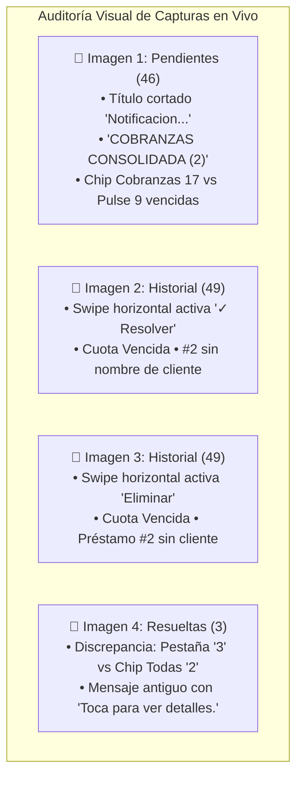
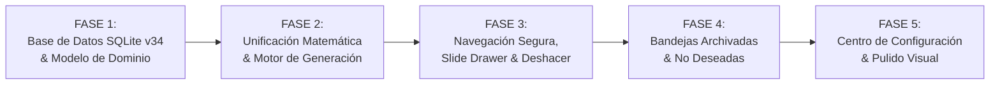

# PLAN MAESTRO DE REINGENIERÍA: NAVEGACIÓN SEGURA DE PESTAÑAS, BANDEJAS DE ARCHIVADO Y NO DESEADAS (SILENCIADAS), AUDITORÍA DE CONTADORES Y CENTRO DE CONFIGURACIÓN DE NOTIFICACIONES

**Documento:** `analisis_proyecto/PLAN_REINGENIERIA_NAVEGACION_ARCHIVO_NO_DESEADOS_Y_CONFIGURACION_NOTIFICACIONES.md`  
**Fecha:** Noviembre 2026  
**Versión:** 1.0 — Diagnóstico Forense en Código, Especificación de Arquitectura y Plan de Ejecución Definitivo  
**Estado:** Pendiente de Aprobación por el Usuario (Cero Código Modificado en esta Fase de Planificación)  
**Metodología:** Loop Autónomo con Árbitro Adversarial (Test-Driven, Cero Regresiones, 0ms SQLite, 320dp/360dp Ready, Cero Emojis en Código Dart)

---

## 1. RESUMEN EJECUTIVO Y DIAGNÓSTICO FORENSE DE LAS 4 CAPTURAS EN VIVO

El nuevo Centro de Notificaciones ha transformado la capacidad de respuesta operativa del comerciante. Sin embargo, las pruebas intensivas en campo evidenciaron colisiones gestuales críticas, inconsistencias matemáticas en los contadores y la necesidad de evolucionar el ciclo de vida de las alertas desde un borrado destructivo hacia un sistema profesional de resguardo (**Archivado**, **Silenciado/No Deseadas** y **Preferencias Personalizadas**).

### 1.1. Análisis Forense Detallado de las 4 Capturas de Pantalla



#### Captura 1 (`media_1794470972330_b4fd1172.jpg`):
1. **Truncamiento en AppBar:** El título superior dice `"Notificacion..."` en lugar de `"Notificaciones"`. La suma de anchuras del botón de retroceso + título a 22sp + `InfoTooltipButton` + botón de texto `[✓✓ Leídas]` satura la barra superior en pantallas compactas (360dp).
2. **Inconsistencia de Contadores en Cobranzas:**
   * La pestaña activa dice `Pendientes (46)`.
   * El chip de categoría dice `Cobranzas 17`.
   * Sin embargo, el Dashboard de Pulso indica `9 cuotas vencidas` (5 de Freddy + 4 de Jj en las tarjetas maestras).
   * **Diagnóstico en Código:** `Cobranzas 17` agrupa todas las alertas de cuotas (`objetoRelacionadoTipo == 'cuota'`), lo que incluye tanto cuotas críticas vencidas (9) como cuotas preventivas por vencer (8). Pero la interfaz no comunica esta distinción, provocando desconfianza matemática en el usuario.
3. **Falta de Concordancia Gramatical:** La cabecera dice `"COBRANZAS CONSOLIDADA (2)"` en singular, debiendo ser `"COBRANZAS CONSOLIDADAS (2)"`.

#### Capturas 2 y 3 (`media_1794470966425_573f3aec.jpg` y `media_1794470962522_9df7f8c0.jpg`):
1. **Peligro Crítico de Colisión Gestual (Swipe Tabs vs. Dismissible):**
   * Al intentar cambiar de pestaña arrastrando horizontalmente la pantalla (`Pendientes` <-> `Resueltas` <-> `Historial`), el dedo inevitablemente entra en contacto con una tarjeta.
   * `TabBarView` y `Dismissible` compiten por el mismo reconocedor de gestos (`HorizontalDragGestureRecognizer`). `Dismissible` captura el puntero de inmediato y, con un ligero desplazamiento, dispara:
     * Hacia la derecha: `prov.markAsResolved(notif.id)` (mostrado en verde con `✓ Resolver` en la `Imagen 2`).
     * Hacia la izquierda: `prov.deleteNotification(notif.id)` (mostrado en rojo con `Eliminar 🗑️` en la `Imagen 3`).
   * **Impacto Comercial:** Pérdida accidental de alertas financieras críticas y de inventario sin confirmación previa ni posibilidad de recuperación inmediata.
2. **Inconsistencia en el Naming de Tarjetas de Cuotas:**
   * En la `Imagen 2` y `3`, una tarjeta dice `"Cuota Vencida • Freddy"`, pero la contigua dice `"Cuota Vencida • Préstamo #2"` (omitiendo el nombre del cliente).
   * **Causa Raíz en Código (`notification_provider.dart:200-203`):**
     ```dart
     final String title = isLoan 
         ? 'Cuota Vencida • $folio' 
         : 'Cuota Vencida • ${row['nombre_completo']}';
     ```
     Al ser préstamo personal, se usaba `$folio` en vez de `nombre_completo`, ocultando la identidad del prestatario en la cabecera.

#### Captura 4 (`media_1794470957029_8c59a6f3.jpg`):
1. **Discrepancia Matemática Crítica en Resueltas (`Pestaña 3 vs Chip Todas 2`):**
   * La pestaña dice **`Resueltas 3`**.
   * Debajo, el chip de filtro dice **`Todas 2`** (`Cobranzas 1` + `Inventario 1` = 2).
   * **Hallazgo Forense Definitivo:**
     * En `NotificationProvider.dart:18`:
       `int get resolvedCount => _notifications.where((n) => n.isResolved).length;` (cuenta TODAS las notificaciones resueltas sin importar su nivel de prioridad o tipo).
     * En `client_service.dart:1644-1655`, al registrar un pago de cuota, el sistema inserta una notificación con:
       `tipo: 'exito', nivel_prioridad: 'informativa', is_resolved: 1`.
     * En `notifications_screen.dart:1184` y `1191`:
       `final resueltas = filteredNotifs.where((n) => n.isActionable && n.isResolved).toList();`
       Dado que `isActionable` exige `tipo == 'alerta'` o `nivelPrioridad == 'critica' / 'preventiva'`, la notificación de éxito queda filtrada de la lista y del chip `Todas` (quedando solo 2 alertas de acción), pero permanece sumada en el badge de la pestaña (3).
2. **Residuos de Textos Antiguos:** Las tarjetas antiguas en base de datos conservan la coletilla `"Toca para ver detalles."`, la cual quedó obsoleta tras incorporar los botones de acción integrados (*In-Card Actions*).

---

## 2. ARQUITECTURA DE SOLUCIÓN: COMPARATIVA DE PARADIGMAS

```mermaid
flowchart TD
    subgraph ANTES["❌ Paradigma Anterior (Frágil y Destructivo)"]
        A1["Usuario arrastra horizontalmente"] --> B1{"Dismissible captura gesto"}
        B1 -->|Derecha| C1["Resuelve notificación inmediatamente"]
        B1 -->|Izquierda| D1["DELETE permanente en SQLite"]
        D1 --> E1["Pérdida irreversible de cobranza"]
        F1["Badge Pestaña: isResolved"] vs1["≠"] F2["Chip Todas: isActionable && isResolved"]
    end

    subgraph DESPUES["✅ Nuevo Paradigma (Seguro, Profesional y No Destructivo)"]
        A2["Usuario arrastra horizontalmente"] --> B2["TabBarView navega suavemente entre pestañas"]
        B2 --> C2["Tarjetas seguras con botón '•••' o Slide-to-Reveal con tope estricto"]
        C2 --> D2["Acción principal: 📦 Archivar (con SnackBar Deshacer)"]
        C2 --> E2["Acción de resguardo: 🔕 No Deseada / Silenciar"]
        E2 --> F3["Regla activa en SQLite: mute_key impide generar nuevas alertas"]
        G1["Bandeja 📦 Archivadas"] <--> G2["Bandeja 🔕 No Deseadas"]
        H1["Contadores unificados: Base matemática compartida a 0ms"]
    end
```

---

## 3. ESPECIFICACIÓN DEL MODELO DE DATOS Y PERSISTENCIA (SQLITE V34)

La base de datos actual se encuentra en **v33** (`local_db.dart:34`). La nueva evolución se implementará bajo la **migración v34** con funciones de creación e indexación 100% idempotentes.

### 3.1. Nuevas Columnas en la Tabla `notificaciones`
* `is_archived INTEGER DEFAULT 0`: Bandera de archivado (0 = activa, 1 = archivada).
* `fecha_archivado TEXT`: Timestamp ISO8601 del archivado.
* `is_silenced INTEGER DEFAULT 0`: Bandera de silenciamiento (0 = normal, 1 = no deseada).
* `fecha_silenciado TEXT`: Timestamp ISO8601 del silenciamiento.
* `mute_key TEXT`: Identificador compuesto de silenciamiento (ej. `cuota_14`, `producto_5`, `prestamo_2`).

### 3.2. Nueva Tabla: `notificaciones_silenciadas` (Reglas de Bloqueo Inteligente)
Garantiza que el motor en segundo plano (`generateAutoNotifications`) no vuelva a regenerar alertas del ítem silenciado.

```sql
CREATE TABLE IF NOT EXISTS notificaciones_silenciadas (
  id INTEGER PRIMARY KEY AUTOINCREMENT,
  negocio_id INTEGER NOT NULL,
  mute_key TEXT NOT NULL UNIQUE,
  objeto_tipo TEXT NOT NULL,
  objeto_id INTEGER NOT NULL,
  motivo TEXT,
  fecha_silenciado TEXT NOT NULL,
  FOREIGN KEY (negocio_id) REFERENCES negocios (id) ON DELETE CASCADE
);
CREATE INDEX IF NOT EXISTS idx_silenciadas_negocio ON notificaciones_silenciadas(negocio_id, mute_key);
```

### 3.3. Nueva Tabla: `preferencias_notificaciones`
Persistencia local desacoplada por negocio para el control granular de canales y umbrales.

```sql
CREATE TABLE IF NOT EXISTS preferencias_notificaciones (
  id INTEGER PRIMARY KEY AUTOINCREMENT,
  negocio_id INTEGER NOT NULL UNIQUE,
  notif_cuotas_vencidas INTEGER DEFAULT 1,
  notif_cuotas_preventivas INTEGER DEFAULT 1,
  notif_recargos_mora INTEGER DEFAULT 1,
  notif_confirmacion_pagos INTEGER DEFAULT 1,
  notif_stock_agotado INTEGER DEFAULT 1,
  notif_stock_bajo INTEGER DEFAULT 1,
  notif_stock_compartido INTEGER DEFAULT 1,
  notif_cotizaciones_vencidas INTEGER DEFAULT 1,
  notif_metas_fidelizacion INTEGER DEFAULT 1,
  dias_anticipacion_cuotas INTEGER DEFAULT 1,
  prioridad_minima TEXT DEFAULT 'todas',
  activar_smart_grouping INTEGER DEFAULT 1,
  mostrar_pulse_dashboard INTEGER DEFAULT 1,
  comportamiento_swipe TEXT DEFAULT 'tab_navigation',
  updated_at TEXT NOT NULL,
  FOREIGN KEY (negocio_id) REFERENCES negocios (id) ON DELETE CASCADE
);
```

### 3.4. Script de Saneamiento y Limpieza de Textos Residuales
Se ejecutará dentro de `_onUpgrade` para v34:
```sql
UPDATE notificaciones 
SET mensaje = TRIM(
  REPLACE(
    REPLACE(
      REPLACE(mensaje, 'Toca para ver detalles o convertir en venta.', ''),
      'Toca para ver detalles o cerrar venta.', ''
    ),
    'Toca para ver detalles.', ''
  )
)
WHERE mensaje LIKE '%Toca para ver detalles%';
```

---

## 4. PLAN DE TRABAJO DETALLADO POR FASES DE IMPLEMENTACIÓN



---

### FASE 1: Evolución de Persistencia (SQLite v34), Migración y Modelo `NotificationModel`

#### 1.1. Modificación en `local_db.dart`
* Incrementar versión a `34`.
* Incorporar helpers idempotentes:
  * `ensureColumnExists(db, 'notificaciones', 'is_archived', 'INTEGER DEFAULT 0')`
  * `ensureColumnExists(db, 'notificaciones', 'fecha_archivado', 'TEXT')`
  * `ensureColumnExists(db, 'notificaciones', 'is_silenced', 'INTEGER DEFAULT 0')`
  * `ensureColumnExists(db, 'notificaciones', 'fecha_silenciado', 'TEXT')`
  * `ensureColumnExists(db, 'notificaciones', 'mute_key', 'TEXT')`
* Crear tablas `notificaciones_silenciadas` y `preferencias_notificaciones` con índices optimizados.
* Ejecutar la limpieza de mensajes residuales con `"Toca para ver detalles"`.

#### 1.2. Actualización de `notification_model.dart`
* Agregar campos tipados:
  * `final bool isArchived;`
  * `final DateTime? fechaArchivado;`
  * `final bool isSilenced;`
  * `final DateTime? fechaSilenciado;`
  * `final String? muteKey;`
* Actualizar `fromJson`, `toSqlite` y constructor inmutable con `copyWith`.
* Definir helpers para identificar la clave de silenciamiento automática:
  * Cuota: `cuota_${objetoRelacionadoId}`
  * Producto: `producto_${objetoRelacionadoId}`
  * Cotización: `cotizacion_${objetoRelacionadoId}`

---

### FASE 2: Auditoría Matemática, Unificación de Contadores y Reglas de Silenciamiento

#### 2.1. Refactorización en `notification_provider.dart`
* **Criterio Matemático Unificado:**
  * Todas las consultas del ciclo activo (`Pendientes`, `Resueltas`, `Historial`) excluirán registros donde `is_archived = 1` o `is_silenced = 1`.
  * La condición `isActionable` se estandariza para que la pestaña y los chips usen la misma definición exacta:
    * `pendingCount`: total de notificaciones activas no archivadas, no silenciadas, no resueltas que cumplen el filtro de visibilidad.
    * `resolvedCount`: total de notificaciones activas no archivadas, no silenciadas, resueltas que cumplen el filtro de visibilidad.
    * `totalHistoryCount`: total de notificaciones activas no archivadas y no silenciadas.
    * `archivedCount`: total con `is_archived = 1`.
    * `silencedCount`: total con `is_silenced = 1`.
* **Cálculo Reactivo de Chips de Categoría:**
  * `totalCount` del chip **`Todas`** coincidirá siempre con el conteo de la pestaña activa a `0ms`.
  * `totalCount == cobranzasCount + inventarioCount + cotizacionesCount + otrosCount`.
* **Motor Canónico con Filtro Anti-Regeneración de Silenciadas:**
  * `generateAutoNotifications` consultará la lista de `mute_key` activos en `notificaciones_silenciadas`.
  * Si una cuota, producto o cotización posee su `mute_key` silenciado, el motor **no insertará ni modificará** alertas para ese registro.
* **Corrección de Títulos de Cuotas de Préstamo (`notification_provider.dart:200`):**
  * Eliminar la condición discriminatoria y asegurar el nombre del cliente en todas las cuotas vencidas:
    `final String title = 'Cuota Vencida • ${row['nombre_completo']}';`
    (El subtítulo mantendrá el detalle de si es `Préstamo #X` o `Recibo #Y`).

---

### FASE 3: Reingeniería Gestual de Navegación, Menú de Acciones y Deshacer Inmediato

#### 3.1. Eliminación de la Colisión Gestual en `notifications_screen.dart`
* Desacoplar el deslizamiento horizontal de `Dismissible` del `TabBarView`:
  * En el modo por defecto (*Tab Navigation*), `TabBarView` opera libremente sin interceptores de arrastre horizontal que destruyan o resuelvan tarjetas por error.
  * La tarjeta incorporará un botón de acceso rápido **`•••`** (*Quick Actions*) en la esquina superior derecha de cada notificación.
  * Al tocar `•••`, se despliega un Action Sheet elegante con opciones claras:
    * `[📦 Archivar notificación]`
    * `[🔕 Silenciar alertas de este ítem]`
    * `[✓ Marcar como Resuelta / Pendiente]`
    * `[🗑️ Eliminar definitivamente]`
* Como alternativa configurable (según preferencia del usuario):
  * Selector en configuración: **Navegación horizontal de pestañas** vs. **Cajón de acciones en tarjeta (*Slide-to-Reveal*)**.
  * Si se activa *Slide-to-Reveal*, se empleará un drawer con límite de recorrido estricto (*hard stop*) que **jamás ejecuta una acción al soltar el dedo**, sino que únicamente expone los botones para toque explícito.

#### 3.2. Animaciones Suaves de Salida y Mecanismo `[↩️ Deshacer]`
* Implementar `AnimatedSize` y `FadeTransition` al retirar una notificación de la lista activa al archivarla o resolverla.
* Desplegar un `SnackBar` flotante con diseño profesional y acción directa:
  * *"Notificación archivada"* -> Botón **`[↩️ Deshacer]`**.
  * Al pulsar `Deshacer`, se revierte el estado en memoria y SQLite de inmediato a `0ms` sin recargar la pantalla.

---

### FASE 4: Bandejas Especializadas de `📦 Archivadas` y `🔕 No Deseadas (Silenciadas)`

#### 4.1. Vista / Bandeja de `📦 Notificaciones Archivadas`
* Pantalla/Modal dedicado accesible desde el AppBar (`Icon(Icons.inventory_2_outlined)`) y desde la Configuración.
* Listado cronológico de notificaciones con badge de categoría y fecha de archivado.
* Acciones directas por tarjeta:
  1. **`[📤 Desarchivar / Restaurar]`**: Retorna la notificación a la bandeja principal (`is_archived = 0`), reubicándola con animación y haciéndola visible en `Pendientes`, `Resueltas` o `Historial` según su estado.
  2. **`[🗑️ Eliminar definitivamente]`**: Diálogo de confirmación para borrado permanente físico en SQLite.
* Barra de búsqueda y filtro por categoría dentro de Archivadas.

#### 4.2. Vista / Bandeja de `🔕 Notificaciones No Deseadas / Silenciadas`
* Pantalla/Modal dedicado para auditoría y reactivación de alertas silenciadas.
* Despliega la entidad afectada (ej. *Cliente Freddy - Cuota #1*, *Producto Aceite*, etc.) y la fecha en que fue silenciada.
* Acciones directas:
  1. **`[🔔 Restaurar a lista principal y reactivar alertas]`**:
     * Elimina el registro de la tabla `notificaciones_silenciadas`.
     * Actualiza la notificación a `is_silenced = 0`.
     * Permite que el motor vuelva a vigilar el ítem y notificar cambios.
  2. **`[🗑️ Eliminar definitivamente]`**: Remueve el registro histórico.

---

### FASE 5: Centro de Configuración de Notificaciones (`⚙️ Preferencias`) y Pulido Visual

#### 5.1. Modal de Configuración Profesional (`NotificationSettingsModal`)
* Accesible mediante el icono **`⚙️`** en el AppBar de `Notificaciones`.
* Estructura organizada por secciones:
  1. **Canales y Categorías Activas (Switches independientes):**
     * Cobranzas: *Cuotas Vencidas (Mora)*, *Avisos Preventivos*, *Recargos de Morosidad*, *Confirmación de Abonos*.
     * Inventario: *Agotados (0 und.)*, *Stock Bajo Preventivo*, *Alertas de Stock Compartido*.
     * Ventas/Cotizaciones: *Cotizaciones por Vencer*, *Metas y Fidelización*.
  2. **Condiciones y Umbrales:**
     * Selector de Anticipación de Cuotas: *1 día antes*, *2 días antes*, *3 días antes*, *Solo el día de vencimiento*.
     * Selector de Prioridad Mínima Visible: *Mostrar todas*, *Solo Preventivas y Críticas*, *Solo Críticas*.
  3. **Comportamiento e Interacción:**
     * Switch: *Agrupación Inteligente por Cliente (Smart Grouping)*.
     * Switch: *Mostrar Dashboard de Pulso Ejecutivo en Pendientes*.
     * Selector de Modo de Deslizamiento (Swipe): *Cambiar de Pestañas* vs. *Cajón de Acciones en Tarjeta*.
  4. **Accesos a Bandejas de Resguardo:**
     * Acceso directo con contador a **`📦 Archivadas (N)`**.
     * Acceso directo con contador a **`🔕 No Deseadas / Silenciadas (M)`**.
* Guardado automático a 0ms en SQLite en `preferencias_notificaciones` con notificación reactiva al Provider.

#### 5.2. Pulido Visual y Correcciones de Texto
1. **AppBar sin Truncamiento:**
   * Rediseñar la distribución del AppBar:
     * Botón de retroceso estándar.
     * Título `Notificaciones` con `titleSpacing: 0`, tamaño 20sp y `fontWeight.w900`.
     * Acciones compactas: `InfoTooltipButton`, `IconButton(Icons.done_all_rounded, tooltip: 'Leídas')` y `IconButton(Icons.settings_outlined, tooltip: 'Configuración')`.
     * Resultado: Cero truncamiento (`Notificaciones` 100% visible sin puntos suspensivos en 320dp y 360dp).
2. **Corrección Gramatical:** Cambiar `"COBRANZAS CONSOLIDADA (2)"` por `"COBRANZAS CONSOLIDADAS (2)"`.
3. **Claridad en Dashboard de Pulso:** Indicar `9 cuotas vencidas • 8 por vencer` para que el comerciante comprenda de inmediato por qué el chip de Cobranzas suma 17.

---

## 5. PROTOCOLO DEL ÁRBITRO INTERNO ADVERSARIAL

Antes de entregar la implementación final al usuario, el Árbitro Interno validará de forma estricta los siguientes puntos de prueba:

* [ ] **Prueba Anticolisión Gestual:** Arrastrar horizontalmente sobre tarjetas en `Pendientes`, `Resueltas` e `Historial`. Verificar que cambia de pestaña limpiamente sin borrar ni resolver ninguna notificación por accidente.
* [ ] **Prueba de Acción '•••' y Deshacer:** Archivar una notificación crítica desde el menú de acciones. Comprobar animación suave de salida, aparición del SnackBar y reversión instantánea al presionar `[↩️ Deshacer]`.
* [ ] **Prueba de Consistencia Matemática:** Verificar en todas las pestañas que `Badge Pestaña == Chip Todas == Cobranzas + Inventario + Cotizaciones`.
* [ ] **Prueba de Silenciamiento Inteligente:** Mover una notificación a `🔕 No Deseadas`. Ejecutar `generateAutoNotifications` y verificar que el ítem silenciado no reaparece ni se duplica en la lista principal.
* [ ] **Prueba de Reactivación:** Ir a la bandeja de `🔕 No Deseadas`, pulsar `[🔔 Restaurar a lista principal]` y confirmar que vuelve a la lista activa y sus alertas vuelven a monitorearse.
* [ ] **Prueba de Configuración Granular:** Apagar el switch de *Stock Bajo Preventivo* y verificar que las alertas preventivas de inventario desaparecen de la vista inmediatamente sin afectar las críticas de stock agotado.
* [ ] **Prueba Visual en 360dp:** Comprobar que el título `Notificaciones` se muestra íntegro, el header dice `COBRANZAS CONSOLIDADAS (2)` y ninguna cuota de préstamo omite el nombre del cliente.

---

## 6. PRÓXIMO PASO Y ORDEN DE EJECUCIÓN

Este documento formaliza la arquitectura técnica requerida para solventar de raíz los problemas identificados.  
**No se ha modificado ningún archivo de código fuente**. Quedo a la espera de tu revisión y confirmación para proceder con la ejecución secuencial de las 5 Fases.

