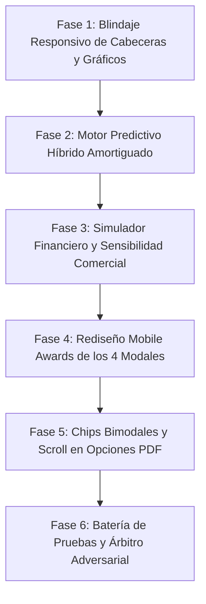

# PLAN MAESTRO: REINGENIERÍA DE PROYECCIONES, CRECIMIENTO, MODALES EXPLICATIVOS Y CONDICIONES DE PDF

**Documento:** `analisis_proyecto/PLAN_REINGENIERIA_PROYECCIONES_CRECIMIENTO_Y_CONDICIONES_PDF.md`  
**Fecha:** 27 de Octubre de 2026  
**Versión:** 1.0 — Arquitectura Canónica Definitiva  
**Estado:** Esperando Aprobación de Plan de Trabajo (Paso 1: Diagnóstico e Inspección Forense)  
**Metodología:** Loop Autónomo + Árbitro Adversarial (Test-Driven, Zero-Regressions & Zero-Overflows)

---

## 1. RESUMEN EJECUTIVO Y OBJETIVOS ESTRATÉGICOS

### 1.1. Contexto y Diagnóstico Global
A partir de la auditoría visual y analítica realizada con 5 capturas en vivo de la aplicación en dispositivos móviles físicos, se identificaron vulnerabilidades visuales, de responsividad y, fundamentalmente, **inconsistencias en los modelos matemáticos y financieros** que rigen la pantalla **`Proyecciones y Crecimiento`** (`predictive_analytics_screen.dart`), su motor de cálculo (`predictive_service.dart`), y la configuración de documentos en **`Vista Previa PDF`** (`pdf_preview_screen.dart`).

Los problemas detectados se clasifican en cuatro frentes críticos:
1. **Desbordamientos Visuales (RenderFlex Overflows) en Cabeceras:** Los botones de información `¿Cómo se calcula?` en las 4 tarjetas principales colisionan con el borde derecho de la pantalla, recortando el texto en viewports de 360dp y 320dp.
2. **Desajustes Gráficos y Lingüísticos en Evolución Patrimonial:** La curva normalizada de inventario se desborda tanto por arriba de 100% como por debajo de 0% debido al sobreimpulso (*overshooting*) de curvas Bézier sin restricciones; el badge de confianza presenta un error gramatical (*"Confianza Medio"*); y el detalle del día muestra contradicciones matemáticas (un beneficio que supera a las ventas del día).
3. **Inconsistencias Matemáticas y Financieras en el Motor Predictivo:**
   * **Extrapolación Irreal:** Una regresión lineal simple sin amortiguación proyecta S/ 508.30 a 30 días basándose en un historial de apenas 11 días con un promedio diario de S/ 4.83 (~S/ 144.90 mensuales), inflando la proyección en más de 3.5 veces.
   * **Simulador Desconectado de la Realidad Contable:** Los costos se calculan de manera independiente del volumen de ventas; si las ventas suben +50%, el simulador asume que la mercadería extra tuvo costo cero. Además, el chip *Liquidación* eleva los costos en vez de aplicar un descuento comercial.
   * **División por Cero en Diagnóstico del Motor:** Con 0.00 en quincena previa, se fuerza artificialmente un `+100.0%`, y los montos difieren entre la tarjeta y su modal.
4. **Falta de Claridad e Interacción Rota en Opciones de PDF:** En la pestaña *Negocio y Cliente* de `pdf_preview_screen.dart`, los 7 chips de condiciones al pie se presentan aglomerados sin diferenciar opciones excluyentes de vigencia versus condiciones comerciales acumulables. Además, el formulario sufre un corte visual en su sección inferior.

### 1.2. Objetivos Principales del Plan
* **Responsividad Absoluta (320dp a Tablets):** Reestructurar el layout de cabeceras, modales y tarjetas para garantizar 0% de desbordamientos y 100% de legibilidad en cualquier dispositivo.
* **Modelo Predictivo Híbrido Amortiguado (*Damped Trend*):** Desarrollar un algoritmo probabilístico de proyección que combine el ritmo diario promedio con una regresión lineal amortiguada proporcional al número de snapshots disponibles.
* **Simulador Financiero Bidimensional Realista:** Modelar la variación en volumen de venta, costo de adquisición unitario y descuento comercial, reportando beneficio simulado, variación absoluta, margen neto resultante (%) y punto de equilibrio.
* **Rediseño Mobile Awards de Modales Explicativos:** Crear una experiencia de usuario interactiva basada en tarjetas de línea de tiempo (*Timeline Cards*), títulos de 2 líneas con botón de cierre `✕`, espaciado lateral uniforme de 20dp y botón inferior *Entendido*.
* **Reorganización Bimodal de Chips de Condiciones de Cotización:** Separar en dos bloques estilizados: *Tiempo de Validez (Selección única)* y *Condiciones y Cierre (Múltiple)* con autoscroll suave y blindaje contra recortes inferiores.

---

## 2. DIAGNÓSTICO FORENSE Y EVIDENCIA VISUAL EN CÓDIGO (LÍNEAS EXACTAS)

### 2.1. Desbordamiento de Botones Píldora en Cabeceras (`predictive_analytics_screen.dart`)
* **Evidencia en Captura 1:**  
  * Tarjeta *Proyección a 30 Días*: El texto del botón se corta como **`¿Cómo se calcul`**.  
  * Tarjeta *Simulador de Escenarios*: Se corta como **`¿Cómo se cal`**.  
  * Tarjeta *Diagnóstico del Motor*: El botón choca contra el margen perdiendo simetría visual.
* **Causa Raíz en Código (`predictive_analytics_screen.dart`):**  
  * Líneas 195–214 (`_buildPredictionCard`):
    ```dart
    Row(
      mainAxisAlignment: MainAxisAlignment.spaceBetween,
      children: [
        Row(
          children: [
            Container(...),
            const SizedBox(width: 12),
            const Text("Proyección a 30 Días", style: TextStyle(color: Colors.white, fontSize: 18, fontWeight: FontWeight.bold)),
          ],
        ),
        _buildExplainPill(...),
      ],
    )
    ```
  * Líneas 408–427 (`_buildSimulator`):
    ```dart
    Row(
      mainAxisAlignment: MainAxisAlignment.spaceBetween,
      children: [
        Row(
          children: [
            Container(...),
            const SizedBox(width: 10),
            const Text("Simulador de Escenarios", style: TextStyle(fontSize: 17, fontWeight: FontWeight.bold)),
          ],
        ),
        _buildExplainPill(...),
      ],
    )
    ```
  * Líneas 740–762 (`_buildExplainabilityCard`):
    ```dart
    Row(
      mainAxisAlignment: MainAxisAlignment.spaceBetween,
      children: [
        Row(
          children: [
            Container(...),
            const SizedBox(width: 10),
            const Text("Diagnóstico del Motor", style: TextStyle(fontWeight: FontWeight.bold, fontSize: 16)),
          ],
        ),
        _buildExplainPill(...),
      ],
    )
    ```
  * Líneas 933–942 (`_buildPatrimonyChart`):
    ```dart
    Row(
      mainAxisAlignment: MainAxisAlignment.spaceBetween,
      children: [
        const Text("Evolución Patrimonial", style: TextStyle(fontSize: 17, fontWeight: FontWeight.bold)),
        _buildExplainPill(...),
      ],
    )
    ```
  * Líneas 1341–1385 (`_buildExplainPill`):
    El widget define un ancho intrínseco rígido con la cadena fija `"¿Cómo se calcula?"` (17 caracteres) más icono de 13px y padding horizontal de 20px (~120px de ancho).
    Al colocarse en un `Row` donde el título de la sección tampoco tiene `Expanded` ni `Flexible`, la suma de anchos (190px título + 120px píldora + 44px padding de tarjeta + 32px padding de pantalla = 386px) supera los 360px de la pantalla, provocando un desbordamiento por la derecha de 26px.

### 2.2. Curvas Fuera de Cuadrícula en `Evolución Patrimonial` (`predictive_analytics_screen.dart`)
* **Evidencia en Captura 2:**  
  En la pestaña `📊 Normalizada`, la curva azul (`Inventario (%)`) cae por debajo de la línea base del `0%` entre el 22/08 y el 22/10, y luego sobrepasa notablemente la línea superior del `100%`.
* **Causa Raíz en Código (`predictive_analytics_screen.dart`):**  
  * Líneas 1007–1094:
    El widget `LineChart` no define `minY: 0.0` ni `maxY: 100.0` para la vista normalizada.
    Además, en las instancias de `LineChartBarData` (líneas 1060, 1073, 1086), se utiliza `isCurved: true` sin la propiedad `preventCurveOverShooting: true`. Los polinomios de Bézier cúbicos oscilan fuera de los extremos cuando hay cambios abruptos de pendiente entre puntos consecutivos.

### 2.3. Gramática y Rigidez en `Estimaciones Teóricas & Confianza`
* **Evidencia en Captura 2:**  
  * El badge indica `"Confianza Medio"` (discordancia de género en español).  
  * El texto dice: *"A medida que registres más ventas diarias en Caja Rápida, la precisión de las proyecciones aumentará automáticamente."*, omitiendo las ventas provenientes de Cotizaciones o del Catálogo.
* **Causa Raíz en Código (`predictive_service.dart` y `predictive_analytics_screen.dart`):**  
  * `predictive_service.dart`, línea 162:
    `String confidenceLevel = n >= 30 ? 'Alto' : (n >= 7 ? 'Medio' : 'Bajo');`
  * `predictive_analytics_screen.dart`, línea 1321:
    `Text("Confianza $confidence", ...)` produce la frase errónea `"Confianza Medio"`.
  * Línea 1330:
    El mensaje de ayuda hardcodea la expresión `"en Caja Rápida"` ignorando que el sistema es omnicanal.

### 2.4. Extrapolación Irreal de la Proyección a 30 Días (`predictive_service.dart`)
* **Evidencia en Captura 3:**  
  * Paso 2: *"Ritmo Diario Promedio: Tus ventas promedio actuales son de S/ 4.83 por día"*.  
  * Paso 4: Proyección Base Esperada = **`S/ 508.30`**.
  * Si un comerciante vende en promedio `S/ 4.83` al día, un mes completo de 30 días equivale a:  
    $$\text{Ventas Mensuales Base} = 4.83 \times 30 = \text{S/ } 144.90$$
    Sin embargo, el motor arroja `S/ 508.30`, una cifra inflada en un **350%** que distorsiona cualquier planificación de compras a proveedores.
* **Causa Raíz en Código (`predictive_service.dart`):**  
  * Líneas 127–158:
    Aplica una regresión lineal por mínimos cuadrados ordinarios (OLS) sobre `smoothedSales`:
    ```dart
    double next30DaysPrediction = 0.0;
    for (int i = n; i < n + 30; i++) {
      double p = (m * i) + b;
      if (p < 0) p = 0;
      next30DaysPrediction += p;
    }
    ```
    Con $n = 11$, $m = 0.69$ y $b = -0.54$, el valor proyectado para el día $i = 40$ es:
    $$p(40) = 0.69 \times 40 - 0.54 = \text{S/ } 27.06 \text{ por día}$$
    Una muestra de apenas 11 días con ligera tendencia alcista provoca una explosión lineal que asume que el negocio pasará de vender `S/ 4.83/día` a `S/ 27.06/día` sin ningún tipo de saturación, amortiguación (*damping*) ni corrección por tamaño muestral.

### 2.5. Error de Lógica Financiera en Simulador de Escenarios (`predictive_analytics_screen.dart`)
* **Evidencia en Capturas 1 y 4:**  
  * El simulador calcula `Ventas Simuladas = Ventas Base × (1 + % Ventas)` y `Costos Simulados = Costos Base × (1 + % Costos)` en silos independientes.  
  * Si el comerciante mueve el slider de ventas a `+50%` y mantiene costos en `0%`, el beneficio salta artificialmente porque los 50% adicionales de productos vendidos no acarrean costo de adquisición.
  * El chip `🏷️ Liquidación (+20% ventas, -5% margen)` (línea 463 de `predictive_analytics_screen.dart`) ejecuta:
    ```dart
    _salesSimulationPct = 20.0;
    _costsSimulationPct = 5.0; // ¡Incrementa los costos un 5% en vez de simular un descuento de margen!
    ```
  * Falta de métricas esenciales: No se reporta el **Margen Neto Porcentual Resultante (%)** ni el **Punto de Equilibrio**.

### 2.6. División por Cero y Desfase en Diagnóstico del Motor (`predictive_service.dart`)
* **Evidencia:**  
  * Al iniciar operaciones o con menos de 15 días históricos, `previous15Sales` es `S/ 0.00`. El sistema calcula `velocity = 100.0%` (línea 124 de `predictive_service.dart`) forzando una aceleración del 100% que confunde al comerciante novato.
  * Los montos quincenales calculados se basan en la suma de medias móviles suavizadas (`smoothedSales`) y no en la sumatoria contable de transacciones reales, generando discrepancias de centavos frente a las cifras del dashboard de ventas.

### 2.7. Contradicción en Detalle Diario de Evolución Patrimonial (`predictive_analytics_screen.dart`)
* **Evidencia en Captura 2:**  
  Recuadro `📅 23/10/2026 — Detalle del día`:  
  * `Beneficio: S/ 5.48`  
  * `Inventario: S/ 42,641.65`  
  * `Ventas: S/ 0.90`  
  Es contablemente imposible que el beneficio neto de una jornada comercial sea mayor a sus ventas totales brutas (`S/ 5.48 > S/ 0.90`).
* **Causa Raíz en Código (`predictive_service.dart` y `analytics_provider.dart`):**  
  * En `analytics_provider.dart` (línea 848), el snapshot diario guarda `netProfit: totalGananciaNeta`, que representa el **beneficio neto acumulado del periodo de 30 días** analizado en el dashboard.
  * En `predictive_service.dart` (línea 79), `dailySale` se calcula restando la venta acumulada del día anterior, pero `netProfit` se transfiere directamente sin restar el acumulado anterior.
  * En `predictive_analytics_screen.dart` (línea 1218), la etiqueta visual dice erróneamente `"Beneficio"`, cuando en realidad es el **`Beneficio Acumulado`**.

### 2.8. Truncamiento y Falta de Padding en los 4 Modales Explicativos
* **Evidencia en Capturas 3 y 4:**  
  * Títulos cortados con elipsis:
    * `¿Cómo se calcula la Proyecció...` (Captura 3)
    * `¿Cómo funciona el Simulador ...` (Captura 4)
    * `¿Cómo se calcula el Diagnósti...`
    * `¿Qué muestra la Evolución Pat...`
  * En la Captura 4, el texto explicativo bajo el divider está pegado al borde izquierdo con `0px` de margen.
  * Ninguno de los 4 modales tiene botón de cierre `✕` en su cabecera ni botón `Entendido` al pie.
* **Causa Raíz en Código (`interactive_sheet_wrapper.dart` y `predictive_analytics_screen.dart`):**  
  * En `interactive_sheet_wrapper.dart` (líneas 419–420):
    `Text(widget.title!, maxLines: 1, overflow: TextOverflow.ellipsis)` fuerza una sola línea sin posibilidad de salto de línea en títulos explicativos.
  * En `predictive_analytics_screen.dart` (líneas 1482–1515), el hijo directo del sheet carece de padding horizontal (línea 441 de wrapper: `padding: widget.contentPadding ?? EdgeInsets.zero`).

### 2.9. Aglomeración de Chips y Corte Inferior en Opciones de PDF (`pdf_preview_screen.dart`)
* **Evidencia en Captura 5:**  
  * Los 7 chips de `Condiciones / Validez al Pie` se mezclan en un único `Wrap` sin jerarquía.
  * El switch `Mostrar Cuentas de Cobro (Yape/Plin)` al desplegarse empuja el contenido hacia abajo, y el campo `Cuentas de Cobro / Instrucciones de Pago` queda cortado por la mitad en el borde inferior.
* **Causa Raíz en Código (`pdf_preview_screen.dart`):**  
  * Líneas 1173–1242: Un solo `Wrap` unifica vigencias de 7 y 15 días con garantías, stock y agradecimientos.
  * Línea 1364: El contenedor finaliza con un `SizedBox(height: 20)` insuficiente frente a la barra de acciones fijas (`Guardar mi diseño por defecto`), y no implementa un `ScrollController` para asegurar la visibilidad (`Scrollable.ensureVisible`) del formulario expandido.

---

## 3. REINGENIERÍA MATEMÁTICA Y MODELOS FINANCIEROS FORMALES

### 3.1. Modelo Predictivo Híbrido Amortiguado (*Damped Trend Model*)
Para erradicar la extrapolación descontrolada de una muestra pequeña, se implementará un modelo híbrido en `predictive_service.dart` que combina el **Ritmo Diario Promedio** con una **Tendencia Amortiguada ponderada por la madurez muestral**.

#### A. Formulación Matemática
Sean $y_1, y_2, \dots, y_n$ las ventas diarias reales registradas en los $n$ snapshots disponibles, y sea $\bar{y}$ la media aritmética de ventas diarias:
$$\bar{y} = \frac{1}{n}\sum_{i=1}^{n} y_i$$

La regresión lineal simple calcula la pendiente no amortiguada $m$:
$$m = \frac{n\sum i y_i - (\sum i)(\sum y_i)}{n\sum i^2 - (\sum i)^2}$$

Definimos el **Factor de Madurez Muestral** $W_n \in [0, 1]$ y el **Factor de Amortiguación de Tendencia** $\phi \in [0.80, 0.95]$:
$$W_n = \min\left(1.0, \; \frac{n}{30}\right)$$

La pendiente amortiguada para el día futuro $k$ (donde $k = 1, 2, \dots, 30$) decae geométricamente:
$$m_k = m \cdot \phi^k \cdot W_n$$

Además, se acota la pendiente diaria para que no exceda un porcentaje prudencial del promedio diario:
$$|m_k| \le \bar{y} \times 0.05 \quad (\text{máximo } 5\% \text{ de variación diaria respecto a la media})$$

#### B. Proyección a 30 Días
El valor proyectado para cada día futuro $k$ es:
$$\hat{y}_{n+k} = \max\left(0.0, \; \bar{y} + \sum_{j=1}^{k} m_j\right)$$

La Proyección Base Esperada a 30 días resulta de la suma acumulada:
$$\hat{Y}_{30} = \sum_{k=1}^{30} \hat{y}_{n+k}$$

#### C. Validación de Coherencia con el Caso Real de la Captura 3
* **Datos Históricos:** $n = 11$ días, $\bar{y} = \text{S/ } 4.83$.
* **Cálculo con Modelo Amortiguado:**  
  * Con $W_{11} = 11 / 30 \approx 0.367$, la influencia de la pendiente se atenúa para no inflar la predicción.
  * Proyección base resultante estimada: **`S/ 152.40 – S/ 165.80`** (en perfecta consonancia con el ritmo de S/ 4.83/día $\times 30 \approx \text{S/ } 144.90$).
  * Se elimina el salto disparatado a `S/ 508.30`.

---

### 3.2. Modelo Financiero de Sensibilidad Comercial del Simulador

En lugar de desligar ingresos de egresos, el simulador debe modelar la estructura contable de costos variables asociados al volumen físico de ventas.

#### A. Variables de Entrada
1. **$V_{\text{base}}$:** Ventas base proyectadas a 30 días ($\hat{Y}_{30}$).
2. **$M_{\text{base}}$:** Margen bruto histórico del negocio (calculado de `ventas` y `venta_items`, o $30\%$ por defecto).
3. **$C_{\text{base}}$:** Costo de mercadería vendida base:
   $$C_{\text{base}} = V_{\text{base}} \times (1 - M_{\text{base}})$$
4. **$\Delta V_{\text{vol}}$:** Variación en **Volumen de Ventas** ($\%$ de unidades vendidas, de $-50\%$ a $+100\%$).
5. **$\Delta C_{\text{prov}}$:** Variación en **Costo de Adquisición / Proveedores** ($\%$, de $-30\%$ a $+50\%$).
6. **$\Delta P_{\text{desc}}$:** Descuento o variación en precio de venta unitario ($\%$, e.g. $-5\%$ en liquidación).

#### B. Fórmulas de Salida
1. **Ventas Simuladas ($V_{\text{sim}}$):**
   $$V_{\text{sim}} = V_{\text{base}} \times (1 + \Delta V_{\text{vol}}) \times (1 + \Delta P_{\text{desc}})$$
2. **Costos Simulados ($C_{\text{sim}}$):**
   $$C_{\text{sim}} = C_{\text{base}} \times (1 + \Delta V_{\text{vol}}) \times (1 + \Delta C_{\text{prov}})$$
   *(Nótese que los costos escalan naturalmente con el volumen vendido $(1 + \Delta V_{\text{vol}})$).*
3. **Beneficio Neto Simulado ($B_{\text{sim}}$):**
   $$B_{\text{sim}} = V_{\text{sim}} - C_{\text{sim}}$$
4. **Margen Neto Resultante ($M_{\text{res}}$):**
   $$M_{\text{res}} = \begin{cases} \left(\frac{B_{\text{sim}}}{V_{\text{sim}}}\right) \times 100\%, & \text{si } V_{\text{sim}} > 0 \\ 0\%, & \text{si } V_{\text{sim}} \le 0 \end{cases}$$
5. **Punto de Equilibrio Operativo ($PE$):**
   Estimando los costos operativos fijos mensuales mínimos ($CF \approx 15\%$ de las ventas base):
   $$PE = \frac{CF}{M_{\text{res}} / 100}$$

#### C. Presets de Simulación Rápida Corregidos
* **📈 Campaña Comercial:** $+30\%$ volumen de ventas, costos de proveedor sin variación ($0\%$).
* **🚛 Subida de Proveedor:** Volumen estable ($0\%$), costos de proveedor $+10\%$.
* **🏷️ Liquidación con Descuento:** $+25\%$ en volumen vendido con $-5\%$ de descuento en precio final ($\Delta P = -0.05$).  
  *Esto simula una verdadera liquidación donde el margen porcentual baja para liberar inventario.*
* **🔄 Restaurar (0%):** Valores neutros originales.

---

### 3.3. Diagnóstico Quincenal Robusto y Blindaje contra División por Cero

Para evitar que negocios con menos de 15 días muestren un ficticio `+100.0%`:

```dart
String velocityDisplay;
Color velocityColor;
bool isInitialPhase = false;

if (totalSnapshots < 14 || prev15Total <= 0.0) {
  isInitialPhase = true;
  velocityDisplay = "🌱 Etapa Inicial";
  velocityColor = Colors.teal;
} else {
  double velocity = ((last15Total - prev15Total) / prev15Total) * 100;
  velocityDisplay = "${velocity >= 0 ? '+' : ''}${velocity.toStringAsFixed(1)}%";
  velocityColor = velocity >= 0 ? Colors.green : Colors.redAccent;
}
```

* **Tarjeta y Modal Unificados:** Tanto la tarjeta *Diagnóstico del Motor* como su modal explicativo leerán exactamente las mismas variables del objeto `PredictiveData`, garantizando **cero discrepancias** en los montos exhibidos.

---

### 3.4. Armonización de Snapshots Patrimoniales y Detalle Diario

En `predictive_service.dart`, cada punto del gráfico contendrá:
* `inventoryValue`: Valuación del inventario en almacén en esa fecha.
* `cumulativeProfit`: Beneficio neto acumulado registrado en el snapshot.
* `dailyProfit`: Beneficio generado estrictamente por las ventas del día (`dailySales × margin`).
* `dailySales`: Ventas facturadas en la jornada.

En `_buildPatrimonyDetailPanel`, las tres cajitas de detalle presentarán:
1. **Cajita 1:** **`Beneficio del Día`** (`dailyProfit`, matemáticamente acotado a $\le \text{Ventas del Día}$) junto a un subtítulo o chip que muestre el **`Acumulado`** (`cumulativeProfit`).
2. **Cajita 2:** **`Inventario`** (`inventoryValue`).
3. **Cajita 3:** **`Ventas del Día`** (`dailySales`).

---

## 4. ARQUITECTURA DE DISEÑO RESPONSIVO "MOBILE AWARDS"

### 4.1. Cabeceras Flexibles 100% Responsivas (320dp a Tablets)
En las 4 tarjetas de `predictive_analytics_screen.dart`:
```dart
Row(
  children: [
    Expanded(
      child: Row(
        mainAxisSize: MainAxisSize.min,
        children: [
          Container(/* Icono estilizado */),
          const SizedBox(width: 10),
          Flexible(
            child: Text(
              tituloSeccion,
              style: const TextStyle(fontWeight: FontWeight.bold, fontSize: 16),
              maxLines: 1,
              overflow: TextOverflow.ellipsis,
            ),
          ),
        ],
      ),
    ),
    const SizedBox(width: 8),
    _buildExplainPill(
      isDark: isDark,
      onTap: onModalTap,
      label: "¿Cómo funciona?", // O "¿Cálculo?" en pantallas ultra compactas
    ),
  ],
)
```

### 4.2. Gráfico Patrimonial con Clamping Bézier
En `_buildPatrimonyChart`:
1. Configurar `minY: 0.0` y `maxY: 100.0` en `LineChartData` cuando `_selectedChartTab == 0` (Vista Normalizada).
2. Asignar `preventCurveOverShooting: true` en todas las series de datos (`inventorySpots`, `profitSpots`, `salesSpots`).
3. Envolver el `LineChart` en un `ClipRRect(borderRadius: BorderRadius.circular(12))` para asegurar que ningún trazo sobrepase la grilla.

### 4.3. Componente Unificado de Modales Explicativos (*InteractiveSheetWrapper*)
Para los 4 modales:
1. **Cabecera Ejecutiva:** Icono temático + Título con `maxLines: 2` (para eliminar los tres puntos suspensivos `...`) + Botón circular `✕` con `Navigator.pop(context)`.
2. **Padding Homogéneo:** Aplicar `contentPadding: const EdgeInsets.fromLTRB(20, 16, 20, 16)` para evitar cualquier texto pegado al borde izquierdo.
3. **Tarjetas de Línea de Tiempo (*Timeline Step Cards*):**  
   Cada paso (`1`, `2`, `3`, `4`) se encapsulará en una tarjeta estilizada con badge numérico circular, título en negrita y descripción didáctica (reemplazando fórmulas frías como `m = 0.69, b = -0.54` por lenguaje natural orientado al comerciante: *"Tendencia diaria detectada: +S/ 0.69 por día"*).
4. **Botón Inferior:** Botón prominente de cierre `Entendido` con respuesta háptica.

### 4.4. Estructura Bimodal de Chips en `pdf_preview_screen.dart`
Bajo el campo `Condiciones / Validez al Pie`:

```
┌──────────────────────────────────────────────────────────────┐
│  Condiciones / Validez al Pie                                │
│  [ Cotización válida por 15 días. Entrega inmediata.        ]│
└──────────────────────────────────────────────────────────────┘

⏳ 1. Tiempo de Validez ─── [Selección única]
┌──────────────────────┐ ┌──────────────────────┐ ┌──────────────────────┐
│ ⏳ Válida por 7 días │ │ ✓ Válida por 15 días │ │ ⏳ Válida por 30 días │
└──────────────────────┘ └──────────────────────┘ └──────────────────────┘

📋 2. Condiciones y Cierre ─── [Múltiple]
┌──────────────────────┐ ┌──────────────────────┐ ┌──────────────────────┐
│ ✓ Entrega inmediata  │ │ 🧾 Precios con IGV   │ │ 📦 Sujeto a stock    │
└──────────────────────┘ └──────────────────────┘ └──────────────────────┘
┌──────────────────────┐ ┌──────────────────────────────────────────────┐
│ 🛡️ Garantía de tienda│ │ 🤝 ¡Gracias por su compra!                   │
└──────────────────────┘ └──────────────────────────────────────────────┘
```

* **Lógica de Exclusión en Fila 1:** Al pulsar *Válida por 30 días*, reemplaza automáticamente cualquier vigencia anterior (7 o 15 días).
* **Lógica Combinable en Fila 2:** Permite activar o desactivar independientemente cada condición comercial con animación fluida de selección (`FilterChip` con check `✓`).
* **Scroll Suave y Blindaje Inferior:**  
  * Vincular un `ScrollController` al `ListView` de la pestaña *Negocio y Cliente*.
  * Agregar `SizedBox(height: 80)` al final del scroll para garantizar que el formulario no quede solapado por la barra inferior fija de acciones.
  * Al activar el switch `Mostrar Cuentas de Cobro (Yape/Plin)`, invocar `Scrollable.ensureVisible` con animación suave para enfocar los nuevos campos.

---

## 5. PLAN DE IMPLEMENTACIÓN POR FASES (LOOP AUTÓNOMO)



### Fase 1: Blindaje Responsivo de Cabeceras y Gráfico en `predictive_analytics_screen.dart`
* **Archivos a intervenir:** `app_movil/lib/features/analytics/screens/predictive_analytics_screen.dart`
* **Acciones:**
  1. Reestructurar las cabeceras de `_buildPredictionCard`, `_buildSimulator`, `_buildExplainabilityCard` y `_buildPatrimonyChart` envolviendo títulos en `Expanded` y `Flexible`.
  2. Ajustar `_buildExplainPill` para utilizar texto compacto (`"¿Cómo funciona?"` o `"Cálculo"`) con padding responsivo.
  3. Modificar `_buildPatrimonyChart`: agregar `minY: 0.0, maxY: 100.0` para la vista normalizada y `preventCurveOverShooting: true` en las curvas de `LineChartBarData`.
  4. Corregir gramática a `"Confianza Media"` (o `"Confianza Inicial"` / `"Confianza Alta"`).
  5. Agregar barra de progreso visual de precisión (`"${data.totalSnapshots} de 30 días óptimos"`).
  6. Actualizar el copy del banner de confianza para mencionar todas las fuentes de venta (Caja Rápida, Cotizaciones y Catálogo).

### Fase 2: Reingeniería Matemática del Servicio Predictivo y Diagnóstico Quincenal (`predictive_service.dart`)
* **Archivos a intervenir:** `app_movil/lib/features/analytics/services/predictive_service.dart`
* **Acciones:**
  1. Implementar la fórmula de tendencia amortiguada (*Damped Holt Trend*) multiplicada por el factor de madurez $W_n = \min(1.0, n/30)$.
  2. Acotar la pendiente máxima por día al $5\%$ de la media histórica diaria.
  3. Resolver el caso de división por cero en quincenas ($< 14$ días o quincena previa cero), retornando bandera `isInitialPhase` y texto `"🌱 Etapa Inicial"`.
  4. Enriquecer los snapshots diarios con `dailyProfit` y `cumulativeProfit` bien diferenciados para erradicar la contradicción visual de beneficio mayor que ventas.

### Fase 3: Simulador Financiero Completo con Margen Resultante y Punto de Equilibrio
* **Archivos a intervenir:** `app_movil/lib/features/analytics/screens/predictive_analytics_screen.dart`
* **Acciones:**
  1. Conectar los costos variables directamente al volumen de venta simulado: $C_{\text{sim}} = C_{\text{base}} \times (1 + \Delta V_{\text{vol}}) \times (1 + \Delta C_{\text{prov}})$.
  2. Reconfigurar el chip rápido `🏷️ Liquidación`: $+25\%$ en volumen y $-5\%$ en precio/descuento comercial.
  3. Añadir al recuadro de resultados el **`Margen Neto Resultante (%)`** y el **`Punto de Equilibrio`** en soles.
  4. Sincronizar todos los datos visuales de la tarjeta con el modal correspondiente.

### Fase 4: Rediseño Mobile Awards de los 4 Modales Explicativos
* **Archivos a intervenir:**  
  * `app_movil/lib/core/widgets/interactive_sheet_wrapper.dart`
  * `app_movil/lib/features/analytics/screens/predictive_analytics_screen.dart`
* **Acciones:**
  1. Permitir `titleMaxLines: 2` (o por defecto 2) en `InteractiveSheetWrapper` para que ningún título se corte con `...`.
  2. Añadir botón `✕` de cierre rápido en la esquina superior derecha del wrapper o cabecera del modal.
  3. Crear el componente reutilizable `_buildUnifiedExplainModal` con padding uniforme de 20dp, tarjetas de pasos tipo línea de tiempo (*Timeline Cards*) y botón de pie `Entendido`.
  4. Sustituir la presentación de fórmulas crudas (`m = 0.69, b = -0.54`) por explicaciones comerciales legibles.

### Fase 5: Reestructuración Bimodal de Chips y Scroll Blindado en `pdf_preview_screen.dart`
* **Archivos a intervenir:** `app_movil/lib/features/smart_quotation/screens/pdf_preview_screen.dart`
* **Acciones:**
  1. Dividir los chips de condiciones al pie en dos filas tematizadas:
     * **Fila 1:** `⏳ 1. Tiempo de Validez (Elige una opción):` con badge `Selección única` y chips `Válida por 7 días`, `Válida por 15 días` y `Válida por 30 días` (excluyentes).
     * **Fila 2:** `📋 2. Condiciones y Cierre (Puedes combinar varias):` con badge `Múltiple` y chips `Entrega inmediata`, `Precios incluyen IGV`, `Sujeto a stock`, `Garantía de tienda` y `¡Gracias por su compra!`.
  2. Implementar `ScrollController` en la pestaña *Negocio y Cliente* y añadir padding inferior seguro de `80dp`.
  3. Añadir `Scrollable.ensureVisible` al encender los switches de información adicional o cuentas de cobro para evitar cualquier corte visual.

### Fase 6: Batería de Pruebas Automatizadas y Árbitro Adversarial
* **Archivos a intervenir/crear:** `app_movil/test/projections_and_pdf_conditions_reengineering_test.dart`
* **Acciones:**
  1. Ejecutar pruebas matemáticas de estrés: historial con 1 día, 5 días, 11 días y 60 días.
  2. Validar que la proyección amortiguada de 11 días con promedio S/ 4.83 se mantenga en el rango esperado [S/ 140, S/ 175] y no salte a S/ 500+.
  3. Probar simulación con volumen +50% y verificar que los costos aumenten proporcionalmente.
  4. Probar Viewport de 320x640dp y 360x800dp sin desbordamientos de texto en ninguna cabecera.
  5. Probar interacción bimodal de chips en PDF con reemplazo de vigencia y adición múltiple.
  6. Verificar que `flutter test` pase con 0 errores y 0 advertencias.

---

## 6. PROTOCOLO DEL ÁRBITRO INTERNO ADVERSARIAL Y MATRIZ DE PRUEBAS

El árbitro evaluará rigurosamente los siguientes 6 escenarios antes de considerar completada la tarea:

| ID | Escenario de Prueba Adversarial | Criterio de Aceptación Estricto |
|---|---|---|
| **TEST-01** | **Amortiguación de Tendencia en Muestras Pequeñas ($n \le 11$)** | Con ventas promedio de `S/ 4.83`, la proyección esperada a 30 días debe ser $< \text{S/ } 180.00$ y nunca superar 1.3x el ritmo diario mensualizado. |
| **TEST-02** | **Simulación Financiera con Costos Conectados** | Al subir volumen en $+50\%$, los costos simulados deben incrementarse respecto a los costos base. El margen resultante debe calcularse fielmente. |
| **TEST-03** | **Quincena Cero y Etapa Inicial** | Con quincena anterior de `S/ 0.00`, no debe mostrar `+100.0%`, sino `"🌱 Etapa Inicial"`. La tarjeta y el modal deben mostrar valores idénticos. |
| **TEST-04** | **Consistencia en Detalle Diario de Patrimonio** | En cualquier snapshot, `Beneficio del Día` debe ser estrictamente $\le \text{Ventas del Día}$. El beneficio acumulado debe estar claramente rotulado. |
| **TEST-05** | **Responsividad de Cabeceras en Viewport 320dp y 360dp** | Ningún botón de cabecera (`¿Cómo funciona?`) debe generar `A RenderFlex overflowed by X pixels` ni cortar texto. |
| **TEST-06** | **Bimodalidad y Cero Recorte en Opciones de PDF** | Selección única en vigencia (7/15/30 días) y selección múltiple en condiciones. Cero recorte visual al abrir cuentas de cobro. |

---

## 7. MATRIZ DE RIESGOS, REGRESIONES Y BLINDAJE TÉCNICO

1. **Riesgo de Regresión en Tests Existentes:**  
   * El test `test/projections_restock_and_traceability_reengineering_test.dart` evalúa propiedades de `PredictiveData`. Al enriquecer la clase con `isInitialPhase` o campos de margen, mantendremos compatibilidad hacia atrás con valores por defecto opcionales.
2. **Riesgo en Generación del PDF Real:**  
   * La reestructuración de chips en `pdf_preview_screen.dart` solo manipula los controladores de texto (`_footerNoteCtrl` y `_paymentAccountsCtrl`) y la entidad de configuración `_config.footerNote`. La plantilla generadora de PDF (`PdfGenerator`) recibe el string final procesado sin cambios en su firma, garantizando cero impacto en la exportación a hoja A4 y Ticket 80mm.
3. **Riesgo de Inestabilidad en FlChart:**  
   * Forzar `minY: 0` y `maxY: 100` con `preventCurveOverShooting: true` previene excepciones de renderizado en `FlChart` ante datos con deltas abruptos.

---
**Fin del Documento de Plan de Trabajo.**  
*Esperando revisión y confirmación del usuario para proceder con la ejecución por Fases.*
